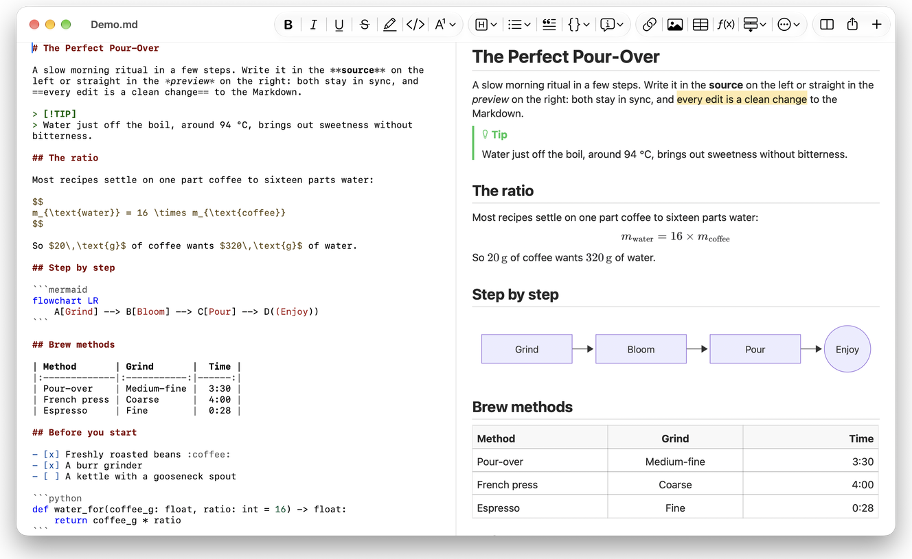
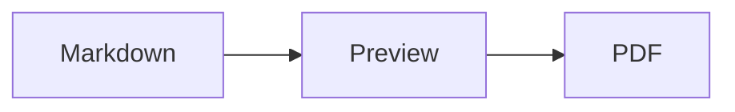

<p>&nbsp;&nbsp;&nbsp;</p>

# Splat

**The Markdown editor for macOS that lets you write in the source or straight in the preview.**

Splat puts your Markdown source with syntax colours on the left and a live, fully editable preview on the right. Type
in either one: whatever you write in the preview becomes a minimal change to the source, so lines you did not touch
stay byte-for-byte identical and your Git diffs stay clean. Splat reads the Markdown you already use: CommonMark and
GitHub Flavored Markdown, GitHub alerts, Obsidian wiki links, embeds and callouts, Pandoc and Typora extensions,
embedded HTML, LaTeX formulas, and Mermaid, Graphviz and PlantUML diagrams, all rendered offline. Export to PDF, HTML
or Word in one click. It is written in Rust on genuine AppKit controls, speaks 24 languages, and sends nothing over
the network unless you ask it to.
 


[](dist/Splat-1.0.2.dmg?raw=true)

**[Download Splat-1.0.2.dmg](dist/Splat-1.0.2.dmg?raw=true)**: signed and notarized by Apple, for macOS 14 or later on Apple Silicon.
 
 

[](https://www.rust-lang.org)
[](https://www.apple.com/macos/)

[](https://github.com/madsmtm/objc2)
[](https://webkit.org)
[](https://github.com/kivikakk/comrak)
[](https://github.github.com/gfm/)
[](https://www.mathjax.org)
[](https://cortexjs.io/mathlive/)
[](https://mermaid.js.org)
[](https://graphviz.org)
[](https://plantuml.com)


[](#license)

## Contents

- [Features at a glance](#features-at-a-glance)
- [Requirements](#requirements)
- [Installation](#installation)
- [Getting started](#getting-started)
- [Writing](#writing)
  - [In the source](#in-the-source)
  - [In the preview](#in-the-preview)
  - [Formatting commands](#formatting-commands)
  - [Lists and tasks](#lists-and-tasks)
  - [Tables](#tables)
- [Supported Markdown](#supported-markdown)
  - [CommonMark and GitHub Flavored Markdown](#commonmark-and-github-flavored-markdown)
  - [Callouts](#callouts)
  - [Extended syntax](#extended-syntax)
  - [Obsidian](#obsidian)
  - [Citations and references](#citations-and-references)
  - [Embedded HTML](#embedded-html)
  - [Typographic punctuation](#typographic-punctuation)
  - [Syntax overview](#syntax-overview)
- [Formulas](#formulas)
- [Diagrams](#diagrams)
- [Images](#images)
- [Links and navigation](#links-and-navigation)
- [Exporting, printing and sharing](#exporting-printing-and-sharing)
- [Appearance and accessibility](#appearance-and-accessibility)
- [Languages](#languages)
- [Keyboard shortcuts](#keyboard-shortcuts)
- [Privacy and security](#privacy-and-security)
- [Large documents](#large-documents)
- [Known limitations](#known-limitations)
- [Troubleshooting](#troubleshooting)
- [For developers](#for-developers)
  - [Building](#building)
  - [Distribution](#distribution)
  - [Testing](#testing)
  - [Project layout](#project-layout)
  - [Data flow](#data-flow)
  - [Rules in the controller](#rules-in-the-controller)
  - [Adding a command](#adding-a-command)
  - [Translations](#translations)
  - [Third-party components](#third-party-components)
- [License](#license)

## Features at a glance

- **Two ways to write, one text.** Source and preview are both editable. The Markdown file is the only truth: there is
  one undo history per document, and each preview edit is translated into the smallest change to the source.
- **The Markdown you already use.** CommonMark, GitHub Flavored Markdown, GitHub alerts, Obsidian, Pandoc and Typora
  extensions, emoji shortcodes, spoilers, definition lists, heading anchors and HTML as in GitHub READMEs.
- **Formulas and diagrams built in.** LaTeX formulas via MathJax, with a visual formula editor. Diagrams in Mermaid,
  Graphviz and PlantUML, rendered on your Mac without Java, a server or a network connection.
- **A button for everything.** Every Markdown construct has a toolbar button and a menu item, the common ones also a
  keyboard shortcut. Tables get their own menu for rows, columns and alignment.
- **Export without losing anything.** PDF, a single self-contained HTML file, or a Word document with real headings,
  lists, tables, footnotes and images.
- **Native to the bone.** Real AppKit windows, tabs, menus, popovers, Versions, Auto Save, the share menu, dark mode,
  spell checking, dictation and VoiceOver. No Electron, no web view for the text itself.
- **Fast with big files.** A keystroke in a 10 MB document takes about 25 ms.
- **Private and careful.** Images from the web load only after you allow them, links to other apps ask first, and
  everything that decodes untrusted image data runs in sandboxed helper processes.
- **In your language.** The interface and the built-in Markdown quick reference come in 24 languages.

## Requirements

- macOS 14 Sonoma or later. Splat is developed and tested on macOS 27, where it picks up the Liquid Glass design
  automatically.
- A Mac with Apple Silicon.
- About 30 MB of disk space.

## Installation

**From the disk image.** Download [`dist/Splat-1.0.2.dmg`](dist/Splat-1.0.2.dmg?raw=true), open it and drag Splat onto the Applications folder. The image is signed with a
Developer ID and notarized by Apple, so it opens without warnings.

**From source.** See [Building](#building) for the prerequisites, then:

```sh
make build
ditto target/release/Splat.app /Applications/Splat.app
open /Applications/Splat.app
```

To open Markdown files with Splat by double-click, select any `.md` file in the Finder, choose **File › Get Info**,
pick Splat under **Open with** and click **Change All…**. Splat registers itself for `.md`, `.markdown`, `.mdown` and
`.mkd` files.

## Getting started

### The window

Each document opens in its own window, or as a tab if you prefer tabs:

- **Left: the source.** Your Markdown in SF Mono with syntax colours.
- **Right: the preview.** The rendered document, ready to edit.
- **Outline sidebar (optional).** All headings as a tree; a click on one shows it in both panes. Toggle it with
  **View › Show Outline** (⌃⌘S).
- **Toolbar.** Buttons grouped by what they change: characters, paragraphs and inserted elements, then preview on/off,
  Share and New Document. Customize it with **View › Customize Toolbar…**.

Drag the divider to give either side more room. **View › Hide Preview** (⌥⌘P) leaves the source alone; Splat
remembers this per window. Both panes scroll together, and a selection in one pane is highlighted in the other.

### Documents, tabs and versions

Splat is a regular macOS document app:

- **Auto Save and Versions.** Changes are saved in place. **File › Revert To › Browse All Versions…** takes you back
  in time.
- **Changes from other programs.** When Git, a script or another editor changes an open document, Splat reloads it
  and keeps the caret and the scroll position. If you have unsaved changes of your own, Splat keeps them, and macOS
  asks before saving over the other version.
- **The usual file commands.** Duplicate (⇧⌘S), Rename…, Move To…, and **File › Open Recent**.
- **Tabs.** **File › New Tab** or the **+** button in the toolbar opens a new document as a tab; the standard Window
  menu merges, moves and cycles tabs.
- **Window placement.** The size and position of your last window are remembered, across restarts as well. If a window
  already stands there, the new one opens slightly offset.
- **The Dock icon.** A click on it after you closed the last window opens a new document.

Files must be UTF-8 text. Splat refuses other encodings rather than guessing and corrupting the text. A byte order
mark stays, and in a file whose lines all end in CRLF, the lines you add get CRLF as well.

**After a crash**, Splat writes the text of every open document to `~/Library/Application Support/Splat/Recovery`
before it quits, and on the next start it says so once, with a button that opens the folder.

### Quick reference

**Help › Markdown Quick Reference** opens a cheat sheet in your language as a new, untitled document. It is an
ordinary document, so try everything right there, in the source or in the preview.

## Writing

### In the source

The source is a plain-text editor tuned for Markdown:

- **Syntax colours** like in VS Code: headings, emphasis, links, code, tables, HTML, front matter, and LaTeX and
  Mermaid inside formulas and diagrams. There are palettes for light, dark and Increase Contrast.
- **Fenced code blocks** are highlighted for Bash, C, C++, C#, CSS (also SCSS and Less), Go, HTML, XML, Java,
  JavaScript, JSON, Kotlin, PHP, Python, Ruby, Rust, SQL, Swift, TypeScript, YAML, TeX and Mermaid, including their
  usual short names such as `js`, `py` or `sh`.
- **No surprise substitutions.** Smart quotes, smart dashes and text replacement are off by default, because they
  break `--`, `---` and `"`. Turn them on under **Edit › Substitutions**.
- **The system's writing tools.** Spell and grammar checking, dictation, Find and Replace (⌥⌘F), and Speech.
- **Drag and drop.** Drop an image file to insert ``, any other file to insert a link to it,
  and a URL to insert `[url](url)`. Each drop is one undo step.
- **Paste images.** A picture on the clipboard, such as a screenshot, is saved as a PNG file next to the document
  (`Image 2026-10-29 13.09.07.png`) and inserted as an image. The document needs to be saved once for this.

### In the preview

The preview behaves like a word processor, but everything you do in it ends up as Markdown:

- **Typing.** Characters that mean something in Markdown, such as `*` or `#`, are escaped so they appear as typed.
- **Return** starts a new paragraph or list item. **⌥Return** or **⌃Return** inserts a line break.
- **Formatting at the cursor.** With the cursor at the end of a word, Bold, Italic and the other character formats
  apply to what you type next. Choose the format again to stop it. Inside a word, the whole word is formatted.
- **Empty lines.** Return on an empty line adds another empty line, and Backspace removes it. In the source, each
  extra empty line is two more blank lines; other Markdown programs show them as normal paragraph spacing.
- **Undo** works across both panes. Undo items carry names ("Undo Bold"), typing is one step per burst, and after Undo
  and Redo both panes scroll to the change.
- **Formulas and diagrams** appear as finished graphics. Click one, move the cursor onto it or press Return on it to
  open its editor (see [Formulas](#formulas) and [Diagrams](#diagrams)).
- **Embedded HTML, embedded notes and front matter** are shown, but you edit them in the source. A click on them puts
  the cursor at the matching place there.

Anything Markdown cannot express is blocked in the preview: the Font and Colour panels, the ruler, and pasting or
dropping rich text and images. Pasted HTML and RTF arrive as plain text.

### Formatting commands

Every command is available from the toolbar, the menu bar and the context menu of both panes. Menu items show a
checkmark for the formatting at the cursor.

| Menu | Commands |
|---|---|
| **Format › Font** | Bold, Italic, Underline, Strikethrough, Highlight, Code, Superscript, Subscript |
| **Format › Heading** | Body Text, Heading 1 to 6 |
| **Format › List** | Bulleted List, Numbered List, Task List |
| **Format** | Quote, Code Block (No Language or one of 20 languages; also changes the language of an existing block), Callout (Note, Tip, Important, Warning, Caution; the same type again removes it), Edit Formula or Diagram…, Clear Formatting |
| **Insert** | Link…, Image…, Table…, Formula, Diagram (Flowchart, Sequence Diagram, Gantt Chart), Table of Contents, Footnote, Horizontal Rule |
| **Table** | Insert Row Above/Below, Insert Column Left/Right, Delete Row, Delete Column, Alignment (Left, Center, Right, Default), Align Table Columns |
| **View** | Hide/Show Preview, Show/Hide Outline, Typographic Punctuation, Zoom In/Out, Actual Size, toolbar, tab bar, full screen |

Underline, highlight, superscript and subscript are written as `<ins>`, `<mark>`, `<sup>` and `<sub>`, which GitHub
shows as well. Splat also reads `<u>`, which GitHub removes, and the shorter `==highlight==`, `^sup^` and `~sub~`.
GitHub shows `==` and `^` as typed and `~sub~` as strikethrough.

### Lists and tasks

- Return continues a list; Return on an empty item ends it.
- **Tab** and **⇧Tab** indent and outdent list items in the preview.
- A click on a task checkbox in the preview toggles `- [ ]` and `- [x]`.
- **Format › List** turns the selected paragraphs into a list or changes its kind.

### Tables

- **Insert › Table…** asks for the number of rows (including the header) and columns.
- In the preview, **Tab** moves to the next cell, **⇧Tab** to the previous one and **Return** to the cell below. Tab
  in the last cell adds a row.
- The **Table** menu inserts and deletes rows and columns and sets the alignment of a column (⌘{, ⌘|, ⌘}).
- **Table › Align Table Columns** pads the source so the columns line up.

## Supported Markdown

Splat parses with [comrak](https://github.com/kivikakk/comrak), a CommonMark and GFM-compatible parser, and turns on
most of its extensions. Everything below renders in the preview and in all exports.

### CommonMark and GitHub Flavored Markdown

- Headings (`#` and underlined), paragraphs, line breaks, emphasis, strong emphasis, inline code, block quotes,
  horizontal rules.
- Bulleted, numbered and nested lists; task lists.
- Links (inline, reference and automatic), images, link reference definitions.
- Fenced and indented code blocks with syntax colours.
- Tables with column alignment.
- Strikethrough with `~~two tildes~~`.
- Footnotes: `text[^1]` with `[^1]: The note.` anywhere in the document. A click on the marker jumps to the note.
- YAML front matter between `---` lines at the top. The preview sums it up in one line, such as
  "Metadata: title, date, tags".

### Callouts

GitHub alerts render as coloured boxes with icon and title:

```markdown
> [!NOTE]
> Useful information that users should know.

> [!WARNING]
> Critical content demanding immediate attention.
```

The five types are Note, Tip, Important, Warning and Caution. **Format › Callout** turns the paragraph at the cursor
into one.

Obsidian callouts work too, with any title and a fold state:

```markdown
> [!tip]- Click ▸ to expand
> Hidden until opened.

> [!question]+ Open by default
> A `+` starts expanded, a `-` collapsed.
```

Obsidian's other types are shown in the closest of the five colours: `success`, `check`, `done` and `hint` as Tip;
`question`, `help` and `faq` as Important; `attention` as Warning; `failure`, `fail`, `missing`, `danger`, `error` and
`bug` as Caution; everything else as Note.

### Extended syntax

| Feature | Syntax | From |
|---|---|---|
| Highlight | `==marked text==` | Obsidian, Typora |
| Superscript | `x^2^` | Pandoc, Typora |
| Subscript | `H~2~O` | Pandoc, Typora |
| Emoji shortcode | `:rocket:` becomes 🚀 | GitHub |
| Spoiler | `\|\|hidden text\|\|`, select it to read | Discord |
| Inline footnote | `text^[the note itself]` | Pandoc, Obsidian |
| Definition list | `Term`, blank line, `: Explanation` | PHP Markdown Extra, Pandoc |
| Heading anchor | `## Install {#setup}`, link with `[see](#setup)` | Pandoc, kramdown |

Definition lists look like this in the source:

```markdown
Term

: Explanation of the term.
```

Without a custom anchor, every heading gets one derived from its text, as on GitHub: `## Getting Started` is
reachable as `#getting-started`.

### Obsidian

- **Wiki links.** `[[Note]]` links to `Note.md` in the same folder or a folder below it. `[[Note|Shown text]]` shows
  your own text, and `[[Note#Heading]]` opens the note. ⌘-click opens it in Splat.
- **Embeds.** `![[Note]]` shows the other note inside this one; notes embedded in it appear as links.
  `![[diagram.png]]` shows an image. As in Obsidian, embeds name notes and images in the document's folder or below,
  never by an absolute path, and only Markdown files show as notes.
- **Comments.** `%%Only in the source%%` stays visible in the source and is left out of the preview and every export,
  inline as well as on lines of their own.
- **Tags.** `#idea` or `#project/splat` is highlighted. ⌘-click searches the document for the tag.
- **Foldable callouts.** See [Callouts](#callouts).

### Citations and references

- **Pandoc citations.** `[@doe2020]` or `[@doe2020; @roe2021]` reads like "(Doe 2020; Roe 2021)". The entries come
  from the BibTeX file that the front matter names as `bibliography: refs.bib`. Without it, Splat uses
  `references.bib`, `literatur.bib` or `bibliography.bib` next to the document.
- **GitHub and GitLab references.** If the document lies in a Git repository whose `origin` remote is on github.com
  or a GitLab host, `@name`, `#12` (issue) and `!7` (merge request, GitLab only) are highlighted. ⌘-click opens them
  in the browser.

### Embedded HTML

HTML as you find it in GitHub READMEs is rendered, with its own reader rather than a browser engine:

- centered paragraphs and blocks (`<p align="center">`, `<div align="center">`)
- images with a size (``)
- links, `<kbd>⌘</kbd>`, `<br>`, `<u>`, `<ins>`, `<mark>`, `<sup>`, `<sub>`
- lists and tables, including cells that span columns (`colspan`)
- collapsible sections: `<details><summary>More</summary>…</details>`, opened by a click on ▸

Markdown between HTML tags is rendered as Markdown. Scripts, styles, frames and forms are left out entirely, and links
and images keep only `http`, `https`, `mailto` and relative addresses.

### Typographic punctuation

**View › Typographic Punctuation** shows straight quotes as the quotation marks of your interface language, `--` as an
en dash, `---` as an em dash and `...` as an ellipsis. In German, `"Ja"` becomes „Ja“, in French «Oui». The source
keeps the plain characters; the preview and all exports show the typographic ones. The setting is off until you turn
it on.

### Syntax overview

| Element | Markdown |
|---|---|
| **Bold** | `**Bold**` |
| *Italic* | `*Italic*` |
| Underline | `<ins>Underline</ins>` or `<u>Underline</u>` |
| ~~Strikethrough~~ | `~~Strikethrough~~` |
| Highlight | `<mark>Highlight</mark>` or `==Highlight==` |
| `Code` | `` `Code` `` |
| x² | `x<sup>2</sup>` or `x^2^` |
| H₂O | `H<sub>2</sub>O` or `H~2~O` |
| [Link](https://example.com) | `[Link](https://example.com)` |
| Heading | `# Heading` to `###### Heading` |
| Quote | `> Quote` |
| Bulleted list | `- Item` |
| Numbered list | `1. Item` |
| Task | `- [ ] Open` and `- [x] Done` |
| Code block | ```` ```rust ```` … ```` ``` ```` |
| Table | `\| A \| B \|` with `\|---\|---\|` below the header |
| Footnote | `Text[^1]` and `[^1]: Note` |
| Horizontal rule | `---` |
| Image | `` |
| Formula | `$E = mc^2$`, `$$ … $$` |
| Diagram | ```` ```mermaid ````, ```` ```dot ````, ```` ```plantuml ```` |
| Callout | `> [!TIP]` |
| Wiki link | `[[Note]]`, `[[Note\|Text]]` |
| Embed | `![[Note]]`, `![[image.png]]` |
| Comment | `%%Comment%%` |
| Tag | `#tag` |
| Citation | `[@key]` |
| Spoiler | `\|\|Spoiler\|\|` |
| Emoji | `:tada:` |

## Formulas

Formulas are rendered by [MathJax](https://www.mathjax.org) with its TeX and AMS math, as crisp vector graphics.

| Kind | Syntax |
|---|---|
| Inline | `$E = mc^2$`, `` $`E = mc^2`$ `` (GitHub, GitLab), `\(E = mc^2\)` |
| Display | `$$` … `$$`, `\[` … `\]`, or a code block marked `math` |

**Editing a formula.** Click a formula in the preview, double-click it, press Return on it or move the cursor onto it
to open its editor in a popover. **Insert › Formula** inserts a new one and opens the editor right away.

- **Visual or LaTeX.** The switch at the top flips between a visual editor ([MathLive](https://cortexjs.io/mathlive/))
  and the LaTeX code. Splat remembers your choice.
- **Building blocks** for fraction, square root, superscript and subscript, sum and integral with limits, limit,
  brackets that grow with their content, 2×2 matrix, Greek letters, and relations, operators and arrows. They leave
  placeholders □, and **Tab** jumps to the next one.
- **Live preview.** Changes appear in the document while you type. Errors from MathJax show in a line below the code.
- **Commit or discard.** Clicking outside keeps the change as a single undo step; **Esc** or **Cancel** throws it
  away. Escaping a new, empty formula removes it again.
- The context menu offers **Edit Formula…** for the formula under the pointer.

VoiceOver reads a formula as its LaTeX code. Splat renders formulas, not complete LaTeX documents: there are no
packages, no TikZ and no `\documentclass`.

## Diagrams

Diagrams render inside Splat, offline and in a light and a dark variant.

| Engine | Code block | What it draws |
|---|---|---|
| [Mermaid](https://mermaid.js.org) | ```` ```mermaid ```` | flowcharts, sequence, class, state, entity relationship, Gantt, pie, mind maps, timelines and every other Mermaid type |
| [Graphviz](https://graphviz.org) | ```` ```dot ```` or ```` ```graphviz ```` | graphs in the DOT language |
| [PlantUML](https://plantuml.com) | ```` ```plantuml ```` or ```` ```puml ```` | UML diagrams; runs without Java |



**Editing a diagram** works like editing a formula: click it to open the code in a popover, with syntax colours and
error messages in a line below the code. **Insert › Diagram** starts from a template for a flowchart, a sequence
diagram or a Gantt chart. Building blocks help with the three most common Mermaid types:

- **Flowchart:** Node ▾ (rectangle, rounded, circle, diamond, database), Connection, Labeled connection, Group,
  Direction ▾
- **Sequence diagram:** Participant, Message, Reply, Note, Loop, Alternative paths
- **Gantt chart:** Section, Task, Milestone

Other diagram types are edited as code. VoiceOver reads a diagram's title or alternative text.

The first diagram after launch takes about a second, because the rendering engine starts in the background. A diagram
that takes longer than 10 seconds shows an error, and the rendering engine starts afresh for the next one.
PlantUML's engine (7 MB) loads only with the first PlantUML diagram. A PlantUML `!include` from the web is blocked.

## Images

- **Local images** use paths relative to the document: ``. Splat shows PNG, JPEG, GIF, WebP,
  BMP, SVG, HEIC, TIFF, AVIF and PDF.
- **Images from the web** stay blocked until you allow them: a bar above the preview explains that loading them tells
  their servers that and when you open the document. **Load Images** allows them for this document; Splat remembers
  the choice per file.
- **Size.** `` sizes an image; otherwise images fit the width of the preview.
- **Dark mode.** Images with a white background are slightly dimmed in the dark preview.
- **Pasting and dropping.** See [In the source](#in-the-source).

## Links and navigation

In the preview, a click places the cursor so you can edit the link text; **⌘-click** follows the link:

- `http`, `https` and `mailto` open in your browser or mail app.
- Markdown files open in Splat; other files and folders are revealed in the Finder.
- `#anchor` jumps to the heading in the document.
- Addresses that open another app, such as `slack://` or `vscode://`, ask first and show the full address and the app.
  **Cancel** is preselected.

**Insert › Table of Contents** inserts a linked list of all headings. With the cursor inside it, the same command
updates it. The outline sidebar (⌃⌘S) jumps to any heading in both panes.

## Exporting, printing and sharing

| Format | How | What you get |
|---|---|---|
| **PDF** | **File › Export as PDF…** or the Share menu | Paper-sized pages, always in the light appearance, formulas and diagrams as vector graphics. **File › Page Setup…** sets the paper. |
| **Print** | **File › Print…** (⌘P) | The same layout as the PDF. |
| **HTML** | **File › Export as HTML…** or the Share menu | One self-contained file: local images embedded, formulas and diagrams as sharp images, heading anchors so the table of contents works. No scripts. |
| **Word** | **File › Export as Word Document…** or the Share menu | A `.docx` with Word's heading styles, real lists and tables (including merged cells), footnotes as Word footnotes, embedded images, formulas and diagrams. |
| **Markdown** | The **Share** button in the toolbar | The document as a `.md` file for Mail, Messages, AirDrop and every other share service. |

The **File › Share** menu offers all of these in one place. Exports use the typographic punctuation setting and the
images you allowed from the web; images from the web stay links in HTML.

## Appearance and accessibility

- **Dark mode** follows the system. Formulas and diagrams are rendered for each appearance.
- **Increase Contrast** in System Settings switches the syntax colours to high-contrast palettes.
- **Zoom.** ⌘+, ⌘− and ⌘0 scale both panes.
- **Full screen, tabs and a customizable toolbar**, as in every Mac app.
- **VoiceOver.** The panes are labelled "Markdown source" and "Preview", formulas read as their code and diagrams as
  their title. Every command is reachable from the keyboard.

Splat has no settings window: the few options live where they apply, in **View** and **Edit › Substitutions**.

## Languages

The interface, the menus and the Markdown quick reference are translated into 24 languages:

Catalan, Croatian, Czech, Danish, Dutch, English, Finnish, French, German, Hungarian, Indonesian, Italian, Malay,
Norwegian, Polish, Portuguese (Brazil), Portuguese (Portugal), Romanian, Slovak, Slovenian, Spanish, Swedish, Turkish
and Vietnamese.

Splat follows the language order in **System Settings › General › Language & Region**; you can also pick a language
for Splat alone there under **Applications**. Without a translation for your language, it uses English. Menu terms
follow Apple's own translations, so Splat reads like the rest of your Mac.

## Keyboard shortcuts

| Action | Shortcut |
|---|---|
| Bold, Italic, Underline | ⌘B, ⌘I, ⌘U |
| Strikethrough | ⇧⌘X |
| Link… | ⌘K |
| Body text, Heading 1 to 6 | ⌥⌘0, ⌥⌘1 to ⌥⌘6 |
| Align table column left, center, right | ⌘{, ⌘\|, ⌘} |
| Hide or show the preview | ⌥⌘P |
| Show or hide the outline | ⌃⌘S |
| Zoom in, out, actual size | ⌘+, ⌘−, ⌘0 |
| New document, open, save, duplicate | ⌘N, ⌘O, ⌘S, ⇧⌘S |
| Page setup, print | ⇧⌘P, ⌘P |
| Find, find and replace | ⌘F, ⌥⌘F |
| Find next, previous; use selection; jump to selection | ⌘G, ⇧⌘G; ⌘E; ⌘J |
| Show spelling and grammar; check document | ⌘:, ⌘; |
| Paste and match style | ⌥⇧⌘V |
| Hide toolbar, show all tabs, full screen | ⌥⌘T, ⇧⌘\\, ⌃⌘F |
| Line break (preview) | ⌥Return or ⌃Return |
| Next cell / previous cell in a table (preview) | Tab / ⇧Tab |
| Indent / outdent a list item (preview) | Tab / ⇧Tab |
| Next placeholder in the formula editor | Tab |
| Close the formula or diagram editor without changes | Esc |
| Follow a link, tag or reference (preview) | ⌘-click |

Splat leaves Apple's standard shortcuts where they are.

## Privacy and security

A Markdown file can come from anyone, so Splat treats every document as untrusted.

- **No network by default.** Splat has no telemetry and no update check. Formulas and diagrams render locally; the web
  views that do it cannot reach the network.
- **Images from the web** load only after your permission, only over `https`, never from hosts in your local network,
  at most 10 MB each, and in a private session without cookies.
- **Isolated decoding.** Images and the graphics of formulas and diagrams are decoded in helper processes that close
  every file they inherited and lock themselves into a sandbox before reading the first byte: no file access, no
  network. They hand back only pixels or a PDF, and are stopped after 10 seconds. Apple's own image decoders only see
  HEIC, TIFF, AVIF and PDF, and only when the data really is that format; they run in Splat itself, outside the
  sandbox.
- **Local files** reach a document only by the path it names. Embeds show Markdown notes from the document's folder
  and below, and a missing picture is looked for only there. An image path elsewhere, absolute or starting with `~`,
  still loads, and HTML and Word exports embed it: look at the export of a document you did not write before you pass
  it on.
- **Links** never start a program by a click. Web and mail links open as usual; links to other apps ask first.
- **HTML in documents** is read by Splat's own parser. Scripts, styles, frames and forms never run.
- **Exports** carry no scripts. HTML pages keep only a fixed list of harmless tags and attributes, as GitHub does, plus
  a content security policy. Word files link only `http`, `https` and `mailto` addresses.
- **Code signing** with the Hardened Runtime. Splat runs without the App Sandbox so that it can show images next to
  your documents without asking for every folder; the isolation of all decoding offsets this.

## Large documents

Splat stays responsive with documents of several megabytes:

- The source uses TextKit 2, which lays out only the visible part.
- After a keystroke, only the affected paragraphs are parsed, coloured and laid out again. In a 10 MB document, a
  keystroke takes about 25 ms.
- Large previews render the visible part first and the rest while the app is idle. Blocks scrolled into view are
  rendered before they are drawn.
- Parsing for the preview runs in the background while you type in the source.

Documents with footnotes, inline footnotes or `%%` comment blocks are processed in full after each change, as are
changes to the front matter or close to link reference definitions: around 300 ms per keystroke at 10 MB. Memory grows
with the file, to roughly 115–160 MB for 1 MB of Markdown and 340–510 MB for 10 MB.

## Known limitations

- **Single tildes mean subscript.** `~text~` is subscript as in Pandoc; strikethrough needs `~~two~~`. GitHub also
  strikes through with one tilde.
- **Read-only in the preview:** embedded HTML, embedded notes and front matter are edited in the source.
- **Merged table cells** exist only in HTML tables, and only across columns (`colspan`, no `rowspan`). MultiMarkdown's
  table syntax for merged cells is not supported.
- **Bibliographies** are read from BibTeX only, not from CSL JSON or YAML.
- **References** need a repository on github.com or a GitLab host; `!7` exists only on GitLab.
- **Typographic punctuation:** a German closing single quote cannot be told apart from an apostrophe and is set as ’.
- **Formulas, not documents:** no LaTeX packages, TikZ or full documents.
- **The visual formula editor** writes LaTeX in MathLive's notation: spaces disappear (`E = mc^2` becomes `E=mc^2`),
  the rendering stays the same.
- **By design:** no line numbers, no settings window, no Help Book, not in the App Store.
- **Apple Silicon only.** There is no Intel build.

## Troubleshooting

**The recent documents list is empty after I rebuilt Splat.** macOS ties recent documents and folder permissions to
the app's code signature. Local builds are signed with the certificate "Splat Local Signing" in your login keychain,
so rebuilds keep both. If the certificate was deleted, the next build creates a new one and the lists start over once.

**The app from the disk image shows other recent documents than my own build.** The two carry different signatures,
so macOS keeps a separate list and separate folder permissions for each.

**HTML or other syntax shows as plain code.** An outdated copy of Splat may have opened the document. Quit it,
choose **File › Get Info** on the document in the Finder and check that **Open with** names the Splat in your
Applications folder.

**Images from the web do not appear.** Click **Load Images** in the bar above the preview. Only `https` images from
public hosts load.

**Pasting a screenshot asks me to save first.** Pasted images are stored as files next to the document, which needs a
place on disk. Save it, then paste again.

**"The file is not UTF-8 text."** Convert the file first, for example with
`iconv -f ISO-8859-1 -t UTF-8 old.md > new.md`.

**A formula or diagram shows an error.** Click it: the editor shows the message of MathJax, Mermaid, Graphviz or
PlantUML below the code.

## For developers

Splat is a Rust application that talks to AppKit and WebKit directly through
[objc2](https://github.com/madsmtm/objc2). There is no Swift, no Objective-C, no Xcode project and no Interface
Builder file.

### Building

Prerequisites:

- macOS with the Command Line Tools (`xcode-select --install`). Xcode is not needed; Splat builds without `actool`,
  `ibtool` and `metal`.
- Rust 1.99 (`brew install rust`). [rust-toolchain.toml](rust-toolchain.toml) names the exact version that CI uses;
  rustup installs it on its own, Homebrew's Rust ignores the file. Raising it there is how new compiler and clippy
  warnings reach the project.

The [Makefile](Makefile) holds short entry points; `make help` lists them all:

```sh
make build                  # target/release/Splat.app, same as cargo xtask bundle --release
make check                  # formatting, clippy without warnings, all tests, vendored libraries; what CI runs
make test                   # make check, then the self-test without a window
make test-gui               # self-tests with a window; they occupy the Mac for about four minutes
make test-long              # longer randomised search and the 10 MB partial-update check
make coverage               # line coverage of all tests and self-tests, with a floor per module
make coverage-library       # the same floors for the modules without a window, as in CI
make bench FILE=<file.md>   # timings for opening, typing and scrolling a large file
make release                # make test first, then the notarized disk image
```

The build logic itself lives in the Rust crate [xtask](xtask/src/main.rs):

```sh
cargo xtask bundle --release   # target/release/Splat.app, Hardened Runtime, signed with "Splat Local Signing"
cargo xtask bundle             # target/debug/Splat Debug.app, a separate app that never opens Markdown files
cargo xtask dmg                # dist/Splat-<version>.dmg for distribution, Developer ID, notarized
cargo xtask icon               # rebuild assets/AppIcon.icns and the README icon from assets/icon-1024.png
cargo xtask vendor check       # verify the bundled JavaScript against vendor.lock
cargo xtask vendor fetch       # download it again after changing a version in vendor.lock
```

`bundle` writes the `Info.plist`, copies the resources and localizations, and signs the app with the certificate
"Splat Local Signing". The first build creates that certificate in your login keychain, valid for 20 years. As long
as it stays, Splat keeps its recent documents and folder permissions across rebuilds; with an ad hoc signature, every
build would be a new app to macOS. Debug and self-test builds carry bundle IDs of their own (`local.splat.debug`,
`local.splat.selftest`) and do not register for Markdown files, so the Finder never opens a document in an outdated
build and they leave the settings of the normal app alone.

The version lives in [VERSION](VERSION) as `major.minor.build` and is the one the next build gets. Every release
build that succeeds (`make build`, `cargo xtask bundle --release`, `make release`) raises the build number by one;
debug and self-test builds leave it alone. Major and minor are raised by hand: set VERSION to, say, `1.1.0`, and the
next build gets exactly that.

### Distribution

`cargo xtask dmg` (or `make release`, which runs `make test` first) builds a release, signs it with your Developer ID,
packs it into a compressed, read-only disk image with a link to Applications, notarizes the image with Apple, staples
the ticket and checks the result with Gatekeeper. Only an image that passed every step becomes
`dist/Splat-<version>.dmg`, the copy that is committed: it replaces the previous image, the download links in this
README follow it, and the build number goes up. A failed run leaves `dist/`, the README and VERSION as they were.
Each release adds the full image, about 10 MB, to the repository history. It runs only when called, never as part of a normal build, and needs:

- a "Developer ID Application" certificate in the keychain
- a saved login for Apple's notary service with an app-specific password, created once with
  `xcrun notarytool store-credentials notary --apple-id <Apple ID> --team-id <team ID>`

If either is missing, `dmg` stops before building. On the first run, macOS asks whether Terminal may control the
Finder; without that permission, the disk image shows neither its background nor the icon arrangement.

The disk image runs on Apple Silicon only: Homebrew's Rust ships the standard library for the host processor alone.
The app in it carries a different signature from a local build, so macOS keeps separate recent documents and folder
permissions for the two.

### Testing

| Command | Checks |
|---|---|
| `cargo test --release` | unit, randomised and translation tests |
| `SPLAT_FUZZ_ROUNDS=20000 cargo test --release` | a longer randomised search; `SPLAT_FUZZ_SEED` varies the inputs |
| `SPLAT_I18N_ONLY=fr cargo test --release i18n` | one language, while others are incomplete |
| `cargo clippy --release --all-targets [--features selftest]` | lints, including the justification of every `unsafe` block |
| `cargo xtask vendor check` | the JavaScript libraries match `vendor.lock` byte for byte |
| `cargo xtask selftest probe` | without a window: formulas, diagrams, web images, blocked addresses, the defences of the web views |
| `cargo xtask selftest gui [--only "<check>"] [--scenarios]` | the running app, click by click. Opens a window and types into it; the Mac is busy for about four minutes. `--scenarios` runs only the second part, in about a minute and a half |
| `cargo xtask selftest resize` | widens the window after moving the divider: the source re-wraps while the window is resized. Takes about ten seconds |
| `cargo xtask selftest bench <file.md>` | timings for opening, typing and scrolling a large file |
| `cargo test --release -- --ignored partial_updates` | a keystroke in 10 MB: partial against full update, result and time |
| `cargo test --release --test decoder` | the decoder process decodes images and reaches neither files nor the network |
| `make coverage` | line coverage of `cargo test` and all self-tests, through [cargo-llvm-cov](https://github.com/taiki-e/cargo-llvm-cov) (`brew install cargo-llvm-cov llvm`); fails below the floors. Occupies the Mac for about five minutes |
| `make coverage-library` | the floors for `src/markdown/`, `src/preview/` and `i18n.rs`, measured by `cargo test` alone |

Unit tests sit next to the code they test. `tests/` holds what reaches the library from outside: the randomised tests
in `robustness.rs`, which share the generator in `src/fuzz.rs` with those of `sync.rs`, and the decoder test, which
starts the built program. Decisions in `src/editor/` that need no window live in free functions with tests of their
own, such as `preview_work` and `eager_blocks` in `update.rs` or `preview_change` in `editing.rs`. The window
self-test runs a second part after its main click-through, in `src/editor/selftest/scenarios.rs`: every formatting and
table command, the dialogs, link clicks, pasting, dropping, exports, a large change and the recovery after a crash.

Coverage has two floors: every module at least 80 % of its lines, all modules together at least 85 %. `make coverage`
measures `cargo test` together with the self-tests and fails below either; the floors and the few exceptions, such
as the panic hook in `main.rs` that runs only in a crash, are in [xtask](xtask/src/main.rs) next to their reasons.
Measured builds go to `target/coverage/`, so measuring code never reaches `target/release/` or a disk image. The
decoder helper opens its measurement file before it locks itself in, so it is measured as well.

CI ([.github/workflows/ci.yml](.github/workflows/ci.yml)) runs `make check` and `make coverage-library` on Apple
Silicon for every push to `main` and every pull request. The self-tests and the disk image stay on the developer's Mac: they need a screen and the
signing certificates in the keychain.

Self-test output goes to `target/selftest/`. The self-test builds a separate app (`target/release/Splat Selftest.app`,
bundle ID `local.splat.selftest`) and leaves the settings, recent documents and file associations of the normal app
untouched.

### Project layout

`src/lib.rs` makes everything that needs no window a library of its own, `splat`: `markdown/`, `preview/`,
`i18n.rs` and the test generator `fuzz.rs`. The app in `src/main.rs` builds on it.

- `src/markdown/`: the parser binding (comrak), syntax colours, and all commands as pure text edits (`Edit`). Also
  re-parsing after an edit (`incremental.rs`), the reader for embedded HTML (`markup.rs`), typography, tags,
  references and citations in running text (`typography.rs`), and the HTML and Word export (`html.rs`, `docx.rs`
  with `docx/html.rs`). No AppKit.
- `src/preview/`: the preview layout, embedded HTML in it (`layout/html.rs`), and the mapping between preview and
  source (`Bridge`, `Index`). No AppKit.
- `src/editor/`: the window. One `EditorController` object serves AppKit as delegate of both views; its work is split
  by responsibility:

| Module | Responsibility |
|---|---|
| `mod.rs` | class, state, delegate methods, `invalidate` |
| `actions.rs` | command registry: selector, title, shortcut, symbol, when the command applies |
| `editing.rs` | running and validating commands, typing in the preview |
| `update.rs` | parsing, colouring, updating the preview; after an edit only the affected paragraphs |
| `sync.rs` | text copy and block bookkeeping, without AppKit and with randomised tests |
| `progressive.rs` | rendering large previews step by step |
| `selection.rs`, `scroll.rs` | selection and scroll position of both panes in step |
| `atom.rs`, `atom_edit.rs` | the formula and diagram editor |
| `navigation.rs`, `links.rs` | links, wiki links, tags, task checkboxes, folding, footnotes |
| `env.rs` | what the preview reads from outside the text: typographic punctuation, the repository for `@name` and `#12`, the BibTeX file, embedded notes |
| `render.rs`, `images.rs`, `remote.rs`, `safe_image.rs` | preview text, local and remote images |
| `decoder.rs` | sandboxed helper processes that decode images and graphics |
| `export.rs`, `outline.rs` | HTML and Word export; the outline sidebar |
| `js.rs`, `mathfield.rs` | WebKit for MathJax, Mermaid, Graphviz, PlantUML and the visual formula editor |
| `window.rs`, `toolbar.rs`, `views.rs`, `dialogs.rs`, `style.rs` | window, toolbar, text views, dialogs, colours |

- `src/menu.rs`, `src/app.rs`, `src/document.rs`: menu bar, app delegate, document (`MDDocument`, an `NSDocument`
  subclass).
- `src/i18n.rs` with `resources/*.lproj`: 24 languages; the keys are the German texts.
- `src/large_alloc.rs`: large allocations come straight from the kernel and go back to it when freed, so memory
  returns after big edits.
- `resources/js/`: web pages and libraries; versions and checksums in [vendor.lock](vendor.lock).
- `xtask/`: bundling, signing, the disk image, the icon, vendoring and the self-test runner.

### Data flow

The source text in the left text view is the single source of truth.

1. Every character change there updates the text copy (`Snapshot`) in place, without reading the text again.
2. An update parses the copy, recolours the source only where colours changed, lays out the preview and replaces only
   the blocks whose content changed.
3. After an edit, only the affected paragraphs are parsed, coloured and laid out again, as long as their neighbours
   stay the same. Documents with footnotes (including `^[…]`) or `%%` comment blocks, changes to the front matter and
   changes near link reference definitions are processed in full.
4. HTML blocks that open `<details>` or `<div align>` and close it later affect the Markdown blocks in between; a
   reused block must have the same surroundings.
5. While you type in the source, parsing and layout run in the background. While you type in the preview, they run
   immediately, because the preview's cursor depends on the result.
6. Input in the preview is translated by `Bridge` into an edit of the source and takes the same path from there.

### Rules in the controller

1. The controller's own changes to the views run inside `silently()`; the delegate callbacks ignore them.
2. `state` is borrowed only to read and compute, never across a call that changes, lays out or scrolls a view.
3. Messages from outside (an image loaded, a formula rendered) arrive delayed through `images_changed`, never in the
   middle of an update.
4. Redrawing without a text change goes through `invalidate(reason)` only.
5. An `Rc<Snapshot>` is not held across a change of the source, or that change copies the whole text.
6. A new command needs an entry in `actions.rs`, a method in `mod.rs` and a branch in `editing::perform`.
7. Every `unsafe` block carries its justification as a `// SAFETY:` comment.

### Adding a command

The menu bar, the toolbar and the context menu all build their items from the registry in
[src/editor/actions.rs](src/editor/actions.rs), and menu validation reads there when a command applies and whether it
shows a checkmark. A new command needs:

1. a variant of `Action` with its `Spec`: selector, title, toolbar label, tooltip (starting with a verb, at most 75
   characters), shortcut, SF Symbol and when it applies
2. the method in `src/editor/mod.rs`
3. a branch in `editing::perform`
4. its texts in every `Localizable.strings`

The test `every_command_has_a_method_and_every_method_a_command` checks that registry and methods match. Apple's
standard shortcuts such as ⌘E, ⌘J, ⌘T, ⌘;, ⇧⌘C, ⌥⌘C, ⌥⌘V, ⇧⌘P, ⌥⌘T, ⌃⌘F and ⌘, stay untouched.

### Translations

Code uses the German text as key: `t("Fett")` looks it up at run time, `n("Fett")` marks a constant for later
lookup. Each `resources/<language>.lproj/` holds:

- `Localizable.strings`: every interface text, menu terms after Apple's own glossaries
- `InfoPlist.strings`: the names macOS shows for the app and its document type
- `QuickReference.md`: the Markdown quick reference

`cargo xtask bundle` lists every `.lproj` folder as a localization, and `CFBundleDevelopmentRegion` is English, so
the system menus and the save dialog follow the same language. The i18n test checks that every language has every
text and that every quick reference has the outline of the German one.

### Third-party components

| Component | Version | Used for | License |
|---|---|---|---|
| [comrak](https://github.com/kivikakk/comrak) | 0.59 | Markdown parser | BSD-2-Clause |
| [objc2](https://github.com/madsmtm/objc2), objc2-foundation, block2 | 0.6 / 0.3 | Objective-C runtime, Foundation, blocks | MIT |
| objc2-app-kit, objc2-web-kit, dispatch2 | 0.3 | AppKit, WebKit and Grand Central Dispatch bindings | Zlib, Apache-2.0 or MIT |
| [svg2pdf](https://github.com/typst/svg2pdf) | 0.13 | formulas and SVG images as vector PDF | MIT or Apache-2.0 |
| [image](https://github.com/image-rs/image) | 0.25 | decoding PNG, JPEG, GIF, WebP and BMP | MIT or Apache-2.0 |
| [unicode-width](https://github.com/unicode-rs/unicode-width) | 0.2 | aligning table columns | MIT or Apache-2.0 |
| [MathJax](https://www.mathjax.org) | 3.2.2 | rendering formulas | Apache-2.0 |
| [MathLive](https://cortexjs.io/mathlive/) | 0.111.1 | visual formula editor, with KaTeX fonts | MIT |
| [Mermaid](https://mermaid.js.org) | 12.2.0 | Mermaid diagrams | MIT |
| [Viz.js](https://github.com/mdaines/viz-js) | 3.24.0 | Graphviz compiled to WebAssembly, contains Graphviz (EPL-1.0) and Expat (MIT) | MIT |
| [PlantUML](https://github.com/plantuml/plantuml) (`@plantuml/core`) | 1.2026.6 | PlantUML diagrams, compiled to JavaScript | MIT |

The JavaScript libraries are stored in `resources/js/` exactly as published; [vendor.lock](vendor.lock) records their
sources and SHA-256 checksums. Their license texts, including those of Graphviz and Expat inside Viz.js, are next to
them as `resources/js/LICENSE-*` and ship inside the app.

## License

Splat is licensed under either of

- Apache License, Version 2.0 ([LICENSE-APACHE](LICENSE-APACHE))
- MIT License ([LICENSE-MIT](LICENSE-MIT))

at your option.

Unless you explicitly state otherwise, any contribution intentionally submitted for inclusion in Splat by you, as
defined in the Apache-2.0 license, shall be dual licensed as above, without any additional terms or conditions.
