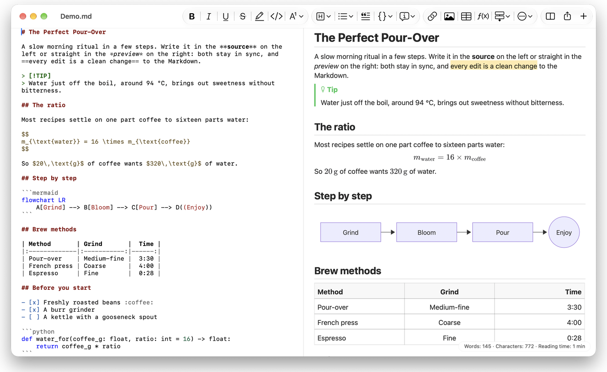
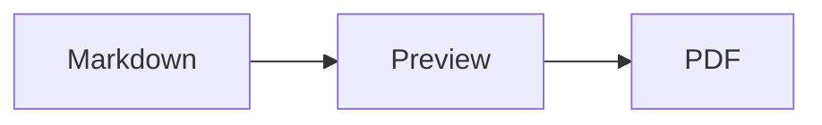

<p>&nbsp;&nbsp;&nbsp;</p>

# Splat

**The Markdown editor for macOS that lets you write in the source or straight in the preview.**

Splat puts your Markdown source with syntax colours on the left and a live, fully editable preview on the right. Type
in either one: whatever you write in the preview becomes a minimal change to the source, so lines you did not touch
stay byte-for-byte identical and your Git diffs stay clean. Splat reads the Markdown you already use: CommonMark and
GitHub Flavored Markdown, GitHub alerts, Obsidian wiki links, embeds and callouts, Pandoc and Typora extensions,
embedded HTML, LaTeX formulas, and Mermaid, Graphviz and PlantUML diagrams, all rendered offline. Browse and search a
whole folder of notes, see what changed since the last Git commit, paste from Word or a web page as Markdown, and export
to PDF, HTML or Word in one click. It is written in Rust on genuine AppKit controls, speaks 35 languages, and sends
nothing over the network unless you ask it to.
 


[](https://github.com/sventmueller/splat/releases/latest/download/Splat.dmg)

**[Download Splat.dmg](https://github.com/sventmueller/splat/releases/latest/download/Splat.dmg)**: signed and notarized by Apple, for macOS 14 or later on Apple Silicon and Intel.

**Found a bug?** Splat keeps the lines you did not touch byte-for-byte identical. If one changes anyway, or a file renders wrong, [open an issue](https://github.com/sventmueller/splat/issues/new/choose) and attach the file. If Splat is useful to you, a [star on GitHub](https://github.com/sventmueller/splat) helps others find it.
 
 

## Windows (preview)

**Splat for Windows 0.2.0** is available as an x64 preview. It uses a Tauri 2 desktop shell and the same Rust Markdown engine as the macOS app, while keeping the Windows implementation under `windows/`.

[](https://github.com/lipeilin375/splat/releases)

- Editable split source and preview, plus folder notes and text/tag/backlink search.
- Offline MathJax 4, Mermaid, Graphviz and PlantUML rendering using bundled local resources.
- Export to Word (.docx) and self-contained HTML; PDF uses the Windows print dialog (choose **Microsoft Print to PDF**).
- Windows menus, Markdown file associations, command-line file opening and crash-recovery drafts.

**Requirements:** Windows 10/11 x64. The installer uses the Microsoft Edge WebView2 bootstrapper when the runtime is missing.

**Preview notice:** the installer is currently unsigned and Windows may display an unknown-publisher warning. Review the release and its notes before installing; do not disable Windows Defender or SmartScreen. The Windows port does not yet include every macOS feature. See the [Windows build, security notes and known limitations](windows/README.md) and [Windows release notes](windows/RELEASE_NOTES.md).

[](https://www.rust-lang.org)
[](https://www.apple.com/macos/)

[](https://github.com/madsmtm/objc2)
[](https://webkit.org)
[](https://github.com/kivikakk/comrak)
[](https://github.github.com/gfm/)
[](https://www.mathjax.org)
[](https://cortexjs.io/mathlive/)
[](https://mermaid.js.org)
[](https://graphviz.org)
[](https://plantuml.com)


[](#license)

[Bahasa Indonesia](assets/readme/id/README.md) ·
[Bahasa Melayu](assets/readme/ms/README.md) ·
[Català](assets/readme/ca/README.md) ·
[Čeština](assets/readme/cs/README.md) ·
[Dansk](assets/readme/da/README.md) ·
[Deutsch](assets/readme/de/README.md) ·
**English** ·
[Español](assets/readme/es/README.md) ·
[Français](assets/readme/fr/README.md) ·
[Hrvatski](assets/readme/hr/README.md) ·
[Italiano](assets/readme/it/README.md) ·
[Magyar](assets/readme/hu/README.md) ·
[Nederlands](assets/readme/nl/README.md) ·
[Norsk](assets/readme/no/README.md) ·
[Polski](assets/readme/pl/README.md) ·
[Português (Brasil)](assets/readme/pt_BR/README.md) ·
[Português (Portugal)](assets/readme/pt_PT/README.md) ·
[Română](assets/readme/ro/README.md) ·
[Slovenčina](assets/readme/sk/README.md) ·
[Slovenščina](assets/readme/sl/README.md) ·
[Suomi](assets/readme/fi/README.md) ·
[Svenska](assets/readme/sv/README.md) ·
[Tiếng Việt](assets/readme/vi/README.md) ·
[Türkçe](assets/readme/tr/README.md) ·
[Ελληνικά](assets/readme/el/README.md) ·
[Русский](assets/readme/ru/README.md) ·
[Українська](assets/readme/uk/README.md) ·
[עברית](assets/readme/he/README.md)‎ ·
[العربية](assets/readme/ar/README.md)‎ ·
[हिन्दी](assets/readme/hi/README.md) ·
[ไทย](assets/readme/th/README.md) ·
[한국어](assets/readme/ko/README.md) ·
[日本語](assets/readme/ja/README.md) ·
[简体中文](assets/readme/zh-Hans/README.md) ·
[繁體中文](assets/readme/zh-Hant/README.md)

## Contents

- [Features at a glance](#features-at-a-glance)
- [Requirements](#requirements)
- [Installation](#installation)
- [Getting started](#getting-started)
- [Writing](#writing)
  - [In the source](#in-the-source)
  - [In the preview](#in-the-preview)
  - [Formatting commands](#formatting-commands)
  - [Lists and tasks](#lists-and-tasks)
  - [Tables](#tables)
  - [Pasting formatted text](#pasting-formatted-text)
  - [Metadata](#metadata)
- [Supported Markdown](#supported-markdown)
  - [CommonMark and GitHub Flavored Markdown](#commonmark-and-github-flavored-markdown)
  - [Callouts](#callouts)
  - [Extended syntax](#extended-syntax)
  - [Obsidian](#obsidian)
  - [Citations and references](#citations-and-references)
  - [Embedded HTML](#embedded-html)
  - [Typographic punctuation](#typographic-punctuation)
  - [Syntax overview](#syntax-overview)
- [Formulas](#formulas)
- [Diagrams](#diagrams)
- [Images](#images)
- [Links and navigation](#links-and-navigation)
- [Notes in a folder](#notes-in-a-folder)
- [Changes since the last commit](#changes-since-the-last-commit)
- [Exporting, printing and sharing](#exporting-printing-and-sharing)
- [Importing Word documents](#importing-word-documents)
- [Appearance and accessibility](#appearance-and-accessibility)
- [Languages](#languages)
- [Keyboard shortcuts](#keyboard-shortcuts)
- [Privacy and security](#privacy-and-security)
- [Large documents](#large-documents)
- [Known limitations](#known-limitations)
- [Troubleshooting](#troubleshooting)
- [For developers](#for-developers)
  - [Third-party components](#third-party-components)
- [License](#license)

## Features at a glance

- **Two ways to write, one text.** Source and preview are both editable. The Markdown file is the only truth: there is
  one undo history per document, and each preview edit is translated into the smallest change to the source.
- **The Markdown you already use.** CommonMark, GitHub Flavored Markdown, GitHub alerts, Obsidian, Pandoc and Typora
  extensions, emoji shortcodes, spoilers, definition lists, heading anchors and HTML as in GitHub READMEs.
- **Formulas and diagrams built in.** LaTeX formulas via MathJax, with a visual formula editor. Diagrams in Mermaid,
  Graphviz and PlantUML, rendered on your Mac without Java, a server or a network connection.
- **A button for everything.** Every Markdown construct has a toolbar button and a menu item, the common ones also a
  keyboard shortcut. Tables get their own menu for rows, columns and alignment.
- **A folder, not just a file.** The sidebar lists the notes around a document and searches all of them. Renaming a note
  changes the links to it, and every byte around them stays.
- **Changes at a glance.** In a Git repository, bars beside the text mark what differs from the last commit, in both panes.
- **From Word and the web into Markdown.** Paste formatted text as Markdown, cells from a spreadsheet as a table, and import
  whole Word documents with their images.
- **Export without losing anything.** PDF, a single self-contained HTML file, or a Word document with real headings,
  lists, tables, footnotes and images. Add page numbers, headers and a title page, or use your company's Word template.
- **Native to the bone.** Real AppKit windows, tabs, menus, popovers, Versions, Auto Save, the share menu, dark mode,
  spell checking, dictation and VoiceOver. No Electron, no web view for the text itself.
- **Fast with big files.** Rendering a keystroke in a 10 MB document takes about 10 ms, before the view's own work.
- **Private and careful.** Images from the web load only after you allow them, links to other apps ask first, and
  everything that decodes untrusted image data runs in sandboxed helper processes.
- **In your language.** The interface and the built-in Markdown quick reference come in 35 languages: Arabic, Catalan,
  Chinese (Simplified), Chinese (Traditional), Croatian, Czech, Danish, Dutch, English, Finnish, French, German, Greek,
  Hebrew, Hindi, Hungarian, Indonesian, Italian, Japanese, Korean, Malay, Norwegian, Polish, Portuguese (Brazil),
  Portuguese (Portugal), Romanian, Russian, Slovak, Slovenian, Spanish, Swedish, Thai, Turkish, Ukrainian and
  Vietnamese.

## Requirements

- macOS 14 Sonoma or later. Splat is developed and tested on macOS 27, where it picks up the Liquid Glass design
  automatically.
- A Mac with Apple Silicon or an Intel processor.
- About 45 MB of disk space.

## Installation

**From the disk image.** Download [`Splat.dmg`](https://github.com/sventmueller/splat/releases/latest/download/Splat.dmg), open it and drag Splat onto the Applications folder. The image is signed with a
Developer ID and notarized by Apple, so it opens without warnings.

**With Homebrew.** The cask lives in a tap of its own:

```sh
brew install --cask sventmueller/tap/splat
```

`brew upgrade --cask splat` installs new versions, and `brew uninstall --zap --cask splat` also removes Splat's settings
and caches.

**Updates.** Splat from the disk image or Homebrew keeps itself up to date with [Sparkle](https://sparkle-project.org).
On the second launch it asks whether it may look for updates on its own, once a day. **Splat › Check for Updates…**
looks right away; **Check for Updates Automatically** and **Automatically Download and Install Updates** in the same
menu change your choice later. Splat installs an update only if it carries the developer's signature. A build of your
own has no updater.

**From source.** See [Building](docs/development.md#building) for the prerequisites, then:

```sh
make build
ditto target/release/Splat.app /Applications/Splat.app
open /Applications/Splat.app
```

To open Markdown files with Splat by double-click, select any `.md` file in the Finder, choose **File › Get Info**,
pick Splat under **Open with** and click **Change All…**. Splat registers itself for `.md`, `.markdown`, `.mdown` and
`.mkd` files.

## Getting started

### The window

Each document opens in its own window, or as a tab if you prefer tabs:

- **Left: the source.** Your Markdown in SF Mono with syntax colours.
- **Right: the preview.** The rendered document, ready to edit.
- **Sidebar (optional).** All headings as a tree, a click on one shows it in both panes: **View › Show Outline** (⌃⌘S). Two
  more tabs hold the [notes in the folder](#notes-in-a-folder) and a search through them. The button beside the window's
  title shows and hides it, and new windows open it as the last one left it.
- **Toolbar.** Buttons grouped by what they change: characters, paragraphs and inserted elements, then preview on/off,
  Share and New Document. Customize it with **View › Customize Toolbar…**.

Drag the divider to give either side more room. **View › Hide Preview** (⌥⌘P) leaves the source alone; Splat
remembers this per window. Both panes scroll together, and a selection in one pane is highlighted in the other.

The corner of the window shows the words and characters of the text and how long it takes to read, and those of the
selection while there is one. Link addresses, HTML tags, metadata, comments, formulas and diagrams do not count. It
stays hidden until **View › Show Word Count** turns it on.

### Documents, tabs and versions

Splat is a regular macOS document app:

- **Auto Save and Versions.** Changes are saved in place. **File › Revert To › Browse All Versions…** takes you back
  in time.
- **Changes from other programs.** When Git, a script or another editor changes an open document, Splat reloads it
  and keeps the caret and the scroll position. If you have unsaved changes of your own, Splat keeps them, and macOS
  asks before saving over the other version.
- **The usual file commands.** Duplicate (⇧⌘S), Rename…, Move To…, and **File › Open Recent**.
- **Tabs.** **File › New Tab** or the **+** button in the toolbar opens a new document as a tab; the standard Window
  menu merges, moves and cycles tabs.
- **Window placement.** The size and position of your last window are remembered, across restarts as well. If a window
  already stands there, the new one opens slightly offset.
- **The Dock icon.** A click on it after you closed the last window opens a new document.
- **Open Markdown files in Splat.** **Splat › Set as Default App for Markdown** makes a double-click on a `.md` or
  `.markdown` file open Splat; macOS asks once to confirm. The item shows a checkmark while Splat is the default.

Files must be UTF-8 text, or UTF-16 with a byte order mark. Splat refuses other encodings rather than guessing and
corrupting the text. A byte order mark stays, UTF-16 stays UTF-16, and in a file whose lines all end in CRLF, the lines
you add get CRLF as well.

**After a crash**, at most the last few seconds of typing are lost: every five seconds, Splat copies unsaved text to
`~/Library/Application Support/Splat/Unsaved`, and removes the copies once a document is saved or Splat quits normally.
The next start moves what a crash left there to `~/Library/Application Support/Splat/Recovery` and says so once, with a
button that opens the folder. A crash Splat can still react to also writes the text of every open document there.

### Quick reference

**Help › Markdown Quick Reference** opens a cheat sheet in your language as a new, untitled document. It is an
ordinary document, so try everything right there, in the source or in the preview.

## Writing

### In the source

The source is a plain-text editor tuned for Markdown:

- **Syntax colours** like in VS Code: headings, emphasis, links, code, tables, HTML, front matter, and LaTeX and
  Mermaid inside formulas and diagrams. There are palettes for light, dark and Increase Contrast.
- **Fenced code blocks** are highlighted for Bash, C, C++, C#, CSS (also SCSS and Less), Go, HTML, XML, Java,
  JavaScript, JSON, Kotlin, PHP, Python, Ruby, Rust, SQL, Swift, TypeScript, YAML, TeX and Mermaid, including their
  usual short names such as `js`, `py` or `sh`.
- **No surprise substitutions.** Smart quotes, smart dashes and text replacement are off by default, because they
  break `--`, `---` and `"`. Turn them on under **Edit › Substitutions**.
- **The system's writing tools.** Spell and grammar checking, dictation, Find and Replace (⌥⌘F), and Speech.
- **Drag and drop.** Drop an image file to insert ``, any other file to insert a link to it,
  and a URL to insert `[url](url)`. Each drop is one undo step.
- **Paste images.** A picture on the clipboard, such as a screenshot, is saved as a PNG file next to the document
  (`Image 2026-10-29 13.09.07.png`) and inserted as an image. The document needs to be saved once for this.

### In the preview

The preview behaves like a word processor, but everything you do in it ends up as Markdown:

- **Typing.** Characters that mean something in Markdown, such as `*` or `#`, are escaped so they appear as typed.
- **Return** starts a new paragraph or list item. **⌥Return** or **⌃Return** inserts a line break.
- **Formatting at the cursor.** With the cursor at the end of a word, Bold, Italic and the other character formats
  apply to what you type next. Choose the format again to stop it. Inside a word, the whole word is formatted.
- **Empty lines.** Return on an empty line adds another empty line, and Backspace removes it. In the source, each
  extra empty line is two more blank lines; other Markdown programs show them as normal paragraph spacing.
- **Undo** works across both panes. Undo items carry names ("Undo Bold"), typing is one step per burst, and after Undo
  and Redo both panes scroll to the change.
- **Formulas and diagrams** appear as finished graphics. Click one, move the cursor onto it or press Return on it to
  open its editor (see [Formulas](#formulas) and [Diagrams](#diagrams)).
- **Embedded HTML, embedded notes and front matter** are shown, but you edit them in the source. A click on them puts
  the cursor at the matching place there.

Anything Markdown cannot express is blocked in the preview: the Font and Colour panels, the ruler, and pasting or
dropping rich text and images. Pasted HTML and RTF arrive as plain text, unless you choose
[Paste as Markdown](#pasting-formatted-text).

### Formatting commands

Every command is available from the toolbar, the menu bar and the context menu of both panes. Menu items show a
checkmark for the formatting at the cursor.

| Menu | Commands |
|---|---|
| **Format › Font** | Bold, Italic, Underline, Strikethrough, Highlight, Code, Superscript, Subscript |
| **Format › Heading** | Body Text, Heading 1 to 6 |
| **Format › List** | Bulleted List, Numbered List, Task List |
| **Format** | Quote, Code Block (No Language or one of 20 languages; also changes the language of an existing block), Callout (Note, Tip, Important, Warning, Caution; the same type again removes it), Edit Formula or Diagram…, Clear Formatting |
| **Insert** | Link…, Image…, Table…, Formula, Diagram (Flowchart, Sequence Diagram, Gantt Chart), Table of Contents, Footnote, Horizontal Rule |
| **Table** | Insert Row Above/Below, Insert Column Left/Right, Delete Row, Delete Column, Alignment (Left, Center, Right, Default), Align Table Columns |
| **View** | Hide/Show Preview, Show/Hide Outline, Typographic Punctuation, Zoom In/Out, Actual Size, toolbar, tab bar, full screen |

Underline, highlight, superscript and subscript are written as `<ins>`, `<mark>`, `<sup>` and `<sub>`, which GitHub
shows as well. Splat also reads `<u>`, which GitHub removes, and the shorter `==highlight==`, `^sup^` and `~sub~`.
GitHub shows `==` and `^` as typed and `~sub~` as strikethrough.

### Lists and tasks

- Return continues a list; Return on an empty item ends it.
- **Tab** and **⇧Tab** indent and outdent list items in the preview.
- A click on a task checkbox in the preview toggles `- [ ]` and `- [x]`.
- **Format › List** turns the selected paragraphs into a list or changes its kind.

### Tables

- **Insert › Table…** asks for the number of rows (including the header) and columns.
- In the preview, **Tab** moves to the next cell, **⇧Tab** to the previous one and **Return** to the cell below. Tab
  in the last cell adds a row.
- The **Table** menu inserts and deletes rows and columns and sets the alignment of a column (⌘{, ⌘|, ⌘}).
- **Table › Align Table Columns** pads the source so the columns line up.

### Pasting formatted text

**Edit › Paste as Markdown** (⌃⌘V), also in the context menu of both panes, turns what is on the clipboard into Markdown at
the selection, as one undo step. ⌘V goes on inserting plain text.

- **From a browser, Word, Google Docs, Confluence, Notes or Pages:** headings, bold, italic, underline, strikethrough,
  superscript and subscript, links, lists with their nesting, quotes, code and tables come along.
- **From a spreadsheet:** cells become a table with a header row and right-aligned columns of numbers. Text separated by
  tabs, semicolons or commas does too, if every line has the same number of columns.
- **Pictures** with a web address stay links. A picture inside the pasted HTML becomes a file next to the document, which
  needs to be saved once for this. Word's temporary picture files stay behind, and their alternative text remains.
- **Links** keep only `http`, `https`, `mailto`, relative and `#` addresses; of any other link the text remains.

### Metadata

**Format › Edit Metadata…**, or a click on the metadata line at the top of the preview, opens a form with the fields of the
YAML front matter. Fields can be changed, added and removed. A field with a list keeps it as a list: its values stand
behind each other with commas, and a value holding a comma stands in quotes. A new field called `tags`, `aliases`,
`keywords`, `categories`, `authors` or `cssclasses` becomes a list as well. Nested fields and multi-line text can be seen
there and edited in the source.

What the form changes is one undo step and reaches only the lines of the fields you changed: comments, the order, odd
spacing, quotes and line ends of all others stay byte-for-byte. A document without metadata gets a block at its start.

## Supported Markdown

Splat parses with [comrak](https://github.com/kivikakk/comrak), a CommonMark and GFM-compatible parser, and turns on
most of its extensions. Everything below renders in the preview and in all exports.

### CommonMark and GitHub Flavored Markdown

- Headings (`#` and underlined), paragraphs, line breaks, emphasis, strong emphasis, inline code, block quotes,
  horizontal rules.
- Bulleted, numbered and nested lists; task lists.
- Links (inline, reference and automatic), images, link reference definitions.
- Fenced and indented code blocks with syntax colours.
- Tables with column alignment.
- Strikethrough with `~~two tildes~~`.
- Footnotes: `text[^1]` with `[^1]: The note.` anywhere in the document. A click on the marker jumps to the note.
- YAML front matter between `---` lines at the top. The preview sums it up in one line, such as
  "Metadata: title, date, tags".

### Callouts

GitHub alerts render as coloured boxes with icon and title:

```markdown
> [!NOTE]
> Useful information that users should know.

> [!WARNING]
> Critical content demanding immediate attention.
```

The five types are Note, Tip, Important, Warning and Caution. **Format › Callout** turns the paragraph at the cursor
into one.

Obsidian callouts work too, with any title and a fold state:

```markdown
> [!tip]- Click ▸ to expand
> Hidden until opened.

> [!question]+ Open by default
> A `+` starts expanded, a `-` collapsed.
```

Obsidian's other types are shown in the closest of the five colours: `success`, `check`, `done` and `hint` as Tip;
`question`, `help` and `faq` as Important; `attention` as Warning; `failure`, `fail`, `missing`, `danger`, `error` and
`bug` as Caution; everything else as Note.

### Extended syntax

| Feature | Syntax | From |
|---|---|---|
| Highlight | `==marked text==` | Obsidian, Typora |
| Superscript | `x^2^` | Pandoc, Typora |
| Subscript | `H~2~O` | Pandoc, Typora |
| Emoji shortcode | `:rocket:` becomes 🚀 | GitHub |
| Spoiler | `\|\|hidden text\|\|`, select it to read | Discord |
| Inline footnote | `text^[the note itself]` | Pandoc, Obsidian |
| Definition list | `Term`, blank line, `: Explanation` | PHP Markdown Extra, Pandoc |
| Heading anchor | `## Install {#setup}`, link with `[see](#setup)` | Pandoc, kramdown |

Definition lists look like this in the source:

```markdown
Term

: Explanation of the term.
```

Without a custom anchor, every heading gets one derived from its text, as on GitHub: `## Getting Started` is
reachable as `#getting-started`.

### Obsidian

- **Wiki links.** `[[Note]]` links to `Note.md` in the same folder or a folder below it. `[[Note|Shown text]]` shows
  your own text, and `[[Note#Heading]]` opens the note. ⌘-click opens it in Splat.
- **Embeds.** `![[Note]]` shows the other note inside this one; notes embedded in it appear as links.
  `![[diagram.png]]` shows an image. As in Obsidian, embeds name notes and images in the document's folder or below,
  never by an absolute path, and only Markdown files show as notes.
- **Comments.** `%%Only in the source%%` stays visible in the source and is left out of the preview and every export,
  inline as well as on lines of their own.
- **Tags.** `#idea` or `#project/splat` is highlighted. ⌘-click searches the document and, in the sidebar, the whole folder
  for the tag.
- **Foldable callouts.** See [Callouts](#callouts).

### Citations and references

- **Pandoc citations.** `[@doe2020]` or `[@doe2020; @roe2021]` reads like "(Doe 2020; Roe 2021)". The entries come
  from the BibTeX file that the front matter names as `bibliography: refs.bib`. Without it, Splat uses
  `references.bib`, `literatur.bib` or `bibliography.bib` next to the document.
- **GitHub and GitLab references.** If the document lies in a Git repository whose `origin` remote is on github.com
  or a GitLab host, `@name`, `#12` (issue) and `!7` (merge request, GitLab only) are highlighted. ⌘-click opens them
  in the browser.

### Embedded HTML

HTML as you find it in GitHub READMEs is rendered, with its own reader rather than a browser engine:

- centered paragraphs and blocks (`<p align="center">`, `<div align="center">`)
- images with a size (``)
- links, `<kbd>⌘</kbd>`, `<br>`, `<u>`, `<ins>`, `<mark>`, `<sup>`, `<sub>`
- lists and tables, including cells that span columns (`colspan`)
- collapsible sections: `<details><summary>More</summary>…</details>`, opened by a click on ▸

Markdown between HTML tags is rendered as Markdown. Scripts, styles, frames and forms are left out entirely, and links
and images keep only `http`, `https`, `mailto` and relative addresses.

### Typographic punctuation

**View › Typographic Punctuation** shows straight quotes as the quotation marks of your interface language, `--` as an
en dash, `---` as an em dash and `...` as an ellipsis. In German, `"Ja"` becomes „Ja“, in French «Oui», in Japanese
「はい」, also where Chinese and Japanese set quotes without a space; Hebrew abbreviations such as `צה"ל` get their
gershayim, צה״ל. The source keeps the plain characters; the preview and all exports show the typographic ones. The
setting is off until you turn it on.

### Syntax overview

| Element | Markdown |
|---|---|
| **Bold** | `**Bold**` |
| *Italic* | `*Italic*` |
| Underline | `<ins>Underline</ins>` or `<u>Underline</u>` |
| ~~Strikethrough~~ | `~~Strikethrough~~` |
| Highlight | `<mark>Highlight</mark>` or `==Highlight==` |
| `Code` | `` `Code` `` |
| x² | `x<sup>2</sup>` or `x^2^` |
| H₂O | `H<sub>2</sub>O` or `H~2~O` |
| [Link](https://example.com) | `[Link](https://example.com)` |
| Heading | `# Heading` to `###### Heading` |
| Quote | `> Quote` |
| Bulleted list | `- Item` |
| Numbered list | `1. Item` |
| Task | `- [ ] Open` and `- [x] Done` |
| Code block | ```` ```rust ```` … ```` ``` ```` |
| Table | `\| A \| B \|` with `\|---\|---\|` below the header |
| Footnote | `Text[^1]` and `[^1]: Note` |
| Horizontal rule | `---` |
| Image | `` |
| Formula | `$E = mc^2$`, `$$ … $$` |
| Diagram | ```` ```mermaid ````, ```` ```dot ````, ```` ```plantuml ```` |
| Callout | `> [!TIP]` |
| Wiki link | `[[Note]]`, `[[Note\|Text]]` |
| Embed | `![[Note]]`, `![[image.png]]` |
| Comment | `%%Comment%%` |
| Tag | `#tag` |
| Citation | `[@key]` |
| Spoiler | `\|\|Spoiler\|\|` |
| Emoji | `:tada:` |

## Formulas

Formulas are rendered by [MathJax](https://www.mathjax.org) with its TeX and AMS math, as crisp vector graphics. Text in
`\text{…}` can be in any script: what MathJax's fonts lack comes from the fonts of your Mac, with Arabic and Hebrew
running from right to left, and emoji in color.

| Kind | Syntax |
|---|---|
| Inline | `$E = mc^2$`, `` $`E = mc^2`$ `` (GitHub, GitLab), `\(E = mc^2\)` |
| Display | `$$` … `$$`, `\[` … `\]`, or a code block marked `math` |

**Editing a formula.** Click a formula in the preview, double-click it, press Return on it or move the cursor onto it
to open its editor in a popover. **Insert › Formula** inserts a new one and opens the editor right away.

- **Visual or LaTeX.** The switch at the top flips between a visual editor ([MathLive](https://cortexjs.io/mathlive/))
  and the LaTeX code. Splat remembers your choice.
- **Building blocks** for fraction, square root, superscript and subscript, sum and integral with limits, limit,
  brackets that grow with their content, 2×2 matrix, Greek letters, and relations, operators and arrows. They leave
  placeholders □, and **Tab** jumps to the next one.
- **Live preview.** Changes appear in the document while you type. Errors from MathJax show in a line below the code.
- **Commit or discard.** Clicking outside keeps the change as a single undo step; **Esc** or **Cancel** throws it
  away. Escaping a new, empty formula removes it again.
- The context menu offers **Edit Formula…** for the formula under the pointer.

VoiceOver reads a formula as its LaTeX code. Splat renders formulas, not complete LaTeX documents: there are no
packages, no TikZ and no `\documentclass`.

## Diagrams

Diagrams render inside Splat, offline and in a light and a dark variant.

| Engine | Code block | What it draws |
|---|---|---|
| [Mermaid](https://mermaid.js.org) | ```` ```mermaid ```` | flowcharts, sequence, class, state, entity relationship, Gantt, pie, mind maps, timelines and every other Mermaid type |
| [Graphviz](https://graphviz.org) | ```` ```dot ```` or ```` ```graphviz ```` | graphs in the DOT language |
| [PlantUML](https://plantuml.com) | ```` ```plantuml ```` or ```` ```puml ```` | UML diagrams; runs without Java |



**Editing a diagram** works like editing a formula: click it to open the code in a popover, with syntax colours and
error messages in a line below the code. **Insert › Diagram** starts from a template for a flowchart, a sequence
diagram or a Gantt chart. Building blocks help with the three most common Mermaid types:

- **Flowchart:** Node ▾ (rectangle, rounded, circle, diamond, database), Connection, Labeled connection, Group,
  Direction ▾
- **Sequence diagram:** Participant, Message, Reply, Note, Loop, Alternative paths
- **Gantt chart:** Section, Task, Milestone

Other diagram types are edited as code. VoiceOver reads a diagram's title or alternative text.

The first diagram after launch takes about a second, because the rendering engine starts in the background. A diagram
that takes longer than 10 seconds shows an error, and the rendering engine starts afresh for the next one.
PlantUML's engine (3 MB) loads only with the first PlantUML diagram. A PlantUML `!include` from the web is blocked.

## Images

- **Local images** use paths relative to the document: ``. Splat shows PNG, JPEG, GIF, WebP,
  BMP, SVG, HEIC, TIFF, AVIF and PDF.
- **Images from the web** stay blocked until you allow them: a bar above the preview explains that loading them tells
  their servers that and when you open the document. **Load Images** allows them for this document; Splat remembers
  the choice per file.
- **Size.** `` sizes an image; otherwise images fit the width of the preview.
- **Changes on disk.** An image you replace, or one that appears after the document named it, shows without opening
  the document again. Images from the web that failed because of the network are tried again while a document shows
  them.
- **Memory.** Images show at up to 2560 pixels on their longest side, which also fills an A4 page. They decode smaller
  once they fill an eighth of the Mac's memory, and while macOS reports memory pressure.
- **Dark mode.** Images with a white background are slightly dimmed in the dark preview.
- **Pasting and dropping.** See [In the source](#in-the-source).

## Links and navigation

In the preview, a click places the cursor so you can edit the link text; **⌘-click** follows the link:

- `http`, `https` and `mailto` open in your browser or mail app.
- Markdown files open in Splat; other files and folders are revealed in the Finder.
- `#anchor` jumps to the heading in the document.
- Addresses that open another app, such as `slack://` or `vscode://`, ask first and show the full address and the app.
  **Cancel** is preselected.

**Insert › Table of Contents** inserts a linked list of all headings. With the cursor inside it, the same command
updates it. The outline sidebar (⌃⌘S) jumps to any heading in both panes.

## Notes in a folder

The buttons at the top of the sidebar switch between the outline, the files and a search.

- **Files** (**View › Show Files**, ⌃⌘E). All Markdown files in the document's folder or, if it lies in a Git repository, in
  all of that. A click or Return opens a note as a tab of this window; if it is open already, it comes to the front. The
  button beside the folder's name shows another folder in this window. Hidden files, `node_modules`, `target`, `Pods`,
  `DerivedData`, `__pycache__` and folders without notes stay out. A document right in your home folder shows only the notes
  beside it, so that Splat does not walk through all your folders and ask for each of them.
- **Search** (**Edit › Find › Search All Notes…**, ⇧⌘F). Finds text in all notes, whatever its case and however its accents
  are encoded. `#tag` finds a tag, `#project` also `#project/splat`, and nothing inside code. A click on a hit opens the note
  at that place.
- **Links to a note.** The context menu of a note lists the notes that link to it, by wiki link, embed, relative link or
  reference definition.
- **Renaming a note.** The same menu renames it and changes those links. Splat first says how many links in how many files
  that means. Only the name changes in each link, and every other byte of the file stays. Open documents take the change as
  an undo step; in other files only Git or Versions can take it back. A file another program changed in the meantime stops
  the rename of all links, and Splat names it.

The list follows the folder when the window comes to the front. Search looks at the files as they are on disk, and text you
have not saved yet counts from the next Auto Save.

## Changes since the last commit

In a document in a Git repository, bars beside the text mark what differs from the last commit, in the source and in the
preview: green for added lines, blue for changed lines, and a short red mark where something was removed. They follow as you
type and when the branch moves. **View › Changes Since Last Commit** switches them off, for all windows.

Lines that differ only in their line end do not count, so a file with CRLF against a commit with LF shows no change. A new
file has no marks until its first commit, and neither has a document above 32 MB.

## Exporting, printing and sharing

| Format | How | What you get |
|---|---|---|
| **PDF** | **File › Export as PDF…** or the Share menu | Paper-sized pages, always in the light appearance, formulas and diagrams as vector graphics. **File › Page Setup…** sets the paper. |
| **Print** | **File › Print…** (⌘P) | The same layout as the PDF. |
| **HTML** | **File › Export as HTML…** or the Share menu | One self-contained file: local images embedded, formulas and diagrams as sharp images, heading anchors so the table of contents works. No scripts. |
| **Word** | **File › Export as Word Document…** or the Share menu | A `.docx` with Word's heading styles, real lists and tables (including merged cells), footnotes as Word footnotes, embedded images, formulas and diagrams. |
| **Markdown** | The **Share** button in the toolbar | The document as a `.md` file for Mail, Messages, AirDrop and every other share service. |

The **File › Share** menu offers all of these in one place. Exports use the typographic punctuation setting and the
images you allowed from the web; images from the web stay links in HTML.

**File › Export Options…** sets what PDF, printing and Word add to the text, for all documents:

- **Page numbers** in the footer of PDF and print, as `2 / 9`.
- **Header and footer** for PDF and print. `{title}`, `{author}`, `{date}`, `{page}` and `{pages}` stand for their values,
  the first three from the document's metadata.
- **A title page** for PDF, print and Word, with `title`, `subtitle`, `author` and `date` from the metadata, or the
  document's name as its title. It has neither header nor footer.
- **A Word template**, a `.docx` or `.dotx` whose look the export takes: its styles, including localized names, its theme,
  page size, margins, headers and footers. A template that cannot be read stops the export and says so, rather than giving
  you a document without it.

## Importing Word documents

**File › Import Word Document…** asks for a `.docx` or `.dotx` file and where its Markdown goes, then opens the result. Images
land in a folder beside it, named after the document with `-images`.

Headings and lists come through as Word's styles and numbering define them, also in documents whose styles have localized
names. Bold, italic, underline, strikethrough, highlight, superscript and subscript, links, quotes, code, footnotes, endnotes
and tables come along, cells spanning columns as an HTML table. Formulas become LaTeX. Tracked changes count as accepted, and
a table of contents stays out, as **Insert › Table of Contents** makes a new one. Old `.doc` files and documents protected
with a password are refused.

## Appearance and accessibility

- **Dark mode** follows the system. Formulas and diagrams are rendered for each appearance.
- **Increase Contrast** in System Settings switches the syntax colours to high-contrast palettes.
- **Zoom.** ⌘+, ⌘− and ⌘0 scale both panes.
- **Full screen, tabs and a customizable toolbar**, as in every Mac app.
- **VoiceOver.** The panes are labelled "Markdown source" and "Preview", formulas read as their code and diagrams as
  their title. Every command is reachable from the keyboard.

Splat has no settings window: the few options live where they apply, in **View**, **Edit › Substitutions** and **File ›
Export Options…**.

## Languages

The interface, the menus and the Markdown quick reference are translated into 35 languages:

Arabic, Catalan, Chinese (Simplified), Chinese (Traditional), Croatian, Czech, Danish, Dutch, English, Finnish, French,
German, Greek, Hebrew, Hindi, Hungarian, Indonesian, Italian, Japanese, Korean, Malay, Norwegian, Polish, Portuguese
(Brazil), Portuguese (Portugal), Romanian, Russian, Slovak, Slovenian, Spanish, Swedish, Thai, Turkish, Ukrainian and
Vietnamese.

Splat follows the language order in **System Settings › General › Language & Region**; you can also pick a language
for Splat alone there under **Applications**. Without a translation for your language, it uses English. Menu terms
follow Apple's own translations, so Splat reads like the rest of your Mac.

Hebrew and Arabic text reads right to left wherever it appears, whatever the interface language: each paragraph,
heading and list item takes the direction of its first letter, quotes and callouts draw their bar on the right, and a
table whose text starts right to left lists its columns from the right. Code blocks stay left to right. The PDF, HTML
and Word exports keep these directions. With Hebrew or Arabic as the system language, macOS also mirrors the window,
so the preview sits on the left.

## Keyboard shortcuts

| Action | Shortcut |
|---|---|
| Bold, Italic, Underline | ⌘B, ⌘I, ⌘U |
| Strikethrough | ⇧⌘X |
| Code | ⌥⇧⌘C |
| Link… | ⌘K |
| Body text, Heading 1 to 6 | ⌥⌘0, ⌥⌘1 to ⌥⌘6 |
| Align table column left, center, right | ⌘{, ⌘\|, ⌘} |
| Hide or show the preview | ⌥⌘P |
| Show or hide the outline | ⌃⌘S |
| Show or hide the files | ⌃⌘E |
| Search all notes | ⇧⌘F |
| Paste as Markdown | ⌃⌘V |
| Zoom in, out, actual size | ⌘+, ⌘−, ⌘0 |
| New document, open, save, duplicate | ⌘N, ⌘O, ⌘S, ⇧⌘S |
| Page setup, print | ⇧⌘P, ⌘P |
| Find, find and replace | ⌘F, ⌥⌘F |
| Find next, previous; use selection; jump to selection | ⌘G, ⇧⌘G; ⌘E; ⌘J |
| Show spelling and grammar; check document | ⌘:, ⌘; |
| Paste and match style | ⌥⇧⌘V |
| Hide toolbar, show all tabs, full screen | ⌥⌘T, ⇧⌘\\, ⌃⌘F |
| Line break (preview) | ⌥Return or ⌃Return |
| Next cell / previous cell in a table (preview) | Tab / ⇧Tab |
| Indent / outdent a list item (preview) | Tab / ⇧Tab |
| Next placeholder in the formula editor | Tab |
| Close the formula or diagram editor without changes | Esc |
| Follow a link, tag or reference (preview) | ⌘-click |

Splat leaves Apple's standard shortcuts where they are.

## Privacy and security

A Markdown file can come from anyone, so Splat treats every document as untrusted.

- **No network by default.** Splat has no telemetry. It looks for updates only once you agree or choose **Check for
  Updates…**: it then loads a small feed file from GitHub, and the request names nothing but the app and its version.
  Formulas and diagrams render locally; the web views that do it cannot reach the network. **Help › Report a Problem…**
  opens a form on GitHub in your browser; its address carries Splat's version, the macOS version and the kind of Mac,
  nothing from your documents.
- **Images from the web** load only after your permission, only over `https`, never from hosts in your local network,
  at most 10 MB each, and in a private session without cookies.
- **Isolated decoding.** Images and the graphics of formulas and diagrams are decoded in helper processes that close
  every file they inherited and lock themselves into a sandbox before reading the first byte: no file access, no
  network. They hand back only pixels, whose size is checked, and are stopped after 10 seconds. Apple's own image
  decoders only see HEIC, TIFF, AVIF and PDF, and only when the data really is that format; they run in a helper of
  their own, which may in addition read the system's font folders and use the system's video decoder. SVGs, formulas
  and diagrams pass that helper as well, so they are pictures with a fixed resolution in Splat: four pixels per point,
  up to 2560 on the longer side.
- **Local files** reach a document only by the path it names. Embeds show Markdown notes from the document's folder
  and below, and a missing picture is looked for only there. An image path elsewhere, absolute or starting with `~`, still loads in the preview; HTML and Word exports, printing and PDFs take along only what lies in the document's folder or its Git repository, unless that repository also holds your home folder, so a document from someone else cannot pull your files into an export you pass on.
- **Folders of notes** are read only while the sidebar shows them, and renaming a note changes other files only after you
  confirmed how many.
- **Git repositories** are read by Splat itself. It never runs the `git` program, whose configuration in a repository from
  someone else can start other programs, and it reads no more than the last commit's version of the open document. It writes
  nothing there and goes on no network.
- **Word documents and pasted text** are read by Splat's own parsers, with limits on size, nesting and how far a file may
  unpack. Links in them keep only the addresses Splat allows elsewhere, and the names of images in a Word file never decide
  where they are written.
- **Copies of unsaved text** stay on this Mac, in your Library folder, for the recovery after a crash. They leave
  with the save or the normal end of Splat; the copies a crash left behind stay in the recovery folder until you delete
  them.
- **Links** never start a program by a click. Web and mail links open as usual; links to other apps ask first.
- **HTML in documents** is read by Splat's own parser. Scripts, styles, frames and forms never run.
- **Exports** carry no scripts. HTML pages keep only a fixed list of harmless tags and attributes, as GitHub does, plus
  a content security policy. Word files link only `http`, `https` and `mailto` addresses.
- **Code signing** with the Hardened Runtime. Splat runs without the App Sandbox so that it can show images next to
  your documents without asking for every folder; the isolation of all decoding offsets this.

## Large documents

Splat stays responsive with documents of several megabytes:

- The source uses TextKit 2, which lays out only the visible part.
- While you type in the preview, and in the source of documents up to 2 MB, only the affected paragraphs are parsed,
  coloured and laid out again. In a 10 MB document, parsing and colouring take about 3 ms, rendering about 10 ms, and a
  whole keystroke in its preview about 30 ms with the view's own work.
- Large previews render the visible part first and the rest while the app is idle. Blocks scrolled into view are
  rendered before they are drawn.
- In the source of larger documents, parsing for the preview runs in the background while you type.
- A document stays plain text once it would take about 4 GB of memory, which is roughly 50 to 120 MB of ordinary
  Markdown but only 10 to 20 MB of nothing but tables or headings: the source has no colours and the preview says why
  it stays empty. Exports still work.
- From about 200 KB, a document opens its window before it is parsed; at 5 MB, the colours and the preview follow
  about a quarter of a second later.
- All pictures together, including formulas and diagrams, take at most a quarter of the Mac's memory and half of that
  while memory is short. Beyond that, further pictures show as placeholders until there is room again.

Some changes are processed in full, at around 300 ms per keystroke at 10 MB: those to a footnote's definition or
references, next to an inline footnote, at the very end of a document next to a footnote, to the front matter or to
link reference definitions, and every change in a document with `%%` comment blocks or with a footnote defined twice
or inside a quote or list. Memory grows with the file, to roughly 115–160 MB for 1 MB of Markdown and 340–510 MB for 10 MB.

## Known limitations

- **Single tildes mean subscript.** `~text~` is subscript as in Pandoc; strikethrough needs `~~two~~`. GitHub also
  strikes through with one tilde.
- **Read-only in the preview:** embedded HTML and embedded notes are edited in the source, front matter in its form or the
  source.
- **Very deep nesting:** HTML nested deeper than 64 levels, and inline HTML deeper than 16, gives way to its content.
- **Merged table cells** exist only in HTML tables, and only across columns (`colspan`, no `rowspan`). MultiMarkdown's
  table syntax for merged cells is not supported.
- **Bibliographies** are read from BibTeX only, not from CSL JSON or YAML.
- **References** need a repository on github.com or a GitLab host; `!7` exists only on GitLab.
- **Typographic punctuation:** a German closing single quote cannot be told apart from an apostrophe and is set as ’.
- **Formulas, not documents:** no LaTeX packages, TikZ or full documents.
- **The visual formula editor** writes LaTeX in MathLive's notation: spaces disappear (`E = mc^2` becomes `E=mc^2`),
  the rendering stays the same.
- **Word count:** Thai, Lao, Khmer and Myanmar write without spaces and count per run of text, not per word. `3.14` and
  `snake_case` are two words each.
- **Renaming a note** does not change links in embedded HTML, and a wiki link stays as it is if the new name holds `#`, `|`,
  `^`, `[`, `]` or `\`.
- **Change marks** read repositories with SHA-1 objects and plain or packed refs; one with SHA-256 or reftable shows none. A
  file under a Git filter such as LFS is compared with what the filter stored.
- **Word import** leaves text in headers, footers and comments behind, and pictures as `.emz` or SVG keep only their
  alternative text.
- **Paste as Markdown** reads RTF as Western text, and takes headings there only from font sizes. Most programs offer HTML as
  well, which it prefers.
- **By design:** no line numbers, no settings window, no Help Book, not in the App Store.
- **Tested less on Intel.** The window self-tests run on Apple Silicon only; on Intel, CI runs `cargo test`.

## Troubleshooting

**The recent documents list is empty after I rebuilt Splat.** macOS ties recent documents and folder permissions to
the app's code signature. Local builds are signed with the certificate "Splat Local Signing" in your login keychain,
so rebuilds keep both. If the certificate was deleted, the next build creates a new one and the lists start over once.

**The app from the disk image shows other recent documents than my own build.** The two carry different signatures,
so macOS keeps a separate list and separate folder permissions for each.

**HTML or other syntax shows as plain code.** An outdated copy of Splat may have opened the document. Quit it,
choose **File › Get Info** on the document in the Finder and check that **Open with** names the Splat in your
Applications folder.

**There is no Check for Updates… in the Splat menu.** Only the version from the disk image or Homebrew updates
itself; a build of your own has no updater.

**Images from the web do not appear.** Click **Load Images** in the bar above the preview. Only `https` images from
public hosts load.

**Pasting a screenshot asks me to save first.** Pasted images are stored as files next to the document, which needs a
place on disk. Save it, then paste again.

**"The file is not UTF-8 text."** The file is in another encoding and has no byte order mark that would name it.
Convert it first, for example with `iconv -f ISO-8859-1 -t UTF-8 old.md > new.md`.

**A formula or diagram shows an error.** Click it: the editor shows the message of MathJax, Mermaid, Graphviz or
PlantUML below the code.

## For developers

Building, testing, the layout of the code and the rules it follows are described in [docs/development.md](docs/development.md).

### Third-party components

| Component | Version | Used for | License |
|---|---|---|---|
| [comrak](https://github.com/kivikakk/comrak) | 0.59 with [one line changed](vendor/comrak/PATCH.md) | Markdown parser | BSD-2-Clause |
| [objc2](https://github.com/madsmtm/objc2), objc2-foundation, block2 | 0.6 / 0.3 | Objective-C runtime, Foundation, blocks | MIT |
| objc2-app-kit, objc2-web-kit, dispatch2 | 0.3 | AppKit, WebKit and Grand Central Dispatch bindings | Zlib, Apache-2.0 or MIT |
| [krilla](https://github.com/LaurenzV/krilla), krilla-svg, [usvg](https://github.com/linebender/resvg) | 0.8 / 0.47 | formulas and SVG images as vector PDF | MIT or Apache-2.0 |
| [image](https://github.com/image-rs/image) | 0.25 | decoding PNG, JPEG, GIF, WebP and BMP | MIT or Apache-2.0 |
| [unicode-width](https://github.com/unicode-rs/unicode-width) | 0.2 | aligning table columns | MIT or Apache-2.0 |
| [entities](https://github.com/p-jackson/entities) | 1 | the names of HTML character references | MIT |
| [miniz_oxide](https://github.com/Frommi/miniz_oxide) | 0.9 | unpacking Word files and Git objects | MIT, Zlib or Apache-2.0 |
| [roxmltree](https://github.com/RazrFalcon/roxmltree) | 0.21 | reading the XML of Word files | MIT or Apache-2.0 |
| [unicode-normalization](https://github.com/unicode-rs/unicode-normalization) | 0.1 | names and search across composed and decomposed letters | MIT or Apache-2.0, Unicode-3.0 |
| [emojis](https://github.com/rossmacarthur/emojis) | 0.9 | keeping `:shortcode:`-like text literal in imported text | MIT or Apache-2.0, Unicode-3.0 |
| [MathJax](https://www.mathjax.org) | 4.1.3 | rendering formulas | Apache-2.0 |
| [MathLive](https://cortexjs.io/mathlive/) | 0.111.4 | visual formula editor, with KaTeX fonts | MIT |
| [Mermaid](https://mermaid.js.org) | 12.3.0 | Mermaid diagrams | MIT |
| [Viz.js](https://github.com/mdaines/viz-js) | 3.24.0 | Graphviz compiled to WebAssembly, contains Graphviz (EPL-1.0) and Expat (MIT) | MIT |
| [PlantUML](https://github.com/plantuml/plantuml) (`@plantuml/core`) | 1.2026.9 | PlantUML diagrams, compiled to JavaScript | MIT |
| [Sparkle](https://sparkle-project.org) | 2.10.1 | updates of the disk image version | MIT, with parts under BSD and zlib licenses |

The JavaScript libraries are stored in `resources/js/` exactly as published; [vendor.lock](vendor.lock) records their
sources and SHA-256 checksums. Their license texts, including those of Graphviz and Expat inside Viz.js, are next to
them as `resources/js/LICENSE-*` and ship inside the app. Sparkle is not stored in the repository: `cargo xtask dmg`
downloads its release and checks it against the checksum in xtask, and its license ships inside the app as
`LICENSE-sparkle`.

## License

Splat is licensed under either of

- Apache License, Version 2.0 ([LICENSE-APACHE](LICENSE-APACHE))
- MIT License ([LICENSE-MIT](LICENSE-MIT))

at your option.

Unless you explicitly state otherwise, any contribution intentionally submitted for inclusion in Splat by you, as
defined in the Apache-2.0 license, shall be dual licensed as above, without any additional terms or conditions.
