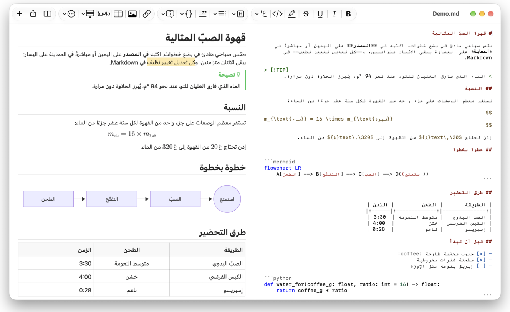
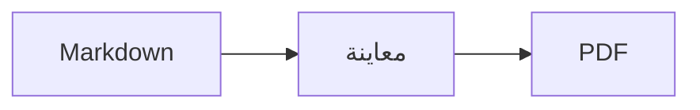

<p>&nbsp;&nbsp;&nbsp;</p>

# Splat

**محرر Markdown لنظام macOS يتيح لك الكتابة في المصدر أو مباشرةً في المعاينة.**

يضع Splat مصدر Markdown بألوان بناء الجملة على اليمين، ومعاينة حية قابلة للتحرير بالكامل على اليسار. اكتب في أيٍّ منهما: كل ما تكتبه في المعاينة يتحول إلى أصغر تغيير ممكن في المصدر، فتبقى الأسطر التي لم تلمسها متطابقة بايتًا ببايت، وتبقى فروقات Git نظيفة. يقرأ Splat صيغة Markdown التي تستخدمها أصلًا: CommonMark وGitHub Flavored Markdown وتنبيهات GitHub وروابط Obsidian الويكي والتضمينات والمربعات التوضيحية وامتدادات Pandoc وTypora وHTML المضمّن وصيغ LaTeX ومخططات Mermaid وGraphviz وPlantUML، وكلها تُعرض دون اتصال بالإنترنت. تصفّح مجلدًا كاملًا من الملاحظات وابحث فيه، واطّلع على ما تغيّر منذ آخر Commit في Git، والصق من Word أو من صفحة ويب بتنسيق Markdown، وصدّر إلى PDF أو HTML أو Word بنقرة واحدة. كُتب Splat بلغة Rust على عناصر تحكم AppKit الأصلية، ويدعم 35 لغة، ولا يرسل شيئًا عبر الشبكة ما لم تطلب منه ذلك.
 


[](https://github.com/sventmueller/splat/releases/latest/download/Splat.dmg)

**[تنزيل Splat.dmg](https://github.com/sventmueller/splat/releases/latest/download/Splat.dmg)**: موقّع ومعتمد من Apple، لنظام macOS 14 أو أحدث على Apple Silicon وIntel.

**هل وجدت خطأ؟** يُبقي Splat الأسطر التي لم تلمسها متطابقة بايتًا ببايت. فإذا تغيّر أحدها رغم ذلك، أو ظهر ملف بشكل خاطئ، [افتح بلاغًا](https://github.com/sventmueller/splat/issues/new/choose) وأرفق الملف. وإذا كان Splat مفيدًا لك، فإن [نجمة على GitHub](https://github.com/sventmueller/splat) تساعد الآخرين على العثور عليه.
 
 

[](https://www.rust-lang.org)
[](https://www.apple.com/macos/)

[](https://github.com/madsmtm/objc2)
[](https://webkit.org)
[](https://github.com/kivikakk/comrak)
[](https://github.github.com/gfm/)
[](https://www.mathjax.org)
[](https://cortexjs.io/mathlive/)
[](https://mermaid.js.org)
[](https://graphviz.org)
[](https://plantuml.com)


[](#الترخيص)

[Bahasa Indonesia](../id/README.md) ·
[Bahasa Melayu](../ms/README.md) ·
[Català](../ca/README.md) ·
[Čeština](../cs/README.md) ·
[Dansk](../da/README.md) ·
[Deutsch](../de/README.md) ·
[English](../../../README.md) ·
[Español](../es/README.md) ·
[Français](../fr/README.md) ·
[Hrvatski](../hr/README.md) ·
[Italiano](../it/README.md) ·
[Magyar](../hu/README.md) ·
[Nederlands](../nl/README.md) ·
[Norsk](../no/README.md) ·
[Polski](../pl/README.md) ·
[Português (Brasil)](../pt_BR/README.md) ·
[Português (Portugal)](../pt_PT/README.md) ·
[Română](../ro/README.md) ·
[Slovenčina](../sk/README.md) ·
[Slovenščina](../sl/README.md) ·
[Suomi](../fi/README.md) ·
[Svenska](../sv/README.md) ·
[Tiếng Việt](../vi/README.md) ·
[Türkçe](../tr/README.md) ·
[Ελληνικά](../el/README.md) ·
[Русский](../ru/README.md) ·
[Українська](../uk/README.md) ·
[עברית](../he/README.md)‎ ·
**العربية**‎ ·
[हिन्दी](../hi/README.md) ·
[ไทย](../th/README.md) ·
[한국어](../ko/README.md) ·
[日本語](../ja/README.md) ·
[简体中文](../zh-Hans/README.md) ·
[繁體中文](../zh-Hant/README.md)

## المحتويات

- [نظرة سريعة على الميزات](#نظرة-سريعة-على-الميزات)
- [المتطلبات](#المتطلبات)
- [التثبيت](#التثبيت)
- [البدء](#البدء)
- [الكتابة](#الكتابة)
  - [في المصدر](#في-المصدر)
  - [في المعاينة](#في-المعاينة)
  - [أوامر التنسيق](#أوامر-التنسيق)
  - [القوائم والمهام](#القوائم-والمهام)
  - [الجداول](#الجداول)
  - [لصق النص المنسق](#لصق-النص-المنسق)
  - [البيانات الوصفية](#البيانات-الوصفية)
- [صيغة Markdown المدعومة](#صيغة-markdown-المدعومة)
  - [CommonMark وGitHub Flavored Markdown](#commonmark-وgithub-flavored-markdown)
  - [المربعات التوضيحية](#المربعات-التوضيحية)
  - [الصيغة الموسّعة](#الصيغة-الموسّعة)
  - [Obsidian](#obsidian)
  - [الاستشهادات والمراجع](#الاستشهادات-والمراجع)
  - [HTML المضمّن](#html-المضمّن)
  - [علامات الترقيم الطباعية](#علامات-الترقيم-الطباعية)
  - [نظرة عامة على الصيغة](#نظرة-عامة-على-الصيغة)
- [الصيغ](#الصيغ)
- [المخططات](#المخططات)
- [الصور](#الصور)
- [الروابط والتنقل](#الروابط-والتنقل)
- [الملاحظات في مجلد](#الملاحظات-في-مجلد)
- [التغييرات منذ آخر Commit](#التغييرات-منذ-آخر-commit)
- [التصدير والطباعة والمشاركة](#التصدير-والطباعة-والمشاركة)
- [استيراد مستندات Word](#استيراد-مستندات-word)
- [المظهر وإمكانية الوصول](#المظهر-وإمكانية-الوصول)
- [اللغات](#اللغات)
- [اختصارات لوحة المفاتيح](#اختصارات-لوحة-المفاتيح)
- [الخصوصية والأمان](#الخصوصية-والأمان)
- [المستندات الكبيرة](#المستندات-الكبيرة)
- [القيود المعروفة](#القيود-المعروفة)
- [استكشاف الأخطاء وإصلاحها](#استكشاف-الأخطاء-وإصلاحها)
- [للمطورين](#للمطورين)
  - [المكونات الخارجية](#المكونات-الخارجية)
- [الترخيص](#الترخيص)

## نظرة سريعة على الميزات

- **طريقتان للكتابة، ونص واحد.** المصدر والمعاينة كلاهما قابل للتحرير. ملف Markdown هو المرجع الوحيد: هناك سجل تراجع واحد لكل مستند، وكل تعديل في المعاينة يُترجم إلى أصغر تغيير ممكن في المصدر.
- **صيغة Markdown التي تستخدمها أصلًا.** CommonMark وGitHub Flavored Markdown وتنبيهات GitHub وObsidian وامتدادات Pandoc وTypora ورموز الإيموجي النصية والنصوص المخفية وقوائم التعريفات ومراسي العناوين وHTML كما في ملفات README على GitHub.
- **صيغ ومخططات مدمجة.** صيغ LaTeX عبر MathJax مع محرر صيغ مرئي. مخططات Mermaid وGraphviz وPlantUML تُعرض على جهاز Mac لديك دون Java أو خادم أو اتصال بالشبكة.
- **زر لكل شيء.** لكل عنصر من عناصر Markdown زر في شريط الأدوات وعنصر في القائمة، وللشائع منها اختصار لوحة مفاتيح أيضًا. وللجداول قائمتها الخاصة للصفوف والأعمدة والمحاذاة.
- **مجلد، لا ملف فحسب.** يسرد الشريط الجانبي الملاحظات المحيطة بالمستند ويبحث فيها جميعًا. وإعادة تسمية ملاحظة تغيّر الروابط إليها، ويبقى كل بايت حولها كما هو.
- **التغييرات بنظرة واحدة.** في مستودع Git، تحدد أشرطة بجوار النص ما يختلف عن آخر Commit، في اللوحتين.
- **من Word والويب إلى Markdown.** الصق النص المنسق بتنسيق Markdown، وخلايا جدول البيانات كجدول، واستورد مستندات Word كاملة مع صورها.
- **تصدير دون فقدان شيء.** PDF، أو ملف HTML واحد مكتفٍ بذاته، أو مستند Word بعناوين وقوائم وجداول وحواشٍ سفلية وصور حقيقية. أضف أرقام الصفحات ورؤوس الصفحات وصفحة عنوان، أو استخدم قالب Word الخاص بشركتك.
- **أصلي حتى النخاع.** نوافذ AppKit حقيقية وعلامات تبويب وقوائم ونوافذ منبثقة والإصدارات والحفظ التلقائي وقائمة المشاركة والوضع الداكن والتدقيق الإملائي والإملاء الصوتي وVoiceOver. لا Electron، ولا عرض ويب للنص نفسه.
- **سريع مع الملفات الكبيرة.** تصيير ضغطة مفتاح في مستند بحجم 10 ميغابايت يستغرق نحو 10 مللي ثانية، قبل عمل العرض نفسه.
- **خاص وحذر.** الصور من الويب لا تُحمَّل إلا بعد أن تسمح بذلك، والروابط إلى تطبيقات أخرى تسألك أولًا، وكل ما يفكّ ترميز بيانات صور غير موثوقة يعمل في عمليات مساعدة معزولة داخل صندوق حماية.
- **بلغتك.** تتوفر الواجهة ومرجع Markdown السريع المدمج بـ 35 لغة: العربية والكتالانية والصينية (المبسطة) والصينية (التقليدية) والكرواتية والتشيكية والدنماركية والهولندية والإنجليزية والفنلندية والفرنسية والألمانية واليونانية والعبرية والهندية والمجرية والإندونيسية والإيطالية واليابانية والكورية والملايوية والنرويجية والبولندية والبرتغالية (البرازيل) والبرتغالية (البرتغال) والرومانية والروسية والسلوفاكية والسلوفينية والإسبانية والسويدية والتايلاندية والتركية والأوكرانية والفيتنامية.

## المتطلبات

- macOS 14 Sonoma أو أحدث. يُطوَّر Splat ويُختبر على macOS 27، حيث يعتمد تصميم Liquid Glass تلقائيًا.
- جهاز Mac بمعالج Apple Silicon أو Intel.
- نحو 45 ميغابايت من مساحة القرص.

## التثبيت

**من صورة القرص.** نزّل [`Splat.dmg`](https://github.com/sventmueller/splat/releases/latest/download/Splat.dmg)، وافتحه واسحب Splat إلى مجلد التطبيقات. الصورة موقّعة بشهادة Developer ID ومعتمدة من Apple، لذا تُفتح دون تحذيرات.

**عبر Homebrew.** توجد الحزمة cask في tap خاص بها:

```sh
brew install --cask sventmueller/tap/splat
```

يثبّت الأمر `brew upgrade --cask splat` الإصدارات الجديدة، ويزيل الأمر `brew uninstall --zap --cask splat` إعدادات Splat وذاكرته المؤقتة أيضًا.

**التحديثات.** يحدّث Splat نفسه بنفسه عبر [Sparkle](https://sparkle-project.org) إذا ثبّتّه من صورة القرص أو Homebrew. عند التشغيل الثاني يسأل إن كان يجوز له البحث عن تحديثات بنفسه مرة في اليوم. يبحث **Splat › البحث عن تحديثات…** فورًا؛ ويغيّر **البحث عن تحديثات تلقائيًا** و**تنزيل التحديثات وتثبيتها تلقائيًا** في القائمة نفسها اختيارك لاحقًا. لا يثبّت Splat تحديثًا إلا إذا كان يحمل توقيع المطوّر. أما النسخة التي تبنيها بنفسك فلا تحتوي على أداة تحديث.

**من الشيفرة المصدرية.** راجع [البناء](../../../docs/development.md#building) لمعرفة المتطلبات المسبقة، ثم:

```sh
make build
ditto target/release/Splat.app /Applications/Splat.app
open /Applications/Splat.app
```

لفتح ملفات Markdown بـ Splat بنقرة مزدوجة، حدّد أي ملف `.md` في Finder، واختر **ملف › إحضار المعلومات**، ثم اختر Splat ضمن **فتح بواسطة** وانقر **تغيير الكل…**. يسجّل Splat نفسه للملفات `.md` و`.markdown` و`.mdown` و`.mkd`.

## البدء

### النافذة

يُفتح كل مستند في نافذته الخاصة، أو في علامة تبويب إن كنت تفضّلها:

- **اليمين: المصدر.** نص Markdown الخاص بك بخط SF Mono وبألوان بناء الجملة.
- **اليسار: المعاينة.** المستند معروضًا، وجاهزًا للتحرير.
- **الشريط الجانبي (اختياري).** كل العناوين على شكل شجرة، والنقر على أحدها يعرضه في اللوحتين: **عرض › إظهار المخطط التفصيلي** (⌃⌘S). وتضم علامتا تبويب أخريان [الملاحظات في المجلد](#الملاحظات-في-مجلد) وبحثًا فيها. الزر بجانب عنوان النافذة يُظهره ويُخفيه، وتفتحه النوافذ الجديدة كما تركته آخر نافذة.
- **شريط الأدوات.** أزرار مجمّعة بحسب ما تغيّره: الأحرف والفقرات والعناصر المُدرَجة، ثم إظهار المعاينة وإخفاؤها، والمشاركة، ومستند جديد. خصّصه من **عرض › تخصيص شريط الأدوات…**.

اسحب الفاصل لتمنح أحد الجانبين مساحة أكبر. يترك **عرض › إخفاء المعاينة** (⌥⌘P) المصدر وحده؛ ويتذكر Splat ذلك لكل نافذة. تتمرر اللوحتان معًا، ويُميَّز التحديد في إحداهما في الأخرى.

تعرض زاوية النافذة عدد كلمات النص وأحرفه والوقت اللازم لقراءته، وكذلك أرقام التحديد ما دام موجودًا. ولا تُحتسب عناوين الروابط ووسوم HTML والبيانات الوصفية والتعليقات والصيغ والمخططات. ويبقى مخفيًا حتى تختار **عرض › إظهار عدد الكلمات**.

### المستندات وعلامات التبويب والإصدارات

Splat تطبيق مستندات عادي في macOS:

- **الحفظ التلقائي والإصدارات.** تُحفظ التغييرات في مكانها. يعيدك **ملف › الرجوع إلى › استعراض كافة الإصدارات…** في الزمن إلى الوراء.
- **تغييرات من برامج أخرى.** عندما يغيّر Git أو سكربت أو محرر آخر مستندًا مفتوحًا، يعيد Splat تحميله ويحتفظ بموضع المؤشر وموضع التمرير. وإذا كانت لديك تغييرات غير محفوظة، يحتفظ بها Splat، ويسأل macOS قبل الحفظ فوق النسخة الأخرى.
- **أوامر الملفات المعتادة.** تكرار (⇧⌘S) وإعادة تسمية… والنقل إلى… و**ملف › فتح العناصر الأخيرة**.
- **علامات التبويب.** يفتح **ملف › علامة تبويب جديدة** أو الزر **+** في شريط الأدوات مستندًا جديدًا في علامة تبويب؛ وتتولى قائمة نافذة القياسية دمج علامات التبويب ونقلها والتنقل بينها.
- **موضع النافذة.** يُحفظ حجم آخر نافذة وموضعها، حتى بعد إعادة التشغيل. وإذا كانت هناك نافذة في المكان نفسه، تُفتح الجديدة بإزاحة طفيفة.
- **أيقونة Dock.** النقر عليها بعد إغلاق آخر نافذة يفتح مستندًا جديدًا.
- **فتح ملفات Markdown في Splat.** يجعل **Splat › تعيين كالتطبيق الافتراضي لملفات Markdown** النقر المزدوج على ملف `.md` أو `.markdown` يفتح Splat؛ ويطلب macOS التأكيد مرة واحدة. يظهر أمام العنصر علامة اختيار ما دام Splat هو التطبيق الافتراضي.

يجب أن تكون الملفات نصًا بترميز UTF-8، أو UTF-16 مع علامة ترتيب البايت. يرفض Splat الترميزات الأخرى بدلًا من التخمين وإفساد النص. تبقى علامة ترتيب البايت كما هي، ويبقى UTF-16 بترميز UTF-16، وفي ملف تنتهي كل أسطره بـ CRLF، تنتهي الأسطر التي تضيفها بـ CRLF أيضًا.

**بعد انهيار التطبيق**، يضيع على الأكثر ما كتبته في الثواني القليلة الأخيرة: ينسخ Splat النص غير المحفوظ كل خمس ثوانٍ إلى `~/Library/Application Support/Splat/Unsaved`، ويزيل النسخ عند حفظ المستند أو عند إنهاء Splat بشكل طبيعي. وفي التشغيل التالي ينقل ما خلّفه الانهيار هناك إلى `~/Library/Application Support/Splat/Recovery` ويبلغك بذلك مرة واحدة، مع زر يفتح المجلد. والانهيار الذي يستطيع Splat الاستجابة له يكتب هناك أيضًا نص كل مستند مفتوح.

### المرجع السريع

يفتح **مساعدة › مرجع Markdown السريع** ورقة مرجعية بلغتك في مستند جديد بلا عنوان. إنه مستند عادي، فجرّب كل شيء هناك مباشرة، في المصدر أو في المعاينة.

## الكتابة

### في المصدر

المصدر محرر نصوص عادية مضبوط لـ Markdown:

- **ألوان بناء الجملة** كما في VS Code: العناوين والتوكيد والروابط والرمز البرمجي والجداول وHTML والبيانات الأمامية front matter، وLaTeX وMermaid داخل الصيغ والمخططات. تتوفر لوحات ألوان للوضع الفاتح والداكن ولزيادة التباين.
- **كتل الرمز البرمجي المسوّرة** تُلوَّن للغات Bash وC وC++ وC# وCSS (وكذلك SCSS وLess) وGo وHTML وXML وJava وJavaScript وJSON وKotlin وPHP وPython وRuby وRust وSQL وSwift وTypeScript وYAML وTeX وMermaid، بما في ذلك أسماؤها المختصرة المعتادة مثل `js` أو `py` أو `sh`.
- **لا استبدالات مفاجئة.** علامات الاقتباس الذكية والشرطات الذكية واستبدال النص معطّلة افتراضيًا، لأنها تفسد `--` و`---` و`"`. فعّلها من **تعديل › البدائل**.
- **أدوات الكتابة في النظام.** التدقيق الإملائي والنحوي والإملاء الصوتي وبحث واستبدال (⌥⌘F) والتكلم.
- **السحب والإفلات.** أفلت ملف صورة لإدراج ``، وأي ملف آخر لإدراج رابط إليه، وعنوان URL لإدراج `[url](url)`. كل عملية إفلات خطوة تراجع واحدة.
- **لصق الصور.** الصورة الموجودة في الحافظة، مثل لقطة الشاشة، تُحفظ كملف PNG بجوار المستند (`صورة 2026-10-29 13.09.07.png`) وتُدرج كصورة. يجب حفظ المستند مرة واحدة لذلك.

### في المعاينة

تتصرف المعاينة كمعالج نصوص، لكن كل ما تفعله فيها ينتهي إلى Markdown:

- **الكتابة.** الأحرف التي لها معنى في Markdown، مثل `*` أو `#`، يُضاف لها حرف الهروب لتظهر كما كُتبت.
- يبدأ **Return** فقرة جديدة أو عنصر قائمة جديدًا. ويُدرج **⌥Return** أو **⌃Return** فاصل سطر.
- **التنسيق عند المؤشر.** عندما يكون المؤشر في نهاية كلمة، يُطبَّق غامق ومائل وبقية تنسيقات الأحرف على ما تكتبه بعد ذلك. اختر التنسيق مرة أخرى لإيقافه. وداخل الكلمة تُنسَّق الكلمة كلها.
- **الأسطر الفارغة.** يضيف Return على سطر فارغ سطرًا فارغًا آخر، ويزيله Backspace. في المصدر، كل سطر فارغ إضافي يعني سطرين فارغين آخرين؛ وتعرضها برامج Markdown الأخرى كمسافة عادية بين الفقرات.
- **التراجع** يعمل عبر اللوحتين. لعناصر التراجع أسماء ("تراجع عن غامق")، والكتابة خطوة واحدة لكل دفعة، وبعد التراجع والإعادة تتمرر اللوحتان إلى التغيير.
- **الصيغ والمخططات** تظهر كرسومات جاهزة. انقر على أحدها أو انقل المؤشر إليه أو اضغط Return عليه لفتح محرره (راجع [الصيغ](#الصيغ) و[المخططات](#المخططات)).
- **HTML المضمّن والملاحظات المضمّنة والبيانات الأمامية** تُعرض، لكنك تحررها في المصدر. النقر عليها يضع المؤشر في المكان المقابل هناك.

كل ما لا يستطيع Markdown التعبير عنه محظور في المعاينة: لوحتا الخط واللون والمسطرة ولصق النص المنسق والصور أو إفلاتها. ويصل HTML وRTF الملصوقان كنص عادي، ما لم تختر [لصق بتنسيق Markdown](#لصق-النص-المنسق).

### أوامر التنسيق

كل أمر متاح من شريط الأدوات وشريط القوائم والقائمة السياقية في اللوحتين. تعرض عناصر القائمة علامة اختيار للتنسيق عند المؤشر.

| القائمة | الأوامر |
|---|---|
| **التنسيق › الخط** | غامق، مائل، تسطير، يتوسطه خط، تمييز، رمز برمجي، خط مرتفع، خط منخفض |
| **التنسيق › عنوان** | النص الأساسي، عنوان 1 إلى 6 |
| **التنسيق › قائمة** | قائمة تعداد نقطي، قائمة تعداد رقمي، قائمة مهام |
| **التنسيق** | اقتباس، كتلة رمز برمجي (بدون لغة أو إحدى 20 لغة؛ ويغيّر أيضًا لغة كتلة موجودة)، مربع توضيحي (ملاحظة، نصيحة، مهم، تحذير، تنبيه؛ النوع نفسه مرة أخرى يزيله)، تعديل الصيغة أو المخطط…، مسح التنسيق |
| **إدراج** | رابط…، صورة…، جدول…، صيغة، مخطط (مخطط انسيابي، مخطط تسلسلي، مخطط جانت)، جدول المحتويات، حاشية سفلية، خط فاصل |
| **جدول** | إدراج صف بالأعلى/بالأسفل، إدراج عمود على اليسار/اليمين، حذف الصف، حذف العمود، المحاذاة (يسار، وسط، يمين، افتراضي)، محاذاة أعمدة الجدول |
| **عرض** | إخفاء/إظهار المعاينة، إظهار/إخفاء المخطط التفصيلي، علامات الترقيم الطباعية، تكبير/تصغير، الحجم الفعلي، شريط الأدوات، شريط علامات التبويب، ملء الشاشة |

يُكتب التسطير والتمييز والخط المرتفع والخط المنخفض بالوسوم `<ins>` و`<mark>` و`<sup>` و`<sub>`، وهي وسوم يعرضها GitHub أيضًا. ويقرأ Splat كذلك `<u>` الذي يزيله GitHub، والصيغ الأقصر `==highlight==` و`^sup^` و`~sub~`. يعرض GitHub الرمزين `==` و`^` كما كُتبا، ويعرض `~sub~` كنص يتوسطه خط.

### القوائم والمهام

- يواصل Return القائمة؛ والضغط عليه في عنصر فارغ ينهيها.
- يزيد **Tab** و **⇧Tab** المسافة البادئة لعناصر القائمة في المعاينة ويقلّلانها.
- النقر على مربع اختيار مهمة في المعاينة يبدّل `- [ ]` و`- [x]`.
- يحوّل **التنسيق › قائمة** الفقرات المحددة إلى قائمة أو يغيّر نوعها.

### الجداول

- يسأل **إدراج › جدول…** عن عدد الصفوف (بما فيها صف العناوين) والأعمدة.
- في المعاينة ينتقل **Tab** إلى الخلية التالية، و **⇧Tab** إلى السابقة، و**Return** إلى الخلية الواقعة أسفل. والضغط على Tab في الخلية الأخيرة يضيف صفًا.
- تدرج قائمة **جدول** الصفوف والأعمدة وتحذفها وتضبط محاذاة العمود (⌘{ و⌘| و⌘}).
- يضيف **جدول › محاذاة أعمدة الجدول** مسافات إلى المصدر لتصطف الأعمدة.

### لصق النص المنسق

يحوّل **تعديل › لصق بتنسيق Markdown** (⌃⌘V)، الموجود أيضًا في القائمة السياقية في اللوحتين، ما في الحافظة إلى Markdown عند التحديد، في خطوة تراجع واحدة. ويواصل ⌘V إدراج نص عادي.

- **من متصفح أو Word أو Google Docs أو Confluence أو الملاحظات أو Pages:** تنتقل العناوين والغامق والمائل والتسطير والخط الذي يتوسط النص والخط المرتفع والخط المنخفض والروابط والقوائم بتداخلها والاقتباسات والرمز البرمجي والجداول.
- **من جدول بيانات:** تصبح الخلايا جدولًا بصف عناوين وأعمدة أرقام محاذاة إلى اليمين. وكذلك النص المفصول بعلامات جدولة أو فواصل منقوطة أو فواصل، إذا كان لكل سطر العدد نفسه من الأعمدة.
- **الصور** ذات عنوان الويب تبقى روابط. والصورة داخل HTML الملصوق تصبح ملفًا بجوار المستند، ويجب حفظ المستند مرة واحدة لذلك. أما ملفات Word المؤقتة للصور فلا تُنقل، ويبقى نصها البديل.
- **الروابط** لا تحتفظ إلا بعناوين `http` و`https` و`mailto` والعناوين النسبية وعناوين `#`؛ ومن أي رابط آخر يبقى نصه.

### البيانات الوصفية

يفتح **التنسيق › تعديل البيانات الوصفية…**، أو النقر على سطر البيانات الوصفية في أعلى المعاينة، نموذجًا بحقول YAML front matter. ويمكن تغيير الحقول وإضافتها وإزالتها. ويبقى الحقل الذي يحمل قائمة قائمةً: تتتابع قيمها مفصولة بفواصل، وتوضع القيمة التي تحتوي على فاصلة بين علامتي اقتباس. ويصبح الحقل الجديد المسمى `tags` أو `aliases` أو `keywords` أو `categories` أو `authors` أو `cssclasses` قائمة أيضًا. وتظهر الحقول المتداخلة والنص متعدد الأسطر هناك، وتُحرَّر في المصدر.

ما يغيّره النموذج خطوة تراجع واحدة، ولا يمس إلا أسطر الحقول التي غيّرتها: تبقى التعليقات والترتيب والمسافات غير المعتادة وعلامات الاقتباس ونهايات الأسطر في كل الحقول الأخرى متطابقة بايتًا ببايت. ويحصل المستند الذي لا بيانات وصفية فيه على كتلة في بدايته.

## صيغة Markdown المدعومة

يحلل Splat النص عبر [comrak](https://github.com/kivikakk/comrak)، وهو محلل متوافق مع CommonMark وGFM، ويفعّل معظم امتداداته. كل ما يلي يُعرض في المعاينة وفي جميع صيغ التصدير.

### CommonMark وGitHub Flavored Markdown

- العناوين (`#` والمسطّرة) والفقرات وفواصل الأسطر والتوكيد والتوكيد القوي والرمز البرمجي داخل السطر واقتباسات الكتل والخطوط الفاصلة.
- القوائم النقطية والرقمية والمتداخلة؛ وقوائم المهام.
- الروابط (داخل السطر وبالمرجع والتلقائية) والصور وتعريفات مراجع الروابط.
- كتل الرمز البرمجي المسوّرة والمزاحة بألوان بناء الجملة.
- الجداول مع محاذاة الأعمدة.
- النص الذي يتوسطه خط باستخدام `~~two tildes~~`.
- الحواشي السفلية: `text[^1]` مع `[^1]: The note.` في أي مكان من المستند. النقر على العلامة ينقلك إلى الحاشية.
- YAML front matter بين سطرين `---` في أعلى المستند. تلخصه المعاينة في سطر واحد، مثل "البيانات الوصفية: title, date, tags".

### المربعات التوضيحية

تُعرض تنبيهات GitHub كمربعات ملونة بأيقونة وعنوان:

```markdown
> [!NOTE]
> معلومة مفيدة ينبغي للمستخدمين معرفتها.

> [!WARNING]
> محتوى بالغ الأهمية يتطلب انتباهًا فوريًا.
```

الأنواع الخمسة هي ملاحظة ونصيحة ومهم وتحذير وتنبيه. يحوّل **التنسيق › مربع توضيحي** الفقرة عند المؤشر إلى واحد منها.

تعمل مربعات Obsidian التوضيحية أيضًا، بأي عنوان وبحالة طي:

```markdown
> [!tip]- انقر ▸ للتوسيع
> مخفي حتى يُفتح.

> [!question]+ مفتوح افتراضيًا
> العلامة `+` تبدأ موسّعة، و`-` تبدأ مطوية.
```

تُعرض أنواع Obsidian الأخرى بأقرب الألوان الخمسة: `success` و`check` و`done` و`hint` كنصيحة؛ و`question` و`help` و`faq` كمهم؛ و`attention` كتحذير؛ و`failure` و`fail` و`missing` و`danger` و`error` و`bug` كتنبيه؛ وكل ما سواها كملاحظة.

### الصيغة الموسّعة

| الميزة | الصيغة | المصدر |
|---|---|---|
| تمييز | `==نص مميز==` | Obsidian وTypora |
| خط مرتفع | `x^2^` | Pandoc وTypora |
| خط منخفض | `H~2~O` | Pandoc وTypora |
| رمز إيموجي نصي | `:rocket:` يصبح 🚀 | GitHub |
| نص مخفي | `\|\|نص مخفي\|\|`، حدده لقراءته | Discord |
| حاشية سفلية داخل السطر | `text^[the note itself]` | Pandoc وObsidian |
| قائمة تعريفات | `Term` وسطر فارغ و`: Explanation` | PHP Markdown Extra وPandoc |
| مرساة عنوان | `## تثبيت {#setup}`، والرابط إليها `[انظر](#setup)` | Pandoc وkramdown |

تبدو قوائم التعريفات هكذا في المصدر:

```markdown
المصطلح

: شرح المصطلح.
```

إذا لم تحدد مرساة خاصة، يحصل كل عنوان على مرساة مشتقة من نصه، كما في GitHub: يمكن الوصول إلى `## البدء` عبر `#البدء`.

### Obsidian

- **الروابط الويكي.** يشير `[[Note]]` إلى `Note.md` في المجلد نفسه أو في مجلد تحته. يعرض `[[Note|نص معروض]]` نصك الخاص، ويفتح `[[Note#Heading]]` الملاحظة. النقر مع ⌘ يفتحها في Splat.
- **التضمينات.** يعرض `![[Note]]` الملاحظة الأخرى داخل هذه؛ وتظهر الملاحظات المضمّنة فيها كروابط. ويعرض `![[diagram.png]]` صورة. كما في Obsidian، تسمّي التضمينات الملاحظات والصور الموجودة في مجلد المستند أو تحته، وليس بمسار مطلق أبدًا، ولا تظهر كملاحظات إلا ملفات Markdown.
- **التعليقات.** يبقى `%%في المصدر فقط%%` ظاهرًا في المصدر ويُستبعد من المعاينة ومن كل تصدير، سواء داخل السطر أو في أسطر مستقلة.
- **الوسوم.** يُميَّز `#idea` أو `#project/splat`. النقر مع ⌘ يبحث عن الوسم في المستند، وفي الشريط الجانبي في المجلد كله.
- **المربعات التوضيحية القابلة للطي.** راجع [المربعات التوضيحية](#المربعات-التوضيحية).

### الاستشهادات والمراجع

- **استشهادات Pandoc.** يظهر `[@doe2020]` أو `[@doe2020; @roe2021]` على هيئة "(Doe 2020; Roe 2021)". تؤخذ المدخلات من ملف BibTeX الذي تسميه البيانات الأمامية بالشكل `bibliography: refs.bib`. وبدونها يستخدم Splat الملف `references.bib` أو `literatur.bib` أو `bibliography.bib` الموجود بجوار المستند.
- **مراجع GitHub وGitLab.** إذا كان المستند داخل مستودع Git يقع مستودعه البعيد `origin` على github.com أو على مضيف GitLab، فإن `@name` و`#12` (مشكلة) و`!7` (طلب دمج، في GitLab فقط) تُميَّز. النقر مع ⌘ يفتحها في المتصفح.

### HTML المضمّن

يُعرض HTML كما تجده في ملفات README على GitHub، بقارئ خاص به لا بمحرك متصفح:

- الفقرات والكتل الموسّطة (`<p align="center">` و`<div align="center">`)
- الصور ذات الحجم المحدد (``)
- الروابط و`<kbd>⌘</kbd>` و`<br>` و`<u>` و`<ins>` و`<mark>` و`<sup>` و`<sub>`
- القوائم والجداول، بما فيها الخلايا الممتدة عبر أعمدة (`colspan`)
- الأقسام القابلة للطي: `<details><summary>المزيد</summary>…</details>`، وتُفتح بالنقر على ▸

يُعرض Markdown الواقع بين وسوم HTML على أنه Markdown. تُستبعد السكربتات والأنماط والإطارات والنماذج تمامًا، ولا تحتفظ الروابط والصور إلا بعناوين `http` و`https` و`mailto` والعناوين النسبية.

### علامات الترقيم الطباعية

يعرض **عرض › علامات الترقيم الطباعية** علامات الاقتباس المستقيمة بعلامات الاقتباس الخاصة بلغة واجهتك، و`--` كشرطة قصيرة، و`---` كشرطة طويلة، و`...` كنقاط حذف. في الألمانية يصبح `"Ja"` هكذا „Ja“، وفي الفرنسية «Oui»، وفي اليابانية 「はい」، وكذلك حيث تضع الصينية واليابانية علامات الاقتباس دون مسافة؛ وتحصل الاختصارات العبرية مثل `צה"ל` على الجرشايم الخاص بها، צה״ל. يحتفظ المصدر بالأحرف العادية؛ وتعرض المعاينة وجميع صيغ التصدير الأحرف الطباعية. الإعداد معطّل حتى تفعّله.

### نظرة عامة على الصيغة

| العنصر | Markdown |
|---|---|
| **غامق** | `**غامق**` |
| *مائل* | `*مائل*` |
| تسطير | `<ins>تسطير</ins>` أو `<u>تسطير</u>` |
| ~~يتوسطه خط~~ | `~~يتوسطه خط~~` |
| تمييز | `<mark>تمييز</mark>` أو `==تمييز==` |
| `رمز` | `` `رمز` `` |
| x² | `x<sup>2</sup>` أو `x^2^` |
| H₂O | `H<sub>2</sub>O` أو `H~2~O` |
| [رابط](https://example.com) | `[رابط](https://example.com)` |
| عنوان | `# عنوان` إلى `###### عنوان` |
| اقتباس | `> اقتباس` |
| قائمة نقطية | `- عنصر` |
| قائمة رقمية | `1. عنصر` |
| مهمة | `- [ ] مفتوحة` و`- [x] منجزة` |
| كتلة رمز برمجي | ```` ```rust ```` … ```` ``` ```` |
| جدول | `\| أ \| ب \|` مع `\|---\|---\|` تحت صف العناوين |
| حاشية سفلية | `نص[^1]` و`[^1]: ملاحظة` |
| خط فاصل | `---` |
| صورة | `` |
| صيغة | `$E = mc^2$`، `$$ … $$` |
| مخطط | ```` ```mermaid ````، ```` ```dot ````، ```` ```plantuml ```` |
| مربع توضيحي | `> [!TIP]` |
| رابط ويكي | `[[Note]]`، `[[Note\|نص]]` |
| تضمين | `![[Note]]`، `![[image.png]]` |
| تعليق | `%%تعليق%%` |
| وسم | `#وسم` |
| استشهاد | `[@key]` |
| نص مخفي | `\|\|نص مخفي\|\|` |
| إيموجي | `:tada:` |

## الصيغ

تُعرض الصيغ بواسطة [MathJax](https://www.mathjax.org) مع TeX ورياضيات AMS الخاصة به، كرسومات متجهة حادة. يمكن أن يكون النص داخل `\text{…}` بأي نظام كتابة: وما تفتقده خطوط MathJax يأتي من خطوط جهاز Mac لديك، مع كتابة العربية والعبرية من اليمين إلى اليسار، والإيموجي بالألوان.

| النوع | الصيغة |
|---|---|
| داخل السطر | `$E = mc^2$`، `` $`E = mc^2`$ `` (GitHub وGitLab)، `\(E = mc^2\)` |
| منفصلة | `$$` … `$$`، أو `\[` … `\]`، أو كتلة رمز برمجي موسومة بـ `math` |

**تعديل صيغة.** انقر على صيغة في المعاينة، أو انقر عليها نقرًا مزدوجًا، أو اضغط Return عليها، أو انقل المؤشر إليها لفتح محررها في نافذة منبثقة. يدرج **إدراج › صيغة** صيغة جديدة ويفتح المحرر فورًا.

- **مرئي أو LaTeX.** يبدّل المفتاح في الأعلى بين محرر مرئي ([MathLive](https://cortexjs.io/mathlive/)) ورمز LaTeX. يتذكر Splat اختيارك.
- **وحدات بناء** للكسر والجذر التربيعي والخط المرتفع والمنخفض والمجموع والتكامل بحدود والنهاية والأقواس التي تتمدد مع محتواها ومصفوفة 2×2 والأحرف اليونانية والعلاقات والمؤثرات والأسهم. تترك مواضع □ فارغة، ويقفز **Tab** إلى التالي منها.
- **معاينة حية.** تظهر التغييرات في المستند أثناء الكتابة. تظهر أخطاء MathJax في سطر تحت الرمز.
- **اعتماد أو تجاهل.** النقر في الخارج يُبقي التغيير كخطوة تراجع واحدة؛ ويتجاهله **Esc** أو **إلغاء**. والضغط على Esc في صيغة جديدة فارغة يزيلها من جديد.
- تقدّم القائمة السياقية **تعديل الصيغة…** للصيغة الواقعة تحت المؤشر.

يقرأ VoiceOver الصيغة كرمز LaTeX الخاص بها. يعرض Splat الصيغ لا مستندات LaTeX الكاملة: لا حزم، ولا TikZ، ولا `\documentclass`.

## المخططات

تُعرض المخططات داخل Splat، دون اتصال بالإنترنت، بنسخة فاتحة ونسخة داكنة.

| المحرك | كتلة الرمز البرمجي | ما يرسمه |
|---|---|---|
| [Mermaid](https://mermaid.js.org) | ```` ```mermaid ```` | المخططات الانسيابية والتسلسلية ومخططات الأصناف والحالات والعلاقات بين الكيانات وجانت والدائرية والخرائط الذهنية والجداول الزمنية وكل أنواع Mermaid الأخرى |
| [Graphviz](https://graphviz.org) | ```` ```dot ```` أو ```` ```graphviz ```` | رسوم بيانية بلغة DOT |
| [PlantUML](https://plantuml.com) | ```` ```plantuml ```` أو ```` ```puml ```` | مخططات UML؛ يعمل دون Java |



**تعديل مخطط** يشبه تعديل صيغة: انقر عليه لفتح الرمز في نافذة منبثقة، مع ألوان بناء الجملة ورسائل الأخطاء في سطر تحت الرمز. يبدأ **إدراج › مخطط** من قالب لمخطط انسيابي أو مخطط تسلسلي أو مخطط جانت. وتساعد وحدات البناء في أكثر أنواع Mermaid الثلاثة شيوعًا:

- **مخطط انسيابي:** عقدة ▾ (مستطيل، مستدير الزوايا، دائرة، معين، قاعدة بيانات)، وصلة، وصلة مع تسمية، مجموعة، الاتجاه ▾
- **مخطط تسلسلي:** مشارك، رسالة، رد، ملاحظة، حلقة، مسارات بديلة
- **مخطط جانت:** قسم، مهمة، علامة فارقة

أنواع المخططات الأخرى تُحرَّر كرمز. يقرأ VoiceOver عنوان المخطط أو نصه البديل.

يستغرق أول مخطط بعد التشغيل نحو ثانية، لأن محرك العرض يبدأ في الخلفية. والمخطط الذي يستغرق أكثر من 10 ثوانٍ يعرض خطأ، ويبدأ محرك العرض من جديد للمخطط التالي. ولا يُحمَّل محرك PlantUML (3 ميغابايت) إلا مع أول مخطط PlantUML. ويُحظر `!include` في PlantUML إذا كان من الويب.

## الصور

- **الصور المحلية** تستخدم مسارات نسبية إلى المستند: ``. يعرض Splat صور PNG وJPEG وGIF وWebP وBMP وSVG وHEIC وTIFF وAVIF وPDF.
- **الصور من الويب** تبقى محظورة حتى تسمح بها: يوضح شريط فوق المعاينة أن تحميلها يُعلم خوادمها بأنك تفتح المستند ومتى تفتحه. يسمح **تحميل الصور** بها لهذا المستند؛ ويتذكر Splat الاختيار لكل ملف.
- **الحجم.** يحدد `` حجم الصورة؛ وما عدا ذلك تلائم الصور عرض المعاينة.
- **التغييرات على القرص.** الصورة التي تستبدلها، أو التي تظهر بعد أن سمّاها المستند، تظهر دون إعادة فتح المستند. والصور من الويب التي فشلت بسبب الشبكة يُعاد تحميلها ما دام مستند يعرضها.
- **الذاكرة.** تُعرض الصور بما يصل إلى 2560 بكسل على أطول ضلع لها، وهو ما يملأ صفحة A4 أيضًا. وتُفكّ بدقة أقل عندما تملأ ثُمن ذاكرة جهاز Mac، وما دام macOS يبلّغ عن ضغط على الذاكرة.
- **الوضع الداكن.** الصور ذات الخلفية البيضاء تُخفَّض إضاءتها قليلًا في المعاينة الداكنة.
- **اللصق والإفلات.** راجع [في المصدر](#في-المصدر).

## الروابط والتنقل

في المعاينة، ينقل النقر المؤشر لتحرير نص الرابط؛ و**النقر مع ⌘** يتبع الرابط:

- تُفتح `http` و`https` و`mailto` في متصفحك أو تطبيق البريد.
- تُفتح ملفات Markdown في Splat؛ أما الملفات والمجلدات الأخرى فتُظهر في Finder.
- ينتقل `#anchor` إلى العنوان في المستند.
- العناوين التي تفتح تطبيقًا آخر، مثل `slack://` أو `vscode://`، تسأل أولًا وتعرض العنوان الكامل والتطبيق. ويكون **إلغاء** محددًا مسبقًا.

يدرج **إدراج › جدول المحتويات** قائمة مرتبطة بكل العناوين. وعندما يكون المؤشر داخلها، يحدّثها الأمر نفسه. ينتقل الشريط الجانبي للمخطط التفصيلي (⌃⌘S) إلى أي عنوان في اللوحتين.

## الملاحظات في مجلد

تبدّل الأزرار في أعلى الشريط الجانبي بين المخطط التفصيلي والملفات والبحث.

- **الملفات** (**عرض › إظهار الملفات**، ⌃⌘E). كل ملفات Markdown في مجلد المستند، أو في المستودع كله إذا كان المستند داخل مستودع Git. يفتح النقر أو Return الملاحظة كعلامة تبويب في هذه النافذة؛ وإذا كانت مفتوحة أصلًا، تنتقل إلى المقدمة. ويعرض الزر المجاور لاسم المجلد مجلدًا آخر في هذه النافذة. وتُستبعد الملفات المخفية و`node_modules` و`target` و`Pods` و`DerivedData` و`__pycache__` والمجلدات التي لا ملاحظات فيها. والمستند الموجود مباشرة في مجلدك الرئيسي لا يعرض إلا الملاحظات المجاورة له، حتى لا يمرّ Splat على كل مجلداتك ويسأل عن كل واحد منها.
- **بحث** (**تعديل › بحث › البحث في كل الملاحظات…**، ⇧⌘F). يجد النص في كل الملاحظات، بصرف النظر عن حالة أحرفه وعن طريقة ترميز علاماته المميزة. يجد `#tag` وسمًا، ويجد `#project` أيضًا `#project/splat`، ولا يجد شيئًا داخل الرمز البرمجي. والنقر على نتيجة يفتح الملاحظة عند ذلك الموضع.
- **الروابط إلى ملاحظة.** تسرد القائمة السياقية لملاحظة الملاحظات التي ترتبط بها، برابط ويكي أو تضمين أو رابط نسبي أو تعريف مرجع.
- **إعادة تسمية ملاحظة.** تعيد القائمة نفسها تسميتها وتغيّر تلك الروابط. يبيّن Splat أولًا كم رابطًا في كم ملفًا يعنيه ذلك. لا يتغير في كل رابط إلا الاسم، ويبقى كل بايت آخر في الملف كما هو. تتلقى المستندات المفتوحة التغيير كخطوة تراجع؛ أما في الملفات الأخرى فلا يستطيع التراجع عنه إلا Git أو الإصدارات. وإذا غيّر برنامج آخر ملفًا في الأثناء، توقفت إعادة تسمية كل الروابط، وذكر Splat اسمه.

تتبع القائمة المجلد عندما تنتقل النافذة إلى المقدمة. ويعمل البحث على الملفات كما هي على القرص، ويُحتسب النص الذي لم تحفظه بعد ابتداءً من الحفظ التلقائي التالي.

## التغييرات منذ آخر Commit

في مستند داخل مستودع Git، تحدد أشرطة بجوار النص ما يختلف عن آخر Commit، في المصدر وفي المعاينة: الأخضر للأسطر المضافة، والأزرق للأسطر المتغيرة، وعلامة حمراء قصيرة حيث حُذف شيء. وتُحدَّث الأشرطة أثناء الكتابة وعند انتقال الفرع. ويوقفها **عرض › التغييرات منذ آخر Commit** في كل النوافذ.

لا تُحتسب الأسطر التي تختلف في نهاية السطر فقط، فلا يظهر أي تغيير لملف بنهايات CRLF مقابل Commit بنهايات LF. ولا تظهر علامات على ملف جديد حتى أول Commit له، ولا على مستند يتجاوز 32 ميغابايت.

## التصدير والطباعة والمشاركة

| الصيغة | الطريقة | ما تحصل عليه |
|---|---|---|
| **PDF** | **ملف › تصدير كملف PDF…** أو قائمة المشاركة | صفحات بحجم الورق، دائمًا بالمظهر الفاتح، والصيغ والمخططات كرسومات متجهة. يحدد **ملف › إعداد الصفحة…** الورق. |
| **طباعة** | **ملف › طباعة…** (⌘P) | التخطيط نفسه كما في PDF. |
| **HTML** | **ملف › تصدير كملف HTML…** أو قائمة المشاركة | ملف واحد مكتفٍ بذاته: الصور المحلية مضمّنة، والصيغ والمخططات كصور حادة، ومراسي العناوين ليعمل جدول المحتويات. بلا سكربتات. |
| **Word** | **ملف › تصدير كمستند Word…** أو قائمة المشاركة | ملف `.docx` بأنماط العناوين في Word وقوائم وجداول حقيقية (بما فيها الخلايا المدمجة) وحواشٍ سفلية بصيغة حواشي Word وصور مضمّنة وصيغ ومخططات. |
| **Markdown** | زر **مشاركة** في شريط الأدوات | المستند كملف `.md` للبريد والرسائل وAirDrop وكل خدمة مشاركة أخرى. |

تقدّم قائمة **ملف › مشاركة** كل ذلك في مكان واحد. تستخدم عمليات التصدير إعداد علامات الترقيم الطباعية والصور التي سمحت بها من الويب؛ وتبقى الصور من الويب روابط في HTML.

يحدد **ملف › خيارات التصدير…** ما تضيفه ملفات PDF والطباعة وWord إلى النص، لكل المستندات:

- **أرقام الصفحات** في تذييل PDF والطباعة، بالشكل `2 / 9`.
- **الرأس والتذييل** لـ PDF والطباعة. تمثل `{title}` و`{author}` و`{date}` و`{page}` و`{pages}` قيمها، والثلاث الأولى من البيانات الوصفية للمستند.
- **صفحة العنوان** لـ PDF والطباعة وWord، وفيها `title` و`subtitle` و`author` و`date` من البيانات الوصفية، أو اسم المستند عنوانًا لها. وليس فيها رأس ولا تذييل.
- **قالب Word**، وهو ملف `.docx` أو `.dotx` يأخذ التصدير مظهره: أنماطه، بما فيها الأسماء المترجمة، وسمته وحجم صفحته وهوامشه ورؤوسه وتذييلاته. والقالب الذي تتعذر قراءته يوقف التصدير ويخبرك بذلك، بدلًا من أن يعطيك مستندًا بدونه.

## استيراد مستندات Word

يسأل **ملف › استيراد مستند Word…** عن ملف `.docx` أو `.dotx` وعن مكان حفظ Markdown الناتج، ثم يفتح النتيجة. وتوضع الصور في مجلد بجواره، يحمل اسم المستند مع `-images`.

تنتقل العناوين والقوائم كما تحددها أنماط Word وترقيمه، حتى في المستندات التي لأنماطها أسماء مترجمة. وينتقل الغامق والمائل والتسطير والخط الذي يتوسط النص والتمييز والخط المرتفع والخط المنخفض والروابط والاقتباسات والرمز البرمجي والحواشي السفلية والحواشي الختامية والجداول، والخلايا الممتدة عبر الأعمدة كجدول HTML. وتصبح الصيغ LaTeX. وتُعد التغييرات المتعقَّبة مقبولة، ويُستبعد جدول المحتويات، لأن **إدراج › جدول المحتويات** ينشئ واحدًا جديدًا. وتُرفض ملفات `.doc` القديمة والمستندات المحمية بكلمة مرور.

## المظهر وإمكانية الوصول

- **الوضع الداكن** يتبع النظام. تُعرض الصيغ والمخططات لكل مظهر.
- **زيادة التباين** في إعدادات النظام تحوّل ألوان بناء الجملة إلى لوحات عالية التباين.
- **التكبير والتصغير.** ⌘+ و⌘− و⌘0 تغيّر مقياس اللوحتين.
- **ملء الشاشة وعلامات التبويب وشريط أدوات قابل للتخصيص**، كما في كل تطبيق Mac.
- **VoiceOver.** تحمل اللوحتان التسميتين "مصدر Markdown" و"معاينة"، وتُقرأ الصيغ كرمزها والمخططات كعنوانها. كل أمر يمكن الوصول إليه من لوحة المفاتيح.

ليس لدى Splat نافذة إعدادات: الخيارات القليلة موجودة حيث تنطبق، في **عرض** و**تعديل › البدائل** و**ملف › خيارات التصدير…**.

## اللغات

الواجهة والقوائم ومرجع Markdown السريع مترجمة إلى 35 لغة:

العربية والكتالانية والصينية (المبسطة) والصينية (التقليدية) والكرواتية والتشيكية والدنماركية والهولندية والإنجليزية والفنلندية والفرنسية والألمانية واليونانية والعبرية والهندية والمجرية والإندونيسية والإيطالية واليابانية والكورية والملايوية والنرويجية والبولندية والبرتغالية (البرازيل) والبرتغالية (البرتغال) والرومانية والروسية والسلوفاكية والسلوفينية والإسبانية والسويدية والتايلاندية والتركية والأوكرانية والفيتنامية.

يتبع Splat ترتيب اللغات في **إعدادات النظام › عام › اللغة والمنطقة**؛ ويمكنك أيضًا اختيار لغة لـ Splat وحده هناك ضمن **التطبيقات**. وإذا لم تتوفر ترجمة للغتك، يستخدم الإنجليزية. تتبع مصطلحات القوائم ترجمات Apple نفسها، فيبدو Splat مثل بقية جهاز Mac لديك.

يُقرأ النص العبري والعربي من اليمين إلى اليسار أينما ظهر، أيًّا كانت لغة الواجهة: تأخذ كل فقرة وعنوان وعنصر قائمة اتجاه أول حرف فيه، وترسم الاقتباسات والمربعات التوضيحية شريطها على اليمين، ويعرض الجدول الذي يبدأ نصه من اليمين إلى اليسار أعمدته من اليمين. وتبقى كتل الرمز البرمجي من اليسار إلى اليمين. وتحافظ عمليات التصدير إلى PDF وHTML وWord على هذه الاتجاهات. وعندما تكون العبرية أو العربية لغة النظام، يعكس macOS النافذة أيضًا، فتكون المعاينة على اليسار.

## اختصارات لوحة المفاتيح

| الإجراء | الاختصار |
|---|---|
| غامق، مائل، تسطير | ⌘B، ⌘I، ⌘U |
| يتوسطه خط | ⇧⌘X |
| رمز برمجي | ⌥⇧⌘C |
| رابط… | ⌘K |
| النص الأساسي، عنوان 1 إلى 6 | ⌥⌘0، ⌥⌘1 إلى ⌥⌘6 |
| محاذاة عمود الجدول إلى اليسار، الوسط، اليمين | ⌘{، ⌘\|، ⌘} |
| إخفاء المعاينة أو إظهارها | ⌥⌘P |
| إظهار المخطط التفصيلي أو إخفاؤه | ⌃⌘S |
| إظهار الملفات أو إخفاؤها | ⌃⌘E |
| البحث في كل الملاحظات | ⇧⌘F |
| لصق بتنسيق Markdown | ⌃⌘V |
| تكبير، تصغير، الحجم الفعلي | ⌘+، ⌘−، ⌘0 |
| مستند جديد، فتح، حفظ، تكرار | ⌘N، ⌘O، ⌘S، ⇧⌘S |
| إعداد الصفحة، طباعة | ⇧⌘P، ⌘P |
| بحث، بحث واستبدال | ⌘F، ⌥⌘F |
| بحث عن التالي والسابق؛ استخدام التحديد للبحث؛ انتقال سريع إلى التحديد | ⌘G، ⇧⌘G؛ ⌘E؛ ⌘J |
| إظهار التدقيق الإملائي والنحوي؛ تدقيق المستند | ⌘:، ⌘; |
| لصق ومطابقة النمط | ⌥⇧⌘V |
| إخفاء شريط الأدوات، إظهار كل علامات التبويب، ملء الشاشة | ⌥⌘T، ⇧⌘\\، ⌃⌘F |
| فاصل سطر (المعاينة) | ⌥Return أو ⌃Return |
| الخلية التالية / السابقة في جدول (المعاينة) | Tab / ⇧Tab |
| زيادة / تقليل المسافة البادئة لعنصر قائمة (المعاينة) | Tab / ⇧Tab |
| الموضع التالي في محرر الصيغ | Tab |
| إغلاق محرر الصيغ أو المخططات دون تغييرات | Esc |
| اتباع رابط أو وسم أو مرجع (المعاينة) | النقر مع ⌘ |

يترك Splat اختصارات Apple القياسية في أماكنها.

## الخصوصية والأمان

يمكن أن يأتي ملف Markdown من أي شخص، لذا يعامل Splat كل مستند على أنه غير موثوق.

- **لا شبكة افتراضيًا.** ليس في Splat أي قياس عن بُعد. لا يبحث عن تحديثات إلا بعد موافقتك أو عند اختيارك **البحث عن تحديثات…**: عندها يحمّل ملف تغذية صغيرًا من GitHub، ولا يذكر الطلب سوى التطبيق وإصداره. تُعرض الصيغ والمخططات محليًا؛ وعروض الويب التي تتولى ذلك لا تصل إلى الشبكة. يفتح **مساعدة › الإبلاغ عن مشكلة…** نموذجًا على GitHub في متصفحك؛ ويحمل عنوانه إصدار Splat وإصدار macOS ونوع جهاز Mac، ولا شيء من مستنداتك.
- **الصور من الويب** لا تُحمَّل إلا بعد إذنك، وعبر `https` فقط، ولا تُحمَّل أبدًا من مضيفين في شبكتك المحلية، وبحد أقصى 10 ميغابايت لكل صورة، وفي جلسة خاصة بلا ملفات تعريف ارتباط.
- **فك ترميز معزول.** تُفك ترميزات الصور ورسومات الصيغ والمخططات في عمليات مساعدة تغلق كل ملف ورثته وتحبس نفسها في صندوق حماية قبل قراءة أول بايت: لا وصول إلى الملفات ولا إلى الشبكة. ولا تعيد إلا وحدات البكسل، ويُتحقق من حجمها، وتُوقف بعد 10 ثوانٍ. ولا ترى أدوات فك الترميز الخاصة بـ Apple إلا HEIC وTIFF وAVIF وPDF، وفقط عندما تكون البيانات فعلًا بهذه الصيغة؛ وهي تعمل في عملية مساعدة خاصة بها، يجوز لها بالإضافة إلى ذلك قراءة مجلدات خطوط النظام واستخدام أداة فك ترميز الفيديو في النظام. وتمر ملفات SVG والصيغ والمخططات بهذه العملية أيضًا، فتكون صورًا بدقة ثابتة في Splat: أربعة بكسلات لكل نقطة، وحتى 2560 على الضلع الأطول.
- **الملفات المحلية** لا تصل إلى المستند إلا بالمسار الذي يسميها. تعرض التضمينات ملاحظات Markdown من مجلد المستند وما تحته، ويُبحث عن الصورة المفقودة هناك فقط. ومسار صورة في مكان آخر، مطلق أو يبدأ بـ `~`، يُحمَّل في المعاينة مع ذلك؛ أما تصديرات HTML وWord والطباعة وملفات PDF فلا تضمّ إلا ما يقع في مجلد المستند أو في مستودع Git الخاص به، ما لم يكن ذلك المستودع يضمّ مجلدك الرئيسي أيضًا، فلا يستطيع مستند من شخص آخر سحب ملفاتك إلى تصدير تمرّره.
- **مجلدات الملاحظات** لا تُقرأ إلا ما دام الشريط الجانبي يعرضها، وإعادة تسمية ملاحظة لا تغيّر ملفات أخرى إلا بعد أن تؤكد عددها.
- **مستودعات Git** يقرؤها Splat بنفسه. فهو لا يشغّل برنامج `git` أبدًا، إذ يمكن لإعداداته في مستودع من شخص آخر أن تشغّل برامج أخرى، ولا يقرأ أكثر من نسخة آخر Commit من المستند المفتوح. ولا يكتب شيئًا هناك ولا يستخدم الشبكة.
- **مستندات Word والنص الملصوق** تقرؤها محللات Splat نفسه، مع حدود للحجم والتداخل ومدى ما يجوز أن يتوسع إليه الملف عند فك ضغطه. ولا تحتفظ الروابط فيها إلا بالعناوين التي يسمح بها Splat في مواضع أخرى، ولا تحدد أسماء الصور في ملف Word أبدًا مكان كتابتها.
- **نسخ النص غير المحفوظ** تبقى على هذا الـ Mac، في مجلد Library الخاص بك، من أجل الاسترداد بعد انهيار. وتختفي عند الحفظ أو عند الإنهاء الطبيعي لـ Splat؛ أما النسخ التي خلّفها انهيار فتبقى في مجلد الاسترداد حتى تحذفها.
- **الروابط** لا تشغّل برنامجًا بنقرة أبدًا. روابط الويب والبريد تُفتح كالمعتاد؛ والروابط إلى تطبيقات أخرى تسأل أولًا.
- **HTML في المستندات** يقرؤه محلل Splat نفسه. السكربتات والأنماط والإطارات والنماذج لا تعمل أبدًا.
- **عمليات التصدير** لا تحمل سكربتات. تحتفظ صفحات HTML بقائمة ثابتة من الوسوم والسمات غير الضارة فقط، كما يفعل GitHub، إضافة إلى سياسة أمان المحتوى. وتربط ملفات Word عناوين `http` و`https` و`mailto` فقط.
- **توقيع الشيفرة** مع Hardened Runtime. يعمل Splat دون App Sandbox ليتمكن من عرض الصور الموجودة بجوار مستنداتك دون أن يسأل عن كل مجلد؛ ويعوّض عن ذلك عزل كل عمليات فك الترميز.

## المستندات الكبيرة

يبقى Splat سريع الاستجابة مع مستندات بحجم عدة ميغابايت:

- يستخدم المصدر TextKit 2 الذي يرتّب الجزء المرئي فقط.
- أثناء الكتابة في المعاينة، وفي مصدر المستندات حتى 2 ميغابايت، تُحلَّل الفقرات المتأثرة فقط وتُلوَّن وتُرتَّب من جديد. في مستند بحجم 10 ميغابايت، يستغرق التحليل والتلوين نحو 3 مللي ثانية، والتصيير نحو 10 مللي ثانية، وضغطة المفتاح كاملةً في معاينته نحو 30 مللي ثانية مع عمل العرض نفسه.
- تعرض المعاينات الكبيرة الجزء المرئي أولًا والباقي أثناء خمول التطبيق. وتُعرض الكتل التي تمرّرها إلى الظهور قبل أن تُرسم.
- في مصدر المستندات الأكبر، يجري التحليل للمعاينة في الخلفية أثناء الكتابة.
- يبقى المستند نصًا عاديًا متى احتاج إلى نحو 4 غيغابايت من الذاكرة، أي نحو 50 إلى 120 ميغابايت من Markdown المعتاد، لكن 10 إلى 20 ميغابايت فقط إذا كان كله جداول أو عناوين: لا ألوان في المصدر، وتوضح المعاينة سبب بقائها فارغة. ويظل التصدير يعمل.
- ابتداءً من نحو 200 كيلوبايت، تُفتح نافذة المستند قبل تحليله؛ وعند 5 ميغابايت، تتبعها الألوان والمعاينة بعد ربع ثانية تقريبًا.
- تشغل الصور كلها معًا، بما فيها الصيغ والمخططات، ربع ذاكرة جهاز Mac على الأكثر، ونصف ذلك حين تكون الذاكرة قليلة. وما زاد على ذلك من صور يظهر كعناصر نائبة إلى أن يتوفر مكان من جديد.

تُعالَج بعض التغييرات بالكامل، بنحو 300 مللي ثانية لكل ضغطة مفتاح عند 10 ميغابايت: تلك التي تطرأ على تعريف حاشية سفلية أو مراجعها، أو بجوار حاشية داخل السطر، أو في آخر المستند تمامًا بجوار حاشية، أو على البيانات الأمامية أو على تعريفات مراجع الروابط، وكل تغيير في مستند فيه كتل تعليقات `%%` أو حاشية معرّفة مرتين أو داخل اقتباس أو قائمة. وتنمو الذاكرة مع الملف، إلى نحو 115–160 ميغابايت لـ 1 ميغابايت من Markdown و340–510 ميغابايت لـ 10 ميغابايت.

## القيود المعروفة

- **علامة ~ المفردة تعني خطًا منخفضًا.** `~text~` خط منخفض كما في Pandoc؛ أما الخط الذي يتوسط النص فيحتاج إلى `~~two~~`. ويضع GitHub خطًا يتوسط النص بعلامة ~ واحدة أيضًا.
- **للقراءة فقط في المعاينة:** HTML المضمّن والملاحظات المضمّنة تُحرَّر في المصدر، والبيانات الأمامية في نموذجها أو في المصدر.
- **التداخل العميق جدًا:** يتراجع HTML المتداخل بعمق يتجاوز 64 مستوى، وHTML داخل السطر بعمق يتجاوز 16، ويبقى محتواه فقط.
- **الخلايا المدمجة في الجداول** موجودة في جداول HTML فقط، وعبر الأعمدة فقط (`colspan`، دون `rowspan`). صيغة جداول MultiMarkdown للخلايا المدمجة غير مدعومة.
- **المراجع الببليوغرافية** تُقرأ من BibTeX فقط، لا من CSL JSON ولا من YAML.
- **المراجع** تحتاج إلى مستودع على github.com أو على مضيف GitLab؛ و`!7` موجود في GitLab فقط.
- **علامات الترقيم الطباعية:** لا يمكن تمييز علامة الاقتباس المفردة الألمانية الختامية عن الفاصلة العليا، فتوضع على هيئة ’.
- **صيغ، لا مستندات:** لا حزم LaTeX ولا TikZ ولا مستندات كاملة.
- **محرر الصيغ المرئي** يكتب LaTeX بترميز MathLive: تختفي المسافات (يصبح `E = mc^2` هكذا `E=mc^2`)، ويبقى العرض كما هو.
- **عدد الكلمات:** تُكتب التايلاندية واللاوية والخميرية والبورمية دون مسافات، فتُعدّ لكل مقطع نصي متصل لا لكل كلمة. و`3.14` و`snake_case` كلمتان لكل منهما.
- **إعادة تسمية ملاحظة** لا تغيّر الروابط في HTML المضمّن، ويبقى الرابط الويكي كما هو إذا احتوى الاسم الجديد على `#` أو `|` أو `^` أو `[` أو `]` أو `\`.
- **علامات التغيير** تقرأ المستودعات ذات كائنات SHA-1 والمراجع العادية أو المحزومة؛ أما المستودع الذي يستخدم SHA-256 أو reftable فلا يعرض أي علامة. ويُقارن الملف الخاضع لمرشّح Git مثل LFS بما خزّنه المرشّح.
- **استيراد Word** لا ينقل النص الموجود في الرؤوس والتذييلات والتعليقات، ولا تحتفظ الصور بصيغة `.emz` أو SVG إلا بنصها البديل.
- **لصق بتنسيق Markdown** يقرأ RTF كنص غربي، ولا يأخذ العناوين فيه إلا من أحجام الخطوط. ويقدّم معظم البرامج HTML أيضًا، وهو يفضّله.
- **عن قصد:** لا أرقام أسطر، ولا نافذة إعدادات، ولا Help Book، وليس في App Store.
- **اختبار أقل على Intel.** تعمل اختبارات النافذة الذاتية على Apple Silicon فقط؛ وعلى Intel يشغّل CI الأمر `cargo test`.

## استكشاف الأخطاء وإصلاحها

**قائمة المستندات الحديثة فارغة بعد أن أعدت بناء Splat.** يربط macOS المستندات الحديثة وأذونات المجلدات بتوقيع شيفرة التطبيق. تُوقَّع النسخ المحلية بالشهادة "Splat Local Signing" في سلسلة مفاتيح الدخول لديك، لذا تحتفظ إعادة البناء بالاثنين. وإذا حُذفت الشهادة، ينشئ البناء التالي شهادة جديدة وتبدأ القوائم من جديد مرة واحدة.

**التطبيق من صورة القرص يعرض مستندات حديثة غير التي في نسختي المبنية.** يحمل الاثنان توقيعين مختلفين، لذا يحتفظ macOS بقائمة منفصلة وأذونات مجلدات منفصلة لكل منهما.

**يظهر HTML أو صيغة أخرى كرمز عادي.** ربما فتح المستند نسخة قديمة من Splat. أنهِها، واختر **ملف › إحضار المعلومات** للمستند في Finder وتأكد من أن **فتح بواسطة** يسمّي Splat الموجود في مجلد التطبيقات.

**لا يوجد البحث عن تحديثات… في قائمة Splat.** لا تحدّث نفسها إلا النسخة من صورة القرص أو Homebrew؛ أما النسخة التي تبنيها بنفسك فلا تحتوي على أداة تحديث.

**الصور من الويب لا تظهر.** انقر **تحميل الصور** في الشريط فوق المعاينة. لا تُحمَّل إلا صور `https` من مضيفين عامين.

**لصق لقطة شاشة يطلب مني الحفظ أولًا.** تُخزَّن الصور الملصقة كملفات بجوار المستند، وهذا يحتاج إلى مكان على القرص. احفظه ثم الصق مرة أخرى.

**"الملف ليس نصًا بترميز UTF-8."** الملف بترميز آخر وليس فيه علامة ترتيب بايت تسمّيه. حوّله أولًا، مثلًا بالأمر `iconv -f ISO-8859-1 -t UTF-8 old.md > new.md`.

**تظهر صيغة أو مخطط برسالة خطأ.** انقر عليه: يعرض المحرر رسالة MathJax أو Mermaid أو Graphviz أو PlantUML تحت الرمز.

## للمطورين

البناء والاختبار وبنية الشيفرة والقواعد التي تتبعها موصوفة في [docs/development.md](../../../docs/development.md) (بالإنجليزية).

### المكونات الخارجية

| المكوّن | الإصدار | الاستخدام | الترخيص |
|---|---|---|---|
| [comrak](https://github.com/kivikakk/comrak) | 0.59 [مع تغيير سطر واحد](../../../vendor/comrak/PATCH.md) | محلل Markdown | BSD-2-Clause |
| [objc2](https://github.com/madsmtm/objc2)، objc2-foundation، block2 | 0.6 / 0.3 | بيئة Objective-C التنفيذية وFoundation والكتل | MIT |
| objc2-app-kit، objc2-web-kit، dispatch2 | 0.3 | روابط AppKit وWebKit وGrand Central Dispatch | Zlib، Apache-2.0 أو MIT |
| [krilla](https://github.com/LaurenzV/krilla), krilla-svg, [usvg](https://github.com/linebender/resvg) | 0.8 / 0.47 | الصيغ وصور SVG كملف PDF متجه | MIT أو Apache-2.0 |
| [image](https://github.com/image-rs/image) | 0.25 | فك ترميز PNG وJPEG وGIF وWebP وBMP | MIT أو Apache-2.0 |
| [unicode-width](https://github.com/unicode-rs/unicode-width) | 0.2 | محاذاة أعمدة الجداول | MIT أو Apache-2.0 |
| [entities](https://github.com/p-jackson/entities) | 1 | أسماء مراجع أحرف HTML | MIT |
| [miniz_oxide](https://github.com/Frommi/miniz_oxide) | 0.9 | فك ضغط ملفات Word وكائنات Git | MIT، Zlib أو Apache-2.0 |
| [roxmltree](https://github.com/RazrFalcon/roxmltree) | 0.21 | قراءة XML في ملفات Word | MIT أو Apache-2.0 |
| [encoding_rs](https://github.com/hsivonen/encoding_rs) | 0.8 | قراءة نصوص RTF المكتوبة بصفحات ترميز قديمة | MIT أو Apache-2.0، BSD-3-Clause |
| [unicode-normalization](https://github.com/unicode-rs/unicode-normalization) | 0.1 | الأسماء والبحث عبر الأحرف المركّبة والمفكّكة | MIT أو Apache-2.0، Unicode-3.0 |
| [emojis](https://github.com/rossmacarthur/emojis) | 0.9 | إبقاء النص الشبيه بـ `:shortcode:` حرفيًا في النص المستورد | MIT أو Apache-2.0، Unicode-3.0 |
| [MathJax](https://www.mathjax.org) | 4.1.3 | عرض الصيغ | Apache-2.0 |
| [MathLive](https://cortexjs.io/mathlive/) | 0.111.4 | محرر الصيغ المرئي، مع خطوط KaTeX | MIT |
| [Mermaid](https://mermaid.js.org) | 12.3.0 | مخططات Mermaid | MIT |
| [Viz.js](https://github.com/mdaines/viz-js) | 3.24.0 | Graphviz مجمّعًا إلى WebAssembly، ويتضمن Graphviz (EPL-1.0) وExpat (MIT) | MIT |
| [PlantUML](https://github.com/plantuml/plantuml) (`@plantuml/core`) | 1.2026.9 | مخططات PlantUML، مجمّعة إلى JavaScript | MIT |
| [Sparkle](https://sparkle-project.org) | 2.10.1 | تحديثات نسخة صورة القرص | MIT، مع أجزاء بترخيصي BSD وzlib |

تُخزَّن مكتبات JavaScript في `resources/js/` تمامًا كما نُشرت؛ ويسجّل [vendor.lock](../../../vendor.lock) مصادرها ومجاميعها الاختبارية SHA-256. وتوجد نصوص تراخيصها، بما فيها تراخيص Graphviz وExpat داخل Viz.js، بجوارها باسم `resources/js/LICENSE-*` وتُشحن داخل التطبيق. أما Sparkle فليس مخزَّنًا في المستودع: ينزّل `cargo xtask dmg` إصداره ويفحصه مقابل المجموع الاختباري في xtask، ويُشحن ترخيصه داخل التطبيق باسم `LICENSE-sparkle`.

## الترخيص

Splat مرخَّص بأحد الترخيصين التاليين

- Apache License، الإصدار 2.0 ([LICENSE-APACHE](../../../LICENSE-APACHE))
- MIT License ([LICENSE-MIT](../../../LICENSE-MIT))

حسب اختيارك.

ما لم تذكر خلاف ذلك صراحةً، فإن أي مساهمة تقدّمها عمدًا لإدراجها في Splat، كما هي معرّفة في ترخيص Apache-2.0، تُرخَّص بترخيص مزدوج كما سبق، دون أي شروط أو أحكام إضافية.
