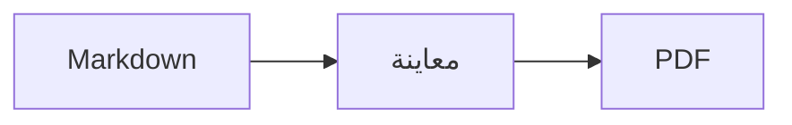

<p>&nbsp;&nbsp;&nbsp;</p>

# Splat

**محرر Markdown لنظام macOS يتيح لك الكتابة في المصدر أو مباشرةً في المعاينة.**

يضع Splat مصدر Markdown بألوان بناء الجملة على اليمين، ومعاينة حية قابلة للتحرير بالكامل على اليسار. اكتب في أيٍّ منهما: كل ما تكتبه في المعاينة يتحول إلى أصغر تغيير ممكن في المصدر، فتبقى الأسطر التي لم تلمسها متطابقة بايتًا ببايت، وتبقى فروقات Git نظيفة. يقرأ Splat صيغة Markdown التي تستخدمها أصلًا: CommonMark وGitHub Flavored Markdown وتنبيهات GitHub وروابط Obsidian الويكي والتضمينات والمربعات التوضيحية وامتدادات Pandoc وTypora وHTML المضمّن وصيغ LaTeX ومخططات Mermaid وGraphviz وPlantUML، وكلها تُعرض دون اتصال بالإنترنت. صدّر إلى PDF أو HTML أو Word بنقرة واحدة. كُتب Splat بلغة Rust على عناصر تحكم AppKit الأصلية، ويدعم 35 لغة، ولا يرسل شيئًا عبر الشبكة ما لم تطلب منه ذلك.
 


[](https://raw.githubusercontent.com/sventmueller/splat/main/dist/Splat-1.0.3.dmg)

**[تنزيل Splat-1.0.3.dmg](https://raw.githubusercontent.com/sventmueller/splat/main/dist/Splat-1.0.3.dmg)**: موقّع ومعتمد من Apple، لنظام macOS 14 أو أحدث على Apple Silicon وIntel.
 
 

[](https://www.rust-lang.org)
[](https://www.apple.com/macos/)

[](https://github.com/madsmtm/objc2)
[](https://webkit.org)
[](https://github.com/kivikakk/comrak)
[](https://github.github.com/gfm/)
[](https://www.mathjax.org)
[](https://cortexjs.io/mathlive/)
[](https://mermaid.js.org)
[](https://graphviz.org)
[](https://plantuml.com)


[](#الترخيص)

[Bahasa Indonesia](../id/README.md) ·
[Bahasa Melayu](../ms/README.md) ·
[Català](../ca/README.md) ·
[Čeština](../cs/README.md) ·
[Dansk](../da/README.md) ·
[Deutsch](../de/README.md) ·
[English](../../../README.md) ·
[Español](../es/README.md) ·
[Français](../fr/README.md) ·
[Hrvatski](../hr/README.md) ·
[Italiano](../it/README.md) ·
[Magyar](../hu/README.md) ·
[Nederlands](../nl/README.md) ·
[Norsk](../no/README.md) ·
[Polski](../pl/README.md) ·
[Português (Brasil)](../pt_BR/README.md) ·
[Português (Portugal)](../pt_PT/README.md) ·
[Română](../ro/README.md) ·
[Slovenčina](../sk/README.md) ·
[Slovenščina](../sl/README.md) ·
[Suomi](../fi/README.md) ·
[Svenska](../sv/README.md) ·
[Tiếng Việt](../vi/README.md) ·
[Türkçe](../tr/README.md) ·
[Ελληνικά](../el/README.md) ·
[Русский](../ru/README.md) ·
[Українська](../uk/README.md) ·
[עברית](../he/README.md)‎ ·
**العربية**‎ ·
[हिन्दी](../hi/README.md) ·
[ไทย](../th/README.md) ·
[한국어](../ko/README.md) ·
[日本語](../ja/README.md) ·
[简体中文](../zh-Hans/README.md) ·
[繁體中文](../zh-Hant/README.md)

## المحتويات

- [نظرة سريعة على الميزات](#نظرة-سريعة-على-الميزات)
- [المتطلبات](#المتطلبات)
- [التثبيت](#التثبيت)
- [البدء](#البدء)
- [الكتابة](#الكتابة)
  - [في المصدر](#في-المصدر)
  - [في المعاينة](#في-المعاينة)
  - [أوامر التنسيق](#أوامر-التنسيق)
  - [القوائم والمهام](#القوائم-والمهام)
  - [الجداول](#الجداول)
- [صيغة Markdown المدعومة](#صيغة-markdown-المدعومة)
  - [CommonMark وGitHub Flavored Markdown](#commonmark-وgithub-flavored-markdown)
  - [المربعات التوضيحية](#المربعات-التوضيحية)
  - [الصيغة الموسّعة](#الصيغة-الموسّعة)
  - [Obsidian](#obsidian)
  - [الاستشهادات والمراجع](#الاستشهادات-والمراجع)
  - [HTML المضمّن](#html-المضمّن)
  - [علامات الترقيم الطباعية](#علامات-الترقيم-الطباعية)
  - [نظرة عامة على الصيغة](#نظرة-عامة-على-الصيغة)
- [الصيغ](#الصيغ)
- [المخططات](#المخططات)
- [الصور](#الصور)
- [الروابط والتنقل](#الروابط-والتنقل)
- [التصدير والطباعة والمشاركة](#التصدير-والطباعة-والمشاركة)
- [المظهر وإمكانية الوصول](#المظهر-وإمكانية-الوصول)
- [اللغات](#اللغات)
- [اختصارات لوحة المفاتيح](#اختصارات-لوحة-المفاتيح)
- [الخصوصية والأمان](#الخصوصية-والأمان)
- [المستندات الكبيرة](#المستندات-الكبيرة)
- [القيود المعروفة](#القيود-المعروفة)
- [استكشاف الأخطاء وإصلاحها](#استكشاف-الأخطاء-وإصلاحها)
- [للمطورين](#للمطورين)
  - [البناء](#البناء)
  - [التوزيع](#التوزيع)
  - [الاختبار](#الاختبار)
  - [بنية المشروع](#بنية-المشروع)
  - [تدفق البيانات](#تدفق-البيانات)
  - [القواعد في المتحكم](#القواعد-في-المتحكم)
  - [إضافة أمر](#إضافة-أمر)
  - [الترجمات](#الترجمات)
  - [المكونات الخارجية](#المكونات-الخارجية)
- [الترخيص](#الترخيص)

## نظرة سريعة على الميزات

- **طريقتان للكتابة، ونص واحد.** المصدر والمعاينة كلاهما قابل للتحرير. ملف Markdown هو المرجع الوحيد: هناك سجل تراجع واحد لكل مستند، وكل تعديل في المعاينة يُترجم إلى أصغر تغيير ممكن في المصدر.
- **صيغة Markdown التي تستخدمها أصلًا.** CommonMark وGitHub Flavored Markdown وتنبيهات GitHub وObsidian وامتدادات Pandoc وTypora ورموز الإيموجي النصية والنصوص المخفية وقوائم التعريفات ومراسي العناوين وHTML كما في ملفات README على GitHub.
- **صيغ ومخططات مدمجة.** صيغ LaTeX عبر MathJax مع محرر صيغ مرئي. مخططات Mermaid وGraphviz وPlantUML تُعرض على جهاز Mac لديك دون Java أو خادم أو اتصال بالشبكة.
- **زر لكل شيء.** لكل عنصر من عناصر Markdown زر في شريط الأدوات وعنصر في القائمة، وللشائع منها اختصار لوحة مفاتيح أيضًا. وللجداول قائمتها الخاصة للصفوف والأعمدة والمحاذاة.
- **تصدير دون فقدان شيء.** PDF، أو ملف HTML واحد مكتفٍ بذاته، أو مستند Word بعناوين وقوائم وجداول وحواشٍ سفلية وصور حقيقية.
- **أصلي حتى النخاع.** نوافذ AppKit حقيقية وعلامات تبويب وقوائم ونوافذ منبثقة والإصدارات والحفظ التلقائي وقائمة المشاركة والوضع الداكن والتدقيق الإملائي والإملاء الصوتي وVoiceOver. لا Electron، ولا عرض ويب للنص نفسه.
- **سريع مع الملفات الكبيرة.** ضغطة مفتاح في مستند بحجم 10 ميغابايت تستغرق نحو 25 مللي ثانية.
- **خاص وحذر.** الصور من الويب لا تُحمَّل إلا بعد أن تسمح بذلك، والروابط إلى تطبيقات أخرى تسألك أولًا، وكل ما يفكّ ترميز بيانات صور غير موثوقة يعمل في عمليات مساعدة معزولة داخل صندوق حماية.
- **بلغتك.** تتوفر الواجهة ومرجع Markdown السريع المدمج بـ 35 لغة: العربية والكتالانية والصينية (المبسطة) والصينية (التقليدية) والكرواتية والتشيكية والدنماركية والهولندية والإنجليزية والفنلندية والفرنسية والألمانية واليونانية والعبرية والهندية والمجرية والإندونيسية والإيطالية واليابانية والكورية والملايوية والنرويجية والبولندية والبرتغالية (البرازيل) والبرتغالية (البرتغال) والرومانية والروسية والسلوفاكية والسلوفينية والإسبانية والسويدية والتايلاندية والتركية والأوكرانية والفيتنامية.

## المتطلبات

- macOS 14 Sonoma أو أحدث. يُطوَّر Splat ويُختبر على macOS 27، حيث يعتمد تصميم Liquid Glass تلقائيًا.
- جهاز Mac بمعالج Apple Silicon أو Intel.
- نحو 45 ميغابايت من مساحة القرص.

## التثبيت

**من صورة القرص.** نزّل [`dist/Splat-1.0.3.dmg`](https://raw.githubusercontent.com/sventmueller/splat/main/dist/Splat-1.0.3.dmg)، وافتحه واسحب Splat إلى مجلد التطبيقات. الصورة موقّعة بشهادة Developer ID ومعتمدة من Apple، لذا تُفتح دون تحذيرات.

**عبر Homebrew.** توجد الحزمة cask في tap خاص بها:

```sh
brew install --cask sventmueller/tap/splat
```

يثبّت الأمر `brew upgrade --cask splat` الإصدارات الجديدة، ويزيل الأمر `brew uninstall --zap --cask splat` إعدادات Splat وذاكرته المؤقتة أيضًا.

**التحديثات.** يحدّث Splat نفسه بنفسه عبر [Sparkle](https://sparkle-project.org) إذا ثبّتّه من صورة القرص أو Homebrew. عند التشغيل الثاني يسأل إن كان يجوز له البحث عن تحديثات بنفسه مرة في اليوم. يبحث **Splat › البحث عن تحديثات…** فورًا؛ ويغيّر **البحث عن تحديثات تلقائيًا** و**تنزيل التحديثات وتثبيتها تلقائيًا** في القائمة نفسها اختيارك لاحقًا. لا يثبّت Splat تحديثًا إلا إذا كان يحمل توقيع المطوّر. أما النسخة التي تبنيها بنفسك فلا تحتوي على أداة تحديث.

**من الشيفرة المصدرية.** راجع [البناء](#البناء) لمعرفة المتطلبات المسبقة، ثم:

```sh
make build
ditto target/release/Splat.app /Applications/Splat.app
open /Applications/Splat.app
```

لفتح ملفات Markdown بـ Splat بنقرة مزدوجة، حدّد أي ملف `.md` في Finder، واختر **ملف › إحضار المعلومات**، ثم اختر Splat ضمن **فتح بواسطة** وانقر **تغيير الكل…**. يسجّل Splat نفسه للملفات `.md` و`.markdown` و`.mdown` و`.mkd`.

## البدء

### النافذة

يُفتح كل مستند في نافذته الخاصة، أو في علامة تبويب إن كنت تفضّلها:

- **اليمين: المصدر.** نص Markdown الخاص بك بخط SF Mono وبألوان بناء الجملة.
- **اليسار: المعاينة.** المستند معروضًا، وجاهزًا للتحرير.
- **الشريط الجانبي للمخطط التفصيلي (اختياري).** كل العناوين على شكل شجرة؛ والنقر على أحدها يعرضه في اللوحتين. بدّله من **عرض › إظهار المخطط التفصيلي** (⌃⌘S).
- **شريط الأدوات.** أزرار مجمّعة بحسب ما تغيّره: الأحرف والفقرات والعناصر المُدرَجة، ثم إظهار المعاينة وإخفاؤها، والمشاركة، ومستند جديد. خصّصه من **عرض › تخصيص شريط الأدوات…**.

اسحب الفاصل لتمنح أحد الجانبين مساحة أكبر. يترك **عرض › إخفاء المعاينة** (⌥⌘P) المصدر وحده؛ ويتذكر Splat ذلك لكل نافذة. تتمرر اللوحتان معًا، ويُميَّز التحديد في إحداهما في الأخرى.

### المستندات وعلامات التبويب والإصدارات

Splat تطبيق مستندات عادي في macOS:

- **الحفظ التلقائي والإصدارات.** تُحفظ التغييرات في مكانها. يعيدك **ملف › الرجوع إلى › استعراض كافة الإصدارات…** في الزمن إلى الوراء.
- **تغييرات من برامج أخرى.** عندما يغيّر Git أو سكربت أو محرر آخر مستندًا مفتوحًا، يعيد Splat تحميله ويحتفظ بموضع المؤشر وموضع التمرير. وإذا كانت لديك تغييرات غير محفوظة، يحتفظ بها Splat، ويسأل macOS قبل الحفظ فوق النسخة الأخرى.
- **أوامر الملفات المعتادة.** تكرار (⇧⌘S) وإعادة تسمية… والنقل إلى… و**ملف › فتح العناصر الأخيرة**.
- **علامات التبويب.** يفتح **ملف › علامة تبويب جديدة** أو الزر **+** في شريط الأدوات مستندًا جديدًا في علامة تبويب؛ وتتولى قائمة نافذة القياسية دمج علامات التبويب ونقلها والتنقل بينها.
- **موضع النافذة.** يُحفظ حجم آخر نافذة وموضعها، حتى بعد إعادة التشغيل. وإذا كانت هناك نافذة في المكان نفسه، تُفتح الجديدة بإزاحة طفيفة.
- **أيقونة Dock.** النقر عليها بعد إغلاق آخر نافذة يفتح مستندًا جديدًا.
- **فتح ملفات Markdown في Splat.** يجعل **Splat › تعيين كالتطبيق الافتراضي لملفات Markdown** النقر المزدوج على ملف `.md` أو `.markdown` يفتح Splat؛ ويطلب macOS التأكيد مرة واحدة. يظهر أمام العنصر علامة اختيار ما دام Splat هو التطبيق الافتراضي.

يجب أن تكون الملفات نصًا بترميز UTF-8، أو UTF-16 مع علامة ترتيب البايت. يرفض Splat الترميزات الأخرى بدلًا من التخمين وإفساد النص. تبقى علامة ترتيب البايت كما هي، ويبقى UTF-16 بترميز UTF-16، وفي ملف تنتهي كل أسطره بـ CRLF، تنتهي الأسطر التي تضيفها بـ CRLF أيضًا.

**بعد انهيار التطبيق**، يضيع على الأكثر ما كتبته في الثواني القليلة الأخيرة: ينسخ Splat النص غير المحفوظ كل خمس ثوانٍ إلى `~/Library/Application Support/Splat/Unsaved`، ويزيل النسخ عند حفظ المستند أو عند إنهاء Splat بشكل طبيعي. وفي التشغيل التالي ينقل ما خلّفه الانهيار هناك إلى `~/Library/Application Support/Splat/Recovery` ويبلغك بذلك مرة واحدة، مع زر يفتح المجلد. والانهيار الذي يستطيع Splat الاستجابة له يكتب هناك أيضًا نص كل مستند مفتوح.

### المرجع السريع

يفتح **مساعدة › مرجع Markdown السريع** ورقة مرجعية بلغتك في مستند جديد بلا عنوان. إنه مستند عادي، فجرّب كل شيء هناك مباشرة، في المصدر أو في المعاينة.

## الكتابة

### في المصدر

المصدر محرر نصوص عادية مضبوط لـ Markdown:

- **ألوان بناء الجملة** كما في VS Code: العناوين والتوكيد والروابط والرمز البرمجي والجداول وHTML والبيانات الأمامية front matter، وLaTeX وMermaid داخل الصيغ والمخططات. تتوفر لوحات ألوان للوضع الفاتح والداكن ولزيادة التباين.
- **كتل الرمز البرمجي المسوّرة** تُلوَّن للغات Bash وC وC++ وC# وCSS (وكذلك SCSS وLess) وGo وHTML وXML وJava وJavaScript وJSON وKotlin وPHP وPython وRuby وRust وSQL وSwift وTypeScript وYAML وTeX وMermaid، بما في ذلك أسماؤها المختصرة المعتادة مثل `js` أو `py` أو `sh`.
- **لا استبدالات مفاجئة.** علامات الاقتباس الذكية والشرطات الذكية واستبدال النص معطّلة افتراضيًا، لأنها تفسد `--` و`---` و`"`. فعّلها من **تعديل › البدائل**.
- **أدوات الكتابة في النظام.** التدقيق الإملائي والنحوي والإملاء الصوتي وبحث واستبدال (⌥⌘F) والتكلم.
- **السحب والإفلات.** أفلت ملف صورة لإدراج ``، وأي ملف آخر لإدراج رابط إليه، وعنوان URL لإدراج `[url](url)`. كل عملية إفلات خطوة تراجع واحدة.
- **لصق الصور.** الصورة الموجودة في الحافظة، مثل لقطة الشاشة، تُحفظ كملف PNG بجوار المستند (`صورة 2026-10-29 13.09.07.png`) وتُدرج كصورة. يجب حفظ المستند مرة واحدة لذلك.

### في المعاينة

تتصرف المعاينة كمعالج نصوص، لكن كل ما تفعله فيها ينتهي إلى Markdown:

- **الكتابة.** الأحرف التي لها معنى في Markdown، مثل `*` أو `#`، يُضاف لها حرف الهروب لتظهر كما كُتبت.
- يبدأ **Return** فقرة جديدة أو عنصر قائمة جديدًا. ويُدرج **⌥Return** أو **⌃Return** فاصل سطر.
- **التنسيق عند المؤشر.** عندما يكون المؤشر في نهاية كلمة، يُطبَّق غامق ومائل وبقية تنسيقات الأحرف على ما تكتبه بعد ذلك. اختر التنسيق مرة أخرى لإيقافه. وداخل الكلمة تُنسَّق الكلمة كلها.
- **الأسطر الفارغة.** يضيف Return على سطر فارغ سطرًا فارغًا آخر، ويزيله Backspace. في المصدر، كل سطر فارغ إضافي يعني سطرين فارغين آخرين؛ وتعرضها برامج Markdown الأخرى كمسافة عادية بين الفقرات.
- **التراجع** يعمل عبر اللوحتين. لعناصر التراجع أسماء ("تراجع عن غامق")، والكتابة خطوة واحدة لكل دفعة، وبعد التراجع والإعادة تتمرر اللوحتان إلى التغيير.
- **الصيغ والمخططات** تظهر كرسومات جاهزة. انقر على أحدها أو انقل المؤشر إليه أو اضغط Return عليه لفتح محرره (راجع [الصيغ](#الصيغ) و[المخططات](#المخططات)).
- **HTML المضمّن والملاحظات المضمّنة والبيانات الأمامية** تُعرض، لكنك تحررها في المصدر. النقر عليها يضع المؤشر في المكان المقابل هناك.

كل ما لا يستطيع Markdown التعبير عنه محظور في المعاينة: لوحتا الخط واللون والمسطرة ولصق النص المنسق والصور أو إفلاتها. ويصل HTML وRTF الملصوقان كنص عادي.

### أوامر التنسيق

كل أمر متاح من شريط الأدوات وشريط القوائم والقائمة السياقية في اللوحتين. تعرض عناصر القائمة علامة اختيار للتنسيق عند المؤشر.

| القائمة | الأوامر |
|---|---|
| **التنسيق › الخط** | غامق، مائل، تسطير، يتوسطه خط، تمييز، رمز برمجي، خط مرتفع، خط منخفض |
| **التنسيق › عنوان** | النص الأساسي، عنوان 1 إلى 6 |
| **التنسيق › قائمة** | قائمة تعداد نقطي، قائمة تعداد رقمي، قائمة مهام |
| **التنسيق** | اقتباس، كتلة رمز برمجي (بدون لغة أو إحدى 20 لغة؛ ويغيّر أيضًا لغة كتلة موجودة)، مربع توضيحي (ملاحظة، نصيحة، مهم، تحذير، تنبيه؛ النوع نفسه مرة أخرى يزيله)، تعديل الصيغة أو المخطط…، مسح التنسيق |
| **إدراج** | رابط…، صورة…، جدول…، صيغة، مخطط (مخطط انسيابي، مخطط تسلسلي، مخطط جانت)، جدول المحتويات، حاشية سفلية، خط فاصل |
| **جدول** | إدراج صف بالأعلى/بالأسفل، إدراج عمود على اليسار/اليمين، حذف الصف، حذف العمود، المحاذاة (يسار، وسط، يمين، افتراضي)، محاذاة أعمدة الجدول |
| **عرض** | إخفاء/إظهار المعاينة، إظهار/إخفاء المخطط التفصيلي، علامات الترقيم الطباعية، تكبير/تصغير، الحجم الفعلي، شريط الأدوات، شريط علامات التبويب، ملء الشاشة |

يُكتب التسطير والتمييز والخط المرتفع والخط المنخفض بالوسوم `<ins>` و`<mark>` و`<sup>` و`<sub>`، وهي وسوم يعرضها GitHub أيضًا. ويقرأ Splat كذلك `<u>` الذي يزيله GitHub، والصيغ الأقصر `==highlight==` و`^sup^` و`~sub~`. يعرض GitHub الرمزين `==` و`^` كما كُتبا، ويعرض `~sub~` كنص يتوسطه خط.

### القوائم والمهام

- يواصل Return القائمة؛ والضغط عليه في عنصر فارغ ينهيها.
- يزيد **Tab** و**⇧Tab** المسافة البادئة لعناصر القائمة في المعاينة ويقلّلانها.
- النقر على مربع اختيار مهمة في المعاينة يبدّل `- [ ]` و`- [x]`.
- يحوّل **التنسيق › قائمة** الفقرات المحددة إلى قائمة أو يغيّر نوعها.

### الجداول

- يسأل **إدراج › جدول…** عن عدد الصفوف (بما فيها صف العناوين) والأعمدة.
- في المعاينة ينتقل **Tab** إلى الخلية التالية، و**⇧Tab** إلى السابقة، و**Return** إلى الخلية الواقعة أسفل. والضغط على Tab في الخلية الأخيرة يضيف صفًا.
- تدرج قائمة **جدول** الصفوف والأعمدة وتحذفها وتضبط محاذاة العمود (⌘{ و⌘| و⌘}).
- يضيف **جدول › محاذاة أعمدة الجدول** مسافات إلى المصدر لتصطف الأعمدة.

## صيغة Markdown المدعومة

يحلل Splat النص عبر [comrak](https://github.com/kivikakk/comrak)، وهو محلل متوافق مع CommonMark وGFM، ويفعّل معظم امتداداته. كل ما يلي يُعرض في المعاينة وفي جميع صيغ التصدير.

### CommonMark وGitHub Flavored Markdown

- العناوين (`#` والمسطّرة) والفقرات وفواصل الأسطر والتوكيد والتوكيد القوي والرمز البرمجي داخل السطر واقتباسات الكتل والخطوط الفاصلة.
- القوائم النقطية والرقمية والمتداخلة؛ وقوائم المهام.
- الروابط (داخل السطر وبالمرجع والتلقائية) والصور وتعريفات مراجع الروابط.
- كتل الرمز البرمجي المسوّرة والمزاحة بألوان بناء الجملة.
- الجداول مع محاذاة الأعمدة.
- النص الذي يتوسطه خط باستخدام `~~two tildes~~`.
- الحواشي السفلية: `text[^1]` مع `[^1]: The note.` في أي مكان من المستند. النقر على العلامة ينقلك إلى الحاشية.
- YAML front matter بين سطرين `---` في أعلى المستند. تلخصه المعاينة في سطر واحد، مثل "البيانات الوصفية: title, date, tags".

### المربعات التوضيحية

تُعرض تنبيهات GitHub كمربعات ملونة بأيقونة وعنوان:

```markdown
> [!NOTE]
> معلومة مفيدة ينبغي للمستخدمين معرفتها.

> [!WARNING]
> محتوى بالغ الأهمية يتطلب انتباهًا فوريًا.
```

الأنواع الخمسة هي ملاحظة ونصيحة ومهم وتحذير وتنبيه. يحوّل **التنسيق › مربع توضيحي** الفقرة عند المؤشر إلى واحد منها.

تعمل مربعات Obsidian التوضيحية أيضًا، بأي عنوان وبحالة طي:

```markdown
> [!tip]- انقر ▸ للتوسيع
> مخفي حتى يُفتح.

> [!question]+ مفتوح افتراضيًا
> العلامة `+` تبدأ موسّعة، و`-` تبدأ مطوية.
```

تُعرض أنواع Obsidian الأخرى بأقرب الألوان الخمسة: `success` و`check` و`done` و`hint` كنصيحة؛ و`question` و`help` و`faq` كمهم؛ و`attention` كتحذير؛ و`failure` و`fail` و`missing` و`danger` و`error` و`bug` كتنبيه؛ وكل ما سواها كملاحظة.

### الصيغة الموسّعة

| الميزة | الصيغة | المصدر |
|---|---|---|
| تمييز | `==نص مميز==` | Obsidian وTypora |
| خط مرتفع | `x^2^` | Pandoc وTypora |
| خط منخفض | `H~2~O` | Pandoc وTypora |
| رمز إيموجي نصي | `:rocket:` يصبح 🚀 | GitHub |
| نص مخفي | `\|\|نص مخفي\|\|`، حدده لقراءته | Discord |
| حاشية سفلية داخل السطر | `text^[the note itself]` | Pandoc وObsidian |
| قائمة تعريفات | `Term` وسطر فارغ و`: Explanation` | PHP Markdown Extra وPandoc |
| مرساة عنوان | `## تثبيت {#setup}`، والرابط إليها `[انظر](#setup)` | Pandoc وkramdown |

تبدو قوائم التعريفات هكذا في المصدر:

```markdown
المصطلح

: شرح المصطلح.
```

إذا لم تحدد مرساة خاصة، يحصل كل عنوان على مرساة مشتقة من نصه، كما في GitHub: يمكن الوصول إلى `## البدء` عبر `#البدء`.

### Obsidian

- **الروابط الويكي.** يشير `[[Note]]` إلى `Note.md` في المجلد نفسه أو في مجلد تحته. يعرض `[[Note|نص معروض]]` نصك الخاص، ويفتح `[[Note#Heading]]` الملاحظة. النقر مع ⌘ يفتحها في Splat.
- **التضمينات.** يعرض `![[Note]]` الملاحظة الأخرى داخل هذه؛ وتظهر الملاحظات المضمّنة فيها كروابط. ويعرض `![[diagram.png]]` صورة. كما في Obsidian، تسمّي التضمينات الملاحظات والصور الموجودة في مجلد المستند أو تحته، وليس بمسار مطلق أبدًا، ولا تظهر كملاحظات إلا ملفات Markdown.
- **التعليقات.** يبقى `%%في المصدر فقط%%` ظاهرًا في المصدر ويُستبعد من المعاينة ومن كل تصدير، سواء داخل السطر أو في أسطر مستقلة.
- **الوسوم.** يُميَّز `#idea` أو `#project/splat`. النقر مع ⌘ يبحث عن الوسم في المستند.
- **المربعات التوضيحية القابلة للطي.** راجع [المربعات التوضيحية](#المربعات-التوضيحية).

### الاستشهادات والمراجع

- **استشهادات Pandoc.** يظهر `[@doe2020]` أو `[@doe2020; @roe2021]` على هيئة "(Doe 2020; Roe 2021)". تؤخذ المدخلات من ملف BibTeX الذي تسميه البيانات الأمامية بالشكل `bibliography: refs.bib`. وبدونها يستخدم Splat الملف `references.bib` أو `literatur.bib` أو `bibliography.bib` الموجود بجوار المستند.
- **مراجع GitHub وGitLab.** إذا كان المستند داخل مستودع Git يقع مستودعه البعيد `origin` على github.com أو على مضيف GitLab، فإن `@name` و`#12` (مشكلة) و`!7` (طلب دمج، في GitLab فقط) تُميَّز. النقر مع ⌘ يفتحها في المتصفح.

### HTML المضمّن

يُعرض HTML كما تجده في ملفات README على GitHub، بقارئ خاص به لا بمحرك متصفح:

- الفقرات والكتل الموسّطة (`<p align="center">` و`<div align="center">`)
- الصور ذات الحجم المحدد (``)
- الروابط و`<kbd>⌘</kbd>` و`<br>` و`<u>` و`<ins>` و`<mark>` و`<sup>` و`<sub>`
- القوائم والجداول، بما فيها الخلايا الممتدة عبر أعمدة (`colspan`)
- الأقسام القابلة للطي: `<details><summary>المزيد</summary>…</details>`، وتُفتح بالنقر على ▸

يُعرض Markdown الواقع بين وسوم HTML على أنه Markdown. تُستبعد السكربتات والأنماط والإطارات والنماذج تمامًا، ولا تحتفظ الروابط والصور إلا بعناوين `http` و`https` و`mailto` والعناوين النسبية.

### علامات الترقيم الطباعية

يعرض **عرض › علامات الترقيم الطباعية** علامات الاقتباس المستقيمة بعلامات الاقتباس الخاصة بلغة واجهتك، و`--` كشرطة قصيرة، و`---` كشرطة طويلة، و`...` كنقاط حذف. في الألمانية يصبح `"Ja"` هكذا „Ja“، وفي الفرنسية «Oui»، وفي اليابانية 「はい」، وكذلك حيث تضع الصينية واليابانية علامات الاقتباس دون مسافة؛ وتحصل الاختصارات العبرية مثل `צה"ל` على الجرشايم الخاص بها، צה״ל. يحتفظ المصدر بالأحرف العادية؛ وتعرض المعاينة وجميع صيغ التصدير الأحرف الطباعية. الإعداد معطّل حتى تفعّله.

### نظرة عامة على الصيغة

| العنصر | Markdown |
|---|---|
| **غامق** | `**غامق**` |
| *مائل* | `*مائل*` |
| تسطير | `<ins>تسطير</ins>` أو `<u>تسطير</u>` |
| ~~يتوسطه خط~~ | `~~يتوسطه خط~~` |
| تمييز | `<mark>تمييز</mark>` أو `==تمييز==` |
| `رمز` | `` `رمز` `` |
| x² | `x<sup>2</sup>` أو `x^2^` |
| H₂O | `H<sub>2</sub>O` أو `H~2~O` |
| [رابط](https://example.com) | `[رابط](https://example.com)` |
| عنوان | `# عنوان` إلى `###### عنوان` |
| اقتباس | `> اقتباس` |
| قائمة نقطية | `- عنصر` |
| قائمة رقمية | `1. عنصر` |
| مهمة | `- [ ] مفتوحة` و`- [x] منجزة` |
| كتلة رمز برمجي | ```` ```rust ```` … ```` ``` ```` |
| جدول | `\| أ \| ب \|` مع `\|---\|---\|` تحت صف العناوين |
| حاشية سفلية | `نص[^1]` و`[^1]: ملاحظة` |
| خط فاصل | `---` |
| صورة | `` |
| صيغة | `$E = mc^2$`، `$$ … $$` |
| مخطط | ```` ```mermaid ````، ```` ```dot ````، ```` ```plantuml ```` |
| مربع توضيحي | `> [!TIP]` |
| رابط ويكي | `[[Note]]`، `[[Note\|نص]]` |
| تضمين | `![[Note]]`، `![[image.png]]` |
| تعليق | `%%تعليق%%` |
| وسم | `#وسم` |
| استشهاد | `[@key]` |
| نص مخفي | `\|\|نص مخفي\|\|` |
| إيموجي | `:tada:` |

## الصيغ

تُعرض الصيغ بواسطة [MathJax](https://www.mathjax.org) مع TeX ورياضيات AMS الخاصة به، كرسومات متجهة حادة. يمكن أن يكون النص داخل `\text{…}` بأي نظام كتابة: وما تفتقده خطوط MathJax يأتي من خطوط جهاز Mac لديك، مع كتابة العربية والعبرية من اليمين إلى اليسار، والإيموجي بالألوان.

| النوع | الصيغة |
|---|---|
| داخل السطر | `$E = mc^2$`، `` $`E = mc^2`$ `` (GitHub وGitLab)، `\(E = mc^2\)` |
| منفصلة | `$$` … `$$`، أو `\[` … `\]`، أو كتلة رمز برمجي موسومة بـ `math` |

**تعديل صيغة.** انقر على صيغة في المعاينة، أو انقر عليها نقرًا مزدوجًا، أو اضغط Return عليها، أو انقل المؤشر إليها لفتح محررها في نافذة منبثقة. يدرج **إدراج › صيغة** صيغة جديدة ويفتح المحرر فورًا.

- **مرئي أو LaTeX.** يبدّل المفتاح في الأعلى بين محرر مرئي ([MathLive](https://cortexjs.io/mathlive/)) ورمز LaTeX. يتذكر Splat اختيارك.
- **وحدات بناء** للكسر والجذر التربيعي والخط المرتفع والمنخفض والمجموع والتكامل بحدود والنهاية والأقواس التي تتمدد مع محتواها ومصفوفة 2×2 والأحرف اليونانية والعلاقات والمؤثرات والأسهم. تترك مواضع □ فارغة، ويقفز **Tab** إلى التالي منها.
- **معاينة حية.** تظهر التغييرات في المستند أثناء الكتابة. تظهر أخطاء MathJax في سطر تحت الرمز.
- **اعتماد أو تجاهل.** النقر في الخارج يُبقي التغيير كخطوة تراجع واحدة؛ ويتجاهله **Esc** أو **إلغاء**. والضغط على Esc في صيغة جديدة فارغة يزيلها من جديد.
- تقدّم القائمة السياقية **تعديل الصيغة…** للصيغة الواقعة تحت المؤشر.

يقرأ VoiceOver الصيغة كرمز LaTeX الخاص بها. يعرض Splat الصيغ لا مستندات LaTeX الكاملة: لا حزم، ولا TikZ، ولا `\documentclass`.

## المخططات

تُعرض المخططات داخل Splat، دون اتصال بالإنترنت، بنسخة فاتحة ونسخة داكنة.

| المحرك | كتلة الرمز البرمجي | ما يرسمه |
|---|---|---|
| [Mermaid](https://mermaid.js.org) | ```` ```mermaid ```` | المخططات الانسيابية والتسلسلية ومخططات الأصناف والحالات والعلاقات بين الكيانات وجانت والدائرية والخرائط الذهنية والجداول الزمنية وكل أنواع Mermaid الأخرى |
| [Graphviz](https://graphviz.org) | ```` ```dot ```` أو ```` ```graphviz ```` | رسوم بيانية بلغة DOT |
| [PlantUML](https://plantuml.com) | ```` ```plantuml ```` أو ```` ```puml ```` | مخططات UML؛ يعمل دون Java |



**تعديل مخطط** يشبه تعديل صيغة: انقر عليه لفتح الرمز في نافذة منبثقة، مع ألوان بناء الجملة ورسائل الأخطاء في سطر تحت الرمز. يبدأ **إدراج › مخطط** من قالب لمخطط انسيابي أو مخطط تسلسلي أو مخطط جانت. وتساعد وحدات البناء في أكثر أنواع Mermaid الثلاثة شيوعًا:

- **مخطط انسيابي:** عقدة ▾ (مستطيل، مستدير الزوايا، دائرة، معين، قاعدة بيانات)، وصلة، وصلة مع تسمية، مجموعة، الاتجاه ▾
- **مخطط تسلسلي:** مشارك، رسالة، رد، ملاحظة، حلقة، مسارات بديلة
- **مخطط جانت:** قسم، مهمة، علامة فارقة

أنواع المخططات الأخرى تُحرَّر كرمز. يقرأ VoiceOver عنوان المخطط أو نصه البديل.

يستغرق أول مخطط بعد التشغيل نحو ثانية، لأن محرك العرض يبدأ في الخلفية. والمخطط الذي يستغرق أكثر من 10 ثوانٍ يعرض خطأ، ويبدأ محرك العرض من جديد للمخطط التالي. ولا يُحمَّل محرك PlantUML (7 ميغابايت) إلا مع أول مخطط PlantUML. ويُحظر `!include` في PlantUML إذا كان من الويب.

## الصور

- **الصور المحلية** تستخدم مسارات نسبية إلى المستند: ``. يعرض Splat صور PNG وJPEG وGIF وWebP وBMP وSVG وHEIC وTIFF وAVIF وPDF.
- **الصور من الويب** تبقى محظورة حتى تسمح بها: يوضح شريط فوق المعاينة أن تحميلها يُعلم خوادمها بأنك تفتح المستند ومتى تفتحه. يسمح **تحميل الصور** بها لهذا المستند؛ ويتذكر Splat الاختيار لكل ملف.
- **الحجم.** يحدد `` حجم الصورة؛ وما عدا ذلك تلائم الصور عرض المعاينة.
- **التغييرات على القرص.** الصورة التي تستبدلها، أو التي تظهر بعد أن سمّاها المستند، تظهر دون إعادة فتح المستند. والصور من الويب التي فشلت بسبب الشبكة يُعاد تحميلها ما دام مستند يعرضها.
- **الذاكرة.** تُعرض الصور بما يصل إلى 2560 بكسل على أطول ضلع لها، وهو ما يملأ صفحة A4 أيضًا. وتُفكّ بدقة أقل عندما تملأ ثُمن ذاكرة جهاز Mac، وما دام macOS يبلّغ عن ضغط على الذاكرة.
- **الوضع الداكن.** الصور ذات الخلفية البيضاء تُخفَّض إضاءتها قليلًا في المعاينة الداكنة.
- **اللصق والإفلات.** راجع [في المصدر](#في-المصدر).

## الروابط والتنقل

في المعاينة، ينقل النقر المؤشر لتحرير نص الرابط؛ و**النقر مع ⌘** يتبع الرابط:

- تُفتح `http` و`https` و`mailto` في متصفحك أو تطبيق البريد.
- تُفتح ملفات Markdown في Splat؛ أما الملفات والمجلدات الأخرى فتُظهر في Finder.
- ينتقل `#anchor` إلى العنوان في المستند.
- العناوين التي تفتح تطبيقًا آخر، مثل `slack://` أو `vscode://`، تسأل أولًا وتعرض العنوان الكامل والتطبيق. ويكون **إلغاء** محددًا مسبقًا.

يدرج **إدراج › جدول المحتويات** قائمة مرتبطة بكل العناوين. وعندما يكون المؤشر داخلها، يحدّثها الأمر نفسه. ينتقل الشريط الجانبي للمخطط التفصيلي (⌃⌘S) إلى أي عنوان في اللوحتين.

## التصدير والطباعة والمشاركة

| الصيغة | الطريقة | ما تحصل عليه |
|---|---|---|
| **PDF** | **ملف › تصدير كملف PDF…** أو قائمة المشاركة | صفحات بحجم الورق، دائمًا بالمظهر الفاتح، والصيغ والمخططات كرسومات متجهة. يحدد **ملف › إعداد الصفحة…** الورق. |
| **طباعة** | **ملف › طباعة…** (⌘P) | التخطيط نفسه كما في PDF. |
| **HTML** | **ملف › تصدير كملف HTML…** أو قائمة المشاركة | ملف واحد مكتفٍ بذاته: الصور المحلية مضمّنة، والصيغ والمخططات كصور حادة، ومراسي العناوين ليعمل جدول المحتويات. بلا سكربتات. |
| **Word** | **ملف › تصدير كمستند Word…** أو قائمة المشاركة | ملف `.docx` بأنماط العناوين في Word وقوائم وجداول حقيقية (بما فيها الخلايا المدمجة) وحواشٍ سفلية بصيغة حواشي Word وصور مضمّنة وصيغ ومخططات. |
| **Markdown** | زر **مشاركة** في شريط الأدوات | المستند كملف `.md` للبريد والرسائل وAirDrop وكل خدمة مشاركة أخرى. |

تقدّم قائمة **ملف › مشاركة** كل ذلك في مكان واحد. تستخدم عمليات التصدير إعداد علامات الترقيم الطباعية والصور التي سمحت بها من الويب؛ وتبقى الصور من الويب روابط في HTML.

## المظهر وإمكانية الوصول

- **الوضع الداكن** يتبع النظام. تُعرض الصيغ والمخططات لكل مظهر.
- **زيادة التباين** في إعدادات النظام تحوّل ألوان بناء الجملة إلى لوحات عالية التباين.
- **التكبير والتصغير.** ⌘+ و⌘− و⌘0 تغيّر مقياس اللوحتين.
- **ملء الشاشة وعلامات التبويب وشريط أدوات قابل للتخصيص**، كما في كل تطبيق Mac.
- **VoiceOver.** تحمل اللوحتان التسميتين "مصدر Markdown" و"معاينة"، وتُقرأ الصيغ كرمزها والمخططات كعنوانها. كل أمر يمكن الوصول إليه من لوحة المفاتيح.

ليس لدى Splat نافذة إعدادات: الخيارات القليلة موجودة حيث تنطبق، في **عرض** و**تعديل › البدائل**.

## اللغات

الواجهة والقوائم ومرجع Markdown السريع مترجمة إلى 35 لغة:

العربية والكتالانية والصينية (المبسطة) والصينية (التقليدية) والكرواتية والتشيكية والدنماركية والهولندية والإنجليزية والفنلندية والفرنسية والألمانية واليونانية والعبرية والهندية والمجرية والإندونيسية والإيطالية واليابانية والكورية والملايوية والنرويجية والبولندية والبرتغالية (البرازيل) والبرتغالية (البرتغال) والرومانية والروسية والسلوفاكية والسلوفينية والإسبانية والسويدية والتايلاندية والتركية والأوكرانية والفيتنامية.

يتبع Splat ترتيب اللغات في **إعدادات النظام › عام › اللغة والمنطقة**؛ ويمكنك أيضًا اختيار لغة لـ Splat وحده هناك ضمن **التطبيقات**. وإذا لم تتوفر ترجمة للغتك، يستخدم الإنجليزية. تتبع مصطلحات القوائم ترجمات Apple نفسها، فيبدو Splat مثل بقية جهاز Mac لديك.

يُقرأ النص العبري والعربي من اليمين إلى اليسار أينما ظهر، أيًّا كانت لغة الواجهة: تأخذ كل فقرة وعنوان وعنصر قائمة اتجاه أول حرف فيه، وترسم الاقتباسات والمربعات التوضيحية شريطها على اليمين، ويعرض الجدول الذي يبدأ نصه من اليمين إلى اليسار أعمدته من اليمين. وتبقى كتل الرمز البرمجي من اليسار إلى اليمين. وتحافظ عمليات التصدير إلى PDF وHTML وWord على هذه الاتجاهات. وعندما تكون العبرية أو العربية لغة النظام، يعكس macOS النافذة أيضًا، فتكون المعاينة على اليسار.

## اختصارات لوحة المفاتيح

| الإجراء | الاختصار |
|---|---|
| غامق، مائل، تسطير | ⌘B، ⌘I، ⌘U |
| يتوسطه خط | ⇧⌘X |
| رابط… | ⌘K |
| النص الأساسي، عنوان 1 إلى 6 | ⌥⌘0، ⌥⌘1 إلى ⌥⌘6 |
| محاذاة عمود الجدول إلى اليسار، الوسط، اليمين | ⌘{، ⌘\|، ⌘} |
| إخفاء المعاينة أو إظهارها | ⌥⌘P |
| إظهار المخطط التفصيلي أو إخفاؤه | ⌃⌘S |
| تكبير، تصغير، الحجم الفعلي | ⌘+، ⌘−، ⌘0 |
| مستند جديد، فتح، حفظ، تكرار | ⌘N، ⌘O، ⌘S، ⇧⌘S |
| إعداد الصفحة، طباعة | ⇧⌘P، ⌘P |
| بحث، بحث واستبدال | ⌘F، ⌥⌘F |
| بحث عن التالي والسابق؛ استخدام التحديد للبحث؛ انتقال سريع إلى التحديد | ⌘G، ⇧⌘G؛ ⌘E؛ ⌘J |
| إظهار التدقيق الإملائي والنحوي؛ تدقيق المستند | ⌘:، ⌘; |
| لصق ومطابقة النمط | ⌥⇧⌘V |
| إخفاء شريط الأدوات، إظهار كل علامات التبويب، ملء الشاشة | ⌥⌘T، ⇧⌘\\، ⌃⌘F |
| فاصل سطر (المعاينة) | ⌥Return أو ⌃Return |
| الخلية التالية / السابقة في جدول (المعاينة) | Tab / ⇧Tab |
| زيادة / تقليل المسافة البادئة لعنصر قائمة (المعاينة) | Tab / ⇧Tab |
| الموضع التالي في محرر الصيغ | Tab |
| إغلاق محرر الصيغ أو المخططات دون تغييرات | Esc |
| اتباع رابط أو وسم أو مرجع (المعاينة) | النقر مع ⌘ |

يترك Splat اختصارات Apple القياسية في أماكنها.

## الخصوصية والأمان

يمكن أن يأتي ملف Markdown من أي شخص، لذا يعامل Splat كل مستند على أنه غير موثوق.

- **لا شبكة افتراضيًا.** ليس في Splat أي قياس عن بُعد. لا يبحث عن تحديثات إلا بعد موافقتك أو عند اختيارك **البحث عن تحديثات…**: عندها يحمّل ملف تغذية صغيرًا من GitHub، ولا يذكر الطلب سوى التطبيق وإصداره. تُعرض الصيغ والمخططات محليًا؛ وعروض الويب التي تتولى ذلك لا تصل إلى الشبكة.
- **الصور من الويب** لا تُحمَّل إلا بعد إذنك، وعبر `https` فقط، ولا تُحمَّل أبدًا من مضيفين في شبكتك المحلية، وبحد أقصى 10 ميغابايت لكل صورة، وفي جلسة خاصة بلا ملفات تعريف ارتباط.
- **فك ترميز معزول.** تُفك ترميزات الصور ورسومات الصيغ والمخططات في عمليات مساعدة تغلق كل ملف ورثته وتحبس نفسها في صندوق حماية قبل قراءة أول بايت: لا وصول إلى الملفات ولا إلى الشبكة. ولا تعيد إلا وحدات البكسل، ويُتحقق من حجمها، وتُوقف بعد 10 ثوانٍ. ولا ترى أدوات فك الترميز الخاصة بـ Apple إلا HEIC وTIFF وAVIF وPDF، وفقط عندما تكون البيانات فعلًا بهذه الصيغة؛ وهي تعمل في عملية مساعدة خاصة بها، يجوز لها بالإضافة إلى ذلك قراءة مجلدات خطوط النظام واستخدام أداة فك ترميز الفيديو في النظام. وتمر ملفات SVG والصيغ والمخططات بهذه العملية أيضًا، فتكون صورًا بدقة ثابتة في Splat: أربعة بكسلات لكل نقطة، وحتى 2560 على الضلع الأطول.
- **الملفات المحلية** لا تصل إلى المستند إلا بالمسار الذي يسميها. تعرض التضمينات ملاحظات Markdown من مجلد المستند وما تحته، ويُبحث عن الصورة المفقودة هناك فقط. ومسار صورة في مكان آخر، مطلق أو يبدأ بـ `~`، يُحمَّل مع ذلك، ويضمّنه التصدير إلى HTML وWord: افحص ناتج تصدير مستند لم تكتبه قبل أن تمرّره إلى غيرك.
- **نسخ النص غير المحفوظ** تبقى على هذا الـ Mac، في مجلد Library الخاص بك، من أجل الاسترداد بعد انهيار. وتختفي عند الحفظ أو عند الإنهاء الطبيعي لـ Splat؛ أما النسخ التي خلّفها انهيار فتبقى في مجلد الاسترداد حتى تحذفها.
- **الروابط** لا تشغّل برنامجًا بنقرة أبدًا. روابط الويب والبريد تُفتح كالمعتاد؛ والروابط إلى تطبيقات أخرى تسأل أولًا.
- **HTML في المستندات** يقرؤه محلل Splat نفسه. السكربتات والأنماط والإطارات والنماذج لا تعمل أبدًا.
- **عمليات التصدير** لا تحمل سكربتات. تحتفظ صفحات HTML بقائمة ثابتة من الوسوم والسمات غير الضارة فقط، كما يفعل GitHub، إضافة إلى سياسة أمان المحتوى. وتربط ملفات Word عناوين `http` و`https` و`mailto` فقط.
- **توقيع الشيفرة** مع Hardened Runtime. يعمل Splat دون App Sandbox ليتمكن من عرض الصور الموجودة بجوار مستنداتك دون أن يسأل عن كل مجلد؛ ويعوّض عن ذلك عزل كل عمليات فك الترميز.

## المستندات الكبيرة

يبقى Splat سريع الاستجابة مع مستندات بحجم عدة ميغابايت:

- يستخدم المصدر TextKit 2 الذي يرتّب الجزء المرئي فقط.
- أثناء الكتابة في المعاينة، وفي مصدر المستندات حتى 2 ميغابايت، تُحلَّل الفقرات المتأثرة فقط وتُلوَّن وتُرتَّب من جديد: نحو 25 مللي ثانية في مستند بحجم 10 ميغابايت، ونحو 50 مللي ثانية لضغطة مفتاح في معاينته، مع عمل العرض نفسه.
- تعرض المعاينات الكبيرة الجزء المرئي أولًا والباقي أثناء خمول التطبيق. وتُعرض الكتل التي تمرّرها إلى الظهور قبل أن تُرسم.
- في مصدر المستندات الأكبر، يجري التحليل للمعاينة في الخلفية أثناء الكتابة.
- ابتداءً من 64 ميغابايت، يبقى المستند نصًا عاديًا: لا ألوان في المصدر، وتوضح المعاينة سبب بقائها فارغة. ويظل التصدير يعمل.
- ابتداءً من نحو 200 كيلوبايت، تُفتح نافذة المستند قبل تحليله؛ وعند 5 ميغابايت، تتبعها الألوان والمعاينة بعد ربع ثانية تقريبًا.

تُعالَج بعض التغييرات بالكامل، بنحو 300 مللي ثانية لكل ضغطة مفتاح عند 10 ميغابايت: تلك التي تطرأ على تعريف حاشية سفلية أو مراجعها، أو بجوار حاشية داخل السطر، أو في آخر المستند تمامًا بجوار حاشية، أو على البيانات الأمامية أو قرب تعريفات مراجع الروابط، وكل تغيير في مستند فيه كتل تعليقات `%%` أو حاشية معرّفة مرتين أو داخل اقتباس أو قائمة. وتنمو الذاكرة مع الملف، إلى نحو 115–160 ميغابايت لـ 1 ميغابايت من Markdown و340–510 ميغابايت لـ 10 ميغابايت.

## القيود المعروفة

- **علامة ~ المفردة تعني خطًا منخفضًا.** `~text~` خط منخفض كما في Pandoc؛ أما الخط الذي يتوسط النص فيحتاج إلى `~~two~~`. ويضع GitHub خطًا يتوسط النص بعلامة ~ واحدة أيضًا.
- **للقراءة فقط في المعاينة:** HTML المضمّن والملاحظات المضمّنة والبيانات الأمامية تُحرَّر في المصدر.
- **التداخل العميق جدًا:** يتراجع HTML المتداخل بعمق يتجاوز 64 مستوى، وHTML داخل السطر بعمق يتجاوز 16، ويبقى محتواه فقط.
- **الخلايا المدمجة في الجداول** موجودة في جداول HTML فقط، وعبر الأعمدة فقط (`colspan`، دون `rowspan`). صيغة جداول MultiMarkdown للخلايا المدمجة غير مدعومة.
- **المراجع الببليوغرافية** تُقرأ من BibTeX فقط، لا من CSL JSON ولا من YAML.
- **المراجع** تحتاج إلى مستودع على github.com أو على مضيف GitLab؛ و`!7` موجود في GitLab فقط.
- **علامات الترقيم الطباعية:** لا يمكن تمييز علامة الاقتباس المفردة الألمانية الختامية عن الفاصلة العليا، فتوضع على هيئة ’.
- **صيغ، لا مستندات:** لا حزم LaTeX ولا TikZ ولا مستندات كاملة.
- **محرر الصيغ المرئي** يكتب LaTeX بترميز MathLive: تختفي المسافات (يصبح `E = mc^2` هكذا `E=mc^2`)، ويبقى العرض كما هو.
- **عن قصد:** لا أرقام أسطر، ولا نافذة إعدادات، ولا Help Book، وليس في App Store.
- **اختبار أقل على Intel.** تعمل اختبارات النافذة الذاتية على Apple Silicon فقط؛ وعلى Intel يشغّل CI الأمر `cargo test`.

## استكشاف الأخطاء وإصلاحها

**قائمة المستندات الحديثة فارغة بعد أن أعدت بناء Splat.** يربط macOS المستندات الحديثة وأذونات المجلدات بتوقيع شيفرة التطبيق. تُوقَّع النسخ المحلية بالشهادة "Splat Local Signing" في سلسلة مفاتيح الدخول لديك، لذا تحتفظ إعادة البناء بالاثنين. وإذا حُذفت الشهادة، ينشئ البناء التالي شهادة جديدة وتبدأ القوائم من جديد مرة واحدة.

**التطبيق من صورة القرص يعرض مستندات حديثة غير التي في نسختي المبنية.** يحمل الاثنان توقيعين مختلفين، لذا يحتفظ macOS بقائمة منفصلة وأذونات مجلدات منفصلة لكل منهما.

**يظهر HTML أو صيغة أخرى كرمز عادي.** ربما فتح المستند نسخة قديمة من Splat. أنهِها، واختر **ملف › إحضار المعلومات** للمستند في Finder وتأكد من أن **فتح بواسطة** يسمّي Splat الموجود في مجلد التطبيقات.

**لا يوجد البحث عن تحديثات… في قائمة Splat.** لا تحدّث نفسها إلا النسخة من صورة القرص أو Homebrew؛ أما النسخة التي تبنيها بنفسك فلا تحتوي على أداة تحديث.

**الصور من الويب لا تظهر.** انقر **تحميل الصور** في الشريط فوق المعاينة. لا تُحمَّل إلا صور `https` من مضيفين عامين.

**لصق لقطة شاشة يطلب مني الحفظ أولًا.** تُخزَّن الصور الملصقة كملفات بجوار المستند، وهذا يحتاج إلى مكان على القرص. احفظه ثم الصق مرة أخرى.

**"الملف ليس نصًا بترميز UTF-8."** الملف بترميز آخر وليس فيه علامة ترتيب بايت تسمّيه. حوّله أولًا، مثلًا بالأمر `iconv -f ISO-8859-1 -t UTF-8 old.md > new.md`.

**تظهر صيغة أو مخطط برسالة خطأ.** انقر عليه: يعرض المحرر رسالة MathJax أو Mermaid أو Graphviz أو PlantUML تحت الرمز.

## للمطورين

Splat تطبيق Rust يتحدث مباشرةً إلى AppKit وWebKit عبر [objc2](https://github.com/madsmtm/objc2). لا يوجد Swift ولا Objective-C ولا مشروع Xcode ولا ملف Interface Builder.

### البناء

المتطلبات المسبقة:

- macOS مع Command Line Tools (`xcode-select --install`). لا حاجة إلى Xcode؛ يُبنى Splat دون `actool` و`ibtool` و`metal`.
- Rust 1.99 (`brew install rust`). يحدد [rust-toolchain.toml](../../../rust-toolchain.toml) الإصدار الدقيق الذي يستخدمه CI؛ يثبّته rustup من تلقاء نفسه، أما Rust من Homebrew فيتجاهل الملف. رفع الإصدار هناك هو الطريقة التي تصل بها تحذيرات المترجم وclippy الجديدة إلى المشروع.

يضم [Makefile](../../../Makefile) نقاط دخول قصيرة؛ ويسردها `make help` كلها:

```sh
make build                  # target/release/Splat.app، مثل cargo xtask bundle --release
make universal              # target/splat-universal لـ Apple Silicon وIntel، كما تحمله صورة القرص
make check                  # التنسيق وclippy دون تحذيرات وكل الاختبارات والمكتبات المضمّنة؛ ما يشغّله CI
make test                   # make check ثم الاختبار الذاتي دون نافذة
make test-gui               # اختبارات ذاتية بنافذة؛ تشغل جهاز Mac نحو أربع دقائق
make test-long              # بحث عشوائي أطول وفحص التحديث الجزئي لملف 10 ميغابايت
make coverage               # تغطية الأسطر لكل الاختبارات والاختبارات الذاتية، بحد أدنى لكل وحدة
make coverage-library       # الحدود الدنيا نفسها للوحدات دون نافذة، كما في CI
make bench FILE=<file.md>   # أزمنة فتح ملف كبير والكتابة فيه وتمريره
make release                # make test أولًا، ثم صورة القرص المعتمدة
```

يقع منطق البناء نفسه في حزمة Rust [xtask](../../../xtask/src/main.rs):

```sh
cargo xtask bundle --release   # target/release/Splat.app، Hardened Runtime، موقّع بـ "Splat Local Signing"
cargo xtask bundle             # target/debug/Splat Debug.app، تطبيق منفصل لا يفتح ملفات Markdown أبدًا
cargo xtask dmg                # dist/Splat-<version>.dmg للتوزيع، Developer ID، معتمد
cargo xtask icon               # إعادة بناء assets/AppIcon.icns وأيقونة README من assets/icon-1024.png
cargo xtask vendor check       # التحقق من JavaScript المضمّن مقابل vendor.lock
cargo xtask vendor fetch       # تنزيله من جديد بعد تغيير إصدار في vendor.lock
```

يكتب `bundle` الملف `Info.plist`، وينسخ الموارد والترجمات، ويوقّع التطبيق بالشهادة "Splat Local Signing". ينشئ البناء الأول تلك الشهادة في سلسلة مفاتيح الدخول لديك، وصلاحيتها 20 عامًا. وما دامت موجودة، يحتفظ Splat بمستنداته الحديثة وأذونات مجلداته عبر إعادة البناء؛ أما مع توقيع ad hoc فيكون كل بناء تطبيقًا جديدًا في نظر macOS. تحمل نسخ التنقيح والاختبار الذاتي معرّفات حزمة خاصة بها (`local.splat.debug` و`local.splat.selftest`) ولا تسجّل نفسها لملفات Markdown، فلا يفتح Finder مستندًا في نسخة قديمة، وتترك إعدادات التطبيق العادي وشأنها.

يقيم الإصدار في [VERSION](../../../VERSION) بالشكل `major.minor.build`، وهو الذي سيحصل عليه البناء التالي. كل بناء إصدار ينجح (`make build` و`cargo xtask bundle --release` و`make release`) يرفع رقم البناء بواحد؛ ونسخ التنقيح والاختبار الذاتي لا تمسّه. ويُرفع major وminor يدويًا: اضبط VERSION على `1.1.0` مثلًا، فيحصل البناء التالي على هذا الرقم بالضبط.

### التوزيع

يبني `cargo xtask dmg` (أو `make release` الذي يشغّل `make test` أولًا) نسخة إصدار، ويوقّعها بشهادة Developer ID الخاصة بك، ويعتمد التطبيق لدى Apple ويثبّت التذكرة فيه، ثم يحزمه في صورة قرص مضغوطة للقراءة فقط مع رابط إلى التطبيقات، ويعتمد الصورة ويثبّت التذكرة فيها أيضًا، ويفحص النتيجة بواسطة Gatekeeper. يحمل التطبيق تذكرته الخاصة، ليُفتح التطبيق المثبَّت دون Finder، كما يفعل Homebrew، دون اتصال عند أول تشغيل أيضًا؛ وتستغرق الجولتان مع خدمة الاعتماد بضع دقائق لكل منهما. ولا تصبح `dist/Splat-<version>.dmg`، النسخة التي تُودَع في المستودع، إلا الصورة التي اجتازت كل الخطوات: وروابط التنزيل في هذا README وترجماته تتبعها، ويرتفع رقم البناء. تبقى الصورة السابقة لإصدار واحد إضافي، لأن خادم GitHub الخام قد يقدّم تغذية التحديث القديمة بضع دقائق بعد الدفع؛ وتُنقل الأقدم إلى سلة المهملات. ويترك التشغيل الفاشل `dist/` وملفات README وVERSION كما كانت.
يضيف كل إصدار الصورة الكاملة، نحو 16 ميغابايت، إلى سجل المستودع. ولا يعمل إلا عند استدعائه، ولا يكون جزءًا من بناء عادي أبدًا، ويحتاج إلى:

- شهادة "Developer ID Application" في سلسلة المفاتيح
- بيانات دخول محفوظة لخدمة الاعتماد لدى Apple مع كلمة مرور خاصة بالتطبيق، تُنشأ مرة واحدة بالأمر `xcrun notarytool store-credentials notary --apple-id <Apple ID> --team-id <team ID>`
- المفتاح الخاص الذي يوقّع التحديثات، في سلسلة مفاتيح الدخول. أنشأه `generate_keys` من Sparkle؛ ونصفه العام هو `UPDATE_KEY` في [xtask/src/main.rs](../../../xtask/src/main.rs) وفي داخل كل نسخة مثبَّتة، التي لا تقبل إلا التحديثات الموقّعة به. احتفظ بنسخة احتياطية في مدير كلمات مرور: يصدّره `target/sparkle-2.10.1/bin/generate_keys -x <file>`، ويستورده `-f <file>` على جهاز Mac آخر. وبدونه لا يمكن تحديث النسخ المثبَّتة مرة أخرى أبدًا.
- rustup (`brew install rustup`، الذي يترك Rust من Homebrew في مكانه)

إذا غاب أي منها، يتوقف `dmg` قبل البناء. في أول تشغيل يسأل macOS إن كان يجوز لـ Terminal التحكم في Finder؛ وبدون هذا الإذن لا تعرض صورة القرص خلفيتها ولا ترتيب الأيقونات.

تحمل صورة القرص وحدها أداة التحديث [Sparkle](https://sparkle-project.org)، التي ينزّلها البناء مرة واحدة إلى `target/` من إصدارها على GitHub ويفحصها مقابل المجموع الاختباري في xtask. لا يحمّل Hardened Runtime الإطار إلا إذا كان يحمل Team ID للتطبيق، وهو ما يملكه توقيع Developer ID وتفتقر إليه الشهادة المحلية؛ ويجب ألا يحل تحديث محل نسخة بنيتها بنفسك. ويحمل بناء الاختبار الذاتي Sparkle أيضًا، ليفحص قائمة التحديث مقابله: مع تغذية غير موجودة، ودون سؤال Sparkle عند التشغيل الثاني، ومع استحقاق يتيح للتطبيق الموقّع محليًا تحميل الإطار. يوقّع `dmg` الصورة الجديدة بمفتاح التحديث ويكتب `dist/appcast.xml`، وهي التغذية التي تقرؤها النسخ المثبَّتة من GitHub. أودِع الصورة والتغذية وملفات README معًا وادفعها: ومن ذلك الحين تعرض النسخ المثبَّتة التحديث.

صورة القرص ملف تنفيذي شامل لـ Apple Silicon وIntel؛ أما البنيات الأخرى فلمعالج الجهاز المضيف وحده. يشحن Rust من Homebrew المكتبة القياسية لمعالج الجهاز المضيف فقط، لذا يبني `dmg` عبر rustup الذي يثبّت سلسلة الأدوات والأهداف المذكورة في [rust-toolchain.toml](../../../rust-toolchain.toml) عند أول استخدام، ويتوقف إذا افتقر البرنامج أو Sparkle إلى الشيفرة لأي من المعالجين. أما `make universal` فيبني البرنامج فقط.
يحمل التطبيق الموجود فيها توقيعًا يختلف عن البناء المحلي، لذا يحتفظ macOS بمستندات حديثة وأذونات مجلدات منفصلة للاثنين.

### الاختبار

| الأمر | ما يفحصه |
|---|---|
| `cargo test --release` | اختبارات الوحدات والاختبارات العشوائية واختبارات الترجمة |
| `SPLAT_FUZZ_ROUNDS=20000 cargo test --release` | بحث عشوائي أطول؛ ويغيّر `SPLAT_FUZZ_SEED` المدخلات |
| `SPLAT_I18N_ONLY=fr cargo test --release i18n` | لغة واحدة، بينما الأخرى غير مكتملة |
| `cargo clippy --release --all-targets [--features selftest]` | فحوص lint، بما فيها تبرير كل كتلة `unsafe` وطول الدوال، وفي المكتبة تحويلات الأعداد |
| `cargo xtask vendor check` | مكتبات JavaScript تطابق `vendor.lock` بايتًا ببايت |
| `cargo xtask selftest probe` | دون نافذة، ولكل فحص نتيجته المتوقعة: الصيغ والمخططات وصور الويب مقابل خادم داخل العملية والعناوين المحظورة ودفاعات عروض الويب |
| `cargo xtask selftest gui [--stop-after "<check>"] [--scenarios]` | التطبيق وهو يعمل، نقرة بنقرة. يفتح نافذة ويكتب فيها؛ ويبقى جهاز Mac مشغولًا نحو أربع دقائق. يشغّل `--scenarios` الجزء الثاني فقط، في نحو دقيقة ونصف |
| `cargo xtask selftest resize` | يوسّع النافذة بعد تحريك الفاصل: يعيد المصدر التفاف أسطره أثناء تغيير حجم النافذة. يستغرق نحو عشر ثوانٍ |
| `cargo xtask selftest bench <file.md>` | أزمنة فتح ملف كبير والكتابة فيه وتمريره |
| `cargo test --release -- --ignored partial_updates` | ضغطة مفتاح في 10 ميغابايت: التحديث الجزئي مقابل الكامل، النتيجة والحد الزمني |
| `cargo test --release --test hostile` | مستندات مبنية لإفراط استخدام المكدس أو لاستغراق زمن تربيعي، عبر التحليل والتخطيط وكلا التصديرين وضغطات المفاتيح والأوامر |
| `make mutants` | أعطال تُدخَل في `src/markdown/` و`src/preview/` واحدًا تلو الآخر، عبر [cargo-mutants](https://mutants.rs) (`cargo install cargo-mutants`)؛ يبيّن أيها لا يلاحظه أي اختبار. يستغرق ساعات؛ ويضيّقه `FILE=src/preview/bridge.rs` |
| `cargo test --release --test decoder` | تقوم عملية فك الترميز بفك ترميز الصور ولا تصل إلى الملفات ولا إلى الشبكة |
| `make coverage` | تغطية الأسطر لـ `cargo test` وكل الاختبارات الذاتية، عبر [cargo-llvm-cov](https://github.com/taiki-e/cargo-llvm-cov) (`brew install cargo-llvm-cov llvm`)؛ ويفشل تحت الحدود الدنيا. يشغل جهاز Mac نحو خمس دقائق |
| `make coverage-library` | الحدود الدنيا لـ `src/markdown/` و`src/preview/` و`i18n.rs`، تقيسها `cargo test` وحدها |

تقع اختبارات الوحدات بجوار الشيفرة التي تختبرها. ويضم `tests/` ما يصل إلى المكتبة من الخارج: الاختبارات العشوائية في `robustness.rs`، التي تتشارك المولّد الموجود في `src/fuzz.rs` مع اختبارات `sync.rs`، والمستندات المبنية للإيذاء في `hostile.rs`، واختبار فك الترميز الذي يشغّل البرنامج المبني. والقرارات في `src/editor/` التي لا تحتاج إلى نافذة تعيش في دوال حرة لها اختباراتها الخاصة: كل ما يعرفه المتحكم وكيف يتغير في `state.rs`، وقواعد العرض في `render_queue.rs`، ونسخة النص في `sync.rs`. وأي خطوة في الاختبار الذاتي للنافذة تنتظر بلا جدوى تُفشل التشغيل. يشغّل الاختبار الذاتي للنافذة جزءًا ثانيًا بعد جولة النقرات الرئيسية، في `src/editor/selftest/scenarios.rs`: كل أمر تنسيق وجدول، والحوارات، والنقر على الروابط، واللصق، والإفلات، والتصدير، وتغيير كبير، وتغيّر الصور على القرص، وضغط الذاكرة، ومستند ضخم، والاسترداد بعد انهيار.

للتغطية حدّان أدنيان: كل وحدة 80 % على الأقل من أسطرها، وكل الوحدات معًا 85 % على الأقل. يقيس `make coverage` الأمر `cargo test` مع الاختبارات الذاتية ويفشل تحت أي من الحدّين؛ والحدود والاستثناءات القليلة، مثل خطاف الذعر panic hook في `main.rs` الذي لا يعمل إلا عند الانهيار، مدونة في [xtask](../../../xtask/src/coverage.rs) بجوار أسبابها. تذهب البنيات المقيسة إلى `target/coverage/`، فلا تصل شيفرة القياس إلى `target/release/` أو إلى صورة قرص. وتفتح عملية فك الترميز المساعدة ملف قياسها قبل أن تحبس نفسها، فهي مقيسة أيضًا.

يشغّل CI ([.github/workflows/ci.yml](../../../.github/workflows/ci.yml)) الأوامر `make check` و`make coverage-library` والبناء الشامل على Apple Silicon، و`cargo test` على Intel، عند كل دفع إلى `main` وكل طلب سحب. وكل ليلة يشغّل [.github/workflows/nightly.yml](../../../.github/workflows/nightly.yml) الأمر `make test-long` بمدخلات عشوائية جديدة. وتبقى الاختبارات الذاتية وصورة القرص على جهاز Mac الخاص بالمطوّر: فهي تحتاج إلى شاشة وشهادات التوقيع في سلسلة المفاتيح.

يذهب ناتج الاختبار الذاتي إلى `target/selftest/`. ويبني الاختبار الذاتي تطبيقًا منفصلًا (`target/release/Splat Selftest.app`، معرّف الحزمة `local.splat.selftest`) ويترك إعدادات التطبيق العادي ومستنداته الحديثة وارتباطات ملفاته دون مساس.

### بنية المشروع

يجعل `src/lib.rs` كل ما لا يحتاج إلى نافذة مكتبة قائمة بذاتها، `splat`: `markdown/` و`preview/` و`i18n.rs` ومولّد الاختبارات `fuzz.rs`. ويبني التطبيق في `src/main.rs` عليها.

- `src/markdown/`: ربط المحلل (comrak)، وألوان بناء الجملة، وكل الأوامر كتعديلات نصية خالصة (`Edit`). وكذلك إعادة التحليل بعد تعديل (`incremental.rs`)، وقارئ HTML المضمّن (`markup.rs`)، والطباعة، والوسوم والمراجع والاستشهادات في النص الجاري (`typography.rs`)، وكيف يبدو النص وأي Markdown وHTML يصنعانه (`style.rs`)، وما يجوز أن يكون عنوانًا (`url.rs`)، وتصدير HTML وWord (`html.rs` و`docx.rs` مع `docx/html.rs` و`docx/xml.rs`). تقرأ المعاينة وكلا التصديرين الشجرة نفسها، `Doc`. بلا AppKit.
- `src/preview/`: تخطيط المعاينة، وHTML المضمّن فيها (`layout/html.rs`)، والربط بين المعاينة والمصدر (`Bridge` و`Index`). بلا AppKit.
- `src/editor/`: النافذة. كائن `EditorController` واحد يخدم AppKit بصفته مفوَّضًا لكلا العرضين؛ ويُقسَّم عمله بحسب المسؤولية:

| الوحدة | المسؤولية |
|---|---|
| `mod.rs` | الصنف وطرائق المفوَّض و`invalidate` |
| `state.rs` | ما يعرفه المتحكم عن المستند وكل طريقة يتغير بها ذلك؛ حقوله خاصة، ولا يلمس أي عرض |
| `actions.rs` | سجل الأوامر: المحدِّد والعنوان والاختصار والرمز ومتى ينطبق الأمر |
| `editing.rs` | تشغيل الأوامر والتحقق منها، والكتابة في المعاينة |
| `update.rs` | التحليل والتلوين وتحديث المعاينة؛ وبعد تعديل الفقرات المتأثرة فقط |
| `sync.rs` | نسخة النص ومسك دفاتر الكتل، بلا AppKit ومع اختبارات عشوائية |
| `progressive.rs` | عرض المعاينات الكبيرة خطوة بخطوة |
| `selection.rs`، `scroll.rs` | التحديد وموضع التمرير في اللوحتين بالتزامن |
| `atom.rs`، `atom_edit.rs` | محرر الصيغ والمخططات |
| `navigation.rs`، `links.rs` | الروابط والروابط الويكي والوسوم ومربعات اختيار المهام والطي والحواشي السفلية |
| `env.rs` | ما تقرؤه المعاينة من خارج النص: علامات الترقيم الطباعية، والمستودع لـ `@name` و`#12`، وملف BibTeX، والملاحظات المضمّنة |
| `render.rs`، `images.rs`، `remote.rs`، `safe_image.rs` | نص المعاينة والصور المحلية والبعيدة |
| `attributes.rs` | سمات النص؛ لا يحصل كل مفتاح إلا على قيمة من النوع الذي يتوقعه |
| `shadow.rs` | نسخ النص غير المحفوظ للاسترداد بعد انهيار |
| `decoder.rs` | عمليات مساعدة في صندوق حماية تفك ترميز الصور والرسومات |
| `export.rs`، `outline.rs` | تصدير HTML وWord؛ والشريط الجانبي للمخطط التفصيلي |
| `js.rs`، `mathfield.rs`، `render_queue.rs` | WebKit لـ MathJax وMermaid وGraphviz وPlantUML ومحرر الصيغ المرئي؛ وقواعد ما يُعرض ومتى، بمعزل عن WebKit |
| `webkit.rs` | الاستدعاءات إلى WebKit؛ ولا يبقى مع `js.rs` و`mathfield.rs` إلا عمر مفوَّض التنقل |
| `window.rs`، `toolbar.rs`، `views.rs`، `dialogs.rs`، `style.rs` | النافذة وشريط الأدوات وعروض النص والحوارات والألوان |

- `src/menu.rs` و`src/app.rs` و`src/document.rs`: شريط القوائم ومفوَّض التطبيق والمستند (`MDDocument`، صنف فرعي من `NSDocument`).
- `src/i18n.rs` مع `resources/*.lproj`: 35 لغة؛ والمفاتيح هي النصوص الألمانية.
- `src/large_alloc.rs`: تأتي التخصيصات الكبيرة مباشرة من النواة وتعود إليها عند تحريرها، فتعود الذاكرة بعد التعديلات الكبيرة.
- `resources/js/`: صفحات الويب والمكتبات؛ والإصدارات والمجاميع الاختبارية في [vendor.lock](../../../vendor.lock).
- `xtask/`: التجميع والتوقيع وصورة القرص والأيقونة والتضمين وأداة تشغيل الاختبارات الذاتية وحدود التغطية الدنيا.

### تدفق البيانات

نص المصدر في عرض النص الأيمن هو المرجع الوحيد.

1. كل تغيير في حرف هناك يحدّث نسخة النص (`Snapshot`) في مكانها، دون إعادة قراءة النص.
2. يحلل التحديث النسخة، ويعيد تلوين المصدر حيث تغيرت الألوان فقط، ويرتّب المعاينة، ويستبدل الكتل التي تغير محتواها فقط.
3. بعد تعديل، تُحلَّل الفقرات المتأثرة فقط وتُلوَّن وتُرتَّب من جديد، ما دام جيرانها لم يتغيروا؛ ويقول `reparse_part_and_color` متى لا يصح ذلك. تُعالَج المستندات التي فيها كتل تعليقات `%%`، والتغييرات في البيانات الأمامية، والتغييرات قرب تعريفات مراجع الروابط، بالكامل. لا يتعرف comrak على مرجع حاشية سفلية إلا مع تعريفه في عملية التحليل نفسها، وينقل التعريفات إلى ما بعد النص، لذا يُحلَّل الجزء مع تعريف بديل لكل تسمية ويأخذ أرقامه من الشجرة القديمة؛ والتغيير في المراجع أو التعريفات داخل الجزء، أو بجوار حاشية داخل السطر، يُعالَج بالكامل.
4. كتل HTML التي تفتح `<details>` أو `<div align>` وتغلقها لاحقًا تؤثر في كتل Markdown الواقعة بينهما؛ ويجب أن يكون لكتلة أُعيد استخدامها المحيط نفسه.
5. أثناء الكتابة في مصدر مستند حتى 2 ميغابايت، يعمل التحديث الجزئي فورًا؛ وعندما لا ينطبق، أو في مستند أكبر، يعمل التحليل والتخطيط في الخلفية. وأثناء الكتابة في المعاينة يعملان فورًا، لأن مؤشر المعاينة يعتمد على النتيجة.
6. يترجم `Bridge` الإدخال في المعاينة إلى تعديل في المصدر، ويسلك المسار نفسه من هناك. لدى Markdown طرق كثيرة جدًا لتحويل النص إلى صيغة لا تكفيها القواعد وحدها، لذا يحلل `preview/verify.rs` الجزء المتغير مرة أخرى ويقارن ما يعرضه بما كُتب؛ والتعديل الذي لا يصمد يُضاف إليه مزيد من الهروب أو يُرفض.
7. مواضع comrak داخل السطر تخطئ في أماكن قليلة، مثلًا بعد تعريف مرجع رابط. يفحصها `markdown/positions.rs` مقابل المصدر عند قراءة كتلة ويقرؤها من جديد من المصدر حيث لا تنطبق.

### القواعد في المتحكم

1. تجري تغييرات المتحكم الخاصة على العروض داخل `silently()`؛ وتتجاهلها استدعاءات المفوَّض.
2. تُستعار `state` للقراءة والحساب فقط، ولا تُستعار أبدًا عبر استدعاء يغيّر عرضًا أو يرتّبه أو يمرّره. وتتغير عبر طرائقها الخاصة فقط، التي لا تحتاج اختباراتها إلى نافذة.
3. الرسائل من الخارج (صورة حُمّلت، صيغة عُرضت) تصل متأخرة عبر `renders_arrived` و`image_arrived`، ولا تصل أبدًا في منتصف تحديث.
4. إعادة الرسم دون تغيير في النص تمر عبر `invalidate(reason)` فقط.
5. لا يُمسَك `Rc<Snapshot>` عبر تغيير في المصدر، وإلا نسخ ذلك التغيير النص كله.
6. الأمر الجديد يحتاج إلى إدخال في `actions.rs` وطريقة في `mod.rs` وفرع في `editing::perform`.
7. تحمل كل كتلة `unsafe` تبريرها في تعليق `// SAFETY:`. وتصل البايتات إلى أدوات فك ترميز الصور في النظام داخل التطبيق عبر `decoder::system_image` فقط.
8. لا ينتظر شيء على الخيط الرئيسي مجلدات المستخدم، لأن وحدة تخزين شبكية قد تتوقف عن الاستجابة: تُفحص الملفات على الخيط `DISK`، وتقرأ المعاينة الإجابات عبر `Env::known`. ولا يجوز لمس القرص مباشرة إلا في إجراء ينتظره المستخدم، مثل التصدير أو الحفظ.

### إضافة أمر

تبني قائمة الشريط وشريط الأدوات والقائمة السياقية عناصرها كلها من السجل في [src/editor/actions.rs](../../../src/editor/actions.rs)، ويقرأ التحقق من القوائم هناك متى ينطبق الأمر وهل يعرض علامة اختيار. يحتاج الأمر الجديد إلى:

1. متغيّر من `Action` مع `Spec` الخاص به: المحدِّد والعنوان وتسمية شريط الأدوات والتلميح (يبدأ بفعل، 75 حرفًا على الأكثر) والاختصار ورمز SF Symbol ومتى ينطبق
2. الطريقة في `src/editor/mod.rs`
3. فرع في `editing::perform`
4. نصوصه في كل `Localizable.strings`

يفحص الاختبار `every_command_has_a_method_and_every_method_a_command` أن السجل والطرائق متطابقان. وتبقى اختصارات Apple القياسية مثل ⌘E و⌘J و⌘T و⌘; و⇧⌘C و⌥⌘C و⌥⌘V و⇧⌘P و⌥⌘T و⌃⌘F و⌘, دون مساس.

### الترجمات

تستخدم الشيفرة النص الألماني مفتاحًا: يبحث `t("Fett")` عنه وقت التشغيل، ويعلّم `n("Fett")` ثابتًا للبحث لاحقًا. يضم كل `resources/<language>.lproj/`:

- `Localizable.strings`: كل نصوص الواجهة، ومصطلحات القوائم بحسب قواميس Apple نفسها
- `InfoPlist.strings`: الأسماء التي يعرضها macOS للتطبيق ولنوع مستنداته
- `QuickReference.md`: مرجع Markdown السريع

يسرد `cargo xtask bundle` كل مجلد `.lproj` على أنه ترجمة، و`CFBundleDevelopmentRegion` هي الإنجليزية، فتتبع قوائم النظام وحوار الحفظ اللغة نفسها. ويفحص اختبار i18n أن لكل لغة كل نص، وأن لكل مرجع سريع مخطط المرجع الألماني.

يضم `assets/readme/<language>/` هذا README بتلك اللغة، ولقطة شاشته، والمستند التجريبي الذي تعرضه اللقطة. وأي تغيير في هذا README ينبغي أن يُجرى في هذه النسخ أيضًا.

### المكونات الخارجية

| المكوّن | الإصدار | الاستخدام | الترخيص |
|---|---|---|---|
| [comrak](https://github.com/kivikakk/comrak) | 0.59 | محلل Markdown | BSD-2-Clause |
| [objc2](https://github.com/madsmtm/objc2)، objc2-foundation، block2 | 0.6 / 0.3 | بيئة Objective-C التنفيذية وFoundation والكتل | MIT |
| objc2-app-kit، objc2-web-kit، dispatch2 | 0.3 | روابط AppKit وWebKit وGrand Central Dispatch | Zlib، Apache-2.0 أو MIT |
| [svg2pdf](https://github.com/typst/svg2pdf) | 0.13 | الصيغ وصور SVG كملف PDF متجه | MIT أو Apache-2.0 |
| [image](https://github.com/image-rs/image) | 0.25 | فك ترميز PNG وJPEG وGIF وWebP وBMP | MIT أو Apache-2.0 |
| [unicode-width](https://github.com/unicode-rs/unicode-width) | 0.2 | محاذاة أعمدة الجداول | MIT أو Apache-2.0 |
| [entities](https://github.com/p-jackson/entities) | 1 | أسماء مراجع أحرف HTML | MIT |
| [MathJax](https://www.mathjax.org) | 3.2.2 | عرض الصيغ | Apache-2.0 |
| [MathLive](https://cortexjs.io/mathlive/) | 0.111.1 | محرر الصيغ المرئي، مع خطوط KaTeX | MIT |
| [Mermaid](https://mermaid.js.org) | 12.2.0 | مخططات Mermaid | MIT |
| [Viz.js](https://github.com/mdaines/viz-js) | 3.24.0 | Graphviz مجمّعًا إلى WebAssembly، ويتضمن Graphviz (EPL-1.0) وExpat (MIT) | MIT |
| [PlantUML](https://github.com/plantuml/plantuml) (`@plantuml/core`) | 1.2026.6 | مخططات PlantUML، مجمّعة إلى JavaScript | MIT |
| [Sparkle](https://sparkle-project.org) | 2.10.1 | تحديثات نسخة صورة القرص | MIT، مع أجزاء بترخيصي BSD وzlib |

تُخزَّن مكتبات JavaScript في `resources/js/` تمامًا كما نُشرت؛ ويسجّل [vendor.lock](../../../vendor.lock) مصادرها ومجاميعها الاختبارية SHA-256. وتوجد نصوص تراخيصها، بما فيها تراخيص Graphviz وExpat داخل Viz.js، بجوارها باسم `resources/js/LICENSE-*` وتُشحن داخل التطبيق. أما Sparkle فليس مخزَّنًا في المستودع: ينزّل `cargo xtask dmg` إصداره ويفحصه مقابل المجموع الاختباري في xtask، ويُشحن ترخيصه داخل التطبيق باسم `LICENSE-sparkle`.

## الترخيص

Splat مرخَّص بأحد الترخيصين التاليين

- Apache License، الإصدار 2.0 ([LICENSE-APACHE](../../../LICENSE-APACHE))
- MIT License ([LICENSE-MIT](../../../LICENSE-MIT))

حسب اختيارك.

ما لم تذكر خلاف ذلك صراحةً، فإن أي مساهمة تقدّمها عمدًا لإدراجها في Splat، كما هي معرّفة في ترخيص Apache-2.0، تُرخَّص بترخيص مزدوج كما سبق، دون أي شروط أو أحكام إضافية.
