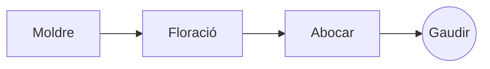

# El pour-over perfecte

Un ritual matinal lent, en pocs passos. Escriu-lo al **codi font** de l’esquerra o directament a la *previsualització* de la dreta: tots dos es mantenen sincronitzats, i ==cada edició és un canvi net== al Markdown.

> [!TIP]
> L’aigua just després del bull, a uns 94 °C, ressalta la dolçor sense amargor.

## La proporció

La majoria de receptes s’acorden en una part de cafè per setze parts d’aigua:

$$
m_{\text{aigua}} = 16 \times m_{\text{cafè}}
$$

Així que $20\,\text{g}$ de cafè demanen $320\,\text{g}$ d’aigua.

## Pas a pas



## Mètodes d’extracció

| Mètode          | Mòlta        | Temps |
|:----------------|:------------:|------:|
| Pour-over       | Mitjana-fina |  3:30 |
| Premsa francesa | Gruixuda     |  4:00 |
| Espresso        | Fina         |  0:28 |

## Abans de començar

- [x] Grans de cafè torrats de fa poc :coffee:
- [x] Un molinet de moles
- [ ] Un bullidor amb bec de coll de cigne

```python
def water_for(coffee_g: float, ratio: int = 16) -> float:
    return coffee_g * ratio
```

Floració
: El primer raig d’aigua, que fa que el cafè molt deixi anar el seu gas.[^1]

[^1]: Els grans frescos són els que més floreixen; els vells gairebé no pugen.
