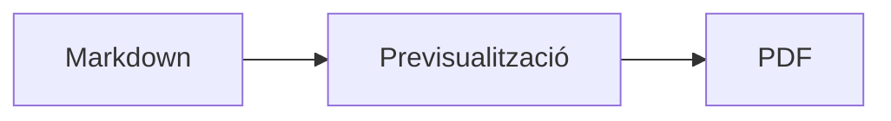

<p>&nbsp;&nbsp;&nbsp;</p>

# Splat

**L’editor de Markdown per a macOS que et deixa escriure al codi font o directament a la previsualització.**

El Splat mostra el teu codi font Markdown amb colors de sintaxi a l’esquerra i una previsualització en directe, totalment editable, a la dreta. Escriu en qualsevol dels dos: tot el que escriguis a la previsualització esdevé un canvi mínim al codi font, de manera que les línies que no has tocat es mantenen idèntiques byte a byte i els teus diffs de Git queden nets. El Splat entén el Markdown que ja fas servir: CommonMark i GitHub Flavored Markdown, alertes de GitHub, enllaços wiki, incrustacions i requadres d’Obsidian, extensions de Pandoc i de Typora, HTML incrustat, fórmules LaTeX i diagrames de Mermaid, Graphviz i PlantUML, tot renderitzat sense connexió. Exporta a PDF, HTML o Word amb un sol clic. Està escrit en Rust amb controls AppKit autèntics, parla 35 idiomes i no envia res per la xarxa si no li ho demanes.
 


[](https://github.com/sventmueller/splat/releases/latest/download/Splat.dmg)

**[Descarrega Splat.dmg](https://github.com/sventmueller/splat/releases/latest/download/Splat.dmg)**: signat i notaritzat per Apple, per a macOS 14 o posterior, amb Apple Silicon i Intel.

**Has trobat un error?** El Splat manté idèntiques byte a byte les línies que no has tocat. Si tot i així en canvia una, o un fitxer es mostra malament, [obre una incidència](https://github.com/sventmueller/splat/issues/new/choose) i adjunta-hi el fitxer. Si el Splat et resulta útil, una [estrella a GitHub](https://github.com/sventmueller/splat) ajuda altres persones a trobar-lo.
 
 

[](https://www.rust-lang.org)
[](https://www.apple.com/macos/)

[](https://github.com/madsmtm/objc2)
[](https://webkit.org)
[](https://github.com/kivikakk/comrak)
[](https://github.github.com/gfm/)
[](https://www.mathjax.org)
[](https://cortexjs.io/mathlive/)
[](https://mermaid.js.org)
[](https://graphviz.org)
[](https://plantuml.com)


[](#llicència)

[Bahasa Indonesia](../id/README.md) ·
[Bahasa Melayu](../ms/README.md) ·
**Català** ·
[Čeština](../cs/README.md) ·
[Dansk](../da/README.md) ·
[Deutsch](../de/README.md) ·
[English](../../../README.md) ·
[Español](../es/README.md) ·
[Français](../fr/README.md) ·
[Hrvatski](../hr/README.md) ·
[Italiano](../it/README.md) ·
[Magyar](../hu/README.md) ·
[Nederlands](../nl/README.md) ·
[Norsk](../no/README.md) ·
[Polski](../pl/README.md) ·
[Português (Brasil)](../pt_BR/README.md) ·
[Português (Portugal)](../pt_PT/README.md) ·
[Română](../ro/README.md) ·
[Slovenčina](../sk/README.md) ·
[Slovenščina](../sl/README.md) ·
[Suomi](../fi/README.md) ·
[Svenska](../sv/README.md) ·
[Tiếng Việt](../vi/README.md) ·
[Türkçe](../tr/README.md) ·
[Ελληνικά](../el/README.md) ·
[Русский](../ru/README.md) ·
[Українська](../uk/README.md) ·
[עברית](../he/README.md)‎ ·
[العربية](../ar/README.md)‎ ·
[हिन्दी](../hi/README.md) ·
[ไทย](../th/README.md) ·
[한국어](../ko/README.md) ·
[日本語](../ja/README.md) ·
[简体中文](../zh-Hans/README.md) ·
[繁體中文](../zh-Hant/README.md)

## Continguts

- [Resum de les funcions](#resum-de-les-funcions)
- [Requisits](#requisits)
- [Instal·lació](#installació)
- [Primers passos](#primers-passos)
- [Escriptura](#escriptura)
  - [Al codi font](#al-codi-font)
  - [A la previsualització](#a-la-previsualització)
  - [Ordres de format](#ordres-de-format)
  - [Llistes i tasques](#llistes-i-tasques)
  - [Taules](#taules)
- [Markdown compatible](#markdown-compatible)
  - [CommonMark i GitHub Flavored Markdown](#commonmark-i-github-flavored-markdown)
  - [Requadres](#requadres)
  - [Sintaxi estesa](#sintaxi-estesa)
  - [Obsidian](#obsidian)
  - [Cites i referències](#cites-i-referències)
  - [HTML incrustat](#html-incrustat)
  - [Puntuació tipogràfica](#puntuació-tipogràfica)
  - [Resum de la sintaxi](#resum-de-la-sintaxi)
- [Fórmules](#fórmules)
- [Diagrames](#diagrames)
- [Imatges](#imatges)
- [Enllaços i navegació](#enllaços-i-navegació)
- [Exportar, imprimir i compartir](#exportar-imprimir-i-compartir)
- [Aparença i accessibilitat](#aparença-i-accessibilitat)
- [Idiomes](#idiomes)
- [Dreceres de teclat](#dreceres-de-teclat)
- [Privadesa i seguretat](#privadesa-i-seguretat)
- [Documents grans](#documents-grans)
- [Limitacions conegudes](#limitacions-conegudes)
- [Resolució de problemes](#resolució-de-problemes)
- [Per a desenvolupadors](#per-a-desenvolupadors)
  - [Compilació](#compilació)
  - [Distribució](#distribució)
  - [Tests](#tests)
  - [Estructura del projecte](#estructura-del-projecte)
  - [Flux de dades](#flux-de-dades)
  - [Regles al controlador](#regles-al-controlador)
  - [Afegir una ordre](#afegir-una-ordre)
  - [Traduccions](#traduccions)
  - [Components de tercers](#components-de-tercers)
- [Llicència](#llicència)

## Resum de les funcions

- **Dues maneres d’escriure, un sol text.** El codi font i la previsualització són editables. El fitxer Markdown és l’única veritat: hi ha un sol historial de desfer per document, i cada edició a la previsualització es tradueix en el canvi més petit possible al codi font.
- **El Markdown que ja fas servir.** CommonMark, GitHub Flavored Markdown, alertes de GitHub, extensions d’Obsidian, de Pandoc i de Typora, codis curts d’emojis, spoilers, llistes de definicions, àncores de capçalera i HTML com als README de GitHub.
- **Fórmules i diagrames integrats.** Fórmules LaTeX amb MathJax i un editor visual de fórmules. Diagrames en Mermaid, Graphviz i PlantUML, renderitzats al teu Mac sense Java, sense servidor i sense connexió a la xarxa.
- **Un botó per a tot.** Cada construcció de Markdown té un botó a la barra d’eines i un element de menú, i les més habituals també una drecera de teclat. Les taules tenen el seu propi menú per a files, columnes i alineació.
- **Exporta sense perdre res.** PDF, un únic fitxer HTML autònom o un document de Word amb capçaleres, llistes, taules, notes a peu de pàgina i imatges de debò.
- **Natiu fins al moll de l’os.** Finestres, pestanyes, menús, finestres emergents, Versions, desament automàtic, el menú de compartir, mode fosc, correcció ortogràfica, dictat i VoiceOver autèntics d’AppKit. Sense Electron, i sense vista web per al text mateix.
- **Àgil amb fitxers grans.** Renderitzar una pulsació de tecla en un document de 10 MB triga uns 10 ms, abans de la feina pròpia de la vista.
- **Privat i prudent.** Les imatges d’internet només es carreguen quan ho permets, els enllaços a altres apps demanen confirmació, i tot el que descodifica dades d’imatge no fiables s’executa en processos auxiliars aïllats en una caixa de proves.
- **En el teu idioma.** La interfície i la referència ràpida de Markdown integrada estan disponibles en 35 idiomes: àrab, català, xinès (simplificat), xinès (tradicional), croat, txec, danès, neerlandès, anglès, finès, francès, alemany, grec, hebreu, hindi, hongarès, indonesi, italià, japonès, coreà, malai, noruec, polonès, portuguès (Brasil), portuguès (Portugal), romanès, rus, eslovac, eslovè, castellà, suec, tailandès, turc, ucraïnès i vietnamita.

## Requisits

- macOS 14 Sonoma o posterior. El Splat es desenvolupa i es prova amb macOS 27, on adopta automàticament el disseny Liquid Glass.
- Un Mac amb Apple Silicon o amb processador Intel.
- Uns 45 MB d’espai al disc.

## Instal·lació

**Des de la imatge de disc.** Descarrega [`Splat.dmg`](https://github.com/sventmueller/splat/releases/latest/download/Splat.dmg), obre’l i arrossega el Splat a la carpeta Aplicacions. La imatge està signada amb un Developer ID i notaritzada per Apple, de manera que s’obre sense advertiments.

**Amb Homebrew.** El cask viu en un tap propi:

```sh
brew install --cask sventmueller/tap/splat
```

`brew upgrade --cask splat` instal·la les versions noves, i `brew uninstall --zap --cask splat` elimina també els ajustos i les memòries cau del Splat.

**Actualitzacions.** El Splat de la imatge de disc o de Homebrew s’actualitza sol amb [Sparkle](https://sparkle-project.org). A la segona obertura pregunta si pot cercar actualitzacions pel seu compte, un cop al dia. **Splat › Cerca actualitzacions…** les cerca a l’instant; **Cerca actualitzacions automàticament** i **Descarrega i instal·la actualitzacions automàticament**, al mateix menú, et permeten canviar l’elecció més endavant. El Splat només instal·la una actualització si porta la signatura del desenvolupador. Una compilació pròpia no té actualitzador.

**Des del codi font.** Mira [Compilació](#compilació) per als requisits previs i després:

```sh
make build
ditto target/release/Splat.app /Applications/Splat.app
open /Applications/Splat.app
```

Per obrir fitxers Markdown amb el Splat fent doble clic, selecciona qualsevol fitxer `.md` al Finder, tria **Arxiu › Obtén informació**, escull el Splat a **Obre amb** i fes clic a **Canvia‑ho tot…**. El Splat es registra per als fitxers `.md`, `.markdown`, `.mdown` i `.mkd`.

## Primers passos

### La finestra

Cada document s’obre en una finestra pròpia, o en una pestanya si prefereixes les pestanyes:

- **Esquerra: el codi font.** El teu Markdown en SF Mono amb colors de sintaxi.
- **Dreta: la previsualització.** El document renderitzat, a punt per editar.
- **Barra lateral d’esquema (opcional).** Totes les capçaleres en forma d’arbre; un clic en una la mostra als dos panells. Mostra-la o amaga-la amb **Mostra › Mostra l’esquema** (⌃⌘S).
- **Barra d’eines.** Botons agrupats segons el que canvien: caràcters, paràgrafs i elements inserits, i després previsualització activada o desactivada, Comparteix i Nou document. Personalitza-la amb **Mostra › Personalitza la barra d’eines…**.

Arrossega el separador per donar més espai a un costat o a l’altre. **Mostra › Oculta la previsualització** (⌥⌘P) deixa només el codi font; el Splat ho recorda per a cada finestra. Els dos panells es desplacen alhora, i una selecció en un es ressalta a l’altre.

### Documents, pestanyes i versions

El Splat és una app de documents normal de macOS:

- **Desament automàtic i Versions.** Els canvis es desen al mateix fitxer. **Arxiu › Reverteix a › Explora totes les versions…** et fa tornar enrere en el temps.
- **Canvis des d’altres programes.** Quan Git, un script o un altre editor canvia un document obert, el Splat el torna a carregar i conserva el cursor i la posició de desplaçament. Si tens canvis propis sense desar, el Splat els manté, i macOS pregunta abans de desar-los sobre l’altra versió.
- **Les ordres de fitxer habituals.** Duplica (⇧⌘S), Canvia el nom…, Trasllada a… i **Arxiu › Obre els recents**.
- **Pestanyes.** **Arxiu › Nova pestanya** o el botó **+** de la barra d’eines obre un document nou en una pestanya; el menú Finestra estàndard fusiona, trasllada i recorre les pestanyes.
- **Posició de les finestres.** Es recorden la mida i la posició de l’última finestra, també entre reinicis. Si ja hi ha una finestra en aquell lloc, la nova s’obre una mica desplaçada.
- **La icona del Dock.** Un clic en ella, després de tancar l’última finestra, obre un document nou.
- **Obre els fitxers Markdown amb el Splat.** **Splat › Defineix com a app per omissió per a Markdown** fa que un doble clic en un fitxer `.md` o `.markdown` obri el Splat; macOS demana una vegada que ho confirmis. L’element mostra una marca de selecció mentre el Splat és l’app per omissió.

Els fitxers han de ser text UTF-8, o UTF-16 amb una marca d’ordre de bytes. El Splat rebutja les altres codificacions en comptes d’endevinar-les i malmetre el text. La marca d’ordre de bytes es conserva, l’UTF-16 continua sent UTF-16, i en un fitxer on totes les línies acaben en CRLF, les línies que hi afegeixes també acaben en CRLF.

**Després d’una fallada**, com a màxim es perden els últims segons d’escriptura: cada cinc segons, el Splat copia el text sense desar a `~/Library/Application Support/Splat/Unsaved`, i elimina les còpies quan el document es desa o el Splat es tanca amb normalitat. A la propera obertura, el que una fallada hi ha deixat es trasllada a `~/Library/Application Support/Splat/Recovery` i s’avisa una vegada, amb un botó que obre la carpeta. Una fallada a la qual el Splat encara pot reaccionar hi escriu també el text de tots els documents oberts.
### Referència ràpida

**Ajuda › Referència ràpida de Markdown** obre un full de consulta en el teu idioma com a document nou sense títol. És un document normal, així que prova-ho tot allà mateix, al codi font o a la previsualització.

## Escriptura

### Al codi font

El codi font és un editor de text pla pensat per a Markdown:

- **Colors de sintaxi** com a VS Code: capçaleres, èmfasi, enllaços, codi, taules, HTML, front matter, i LaTeX i Mermaid dins de fórmules i diagrames. Hi ha paletes per a mode clar, mode fosc i Augmenta el contrast.
- **Els blocs de codi delimitats** es ressalten per a Bash, C, C++, C#, CSS (també SCSS i Less), Go, HTML, XML, Java, JavaScript, JSON, Kotlin, PHP, Python, Ruby, Rust, SQL, Swift, TypeScript, YAML, TeX i Mermaid, incloent-hi els seus noms curts habituals com `js`, `py` o `sh`.
- **Cap substitució sorpresa.** Les cometes tipogràfiques, els guions intel·ligents i la substitució de text estan desactivats per omissió, perquè trenquen `--`, `---` i `"`. Activa’ls a **Edita › Substitucions**.
- **Les eines d’escriptura del sistema.** Correcció ortogràfica i gramatical, dictat, Cerca i substitueix (⌥⌘F) i Veu.
- **Arrossega i deixa anar.** Deixa anar un fitxer d’imatge per inserir ``, qualsevol altre fitxer per inserir-ne un enllaç, i una URL per inserir `[url](url)`. Cada acció és un sol pas de desfer.
- **Enganxa imatges.** Una imatge del porta-retalls, com ara una captura de pantalla, es desa com a fitxer PNG al costat del document (`Imatge 2026-10-29 13.09.07.png`) i s’insereix com a imatge. Per a això cal que el document s’hagi desat una vegada.

### A la previsualització

La previsualització es comporta com un processador de textos, però tot el que hi fas acaba en Markdown:

- **Escriure.** Els caràcters que signifiquen alguna cosa en Markdown, com `*` o `#`, s’escapen perquè apareguin tal com els has escrit.
- **Retorn** comença un paràgraf o un element de llista nou. **⌥Retorn** o **⌃Retorn** insereix un salt de línia.
- **Format al cursor.** Amb el cursor al final d’una paraula, Negreta, Cursiva i els altres formats de caràcter s’apliquen al que escriguis a continuació. Torna a triar el format per aturar-lo. Dins d’una paraula, es formata tota la paraula.
- **Línies buides.** Retorn en una línia buida n’afegeix una altra, i Retrocés l’elimina. Al codi font, cada línia buida addicional són dues línies en blanc més; altres programes de Markdown les mostren com a espaiat normal entre paràgrafs.
- **Desfés** funciona als dos panells. Els elements de desfer tenen nom («Desfés negreta»), escriure és un pas per ràfega, i després de Desfés i Refés els dos panells es desplacen fins al canvi.
- **Les fórmules i els diagrames** apareixen com a gràfics acabats. Fes-hi clic, posa-hi el cursor a sobre o prem Retorn per obrir-ne l’editor (mira [Fórmules](#fórmules) i [Diagrames](#diagrames)).
- **L’HTML incrustat, les notes incrustades i el front matter** es mostren, però s’editen al codi font. Un clic en ells posa el cursor al lloc corresponent del codi font.

A la previsualització es bloqueja tot el que Markdown no pot expressar: els plafons Tipus de lletra i Color, la regla, i enganxar o deixar anar text enriquit i imatges. L’HTML i l’RTF enganxats arriben com a text pla.

### Ordres de format

Totes les ordres estan disponibles a la barra d’eines, a la barra de menús i al menú contextual dels dos panells. Els elements de menú mostren una marca de selecció per al format que hi ha al cursor.

| Menú | Ordres |
|---|---|
| **Format › Tipus de lletra** | Negreta, Cursiva, Subratllat, Ratllat, Ressaltat, Codi, Superíndex, Subíndex |
| **Format › Capçalera** | Cos de text, Capçalera de l’1 al 6 |
| **Format › Llista** | Llista amb vinyetes, Llista numerada, Llista de tasques |
| **Format** | Cita, Bloc de codi (Sense llenguatge o un de 20 llenguatges; també canvia el llenguatge d’un bloc existent), Requadre (Nota, Consell, Important, Avís, Precaució; el mateix tipus una altra vegada l’elimina), Edita la fórmula o el diagrama…, Esborra el format |
| **Insereix** | Enllaça…, Imatge…, Taula…, Fórmula, Diagrama (Diagrama de flux, Diagrama de seqüència, Diagrama de Gantt), Taula de contingut, Nota a peu de pàgina, Separador |
| **Taula** | Insereix una fila a sobre/a sota, Insereix una columna a l’esquerra/a la dreta, Elimina la fila, Elimina la columna, Alineació (Esquerra, Centrat, Dreta, Per omissió), Alinea les columnes de la taula |
| **Mostra** | Oculta/Mostra la previsualització, Mostra/Oculta l’esquema, Puntuació tipogràfica, Apropa/Allunya, Mida real, barra d’eines, barra de pestanyes, pantalla completa |

El subratllat, el ressaltat, el superíndex i el subíndex s’escriuen com `<ins>`, `<mark>`, `<sup>` i `<sub>`, que GitHub també mostra. El Splat també entén `<u>`, que GitHub elimina, i les formes més curtes `==ressaltat==`, `^sup^` i `~sub~`. GitHub mostra `==` i `^` tal com estan escrits, i `~sub~` com a ratllat.

### Llistes i tasques

- Retorn continua una llista; Retorn en un element buit la tanca.
- **Tab** i **⇧Tab** augmenten i redueixen el sagnat dels elements de llista a la previsualització.
- Un clic en una casella de tasca a la previsualització canvia entre `- [ ]` i `- [x]`.
- **Format › Llista** converteix els paràgrafs seleccionats en una llista o en canvia el tipus.

### Taules

- **Insereix › Taula…** demana el nombre de files (inclosa la capçalera) i de columnes.
- A la previsualització, **Tab** passa a la cel·la següent, **⇧Tab** a l’anterior i **Retorn** a la cel·la de sota. Tab a l’última cel·la afegeix una fila.
- El menú **Taula** insereix i elimina files i columnes i defineix l’alineació d’una columna (⌘{, ⌘|, ⌘}).
- **Taula › Alinea les columnes de la taula** omple el codi font amb espais perquè les columnes quedin alineades.

## Markdown compatible

El Splat analitza amb [comrak](https://github.com/kivikakk/comrak), un analitzador compatible amb CommonMark i GFM, i activa la majoria de les seves extensions. Tot el que hi ha a continuació es renderitza a la previsualització i a totes les exportacions.

### CommonMark i GitHub Flavored Markdown

- Capçaleres (`#` i subratllades), paràgrafs, salts de línia, èmfasi, èmfasi fort, codi en línia, cites en bloc, separadors.
- Llistes amb vinyetes, numerades i imbricades; llistes de tasques.
- Enllaços (en línia, de referència i automàtics), imatges, definicions de referències d’enllaços.
- Blocs de codi delimitats i sagnats amb colors de sintaxi.
- Taules amb alineació de columnes.
- Ratllat amb `~~dues tildes~~`.
- Notes a peu de pàgina: `text[^1]` amb `[^1]: La nota.` en qualsevol lloc del document. Un clic al marcador salta a la nota.
- YAML front matter entre línies `---` a dalt de tot. La previsualització el resumeix en una sola línia, com ara «Metadades: title, date, tags».

### Requadres

Les alertes de GitHub es renderitzen com a requadres de colors amb icona i títol:

```markdown
> [!NOTE]
> Informació útil que els usuaris haurien de conèixer.

> [!WARNING]
> Contingut crític que requereix atenció immediata.
```

Els cinc tipus són Nota, Consell, Important, Avís i Precaució. **Format › Requadre** converteix el paràgraf on és el cursor en un d’ells.

Els requadres d’Obsidian també funcionen, amb qualsevol títol i un estat de plegat:

```markdown
> [!tip]- Fes clic a ▸ per desplegar
> Ocult fins que s’obre.

> [!question]+ Obert per omissió
> Un `+` comença desplegat, un `-` plegat.
```

Els altres tipus d’Obsidian es mostren amb el més proper dels cinc colors: `success`, `check`, `done` i `hint` com a Consell; `question`, `help` i `faq` com a Important; `attention` com a Avís; `failure`, `fail`, `missing`, `danger`, `error` i `bug` com a Precaució; la resta com a Nota.

### Sintaxi estesa

| Funció | Sintaxi | Origen |
|---|---|---|
| Ressaltat | `==text marcat==` | Obsidian, Typora |
| Superíndex | `x^2^` | Pandoc, Typora |
| Subíndex | `H~2~O` | Pandoc, Typora |
| Codi curt d’emoji | `:rocket:` esdevé 🚀 | GitHub |
| Spoiler | `\|\|text ocult\|\|`, selecciona’l per llegir-lo | Discord |
| Nota en línia | `text^[la nota mateixa]` | Pandoc, Obsidian |
| Llista de definicions | `Terme`, línia en blanc, `: Explicació` | PHP Markdown Extra, Pandoc |
| Àncora de capçalera | `## Instal·lació {#setup}`, enllaça amb `[vegeu](#setup)` | Pandoc, kramdown |

Les llistes de definicions tenen aquest aspecte al codi font:

```markdown
Terme

: Explicació del terme.
```

Sense una àncora pròpia, cada capçalera en rep una derivada del seu text, com a GitHub: `## Primers passos` s’hi arriba com a `#primers-passos`.

### Obsidian

- **Enllaços wiki.** `[[Nota]]` enllaça amb `Nota.md` a la mateixa carpeta o en una carpeta de sota. `[[Nota|Text mostrat]]` mostra el teu propi text, i `[[Nota#Capçalera]]` obre la nota. ⌘-clic l’obre al Splat.
- **Incrustacions.** `![[Nota]]` mostra l’altra nota dins d’aquesta; les notes que hi estan incrustades apareixen com a enllaços. `![[diagram.png]]` mostra una imatge. Com a Obsidian, les incrustacions anomenen notes i imatges de la carpeta del document o de sota, mai amb una ruta absoluta, i només els fitxers Markdown es mostren com a notes.
- **Comentaris.** `%%Només al codi font%%` continua visible al codi font i s’omet de la previsualització i de totes les exportacions, tant en línia com en línies pròpies.
- **Etiquetes.** `#idea` o `#project/splat` es ressalta. ⌘-clic cerca l’etiqueta al document.
- **Requadres plegables.** Mira [Requadres](#requadres).

### Cites i referències

- **Cites de Pandoc.** `[@doe2020]` o `[@doe2020; @roe2021]` es llegeix com «(Doe 2020; Roe 2021)». Les entrades vénen del fitxer BibTeX que el front matter indica amb `bibliography: refs.bib`. Si no n’hi ha, el Splat fa servir `references.bib`, `literatur.bib` o `bibliography.bib` al costat del document.
- **Referències de GitHub i GitLab.** Si el document és en un dipòsit de Git el remot `origin` del qual és a github.com o a un servidor GitLab, `@name`, `#12` (incidència) i `!7` (sol·licitud de combinació, només a GitLab) es ressalten. ⌘-clic els obre al navegador.

### HTML incrustat

L’HTML tal com el trobes als README de GitHub es renderitza, amb un lector propi en comptes d’un motor de navegador:

- paràgrafs i blocs centrats (`<p align="center">`, `<div align="center">`)
- imatges amb mida (``)
- enllaços, `<kbd>⌘</kbd>`, `<br>`, `<u>`, `<ins>`, `<mark>`, `<sup>`, `<sub>`
- llistes i taules, incloses les cel·les que ocupen diverses columnes (`colspan`)
- seccions plegables: `<details><summary>Més</summary>…</details>`, que s’obren amb un clic a ▸

El Markdown entre etiquetes HTML es renderitza com a Markdown. Els scripts, els estils, els marcs i els formularis s’ometen del tot, i els enllaços i les imatges només conserven adreces `http`, `https`, `mailto` i relatives.

### Puntuació tipogràfica

**Mostra › Puntuació tipogràfica** mostra les cometes rectes com les cometes de l’idioma de la teva interfície, `--` com un guió mitjà, `---` com un guió llarg i `...` com a punts suspensius. En alemany, `"Ja"` esdevé „Ja“, en francès «Oui», en japonès 「はい」, també allà on el xinès i el japonès posen les cometes sense espai; les abreviatures hebrees com `צה"ל` reben la seva gershayim, צה״ל. El codi font conserva els caràcters simples; la previsualització i totes les exportacions mostren els tipogràfics. L’ajust està desactivat fins que l’actives.

### Resum de la sintaxi

| Element | Markdown |
|---|---|
| **Negreta** | `**Negreta**` |
| *Cursiva* | `*Cursiva*` |
| Subratllat | `<ins>Subratllat</ins>` o `<u>Subratllat</u>` |
| ~~Ratllat~~ | `~~Ratllat~~` |
| Ressaltat | `<mark>Ressaltat</mark>` o `==Ressaltat==` |
| `Codi` | `` `Codi` `` |
| x² | `x<sup>2</sup>` o `x^2^` |
| H₂O | `H<sub>2</sub>O` o `H~2~O` |
| [Enllaç](https://example.com) | `[Enllaç](https://example.com)` |
| Capçalera | `# Capçalera` a `###### Capçalera` |
| Cita | `> Cita` |
| Llista amb vinyetes | `- Element` |
| Llista numerada | `1. Element` |
| Tasca | `- [ ] Pendent` i `- [x] Feta` |
| Bloc de codi | ```` ```rust ```` … ```` ``` ```` |
| Taula | `\| A \| B \|` amb `\|---\|---\|` sota la capçalera |
| Nota a peu de pàgina | `Text[^1]` i `[^1]: Nota` |
| Separador | `---` |
| Imatge | `` |
| Fórmula | `$E = mc^2$`, `$$ … $$` |
| Diagrama | ```` ```mermaid ````, ```` ```dot ````, ```` ```plantuml ```` |
| Requadre | `> [!TIP]` |
| Enllaç wiki | `[[Nota]]`, `[[Nota\|Text]]` |
| Incrustació | `![[Nota]]`, `![[image.png]]` |
| Comentari | `%%Comentari%%` |
| Etiqueta | `#etiqueta` |
| Cita bibliogràfica | `[@clau]` |
| Spoiler | `\|\|Spoiler\|\|` |
| Emoji | `:tada:` |

## Fórmules

Les fórmules les renderitza [MathJax](https://www.mathjax.org) amb les seves matemàtiques TeX i AMS, com a gràfics vectorials nítids. El text de `\text{…}` pot ser en qualsevol escriptura: el que falta a les tipografies de MathJax ve de les tipografies del teu Mac, amb l’àrab i l’hebreu escrits de dreta a esquerra, i els emojis en color.

| Tipus | Sintaxi |
|---|---|
| En línia | `$E = mc^2$`, `` $`E = mc^2`$ `` (GitHub, GitLab), `\(E = mc^2\)` |
| En bloc | `$$` … `$$`, `\[` … `\]`, o un bloc de codi marcat amb `math` |

**Editar una fórmula.** Fes clic en una fórmula a la previsualització, fes-hi doble clic, prem Retorn a sobre o posa-hi el cursor per obrir-ne l’editor en una finestra emergent. **Insereix › Fórmula** n’insereix una de nova i n’obre l’editor a l’instant.

- **Visual o LaTeX.** L’interruptor de dalt canvia entre un editor visual ([MathLive](https://cortexjs.io/mathlive/)) i el codi LaTeX. El Splat recorda la teva elecció.
- **Blocs de construcció** per a fracció, arrel quadrada, superíndex i subíndex, suma i integral amb límits, límit, parèntesis que creixen amb el contingut, matriu 2×2, lletres gregues, i relacions, operadors i fletxes. Deixen marcadors □, i **Tab** salta al següent.
- **Previsualització en directe.** Els canvis apareixen al document mentre escrius. Els errors de MathJax es mostren en una línia sota el codi.
- **Confirma o descarta.** Fer clic fora conserva el canvi com un sol pas de desfer; **Esc** o **Cancel·la** el descarta. Prémer Esc en una fórmula nova i buida l’elimina de nou.
- El menú contextual ofereix **Edita la fórmula…** per a la fórmula que hi ha sota el punter.

VoiceOver llegeix una fórmula com el seu codi LaTeX. El Splat renderitza fórmules, no documents LaTeX complets: no hi ha paquets, ni TikZ, ni `\documentclass`.

## Diagrames

Els diagrames es renderitzen dins del Splat, sense connexió i en una variant clara i una de fosca.

| Motor | Bloc de codi | Què dibuixa |
|---|---|---|
| [Mermaid](https://mermaid.js.org) | ```` ```mermaid ```` | diagrames de flux, de seqüència, de classes, d’estats, entitat-relació, de Gantt, de sectors, mapes mentals, cronologies i tots els altres tipus de Mermaid |
| [Graphviz](https://graphviz.org) | ```` ```dot ```` o ```` ```graphviz ```` | grafs en el llenguatge DOT |
| [PlantUML](https://plantuml.com) | ```` ```plantuml ```` o ```` ```puml ```` | diagrames UML; funciona sense Java |



**Editar un diagrama** funciona com editar una fórmula: fes-hi clic per obrir el codi en una finestra emergent, amb colors de sintaxi i missatges d’error en una línia sota el codi. **Insereix › Diagrama** parteix d’una plantilla per a un diagrama de flux, un diagrama de seqüència o un diagrama de Gantt. Els blocs de construcció ajuden amb els tres tipus de Mermaid més habituals:

- **Diagrama de flux:** Node ▾ (rectangle, arrodonit, cercle, rombe, base de dades), Connexió, Connexió amb etiqueta, Grup, Direcció ▾
- **Diagrama de seqüència:** Participant, Missatge, Resposta, Nota, Bucle, Camins alternatius
- **Diagrama de Gantt:** Secció, Tasca, Fita

Els altres tipus de diagrama s’editen com a codi. VoiceOver llegeix el títol o el text alternatiu d’un diagrama.

El primer diagrama després d’obrir l’app triga aproximadament un segon, perquè el motor de renderització arrenca en segon pla. Un diagrama que triga més de 10 segons mostra un error, i el motor de renderització arrenca de nou per al següent. El motor de PlantUML (3 MB) només es carrega amb el primer diagrama de PlantUML. Un `!include` de PlantUML des del web es bloqueja.

## Imatges

- **Les imatges locals** fan servir rutes relatives al document: ``. El Splat mostra PNG, JPEG, GIF, WebP, BMP, SVG, HEIC, TIFF, AVIF i PDF.
- **Les imatges d’internet** continuen bloquejades fins que les permets: una barra sobre la previsualització explica que carregar-les fa saber als seus servidors que obres el document i quan. **Carrega les imatges** les permet per a aquest document; el Splat recorda l’elecció per a cada fitxer.
- **Mida.** `` dona mida a una imatge; si no, les imatges s’ajusten a l’amplada de la previsualització.
- **Canvis al disc.** Una imatge que substitueixes, o una que apareix després que el document la nomeni, es mostra sense tornar a obrir el document. Les imatges d’internet que han fallat per culpa de la xarxa es tornen a provar mentre un document les mostra.
- **Memòria.** Les imatges es mostren amb fins a 2560 píxels al costat més llarg, cosa que també omple una pàgina A4. Es descodifiquen més petites quan ocupen una vuitena part de la memòria del Mac, i mentre macOS informa de pressió de memòria.
- **Mode fosc.** Les imatges amb fons blanc s’atenuen una mica a la previsualització fosca.
- **Enganxar i deixar anar.** Mira [Al codi font](#al-codi-font).

## Enllaços i navegació

A la previsualització, un clic situa el cursor perquè puguis editar el text de l’enllaç; **⌘-clic** segueix l’enllaç:

- `http`, `https` i `mailto` s’obren al teu navegador o a l’app de correu.
- Els fitxers Markdown s’obren al Splat; els altres fitxers i carpetes es mostren al Finder.
- `#anchor` salta a la capçalera del document.
- Les adreces que obren una altra app, com `slack://` o `vscode://`, demanen confirmació abans i mostren l’adreça completa i l’app. **Cancel·la** ve preseleccionat.

**Insereix › Taula de contingut** insereix una llista enllaçada de totes les capçaleres. Amb el cursor a dins, la mateixa ordre l’actualitza. La barra lateral d’esquema (⌃⌘S) salta a qualsevol capçalera als dos panells.

## Exportar, imprimir i compartir

| Format | Com | Què obtens |
|---|---|---|
| **PDF** | **Arxiu › Exporta com a PDF…** o el menú Comparteix | Pàgines de la mida del paper, sempre en l’aparença clara, amb fórmules i diagrames com a gràfics vectorials. **Arxiu › Configuració de pàgina…** defineix el paper. |
| **Impressió** | **Arxiu › Imprimeix…** (⌘P) | El mateix disseny que el PDF. |
| **HTML** | **Arxiu › Exporta com a HTML…** o el menú Comparteix | Un únic fitxer autònom: imatges locals incrustades, fórmules i diagrames com a imatges nítides, àncores de capçalera perquè la taula de contingut funcioni. Sense scripts. |
| **Word** | **Arxiu › Exporta com a document del Word…** o el menú Comparteix | Un `.docx` amb els estils de capçalera de Word, llistes i taules de debò (incloses les cel·les combinades), notes a peu de pàgina com a notes a peu de pàgina de Word, imatges incrustades, fórmules i diagrames. |
| **Markdown** | El botó **Comparteix** de la barra d’eines | El document com a fitxer `.md` per a Mail, Missatges, AirDrop i tots els altres serveis per compartir. |

El menú **Arxiu › Comparteix** ofereix tot això en un sol lloc. Les exportacions fan servir l’ajust de puntuació tipogràfica i les imatges d’internet que has permès; en HTML, les imatges d’internet continuen sent enllaços.

## Aparença i accessibilitat

- **El mode fosc** segueix el sistema. Les fórmules i els diagrames es renderitzen per a cada aparença.
- **Augmenta el contrast**, a Configuració del Sistema, canvia els colors de sintaxi a paletes d’alt contrast.
- **Zoom.** ⌘+, ⌘− i ⌘0 escalen els dos panells.
- **Pantalla completa, pestanyes i una barra d’eines personalitzable**, com en qualsevol app del Mac.
- **VoiceOver.** Els panells s’anomenen «Codi font Markdown» i «Previsualització», les fórmules es llegeixen com el seu codi i els diagrames com el seu títol. Totes les ordres es poden fer amb el teclat.

El Splat no té finestra d’ajustos: les poques opcions són on s’apliquen, a **Mostra** i a **Edita › Substitucions**.

## Idiomes

La interfície, els menús i la referència ràpida de Markdown estan traduïts a 35 idiomes:

àrab, català, xinès (simplificat), xinès (tradicional), croat, txec, danès, neerlandès, anglès, finès, francès, alemany, grec, hebreu, hindi, hongarès, indonesi, italià, japonès, coreà, malai, noruec, polonès, portuguès (Brasil), portuguès (Portugal), romanès, rus, eslovac, eslovè, castellà, suec, tailandès, turc, ucraïnès i vietnamita.

El Splat segueix l’ordre d’idiomes de **Configuració del Sistema › General › Idioma i regió**; allà també pots triar un idioma només per al Splat, a **Apps**. Si no hi ha traducció per al teu idioma, fa servir l’anglès. Els termes dels menús segueixen les traduccions d’Apple, de manera que el Splat es llegeix com la resta del teu Mac.

El text en hebreu i en àrab es llegeix de dreta a esquerra allà on aparegui, sigui quin sigui l’idioma de la interfície: cada paràgraf, capçalera i element de llista pren la direcció de la seva primera lletra, les cites i els requadres dibuixen la barra a la dreta, i una taula el text de la qual comença de dreta a esquerra ordena les columnes des de la dreta. Els blocs de codi continuen d’esquerra a dreta. Les exportacions a PDF, HTML i Word conserven aquestes direccions. Amb l’hebreu o l’àrab com a idioma del sistema, macOS també emmiralla la finestra, de manera que la previsualització queda a l’esquerra.

## Dreceres de teclat

| Acció | Drecera |
|---|---|
| Negreta, cursiva, subratllat | ⌘B, ⌘I, ⌘U |
| Ratllat | ⇧⌘X |
| Enllaça… | ⌘K |
| Cos de text, capçalera de l’1 al 6 | ⌥⌘0, ⌥⌘1 a ⌥⌘6 |
| Alinea la columna de la taula a l’esquerra, centrada, a la dreta | ⌘{, ⌘\|, ⌘} |
| Oculta o mostra la previsualització | ⌥⌘P |
| Mostra o oculta l’esquema | ⌃⌘S |
| Apropa, allunya, mida real | ⌘+, ⌘−, ⌘0 |
| Nou document, obre, desa, duplica | ⌘N, ⌘O, ⌘S, ⇧⌘S |
| Configuració de pàgina, imprimeix | ⇧⌘P, ⌘P |
| Cerca, cerca i substitueix | ⌘F, ⌥⌘F |
| Cerca el següent, l’anterior; utilitza la selecció; ves a la selecció | ⌘G, ⇧⌘G; ⌘E; ⌘J |
| Mostra l’ortografia i la gramàtica; revisa el document | ⌘:, ⌘; |
| Enganxa amb el mateix estil | ⌥⇧⌘V |
| Oculta la barra d’eines, mostra totes les pestanyes, pantalla completa | ⌥⌘T, ⇧⌘\\, ⌃⌘F |
| Salt de línia (previsualització) | ⌥Retorn o ⌃Retorn |
| Cel·la següent / anterior d’una taula (previsualització) | Tab / ⇧Tab |
| Augmenta / redueix el sagnat d’un element de llista (previsualització) | Tab / ⇧Tab |
| Següent marcador a l’editor de fórmules | Tab |
| Tanca l’editor de fórmules o de diagrames sense canvis | Esc |
| Segueix un enllaç, una etiqueta o una referència (previsualització) | ⌘-clic |

El Splat deixa les dreceres estàndard d’Apple tal com són.

## Privadesa i seguretat

Un fitxer Markdown pot venir de qualsevol, així que el Splat tracta cada document com a no fiable.

- **Sense xarxa per omissió.** El Splat no té telemetria. Només cerca actualitzacions quan hi estàs d’acord o tries **Cerca actualitzacions…**: llavors carrega un petit fitxer de canal de GitHub, i la sol·licitud no esmenta res més que l’app i la seva versió. Les fórmules i els diagrames es renderitzen en local; les vistes web que ho fan no poden accedir a la xarxa. **Ajuda › Informa d’un problema…** obre un formulari de GitHub al navegador; la seva adreça porta la versió del Splat, la de macOS i el tipus de Mac, però res dels teus documents.
- **Les imatges d’internet** només es carreguen amb el teu permís, només per `https`, mai des de servidors de la teva xarxa local, com a màxim de 10 MB cadascuna i en una sessió privada sense galetes.
- **Descodificació aïllada.** Les imatges i els gràfics de fórmules i diagrames es descodifiquen en processos auxiliars que tanquen tots els fitxers que han heretat i es tanquen ells mateixos en una caixa de proves abans de llegir el primer byte: sense accés a fitxers ni a la xarxa. Només retornen píxels, la mida dels quals es comprova, i s’aturen als 10 segons. Els descodificadors d’imatge d’Apple només veuen HEIC, TIFF, AVIF i PDF, i només quan les dades són realment d’aquest format; s’executen en un procés auxiliar propi, que a més pot llegir les carpetes de tipus de lletra del sistema i fer servir el descodificador de vídeo del sistema. Els SVG, les fórmules i els diagrames també passen per aquest procés, de manera que al Splat són imatges amb una resolució fixa: quatre píxels per punt, fins a 2560 al costat més llarg.
- **Els fitxers locals** només arriben a un document per la ruta que aquest anomena. Les incrustacions mostren notes Markdown de la carpeta del document i de sota, i una imatge que falta només es busca allà. Una ruta d’imatge a un altre lloc, absoluta o que comença per `~`, es carrega igualment a la previsualització; les exportacions HTML i Word, la impressió i els PDF només s’emporten el que hi ha a la carpeta del document o al seu repositori Git, tret que aquest repositori també contingui la teva carpeta d’inici, de manera que un document d’una altra persona no pot arrossegar els teus fitxers a una exportació que passis a algú.
- **Les còpies del text sense desar** es queden en aquest Mac, a la carpeta Library, per a la recuperació després d’una fallada. Desapareixen amb el desament o amb el tancament normal del Splat; les còpies que una fallada ha deixat es queden a la carpeta de recuperació fins que les eliminis.
- **Els enllaços** mai inicien un programa amb un clic. Els enllaços web i de correu s’obren com sempre; els enllaços a altres apps demanen confirmació.
- **L’HTML als documents** el llegeix l’analitzador propi del Splat. Els scripts, els estils, els marcs i els formularis no s’executen mai.
- **Les exportacions** no porten scripts. Les pàgines HTML només conserven una llista fixa d’etiquetes i atributs inofensius, com fa GitHub, més una política de seguretat de contingut. Els fitxers de Word només enllacen adreces `http`, `https` i `mailto`.
- **Signatura de codi** amb el Hardened Runtime. El Splat s’executa sense l’App Sandbox perquè pugui mostrar imatges al costat dels teus documents sense demanar permís per a cada carpeta; l’aïllament de tota la descodificació ho compensa.

## Documents grans

El Splat continua responent amb documents de diversos megabytes:

- El codi font fa servir TextKit 2, que només disposa la part visible.
- Mentre escrius a la previsualització, i al codi font de documents de fins a 2 MB, només s’analitzen, es coloregen i es tornen a disposar els paràgrafs afectats. En un document de 10 MB, analitzar i colorejar triga uns 3 ms, renderitzar uns 10 ms, i una pulsació de tecla sencera a la seva previsualització uns 30 ms amb la feina pròpia de la vista.
- Les previsualitzacions grans renderitzen primer la part visible i la resta mentre l’app està inactiva. Els blocs que es desplacen a la vista es renderitzen abans de dibuixar-se.
- Al codi font dels documents més grans, l’anàlisi per a la previsualització s’executa en segon pla mentre escrius.
- Un document es manté com a text pla quan necessitaria uns 4 GB de memòria, és a dir, uns 50 a 120 MB de Markdown habitual, però només de 10 a 20 MB si tot són taules o encapçalaments: el codi font no té colors i la previsualització diu per què es manté buida. Les exportacions continuen funcionant.
- A partir d’uns 200 KB, un document obre la finestra abans d’analitzar-se; a 5 MB, els colors i la previsualització arriben aproximadament un quart de segon més tard.
- Totes les imatges juntes, incloses les fórmules i els diagrames, ocupen com a màxim una quarta part de la memòria del Mac, i la meitat d’això mentre hi ha poca memòria. Més enllà d’això, les altres imatges es mostren com a marcadors de posició fins que torna a haver-hi espai.

Alguns canvis es processen sencers, amb uns 300 ms per pulsació de tecla a 10 MB: els de la definició o de les referències d’una nota a peu de pàgina, els que hi ha al costat d’una nota en línia, al final mateix d’un document al costat d’una nota a peu de pàgina, al front matter o a definicions de referències d’enllaços, i tots els canvis en un document amb blocs de comentaris `%%` o amb una nota a peu de pàgina definida dues vegades o dins d’una cita o d’una llista. La memòria creix amb el fitxer, fins a uns 115–160 MB per a 1 MB de Markdown i 340–510 MB per a 10 MB.

## Limitacions conegudes

- **Les tildes soltes volen dir subíndex.** `~text~` és subíndex com a Pandoc; el ratllat necessita `~~dues~~`. GitHub també ratlla amb una sola tilde.
- **Només de lectura a la previsualització:** l’HTML incrustat, les notes incrustades i el front matter s’editen al codi font.
- **Imbricació molt profunda:** l’HTML imbricat a més de 64 nivells, i l’HTML en línia a més de 16, cedeix el pas al seu contingut.
- **Les cel·les combinades de taula** només existeixen en taules HTML, i només entre columnes (`colspan`, no `rowspan`). La sintaxi de taules de MultiMarkdown per a cel·les combinades no és compatible.
- **Les bibliografies** només es llegeixen de BibTeX, no de CSL JSON ni de YAML.
- **Les referències** necessiten un dipòsit a github.com o a un servidor GitLab; `!7` només existeix a GitLab.
- **Puntuació tipogràfica:** una cometa simple de tancament alemanya no es pot distingir d’un apòstrof i es posa com a ’.
- **Fórmules, no documents:** sense paquets LaTeX, TikZ ni documents complets.
- **L’editor visual de fórmules** escriu LaTeX amb la notació de MathLive: els espais desapareixen (`E = mc^2` esdevé `E=mc^2`), la renderització continua igual.
- **Per disseny:** sense números de línia, sense finestra d’ajustos, sense Help Book, no és a l’App Store.
- **Provat menys en Intel.** Els autotests de finestra només s’executen en Apple Silicon; en Intel, la CI executa `cargo test`.

## Resolució de problemes

**La llista de documents recents és buida després de tornar a compilar el Splat.** macOS lliga els documents recents i els permisos de carpeta a la signatura de codi de l’app. Les compilacions locals es signen amb el certificat «Splat Local Signing» del teu clauer d’inici de sessió, de manera que en recompilar es conserven tots dos. Si s’ha eliminat el certificat, la compilació següent en crea un de nou i les llistes tornen a començar una vegada.

**L’app de la imatge de disc mostra uns documents recents diferents dels de la meva pròpia compilació.** Les dues porten signatures diferents, de manera que macOS manté una llista i uns permisos de carpeta separats per a cadascuna.

**L’HTML o una altra sintaxi es mostra com a codi pla.** Pot ser que una còpia antiga del Splat hagi obert el document. Tanca-la, tria **Arxiu › Obtén informació** en el document al Finder i comprova que **Obre amb** indiqui el Splat de la teva carpeta Aplicacions.

**No hi ha cap Cerca actualitzacions… al menú Splat.** Només la versió de la imatge de disc o de Homebrew s’actualitza sola; una compilació pròpia no té actualitzador.

**Les imatges d’internet no apareixen.** Fes clic a **Carrega les imatges** a la barra sobre la previsualització. Només es carreguen les imatges `https` de servidors públics.

**Enganxar una captura de pantalla em demana desar primer.** Les imatges enganxades es desen com a fitxers al costat del document, cosa que necessita un lloc al disc. Desa’l i torna a enganxar.

**«El fitxer no és text UTF-8 i no es pot obrir com a Markdown.»** El fitxer està en una altra codificació i no té cap marca d’ordre de bytes que la indiqui. Converteix-lo primer, per exemple amb `iconv -f ISO-8859-1 -t UTF-8 old.md > new.md`.

**Una fórmula o un diagrama mostra un error.** Fes-hi clic: l’editor mostra el missatge de MathJax, Mermaid, Graphviz o PlantUML sota el codi.

## Per a desenvolupadors

El Splat és una aplicació en Rust que parla directament amb AppKit i WebKit mitjançant [objc2](https://github.com/madsmtm/objc2). No hi ha Swift, ni Objective-C, ni projecte d’Xcode, ni fitxer d’Interface Builder.

### Compilació

Requisits previs:

- macOS amb les Command Line Tools (`xcode-select --install`). No cal Xcode; el Splat es compila sense `actool`, `ibtool` ni `metal`.
- Rust 1.99 (`brew install rust`). [rust-toolchain.toml](../../../rust-toolchain.toml) indica la versió exacta que fa servir la CI; rustup l’instal·la sol, el Rust de Homebrew ignora el fitxer. Pujar-la allà és com arriben al projecte els nous avisos del compilador i de clippy.
- rustup, per a `make lint`, `make check` i `make universal`: `cargo xtask check-library` compila la biblioteca per a Linux per demostrar que no necessita macOS, i el Rust de Homebrew no té cap altre objectiu de compilació.

El [Makefile](../../../Makefile) conté punts d’entrada curts; `make help` els llista tots:

```sh
make build                  # target/release/Splat.app, igual que cargo xtask bundle --release
make universal              # target/splat-universal per a Apple Silicon i Intel, tal com el porta la imatge de disc
make check                  # format, clippy sense avisos, tots els tests, biblioteques incorporades; el que executa la CI
make test                   # make check, i després l’autotest sense finestra
make test-gui               # autotests amb finestra; ocupen el Mac durant uns quatre minuts
make test-long              # cerca aleatòria més llarga i la comprovació de l’actualització parcial a 10 MB
make fuzz                   # entrada aleatòria per a l’anàlisi parcial i totes les sortides
make coverage               # cobertura de línies de tots els tests i autotests, amb un mínim per mòdul
make coverage-library       # els mateixos mínims per als mòduls sense finestra, com a la CI
make bench FILE=<file.md>   # temps d’obertura, d’escriptura i de desplaçament d’un fitxer gran
make release                # primer make test, després la imatge de disc notaritzada
```

La lògica de compilació mateixa viu al crate de Rust [xtask](../../../xtask/src/main.rs):

```sh
cargo xtask bundle --release   # target/release/Splat.app, Hardened Runtime, signat amb "Splat Local Signing"
cargo xtask bundle             # target/debug/Splat Debug.app, una app separada que mai obre fitxers Markdown
cargo xtask dmg                # dist/Splat-<version>.dmg per a la distribució, Developer ID, notaritzat
cargo xtask icon               # reconstrueix assets/AppIcon.icns i la icona del README a partir d'assets/icon-1024.png
cargo xtask vendor check       # verifica el JavaScript inclòs amb vendor.lock
cargo xtask vendor fetch       # el descarrega de nou després de canviar una versió a vendor.lock
```

`bundle` escriu l’`Info.plist`, copia els recursos i les localitzacions, i signa l’app amb el certificat "Splat Local Signing". La primera compilació crea aquest certificat al teu clauer d’inici de sessió, vàlid durant 20 anys. Mentre hi sigui, el Splat conserva els seus documents recents i els permisos de carpeta entre recompilacions; amb una signatura ad hoc, cada compilació seria una app nova per a macOS. Les compilacions de depuració i d’autotest porten identificadors de paquet propis (`local.splat.debug`, `local.splat.selftest`) i no es registren per als fitxers Markdown, de manera que el Finder mai obre un document en una compilació antiga i no toquen els ajustos de l’app normal.

La versió viu a [VERSION](../../../VERSION) com a `major.minor.build` i és la que rebrà la propera compilació. Cada compilació de llançament que té èxit (`make build`, `cargo xtask bundle --release`, `make release`) puja el número de compilació en una unitat; les compilacions de depuració i d’autotest no el toquen. El major i el minor es pugen a mà: posa VERSION a, per exemple, `1.1.0`, i la propera compilació rebrà exactament això.

### Distribució

`cargo xtask dmg` (o `make release`, que executa primer `make test`) compila una versió de llançament, la signa amb el teu Developer ID, notaritza l’app amb Apple i hi grapa el tiquet, l’empaqueta en una imatge de disc comprimida i de només lectura amb un enllaç a Aplicacions, notaritza i grapa també la imatge i comprova el resultat amb Gatekeeper. L’app porta el seu propi tiquet perquè una còpia instal·lada sense el Finder, com fa Homebrew, també s’obri sense connexió la primera vegada; les dues rondes amb el servei de notarització triguen uns minuts cadascuna. Només una imatge que ha superat tots els passos esdevé `dist/Splat-<version>.dmg`, la còpia que es confirma, i el número de compilació puja. La imatge anterior es manté una versió més, ja que el servidor raw de GitHub pot servir el canal d’actualitzacions antic durant uns minuts després d’un push; les més antigues es porten a la paperera. Una execució fallida deixa `dist/` i VERSION tal com eren. Cada versió afegeix la imatge completa, d’uns 16 MB, a l’historial del dipòsit. S’executa només quan es crida, mai com a part d’una compilació normal, i necessita:

- un certificat "Developer ID Application" al clauer
- un inici de sessió desat per al servei de notarització d’Apple amb una contrasenya específica d’app, creat una vegada amb `xcrun notarytool store-credentials notary --apple-id <Apple ID> --team-id <team ID>`
- la clau privada que signa les actualitzacions, al clauer d’inici de sessió. La va crear `generate_keys` de Sparkle; la seva meitat pública és `UPDATE_KEY` a [xtask/src/main.rs](../../../xtask/src/main.rs) i dins de cada còpia instal·lada, que només accepta actualitzacions signades amb ella. Guarda’n una còpia de seguretat en un gestor de contrasenyes: `target/sparkle-2.10.1/bin/generate_keys -x <file>` l’exporta, `-f <file>` la importa en un altre Mac. Sense ella, les còpies instal·lades no es poden tornar a actualitzar mai més.
- rustup (`brew install rustup`, que deixa el Rust de Homebrew al seu lloc)
- `RELEASE_NOTES.md`, amb el que aporta aquesta versió. El diàleg d’actualització el mostra sobre una línia que explica com informar d’un problema, de manera que `dmg` s’atura si el fitxer és buit o encara conté les notes de la versió anterior

Si en falta qualsevol, `dmg` s’atura abans de compilar. La primera vegada, macOS pregunta si el Terminal pot controlar el Finder; sense aquest permís, la imatge de disc no mostra ni el fons ni la disposició de les icones.

Només la imatge de disc porta l’actualitzador, [Sparkle](https://sparkle-project.org), que la compilació descarrega una vegada a `target/` des de la seva versió de GitHub i comprova amb la suma de verificació d’xtask. El hardened runtime només carrega el framework quan porta el Team ID de l’app, cosa que la signatura Developer ID té i el certificat local no; i una actualització no ha de substituir una compilació pròpia. La compilació d’autotest també porta Sparkle, per comprovar-hi el menú d’actualització: amb un canal que no existeix, sense la pregunta de Sparkle a la segona obertura, i amb un entitlement que deixa que l’app signada localment carregui el framework. `dmg` signa la imatge nova amb la clau d’actualització i escriu `dist/appcast.xml`, el canal que llegeixen des de GitHub les còpies instal·lades. Confirma i puja la imatge i el canal junts: a partir d’aleshores, les còpies instal·lades ofereixen l’actualització. Els enllaços de descàrrega d’aquest README i de les seves traduccions apunten a `Splat.dmg` de la darrera versió de GitHub, de manera que cada versió porta una còpia amb aquest nom: `cp dist/Splat-<version>.dmg target/Splat.dmg` i després `gh release create v<version> dist/Splat-<version>.dmg target/Splat.dmg`.

La imatge de disc és un binari universal per a Apple Silicon i Intel; les altres compilacions són només per al processador amfitrió. El Rust de Homebrew només inclou la biblioteca estàndard per al processador amfitrió, de manera que `dmg` compila mitjançant rustup, que instal·la la cadena d’eines i els destins de [rust-toolchain.toml](../../../rust-toolchain.toml) en el primer ús, i s’atura si el programa o Sparkle no tenen el codi per a algun dels dos processadors. `make universal` només compila el programa. L’app que hi ha dins porta una signatura diferent de la d’una compilació local, de manera que macOS manté documents recents i permisos de carpeta separats per a les dues.

### Tests

| Ordre | Comprova |
|---|---|
| `cargo test --release` | tests unitaris, aleatoris i de traducció |
| `SPLAT_FUZZ_ROUNDS=20000 cargo test --release` | una cerca aleatòria més llarga; `SPLAT_FUZZ_SEED` varia les entrades |
| `SPLAT_I18N_ONLY=fr cargo test --release i18n` | un sol idioma, mentre els altres són incomplets |
| `cargo clippy --release --all-targets [--features selftest]` | lints, inclosa la justificació de cada bloc `unsafe`, la longitud de les funcions i, a la biblioteca, les conversions de nombres |
| `cargo xtask check-library` | la biblioteca es compila per a Linux, així que res no necessita macOS |
| `cargo xtask vendor check` | les biblioteques de JavaScript coincideixen amb `vendor.lock` byte per byte |
| `cargo xtask selftest probe` | sense finestra, cadascun amb el seu resultat esperat: fórmules, diagrames, imatges web contra un servidor dins del procés, adreces bloquejades, el text que escriu cada ordre, cada format d’imatge a través de les dues exportacions, una pàgina que deixa de respondre i les defenses de les vistes web contra una pàgina sense elles. Triga uns trenta segons. El que necessita l’app al davant se salta amb la pantalla bloquejada |
| `cargo xtask selftest gui [--stop-after "<check>"] [--scenarios] [--only "<group>"] [--in-back]` | l’app en execució, clic a clic. Obre una finestra i hi escriu; el Mac queda ocupat durant uns quatre minuts. `--scenarios` només executa la segona part, en aproximadament un minut i mig. `--only` executa un grup d’aquesta part, en el seu propi document, també amb la pantalla bloquejada. `--in-back` deixa de banda el que necessita l’app al davant; sense això, aquesta comprovació falla |
| `cargo xtask selftest resize` | eixampla la finestra després de moure el separador: el codi font es torna a ajustar mentre es canvia la mida de la finestra. Triga uns deu segons |
| `cargo xtask selftest typing [--by-hand]` | escriu travessant els desaments, amb tecles a través de la cua d’esdeveniments de l’app o, amb `--by-hand`, a mà: el que s’escriu es conserva i consta com a no desat. Triga aproximadament un minut |
| `cargo xtask selftest bench <file.md> [--keystroke-ms <n>]` | temps d’obertura, d’escriptura i de desplaçament d’un fitxer gran; `--keystroke-ms` falla quan la pulsació més ràpida triga més |
| `cargo test --release -- --ignored partial_updates` | una pulsació de tecla en 10 MB: actualització parcial contra completa, el mateix resultat en una quarta part del temps com a màxim |
| `cargo test --release --test hostile` | documents fets per desbordar la pila o trigar un temps quadràtic, cadascun en dues mides els temps de les quals han de créixer com el text, a través de l’anàlisi, la disposició, les dues exportacions, les pulsacions de tecla i les ordres |
| `make mutants` | errors introduïts un per un a `crates/splat-markdown`, `crates/splat-preview` i `crates/splat-file-state`, mitjançant [cargo-mutants](https://mutants.rs) (`cargo install cargo-mutants`); diu quins no els detecta cap test. Triga hores; `FILE=crates/splat-preview/src/bridge/mod.rs` l’acota |
| `make fuzz` | entrada aleatòria amb [cargo-fuzz](https://github.com/rust-fuzz/cargo-fuzz), que necessita la versió nightly de rustup: pulsacions que s’han de llegir com una anàlisi completa, totes les sortides, les edicions a la previsualització, totes les ordres i un fitxer que es desa tal com s’ha obert. `SECONDS=600` cerca més temps |
| `cargo test --release --test fuzz_seeds` | les llavors de `fuzz/seeds/` a través de les comprovacions d’aquests objectius de fuzzing, sense fuzzer; part de cada `cargo test` |
| `cargo test --profile checked --workspace` | les proves amb el que una compilació de depuració comprova a més: després de cada anàlisi parcial els blocs encaixen amb el text, i el que arrossega és el que diu el text. Forma part de `make test-long` |
| `cargo test --release --test entry_points --test structure` | a partir del codi font: tot el que crida el sistema està protegit contra panics, i els mòduls només depenen cap avall |
| `cargo test --release --test decoder` | el procés descodificador descodifica imatges i no arriba ni als fitxers ni a la xarxa |
| `make coverage` | cobertura de línies de `cargo test` i de tots els autotests, mitjançant [cargo-llvm-cov](https://github.com/taiki-e/cargo-llvm-cov) (`brew install cargo-llvm-cov llvm`); falla per sota dels mínims. Ocupa el Mac durant uns cinc minuts |
| `make coverage-library` | els crates `splat-markdown`, `splat-preview`, `splat-file-state` i `splat-i18n` contra els seus mínims més alts, mesurats només per `cargo test` |

Els tests unitaris són al costat del codi que proven. `crates/splat-testkit/tests/` conté el que arriba al model i a la previsualització des de fora: els tests aleatoris a `robustness.rs`, que comparteixen el generador de `splat-testkit` amb els de `sync.rs`, els documents fets per fer mal a `hostile.rs`, i les llavors dels objectius de fuzzing a `fuzz_seeds.rs`. `tests/` conté el que examina tot el programa: el seu codi font, les seves traduccions i el test del descodificador, que inicia el programa compilat. Les decisions de `src/editor/` que no necessiten finestra viuen en funcions lliures amb tests propis: tot el que sap el controlador i com canvia a `state.rs`, les regles de renderització a `render_queue.rs`, la còpia del text a `sync.rs`, els estils de paràgraf, els tipus de lletra i els colors com a valors a `render.rs`, què signifiquen els identificadors de la barra d’eines a `toolbar.rs`, què vol dir un clic en un enllaç a `navigation.rs`.

Un pas de l’autotest de finestra espera una condició amb nom, no un temps; només el que no dóna cap senyal, com l’absència d’alguna cosa, conserva una pausa amb el seu motiu. Esperar en va és una comprovació fallida que diu què no va arribar mai, un pas que entra en pànic també és una comprovació fallida, i l’execució continua en tots dos casos. Una comprovació que en aquesta execució no pot dir res informa `SELFTEST SKIP`: xtask la llista, i ni passa ni falla. xtask exigeix a cada mode, i a `--scenarios` pel seu compte, uns nou dècims de les seves comprovacions. L’autotest de finestra executa una segona part després del seu recorregut principal de clics, a `src/editor/selftest/scenarios.rs`: totes les ordres de format i de taula, els diàlegs, els clics en enllaços, enganxar, deixar anar, les exportacions, un fitxer que ha canviat un altre programa, un canvi gran, imatges que canvien al disc, la pressió de memòria, un document enorme i la recuperació després d’una fallada. Cada grup obre un document propi, de manera que una fallada en un no arriba al següent, i cadascun es pot executar sol amb `--only`. L’autotest sense finestra també trenca el desament a propòsit: una carpeta que no accepta res, un fitxer de només lectura, una carpeta que ha desaparegut, un disc ple i un panic a cada callback d’un desament, i res d’això pot costar text.

La cobertura té dos mínims: cada mòdul almenys el 84 % de les seves línies, tots els mòduls junts almenys el 96 %. `make coverage` mesura `cargo test` juntament amb els autotests i falla per sota de qualsevol dels dos; `make coverage-library` exigeix el 90 % i el 97 % al que no necessita finestra. Els mínims i les poques excepcions, com el panic hook de `main.rs` que només s’executa en una fallada, són a [xtask](../../../xtask/src/coverage.rs) al costat dels seus motius. Les compilacions mesurades van a `target/coverage/`, de manera que el codi de mesura no arriba mai a `target/release/` ni a una imatge de disc. El procés auxiliar descodificador obre el seu fitxer de mesura abans d’aïllar-se, així que també es mesura.

La CI ([.github/workflows/ci.yml](../../../.github/workflows/ci.yml)) executa `make check`, `make coverage-library` i la compilació universal en Apple Silicon i `cargo test` en Intel a cada push a `main` i a cada pull request. Cada nit, [.github/workflows/nightly.yml](../../../.github/workflows/nightly.yml) executa `make test-long` amb entrades aleatòries noves. Els autotests i la imatge de disc es queden al Mac del desenvolupador: necessiten una pantalla i els certificats de signatura al clauer.

La sortida dels autotests va a `target/selftest/`. L’autotest compila una app separada (`target/release/Splat Selftest.app`, identificador de paquet `local.splat.selftest`) i deixa intactes els ajustos, els documents recents i les associacions de fitxers de l’app normal.

### Estructura del projecte

Tot el que no necessita finestra és un crate propi a `crates/`, que es compila sense macOS, de manera que el compilador fa complir com depenen els uns dels altres. L’app de `src/` (paquet `splat-app`, programa `splat`) s’hi recolza.

- `crates/splat-markdown/`: l’arbre que llegeix tothom, `Doc` a `doc/`, que és propietari del seu text, i l’única connexió amb l’analitzador a `reader/`: comrak no es nomena enlloc més, i `reader/assumptions.rs` recull el que el codi suposa d’ell. Els colors de sintaxi, i totes les ordres com a edicions de text pures (`Edit`) a `commands/`. També la reanàlisi després d’una edició (`incremental.rs`), el lector de l’HTML incrustat (`markup.rs`), la tipografia, les etiquetes, les referències i les cites dins del text corregut (`typography.rs`), com es veu el text i quin Markdown i HTML el fan així (`style.rs`), què pot ser una adreça (`url.rs`), i l’exportació a HTML i a Word (`html.rs`, `docx.rs` amb `docx/html.rs` i `docx/xml.rs`). Una posició té el seu tipus: `Byte` al text font, `U16` a la vista del codi font, `Shown` a la vista de previsualització (`text.rs`).
- `crates/splat-preview/`: la disposició de la previsualització a `layout/`, amb l’HTML incrustat a `layout/html.rs`, i la correspondència entre previsualització i codi font (`Bridge`, `Index`). Un `Bridge` rebutja una disposició d’una altra versió del `Doc`.
- `crates/splat-file-state/`: quin text conté un fitxer, en quin format i què significa mirar-lo.
- `crates/splat-i18n/` amb `resources/*.lproj`: 35 idiomes; les claus són els textos en alemany, i l’app instal·la la taula de l’idioma de la interfície en iniciar-se.
- `crates/splat-testkit/`: el generador dels tests aleatoris i les comprovacions dels objectius de fuzzing.
- `src/editor/`: la finestra. Un únic objecte `EditorController` serveix AppKit com a delegat de totes dues vistes i reenvia a components, estructures petites sobre el controlador i l’estat que posseeixen, els camps de les quals els altres mòduls no poden tocar:

| Mòdul | Responsabilitat |
|---|---|
| `controller.rs` | classe, mètodes del delegat que reenvien, `invalidate`, i el que la resta del programa diu a un editor; només ell arriba als components |
| `panes.rs` | `Panes`: les vistes de text, l’esquema, mostrar i amagar panells, i el que dóna accés a les vistes |
| `controller/layers.rs` | qui pot arribar a qui: un component rep un accés al controlador que ofereix el que té a sota, i el compilador ho fa complir |
| `state.rs` | el que el controlador sap del document i totes les maneres com canvia; els seus camps són privats i no toca cap vista |
| `model.rs` | presta l’estat i la còpia del text a closures que no poden arribar a cap vista |
| `actions.rs` | registre d’ordres: selector, títol, drecera, símbol, quan s’aplica l’ordre |
| `editing.rs` | `Editing`: execució i validació d’ordres, escriptura a la previsualització |
| `update.rs` | `Updater`: anàlisi, coloració, actualització de la previsualització; després d’una edició, només els paràgrafs afectats |
| `sync.rs` | còpia del text i comptabilitat de blocs, sense AppKit i amb tests aleatoris |
| `progressive.rs` | `Progressive`: renderització de previsualitzacions grans pas a pas |
| `selection.rs`, `scroll.rs` | `Selection`, `ScrollSync`: selecció i posició de desplaçament dels dos panells, sincronitzades |
| `atom.rs`, `atom/edit.rs` | `AtomEditor`: l’editor de fórmules i de diagrames |
| `navigation.rs`, `links.rs` | `Links`: enllaços, enllaços wiki, etiquetes, caselles de tasca, plegat, notes a peu de pàgina |
| `env.rs` | el que la previsualització llegeix de fora del text: la puntuació tipogràfica, el dipòsit per a `@name` i `#12`, el fitxer BibTeX, les notes incrustades |
| `render.rs`, `images.rs`, `picture.rs`, `remote.rs`, `safe_image.rs` | text de la previsualització, imatges locals i remotes; `Pictures` a `images.rs` |
| `attributes.rs` | atributs de text; cada clau només rep un valor del tipus que espera |
| `shadow.rs` | còpies del text sense desar per a la recuperació després d’una fallada |
| `decoder.rs` | processos auxiliars aïllats que descodifiquen imatges i gràfics |
| `export.rs`, `outline.rs` | `Sharing`: exportació a HTML i a Word, el fitxer de compartició, la impressió; la barra lateral d’esquema |
| `js.rs`, `mathfield.rs`, `render_queue.rs` | WebKit per a MathJax, Mermaid, Graphviz, PlantUML i l’editor visual de fórmules; les regles de què es renderitza quan, al marge de WebKit |
| `webkit.rs` | crides a WebKit; només la vida del delegat de navegació es queda amb `js.rs` i `mathfield.rs` |
| `controller/window.rs`, `toolbar.rs`, `views.rs`, `dialogs.rs`, `style.rs` | construcció de la finestra, barra d’eines, vistes de text, diàlegs, colors |

- `src/menu.rs`, `src/app.rs`, `src/document.rs`: barra de menús, delegat de l’app, document (`MDDocument`, una subclasse de `NSDocument`).
- `src/util/`: fils de treball (`lanes.rs`), volums que poden deixar de respondre (`volumes.rs`), ajudes d’AppKit, fitxers i processos. `src/diag.rs`: el que va malament fora de la vista de l’usuari va al registre del sistema, sense cap text d’un document.
- `src/large_alloc.rs`: les assignacions grans vénen directament del nucli i hi tornen quan s’alliberen, de manera que la memòria torna després de grans edicions.
- `resources/js/`: pàgines web i biblioteques; versions i sumes de verificació a [vendor.lock](../../../vendor.lock).
- `xtask/`: empaquetat, signatura, la imatge de disc, la icona, la incorporació de biblioteques, l’executor d’autotests i els mínims de cobertura.

### Flux de dades

El text del codi font a la vista de text de l’esquerra és l’única font de veritat.

1. Cada canvi de caràcter hi actualitza al mateix lloc la còpia del text (`Snapshot`), sense tornar a llegir el text.
2. Una actualització analitza la còpia, torna a acolorir el codi font només on els colors han canviat, disposa la previsualització i substitueix només els blocs el contingut dels quals ha canviat.
3. Després d’una edició, només s’analitzen, es coloregen i es tornen a disposar els paràgrafs afectats, mentre els veïns es mantinguin iguals; [docs/partial-parse.md](../../../docs/partial-parse.md) explica per què això dona el mateix que una anàlisi completa i què cal mirar quan canvia comrak. Els documents amb blocs de comentaris `%%`, els canvis al front matter i, en un document amb definicions de referències d’enllaços, els canvis en una part que conté un claudàtor es processen sencers. comrak només reconeix una referència de nota a peu de pàgina amb la seva definició en la mateixa anàlisi i mou les definicions darrere del text, de manera que la part s’analitza amb una definició substituta per etiqueta i pren els seus números de l’arbre antic; un canvi a les referències o a les definicions de la part, o al costat d’una nota en línia, es processa sencer.
4. Els blocs HTML que obren `<details>` o `<div align>` i el tanquen més tard afecten els blocs Markdown d’entremig; un bloc reutilitzat ha de tenir el mateix entorn.
5. Mentre escrius al codi font d’un document de fins a 2 MB, l’actualització parcial s’executa a l’instant; quan no es pot aplicar, o en un document més gran, l’anàlisi i la disposició s’executen en segon pla. Mentre escrius a la previsualització, s’executen a l’instant, perquè el cursor de la previsualització depèn del resultat.
6. L’entrada a la previsualització la tradueix `Bridge` en una edició del codi font i d’allà segueix el mateix camí. Markdown té massa maneres de convertir text en sintaxi per bastar-hi només regles, així que `preview/verify.rs` torna a analitzar la part canviada i compara el que mostra amb el que s’ha escrit; una edició que no se sosté s’escapa més o es rebutja.
7. Les posicions en línia de comrak fallen en uns pocs llocs, per exemple darrere d’una definició de referència d’enllaç. `reader/positions.rs` les comprova amb el codi font en llegir un bloc i les torna a llegir del codi font on no encaixen.

### Regles al controlador

1. Els canvis propis del controlador a les vistes s’executen dins de `Panes::silently`; les crides de retorn del delegat els ignoren. A tota la resta les vistes només es poden llegir, de manera que el compilador ho comprova. El que les crides de retorn han d’escoltar, o el que lliura una vista a AppKit, ho diu passant per `Panes::for_appkit`.
2. L’estat només es pren prestat per llegir i calcular, mai durant una crida que canvia, disposa o desplaça una vista: `Model` el presta a closures `Send`, i cap vista no és `Send`, de manera que el compilador ho comprova. Només canvia amb els seus propis mètodes, els tests dels quals no necessiten finestra.
3. Els missatges de fora (una imatge carregada, una fórmula renderitzada) arriben diferits mitjançant `renders_arrived` i `image_arrived`, mai enmig d’una actualització.
4. Tornar a dibuixar sense un canvi de text passa només per `invalidate(reason)`.
5. La còpia del text no es reté durant un canvi del codi font, o aquest canvi copia el text sencer: `with_text` la presta només mentre dura un closure `Send`.
6. Una ordre nova necessita una entrada a `actions.rs`, un mètode a `controller.rs` i una branca a `Editing::perform`.
7. Cada bloc `unsafe` porta la seva justificació com a comentari `// SAFETY:`. Els bytes arriben als descodificadors d’imatge del sistema només al procés auxiliar, mitjançant `decoder::decode_native`; un test escaneja les fonts a la cerca d’altres crides.
8. Res al fil principal espera les carpetes de l’usuari, ja que un volum de xarxa pot deixar de respondre: els fitxers es consulten al fil `DISK`, i la previsualització llegeix les respostes mitjançant `Env::known`. Només una acció que l’usuari espera, com una exportació o desar, pot tocar el disc directament.
9. El que ha d’acabar també acaba després d’un panic, ja que el fil principal en sobreviu: una marca activada passa per `with_raised`, una edició de l’emmagatzematge de text per `editing`, i el que el desfer no ha de saber per `without_undo`. Un test troba els casos escrits a mà.
10. Una adreça en un document té una sola lectura, a `splat_markdown::url`; un test troba els esquemes comparats a mà.

### Afegir una ordre

La barra de menús, la barra d’eines i el menú contextual construeixen els seus elements a partir del registre de [src/editor/actions.rs](../../../src/editor/actions.rs), i la validació de menús hi llegeix quan s’aplica una ordre i si mostra una marca de selecció. Una ordre nova necessita:

1. una variant d’`Action` amb el seu `Spec`: selector, títol, etiqueta de la barra d’eines, indicador (que comenci amb un verb, de 75 caràcters com a màxim), drecera, SF Symbol i quan s’aplica
2. el mètode a `src/editor/controller.rs`
3. una branca a `Editing::perform`
4. els seus textos a cada `Localizable.strings`

El test `every_command_has_a_method_and_every_method_a_command` comprova que el registre i els mètodes coincideixin. Les dreceres estàndard d’Apple com ⌘E, ⌘J, ⌘T, ⌘;, ⇧⌘C, ⌥⌘C, ⌥⌘V, ⇧⌘P, ⌥⌘T, ⌃⌘F i ⌘, es deixen intactes.

### Traduccions

El codi fa servir el text en alemany com a clau: `t("Fett")` el cerca en temps d’execució, `n("Fett")` marca una constant per a una cerca posterior. Cada `resources/<language>.lproj/` conté:

- `Localizable.strings`: tots els textos de la interfície, termes de menú segons els glossaris d’Apple
- `InfoPlist.strings`: els noms que macOS mostra per a l’app i el seu tipus de document
- `QuickReference.md`: la referència ràpida de Markdown

`cargo xtask bundle` llista cada carpeta `.lproj` com a localització, i `CFBundleDevelopmentRegion` és l’anglès, de manera que els menús del sistema i el diàleg de desar segueixen el mateix idioma. El test d’i18n comprova que cada idioma té cada text i que cada referència ràpida té l’esquema de l’alemanya.

`assets/readme/<language>/` conté aquest README en aquell idioma, la seva captura de pantalla i el document de demostració que mostra la captura. Un canvi en aquest README també s’ha de fer en aquestes còpies.

### Components de tercers

| Component | Versió | Ús | Llicència |
|---|---|---|---|
| [comrak](https://github.com/kivikakk/comrak) | 0.59 amb [una línia canviada](../../../vendor/comrak/PATCH.md) | analitzador de Markdown | BSD-2-Clause |
| [objc2](https://github.com/madsmtm/objc2), objc2-foundation, block2 | 0.6 / 0.3 | entorn d’execució d’Objective-C, Foundation, blocs | MIT |
| objc2-app-kit, objc2-web-kit, dispatch2 | 0.3 | enllaços amb AppKit, WebKit i Grand Central Dispatch | Zlib, Apache-2.0 o MIT |
| [krilla](https://github.com/LaurenzV/krilla), krilla-svg, [usvg](https://github.com/linebender/resvg) | 0.8 / 0.47 | fórmules i imatges SVG com a PDF vectorial | MIT o Apache-2.0 |
| [image](https://github.com/image-rs/image) | 0.25 | descodificació de PNG, JPEG, GIF, WebP i BMP | MIT o Apache-2.0 |
| [unicode-width](https://github.com/unicode-rs/unicode-width) | 0.2 | alineació de les columnes de les taules | MIT o Apache-2.0 |
| [entities](https://github.com/p-jackson/entities) | 1 | els noms de les referències de caràcters HTML | MIT |
| [MathJax](https://www.mathjax.org) | 4.1.3 | renderització de fórmules | Apache-2.0 |
| [MathLive](https://cortexjs.io/mathlive/) | 0.111.4 | editor visual de fórmules, amb tipus de lletra KaTeX | MIT |
| [Mermaid](https://mermaid.js.org) | 12.3.0 | diagrames de Mermaid | MIT |
| [Viz.js](https://github.com/mdaines/viz-js) | 3.24.0 | Graphviz compilat a WebAssembly, conté Graphviz (EPL-1.0) i Expat (MIT) | MIT |
| [PlantUML](https://github.com/plantuml/plantuml) (`@plantuml/core`) | 1.2026.9 | diagrames de PlantUML, compilats a JavaScript | MIT |
| [Sparkle](https://sparkle-project.org) | 2.10.1 | actualitzacions de la versió de la imatge de disc | MIT, amb parts sota llicències BSD i zlib |

Les biblioteques de JavaScript s’emmagatzemen a `resources/js/` exactament tal com es van publicar; [vendor.lock](../../../vendor.lock) n’enregistra les fonts i les sumes de verificació SHA-256. Els seus textos de llicència, inclosos els de Graphviz i Expat dins de Viz.js, són al seu costat com a `resources/js/LICENSE-*` i van dins de l’app. Sparkle no s’emmagatzema al dipòsit: `cargo xtask dmg` en descarrega la versió i la comprova amb la suma de verificació d’xtask, i la seva llicència va dins de l’app com a `LICENSE-sparkle`.

## Llicència

El Splat té llicència sota qualsevol de les dues següents:

- Llicència Apache, versió 2.0 ([LICENSE-APACHE](../../../LICENSE-APACHE))
- Llicència MIT ([LICENSE-MIT](../../../LICENSE-MIT))

a la teva elecció.

Tret que indiquis explícitament el contrari, qualsevol contribució enviada intencionadament per tu per ser inclosa al Splat, tal com es defineix a la llicència Apache-2.0, tindrà la doble llicència anterior, sense cap condició addicional.
