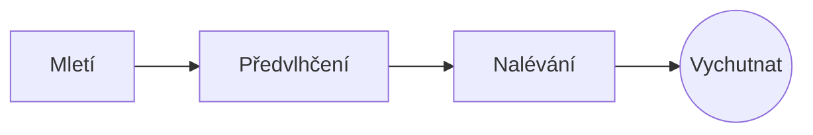

# Dokonalá překapávaná káva

Pomalý ranní rituál v několika krocích. Pište ve **zdrojovém textu** vlevo nebo přímo v *náhledu* vpravo: oba zůstávají synchronizované a ==každá úprava je čistá změna== v Markdownu.

> [!TIP]
> Voda těsně po varu, kolem 94 °C, vynese sladkost bez hořkosti.

## Poměr

Většina receptů se ustálí na jednom dílu kávy na šestnáct dílů vody:

$$
m_{\text{voda}} = 16 \times m_{\text{káva}}
$$

Takže $20\,\text{g}$ kávy potřebuje $320\,\text{g}$ vody.

## Krok za krokem



## Způsoby přípravy

| Způsob       | Mletí         |  Čas |
|:-------------|:-------------:|-----:|
| Překapávaná  | Středně jemné | 3:30 |
| French press | Hrubé         | 4:00 |
| Espresso     | Jemné         | 0:28 |

## Než začnete

- [x] Čerstvě pražená zrna :coffee:
- [x] Žernový mlýnek
- [ ] Konvice s husím krkem

```python
def water_for(coffee_g: float, ratio: int = 16) -> float:
    return coffee_g * ratio
```

Předvlhčení
: První spláchnutí vodou, při kterém z namletých zrn unikne plyn.[^1]

[^1]: Čerstvá zrna kypí nejvíc; stará se sotva zvednou.
