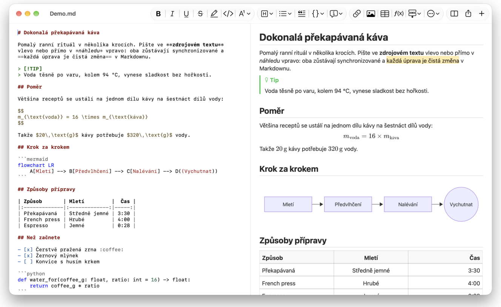
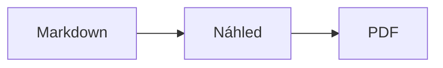

<p>&nbsp;&nbsp;&nbsp;</p>

# Splat

**Editor Markdownu pro macOS, ve kterém píšete ve zdrojovém textu nebo přímo v náhledu.**

Splat zobrazuje vlevo zdrojový text Markdownu s barevným zvýrazněním syntaxe a vpravo živý, plně upravitelný náhled. Pište v kterémkoli z nich: co napíšete v náhledu, promítne se do zdrojového textu jako minimální změna, takže řádky, kterých jste se nedotkli, zůstanou bajt po bajtu stejné a diffy v Gitu zůstanou přehledné. Splat čte Markdown, který už používáte: CommonMark a GitHub Flavored Markdown, upozornění GitHubu, wikiodkazy, vložené poznámky a informační rámečky z Obsidianu, rozšíření Pandocu a Typory, vložený HTML kód, vzorce LaTeX a diagramy Mermaid, Graphviz a PlantUML, vše vykreslené offline. Do PDF, HTML nebo Wordu exportuje jedním kliknutím. Je napsaný v Rustu na skutečných ovládacích prvcích AppKit, mluví 35 jazyky a nic neposílá po síti, pokud o to nepožádáte.
 


[](https://raw.githubusercontent.com/sventmueller/splat/main/dist/Splat-1.0.4.dmg)

**[Download Splat-1.0.4.dmg](https://raw.githubusercontent.com/sventmueller/splat/main/dist/Splat-1.0.4.dmg)**: podepsáno a notarizováno Applem, pro macOS 14 nebo novější na Apple Silicon i Intelu.
 
 

[](https://www.rust-lang.org)
[](https://www.apple.com/macos/)

[](https://github.com/madsmtm/objc2)
[](https://webkit.org)
[](https://github.com/kivikakk/comrak)
[](https://github.github.com/gfm/)
[](https://www.mathjax.org)
[](https://cortexjs.io/mathlive/)
[](https://mermaid.js.org)
[](https://graphviz.org)
[](https://plantuml.com)


[](#licence)

[Bahasa Indonesia](../id/README.md) ·
[Bahasa Melayu](../ms/README.md) ·
[Català](../ca/README.md) ·
**Čeština** ·
[Dansk](../da/README.md) ·
[Deutsch](../de/README.md) ·
[English](../../../README.md) ·
[Español](../es/README.md) ·
[Français](../fr/README.md) ·
[Hrvatski](../hr/README.md) ·
[Italiano](../it/README.md) ·
[Magyar](../hu/README.md) ·
[Nederlands](../nl/README.md) ·
[Norsk](../no/README.md) ·
[Polski](../pl/README.md) ·
[Português (Brasil)](../pt_BR/README.md) ·
[Português (Portugal)](../pt_PT/README.md) ·
[Română](../ro/README.md) ·
[Slovenčina](../sk/README.md) ·
[Slovenščina](../sl/README.md) ·
[Suomi](../fi/README.md) ·
[Svenska](../sv/README.md) ·
[Tiếng Việt](../vi/README.md) ·
[Türkçe](../tr/README.md) ·
[Ελληνικά](../el/README.md) ·
[Русский](../ru/README.md) ·
[Українська](../uk/README.md) ·
[עברית](../he/README.md)‎ ·
[العربية](../ar/README.md)‎ ·
[हिन्दी](../hi/README.md) ·
[ไทย](../th/README.md) ·
[한국어](../ko/README.md) ·
[日本語](../ja/README.md) ·
[简体中文](../zh-Hans/README.md) ·
[繁體中文](../zh-Hant/README.md)

## Obsah

- [Přehled funkcí](#přehled-funkcí)
- [Požadavky](#požadavky)
- [Instalace](#instalace)
- [Začínáme](#začínáme)
- [Psaní](#psaní)
  - [Ve zdrojovém textu](#ve-zdrojovém-textu)
  - [V náhledu](#v-náhledu)
  - [Příkazy formátování](#příkazy-formátování)
  - [Seznamy a úkoly](#seznamy-a-úkoly)
  - [Tabulky](#tabulky)
- [Podporovaný Markdown](#podporovaný-markdown)
  - [CommonMark a GitHub Flavored Markdown](#commonmark-a-github-flavored-markdown)
  - [Informační rámečky](#informační-rámečky)
  - [Rozšířená syntaxe](#rozšířená-syntaxe)
  - [Obsidian](#obsidian)
  - [Citace a odkazy](#citace-a-odkazy)
  - [Vložený HTML kód](#vložený-html-kód)
  - [Typografická interpunkce](#typografická-interpunkce)
  - [Přehled syntaxe](#přehled-syntaxe)
- [Vzorce](#vzorce)
- [Diagramy](#diagramy)
- [Obrázky](#obrázky)
- [Odkazy a navigace](#odkazy-a-navigace)
- [Export, tisk a sdílení](#export-tisk-a-sdílení)
- [Vzhled a zpřístupnění](#vzhled-a-zpřístupnění)
- [Jazyky](#jazyky)
- [Klávesové zkratky](#klávesové-zkratky)
- [Soukromí a zabezpečení](#soukromí-a-zabezpečení)
- [Velké dokumenty](#velké-dokumenty)
- [Známá omezení](#známá-omezení)
- [Řešení potíží](#řešení-potíží)
- [Pro vývojáře](#pro-vývojáře)
  - [Sestavení](#sestavení)
  - [Distribuce](#distribuce)
  - [Testování](#testování)
  - [Struktura projektu](#struktura-projektu)
  - [Tok dat](#tok-dat)
  - [Pravidla v ovladači](#pravidla-v-ovladači)
  - [Přidání příkazu](#přidání-příkazu)
  - [Překlady](#překlady)
  - [Komponenty třetích stran](#komponenty-třetích-stran)
- [Licence](#licence)

## Přehled funkcí

- **Dva způsoby psaní, jeden text.** Zdrojový text i náhled jsou upravitelné. Soubor Markdown je jediná pravda: každý dokument má jednu historii změn a každá úprava v náhledu se promítne do zdrojového textu jako nejmenší možná změna.
- **Markdown, který už používáte.** CommonMark, GitHub Flavored Markdown, upozornění GitHubu, Obsidian, rozšíření Pandocu a Typory, kódy emoji, spoilery, seznamy definic, kotvy nadpisů a HTML jako v README na GitHubu.
- **Vzorce a diagramy hned v aplikaci.** Vzorce LaTeX přes MathJax s vizuálním editorem vzorců. Diagramy Mermaid, Graphviz a PlantUML se vykreslují přímo ve vašem Macu, bez Javy, serveru či připojení k síti.
- **Tlačítko pro všechno.** Každý prvek Markdownu má tlačítko na panelu nástrojů a položku v nabídce, ty běžné také klávesovou zkratku. Tabulky mají vlastní nabídku pro řádky, sloupce a zarovnání.
- **Export bez ztrát.** PDF, jediný samostatný soubor HTML nebo dokument Word se skutečnými nadpisy, seznamy, tabulkami, poznámkami pod čarou a obrázky.
- **Nativní do posledního detailu.** Skutečná okna AppKit, panely, nabídky, popovery, Verze, Automatické ukládání, nabídka Sdílet, tmavý režim, kontrola pravopisu, diktování a VoiceOver. Žádný Electron, žádné webové zobrazení pro samotný text.
- **Rychlý i u velkých souborů.** Stisk klávesy v dokumentu o velikosti 10 MB trvá zhruba 25 ms.
- **Soukromí a opatrnost.** Obrázky z webu se načtou, až když to povolíte, odkazy do jiných aplikací se nejdřív zeptají a vše, co dekóduje nedůvěryhodná obrazová data, běží v izolovaných pomocných procesech.
- **Ve vašem jazyce.** Rozhraní i vestavěný stručný přehled Markdownu jsou ve 35 jazycích: arabština, katalánština, čínština (zjednodušená), čínština (tradiční), chorvatština, čeština, dánština, nizozemština, angličtina, finština, francouzština, němčina, řečtina, hebrejština, hindština, maďarština, indonéština, italština, japonština, korejština, malajština, norština, polština, portugalština (Brazílie), portugalština (Portugalsko), rumunština, ruština, slovenština, slovinština, španělština, švédština, thajština, turečtina, ukrajinština a vietnamština.

## Požadavky

- macOS 14 Sonoma nebo novější. Splat se vyvíjí a testuje na macOS 27, kde automaticky převezme design Liquid Glass.
- Mac s Apple Silicon nebo procesorem Intel.
- Asi 45 MB místa na disku.

## Instalace

**Z obrazu disku.** Stáhněte si [`dist/Splat-1.0.4.dmg`](https://raw.githubusercontent.com/sventmueller/splat/main/dist/Splat-1.0.4.dmg), otevřete ho a přetáhněte Splat do složky Aplikace. Obraz je podepsaný certifikátem Developer ID a notarizovaný Applem, takže se otevře bez varování.

**Přes Homebrew.** Cask má vlastní tap:

```sh
brew install --cask sventmueller/tap/splat
```

`brew upgrade --cask splat` nainstaluje nové verze a `brew uninstall --zap --cask splat` odstraní také nastavení a mezipaměti Splatu.

**Aktualizace.** Splat z obrazu disku nebo z Homebrew se aktualizuje sám pomocí [Sparkle](https://sparkle-project.org). Při druhém spuštění se zeptá, zda smí jednou denně sám vyhledávat aktualizace. **Splat › Vyhledat aktualizace…** vyhledá hned; **Vyhledávat aktualizace automaticky** a **Stahovat a instalovat aktualizace automaticky** ve stejné nabídce vaši volbu později změní. Splat nainstaluje aktualizaci, jen pokud nese podpis vývojáře. Vlastní sestavení aktualizace nemá.

**Ze zdrojového kódu.** Předpoklady najdete v části [Sestavení](#sestavení), potom:

```sh
make build
ditto target/release/Splat.app /Applications/Splat.app
open /Applications/Splat.app
```

Chcete-li soubory Markdown otevírat ve Splatu dvojitým kliknutím, vyberte ve Finderu libovolný soubor `.md`, zvolte **Soubor › Informace**, v části **Otevřít v aplikaci** vyberte Splat a klikněte na **Změnit vše…**. Splat se sám registruje pro soubory `.md`, `.markdown`, `.mdown` a `.mkd`.

## Začínáme

### Okno

Každý dokument se otevře ve vlastním okně, nebo jako panel, pokud dáváte přednost panelům:

- **Vlevo: zdrojový text.** Váš Markdown v písmu SF Mono s barevným zvýrazněním syntaxe.
- **Vpravo: náhled.** Vykreslený dokument připravený k úpravám.
- **Postranní panel s osnovou (volitelný).** Všechny nadpisy jako strom; kliknutí na nadpis ho zobrazí v obou podoknech. Zobrazíte ho příkazem **Zobrazení › Zobrazit osnovu** (⌃⌘S).
- **Panel nástrojů.** Tlačítka seskupená podle toho, co mění: znaky, odstavce a vkládané prvky, potom zapnutí a vypnutí náhledu, Sdílet a Nový dokument. Upravíte ho příkazem **Zobrazení › Upravit panel nástrojů…**.

Tažením rozdělovače dáte více místa kterékoli straně. **Zobrazení › Skrýt náhled** (⌥⌘P) nechá jen zdrojový text; Splat si to pamatuje pro každé okno zvlášť. Obě podokna se posouvají společně a výběr v jednom z nich je zvýrazněn i v druhém.

### Dokumenty, panely a verze

Splat je běžná dokumentová aplikace pro macOS:

- **Automatické ukládání a verze.** Změny se ukládají přímo do souboru. **Soubor › Vrátit do › Procházet všechny verze…** vás vrátí v čase.
- **Změny z jiných programů.** Když otevřený dokument změní Git, skript nebo jiný editor, Splat ho znovu načte a zachová polohu kurzoru i posunu. Pokud máte vlastní neuložené změny, Splat je ponechá a macOS se zeptá, než přepíšete druhou verzi.
- **Obvyklé příkazy pro soubory.** Duplikovat (⇧⌘S), Přejmenovat…, Přesunout do… a **Soubor › Poslední položky**.
- **Panely.** **Soubor › Nový panel** nebo tlačítko **+** na panelu nástrojů otevře nový dokument jako panel; standardní nabídka Okno panely sloučí, přesune a prochází.
- **Umístění oken.** Velikost a poloha posledního okna se pamatují, i po restartu. Pokud už na tom místě okno stojí, nové se otevře mírně posunuté.
- **Ikona v Docku.** Kliknutí na ni po zavření posledního okna otevře nový dokument.
- **Otevírání souborů Markdown ve Splatu.** **Splat › Nastavit jako výchozí aplikaci pro Markdown** způsobí, že dvojité kliknutí na soubor `.md` nebo `.markdown` otevře Splat; macOS se jednou zeptá na potvrzení. Dokud je Splat výchozí aplikací, položka je označena zaškrtnutím.

Soubory musí být text v UTF-8 nebo UTF-16 se značkou pořadí bajtů. Jiná kódování Splat odmítne, místo aby hádal a poškodil text. Značka pořadí bajtů zůstane, UTF-16 zůstane UTF-16 a v souboru, kde všechny řádky končí CRLF, dostanou CRLF i řádky, které přidáte.

**Po pádu** se ztratí nejvýš posledních pár sekund psaní: Splat každých pět sekund kopíruje neuložený text do `~/Library/Application Support/Splat/Unsaved` a kopie odstraní, jakmile je dokument uložen nebo Splat normálně skončí. Při dalším spuštění přesune, co tam pád zanechal, do `~/Library/Application Support/Splat/Recovery` a jednou o tom informuje, s tlačítkem, které složku otevře. Pád, na který Splat ještě stihne zareagovat, tam také zapíše text každého otevřeného dokumentu.

### Stručný přehled

**Nápověda › Markdown – stručný přehled** otevře přehled ve vašem jazyce jako nový, nepojmenovaný dokument. Je to běžný dokument, takže si v něm vše vyzkoušíte přímo, ve zdrojovém textu i v náhledu.

## Psaní

### Ve zdrojovém textu

Zdrojový text je editor čistého textu vyladěný pro Markdown:

- **Barevné zvýraznění syntaxe** jako ve VS Code: nadpisy, zdůraznění, odkazy, kód, tabulky, HTML, front matter a také LaTeX a Mermaid uvnitř vzorců a diagramů. K dispozici jsou palety pro světlý a tmavý vzhled a pro Zvýšit kontrast.
- **Bloky kódu v ohraničení** se zvýrazňují pro Bash, C, C++, C#, CSS (také SCSS a Less), Go, HTML, XML, Javu, JavaScript, JSON, Kotlin, PHP, Python, Ruby, Rust, SQL, Swift, TypeScript, YAML, TeX a Mermaid, včetně obvyklých zkrácených názvů jako `js`, `py` nebo `sh`.
- **Žádné nečekané záměny.** Inteligentní uvozovky, inteligentní pomlčky a nahrazování textu jsou ve výchozím stavu vypnuté, protože kazí `--`, `---` a `"`. Zapnete je v nabídce **Úpravy › Záměny**.
- **Psací nástroje systému.** Kontrola pravopisu a gramatiky, diktování, Hledat a nahradit (⌥⌘F) a Řeč.
- **Přetahování.** Přetažením souboru s obrázkem vložíte ``, přetažením jiného souboru odkaz na něj a přetažením adresy URL `[url](url)`. Každé přetažení je jeden krok zpět.
- **Vkládání obrázků.** Obrázek ve schránce, například snímek obrazovky, se uloží jako soubor PNG vedle dokumentu (`Obrázek 2026-10-29 13.09.07.png`) a vloží se jako obrázek. Dokument musí být kvůli tomu jednou uložen.

### V náhledu

Náhled se chová jako textový procesor, ale vše, co v něm uděláte, skončí jako Markdown:

- **Psaní.** Znaky, které v Markdownu něco znamenají, například `*` nebo `#`, se escapují, aby se zobrazily tak, jak jste je napsali.
- **Return** začne nový odstavec nebo položku seznamu. **⌥Return** nebo **⌃Return** vloží zalomení řádku.
- **Formátování u kurzoru.** Když je kurzor na konci slova, Tučné, Kurzíva a další formáty znaků platí pro to, co napíšete dál. Dalším zvolením formátu ho ukončíte. Uvnitř slova se naformátuje celé slovo.
- **Prázdné řádky.** Return na prázdném řádku přidá další prázdný řádek a Backspace ho odstraní. Ve zdrojovém textu je každý takový řádek navíc dvojice prázdných řádků; jiné programy pro Markdown je zobrazí jako běžnou mezeru mezi odstavci.
- **Odvolat akci** funguje napříč oběma podokny. Kroky mají názvy („Odvolat akci Tučné“), psaní je jeden krok na souvislou dávku a po Odvolat akci a Opakovat akci se obě podokna posunou ke změně.
- **Vzorce a diagramy** se zobrazují jako hotová grafika. Kliknutím na ně, přesunutím kurzoru na ně nebo stiskem Return otevřete jejich editor (viz [Vzorce](#vzorce) a [Diagramy](#diagramy)).
- **Vložený HTML kód, vložené poznámky a front matter** se zobrazují, ale upravujete je ve zdrojovém textu. Kliknutí na ně umístí kurzor na odpovídající místo tam.

Cokoli, co Markdown nedokáže vyjádřit, je v náhledu zablokováno: panely Písmo a Barvy, pravítko a vkládání či přetahování formátovaného textu a obrázků. Vložený HTML a RTF se objeví jako prostý text.

### Příkazy formátování

Každý příkaz je dostupný na panelu nástrojů, v řádku nabídek i v kontextové nabídce obou podoken. Položky nabídky mají zaškrtnutí u formátování, které platí u kurzoru.

| Nabídka | Příkazy |
|---|---|
| **Formát › Písmo** | Tučné, Kurzíva, Podtržené, Přeškrtnuté, Zvýraznit, Kód, Horní index, Dolní index |
| **Formát › Nadpis** | Základní text, Nadpis 1 až 6 |
| **Formát › Seznam** | Seznam s odrážkami, Číslovaný seznam, Seznam úkolů |
| **Formát** | Citace, Blok kódu (Bez jazyka nebo jeden z 20 jazyků; změní také jazyk existujícího bloku), Informační rámeček (Poznámka, Tip, Důležité, Varování, Pozor; stejný typ znovu ho odstraní), Upravit vzorec nebo diagram…, Odstranit formátování |
| **Přidat** | Odkaz…, Obrázek…, Tabulka…, Vzorec, Diagram (Vývojový diagram, Sekvenční diagram, Ganttův diagram), Obsah, Poznámka pod čarou, Oddělovač |
| **Tabulka** | Vložit řádek nad/pod, Vložit sloupec vlevo/vpravo, Smazat řádek, Smazat sloupec, Zarovnání (Vlevo, Na střed, Vpravo, Výchozí), Zarovnat sloupce tabulky |
| **Zobrazení** | Skrýt/Zobrazit náhled, Zobrazit/Skrýt osnovu, Typografická interpunkce, Přiblížit/Oddálit, Skutečná velikost, panel nástrojů, řádek panelů, režim celé obrazovky |

Podtržení, zvýraznění, horní a dolní index se zapisují jako `<ins>`, `<mark>`, `<sup>` a `<sub>`, které GitHub zobrazuje také. Splat čte i `<u>`, které GitHub odstraňuje, a kratší `==zvýraznění==`, `^horní^` a `~dolní~`. GitHub zobrazuje `==` a `^` tak, jak jsou napsány, a `~dolní~` jako přeškrtnutí.

### Seznamy a úkoly

- Return pokračuje v seznamu; Return na prázdné položce ho ukončí.
- **Tab** a **⇧Tab** odsazují a zrušují odsazení položek seznamu v náhledu.
- Kliknutí na zaškrtávací políčko úkolu v náhledu přepíná `- [ ]` a `- [x]`.
- **Formát › Seznam** převede vybrané odstavce na seznam nebo změní jeho druh.

### Tabulky

- **Přidat › Tabulka…** se zeptá na počet řádků (včetně záhlaví) a sloupců.
- V náhledu se **Tab** přesune na další buňku, **⇧Tab** na předchozí a **Return** na buňku pod ní. Tab v poslední buňce přidá řádek.
- Nabídka **Tabulka** vkládá a maže řádky a sloupce a nastavuje zarovnání sloupce (⌘{, ⌘|, ⌘}).
- **Tabulka › Zarovnat sloupce tabulky** doplní zdrojový text mezerami, aby sloupce lícovaly.

## Podporovaný Markdown

Splat parsuje pomocí [comraku](https://github.com/kivikakk/comrak), parseru kompatibilního s CommonMark a GFM, a zapíná většinu jeho rozšíření. Vše níže se vykreslí v náhledu i ve všech exportech.

### CommonMark a GitHub Flavored Markdown

- Nadpisy (`#` i podtržené), odstavce, zalomení řádků, zdůraznění, silné zdůraznění, kód v textu, citace, oddělovače.
- Seznamy s odrážkami, číslované a vnořené; seznamy úkolů.
- Odkazy (v textu, referenční i automatické), obrázky, definice referenčních odkazů.
- Bloky kódu v ohraničení i odsazené, s barevným zvýrazněním syntaxe.
- Tabulky se zarovnáním sloupců.
- Přeškrtnutí pomocí `~~dvou vlnovek~~`.
- Poznámky pod čarou: `text[^1]` s `[^1]: Poznámka.` kdekoli v dokumentu. Kliknutí na značku přejde na poznámku.
- Front matter v YAML mezi řádky `---` na začátku. Náhled ho shrne v jednom řádku, například „Metadata: title, date, tags“.

### Informační rámečky

Upozornění GitHubu se vykreslí jako barevné rámečky s ikonou a názvem:

```markdown
> [!NOTE]
> Užitečné informace, které by uživatelé měli znát.

> [!WARNING]
> Zásadní obsah vyžadující okamžitou pozornost.
```

Je pět typů: Poznámka, Tip, Důležité, Varování a Pozor. **Formát › Informační rámeček** převede odstavec u kurzoru na jeden z nich.

Fungují i informační rámečky z Obsidianu, s libovolným názvem a stavem sbalení:

```markdown
> [!tip]- Kliknutím na ▸ rozbalíte
> Skryto, dokud se neotevře.

> [!question]+ Ve výchozím stavu otevřeno
> `+` začíná rozbaleně, `-` sbaleně.
```

Ostatní typy z Obsidianu se zobrazí v nejbližší z těchto pěti barev: `success`, `check`, `done` a `hint` jako Tip; `question`, `help` a `faq` jako Důležité; `attention` jako Varování; `failure`, `fail`, `missing`, `danger`, `error` a `bug` jako Pozor; vše ostatní jako Poznámka.

### Rozšířená syntaxe

| Funkce | Syntaxe | Odkud |
|---|---|---|
| Zvýraznění | `==označený text==` | Obsidian, Typora |
| Horní index | `x^2^` | Pandoc, Typora |
| Dolní index | `H~2~O` | Pandoc, Typora |
| Kód emoji | `:rocket:` se změní na 🚀 | GitHub |
| Spoiler | `\|\|skrytý text\|\|`, označte ho, chcete-li ho přečíst | Discord |
| Poznámka v textu | `text^[samotná poznámka]` | Pandoc, Obsidian |
| Seznam definic | `Pojem`, prázdný řádek, `: Vysvětlení` | PHP Markdown Extra, Pandoc |
| Kotva nadpisu | `## Instalace {#setup}`, odkaz pomocí `[viz](#setup)` | Pandoc, kramdown |

Seznamy definic vypadají ve zdrojovém textu takto:

```markdown
Pojem

: Vysvětlení pojmu.
```

Bez vlastní kotvy dostane každý nadpis kotvu odvozenou z jeho textu, stejně jako na GitHubu: `## Začínáme` najdete na `#začínáme`.

### Obsidian

- **Wikiodkazy.** `[[Poznámka]]` odkazuje na `Poznámka.md` ve stejné složce nebo pod ní. `[[Poznámka|Zobrazený text]]` zobrazí váš vlastní text a `[[Poznámka#Nadpis]]` poznámku otevře. ⌘-klik ji otevře ve Splatu.
- **Vložení.** `![[Poznámka]]` zobrazí jinou poznámku uvnitř této; poznámky vložené v ní se zobrazí jako odkazy. `![[diagram.png]]` zobrazí obrázek. Stejně jako v Obsidianu pojmenovávají vložení poznámky a obrázky ve složce dokumentu nebo pod ní, nikdy absolutní cestou, a jako poznámky se zobrazují jen soubory Markdown.
- **Komentáře.** `%%Jen ve zdroji%%` zůstane viditelný ve zdrojovém textu a z náhledu i ze všech exportů se vynechá, uvnitř řádku stejně jako na samostatných řádcích.
- **Štítky.** `#nápad` nebo `#projekt/splat` se zvýrazní. ⌘-klik vyhledá štítek v dokumentu.
- **Sbalitelné informační rámečky.** Viz [Informační rámečky](#informační-rámečky).

### Citace a odkazy

- **Citace Pandocu.** `[@doe2020]` nebo `[@doe2020; @roe2021]` se čte jako „(Doe 2020; Roe 2021)“. Záznamy se berou ze souboru BibTeX, který front matter uvádí jako `bibliography: refs.bib`. Bez toho Splat použije `references.bib`, `literatur.bib` nebo `bibliography.bib` vedle dokumentu.
- **Odkazy na GitHub a GitLab.** Pokud dokument leží v repozitáři Gitu, jehož vzdálený repozitář `origin` je na github.com nebo na hostiteli GitLabu, zvýrazní se `@name`, `#12` (issue) a `!7` (merge request, jen GitLab). ⌘-klik je otevře v prohlížeči.

### Vložený HTML kód

HTML, jaké najdete v README na GitHubu, se vykreslí vlastním čtecím modulem, nikoli enginem prohlížeče:

- vystředěné odstavce a bloky (`<p align="center">`, `<div align="center">`)
- obrázky s velikostí (``)
- odkazy, `<kbd>⌘</kbd>`, `<br>`, `<u>`, `<ins>`, `<mark>`, `<sup>`, `<sub>`
- seznamy a tabulky, včetně buněk přes více sloupců (`colspan`)
- sbalitelné oddíly: `<details><summary>Více</summary>…</details>`, otevřené kliknutím na ▸

Markdown mezi značkami HTML se vykreslí jako Markdown. Skripty, styly, rámce a formuláře se vynechají úplně a odkazy a obrázky si ponechají jen adresy `http`, `https`, `mailto` a relativní.

### Typografická interpunkce

**Zobrazení › Typografická interpunkce** zobrazí rovné uvozovky jako uvozovky jazyka vašeho rozhraní, `--` jako pomlčku, `---` jako dlouhou pomlčku a `...` jako výpustku. V němčině se `"Ja"` změní na „Ja“, ve francouzštině na «Oui», v japonštině na 「はい」, také tam, kde čínština a japonština sázejí uvozovky bez mezery; hebrejské zkratky jako `צה"ל` dostanou gershayim, צה״ל. Zdrojový text si ponechá prosté znaky; náhled a všechny exporty zobrazují typografické. Nastavení je vypnuté, dokud je nezapnete.

### Přehled syntaxe

| Prvek | Markdown |
|---|---|
| **Tučné** | `**Tučné**` |
| *Kurzíva* | `*Kurzíva*` |
| Podtržené | `<ins>Podtržené</ins>` nebo `<u>Podtržené</u>` |
| ~~Přeškrtnuté~~ | `~~Přeškrtnuté~~` |
| Zvýraznění | `<mark>Zvýraznění</mark>` nebo `==Zvýraznění==` |
| `Kód` | `` `Kód` `` |
| x² | `x<sup>2</sup>` nebo `x^2^` |
| H₂O | `H<sub>2</sub>O` nebo `H~2~O` |
| [Odkaz](https://example.com) | `[Odkaz](https://example.com)` |
| Nadpis | `# Nadpis` až `###### Nadpis` |
| Citace | `> Citace` |
| Seznam s odrážkami | `- Položka` |
| Číslovaný seznam | `1. Položka` |
| Úkol | `- [ ] Otevřený` a `- [x] Hotový` |
| Blok kódu | ```` ```rust ```` … ```` ``` ```` |
| Tabulka | `\| A \| B \|` s `\|---\|---\|` pod záhlavím |
| Poznámka pod čarou | `Text[^1]` a `[^1]: Poznámka` |
| Oddělovač | `---` |
| Obrázek | `` |
| Vzorec | `$E = mc^2$`, `$$ … $$` |
| Diagram | ```` ```mermaid ````, ```` ```dot ````, ```` ```plantuml ```` |
| Informační rámeček | `> [!TIP]` |
| Wikiodkaz | `[[Poznámka]]`, `[[Poznámka\|Text]]` |
| Vložení | `![[Poznámka]]`, `![[obrazek.png]]` |
| Komentář | `%%Komentář%%` |
| Štítek | `#štítek` |
| Citace zdroje | `[@key]` |
| Spoiler | `\|\|Spoiler\|\|` |
| Emoji | `:tada:` |

## Vzorce

Vzorce vykresluje [MathJax](https://www.mathjax.org) s matematikou TeX a AMS jako ostrou vektorovou grafiku. Text v `\text{…}` může být v libovolném písmu: co v písmech MathJaxu chybí, se vezme z písem vašeho Macu, arabština a hebrejština běží zprava doleva a emoji jsou barevné.

| Druh | Syntaxe |
|---|---|
| V textu | `$E = mc^2$`, `` $`E = mc^2`$ `` (GitHub, GitLab), `\(E = mc^2\)` |
| Samostatný | `$$` … `$$`, `\[` … `\]` nebo blok kódu označený `math` |

**Úprava vzorce.** Kliknutím na vzorec v náhledu, dvojitým kliknutím, stiskem Return nebo přesunutím kurzoru na něj otevřete jeho editor v popoveru. **Přidat › Vzorec** vloží nový a hned otevře editor.

- **Vizuálně nebo LaTeX.** Přepínač nahoře přepíná mezi vizuálním editorem ([MathLive](https://cortexjs.io/mathlive/)) a kódem LaTeX. Splat si vaši volbu pamatuje.
- **Stavební bloky** pro zlomek, druhou odmocninu, horní a dolní index, součet a integrál s mezemi, limitu, závorky, které rostou s obsahem, matici 2×2, řecká písmena a relace, operátory a šipky. Nechávají zástupné symboly □ a **Tab** přeskočí na další.
- **Živý náhled.** Změny se v dokumentu objevují při psaní. Chyby z MathJaxu se zobrazí v řádku pod kódem.
- **Potvrdit nebo zahodit.** Kliknutí mimo editor změnu ponechá jako jeden krok zpět; **Esc** nebo **Zrušit** ji zahodí. Esc u nového, prázdného vzorce ho zase odstraní.
- Kontextová nabídka nabízí **Upravit vzorec…** pro vzorec pod ukazatelem.

VoiceOver čte vzorec jako jeho kód LaTeX. Splat vykresluje vzorce, ne celé dokumenty LaTeX: nejsou tu žádné balíčky, žádné TikZ a žádné `\documentclass`.

## Diagramy

Diagramy se vykreslují přímo ve Splatu, offline, ve světlé i tmavé variantě.

| Engine | Blok kódu | Co kreslí |
|---|---|---|
| [Mermaid](https://mermaid.js.org) | ```` ```mermaid ```` | vývojové diagramy, sekvenční, třídní, stavové, diagramy entit a vztahů, Ganttovy diagramy, výsečové grafy, myšlenkové mapy, časové osy a všechny ostatní typy Mermaid |
| [Graphviz](https://graphviz.org) | ```` ```dot ```` nebo ```` ```graphviz ```` | grafy v jazyce DOT |
| [PlantUML](https://plantuml.com) | ```` ```plantuml ```` nebo ```` ```puml ```` | diagramy UML; běží bez Javy |



**Úprava diagramu** funguje jako úprava vzorce: kliknutím na něj otevřete kód v popoveru, s barevným zvýrazněním syntaxe a chybovými hlášeními v řádku pod kódem. **Přidat › Diagram** začne od šablony vývojového diagramu, sekvenčního diagramu nebo Ganttova diagramu. Stavební bloky pomáhají u tří nejběžnějších typů Mermaid:

- **Vývojový diagram:** Uzel ▾ (obdélník, zaoblený, kruh, kosočtverec, databáze), Spojení, Spojení s popiskem, Skupina, Směr ▾
- **Sekvenční diagram:** Účastník, Zpráva, Odpověď, Poznámka, Smyčka, Alternativní cesty
- **Ganttův diagram:** Oddíl, Úkol, Milník

Ostatní typy diagramů se upravují jako kód. VoiceOver čte název diagramu nebo jeho alternativní text.

První diagram po spuštění trvá asi vteřinu, protože se vykreslovací engine spouští na pozadí. Diagram, který trvá déle než 10 sekund, zobrazí chybu a vykreslovací engine se pro další diagram spustí znovu. Engine PlantUML (7 MB) se načte až s prvním diagramem PlantUML. Příkaz `!include` v PlantUML z webu je zablokován.

## Obrázky

- **Místní obrázky** používají cesty relativní k dokumentu: ``. Splat zobrazí PNG, JPEG, GIF, WebP, BMP, SVG, HEIC, TIFF, AVIF a PDF.
- **Obrázky z webu** zůstávají zablokované, dokud je nepovolíte: lišta nad náhledem vysvětlí, že jejich načtením se jejich servery dozvědí, že a kdy dokument otevíráte. **Načíst obrázky** je povolí pro tento dokument; Splat si volbu pamatuje pro každý soubor zvlášť.
- **Velikost.** `` nastaví velikost obrázku; jinak se obrázky přizpůsobí šířce náhledu.
- **Změny na disku.** Obrázek, který nahradíte, nebo ten, který se objeví po jeho uvedení v dokumentu, se zobrazí bez nového otevření dokumentu. Obrázky z webu, které selhaly kvůli síti, se zkusí znovu, dokud je dokument zobrazuje.
- **Paměť.** Obrázky se zobrazují nejvýše na 2560 pixelů na delší straně, což vyplní i stránku A4. Dekódují se menší, jakmile zaplní osminu paměti Macu a když macOS hlásí nedostatek paměti.
- **Tmavý režim.** Obrázky s bílým pozadím se v tmavém náhledu mírně ztlumí.
- **Vkládání a přetahování.** Viz [Ve zdrojovém textu](#ve-zdrojovém-textu).

## Odkazy a navigace

V náhledu kliknutí umístí kurzor, takže můžete upravit text odkazu; **⌘-klik** odkaz následuje:

- `http`, `https` a `mailto` se otevřou ve vašem prohlížeči nebo poštovní aplikaci.
- Soubory Markdown se otevřou ve Splatu; jiné soubory a složky se zobrazí ve Finderu.
- `#kotva` přejde na nadpis v dokumentu.
- Adresy, které otevírají jinou aplikaci, například `slack://` nebo `vscode://`, se nejdřív zeptají a ukážou celou adresu a aplikaci. **Zrušit** je předvolené.

**Přidat › Obsah** vloží odkazovaný seznam všech nadpisů. S kurzorem uvnitř ho stejný příkaz aktualizuje. Postranní panel s osnovou (⌃⌘S) přejde na libovolný nadpis v obou podoknech.

## Export, tisk a sdílení

| Formát | Postup | Co získáte |
|---|---|---|
| **PDF** | **Soubor › Exportovat jako PDF…** nebo nabídka Sdílet | Stránky ve velikosti papíru, vždy ve světlém vzhledu, vzorce a diagramy jako vektorová grafika. **Soubor › Vzhled stránky…** nastaví papír. |
| **Tisk** | **Soubor › Tisknout…** (⌘P) | Stejné rozvržení jako u PDF. |
| **HTML** | **Soubor › Exportovat jako HTML…** nebo nabídka Sdílet | Jeden samostatný soubor: místní obrázky jsou vložené, vzorce a diagramy jako ostré obrázky, kotvy nadpisů zajišťují funkční obsah. Žádné skripty. |
| **Word** | **Soubor › Exportovat jako dokument Word…** nebo nabídka Sdílet | Soubor `.docx` se styly nadpisů Wordu, skutečnými seznamy a tabulkami (včetně sloučených buněk), poznámkami pod čarou jako poznámkami Wordu, vloženými obrázky, vzorci a diagramy. |
| **Markdown** | Tlačítko **Sdílet** na panelu nástrojů | Dokument jako soubor `.md` pro Mail, Zprávy, AirDrop a každou další službu sdílení. |

Nabídka **Soubor › Sdílet** nabízí všechno z toho na jednom místě. Exporty používají nastavení typografické interpunkce a obrázky z webu, které jste povolili; obrázky z webu zůstávají v HTML odkazy.

## Vzhled a zpřístupnění

- **Tmavý režim** se řídí systémem. Vzorce a diagramy se vykreslují pro každý vzhled zvlášť.
- **Zvýšit kontrast** v Nastavení systému přepne barvy syntaxe na paletu s vysokým kontrastem.
- **Přiblížení.** ⌘+, ⌘− a ⌘0 mění měřítko obou podoken.
- **Režim celé obrazovky, panely a přizpůsobitelný panel nástrojů**, jako v každé aplikaci pro Mac.
- **VoiceOver.** Podokna jsou označena „Zdrojový text Markdown“ a „Náhled“, vzorce se čtou jako jejich kód a diagramy jako jejich název. Každý příkaz je dostupný z klávesnice.

Splat nemá okno nastavení: těch pár voleb je tam, kde se uplatňují, v nabídkách **Zobrazení** a **Úpravy › Záměny**.

## Jazyky

Rozhraní, nabídky a stručný přehled Markdownu jsou přeloženy do 35 jazyků:

arabština, katalánština, čínština (zjednodušená), čínština (tradiční), chorvatština, čeština, dánština, nizozemština, angličtina, finština, francouzština, němčina, řečtina, hebrejština, hindština, maďarština, indonéština, italština, japonština, korejština, malajština, norština, polština, portugalština (Brazílie), portugalština (Portugalsko), rumunština, ruština, slovenština, slovinština, španělština, švédština, thajština, turečtina, ukrajinština a vietnamština.

Splat se řídí pořadím jazyků v **Nastavení systému › Obecné › Jazyk a oblast**; tam také můžete vybrat jazyk jen pro Splat v části **Aplikace**. Pokud pro váš jazyk překlad není, použije angličtinu. Termíny v nabídkách vycházejí z vlastních překladů Applu, takže Splat působí jako zbytek vašeho Macu.

Hebrejský a arabský text se čte zprava doleva všude, kde se objeví, bez ohledu na jazyk rozhraní: každý odstavec, nadpis a položka seznamu přebírá směr svého prvního písmene, citace a informační rámečky kreslí svislý pruh vpravo a tabulka, jejíž text začíná zprava doleva, řadí sloupce zprava. Bloky kódu zůstávají zleva doprava. Exporty do PDF, HTML a Wordu tyto směry zachovávají. Když je systémovým jazykem hebrejština nebo arabština, macOS zrcadlí také okno, takže náhled je vlevo.

## Klávesové zkratky

| Akce | Zkratka |
|---|---|
| Tučné, Kurzíva, Podtržené | ⌘B, ⌘I, ⌘U |
| Přeškrtnuté | ⇧⌘X |
| Odkaz… | ⌘K |
| Základní text, Nadpis 1 až 6 | ⌥⌘0, ⌥⌘1 až ⌥⌘6 |
| Zarovnat sloupec tabulky vlevo, na střed, vpravo | ⌘{, ⌘\|, ⌘} |
| Skrýt nebo zobrazit náhled | ⌥⌘P |
| Zobrazit nebo skrýt osnovu | ⌃⌘S |
| Přiblížit, oddálit, skutečná velikost | ⌘+, ⌘−, ⌘0 |
| Nový dokument, otevřít, uložit, duplikovat | ⌘N, ⌘O, ⌘S, ⇧⌘S |
| Vzhled stránky, tisk | ⇧⌘P, ⌘P |
| Hledat, hledat a nahradit | ⌘F, ⌥⌘F |
| Hledat další, předchozí; hledat výběr; zobrazit výběr | ⌘G, ⇧⌘G; ⌘E; ⌘J |
| Zobrazit pravopis a gramatiku; zkontrolovat dokument | ⌘:, ⌘; |
| Vložit a přizpůsobit styl | ⌥⇧⌘V |
| Skrýt panel nástrojů, zobrazit všechny panely, celá obrazovka | ⌥⌘T, ⇧⌘\\, ⌃⌘F |
| Zalomení řádku (náhled) | ⌥Return nebo ⌃Return |
| Další buňka / předchozí buňka v tabulce (náhled) | Tab / ⇧Tab |
| Odsadit / zrušit odsazení položky seznamu (náhled) | Tab / ⇧Tab |
| Další zástupný symbol v editoru vzorců | Tab |
| Zavřít editor vzorce nebo diagramu bez změn | Esc |
| Následovat odkaz, štítek nebo odkaz na zdroj (náhled) | ⌘-klik |

Splat nechává standardní zkratky Applu tam, kde jsou.

## Soukromí a zabezpečení

Soubor Markdown může pocházet od kohokoli, proto Splat považuje každý dokument za nedůvěryhodný.

- **Ve výchozím stavu bez sítě.** Splat nemá žádnou telemetrii. Aktualizace vyhledává, až když s tím souhlasíte nebo zvolíte **Vyhledat aktualizace…**: načte pak malý soubor kanálu z GitHubu a požadavek uvádí jen aplikaci a její verzi. Vzorce a diagramy se vykreslují lokálně; webová zobrazení, která to dělají, nemají přístup k síti.
- **Obrázky z webu** se načtou až s vaším svolením, jen přes `https`, nikdy z hostitelů ve vaší místní síti, nejvýše 10 MB každý a v soukromé relaci bez cookies.
- **Izolované dekódování.** Obrázky a grafika vzorců a diagramů se dekódují v pomocných procesech, které zavřou všechny zděděné soubory a před přečtením prvního bajtu se uzamknou v sandboxu: žádný přístup k souborům, žádná síť. Vracejí jen pixely, jejichž velikost se kontroluje, a po 10 sekundách se zastaví. Dekodéry obrazu přímo od Applu vidí jen HEIC, TIFF, AVIF a PDF, a to jen když data opravdu mají tento formát; běží ve vlastním pomocném procesu, který navíc smí číst systémové složky s písmy a používat systémový video dekodér. Přes tento proces procházejí i SVG, vzorce a diagramy, takže jsou ve Splatu obrázky s pevným rozlišením: čtyři pixely na bod, nejvýše 2560 na delší straně.
- **Místní soubory** se k dokumentu dostanou jen cestou, kterou uvádí. Vložení zobrazují poznámky Markdown ze složky dokumentu a z podsložek a chybějící obrázek se hledá jen tam. Cesta k obrázku jinde, absolutní nebo začínající `~`, se přesto načte a exporty do HTML a Wordu ji vloží: export dokumentu, který jste nenapsali, si prohlédněte, než ho předáte dál.
- **Kopie neuloženého textu** zůstávají v tomto Macu, ve vaší složce Knihovna, pro obnovení po pádu. Zmizí s uložením nebo s normálním ukončením Splatu; kopie, které zanechal pád, zůstávají ve složce pro obnovení, dokud je nesmažete.
- **Odkazy** nikdy nespustí program kliknutím. Odkazy na web a e-mail se otevřou jako obvykle; odkazy do jiných aplikací se nejdřív zeptají.
- **HTML v dokumentech** čte vlastní parser Splatu. Skripty, styly, rámce a formuláře se nikdy nespustí.
- **Exporty** neobsahují žádné skripty. Stránky HTML si ponechávají jen pevný seznam neškodných značek a atributů, jako GitHub, a k tomu zásady zabezpečení obsahu. Soubory Word odkazují jen na adresy `http`, `https` a `mailto`.
- **Podepisování kódu** s Hardened Runtime. Splat běží bez App Sandbox, aby mohl zobrazovat obrázky vedle vašich dokumentů, aniž by se ptal na každou složku; izolace veškerého dekódování to vyvažuje.

## Velké dokumenty

Splat zůstává svižný i u dokumentů o velikosti několika megabajtů:

- Zdrojový text používá TextKit 2, který rozvrhuje jen viditelnou část.
- Při psaní v náhledu a ve zdrojovém textu dokumentů do 2 MB se znovu parsují, barví a rozvrhují jen dotčené odstavce: asi 25 ms v dokumentu o velikosti 10 MB a asi 50 ms na stisk klávesy v jeho náhledu, včetně vlastní práce zobrazení.
- Velké náhledy vykreslují nejdřív viditelnou část a zbytek, když aplikace nic nedělá. Bloky posunuté do zobrazení se vykreslí dřív, než se nakreslí.
- U zdrojového textu větších dokumentů běží parsování pro náhled při psaní na pozadí.
- Dokument zůstává čistým textem, jakmile by potřeboval asi 4 GB paměti, což je zhruba 50 až 120 MB běžného Markdownu, ale jen 10 až 20 MB samých tabulek nebo nadpisů: zdrojový text nemá barvy a náhled uvede, proč zůstává prázdný. Exporty fungují dál.
- Od asi 200 KB se okno dokumentu otevře dřív, než se parsuje; při 5 MB následují barvy a náhled asi o čtvrt vteřiny později.

Některé změny se zpracovávají celé, při 10 MB zhruba 300 ms na stisk klávesy: ty v definici nebo odkazech poznámky pod čarou, vedle poznámky v textu, na samém konci dokumentu vedle poznámky pod čarou, ve front matter nebo blízko definic referenčních odkazů, a každá změna v dokumentu s bloky komentářů `%%` nebo s dvakrát definovanou poznámkou pod čarou či poznámkou uvnitř citace nebo seznamu. Paměť roste se souborem, zhruba na 115–160 MB pro 1 MB Markdownu a 340–510 MB pro 10 MB.

## Známá omezení

- **Jedna vlnovka znamená dolní index.** `~text~` je dolní index jako v Pandocu; přeškrtnutí vyžaduje `~~dvě~~`. GitHub přeškrtává i jednou vlnovkou.
- **Jen pro čtení v náhledu:** vložený HTML kód, vložené poznámky a front matter se upravují ve zdrojovém textu.
- **Velmi hluboké vnoření:** HTML vnořené hlouběji než 64 úrovní a HTML v textu hlouběji než 16 ustoupí svému obsahu.
- **Sloučené buňky tabulky** existují jen v tabulkách HTML, a to jen přes sloupce (`colspan`, ne `rowspan`). Syntaxe tabulek MultiMarkdownu pro sloučené buňky není podporována.
- **Bibliografie** se čtou jen z BibTeXu, ne z CSL JSON ani z YAML.
- **Odkazy na zdroje** vyžadují repozitář na github.com nebo na hostiteli GitLabu; `!7` existuje jen na GitLabu.
- **Typografická interpunkce:** německá koncová jednoduchá uvozovka se nedá rozeznat od apostrofu a sází se jako ’.
- **Vzorce, ne dokumenty:** žádné balíčky LaTeX, TikZ ani celé dokumenty.
- **Vizuální editor vzorců** zapisuje LaTeX v notaci MathLive: mezery mizí (`E = mc^2` se změní na `E=mc^2`), vykreslení zůstává stejné.
- **Záměrně:** žádná čísla řádků, žádné okno nastavení, žádná nápověda Help Book, ne v App Store.
- **Méně testováno na Intelu.** Testy okna běží jen na Apple Silicon; na Intelu CI spouští `cargo test`.

## Řešení potíží

**Seznam nedávných dokumentů je po novém sestavení Splatu prázdný.** macOS váže nedávné dokumenty a oprávnění ke složkám na podpis kódu aplikace. Místní sestavení se podepisují certifikátem „Splat Local Signing“ v klíčence přihlášení, takže si obojí zachovají i po novém sestavení. Pokud byl certifikát smazán, další sestavení vytvoří nový a seznamy začnou jednou znovu.

**Aplikace z obrazu disku ukazuje jiné nedávné dokumenty než moje vlastní sestavení.** Obě mají jiný podpis, takže macOS pro každou vede samostatný seznam a samostatná oprávnění ke složkám.

**HTML nebo jiná syntaxe se zobrazuje jako prostý kód.** Dokument možná otevřela zastaralá kopie Splatu. Ukončete ji, ve Finderu zvolte u dokumentu **Soubor › Informace** a zkontrolujte, že v části **Otevřít v aplikaci** je Splat ze složky Aplikace.

**V nabídce Splat chybí položka Vyhledat aktualizace…** Aktualizuje se jen verze z obrazu disku nebo z Homebrew; vlastní sestavení aktualizace nemá.

**Obrázky z webu se nezobrazují.** Klikněte na **Načíst obrázky** na liště nad náhledem. Načtou se jen obrázky `https` z veřejných hostitelů.

**Vložení snímku obrazovky chce nejdřív uložit.** Vložené obrázky se ukládají jako soubory vedle dokumentu, což vyžaduje místo na disku. Uložte dokument a vložte obrázek znovu.

**„Soubor neobsahuje text v kódování UTF-8.“** Soubor je v jiném kódování a nemá značku pořadí bajtů, která by ho určila. Nejdřív ho převeďte, například pomocí `iconv -f ISO-8859-1 -t UTF-8 old.md > new.md`.

**Vzorec nebo diagram zobrazuje chybu.** Klikněte na něj: editor pod kódem ukáže hlášení z MathJaxu, Mermaid, Graphviz nebo PlantUML.

## Pro vývojáře

Splat je aplikace v Rustu, která mluví s AppKit a WebKit přímo přes [objc2](https://github.com/madsmtm/objc2). Není tu žádný Swift, žádný Objective-C, žádný projekt Xcode a žádný soubor Interface Builderu.

### Sestavení

Předpoklady:

- macOS s Command Line Tools (`xcode-select --install`). Xcode není potřeba; Splat se sestaví bez `actool`, `ibtool` a `metal`.
- Rust 1.99 (`brew install rust`). [rust-toolchain.toml](../../../rust-toolchain.toml) uvádí přesnou verzi, kterou používá CI; rustup ji nainstaluje sám, Rust z Homebrew soubor ignoruje. Zvýšením verze tam se do projektu dostávají nová varování kompilátoru a clippy.

[Makefile](../../../Makefile) obsahuje krátké vstupní body; `make help` je vypíše všechny:

```sh
make build                  # target/release/Splat.app, totéž jako cargo xtask bundle --release
make universal              # target/splat-universal pro Apple Silicon i Intel, tak jak ho nese obraz disku
make check                  # formátování, clippy bez varování, všechny testy, vendorované knihovny; co spouští CI
make test                   # make check, potom test bez okna
make test-gui               # testy s oknem; zabírají Mac asi čtyři minuty
make test-long              # delší náhodné hledání a kontrola částečné aktualizace při 10 MB
make coverage               # pokrytí řádků všemi testy, s minimem pro každý modul
make coverage-library       # stejná minima pro moduly bez okna, jako v CI
make bench FILE=<file.md>   # časování otevření, psaní a posouvání velkého souboru
make release                # nejdřív make test, potom notarizovaný obraz disku
```

Samotná logika sestavení je v Rust crate [xtask](../../../xtask/src/main.rs):

```sh
cargo xtask bundle --release   # target/release/Splat.app, Hardened Runtime, podepsáno „Splat Local Signing“
cargo xtask bundle             # target/debug/Splat Debug.app, samostatná aplikace, která nikdy neotevírá soubory Markdown
cargo xtask dmg                # dist/Splat-<version>.dmg k distribuci, Developer ID, notarizováno
cargo xtask icon               # znovu vytvoří assets/AppIcon.icns a ikonu README z assets/icon-1024.png
cargo xtask vendor check       # ověří přibalený JavaScript podle vendor.lock
cargo xtask vendor fetch       # stáhne ho znovu po změně verze ve vendor.lock
```

`bundle` zapíše `Info.plist`, zkopíruje zdroje a lokalizace a podepíše aplikaci certifikátem „Splat Local Signing“. První sestavení vytvoří tento certifikát ve vaší klíčence přihlášení, s platností 20 let. Dokud tam zůstane, Splat si zachová nedávné dokumenty a oprávnění ke složkám i po novém sestavení; s ad hoc podpisem by bylo každé sestavení pro macOS novou aplikací. Sestavení pro ladění a self-testy mají vlastní ID balíčků (`local.splat.debug`, `local.splat.selftest`) a neregistrují se pro soubory Markdown, takže Finder nikdy neotevře dokument v zastaralém sestavení a nastavení běžné aplikace nechávají být.

Verze je ve [VERSION](../../../VERSION) jako `major.minor.build` a je to ta, kterou dostane další sestavení. Každé úspěšné release sestavení (`make build`, `cargo xtask bundle --release`, `make release`) zvýší číslo sestavení o jedna; sestavení pro ladění a self-testy ho nechávají být. Major a minor se zvyšují ručně: nastavte VERSION třeba na `1.1.0` a další sestavení dostane přesně tuto verzi.

### Distribuce

`cargo xtask dmg` (nebo `make release`, které nejdřív spustí `make test`) sestaví release, podepíše ho vaším Developer ID, notarizuje aplikaci u Applu a připojí k ní lístek, zabalí ji do komprimovaného obrazu disku jen pro čtení s odkazem na Aplikace, notarizuje a označí lístkem také obraz a výsledek zkontroluje pomocí Gatekeeperu. Aplikace nese vlastní lístek, aby se kopie nainstalovaná bez Finderu, jako to dělá Homebrew, otevřela offline i při prvním spuštění; dvě kola se službou notarizace trvají několik minut každé. Jen obraz, který prošel všemi kroky, se stane `dist/Splat-<version>.dmg`, kopií, která se commituje: odkazy ke stažení v tomto README a v jeho překladech ji následují a číslo sestavení se zvýší. Předchozí obraz zůstane ještě jedno vydání, protože raw server GitHubu může několik minut po pushi vydávat starý kanál aktualizací; starší se přesunou do koše. Neúspěšný běh nechá `dist/`, README a VERSION tak, jak byly.
Každé vydání přidá do historie repozitáře celý obraz, asi 16 MB. Běží jen na požádání, nikdy jako součást běžného sestavení, a potřebuje:

- certifikát „Developer ID Application“ v klíčence
- uložené přihlášení ke službě notarizace Applu s heslem pro konkrétní aplikaci, vytvořené jednou pomocí `xcrun notarytool store-credentials notary --apple-id <Apple ID> --team-id <team ID>`
- soukromý klíč, kterým se podepisují aktualizace, v klíčence přihlášení. Vytvořilo ho `generate_keys` ze Sparkle; jeho veřejná část je `UPDATE_KEY` v [xtask/src/main.rs](../../../xtask/src/main.rs) a uvnitř každé nainstalované kopie, která přijímá jen aktualizace jím podepsané. Uložte si zálohu do správce hesel: `target/sparkle-2.10.1/bin/generate_keys -x <file>` ho exportuje, `-f <file>` importuje na jiném Macu. Bez něj už nainstalované kopie nelze nikdy aktualizovat.
- rustup (`brew install rustup`, který ponechá Rust z Homebrew na místě)

Pokud cokoli z toho chybí, `dmg` se zastaví před sestavením. Při prvním spuštění se macOS zeptá, zda smí Terminál ovládat Finder; bez tohoto oprávnění obraz disku nezobrazí ani pozadí, ani rozmístění ikon.

Aktualizační modul, [Sparkle](https://sparkle-project.org), nese jen obraz disku; sestavení ho jednou stáhne do `target/` z jeho vydání na GitHubu a ověří podle kontrolního součtu v xtasku. Hardened runtime načte framework jen tehdy, když nese Team ID aplikace, které podpis Developer ID má a místní certifikát nemá; a aktualizace nesmí nahradit vaše vlastní sestavení. Sestavení self-testu nese Sparkle také, aby proti němu ověřilo nabídku aktualizací: s kanálem, který neexistuje, bez otázky Sparkle při druhém spuštění a s oprávněním, které místně podepsané aplikaci dovolí framework načíst. `dmg` podepíše nový obraz klíčem aktualizací a zapíše `dist/appcast.xml`, kanál, který nainstalované kopie čtou z GitHubu. Obraz, kanál a README commitněte a pushněte společně: od té chvíle nabídnou nainstalované kopie aktualizaci.

Obraz disku je univerzální binární soubor pro Apple Silicon a Intel; ostatní sestavení jsou jen pro procesor hostitele. Rust z Homebrew dodává standardní knihovnu jen pro procesor hostitele, proto `dmg` sestavuje přes rustup, který při prvním použití nainstaluje toolchain a cíle z [rust-toolchain.toml](../../../rust-toolchain.toml), a zastaví se, pokud program nebo Sparkle postrádá kód pro některý z obou procesorů. `make universal` sestaví jen program.
Aplikace v něm nese jiný podpis než místní sestavení, takže macOS vede pro obě samostatné nedávné dokumenty a oprávnění ke složkám.

### Testování

| Příkaz | Co kontroluje |
|---|---|
| `cargo test --release` | jednotkové, náhodné a překladové testy |
| `SPLAT_FUZZ_ROUNDS=20000 cargo test --release` | delší náhodné hledání; `SPLAT_FUZZ_SEED` mění vstupy |
| `SPLAT_I18N_ONLY=fr cargo test --release i18n` | jeden jazyk, dokud ostatní nejsou dokončené |
| `cargo clippy --release --all-targets [--features selftest]` | lint, včetně zdůvodnění každého bloku `unsafe`, délky funkcí a v knihovně převodů čísel |
| `cargo xtask vendor check` | JavaScriptové knihovny odpovídají `vendor.lock` bajt po bajtu |
| `cargo xtask selftest probe` | bez okna, každý s očekávaným výsledkem: vzorce, diagramy, obrázky z webu proti serveru uvnitř procesu, zablokované adresy, obrana webových zobrazení |
| `cargo xtask selftest gui [--stop-after "<check>"] [--scenarios]` | běžící aplikace, klik po kliku. Otevře okno a píše do něj; Mac je asi čtyři minuty zaneprázdněn. `--scenarios` spustí jen druhou část, asi za půldruhé minuty |
| `cargo xtask selftest resize` | rozšíří okno po posunutí rozdělovače: zdrojový text se přeláme, zatímco se mění velikost okna. Trvá asi deset sekund |
| `cargo xtask selftest bench <file.md>` | časování otevření, psaní a posouvání velkého souboru |
| `cargo test --release -- --ignored partial_updates` | stisk klávesy v 10 MB: částečná proti úplné aktualizaci, výsledek a časový limit |
| `cargo test --release --test hostile` | dokumenty vytvořené tak, aby přetekly zásobník nebo trvaly kvadraticky dlouho, přes parsování, rozvržení, oba exporty, stisky kláves a příkazy |
| `make mutants` | chyby vestavěné do `src/markdown/` a `src/preview/` jedna po druhé přes [cargo-mutants](https://mutants.rs) (`cargo install cargo-mutants`); říká, které žádný test nezaznamená. Trvá hodiny; `FILE=src/preview/bridge.rs` to zúží |
| `cargo test --release --test decoder` | proces dekodéru dekóduje obrázky a nedosáhne na soubory ani na síť |
| `make coverage` | pokrytí řádků pomocí `cargo test` a všech self-testů přes [cargo-llvm-cov](https://github.com/taiki-e/cargo-llvm-cov) (`brew install cargo-llvm-cov llvm`); selže pod minimy. Zabírá Mac asi pět minut |
| `make coverage-library` | minima pro `src/markdown/`, `src/preview/` a `i18n.rs`, měřená samotným `cargo test` |

Jednotkové testy leží vedle kódu, který testují. `tests/` obsahuje to, co se ke knihovně dostává zvenčí: náhodné testy v `robustness.rs`, které sdílejí generátor v `src/fuzz.rs` s testy v `sync.rs`, dokumenty vytvořené k poškození v `hostile.rs` a test dekodéru, který spouští sestavený program. Rozhodnutí v `src/editor/`, která nepotřebují okno, žijí ve volných funkcích s vlastními testy: vše, co ovladač ví, a jak se to mění, v `state.rs`, pravidla vykreslování v `render_queue.rs`, kopie textu v `sync.rs`. Krok self-testu okna, který čeká marně, běh selže. Self-test okna spouští po hlavním proklikání druhou část, v `src/editor/selftest/scenarios.rs`: každý příkaz formátování a tabulek, dialogy, kliknutí na odkazy, vkládání, přetahování, exporty, velkou změnu, obrázky měnící se na disku, nedostatek paměti, obrovský dokument a obnovu po pádu.

Pokrytí má dvě minima: každý modul alespoň 80 % řádků, všechny moduly dohromady alespoň 85 %. `make coverage` měří `cargo test` spolu se self-testy a selže pod kterýmkoli z nich; minima a pár výjimek, například panic hook v `main.rs`, který běží jen při pádu, jsou v [xtask](../../../xtask/src/coverage.rs) vedle svých důvodů. Měřená sestavení jdou do `target/coverage/`, takže měřicí kód se nikdy nedostane do `target/release/` ani do obrazu disku. Pomocný proces dekodéru otevírá svůj soubor s měřením dřív, než se uzamkne, takže se měří také.

CI ([.github/workflows/ci.yml](../../../.github/workflows/ci.yml)) spouští při každém pushi do `main` a každém pull requestu `make check`, `make coverage-library` a univerzální sestavení na Apple Silicon a `cargo test` na Intelu. Každou noc [.github/workflows/nightly.yml](../../../.github/workflows/nightly.yml) spouští `make test-long` s novými náhodnými vstupy. Self-testy a obraz disku zůstávají na Macu vývojáře: potřebují obrazovku a podpisové certifikáty v klíčence.

Výstup self-testů jde do `target/selftest/`. Self-test sestaví samostatnou aplikaci (`target/release/Splat Selftest.app`, ID balíčku `local.splat.selftest`) a nastavení, nedávné dokumenty a přiřazení souborů běžné aplikace nechá být.

### Struktura projektu

`src/lib.rs` dělá z toho, co nepotřebuje okno, samostatnou knihovnu `splat`: `markdown/`, `preview/`, `i18n.rs` a generátor testů `fuzz.rs`. Aplikace v `src/main.rs` na ní staví.

- `src/markdown/`: vazba na parser (comrak), barvy syntaxe a všechny příkazy jako čisté úpravy textu (`Edit`). Také opětovné parsování po úpravě (`incremental.rs`), čtečka vloženého HTML (`markup.rs`), typografie, štítky, odkazy na zdroje a citace v plynulém textu (`typography.rs`), jak text vypadá a jaký Markdown a HTML to způsobí (`style.rs`), co smí být adresa (`url.rs`) a export do HTML a Wordu (`html.rs`, `docx.rs` s `docx/html.rs` a `docx/xml.rs`). Náhled i oba exporty čtou stejný strom, `Doc`. Žádný AppKit.
- `src/preview/`: rozvržení náhledu, vložený HTML v něm (`layout/html.rs`) a mapování mezi náhledem a zdrojovým textem (`Bridge`, `Index`). Žádný AppKit.
- `src/editor/`: okno. Jeden objekt `EditorController` slouží AppKitu jako delegát obou zobrazení; jeho práce je rozdělena podle odpovědnosti:

| Modul | Odpovědnost |
|---|---|
| `mod.rs` | třída, metody delegáta, `invalidate` |
| `state.rs` | co ovladač ví o dokumentu a každý způsob, jak se to mění; jeho pole jsou soukromá a nedotýká se žádného zobrazení |
| `actions.rs` | registr příkazů: selektor, název, zkratka, symbol, kdy se příkaz uplatní |
| `editing.rs` | spouštění a ověřování příkazů, psaní v náhledu |
| `update.rs` | parsování, barvení, aktualizace náhledu; po úpravě jen dotčené odstavce |
| `sync.rs` | kopie textu a evidence bloků, bez AppKitu a s náhodnými testy |
| `progressive.rs` | vykreslování velkých náhledů krok za krokem |
| `selection.rs`, `scroll.rs` | výběr a poloha posunu obou podoken v souladu |
| `atom.rs`, `atom_edit.rs` | editor vzorců a diagramů |
| `navigation.rs`, `links.rs` | odkazy, wikiodkazy, štítky, zaškrtávací políčka úkolů, sbalování, poznámky pod čarou |
| `env.rs` | co náhled čte zvenčí textu: typografická interpunkce, repozitář pro `@name` a `#12`, soubor BibTeX, vložené poznámky |
| `render.rs`, `images.rs`, `remote.rs`, `safe_image.rs` | text náhledu, místní a vzdálené obrázky |
| `attributes.rs` | atributy textu; každý klíč dostane jen hodnotu typu, který očekává |
| `shadow.rs` | kopie neuloženého textu pro obnovu po pádu |
| `decoder.rs` | pomocné procesy v sandboxu, které dekódují obrázky a grafiku |
| `export.rs`, `outline.rs` | export do HTML a Wordu; postranní panel s osnovou |
| `js.rs`, `mathfield.rs`, `render_queue.rs` | WebKit pro MathJax, Mermaid, Graphviz, PlantUML a vizuální editor vzorců; pravidla, co se kdy vykresluje, stranou od WebKitu |
| `webkit.rs` | volání do WebKitu; u `js.rs` a `mathfield.rs` zůstává jen životnost navigačního delegáta |
| `window.rs`, `toolbar.rs`, `views.rs`, `dialogs.rs`, `style.rs` | okno, panel nástrojů, textová zobrazení, dialogy, barvy |

- `src/menu.rs`, `src/app.rs`, `src/document.rs`: řádek nabídek, delegát aplikace, dokument (`MDDocument`, podtřída `NSDocument`).
- `src/i18n.rs` s `resources/*.lproj`: 35 jazyků; klíče jsou německé texty.
- `src/large_alloc.rs`: velké alokace jdou přímo z jádra a po uvolnění se do něj vracejí, takže se paměť po velkých úpravách vrací.
- `resources/js/`: webové stránky a knihovny; verze a kontrolní součty ve [vendor.lock](../../../vendor.lock).
- `xtask/`: sestavení balíčku, podepisování, obraz disku, ikona, vendoring, spouštěč self-testů a minima pokrytí.

### Tok dat

Zdrojový text v levém textovém zobrazení je jediný zdroj pravdy.

1. Každá změna znaku tam aktualizuje kopii textu (`Snapshot`) na místě, bez nového čtení textu.
2. Aktualizace zparsuje kopii, přebarví zdrojový text jen tam, kde se barvy změnily, rozvrhne náhled a nahradí jen bloky, jejichž obsah se změnil.
3. Po úpravě se znovu parsují, barví a rozvrhují jen dotčené odstavce, pokud jejich sousedé zůstávají stejní; kdy tomu tak není, říká `reparse_part_and_color`. Dokumenty s bloky komentářů `%%`, změny front matter a změny blízko definic referenčních odkazů se zpracovávají celé. comrak rozpozná odkaz na poznámku pod čarou jen s její definicí ve stejném parsování a definice přesouvá za text, proto se část parsuje se zástupnou definicí pro každý štítek a čísla bere ze starého stromu; změna odkazů nebo definic v této části, nebo vedle poznámky v textu, se zpracuje celá.
4. Bloky HTML, které otevírají `<details>` nebo `<div align>` a zavírají je později, ovlivňují bloky Markdownu mezi nimi; znovu použitý blok musí mít stejné okolí.
5. Při psaní ve zdrojovém textu dokumentu do 2 MB běží částečná aktualizace okamžitě; pokud se neuplatní, nebo ve větším dokumentu, běží parsování a rozvržení na pozadí. Při psaní v náhledu běží okamžitě, protože kurzor náhledu závisí na výsledku.
6. Vstup v náhledu převádí `Bridge` na úpravu zdrojového textu a odtud jde stejnou cestou. Markdown má příliš mnoho způsobů, jak z textu udělat syntaxi, než aby stačila pravidla, proto `preview/verify.rs` změněnou část parsuje znovu a porovná, co ukazuje, s tím, co bylo napsáno; úprava, která neobstojí, se escapuje dál nebo odmítne.
7. Pozice v textu podle comraku jsou na několika místech chybné, například za definicí referenčního odkazu. `markdown/positions.rs` je při čtení bloku kontroluje podle zdrojového textu a tam, kde nesedí, je načte ze zdrojového textu znovu.

### Pravidla v ovladači

1. Vlastní změny zobrazení provedené ovladačem běží uvnitř `silently()`; zpětná volání delegáta je ignorují.
2. `state` se půjčuje jen ke čtení a výpočtu, nikdy přes volání, které zobrazení mění, rozvrhuje nebo posouvá. Mění se jen vlastními metodami, jejichž testy okno nepotřebují.
3. Zprávy zvenčí (načtený obrázek, vykreslený vzorec) přicházejí se zpožděním přes `renders_arrived` a `image_arrived`, nikdy uprostřed aktualizace.
4. Překreslení bez změny textu jde jen přes `invalidate(reason)`.
5. `Rc<Snapshot>` se nedrží přes změnu zdrojového textu, jinak ta změna zkopíruje celý text.
6. Nový příkaz potřebuje záznam v `actions.rs`, metodu v `mod.rs` a větev v `editing::perform`.
7. Každý blok `unsafe` nese své zdůvodnění jako komentář `// SAFETY:`. Bajty se k systémovým dekodérům obrazu v aplikaci dostanou jen přes `decoder::system_image`.
8. Nic na hlavním vlákně nečeká na složky uživatele, protože síťový svazek může přestat odpovídat: soubory se zjišťují ve vlákně `DISK` a náhled čte odpovědi přes `Env::known`. Přímo na disk smí sáhnout jen akce, na kterou uživatel čeká, jako export nebo ukládání.

### Přidání příkazu

Řádek nabídek, panel nástrojů i kontextová nabídka vytvářejí své položky z registru v [src/editor/actions.rs](../../../src/editor/actions.rs) a validace nabídek z něj čte, kdy se příkaz uplatní a zda má zaškrtnutí. Nový příkaz potřebuje:

1. variantu `Action` s jeho `Spec`: selektor, název, popisek na panelu nástrojů, nápovědu (začínající slovesem, nejvýše 75 znaků), zkratku, symbol SF a kdy se uplatní
2. metodu v `src/editor/mod.rs`
3. větev v `editing::perform`
4. jeho texty v každém souboru `Localizable.strings`

Test `every_command_has_a_method_and_every_method_a_command` kontroluje, že registr a metody si odpovídají. Standardní zkratky Applu jako ⌘E, ⌘J, ⌘T, ⌘;, ⇧⌘C, ⌥⌘C, ⌥⌘V, ⇧⌘P, ⌥⌘T, ⌃⌘F a ⌘, zůstávají nedotčené.

### Překlady

Kód používá německý text jako klíč: `t("Fett")` ho vyhledá za běhu, `n("Fett")` označí konstantu pro pozdější vyhledání. Každá složka `resources/<language>.lproj/` obsahuje:

- `Localizable.strings`: každý text rozhraní, termíny v nabídkách podle vlastních glosářů Applu
- `InfoPlist.strings`: názvy, které macOS ukazuje pro aplikaci a její typ dokumentu
- `QuickReference.md`: stručný přehled Markdownu

`cargo xtask bundle` uvádí každou složku `.lproj` jako lokalizaci a `CFBundleDevelopmentRegion` je angličtina, takže systémové nabídky a dialog uložení následují stejný jazyk. Test i18n kontroluje, že každý jazyk má každý text a že každý stručný přehled má osnovu německého.

`assets/readme/<language>/` obsahuje toto README v daném jazyce, jeho snímek obrazovky a ukázkový dokument, který snímek zobrazuje. Změna tohoto README patří i do těchto kopií.

### Komponenty třetích stran

| Komponenta | Verze | Použití | Licence |
|---|---|---|---|
| [comrak](https://github.com/kivikakk/comrak) | 0.59 | parser Markdownu | BSD-2-Clause |
| [objc2](https://github.com/madsmtm/objc2), objc2-foundation, block2 | 0.6 / 0.3 | běhové prostředí Objective-C, Foundation, bloky | MIT |
| objc2-app-kit, objc2-web-kit, dispatch2 | 0.3 | vazby na AppKit, WebKit a Grand Central Dispatch | Zlib, Apache-2.0 nebo MIT |
| [svg2pdf](https://github.com/typst/svg2pdf) | 0.13 | vzorce a obrázky SVG jako vektorové PDF | MIT nebo Apache-2.0 |
| [image](https://github.com/image-rs/image) | 0.25 | dekódování PNG, JPEG, GIF, WebP a BMP | MIT nebo Apache-2.0 |
| [unicode-width](https://github.com/unicode-rs/unicode-width) | 0.2 | zarovnání sloupců tabulky | MIT nebo Apache-2.0 |
| [entities](https://github.com/p-jackson/entities) | 1 | názvy znakových referencí HTML | MIT |
| [MathJax](https://www.mathjax.org) | 3.2.2 | vykreslování vzorců | Apache-2.0 |
| [MathLive](https://cortexjs.io/mathlive/) | 0.111.1 | vizuální editor vzorců, s písmy KaTeX | MIT |
| [Mermaid](https://mermaid.js.org) | 12.2.0 | diagramy Mermaid | MIT |
| [Viz.js](https://github.com/mdaines/viz-js) | 3.24.0 | Graphviz zkompilovaný do WebAssembly, obsahuje Graphviz (EPL-1.0) a Expat (MIT) | MIT |
| [PlantUML](https://github.com/plantuml/plantuml) (`@plantuml/core`) | 1.2026.6 | diagramy PlantUML, zkompilované do JavaScriptu | MIT |
| [Sparkle](https://sparkle-project.org) | 2.10.1 | aktualizace verze z obrazu disku | MIT, s částmi pod licencemi BSD a zlib |

Knihovny JavaScriptu jsou uloženy v `resources/js/` přesně tak, jak byly publikovány; [vendor.lock](../../../vendor.lock) zaznamenává jejich zdroje a kontrolní součty SHA-256. Texty jejich licencí, včetně licencí Graphviz a Expat uvnitř Viz.js, leží vedle nich jako `resources/js/LICENSE-*` a jsou součástí aplikace. Sparkle není uložen v repozitáři: `cargo xtask dmg` stáhne jeho vydání a ověří ho podle kontrolního součtu v xtasku a jeho licence je součástí aplikace jako `LICENSE-sparkle`.

## Licence

Splat je licencován podle jedné z těchto licencí:

- Licence Apache, verze 2.0 ([LICENSE-APACHE](../../../LICENSE-APACHE))
- Licence MIT ([LICENSE-MIT](../../../LICENSE-MIT))

dle vaší volby.

Pokud výslovně neuvedete jinak, každý příspěvek, který jste záměrně předložili k zahrnutí do Splatu, jak je definováno v licenci Apache-2.0, bude licencován duálně jako výše, bez dalších podmínek.
