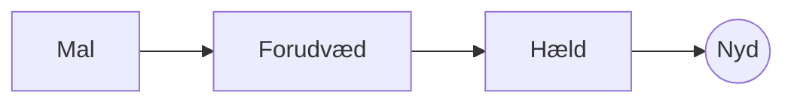

# Den perfekte pour-over

Et langsomt morgenritual i få trin. Skriv det i **kildeteksten** til venstre eller direkte i *eksemplet* til højre: Begge holdes i takt, og ==enhver ændring er en ren ændring== af Markdown.

> [!TIP]
> Vand lige under kogepunktet, omkring 94 °C, fremhæver sødmen uden bitterhed.

## Forholdet

De fleste opskrifter lander på én del kaffe til seksten dele vand:

$$
m_{\text{vand}} = 16 \times m_{\text{kaffe}}
$$

Så $20\,\text{g}$ kaffe kræver $320\,\text{g}$ vand.

## Trin for trin



## Bryggemetoder

| Metode       | Formaling  |  Tid |
|:-------------|:----------:|-----:|
| Pour-over    | Medium-fin | 3.30 |
| Stempelkande | Grov       | 4.00 |
| Espresso     | Fin        | 0.28 |

## Inden du går i gang

- [x] Friskristede bønner :coffee:
- [x] En kværn med kegleskær
- [ ] En kedel med svanehals

```python
def water_for(coffee_g: float, ratio: int = 16) -> float:
    return coffee_g * ratio
```

Forudvætning
: Den første sprøjt vand, der lader kaffegrumset afgive sin gas.[^1]

[^1]: Friske bønner blomstrer mest; gamle hæver sig næsten ikke.
