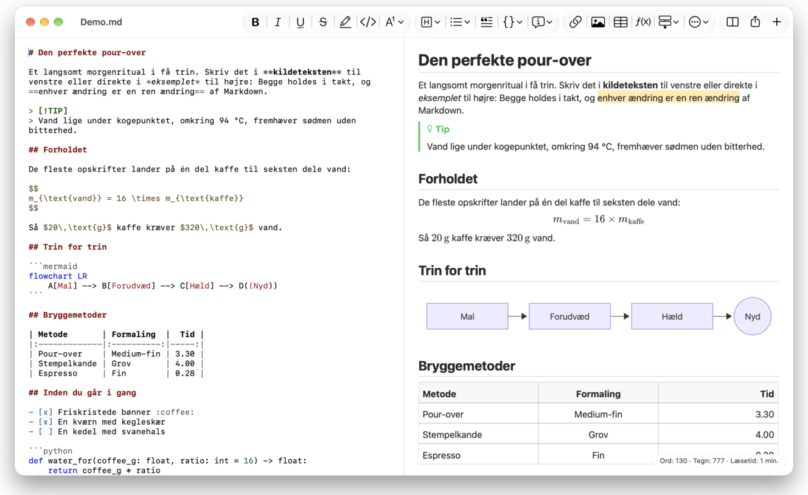
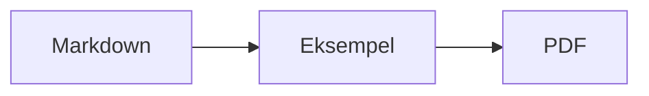

<p>&nbsp;&nbsp;&nbsp;</p>

# Splat

**Markdown-editoren til macOS, hvor du skriver i kildeteksten eller direkte i eksemplet.**

Splat viser din Markdown-kildetekst med syntaksfarver til venstre og et levende, fuldt redigerbart eksempel til højre. Skriv i det ene eller det andet: Det, du skriver i eksemplet, bliver til en minimal ændring i kildeteksten, så linjer, du ikke har rørt, forbliver identiske byte for byte, og dine Git-diffs holder sig rene. Splat læser den Markdown, du allerede bruger: CommonMark og GitHub Flavored Markdown, GitHub-alerts, Obsidians wikilinks, indlejringer og infobokse, Pandoc- og Typora-udvidelser, indlejret HTML, LaTeX-formler samt Mermaid-, Graphviz- og PlantUML-diagrammer, alt sammen gengivet offline. Eksporter til PDF, HTML eller Word med ét klik. Programmet er skrevet i Rust med ægte AppKit-kontroller, findes på 35 sprog og sender intet over netværket, medmindre du beder om det.
 


[](https://raw.githubusercontent.com/sventmueller/splat/main/dist/Splat-1.0.6.dmg)

**[Hent Splat-1.0.6.dmg](https://raw.githubusercontent.com/sventmueller/splat/main/dist/Splat-1.0.6.dmg)**: signeret og notariseret af Apple, til macOS 14 eller nyere på Apple Silicon og Intel.
 
 

[](https://www.rust-lang.org)
[](https://www.apple.com/macos/)

[](https://github.com/madsmtm/objc2)
[](https://webkit.org)
[](https://github.com/kivikakk/comrak)
[](https://github.github.com/gfm/)
[](https://www.mathjax.org)
[](https://cortexjs.io/mathlive/)
[](https://mermaid.js.org)
[](https://graphviz.org)
[](https://plantuml.com)


[](#licens)

[Bahasa Indonesia](../id/README.md) ·
[Bahasa Melayu](../ms/README.md) ·
[Català](../ca/README.md) ·
[Čeština](../cs/README.md) ·
**Dansk** ·
[Deutsch](../de/README.md) ·
[English](../../../README.md) ·
[Español](../es/README.md) ·
[Français](../fr/README.md) ·
[Hrvatski](../hr/README.md) ·
[Italiano](../it/README.md) ·
[Magyar](../hu/README.md) ·
[Nederlands](../nl/README.md) ·
[Norsk](../no/README.md) ·
[Polski](../pl/README.md) ·
[Português (Brasil)](../pt_BR/README.md) ·
[Português (Portugal)](../pt_PT/README.md) ·
[Română](../ro/README.md) ·
[Slovenčina](../sk/README.md) ·
[Slovenščina](../sl/README.md) ·
[Suomi](../fi/README.md) ·
[Svenska](../sv/README.md) ·
[Tiếng Việt](../vi/README.md) ·
[Türkçe](../tr/README.md) ·
[Ελληνικά](../el/README.md) ·
[Русский](../ru/README.md) ·
[Українська](../uk/README.md) ·
[עברית](../he/README.md)‎ ·
[العربية](../ar/README.md)‎ ·
[हिन्दी](../hi/README.md) ·
[ไทย](../th/README.md) ·
[한국어](../ko/README.md) ·
[日本語](../ja/README.md) ·
[简体中文](../zh-Hans/README.md) ·
[繁體中文](../zh-Hant/README.md)

## Indhold

- [Overblik](#overblik)
- [Krav](#krav)
- [Installation](#installation)
- [Kom i gang](#kom-i-gang)
- [Skrivning](#skrivning)
  - [I kildeteksten](#i-kildeteksten)
  - [I eksemplet](#i-eksemplet)
  - [Formateringskommandoer](#formateringskommandoer)
  - [Lister og opgaver](#lister-og-opgaver)
  - [Tabeller](#tabeller)
- [Understøttet Markdown](#understøttet-markdown)
  - [CommonMark og GitHub Flavored Markdown](#commonmark-og-github-flavored-markdown)
  - [Infobokse](#infobokse)
  - [Udvidet syntaks](#udvidet-syntaks)
  - [Obsidian](#obsidian)
  - [Citater og henvisninger](#citater-og-henvisninger)
  - [Indlejret HTML](#indlejret-html)
  - [Typografisk tegnsætning](#typografisk-tegnsætning)
  - [Syntaksoversigt](#syntaksoversigt)
- [Formler](#formler)
- [Diagrammer](#diagrammer)
- [Billeder](#billeder)
- [Links og navigation](#links-og-navigation)
- [Eksport, udskrivning og deling](#eksport-udskrivning-og-deling)
- [Udseende og tilgængelighed](#udseende-og-tilgængelighed)
- [Sprog](#sprog)
- [Tastaturgenveje](#tastaturgenveje)
- [Fortrolighed og sikkerhed](#fortrolighed-og-sikkerhed)
- [Store dokumenter](#store-dokumenter)
- [Kendte begrænsninger](#kendte-begrænsninger)
- [Fejlfinding](#fejlfinding)
- [Til udviklere](#til-udviklere)
  - [Opbygning](#opbygning)
  - [Distribution](#distribution)
  - [Test](#test)
  - [Projektstruktur](#projektstruktur)
  - [Dataflow](#dataflow)
  - [Regler i controlleren](#regler-i-controlleren)
  - [Tilføj en kommando](#tilføj-en-kommando)
  - [Oversættelser](#oversættelser)
  - [Tredjepartskomponenter](#tredjepartskomponenter)
- [Licens](#licens)

## Overblik

- **To måder at skrive på, én tekst.** Kildetekst og eksempel kan begge redigeres. Markdown-arkivet er den eneste sandhed: Der er én fortrydelseshistorik pr. dokument, og hver ændring i eksemplet oversættes til den mindst mulige ændring i kildeteksten.
- **Den Markdown, du allerede bruger.** CommonMark, GitHub Flavored Markdown, GitHub-alerts, Obsidian, Pandoc- og Typora-udvidelser, emoji-shortcodes, spoilere, definitionslister, overskriftsankre og HTML som i GitHub-README-filer.
- **Formler og diagrammer indbygget.** LaTeX-formler via MathJax med en visuel formeleditor. Diagrammer i Mermaid, Graphviz og PlantUML, gengivet på din Mac uden Java, server eller netforbindelse.
- **En knap til alt.** Hver Markdown-konstruktion har en knap i værktøjslinjen og et menupunkt, de almindelige også en tastaturgenvej. Tabeller har deres egen menu til rækker, kolonner og justering.
- **Eksport uden tab.** PDF, en enkelt selvstændig HTML-fil eller et Word-dokument med rigtige overskrifter, lister, tabeller, fodnoter og billeder.
- **Native helt ind til benet.** Ægte AppKit-vinduer, faner, menuer, popovers, Versioner, automatisk arkivering, delingsmenuen, mørk tilstand, stavekontrol, diktering og VoiceOver. Ingen Electron, ingen webvisning til selve teksten.
- **Hurtig med store filer.** At gengive et tastetryk i et dokument på 10 MB tager omkring 25 ms, før visningens eget arbejde.
- **Privat og forsigtig.** Billeder fra nettet indlæses først, når du tillader det, links til andre apps spørger først, og alt, der afkoder upålidelige billeddata, kører i helperprocesser i en sandbox.
- **På dit sprog.** Grænsefladen og den indbyggede Markdown-hurtigreference findes på 35 sprog: arabisk, catalansk, kinesisk (forenklet), kinesisk (traditionelt), kroatisk, tjekkisk, dansk, hollandsk, engelsk, finsk, fransk, tysk, græsk, hebraisk, hindi, ungarsk, indonesisk, italiensk, japansk, koreansk, malajisk, norsk, polsk, portugisisk (Brasilien), portugisisk (Portugal), rumænsk, russisk, slovakisk, slovensk, spansk, svensk, thai, tyrkisk, ukrainsk og vietnamesisk.

## Krav

- macOS 14 Sonoma eller nyere. Splat udvikles og testes på macOS 27, hvor det automatisk overtager designet Liquid Glass.
- En Mac med Apple Silicon eller en Intel-processor.
- Cirka 45 MB ledig diskplads.

## Installation

**Fra diskaftrykket.** Hent [`dist/Splat-1.0.6.dmg`](https://raw.githubusercontent.com/sventmueller/splat/main/dist/Splat-1.0.6.dmg), åbn det, og træk Splat til mappen Programmer. Aftrykket er signeret med et Developer ID og notariseret af Apple, så det åbner uden advarsler.

**Med Homebrew.** Cask'en ligger i et eget tap:

```sh
brew install --cask sventmueller/tap/splat
```

`brew upgrade --cask splat` installerer nye versioner, og `brew uninstall --zap --cask splat` fjerner også Splats indstillinger og cache.

**Opdateringer.** Splat fra diskaftrykket eller fra Homebrew holder sig selv opdateret via [Sparkle](https://sparkle-project.org). Ved anden opstart spørger programmet, om det må søge efter opdateringer af sig selv, en gang om dagen. **Splat › Søg efter opdateringer…** søger med det samme; **Søg automatisk efter opdateringer** og **Hent og installer opdateringer automatisk** i samme menu ændrer dit valg senere. Splat installerer kun en opdatering, hvis den bærer udviklerens signatur. Et build, du selv har lavet, har ingen opdateringsfunktion.

**Fra kildekode.** Se [Opbygning](#opbygning) for forudsætningerne, og kør derefter:

```sh
make build
ditto target/release/Splat.app /Applications/Splat.app
open /Applications/Splat.app
```

For at åbne Markdown-filer med Splat ved dobbeltklik skal du vælge en vilkårlig `.md`-fil i Finder, vælge **Arkiv › Vis info**, vælge Splat under **Åbn i** og klikke på **Ret alle…**. Splat registrerer sig selv for filerne `.md`, `.markdown`, `.mdown` og `.mkd`.

## Kom i gang

### Vinduet

Hvert dokument åbner i sit eget vindue eller som en fane, hvis du foretrækker faner:

- **Til venstre: kildeteksten.** Din Markdown i SF Mono med syntaksfarver.
- **Til højre: eksemplet.** Det gengivne dokument, klar til redigering.
- **Dispositionsliste (valgfri).** Alle overskrifter som et træ; et klik på en af dem viser den i begge felter. Slå den til og fra med **Oversigt › Vis disposition** (⌃⌘S).
- **Værktøjslinje.** Knapper grupperet efter det, de ændrer: tegn, afsnit og indsatte elementer, derefter eksempel til/fra, Del og Nyt dokument. Tilpas den med **Oversigt › Indstil værktøjslinje…**.

Træk i skillelinjen for at give den ene side mere plads. **Oversigt › Skjul eksempel** (⌥⌘P) lader kun kildeteksten stå tilbage; Splat husker det for hvert vindue. Begge felter ruller sammen, og en markering i det ene felt fremhæves i det andet.

### Dokumenter, faner og versioner

Splat er en almindelig dokumentapp til macOS:

- **Automatisk arkivering og versioner.** Ændringer gemmes på stedet. **Arkiv › Tilbage til › Gennemse alle versioner…** tager dig tilbage i tiden.
- **Ændringer fra andre programmer.** Når Git, et script eller en anden editor ændrer et åbent dokument, genindlæser Splat det og bevarer markøren og rulleposition. Har du selv ugemte ændringer, beholder Splat dem, og macOS spørger, før den anden version overskrives.
- **De sædvanlige arkivkommandoer.** Dubler (⇧⌘S), Omdøb…, Flyt til… og **Arkiv › Åbn seneste**.
- **Faner.** **Arkiv › Ny fane** eller knappen **+** i værktøjslinjen åbner et nyt dokument som fane; standardmenuen Vindue kombinerer, flytter og skifter mellem faner.
- **Vinduets placering.** Størrelsen og positionen af dit sidste vindue huskes, også efter genstart. Står der allerede et vindue dér, åbner det nye en smule forskudt.
- **Dock-symbolet.** Et klik på det, efter du har lukket det sidste vindue, åbner et nyt dokument.
- **Åbn Markdown-filer i Splat.** **Splat › Indstil som standardapp til Markdown** får et dobbeltklik på en `.md`- eller `.markdown`-fil til at åbne Splat; macOS beder om bekræftelse en enkelt gang. Punktet har et flueben, så længe Splat er standardappen.

Filer skal være UTF-8-tekst eller UTF-16 med byte order mark. Splat afviser andre kodninger i stedet for at gætte og ødelægge teksten. Et byte order mark bevares, UTF-16 forbliver UTF-16, og i en fil, hvor alle linjer ender på CRLF, får de linjer, du tilføjer, også CRLF.

**Efter et nedbrud** går højst de sidste sekunders tastning tabt: Hvert femte sekund kopierer Splat ugemt tekst til `~/Library/Application Support/Splat/Unsaved` og fjerner kopierne, når et dokument er gemt, eller Splat afsluttes normalt. Ved næste start flytter Splat det, et nedbrud har efterladt dér, til `~/Library/Application Support/Splat/Recovery` og siger det en enkelt gang, med en knap, der åbner mappen. Et nedbrud, som Splat stadig kan reagere på, skriver også teksten i alle åbne dokumenter dertil.

### Hurtigreference

**Hjælp › Markdown-hurtigreference** åbner et snydeark på dit sprog som et nyt, unavngivet dokument. Det er et almindeligt dokument, så prøv alt lige dér, i kildeteksten eller i eksemplet.

## Skrivning

### I kildeteksten

Kildeteksten er en ren teksteditor, tilpasset Markdown:

- **Syntaksfarver** som i VS Code: overskrifter, fremhævelse, links, kode, tabeller, HTML, front matter samt LaTeX og Mermaid inde i formler og diagrammer. Der er paletter til lys, mørk og Øg kontrast.
- **Afgrænsede kodeblokke** fremhæves for Bash, C, C++, C#, CSS (også SCSS og Less), Go, HTML, XML, Java, JavaScript, JSON, Kotlin, PHP, Python, Ruby, Rust, SQL, Swift, TypeScript, YAML, TeX og Mermaid, også under deres sædvanlige korte navne som `js`, `py` eller `sh`.
- **Ingen overraskende erstatninger.** Typografiske anførselstegn, typografiske tankestreger og tekstudskiftning er slået fra som standard, fordi de ødelægger `--`, `---` og `"`. Slå dem til under **Rediger › Erstatninger**.
- **Systemets skriveværktøjer.** Stave- og grammatikkontrol, diktering, Find og erstat (⌥⌘F) og Tale.
- **Træk og slip.** Slip en billedfil for at indsætte ``, en hvilken som helst anden fil for at indsætte et link til den og en URL for at indsætte `[url](url)`. Hvert slip er ét fortrydelsestrin.
- **Indsæt billeder.** Et billede på udklipsholderen, f.eks. et skærmbillede, gemmes som PNG-fil ved siden af dokumentet (`Billede 2026-10-29 13.09.07.png`) og indsættes som billede. Dokumentet skal være gemt en gang for at det kan lade sig gøre.

### I eksemplet

Eksemplet opfører sig som et tekstbehandlingsprogram, men alt, hvad du gør i det, ender som Markdown:

- **Tastning.** Tegn, der betyder noget i Markdown, som `*` eller `#`, escapes, så de står, som du skrev dem.
- **Return** starter et nyt afsnit eller et nyt listepunkt. **⌥Return** eller **⌃Return** indsætter et linjeskift.
- **Formatering ved markøren.** Står markøren i slutningen af et ord, gælder Fed, Kursiv og de andre tegnformater for det, du skriver bagefter. Vælg formatet igen for at stoppe. Inde i et ord formateres hele ordet.
- **Tomme linjer.** Return på en tom linje tilføjer endnu en tom linje, og Backspace fjerner den. I kildeteksten er hver ekstra tom linje to blanke linjer mere; andre Markdown-programmer viser dem som almindelig afstand mellem afsnit.
- **Fortryd** virker på tværs af begge felter. Fortrydelsestrin har navne (“Fortryd Fed”), tastning er ét trin pr. skrivning i ét stræk, og efter Fortryd og Gentag ruller begge felter hen til ændringen.
- **Formler og diagrammer** vises som færdige grafikker. Klik på en, flyt markøren hen på den, eller tryk Return på den for at åbne dens editor (se [Formler](#formler) og [Diagrammer](#diagrammer)).
- **Indlejret HTML, indlejrede noter og front matter** vises, men du redigerer dem i kildeteksten. Et klik på dem sætter markøren det tilsvarende sted dér.

Alt, hvad Markdown ikke kan udtrykke, er blokeret i eksemplet: panelerne Skrifttyper og Farver, linealen samt indsættelse og slip af rich text og billeder. Indsat HTML og RTF kommer ind som ren tekst.

### Formateringskommandoer

Alle kommandoer findes i værktøjslinjen, i menulinjen og i lokalmenuen i begge felter. Menupunkter viser et flueben for formateringen ved markøren.

| Menu | Kommandoer |
|---|---|
| **Format › Skrift** | Fed, Kursiv, Understreget, Gennemstreget, Fremhæv, Kode, Hævet skrift, Sænket skrift |
| **Format › Overskrift** | Brødtekst, Overskrift 1 til 6 |
| **Format › Liste** | Punktliste, Nummereret liste, Opgaveliste |
| **Format** | Citat, Kodeblok (Intet sprog eller et af 20 sprog; ændrer også sproget i en eksisterende blok), Infoboks (Note, Tip, Vigtigt, Advarsel, Forsigtig; samme type igen fjerner den), Rediger formel eller diagram…, Fjern formatering |
| **Indsæt** | Link…, Billede…, Tabel…, Formel, Diagram (Rutediagram, Sekvensdiagram, Gantt-diagram), Indholdsfortegnelse, Fodnote, Skillelinje |
| **Tabel** | Indsæt række over/under, Indsæt kolonne til venstre/højre, Slet række, Slet kolonne, Justering (Venstre, Centrer, Højre, Standard), Juster tabelkolonner |
| **Oversigt** | Skjul/Vis eksempel, Vis/Skjul disposition, Typografisk tegnsætning, Zoom ind/ud, Faktisk størrelse, værktøjslinje, fanelinje, fuld skærm |

Understregning, fremhævning, hævet og sænket skrift skrives som `<ins>`, `<mark>`, `<sup>` og `<sub>`, som GitHub også viser. Splat læser også `<u>`, som GitHub fjerner, og de kortere `==fremhævning==`, `^hævet^` og `~sænket~`. GitHub viser `==` og `^` som skrevet og `~sænket~` som gennemstreget.

### Lister og opgaver

- Return fortsætter en liste; Return på et tomt punkt afslutter den.
- **Tab** og **⇧Tab** rykker listepunkter ind og ud i eksemplet.
- Et klik på et afkrydsningsfelt i en opgave i eksemplet skifter mellem `- [ ]` og `- [x]`.
- **Format › Liste** gør de markerede afsnit om til en liste eller ændrer dens type.

### Tabeller

- **Indsæt › Tabel…** spørger efter antallet af rækker (inklusive overskriftsrækken) og kolonner.
- I eksemplet flytter **Tab** til næste celle, **⇧Tab** til den forrige og **Return** til cellen nedenfor. Tab i den sidste celle tilføjer en række.
- Menuen **Tabel** indsætter og sletter rækker og kolonner og angiver en kolonnes justering (⌘{, ⌘|, ⌘}).
- **Tabel › Juster tabelkolonner** udfylder kildeteksten, så kolonnerne flugter.

## Understøttet Markdown

Splat parser med [comrak](https://github.com/kivikakk/comrak), en parser, der er kompatibel med CommonMark og GFM, og slår de fleste af dens udvidelser til. Alt nedenfor gengives i eksemplet og i alle eksporter.

### CommonMark og GitHub Flavored Markdown

- Overskrifter (`#` og understregede), afsnit, linjeskift, fremhævelse, kraftig fremhævelse, kode i teksten, blokcitater, skillelinjer.
- Punktlister, nummererede og indlejrede lister; opgavelister.
- Links (i teksten, reference og automatiske), billeder, definitioner af linkreferencer.
- Afgrænsede og indrykkede kodeblokke med syntaksfarver.
- Tabeller med kolonnejustering.
- Gennemstreget med `~~to tilder~~`.
- Fodnoter: `tekst[^1]` med `[^1]: Noten.` et vilkårligt sted i dokumentet. Et klik på markøren springer til noten.
- YAML-front matter mellem `---`-linjer øverst. Eksemplet opsummerer det på én linje, f.eks. “Metadata: title, date, tags”.

### Infobokse

GitHub-alerts gengives som farvede bokse med ikon og titel:

```markdown
> [!NOTE]
> Nyttig information, som brugerne bør kende til.

> [!WARNING]
> Kritisk indhold, der kræver øjeblikkelig opmærksomhed.
```

De fem typer er Note, Tip, Vigtigt, Advarsel og Forsigtig. **Format › Infoboks** gør afsnittet ved markøren til en.

Obsidians infobokse virker også, med en vilkårlig titel og en foldetilstand:

```markdown
> [!tip]- Klik på ▸ for at folde ud
> Skjult, indtil den åbnes.

> [!question]+ Åben som standard
> Et `+` starter udfoldet, et `-` foldet sammen.
```

Obsidians øvrige typer vises i den nærmeste af de fem farver: `success`, `check`, `done` og `hint` som Tip; `question`, `help` og `faq` som Vigtigt; `attention` som Advarsel; `failure`, `fail`, `missing`, `danger`, `error` og `bug` som Forsigtig; alt andet som Note.

### Udvidet syntaks

| Funktion | Syntaks | Fra |
|---|---|---|
| Fremhævning | `==markeret tekst==` | Obsidian, Typora |
| Hævet skrift | `x^2^` | Pandoc, Typora |
| Sænket skrift | `H~2~O` | Pandoc, Typora |
| Emoji-shortcode | `:rocket:` bliver til 🚀 | GitHub |
| Spoiler | `\|\|skjult tekst\|\|`, marker den for at læse | Discord |
| Fodnote i teksten | `tekst^[selve noten]` | Pandoc, Obsidian |
| Definitionsliste | `Begreb`, tom linje, `: Forklaring` | PHP Markdown Extra, Pandoc |
| Overskriftsanker | `## Installation {#setup}`, link med `[se](#setup)` | Pandoc, kramdown |

Definitionslister ser sådan ud i kildeteksten:

```markdown
Begreb

: Forklaring af begrebet.
```

Uden et eget anker får hver overskrift et, der er afledt af dens tekst, som på GitHub: `## Kom godt i gang` kan nås som `#kom-godt-i-gang`.

### Obsidian

- **Wikilinks.** `[[Note]]` linker til `Note.md` i samme mappe eller en mappe under den. `[[Note|Vist tekst]]` viser din egen tekst, og `[[Note#Overskrift]]` åbner noten. ⌘-klik åbner den i Splat.
- **Indlejringer.** `![[Note]]` viser den anden note inde i denne; noter, der er indlejret i den, vises som links. `![[diagram.png]]` viser et billede. Som i Obsidian navngiver indlejringer noter og billeder i dokumentets mappe eller under den, aldrig med en absolut sti, og kun Markdown-filer vises som noter.
- **Kommentarer.** `%%Kun i kilden%%` forbliver synlig i kildeteksten og udelades fra eksemplet og alle eksporter, både i teksten og på egne linjer.
- **Tags.** `#idé` eller `#projekt/splat` fremhæves. ⌘-klik søger efter tagget i dokumentet.
- **Infobokse, der kan foldes.** Se [Infobokse](#infobokse).

### Citater og henvisninger

- **Pandoc-citater.** `[@doe2020]` eller `[@doe2020; @roe2021]` læses som “(Doe 2020; Roe 2021)”. Posterne kommer fra den BibTeX-fil, som front matter angiver som `bibliography: refs.bib`. Uden den bruger Splat `references.bib`, `literatur.bib` eller `bibliography.bib` ved siden af dokumentet.
- **Henvisninger til GitHub og GitLab.** Ligger dokumentet i et Git-repository, hvis `origin`-remote er på github.com eller en GitLab-vært, fremhæves `@name`, `#12` (issue) og `!7` (merge request, kun GitLab). ⌘-klik åbner dem i browseren.

### Indlejret HTML

HTML, som man finder det i GitHub-README-filer, gengives med en egen læser i stedet for en browsermotor:

- centrerede afsnit og blokke (`<p align="center">`, `<div align="center">`)
- billeder med en størrelse (``)
- links, `<kbd>⌘</kbd>`, `<br>`, `<u>`, `<ins>`, `<mark>`, `<sup>`, `<sub>`
- lister og tabeller, også celler, der spænder over kolonner (`colspan`)
- sektioner, der kan foldes: `<details><summary>Mere</summary>…</details>`, åbnes med et klik på ▸

Markdown mellem HTML-tags gengives som Markdown. Scripts, typografier, frames og formularer udelades helt, og links og billeder beholder kun `http`, `https`, `mailto` og relative adresser.

### Typografisk tegnsætning

**Oversigt › Typografisk tegnsætning** viser lige anførselstegn som anførselstegnene i grænsefladens sprog, `--` som en halvlang tankestreg, `---` som en lang tankestreg og `...` som udeladelsesprikker. På tysk bliver `"Ja"` til „Ja“, på fransk «Oui», på japansk 「はい」, også hvor kinesisk og japansk sætter anførselstegn uden mellemrum; hebraiske forkortelser som `צה"ל` får deres gershayim, צה״ל. Kildeteksten beholder de almindelige tegn; eksemplet og alle eksporter viser de typografiske. Indstillingen er slået fra, indtil du slår den til.

### Syntaksoversigt

| Element | Markdown |
|---|---|
| **Fed** | `**Fed**` |
| *Kursiv* | `*Kursiv*` |
| Understreget | `<ins>Understreget</ins>` eller `<u>Understreget</u>` |
| ~~Gennemstreget~~ | `~~Gennemstreget~~` |
| Fremhævet | `<mark>Fremhævet</mark>` eller `==Fremhævet==` |
| `Kode` | `` `Kode` `` |
| x² | `x<sup>2</sup>` eller `x^2^` |
| H₂O | `H<sub>2</sub>O` eller `H~2~O` |
| [Link](https://example.com) | `[Link](https://example.com)` |
| Overskrift | `# Overskrift` til `###### Overskrift` |
| Citat | `> Citat` |
| Punktliste | `- Punkt` |
| Nummereret liste | `1. Punkt` |
| Opgave | `- [ ] Åben` og `- [x] Udført` |
| Kodeblok | ```` ```rust ```` … ```` ``` ```` |
| Tabel | `\| A \| B \|` med `\|---\|---\|` under overskriftsrækken |
| Fodnote | `Tekst[^1]` og `[^1]: Note` |
| Skillelinje | `---` |
| Billede | `` |
| Formel | `$E = mc^2$`, `$$ … $$` |
| Diagram | ```` ```mermaid ````, ```` ```dot ````, ```` ```plantuml ```` |
| Infoboks | `> [!TIP]` |
| Wikilink | `[[Note]]`, `[[Note\|Tekst]]` |
| Indlejring | `![[Note]]`, `![[billede.png]]` |
| Kommentar | `%%Kommentar%%` |
| Tag | `#tag` |
| Litteraturhenvisning | `[@key]` |
| Spoiler | `\|\|Spoiler\|\|` |
| Emoji | `:tada:` |

## Formler

Formler gengives af [MathJax](https://www.mathjax.org) med dens TeX- og AMS-matematik som skarp vektorgrafik. Tekst i `\text{…}` kan være i et vilkårligt skriftsystem: Det, MathJax' skrifttyper mangler, kommer fra din Macs skrifttyper, med arabisk og hebraisk skrevet fra højre mod venstre og emoji i farver.

| Slags | Syntaks |
|---|---|
| I teksten | `$E = mc^2$`, `` $`E = mc^2`$ `` (GitHub, GitLab), `\(E = mc^2\)` |
| Fremhævet | `$$` … `$$`, `\[` … `\]` eller en kodeblok med `math` |

**Redigering af en formel.** Klik på en formel i eksemplet, dobbeltklik på den, tryk Return på den, eller flyt markøren hen på den for at åbne dens editor i en popover. **Indsæt › Formel** indsætter en ny og åbner editoren med det samme.

- **Visuel eller LaTeX.** Kontakten øverst skifter mellem en visuel editor ([MathLive](https://cortexjs.io/mathlive/)) og LaTeX-koden. Splat husker dit valg.
- **Byggeklodser** til brøk, kvadratrod, hævet og sænket skrift, sum og integral med grænser, grænseværdi, parenteser, der vokser med indholdet, 2×2-matrix, græske bogstaver samt relationer, operatorer og pile. De efterlader pladsholdere □, og **Tab** springer til den næste.
- **Levende eksempel.** Ændringer vises i dokumentet, mens du taster. Fejl fra MathJax vises på en linje under koden.
- **Anvend eller kassér.** Et klik udenfor beholder ændringen som ét fortrydelsestrin; **Esc** eller **Annuller** kasserer den. Esc i en ny, tom formel fjerner den igen.
- Lokalmenuen tilbyder **Rediger formel…** for formlen under markøren.

VoiceOver læser en formel som dens LaTeX-kode. Splat gengiver formler, ikke hele LaTeX-dokumenter: Der er ingen pakker, ingen TikZ og ingen `\documentclass`.

## Diagrammer

Diagrammer gengives inde i Splat, offline og i en lys og en mørk variant.

| Motor | Kodeblok | Hvad den tegner |
|---|---|---|
| [Mermaid](https://mermaid.js.org) | ```` ```mermaid ```` | rutediagrammer, sekvens-, klasse-, tilstands-, entity-relationship-, Gantt- og cirkeldiagrammer, mindmaps, tidslinjer og alle andre Mermaid-typer |
| [Graphviz](https://graphviz.org) | ```` ```dot ```` eller ```` ```graphviz ```` | grafer i sproget DOT |
| [PlantUML](https://plantuml.com) | ```` ```plantuml ```` eller ```` ```puml ```` | UML-diagrammer; kører uden Java |



**Redigering af et diagram** fungerer som redigering af en formel: Klik på det for at åbne koden i en popover med syntaksfarver og fejlmeddelelser på en linje under koden. **Indsæt › Diagram** starter fra en skabelon til et rutediagram, et sekvensdiagram eller et Gantt-diagram. Byggeklodser hjælper med de tre mest almindelige Mermaid-typer:

- **Rutediagram:** Knude ▾ (rektangel, afrundet, cirkel, rombe, database), Forbindelse, Forbindelse med etiket, Gruppe, Retning ▾
- **Sekvensdiagram:** Deltager, Besked, Svar, Note, Sløjfe, Alternative forløb
- **Gantt-diagram:** Sektion, Opgave, Milepæl

Andre diagramtyper redigeres som kode. VoiceOver læser et diagrams titel eller alternative tekst.

Det første diagram efter opstart tager cirka et sekund, fordi gengivelsesmotoren starter i baggrunden. Et diagram, der tager længere end 10 sekunder, viser en fejl, og gengivelsesmotoren starter forfra til det næste. PlantUML's motor (3 MB) indlæses først med det første PlantUML-diagram. En PlantUML-`!include` fra nettet er blokeret.

## Billeder

- **Lokale billeder** bruger stier relative til dokumentet: ``. Splat viser PNG, JPEG, GIF, WebP, BMP, SVG, HEIC, TIFF, AVIF og PDF.
- **Billeder fra nettet** forbliver blokeret, indtil du tillader dem: En bjælke over eksemplet forklarer, at når de indlæses, får deres servere at vide, at og hvornår du åbner dokumentet. **Indlæs billeder** tillader dem for dette dokument; Splat husker valget pr. fil.
- **Størrelse.** `` angiver et billedes størrelse; ellers tilpasses billeder til eksemplets bredde.
- **Ændringer på disken.** Et billede, du erstatter, eller et, der dukker op, efter dokumentet har nævnt det, vises uden at dokumentet åbnes igen. Billeder fra nettet, der slog fejl på grund af netværket, prøves igen, mens et dokument viser dem.
- **Hukommelse.** Billeder vises med op til 2560 pixel på den længste led, hvilket også fylder en A4-side. De afkodes mindre, når de fylder en ottendedel af Macens hukommelse, og mens macOS melder hukommelsespres.
- **Mørk tilstand.** Billeder med hvid baggrund dæmpes en smule i det mørke eksempel.
- **Indsættelse og slip.** Se [I kildeteksten](#i-kildeteksten).

## Links og navigation

I eksemplet placerer et klik markøren, så du kan redigere linkteksten; **⌘-klik** følger linket:

- `http`, `https` og `mailto` åbner i din browser eller mailapp.
- Markdown-filer åbner i Splat; andre filer og mapper vises i Finder.
- `#anchor` springer til overskriften i dokumentet.
- Adresser, der åbner en anden app, som `slack://` eller `vscode://`, spørger først og viser den fulde adresse og appen. **Annuller** er forvalgt.

**Indsæt › Indholdsfortegnelse** indsætter en linket liste over alle overskrifter. Står markøren i den, opdaterer samme kommando den. Dispositionslisten (⌃⌘S) springer til en vilkårlig overskrift i begge felter.

## Eksport, udskrivning og deling

| Format | Sådan | Det får du |
|---|---|---|
| **PDF** | **Arkiv › Eksporter som PDF…** eller menuen Del | Sider i papirstørrelse, altid med lyst udseende, formler og diagrammer som vektorgrafik. **Arkiv › Sidelayout…** angiver papiret. |
| **Udskriv** | **Arkiv › Udskriv…** (⌘P) | Samme layout som PDF-filen. |
| **HTML** | **Arkiv › Eksporter som HTML…** eller menuen Del | Én selvstændig fil: lokale billeder indlejret, formler og diagrammer som skarpe billeder, overskriftsankre, så indholdsfortegnelsen virker. Ingen scripts. |
| **Word** | **Arkiv › Eksporter som Word-dokument…** eller menuen Del | En `.docx` med Words overskriftstypografier, rigtige lister og tabeller (også sammenflettede celler), fodnoter som Word-fodnoter, indlejrede billeder, formler og diagrammer. |
| **Markdown** | Knappen **Del** i værktøjslinjen | Dokumentet som en `.md`-fil til Mail, Beskeder, AirDrop og alle andre delingstjenester. |

Menuen **Arkiv › Del** tilbyder alle disse på ét sted. Eksporter bruger indstillingen for typografisk tegnsætning og de billeder fra nettet, du har tilladt; billeder fra nettet forbliver links i HTML.

## Udseende og tilgængelighed

- **Mørk tilstand** følger systemet. Formler og diagrammer gengives til hvert udseende.
- **Forøg kontrast** i Systemindstillinger skifter syntaksfarverne til paletter med høj kontrast.
- **Zoom.** ⌘+, ⌘− og ⌘0 skalerer begge felter.
- **Fuld skærm, faner og en værktøjslinje, der kan tilpasses**, som i enhver Mac-app.
- **VoiceOver.** Felterne hedder “Markdown-kildetekst” og “Eksempel”, formler læses som deres kode og diagrammer som deres titel. Hver kommando kan nås fra tastaturet.

Splat har intet indstillingsvindue: De få valg findes, hvor de gælder, i **Oversigt** og **Rediger › Erstatninger**.

## Sprog

Grænsefladen, menuerne og Markdown-hurtigreferencen er oversat til 35 sprog:

arabisk, catalansk, kinesisk (forenklet), kinesisk (traditionelt), kroatisk, tjekkisk, dansk, hollandsk, engelsk, finsk, fransk, tysk, græsk, hebraisk, hindi, ungarsk, indonesisk, italiensk, japansk, koreansk, malajisk, norsk, polsk, portugisisk (Brasilien), portugisisk (Portugal), rumænsk, russisk, slovakisk, slovensk, spansk, svensk, thai, tyrkisk, ukrainsk og vietnamesisk.

Splat følger sprogrækkefølgen i **Systemindstillinger › Generelt › Sprog & område**; dér kan du også vælge et sprog til Splat alene under **Apps**. Findes der ingen oversættelse til dit sprog, bruger det engelsk. Menutermerne følger Apples egne oversættelser, så Splat læses som resten af din Mac.

Hebraisk og arabisk tekst læses fra højre mod venstre, uanset hvor den står og uanset grænsefladens sprog: Hvert afsnit, hver overskrift og hvert listepunkt får retningen fra sit første bogstav, citater og infobokse tegner deres bjælke til højre, og en tabel, hvis tekst begynder fra højre mod venstre, viser sine kolonner fra højre. Kodeblokke forbliver fra venstre mod højre. Eksporterne til PDF, HTML og Word bevarer disse retninger. Med hebraisk eller arabisk som systemsprog spejler macOS også vinduet, så eksemplet står til venstre.

## Tastaturgenveje

| Handling | Genvej |
|---|---|
| Fed, Kursiv, Understreget | ⌘B, ⌘I, ⌘U |
| Gennemstreget | ⇧⌘X |
| Link… | ⌘K |
| Brødtekst, Overskrift 1 til 6 | ⌥⌘0, ⌥⌘1 til ⌥⌘6 |
| Juster tabelkolonne til venstre, centreret, til højre | ⌘{, ⌘\|, ⌘} |
| Skjul eller vis eksemplet | ⌥⌘P |
| Vis eller skjul dispositionen | ⌃⌘S |
| Zoom ind, ud, faktisk størrelse | ⌘+, ⌘−, ⌘0 |
| Nyt dokument, åbn, gem, dubler | ⌘N, ⌘O, ⌘S, ⇧⌘S |
| Sidelayout, udskriv | ⇧⌘P, ⌘P |
| Find, find og erstat | ⌘F, ⌥⌘F |
| Find næste, forrige; søg med det valgte; hop til det valgte | ⌘G, ⇧⌘G; ⌘E; ⌘J |
| Vis stavekontrol og grammatik; kontroller dokument | ⌘:, ⌘; |
| Sæt ind og tilpas format | ⌥⇧⌘V |
| Skjul værktøjslinje, vis alle faner, fuld skærm | ⌥⌘T, ⇧⌘\\, ⌃⌘F |
| Linjeskift (eksempel) | ⌥Return eller ⌃Return |
| Næste celle / forrige celle i en tabel (eksempel) | Tab / ⇧Tab |
| Ryk et listepunkt ind / ud (eksempel) | Tab / ⇧Tab |
| Næste pladsholder i formeleditoren | Tab |
| Luk formel- eller diagrameditoren uden ændringer | Esc |
| Følg et link, tag eller en henvisning (eksempel) | ⌘-klik |

Splat lader Apples standardgenveje være, som de er.

## Fortrolighed og sikkerhed

En Markdown-fil kan komme fra hvem som helst, så Splat behandler hvert dokument som upålideligt.

- **Intet netværk som standard.** Splat har ingen telemetri. Det søger kun efter opdateringer, når du har sagt ja, eller du vælger **Søg efter opdateringer…**: Så indlæser det en lille feedfil fra GitHub, og forespørgslen nævner kun appen og dens version. Formler og diagrammer gengives lokalt; de webvisninger, der gør det, kan ikke nå netværket.
- **Billeder fra nettet** indlæses først efter din tilladelse, kun over `https`, aldrig fra værter på dit lokale netværk, højst 10 MB pr. billede og i en privat session uden cookies.
- **Isoleret afkodning.** Billeder og grafikken fra formler og diagrammer afkodes i helperprocesser, der lukker alle filer, de har arvet, og spærrer sig inde i en sandbox, før de læser den første byte: ingen filadgang, intet netværk. De afleverer kun pixels, hvis størrelse kontrolleres, og stoppes efter 10 sekunder. Apples egne billeddekodere ser kun HEIC, TIFF, AVIF og PDF, og kun når dataene virkelig har det format; de kører i en helper for sig, som desuden må læse systemets skrifttypemapper og bruge systemets videodekoder. SVG-filer, formler og diagrammer passerer også den helper, så de er billeder med fast opløsning i Splat: fire pixels pr. punkt, op til 2560 på den længste led.
- **Lokale filer** når kun et dokument gennem den sti, det angiver. Indlejringer viser Markdown-noter fra dokumentets mappe og derunder, og et manglende billede søges kun dér. En billedsti andre steder, absolut eller begyndende med `~`, indlæses stadig, og HTML- og Word-eksporter indlejrer det: Se eksporten af et dokument, du ikke selv har skrevet, igennem, før du giver det videre.
- **Kopier af ugemt tekst** bliver på denne Mac, i din mappe Library, til genopretning efter et nedbrud. De forsvinder ved arkivering eller ved Splats normale afslutning; de kopier, et nedbrud har efterladt, bliver i genopretningsmappen, til du sletter dem.
- **Links** starter aldrig et program ved et klik. Web- og maillinks åbner som sædvanlig; links til andre apps spørger først.
- **HTML i dokumenter** læses af Splats egen parser. Scripts, typografier, frames og formularer kører aldrig.
- **Eksporter** indeholder ingen scripts. HTML-sider beholder kun en fast liste over harmløse tags og attributter, som GitHub gør, plus en content security policy. Word-filer linker kun til `http`-, `https`- og `mailto`-adresser.
- **Kodesignering** med Hardened Runtime. Splat kører uden App Sandbox, så det kan vise billeder ved siden af dine dokumenter uden at spørge om hver mappe; isoleringen af al afkodning opvejer det.

## Store dokumenter

Splat forbliver responsivt med dokumenter på flere megabyte:

- Kildeteksten bruger TextKit 2, som kun lægger den synlige del ud.
- Mens du taster i eksemplet, og i kildeteksten i dokumenter på op til 2 MB, parses, farvelægges og lægges kun de berørte afsnit ud igen. I et dokument på 10 MB tager parsning og farvelægning cirka 20 ms, gengivelse cirka 25 ms og et helt tastetryk i dets eksempel cirka 60 ms med visningens eget arbejde.
- Store eksempler gengiver den synlige del først og resten, mens appen er ledig. Blokke, der ruller ind i billedet, gengives, før de tegnes.
- I kildeteksten i større dokumenter kører parsingen til eksemplet i baggrunden, mens du taster.
- Et dokument forbliver ren tekst, når det ville bruge omkring 4 GB hukommelse, hvilket svarer til cirka 50 til 120 MB almindelig Markdown, men kun 10 til 20 MB, hvis det udelukkende består af tabeller eller overskrifter: Kildeteksten har ingen farver, og eksemplet siger, hvorfor det forbliver tomt. Eksporter virker stadig.
- Fra cirka 200 KB åbner et dokument sit vindue, før det er parset; ved 5 MB følger farverne og eksemplet cirka et kvart sekund senere.

Nogle ændringer behandles i fuld, med omkring 300 ms pr. tastetryk ved 10 MB: ændringer af en fodnotes definition eller henvisninger, ved siden af en fodnote i teksten, helt til sidst i et dokument ved siden af en fodnote, af front matter eller tæt på definitioner af linkreferencer, og enhver ændring i et dokument med `%%`-kommentarblokke eller med en fodnote, der er defineret to gange eller inde i et citat eller en liste. Hukommelsen vokser med filen, til cirka 115–160 MB for 1 MB Markdown og 340–510 MB for 10 MB.

## Kendte begrænsninger

- **Enkelte tilder betyder sænket skrift.** `~tekst~` er sænket skrift som i Pandoc; gennemstreget kræver `~~to~~`. GitHub gennemstreger også med én tilde.
- **Skrivebeskyttet i eksemplet:** indlejret HTML, indlejrede noter og front matter redigeres i kildeteksten.
- **Meget dyb indlejring:** HTML, der er indlejret dybere end 64 niveauer, og HTML i teksten dybere end 16 viger for sit indhold.
- **Sammenflettede tabelceller** findes kun i HTML-tabeller og kun på tværs af kolonner (`colspan`, ingen `rowspan`). MultiMarkdowns tabelsyntaks for sammenflettede celler understøttes ikke.
- **Litteraturlister** læses kun fra BibTeX, ikke fra CSL JSON eller YAML.
- **Henvisninger** kræver et repository på github.com eller en GitLab-vært; `!7` findes kun på GitLab.
- **Typografisk tegnsætning:** Et tysk afsluttende enkelt anførselstegn kan ikke skelnes fra en apostrof og sættes som ’.
- **Formler, ikke dokumenter:** ingen LaTeX-pakker, TikZ eller hele dokumenter.
- **Den visuelle formeleditor** skriver LaTeX i MathLives notation: Mellemrum forsvinder (`E = mc^2` bliver til `E=mc^2`), gengivelsen forbliver den samme.
- **Af design:** ingen linjenumre, intet indstillingsvindue, ingen Help Book, ikke i App Store.
- **Mindre testet på Intel.** Vinduets selvtest kører kun på Apple Silicon; på Intel kører CI `cargo test`.

## Fejlfinding

**Listen over seneste dokumenter er tom, efter jeg har bygget Splat igen.** macOS knytter seneste dokumenter og mappetilladelser til appens kodesignatur. Lokale builds signeres med certifikatet “Splat Local Signing” i din loginnøglering, så nye builds beholder begge dele. Hvis certifikatet er slettet, opretter det næste build et nyt, og listerne starter forfra en enkelt gang.

**Appen fra diskaftrykket viser andre seneste dokumenter end mit eget build.** De to har forskellige signaturer, så macOS fører en separat liste og separate mappetilladelser for hver.

**HTML eller anden syntaks vises som ren kode.** Det kan være en forældet kopi af Splat, der har åbnet dokumentet. Afslut den, vælg **Arkiv › Vis info** for dokumentet i Finder, og kontroller, at **Åbn i** angiver den Splat, der ligger i din mappe Programmer.

**Der er ingen Søg efter opdateringer… i menuen Splat.** Kun versionen fra diskaftrykket eller Homebrew opdaterer sig selv; et build, du selv har lavet, har ingen opdateringsfunktion.

**Billeder fra nettet vises ikke.** Klik på **Indlæs billeder** i bjælken over eksemplet. Kun `https`-billeder fra offentlige værter indlæses.

**Når jeg indsætter et skærmbillede, skal jeg først gemme.** Indsatte billeder gemmes som filer ved siden af dokumentet, hvilket kræver et sted på disken. Gem det, og indsæt derefter igen.

**“Arkivet er ikke UTF-8-tekst.”** Filen har en anden kodning og intet byte order mark, der ville angive den. Konvertér den først, f.eks. med `iconv -f ISO-8859-1 -t UTF-8 old.md > new.md`.

**En formel eller et diagram viser en fejl.** Klik på den: Editoren viser meddelelsen fra MathJax, Mermaid, Graphviz eller PlantUML under koden.

## Til udviklere

Splat er et Rust-program, der taler direkte med AppKit og WebKit gennem
[objc2](https://github.com/madsmtm/objc2). Der er ingen Swift, ingen Objective-C, intet Xcode-projekt og ingen Interface Builder-fil.

### Opbygning

Forudsætninger:

- macOS med Command Line Tools (`xcode-select --install`). Xcode er ikke nødvendigt; Splat bygges uden `actool`, `ibtool` og `metal`.
- Rust 1.99 (`brew install rust`). [rust-toolchain.toml](../../../rust-toolchain.toml) angiver den nøjagtige version, som CI bruger; rustup installerer den selv, Homebrews Rust ignorerer filen. Ved at hæve den dér når nye advarsler fra compileren og clippy frem til projektet.
- rustup, til `make lint`, `make check` og `make universal`: `cargo xtask check-library` bygger biblioteket til Linux for at vise, at det ikke kræver macOS, og Homebrews Rust har ingen andre mål.

[Makefile](../../../Makefile) rummer korte indgangspunkter; `make help` viser dem alle:

```sh
make build                  # target/release/Splat.app, samme som cargo xtask bundle --release
make universal              # target/splat-universal til Apple Silicon og Intel, som diskaftrykket indeholder det
make check                  # formatering, clippy uden advarsler, alle tests, medfølgende biblioteker; det, CI kører
make test                   # make check, derefter selvtesten uden vindue
make test-gui               # selvtests med vindue; de lægger beslag på Macen i cirka fire minutter
make test-long              # længere randomiseret søgning og kontrollen af delvis opdatering ved 10 MB
make coverage               # linjedækning for alle tests og selvtests, med en nedre grænse pr. modul
make coverage-library       # de samme nedre grænser for modulerne uden vindue, som i CI
make bench FILE=<file.md>   # tider for at åbne, taste i og rulle i en stor fil
make release                # først make test, derefter det notariserede diskaftryk
```

Selve byggelogikken ligger i Rust-cratet [xtask](../../../xtask/src/main.rs):

```sh
cargo xtask bundle --release   # target/release/Splat.app, Hardened Runtime, signeret med "Splat Local Signing"
cargo xtask bundle             # target/debug/Splat Debug.app, en separat app, der aldrig åbner Markdown-filer
cargo xtask dmg                # dist/Splat-<version>.dmg til distribution, Developer ID, notariseret
cargo xtask icon               # byg assets/AppIcon.icns og README-ikonet igen ud fra assets/icon-1024.png
cargo xtask vendor check       # kontroller det medfølgende JavaScript mod vendor.lock
cargo xtask vendor fetch       # hent det igen, når en version i vendor.lock er ændret
```

`bundle` skriver `Info.plist`, kopierer ressourcerne og lokaliseringerne og signerer appen med certifikatet “Splat Local Signing”. Det første build opretter certifikatet i din loginnøglering, gyldigt i 20 år. Så længe det består, beholder Splat sine seneste dokumenter og mappetilladelser på tværs af nye builds; med en ad hoc-signatur ville hvert build være en ny app for macOS. Debug- og selvtest-builds har egne bundle-ID'er (`local.splat.debug`, `local.splat.selftest`) og registrerer sig ikke for Markdown-filer, så Finder aldrig åbner et dokument i et forældet build, og de lader den almindelige apps indstillinger være i fred.

Versionen står i [VERSION](../../../VERSION) som `major.minor.build` og er den, det næste build får. Hvert vellykket release-build (`make build`, `cargo xtask bundle --release`, `make release`) hæver build-nummeret med én; debug- og selvtest-builds lader det være. Major og minor hæves i hånden: Sæt VERSION til f.eks. `1.1.0`, og det næste build får præcis den.

### Distribution

`cargo xtask dmg` (eller `make release`, som først kører `make test`) bygger en release, signerer den med dit Developer ID, notariserer appen hos Apple og hæfter billetten på, pakker den i et komprimeret, skrivebeskyttet diskaftryk med et link til Programmer, notariserer og hæfter også aftrykket og kontrollerer resultatet med Gatekeeper. Appen bærer sin egen billet, så en kopi, der installeres uden Finder, som Homebrew gør, også åbner offline ved første start; de to runder hos notartjenesten tager hver nogle minutter. Kun et aftryk, der har bestået alle trin, bliver til `dist/Splat-<version>.dmg`, den kopi der committes: Downloadlinkene i denne README og dens oversættelser følger den, og build-nummeret går op. Det forrige aftryk bliver liggende en udgivelse til, da GitHubs raw-server kan udlevere det gamle opdateringsfeed i nogle minutter efter et push; ældre aftryk lægges i papirkurven. En mislykket kørsel lader `dist/`, README-filerne og VERSION være, som de var.
Hver udgivelse føjer det fulde aftryk, cirka 16 MB, til repositoryets historik. Det kører kun, når det kaldes, aldrig som led i et almindeligt build, og kræver:

- et “Developer ID Application”-certifikat i nøgleringen
- et gemt login til Apples notartjeneste med en appspecifik adgangskode, oprettet en gang med
  `xcrun notarytool store-credentials notary --apple-id <Apple ID> --team-id <team ID>`
- den private nøgle, der signerer opdateringer, i loginnøgleringen. Sparkles `generate_keys` oprettede den; dens offentlige halvdel er `UPDATE_KEY` i [xtask/src/main.rs](../../../xtask/src/main.rs) og inde i hver installeret kopi, som kun accepterer opdateringer signeret med den. Gem en sikkerhedskopi i en adgangskodemanager: `target/sparkle-2.10.1/bin/generate_keys -x <file>` eksporterer den, `-f <file>` importerer den på en anden Mac. Uden den kan installerede kopier aldrig opdateres igen.
- rustup (`brew install rustup`, som lader Homebrews Rust blive, hvor det er)

Mangler en af dem, stopper `dmg`, før det bygger. Ved første kørsel spørger macOS, om Terminal må styre Finder; uden den tilladelse viser diskaftrykket hverken sin baggrund eller ikonernes placering.

Kun diskaftrykket bærer opdateringsfunktionen, [Sparkle](https://sparkle-project.org), som buildet henter en enkelt gang ned i `target/` fra dens GitHub-release og kontrollerer mod kontrolsummen i xtask. Den hærdede runtime indlæser kun frameworket, når det bærer appens Team ID, hvilket Developer ID-signaturen har, og det lokale certifikat mangler; og en opdatering må ikke erstatte et build, du selv har lavet. Selvtest-buildet bærer også Sparkle for at kontrollere opdateringsmenuen mod det: med et feed, der ikke findes, uden Sparkles spørgsmål ved anden opstart og med en entitlement, der lader den lokalt signerede app indlæse frameworket. `dmg` signerer det nye aftryk med opdateringsnøglen og skriver `dist/appcast.xml`, det feed, installerede kopier læser fra GitHub. Commit og push aftrykket, feedet og README-filerne sammen: Fra da af tilbyder installerede kopier opdateringen.

Diskaftrykket er en universal binary til Apple Silicon og Intel; andre builds er kun til værtsprocessoren. Homebrews Rust leveres kun med standardbiblioteket til værtsprocessoren, så `dmg` bygger gennem rustup, som ved første brug installerer toolchainen og targets fra [rust-toolchain.toml](../../../rust-toolchain.toml), og stopper, hvis programmet eller Sparkle mangler koden til en af de to processorer. `make universal` bygger kun programmet.
Appen i det har en anden signatur end et lokalt build, så macOS fører separate seneste dokumenter og mappetilladelser for de to.

### Test

| Kommando | Kontrollerer |
|---|---|
| `cargo test --release` | enhedstests, randomiserede tests og oversættelsestests |
| `SPLAT_FUZZ_ROUNDS=20000 cargo test --release` | en længere randomiseret søgning; `SPLAT_FUZZ_SEED` varierer inddata |
| `SPLAT_I18N_ONLY=fr cargo test --release i18n` | ét sprog, mens andre er ufuldstændige |
| `cargo clippy --release --all-targets [--features selftest]` | lints, herunder begrundelsen for hver `unsafe`-blok, funktionernes længde og, i biblioteket, talkonverteringer |
| `cargo xtask check-library` | biblioteket bygger til Linux, så intet i det kræver macOS |
| `cargo xtask vendor check` | JavaScript-bibliotekerne stemmer byte for byte med `vendor.lock` |
| `cargo xtask selftest probe` | uden vindue, hver med sit forventede resultat: formler, diagrammer, webbilleder mod en server i processen, blokerede adresser, den tekst, hver kommando skriver, hvert billedformat gennem begge eksporter, en side, der holder op med at svare, og webvisningernes forsvar mod en side uden dem. Tager omkring et halvt minut. Det, der kræver appen foran sig, springes over på en låst skærm |
| `cargo xtask selftest gui [--stop-after "<check>"] [--scenarios]` | den kørende app, klik for klik. Åbner et vindue og taster i det; Macen er optaget i cirka fire minutter. `--scenarios` kører kun anden del, på cirka halvanden minut |
| `cargo xtask selftest resize` | gør vinduet bredere, efter skillelinjen er flyttet: kildeteksten ombrydes, mens vinduets størrelse ændres. Tager cirka ti sekunder |
| `cargo xtask selftest bench <file.md>` | tider for at åbne, taste i og rulle i en stor fil |
| `cargo test --release -- --ignored partial_updates` | et tastetryk i 10 MB: delvis mod fuld opdatering, det samme resultat på højst en fjerdedel af tiden |
| `cargo test --release --test hostile` | dokumenter bygget til at løbe over på stakken eller tage kvadratisk tid, hver i to størrelser, hvis tider skal vokse som teksten, gennem parsing, layout, begge eksporter, tastetryk og kommandoer |
| `make mutants` | fejl indbygget i `src/markdown/` og `src/preview/` en ad gangen, gennem [cargo-mutants](https://mutants.rs) (`cargo install cargo-mutants`); siger, hvilke ingen test opdager. Tager timer; `FILE=src/preview/bridge.rs` afgrænser det |
| `cargo test --release --test decoder` | dekoderprocessen afkoder billeder og når hverken filer eller netværket |
| `make coverage` | linjedækning for `cargo test` og alle selvtests, gennem [cargo-llvm-cov](https://github.com/taiki-e/cargo-llvm-cov) (`brew install cargo-llvm-cov llvm`); fejler under de nedre grænser. Lægger beslag på Macen i cirka fem minutter |
| `make coverage-library` | `src/markdown/`, `src/preview/` og `i18n.rs` mod deres højere nedre grænser, målt af `cargo test` alene |

Enhedstests ligger ved siden af den kode, de tester. `tests/` rummer det, der når biblioteket udefra: de randomiserede tests i `robustness.rs`, som deler generatoren i `src/fuzz.rs` med dem i `sync.rs`, de dokumenter, der er bygget til at gøre ondt, i `hostile.rs`, og dekodertesten, som starter det byggede program. Beslutninger i `src/editor/`, der ikke kræver et vindue, ligger i frie funktioner med egne tests: alt, hvad controlleren ved, og hvordan det ændrer sig, i `state.rs`, gengivelsens regler i `render_queue.rs`, tekstkopien i `sync.rs`, afsnitstypografier, skrifttyper og farver som værdier i `render.rs`, hvad værktøjslinjens identifikatorer står for i `toolbar.rs`, hvad et klik på et link betyder i `navigation.rs`.

Et trin i vinduets selvtest venter på en navngiven betingelse, ikke på et tidsrum; kun det, der ikke giver noget signal, som fraværet af noget, beholder en pause med sin begrundelse. At vente forgæves er en fejlet kontrol, der nævner, hvad der aldrig kom, et trin, der gør panic, er også en fejlet kontrol, og kørslen fortsætter i begge tilfælde. En kontrol, der ikke kan sige noget i denne kørsel, melder `SELFTEST SKIP`: xtask opregner den, og den hverken består eller fejler. xtask kræver af hver tilstand, og af `--scenarios` for sig, omkring ni tiendedele af dens kontroller. Vinduets selvtest kører en anden del efter sit hovedgennemløb af klik, i `src/editor/selftest/scenarios.rs`: hver formaterings- og tabelkommando, dialogerne, linkklik, indsættelse, slip, eksporter, en stor ændring, billeder der ændrer sig på disken, hukommelsespres, et kæmpedokument og genopretningen efter et nedbrud.

Dækningen har to nedre grænser: hvert modul mindst 84 % af sine linjer, alle moduler tilsammen mindst 96 %. `make coverage` måler `cargo test` sammen med selvtestene og fejler under en af dem; `make coverage-library` holder det, der ikke kræver et vindue, til 90 % og 97 %. Grænserne og de få undtagelser, som panic-hooket i `main.rs`, der kun kører ved et nedbrud, står i [xtask](../../../xtask/src/coverage.rs) sammen med deres begrundelser. Målte builds havner i `target/coverage/`, så målekode aldrig når `target/release/` eller et diskaftryk. Dekoderhjælperen åbner sin målefil, før den spærrer sig selv inde, så den måles også.

CI ([.github/workflows/ci.yml](../../../.github/workflows/ci.yml)) kører `make check`, `make coverage-library` og det universelle build på Apple Silicon og `cargo test` på Intel for hvert push til `main` og hver pull request. Hver nat kører [.github/workflows/nightly.yml](../../../.github/workflows/nightly.yml) `make test-long` med nye tilfældige inddata. Selvtestene og diskaftrykket bliver på udviklerens Mac: De kræver en skærm og signeringscertifikaterne i nøgleringen.

Selvtestens output havner i `target/selftest/`. Selvtesten bygger en separat app (`target/release/Splat Selftest.app`, bundle-ID `local.splat.selftest`) og lader den almindelige apps indstillinger, seneste dokumenter og filtilknytninger være urørt.

### Projektstruktur

`src/lib.rs` gør alt, hvad der ikke kræver et vindue, til et bibliotek for sig, `splat`: `markdown/`, `preview/`, `i18n.rs` og testgeneratoren `fuzz.rs`. Det bygger uden macOS. Appen i `src/main.rs` bygger oven på det.

- `src/markdown/`: det træ, som alle forbrugere læser, `Doc` i `doc/`, der ejer sin tekst, og den eneste binding til parseren i `reader/`: comrak nævnes ingen andre steder, og `reader/assumptions.rs` rummer, hvad koden antager om den. Syntaksfarver og alle kommandoer som rene tekstændringer (`Edit`) i `commands/`. Dertil ny parsing efter en ændring (`incremental.rs`), læseren af indlejret HTML (`markup.rs`), typografi, tags, henvisninger og citater i løbende tekst (`typography.rs`), hvordan tekst ser ud, og hvilken Markdown og HTML der giver den udseendet (`style.rs`), hvad en adresse må være (`url.rs`) og HTML- og Word-eksporten (`html.rs`, `docx.rs` med `docx/html.rs` og `docx/xml.rs`). En position har sin type: `Byte` i kildeteksten, `U16` i kildevisningen, `Shown` i eksempelvisningen (`text.rs`). Ingen AppKit.
- `src/preview/`: eksemplets layout i `layout/` med indlejret HTML i `layout/html.rs` og afbildningen mellem eksempel og kildetekst (`Bridge`, `Index`). En `Bridge` afviser et layout fra en anden version af `Doc`. Ingen AppKit.
- `src/editor/`: vinduet. Ét `EditorController`-objekt betjener AppKit som delegate for begge visninger og videresender til komponenter, små structs oven på controlleren og den tilstand, de ejer, hvis felter de andre moduler ikke kan nå:

| Modul | Ansvar |
|---|---|
| `mod.rs` | klasse, delegatemetoder, der videresender, `invalidate` |
| `panes.rs` | `Panes`: tekstvisningerne, dispositionen, visning og skjulning af ruder og det, der giver adgang til visningerne |
| `state.rs` | hvad controlleren ved om dokumentet, og enhver måde det ændrer sig på; felterne er private, og den rører ingen visning |
| `model.rs` | låner tilstanden og tekstkopien ud til closures, der ikke kan nå en visning |
| `actions.rs` | kommandoregister: selector, titel, genvej, symbol, hvornår kommandoen gælder |
| `editing.rs` | `Editing`: kørsel og validering af kommandoer, tastning i eksemplet |
| `update.rs` | `Updater`: parsing, farvelægning, opdatering af eksemplet; efter en ændring kun de berørte afsnit |
| `sync.rs` | tekstkopi og blokbogholderi, uden AppKit og med randomiserede tests |
| `progressive.rs` | `Progressive`: trinvis gengivelse af store eksempler |
| `selection.rs`, `scroll.rs` | `Selection`, `ScrollSync`: markering og rulleposition i begge felter i takt |
| `atom.rs`, `atom/edit.rs` | `AtomEditor`: formel- og diagrameditoren |
| `navigation.rs`, `links.rs` | `Links`: links, wikilinks, tags, afkrydsningsfelter i opgaver, foldning, fodnoter |
| `env.rs` | hvad eksemplet læser uden for teksten: typografisk tegnsætning, repositoryet til `@name` og `#12`, BibTeX-filen, indlejrede noter |
| `render.rs`, `images.rs`, `remote.rs`, `safe_image.rs` | eksempeltekst, lokale og eksterne billeder; `Pictures` i `images.rs` |
| `attributes.rs` | tekstattributter; hver nøgle får kun en værdi af den type, den forventer |
| `shadow.rs` | kopier af ugemt tekst til genopretning efter et nedbrud |
| `decoder.rs` | helperprocesser i en sandbox, der afkoder billeder og grafik |
| `export.rs`, `outline.rs` | `Sharing`: HTML- og Word-eksport, delefilen, udskrivning; dispositionslisten |
| `js.rs`, `mathfield.rs`, `render_queue.rs` | WebKit til MathJax, Mermaid, Graphviz, PlantUML og den visuelle formeleditor; reglerne for, hvad der gengives hvornår, uafhængigt af WebKit |
| `webkit.rs` | kald ind i WebKit; kun navigationsdelegatens levetid bliver hos `js.rs` og `mathfield.rs` |
| `window.rs`, `toolbar.rs`, `views.rs`, `dialogs.rs`, `style.rs` | opbygning af vinduet, værktøjslinje, tekstvisninger, dialoger, farver |

- `src/menu.rs`, `src/app.rs`, `src/document.rs`: menulinje, appdelegate, dokument (`MDDocument`, en underklasse af `NSDocument`).
- `src/i18n.rs` med `resources/*.lproj`: 35 sprog; nøglerne er de tyske tekster, og appen installerer tabellen for grænsefladens sprog ved start.
- `src/util/`: arbejdstråde (`lanes.rs`), diske, der kan holde op med at svare (`volumes.rs`), AppKit-hjælpere, filer og processer. `src/diag.rs`: det, der går galt uden for brugerens syn, går til systemloggen, uden nogen tekst fra et dokument.
- `src/large_alloc.rs`: store allokeringer kommer direkte fra kernen og går tilbage til den, når de frigives, så hukommelsen vender tilbage efter store ændringer.
- `resources/js/`: websider og biblioteker; versioner og kontrolsummer i [vendor.lock](../../../vendor.lock).
- `xtask/`: bundling, signering, diskaftrykket, ikonet, vendoring, selvtestkøreren og de nedre grænser for dækning.

### Dataflow

Kildeteksten i den venstre tekstvisning er den eneste sandhedskilde.

1. Hver tegnændring dér opdaterer tekstkopien (`Snapshot`) på stedet uden at læse teksten igen.
2. En opdatering parser kopien, farvelægger kun kildeteksten igen, hvor farverne er ændret, lægger eksemplet ud og erstatter kun de blokke, hvis indhold er ændret.
3. Efter en ændring parses, farvelægges og lægges kun de berørte afsnit ud igen, så længe deres naboer forbliver de samme; `reparse_part_and_color` afgør, hvornår de ikke gør. Dokumenter med `%%`-kommentarblokke, ændringer i front matter og, i et dokument med definitioner af linkreferencer, ændringer i en del med en kantet parentes behandles i fuld. comrak genkender en fodnotehenvisning kun med sin definition i samme parsing og flytter definitioner bag teksten, så delen parses med en stedfortrædende definition pr. etiket og henter sine numre fra det gamle træ; en ændring af henvisningerne eller definitionerne i delen, eller ved siden af en fodnote i teksten, behandles i fuld.
4. HTML-blokke, der åbner `<details>` eller `<div align>` og lukker det senere, påvirker Markdown-blokkene imellem; en genbrugt blok skal have de samme omgivelser.
5. Mens du taster i kildeteksten i et dokument på op til 2 MB, kører den delvise opdatering med det samme; gælder den ikke, eller er dokumentet større, kører parsing og layout i baggrunden. Mens du taster i eksemplet, kører de med det samme, fordi eksemplets markør afhænger af resultatet.
6. Inddata i eksemplet oversættes af `Bridge` til en ændring af kildeteksten og følger derfra samme vej. Markdown har for mange måder at gøre tekst til syntaks på til, at regler alene slår til, så `preview/verify.rs` parser den ændrede del igen og sammenligner det, den viser, med det, der blev tastet; en ændring, der ikke holder, escapes yderligere eller afvises.
7. comraks positioner i teksten går galt nogle få steder, for eksempel bag en definition af en linkreference. `markdown/reader/positions.rs` kontrollerer dem mod kildeteksten, når en blok læses, og læser dem igen fra kildeteksten, hvor de ikke passer.

### Regler i controlleren

1. Controllerens egne ændringer af visningerne kører inde i `Panes::silently`; delegatens callbacks ignorerer dem. Alle andre steder kan visningerne kun læses, så compileren tjekker det. Det, callbacks skal høre, eller det, der giver en visning til AppKit, siger det ved at gå gennem `Panes::for_appkit`.
2. Tilstanden lånes kun til at læse og beregne, aldrig henover et kald, der ændrer, lægger ud eller ruller en visning: `Model` låner den ud til `Send`-closures, og ingen visning er `Send`, så compileren tjekker det. Den ændrer sig kun gennem sine egne metoder, hvis tests ikke kræver et vindue.
3. Meddelelser udefra (et billede er indlæst, en formel er gengivet) ankommer forsinket gennem `renders_arrived` og `image_arrived`, aldrig midt i en opdatering.
4. Gentegning uden tekstændring går kun gennem `invalidate(reason)`.
5. Tekstkopien holdes ikke henover en ændring af kildeteksten, ellers kopierer ændringen hele teksten: `with_text` låner den kun ud i en `Send`-closures levetid.
6. En ny kommando kræver en post i `actions.rs`, en metode i `mod.rs` og en gren i `Editing::perform`.
7. Hver `unsafe`-blok bærer sin begrundelse som en `// SAFETY:`-kommentar. Bytes når systemets billeddekodere kun i hjælpeprocessen, gennem `decoder::decode_native`; en test gennemsøger kilderne for andre kald.
8. Intet på hovedtråden venter på brugerens mapper, da et netværksdrev kan holde op med at svare: Filer undersøges på tråden `DISK`, og eksemplet læser svarene gennem `Env::known`. Kun en handling, som brugeren venter på, som en eksport eller en arkivering, må røre disken direkte.

### Tilføj en kommando

Menulinjen, værktøjslinjen og lokalmenuen bygger alle deres punkter ud fra registret i [src/editor/actions.rs](../../../src/editor/actions.rs), og menuvalideringen læser dér, hvornår en kommando gælder, og om den viser et flueben. En ny kommando kræver:

1. en variant af `Action` med sin `Spec`: selector, titel, knaptekst i værktøjslinjen, værktøjstip (begynder med et udsagnsord, højst 75 tegn), genvej, SF Symbol og hvornår den gælder
2. metoden i `src/editor/mod.rs`
3. en gren i `Editing::perform`
4. dens tekster i hver `Localizable.strings`

Testen `every_command_has_a_method_and_every_method_a_command` kontrollerer, at register og metoder passer sammen. Apples standardgenveje som ⌘E, ⌘J, ⌘T, ⌘;, ⇧⌘C, ⌥⌘C, ⌥⌘V, ⇧⌘P, ⌥⌘T, ⌃⌘F og ⌘, forbliver urørte.

### Oversættelser

Koden bruger den tyske tekst som nøgle: `t("Fett")` slår den op ved kørsel, `n("Fett")` markerer en konstant til senere opslag. Hver `resources/<language>.lproj/` rummer:

- `Localizable.strings`: hver tekst i grænsefladen, menutermer efter Apples egne ordlister
- `InfoPlist.strings`: de navne, macOS viser for appen og dens dokumenttype
- `QuickReference.md`: Markdown-hurtigreferencen

`cargo xtask bundle` angiver hver `.lproj`-mappe som en lokalisering, og `CFBundleDevelopmentRegion` er engelsk, så systemmenuerne og arkivdialogen følger samme sprog. i18n-testen kontrollerer, at hvert sprog har hver tekst, og at hver hurtigreference har samme disposition som den tyske.

`assets/readme/<language>/` rummer denne README på det pågældende sprog, dens skærmbillede og det demodokument, skærmbilledet viser. En ændring af denne README hører også hjemme i de kopier.

### Tredjepartskomponenter

| Komponent | Version | Bruges til | Licens |
|---|---|---|---|
| [comrak](https://github.com/kivikakk/comrak) | 0.59 | Markdown-parser | BSD-2-Clause |
| [objc2](https://github.com/madsmtm/objc2), objc2-foundation, block2 | 0.6 / 0.3 | Objective-C-runtime, Foundation, blokke | MIT |
| objc2-app-kit, objc2-web-kit, dispatch2 | 0.3 | bindinger til AppKit, WebKit og Grand Central Dispatch | Zlib, Apache-2.0 eller MIT |
| [svg2pdf](https://github.com/typst/svg2pdf) | 0.13 | formler og SVG-billeder som vektor-PDF | MIT eller Apache-2.0 |
| [image](https://github.com/image-rs/image) | 0.25 | afkodning af PNG, JPEG, GIF, WebP og BMP | MIT eller Apache-2.0 |
| [unicode-width](https://github.com/unicode-rs/unicode-width) | 0.2 | justering af tabelkolonner | MIT eller Apache-2.0 |
| [entities](https://github.com/p-jackson/entities) | 1 | navnene på HTML-tegnreferencer | MIT |
| [MathJax](https://www.mathjax.org) | 4.1.3 | gengivelse af formler | Apache-2.0 |
| [MathLive](https://cortexjs.io/mathlive/) | 0.111.4 | visuel formeleditor med KaTeX-skrifttyper | MIT |
| [Mermaid](https://mermaid.js.org) | 12.3.0 | Mermaid-diagrammer | MIT |
| [Viz.js](https://github.com/mdaines/viz-js) | 3.24.0 | Graphviz kompileret til WebAssembly, indeholder Graphviz (EPL-1.0) og Expat (MIT) | MIT |
| [PlantUML](https://github.com/plantuml/plantuml) (`@plantuml/core`) | 1.2026.9 | PlantUML-diagrammer, kompileret til JavaScript | MIT |
| [Sparkle](https://sparkle-project.org) | 2.10.1 | opdateringer af versionen fra diskaftrykket | MIT, med dele under BSD- og zlib-licenser |

JavaScript-bibliotekerne ligger i `resources/js/` præcis som udgivet; [vendor.lock](../../../vendor.lock) registrerer deres kilder og SHA-256-kontrolsummer. Deres licenstekster, også dem for Graphviz og Expat inde i Viz.js, ligger ved siden af som `resources/js/LICENSE-*` og følger med i appen. Sparkle ligger ikke i repositoryet: `cargo xtask dmg` henter dens release og kontrollerer den mod kontrolsummen i xtask, og dens licens følger med i appen som `LICENSE-sparkle`.

## Licens

Splat er licenseret under en af følgende

- Apache-licensen, version 2.0 ([LICENSE-APACHE](../../../LICENSE-APACHE))
- MIT-licensen ([LICENSE-MIT](../../../LICENSE-MIT))

efter eget valg.

Medmindre du udtrykkeligt angiver andet, skal ethvert bidrag, som du bevidst indsender til optagelse i Splat, som defineret i Apache-2.0-licensen, have dobbeltlicens som ovenfor, uden yderligere vilkår eller betingelser.
