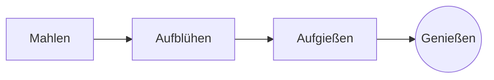

# Der perfekte Handaufguss

Ein langsames Morgenritual in wenigen Schritten. Schreib es im **Quelltext** links oder direkt in der *Vorschau* rechts: Beide bleiben synchron, und ==jede Änderung ist eine saubere Änderung== am Markdown.

> [!TIP]
> Wasser kurz nach dem Kochen, etwa 94 °C, bringt Süße ohne Bitterkeit hervor.

## Das Verhältnis

Die meisten Rezepte setzen auf einen Teil Kaffee zu sechzehn Teilen Wasser:

$$
m_{\text{Wasser}} = 16 \times m_{\text{Kaffee}}
$$

Also braucht $20\,\text{g}$ Kaffee $320\,\text{g}$ Wasser.

## Schritt für Schritt



## Zubereitungsarten

| Methode      | Mahlgrad   | Zeit |
|:-------------|:----------:|-----:|
| Handaufguss  | Mittelfein | 3:30 |
| French Press | Grob       | 4:00 |
| Espresso     | Fein       | 0:28 |

## Bevor du anfängst

- [x] Frisch geröstete Bohnen :coffee:
- [x] Eine Mühle mit Kegelmahlwerk
- [ ] Ein Kessel mit Schwanenhals

```python
def water_for(coffee_g: float, ratio: int = 16) -> float:
    return coffee_g * ratio
```

Aufblühen
: Der erste Schwall Wasser, durch den das Kaffeemehl sein Gas freisetzt.[^1]

[^1]: Frische Bohnen blühen am stärksten auf; alte heben sich kaum.
