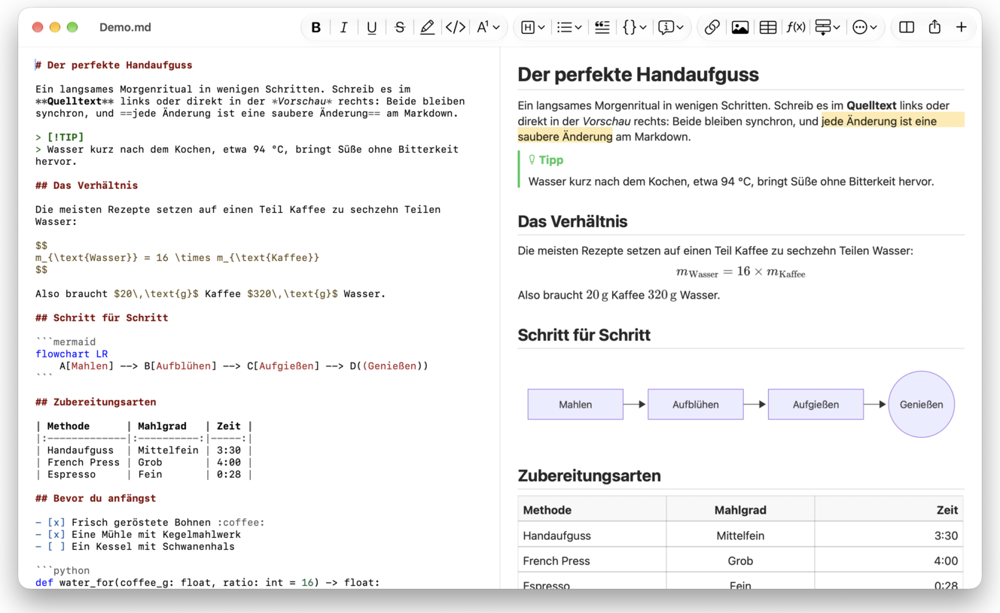
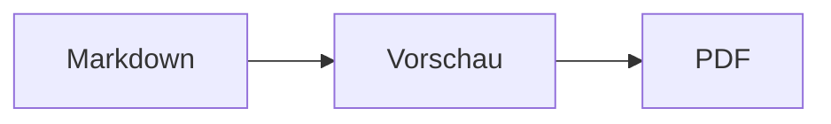

<p>&nbsp;&nbsp;&nbsp;</p>

# Splat

**Der Markdown-Editor für macOS, in dem du im Quelltext oder direkt in der Vorschau schreibst.**

Splat zeigt links deinen Markdown-Quelltext mit Syntaxfarben und rechts eine live aktualisierte, voll bearbeitbare Vorschau. Du kannst in beiden tippen: Was du in der Vorschau schreibst, wird zu einer minimalen Änderung am Quelltext, sodass unberührte Zeilen Byte für Byte identisch bleiben und deine Git-Diffs sauber bleiben. Splat liest das Markdown, das du ohnehin benutzt: CommonMark und GitHub Flavored Markdown, GitHub-Alerts, Wiki-Links, Einbettungen und Hinweisboxen aus Obsidian, Erweiterungen von Pandoc und Typora, eingebettetes HTML, LaTeX-Formeln sowie Diagramme in Mermaid, Graphviz und PlantUML, alles offline dargestellt. Der Export als PDF, HTML oder Word geht mit einem Klick. Splat ist in Rust auf echten AppKit-Steuerelementen geschrieben, spricht 35 Sprachen und sendet nichts über das Netzwerk, solange du es nicht willst.
 


[](https://raw.githubusercontent.com/sventmueller/splat/main/dist/Splat-1.0.3.dmg)

**[Splat-1.0.3.dmg laden](https://raw.githubusercontent.com/sventmueller/splat/main/dist/Splat-1.0.3.dmg)**: von Apple signiert und notarisiert, für macOS 14 oder neuer auf Apple Silicon und Intel.
 
 

[](https://www.rust-lang.org)
[](https://www.apple.com/macos/)

[](https://github.com/madsmtm/objc2)
[](https://webkit.org)
[](https://github.com/kivikakk/comrak)
[](https://github.github.com/gfm/)
[](https://www.mathjax.org)
[](https://cortexjs.io/mathlive/)
[](https://mermaid.js.org)
[](https://graphviz.org)
[](https://plantuml.com)


[](#lizenz)

[Bahasa Indonesia](../id/README.md) ·
[Bahasa Melayu](../ms/README.md) ·
[Català](../ca/README.md) ·
[Čeština](../cs/README.md) ·
[Dansk](../da/README.md) ·
**Deutsch** ·
[English](../../../README.md) ·
[Español](../es/README.md) ·
[Français](../fr/README.md) ·
[Hrvatski](../hr/README.md) ·
[Italiano](../it/README.md) ·
[Magyar](../hu/README.md) ·
[Nederlands](../nl/README.md) ·
[Norsk](../no/README.md) ·
[Polski](../pl/README.md) ·
[Português (Brasil)](../pt_BR/README.md) ·
[Português (Portugal)](../pt_PT/README.md) ·
[Română](../ro/README.md) ·
[Slovenčina](../sk/README.md) ·
[Slovenščina](../sl/README.md) ·
[Suomi](../fi/README.md) ·
[Svenska](../sv/README.md) ·
[Tiếng Việt](../vi/README.md) ·
[Türkçe](../tr/README.md) ·
[Ελληνικά](../el/README.md) ·
[Русский](../ru/README.md) ·
[Українська](../uk/README.md) ·
[עברית](../he/README.md)‎ ·
[العربية](../ar/README.md)‎ ·
[हिन्दी](../hi/README.md) ·
[ไทย](../th/README.md) ·
[한국어](../ko/README.md) ·
[日本語](../ja/README.md) ·
[简体中文](../zh-Hans/README.md) ·
[繁體中文](../zh-Hant/README.md)

## Inhalt

- [Funktionen im Überblick](#funktionen-im-überblick)
- [Voraussetzungen](#voraussetzungen)
- [Installation](#installation)
- [Erste Schritte](#erste-schritte)
- [Schreiben](#schreiben)
  - [Im Quelltext](#im-quelltext)
  - [In der Vorschau](#in-der-vorschau)
  - [Formatierungsbefehle](#formatierungsbefehle)
  - [Listen und Aufgaben](#listen-und-aufgaben)
  - [Tabellen](#tabellen)
- [Unterstütztes Markdown](#unterstütztes-markdown)
  - [CommonMark und GitHub Flavored Markdown](#commonmark-und-github-flavored-markdown)
  - [Hinweisboxen](#hinweisboxen)
  - [Erweiterte Syntax](#erweiterte-syntax)
  - [Obsidian](#obsidian)
  - [Zitate und Verweise](#zitate-und-verweise)
  - [Eingebettetes HTML](#eingebettetes-html)
  - [Typografische Satzzeichen](#typografische-satzzeichen)
  - [Syntaxübersicht](#syntaxübersicht)
- [Formeln](#formeln)
- [Diagramme](#diagramme)
- [Bilder](#bilder)
- [Links und Navigation](#links-und-navigation)
- [Exportieren, Drucken und Teilen](#exportieren-drucken-und-teilen)
- [Darstellung und Bedienungshilfen](#darstellung-und-bedienungshilfen)
- [Sprachen](#sprachen)
- [Kurzbefehle](#kurzbefehle)
- [Datenschutz und Sicherheit](#datenschutz-und-sicherheit)
- [Große Dokumente](#große-dokumente)
- [Bekannte Einschränkungen](#bekannte-einschränkungen)
- [Fehlerbehebung](#fehlerbehebung)
- [Für Entwickler](#für-entwickler)
  - [Bauen](#bauen)
  - [Verteilung](#verteilung)
  - [Testen](#testen)
  - [Projektaufbau](#projektaufbau)
  - [Datenfluss](#datenfluss)
  - [Regeln im Controller](#regeln-im-controller)
  - [Einen Befehl hinzufügen](#einen-befehl-hinzufügen)
  - [Übersetzungen](#übersetzungen)
  - [Komponenten von Drittanbietern](#komponenten-von-drittanbietern)
- [Lizenz](#lizenz)

## Funktionen im Überblick

- **Zwei Wege zu schreiben, ein Text.** Quelltext und Vorschau sind beide bearbeitbar. Die Markdown-Datei ist die einzige Wahrheit: Es gibt pro Dokument einen Verlauf zum Widerrufen, und jede Änderung in der Vorschau wird in die kleinstmögliche Änderung am Quelltext übersetzt.
- **Das Markdown, das du ohnehin benutzt.** CommonMark, GitHub Flavored Markdown, GitHub-Alerts, Erweiterungen von Obsidian, Pandoc und Typora, Emoji-Kürzel, Spoiler, Definitionslisten, Überschriftenanker und HTML wie in GitHub-READMEs.
- **Formeln und Diagramme eingebaut.** LaTeX-Formeln über MathJax, mit einem visuellen Formeleditor. Diagramme in Mermaid, Graphviz und PlantUML, auf deinem Mac dargestellt, ohne Java, Server oder Netzwerkverbindung.
- **Für alles eine Schaltfläche.** Jedes Markdown-Element hat eine Schaltfläche in der Symbolleiste und einen Menübefehl, die gängigen auch einen Kurzbefehl. Tabellen haben ein eigenes Menü für Zeilen, Spalten und Ausrichtung.
- **Export ohne Verluste.** PDF, eine einzelne, in sich geschlossene HTML-Datei oder ein Word-Dokument mit echten Überschriften, Listen, Tabellen, Fußnoten und Bildern.
- **Durch und durch nativ.** Echte AppKit-Fenster, Tabs, Menüs, Popover, Versionen, automatisches Sichern, das Teilen-Menü, Dark Mode, Rechtschreibprüfung, Diktierfunktion und VoiceOver. Kein Electron, keine Web-Ansicht für den Text selbst.
- **Schnell mit großen Dateien.** Ein Tastendruck in einem 10-MB-Dokument dauert etwa 25 ms.
- **Privat und sorgfältig.** Bilder aus dem Web laden erst, wenn du es erlaubst, Links zu anderen Apps fragen vorher nach, und alles, was nicht vertrauenswürdige Bilddaten dekodiert, läuft in Hilfsprozessen in einer Sandbox.
- **In deiner Sprache.** Die Oberfläche und die eingebaute Markdown-Kurzreferenz gibt es in 35 Sprachen: Arabisch, Katalanisch, Chinesisch (vereinfacht), Chinesisch (traditionell), Kroatisch, Tschechisch, Dänisch, Niederländisch, Englisch, Finnisch, Französisch, Deutsch, Griechisch, Hebräisch, Hindi, Ungarisch, Indonesisch, Italienisch, Japanisch, Koreanisch, Malaiisch, Norwegisch, Polnisch, Portugiesisch (Brasilien), Portugiesisch (Portugal), Rumänisch, Russisch, Slowakisch, Slowenisch, Spanisch, Schwedisch, Thai, Türkisch, Ukrainisch und Vietnamesisch.

## Voraussetzungen

- macOS 14 Sonoma oder neuer. Splat wird auf macOS 27 entwickelt und getestet, wo es das Design Liquid Glass automatisch übernimmt.
- Ein Mac mit Apple Silicon oder einem Intel-Prozessor.
- Etwa 45 MB Speicherplatz.

## Installation

**Vom Disk-Image.** Lade [`dist/Splat-1.0.3.dmg`](https://raw.githubusercontent.com/sventmueller/splat/main/dist/Splat-1.0.3.dmg), öffne es und ziehe Splat auf den Ordner „Programme“. Das Image ist mit einer Developer ID signiert und von Apple notarisiert, sodass es ohne Warnungen öffnet.

**Mit Homebrew.** Das Cask liegt in einem eigenen Tap:

```sh
brew install --cask sventmueller/tap/splat
```

`brew upgrade --cask splat` installiert neue Versionen, und `brew uninstall --zap --cask splat` entfernt zusätzlich die Einstellungen und Caches von Splat.

**Updates.** Splat aus dem Disk-Image oder von Homebrew hält sich mit [Sparkle](https://sparkle-project.org) selbst aktuell. Beim zweiten Start fragt es, ob es einmal täglich selbstständig nach Updates suchen darf. **Splat › Nach Updates suchen …** sucht sofort; **Automatisch nach Updates suchen** und **Updates automatisch laden und installieren** im selben Menü ändern deine Wahl später. Splat installiert ein Update nur, wenn es die Signatur des Entwicklers trägt. Ein selbst gebautes Splat hat keinen Updater.

**Aus dem Quellcode.** Die Voraussetzungen stehen unter [Bauen](#bauen), dann:

```sh
make build
ditto target/release/Splat.app /Applications/Splat.app
open /Applications/Splat.app
```

Damit Markdown-Dateien per Doppelklick mit Splat öffnen, wähle im Finder eine beliebige `.md`-Datei aus, dann **Ablage › Informationen**, wähle unter **Öffnen mit** Splat und klicke auf **Alle ändern …**. Splat meldet sich selbst für `.md`-, `.markdown`-, `.mdown`- und `.mkd`-Dateien an.

## Erste Schritte

### Das Fenster

Jedes Dokument öffnet in einem eigenen Fenster oder, wenn du Tabs bevorzugst, in einem Tab:

- **Links: der Quelltext.** Dein Markdown in SF Mono mit Syntaxfarben.
- **Rechts: die Vorschau.** Das dargestellte Dokument, bereit zum Bearbeiten.
- **Gliederung in der Seitenleiste (optional).** Alle Überschriften als Baum; ein Klick auf eine zeigt sie in beiden Bereichen. Ein- und ausblenden mit **Darstellung › Gliederung einblenden** (⌃⌘S).
- **Symbolleiste.** Schaltflächen, gruppiert danach, was sie ändern: Zeichen, Absätze und eingefügte Elemente, dann Vorschau ein/aus, Teilen und Neues Dokument. Anpassen mit **Darstellung › Symbolleiste anpassen …**.

Ziehe die Trennlinie, um einer Seite mehr Platz zu geben. **Darstellung › Vorschau ausblenden** (⌥⌘P) lässt nur den Quelltext stehen; Splat merkt sich das pro Fenster. Beide Bereiche scrollen gemeinsam, und eine Auswahl in einem Bereich wird im anderen hervorgehoben.

### Dokumente, Tabs und Versionen

Splat ist eine ganz normale dokumentbasierte macOS-App:

- **Automatisches Sichern und Versionen.** Änderungen werden direkt in der Datei gesichert. **Ablage › Zurücksetzen auf › Alle Versionen durchsuchen …** bringt dich in der Zeit zurück.
- **Änderungen durch andere Programme.** Ändern Git, ein Skript oder ein anderer Editor ein geöffnetes Dokument, lädt Splat es neu und behält Cursor und Scrollposition. Hast du selbst ungesicherte Änderungen, behält Splat sie, und macOS fragt nach, bevor es über die andere Version sichert.
- **Die üblichen Dateibefehle.** Duplizieren (⇧⌘S), Umbenennen …, Bewegen … und **Ablage › Benutzte Dokumente**.
- **Tabs.** **Ablage › Neuer Tab** oder die Schaltfläche **+** in der Symbolleiste öffnet ein neues Dokument als Tab; das Standardmenü „Fenster“ führt Tabs zusammen, bewegt sie und wechselt zwischen ihnen.
- **Fensterposition.** Größe und Position deines letzten Fensters werden gemerkt, auch über Neustarts hinweg. Steht dort schon ein Fenster, öffnet das neue leicht versetzt.
- **Das Dock-Symbol.** Ein Klick darauf öffnet ein neues Dokument, nachdem du das letzte Fenster geschlossen hast.
- **Markdown-Dateien mit Splat öffnen.** **Splat › Als Standard-App für Markdown festlegen** sorgt dafür, dass ein Doppelklick auf eine `.md`- oder `.markdown`-Datei Splat öffnet; macOS lässt dies einmal bestätigen. Der Eintrag zeigt ein Häkchen, solange Splat die Standard-App ist.

Dateien müssen UTF-8-Text sein oder UTF-16 mit Byte-Order-Mark. Splat lehnt andere Kodierungen ab, statt zu raten und den Text zu beschädigen. Eine Byte-Order-Mark bleibt erhalten, UTF-16 bleibt UTF-16, und in einer Datei, in der alle Zeilen mit CRLF enden, bekommen auch die Zeilen, die du hinzufügst, CRLF.

**Nach einem Absturz** gehen höchstens die letzten Sekunden des Tippens verloren: Alle fünf Sekunden kopiert Splat ungesicherten Text nach `~/Library/Application Support/Splat/Unsaved` und entfernt die Kopien, sobald ein Dokument gesichert ist oder Splat normal beendet wird. Beim nächsten Start verschiebt Splat, was ein Absturz dort hinterlassen hat, nach `~/Library/Application Support/Splat/Recovery` und sagt dies einmal an, mit einer Schaltfläche, die den Ordner öffnet. Ein Absturz, auf den Splat noch reagieren kann, schreibt dorthin außerdem den Text jedes geöffneten Dokuments.

### Kurzreferenz

**Hilfe › Markdown-Kurzreferenz** öffnet in deiner Sprache ein Spickzettel-Dokument als neues, unbenanntes Dokument. Es ist ein ganz normales Dokument, also probiere alles gleich dort aus, im Quelltext oder in der Vorschau.

## Schreiben

### Im Quelltext

Der Quelltext ist ein Nur-Text-Editor, der auf Markdown abgestimmt ist:

- **Syntaxfarben** wie in VS Code: Überschriften, Hervorhebungen, Links, Code, Tabellen, HTML, Front Matter sowie LaTeX und Mermaid in Formeln und Diagrammen. Es gibt Paletten für Hell, Dunkel und Kontrast erhöhen.
- **Eingezäunte Codeblöcke** werden für Bash, C, C++, C#, CSS (auch SCSS und Less), Go, HTML, XML, Java, JavaScript, JSON, Kotlin, PHP, Python, Ruby, Rust, SQL, Swift, TypeScript, YAML, TeX und Mermaid hervorgehoben, auch unter ihren üblichen Kurznamen wie `js`, `py` oder `sh`.
- **Keine überraschenden Ersetzungen.** Intelligente Anführungszeichen, intelligente Bindestriche und Textersetzung sind standardmäßig aus, weil sie `--`, `---` und `"` zerstören. Schalte sie unter **Bearbeiten › Ersetzungen** ein.
- **Die Schreibwerkzeuge des Systems.** Rechtschreib- und Grammatikprüfung, Diktierfunktion, Suchen und Ersetzen (⌥⌘F) und Sprachausgabe.
- **Drag & Drop.** Lege eine Bilddatei ab, um `` einzufügen, eine andere Datei, um einen Link darauf einzufügen, und eine URL, um `[url](url)` einzufügen. Jedes Ablegen ist ein Schritt beim Widerrufen.
- **Bilder einsetzen.** Ein Bild in der Zwischenablage, etwa ein Bildschirmfoto, wird als PNG-Datei neben dem Dokument gesichert (`Bild 2026-10-29 13.09.07.png`) und als Bild eingefügt. Dafür muss das Dokument einmal gesichert sein.

### In der Vorschau

Die Vorschau verhält sich wie eine Textverarbeitung, aber alles, was du darin tust, landet als Markdown im Text:

- **Tippen.** Zeichen mit einer Bedeutung in Markdown, etwa `*` oder `#`, werden maskiert, damit sie so erscheinen, wie du sie getippt hast.
- **Return** beginnt einen neuen Absatz oder Listeneintrag. **⌥Return** oder **⌃Return** fügt einen Zeilenumbruch ein.
- **Formatieren am Cursor.** Steht der Cursor am Ende eines Wortes, gelten Fett, Kursiv und die anderen Zeichenformate für das, was du als Nächstes tippst. Wähle das Format erneut, um es zu beenden. In einem Wort wird das ganze Wort formatiert.
- **Leere Zeilen.** Return in einer leeren Zeile fügt eine weitere leere Zeile hinzu, die Rückschritttaste entfernt sie. Im Quelltext ist jede zusätzliche leere Zeile zwei weitere Leerzeilen; andere Markdown-Programme zeigen sie als normalen Absatzabstand.
- **Widerrufen** gilt für beide Bereiche. Die Einträge tragen Namen („Fett widerrufen“), Tippen ist ein Schritt pro Schub, und nach Widerrufen und Wiederholen scrollen beide Bereiche zur Änderung.
- **Formeln und Diagramme** erscheinen als fertige Grafiken. Klicke eine an, bewege den Cursor darauf oder drücke Return darauf, um den Editor zu öffnen (siehe [Formulas](#formeln) und [Diagrams](#diagramme)).
- **Eingebettetes HTML, eingebettete Notizen und Front Matter** werden angezeigt, aber im Quelltext bearbeitet. Ein Klick darauf setzt den Cursor an die passende Stelle dort.

Alles, was Markdown nicht ausdrücken kann, wird in der Vorschau blockiert: die Fenster für Schriften und Farben, das Lineal sowie das Einsetzen und Ablegen von formatiertem Text und Bildern. Eingesetztes HTML und RTF kommen als reiner Text an.

### Formatierungsbefehle

Jeder Befehl ist über die Symbolleiste, die Menüleiste und das Kontextmenü beider Bereiche erreichbar. Menüeinträge zeigen ein Häkchen für die Formatierung am Cursor.

| Menü | Befehle |
|---|---|
| **Format › Schrift** | Fett, Kursiv, Unterstrichen, Durchgestrichen, Textmarker, Code, Hochgestellt, Tiefgestellt |
| **Format › Überschrift** | Fließtext, Überschrift 1 bis 6 |
| **Format › Liste** | Aufzählung, Nummerierung, Aufgabenliste |
| **Format** | Zitat, Codeblock (Ohne Sprache oder eine von 20 Sprachen; ändert auch die Sprache eines bestehenden Blocks), Hinweisbox (Notiz, Tipp, Wichtig, Warnung, Vorsicht; derselbe Typ noch einmal entfernt sie), Formel oder Diagramm bearbeiten …, Formatierung entfernen |
| **Einfügen** | Link …, Bild …, Tabelle …, Formel, Diagramm (Flussdiagramm, Sequenzdiagramm, Gantt-Diagramm), Inhaltsverzeichnis, Fußnote, Trennlinie |
| **Tabelle** | Zeile darüber/darunter einfügen, Spalte links/rechts einfügen, Zeile löschen, Spalte löschen, Ausrichtung (Links, Zentriert, Rechts, Standard), Tabelle bündig ausrichten |
| **Darstellung** | Vorschau ausblenden/einblenden, Gliederung einblenden/ausblenden, Typografische Satzzeichen, Vergrößern/Verkleinern, Originalgröße, Symbolleiste, Tableiste, Vollbildmodus |

Unterstrichen, Textmarker, Hochgestellt und Tiefgestellt werden als `<ins>`, `<mark>`, `<sup>` und `<sub>` geschrieben, was GitHub ebenfalls darstellt. Splat liest auch `<u>`, das GitHub entfernt, und die kürzeren `==highlight==`, `^sup^` und `~sub~`. GitHub zeigt `==` und `^` so, wie sie getippt wurden, und `~sub~` als Durchgestrichen.

### Listen und Aufgaben

- Return setzt eine Liste fort; Return in einem leeren Eintrag beendet sie.
- **Tab** und **⇧Tab** rücken Listeneinträge in der Vorschau ein und aus.
- Ein Klick auf das Kästchen einer Aufgabe in der Vorschau schaltet zwischen `- [ ]` und `- [x]` um.
- **Format › Liste** wandelt die markierten Absätze in eine Liste um oder ändert deren Art.

### Tabellen

- **Einfügen › Tabelle …** fragt nach der Anzahl der Zeilen (inklusive Kopfzeile) und Spalten.
- In der Vorschau springt **Tab** in die nächste Zelle, **⇧Tab** in die vorherige und **Return** in die Zelle darunter. Tab in der letzten Zelle fügt eine Zeile hinzu.
- Das Menü **Tabelle** fügt Zeilen und Spalten ein und löscht sie und legt die Ausrichtung einer Spalte fest (⌘{, ⌘|, ⌘}).
- **Tabelle › Tabelle bündig ausrichten** füllt den Quelltext auf, damit die Spalten untereinander stehen.

## Unterstütztes Markdown

Splat parst mit [comrak](https://github.com/kivikakk/comrak), einem zu CommonMark und GFM kompatiblen Parser, und schaltet die meisten seiner Erweiterungen ein. Alles Folgende wird in der Vorschau und in allen Exporten dargestellt.

### CommonMark und GitHub Flavored Markdown

- Überschriften (`#` und unterstrichen), Absätze, Zeilenumbrüche, Betonung, starke Betonung, Inline-Code, Blockzitate, Trennlinien.
- Aufzählungen, Nummerierungen und verschachtelte Listen; Aufgabenlisten.
- Links (inline, Referenz und automatisch), Bilder, Link-Referenzdefinitionen.
- Eingezäunte und eingerückte Codeblöcke mit Syntaxfarben.
- Tabellen mit Spaltenausrichtung.
- Durchgestrichen mit `~~zwei Tilden~~`.
- Fußnoten: `Text[^1]` mit `[^1]: Die Notiz.` an beliebiger Stelle im Dokument. Ein Klick auf die Markierung springt zur Notiz.
- YAML-Front-Matter zwischen `---`-Zeilen am Anfang. Die Vorschau fasst es in einer Zeile zusammen, etwa „Metadaten: title, date, tags“.

### Hinweisboxen

GitHub-Alerts werden als farbige Boxen mit Symbol und Titel dargestellt:

```markdown
> [!NOTE]
> Nützliche Informationen, die Nutzer kennen sollten.

> [!WARNING]
> Kritischer Inhalt, der sofortige Aufmerksamkeit verlangt.
```

Die fünf Typen sind Notiz, Tipp, Wichtig, Warnung und Vorsicht. **Format › Hinweisbox** macht den Absatz am Cursor zu einer solchen Box.

Hinweisboxen aus Obsidian funktionieren auch, mit beliebigem Titel und Auf- oder Zuklappzustand:

```markdown
> [!tip]- Klicke auf ▸ zum Aufklappen
> Verborgen, bis es geöffnet wird.

> [!question]+ Standardmäßig offen
> Ein `+` startet aufgeklappt, ein `-` zugeklappt.
```

Die anderen Typen von Obsidian werden in der nächstliegenden der fünf Farben dargestellt: `success`, `check`, `done` und `hint` als Tipp; `question`, `help` und `faq` als Wichtig; `attention` als Warnung; `failure`, `fail`, `missing`, `danger`, `error` und `bug` als Vorsicht; alles andere als Notiz.

### Erweiterte Syntax

| Funktion | Syntax | Herkunft |
|---|---|---|
| Textmarker | `==markierter Text==` | Obsidian, Typora |
| Hochgestellt | `x^2^` | Pandoc, Typora |
| Tiefgestellt | `H~2~O` | Pandoc, Typora |
| Emoji-Kürzel | `:rocket:` wird zu 🚀 | GitHub |
| Spoiler | `\|\|verborgener Text\|\|`, zum Lesen markieren | Discord |
| Inline-Fußnote | `Text^[die Notiz selbst]` | Pandoc, Obsidian |
| Definitionsliste | `Begriff`, Leerzeile, `: Erklärung` | PHP Markdown Extra, Pandoc |
| Überschriftenanker | `## Installieren {#setup}`, Link mit `[siehe](#setup)` | Pandoc, kramdown |

Definitionslisten sehen im Quelltext so aus:

```markdown
Begriff

: Erklärung des Begriffs.
```

Ohne eigenen Anker bekommt jede Überschrift wie auf GitHub einen aus ihrem Text abgeleiteten: `## Erste Schritte` ist als `#erste-schritte` erreichbar.

### Obsidian

- **Wiki-Links.** `[[Notiz]]` verlinkt auf `Notiz.md` im selben Ordner oder einem Ordner darunter. `[[Notiz|Angezeigter Text]]` zeigt deinen eigenen Text, und `[[Notiz#Überschrift]]` öffnet die Notiz. ⌘-Klick öffnet sie in Splat.
- **Einbettungen.** `![[Notiz]]` zeigt die andere Notiz in dieser; darin eingebettete Notizen erscheinen als Links. `![[diagram.png]]` zeigt ein Bild. Wie in Obsidian nennen Einbettungen Notizen und Bilder im Ordner des Dokuments oder darunter, nie mit absolutem Pfad, und nur Markdown-Dateien erscheinen als Notizen.
- **Kommentare.** `%%Nur im Quelltext%%` bleibt im Quelltext sichtbar und wird in der Vorschau und in jedem Export weggelassen, inline wie auch in eigenen Zeilen.
- **Tags.** `#idee` oder `#projekt/splat` wird hervorgehoben. ⌘-Klick durchsucht das Dokument nach dem Tag.
- **Aufklappbare Hinweisboxen.** Siehe [Hinweisboxen](#hinweisboxen).

### Zitate und Verweise

- **Pandoc-Zitate.** `[@doe2020]` oder `[@doe2020; @roe2021]` liest sich wie „(Doe 2020; Roe 2021)“. Die Einträge stammen aus der BibTeX-Datei, die der Front Matter mit `bibliography: refs.bib` nennt. Ohne diese Angabe nutzt Splat `references.bib`, `literatur.bib` oder `bibliography.bib` neben dem Dokument.
- **GitHub- und GitLab-Verweise.** Liegt das Dokument in einem Git-Repository, dessen Remote `origin` auf github.com oder einem GitLab-Host liegt, werden `@name`, `#12` (Issue) und `!7` (Merge Request, nur GitLab) hervorgehoben. ⌘-Klick öffnet sie im Browser.

### Eingebettetes HTML

HTML, wie es in GitHub-READMEs steht, wird dargestellt, mit einem eigenen Leser statt einer Browser-Engine:

- zentrierte Absätze und Blöcke (`<p align="center">`, `<div align="center">`)
- Bilder mit Größenangabe (``)
- Links, `<kbd>⌘</kbd>`, `<br>`, `<u>`, `<ins>`, `<mark>`, `<sup>`, `<sub>`
- Listen und Tabellen, auch mit Zellen über mehrere Spalten (`colspan`)
- aufklappbare Abschnitte: `<details><summary>Mehr</summary>…</details>`, geöffnet per Klick auf ▸

Markdown zwischen HTML-Tags wird als Markdown dargestellt. Skripte, Stile, Frames und Formulare werden ganz weggelassen, und bei Links und Bildern bleiben nur `http`, `https`, `mailto` und relative Adressen erhalten.

### Typografische Satzzeichen

**Darstellung › Typografische Satzzeichen** zeigt gerade Anführungszeichen als die Anführungszeichen deiner Oberflächensprache, `--` als Halbgeviertstrich, `---` als Geviertstrich und `...` als Auslassungspunkte. Im Deutschen wird `"Ja"` zu „Ja“, im Französischen «Oui», im Japanischen 「はい」, auch dort, wo Chinesisch und Japanisch Anführungszeichen ohne Leerraum setzen; hebräische Abkürzungen wie `צה"ל` bekommen ihre Gershayim, צה״ל. Der Quelltext behält die einfachen Zeichen; die Vorschau und alle Exporte zeigen die typografischen. Die Einstellung ist aus, bis du sie einschaltest.

### Syntaxübersicht

| Element | Markdown |
|---|---|
| **Fett** | `**Fett**` |
| *Kursiv* | `*Kursiv*` |
| Unterstrichen | `<ins>Unterstrichen</ins>` oder `<u>Unterstrichen</u>` |
| ~~Durchgestrichen~~ | `~~Durchgestrichen~~` |
| Textmarker | `<mark>Textmarker</mark>` oder `==Textmarker==` |
| `Code` | `` `Code` `` |
| x² | `x<sup>2</sup>` oder `x^2^` |
| H₂O | `H<sub>2</sub>O` oder `H~2~O` |
| [Link](https://example.com) | `[Link](https://example.com)` |
| Überschrift | `# Überschrift` bis `###### Überschrift` |
| Zitat | `> Zitat` |
| Aufzählung | `- Punkt` |
| Nummerierung | `1. Punkt` |
| Aufgabe | `- [ ] Offen` und `- [x] Erledigt` |
| Codeblock | ```` ```rust ```` … ```` ``` ```` |
| Tabelle | `\| A \| B \|` mit `\|---\|---\|` unter der Kopfzeile |
| Fußnote | `Text[^1]` und `[^1]: Notiz` |
| Trennlinie | `---` |
| Bild | `` |
| Formel | `$E = mc^2$`, `$$ … $$` |
| Diagramm | ```` ```mermaid ````, ```` ```dot ````, ```` ```plantuml ```` |
| Hinweisbox | `> [!TIP]` |
| Wiki-Link | `[[Notiz]]`, `[[Notiz\|Text]]` |
| Einbettung | `![[Notiz]]`, `![[image.png]]` |
| Kommentar | `%%Kommentar%%` |
| Tag | `#tag` |
| Quellenangabe | `[@key]` |
| Spoiler | `\|\|Spoiler\|\|` |
| Emoji | `:tada:` |

## Formeln

Formeln werden von [MathJax](https://www.mathjax.org) mit seiner TeX- und AMS-Mathematik als gestochen scharfe Vektorgrafiken dargestellt. Text in `\text{…}` kann in jeder Schrift stehen: Was den Schriften von MathJax fehlt, kommt aus den Schriften deines Mac, wobei Arabisch und Hebräisch von rechts nach links laufen und Emoji farbig erscheinen.

| Art | Syntax |
|---|---|
| Inline | `$E = mc^2$`, `` $`E = mc^2`$ `` (GitHub, GitLab), `\(E = mc^2\)` |
| Abgesetzt | `$$` … `$$`, `\[` … `\]` oder ein Codeblock mit der Angabe `math` |

**Eine Formel bearbeiten.** Klicke in der Vorschau auf eine Formel, klicke doppelt darauf, drücke Return darauf oder bewege den Cursor darauf, um ihren Editor in einem Popover zu öffnen. **Einfügen › Formel** fügt eine neue ein und öffnet den Editor sofort.

- **Visuell oder LaTeX.** Der Schalter oben wechselt zwischen einem visuellen Editor ([MathLive](https://cortexjs.io/mathlive/)) und dem LaTeX-Code. Splat merkt sich deine Wahl.
- **Bausteine** für Bruch, Wurzel, Hoch- und Tiefstellung, Summe und Integral mit Grenzen, Grenzwert, Klammern, die mit dem Inhalt wachsen, 2×2-Matrix, griechische Buchstaben sowie Relationen, Operatoren und Pfeile. Sie hinterlassen Platzhalter □, und **Tab** springt zum nächsten.
- **Live-Vorschau.** Änderungen erscheinen beim Tippen im Dokument. Fehler von MathJax stehen in einer Zeile unter dem Code.
- **Übernehmen oder verwerfen.** Ein Klick nach außen behält die Änderung als einen einzigen Schritt beim Widerrufen; **Esc** oder **Abbrechen** verwirft sie. Esc bei einer neuen, leeren Formel entfernt sie wieder.
- Das Kontextmenü bietet **Formel bearbeiten …** für die Formel unter dem Zeiger.

VoiceOver liest eine Formel als ihren LaTeX-Code vor. Splat stellt Formeln dar, keine vollständigen LaTeX-Dokumente: Es gibt keine Pakete, kein TikZ und kein `\documentclass`.

## Diagramme

Diagramme werden in Splat dargestellt, offline und in einer hellen und einer dunklen Variante.

| Engine | Codeblock | Was sie zeichnet |
|---|---|---|
| [Mermaid](https://mermaid.js.org) | ```` ```mermaid ```` | Flussdiagramme, Sequenz-, Klassen-, Zustands-, Entity-Relationship-, Gantt-, Kreisdiagramme, Mind-Maps, Zeitleisten und alle anderen Mermaid-Typen |
| [Graphviz](https://graphviz.org) | ```` ```dot ```` oder ```` ```graphviz ```` | Graphen in der Sprache DOT |
| [PlantUML](https://plantuml.com) | ```` ```plantuml ```` oder ```` ```puml ```` | UML-Diagramme; läuft ohne Java |



**Ein Diagramm bearbeiten** funktioniert wie das Bearbeiten einer Formel: Klicke darauf, um den Code in einem Popover zu öffnen, mit Syntaxfarben und Fehlermeldungen in einer Zeile unter dem Code. **Einfügen › Diagramm** beginnt mit einer Vorlage für ein Flussdiagramm, ein Sequenzdiagramm oder ein Gantt-Diagramm. Bausteine helfen bei den drei häufigsten Mermaid-Typen:

- **Flussdiagramm:** Knoten ▾ (Rechteck, Abgerundet, Kreis, Raute, Datenbank), Verbindung, Beschriftete Verbindung, Gruppe, Richtung ▾
- **Sequenzdiagramm:** Teilnehmer, Nachricht, Antwort, Notiz, Schleife, Fallunterscheidung
- **Gantt-Diagramm:** Abschnitt, Aufgabe, Meilenstein

Andere Diagrammtypen werden als Code bearbeitet. VoiceOver liest den Titel oder den Alternativtext eines Diagramms vor.

Das erste Diagramm nach dem Start braucht etwa eine Sekunde, weil die Darstellungs-Engine im Hintergrund startet. Ein Diagramm, das länger als 10 Sekunden braucht, zeigt einen Fehler, und die Engine startet für das nächste neu. Die Engine von PlantUML (7 MB) wird erst mit dem ersten PlantUML-Diagramm geladen. Ein PlantUML-`!include` aus dem Web wird blockiert.

## Bilder

- **Lokale Bilder** verwenden Pfade relativ zum Dokument: ``. Splat zeigt PNG, JPEG, GIF, WebP, BMP, SVG, HEIC, TIFF, AVIF und PDF.
- **Bilder aus dem Web** bleiben blockiert, bis du sie erlaubst: Eine Leiste über der Vorschau erklärt, dass deren Server beim Laden erfahren, dass und wann du das Dokument öffnest. **Bilder laden** erlaubt sie für dieses Dokument; Splat merkt sich die Wahl pro Datei.
- **Größe.** `` legt die Größe eines Bildes fest; sonst passen sich Bilder der Breite der Vorschau an.
- **Änderungen auf dem Datenträger.** Ein Bild, das du ersetzt, oder eines, das erscheint, nachdem das Dokument es genannt hat, wird angezeigt, ohne das Dokument neu zu öffnen. Bilder aus dem Web, die wegen des Netzwerks gescheitert sind, werden erneut versucht, solange ein Dokument sie zeigt.
- **Speicher.** Bilder werden mit bis zu 2560 Pixeln an der längsten Seite angezeigt, was auch eine A4-Seite füllt. Sie werden kleiner dekodiert, sobald sie ein Achtel des Arbeitsspeichers deines Mac füllen, und solange macOS Speicherdruck meldet.
- **Dark Mode.** Bilder mit weißem Hintergrund werden in der dunklen Vorschau leicht abgedunkelt.
- **Einsetzen und Ablegen.** Siehe [Im Quelltext](#im-quelltext).

## Links und Navigation

In der Vorschau setzt ein Klick den Cursor, damit du den Linktext bearbeiten kannst; **⌘-Klick** folgt dem Link:

- `http`, `https` und `mailto` öffnen in deinem Browser oder Mail-Programm.
- Markdown-Dateien öffnen in Splat; andere Dateien und Ordner werden im Finder gezeigt.
- `#anchor` springt zur Überschrift im Dokument.
- Adressen, die eine andere App öffnen, etwa `slack://` oder `vscode://`, fragen vorher nach und zeigen die vollständige Adresse und die App. **Abbrechen** ist vorausgewählt.

**Einfügen › Inhaltsverzeichnis** fügt eine verlinkte Liste aller Überschriften ein. Steht der Cursor darin, aktualisiert derselbe Befehl sie. Die Gliederung in der Seitenleiste (⌃⌘S) springt in beiden Bereichen zu jeder Überschrift.

## Exportieren, Drucken und Teilen

| Format | Wie | Ergebnis |
|---|---|---|
| **PDF** | **Ablage › Als PDF exportieren …** oder das Teilen-Menü | Seiten in Papiergröße, immer im hellen Erscheinungsbild, Formeln und Diagramme als Vektorgrafiken. **Ablage › Papierformat …** legt das Papier fest. |
| **Drucken** | **Ablage › Drucken …** (⌘P) | Dasselbe Layout wie beim PDF. |
| **HTML** | **Ablage › Als HTML exportieren …** oder das Teilen-Menü | Eine in sich geschlossene Datei: lokale Bilder eingebettet, Formeln und Diagramme als scharfe Bilder, Überschriftenanker, damit das Inhaltsverzeichnis funktioniert. Keine Skripte. |
| **Word** | **Ablage › Als Word-Dokument exportieren …** oder das Teilen-Menü | Eine `.docx` mit den Überschriftenstilen von Word, echten Listen und Tabellen (auch mit verbundenen Zellen), Fußnoten als Word-Fußnoten, eingebetteten Bildern, Formeln und Diagrammen. |
| **Markdown** | Die Schaltfläche **Teilen** in der Symbolleiste | Das Dokument als `.md`-Datei für Mail, Nachrichten, AirDrop und jeden anderen Teilen-Dienst. |

Das Menü **Ablage › Teilen** bietet all das an einer Stelle an. Exporte verwenden die Einstellung für typografische Satzzeichen und die Bilder aus dem Web, die du erlaubt hast; Bilder aus dem Web bleiben in HTML Links.

## Darstellung und Bedienungshilfen

- **Dark Mode** folgt dem System. Formeln und Diagramme werden für jedes Erscheinungsbild neu dargestellt.
- **Kontrast erhöhen** in den Systemeinstellungen schaltet die Syntaxfarben auf kontrastreiche Paletten um.
- **Zoomen.** ⌘+, ⌘− und ⌘0 skalieren beide Bereiche.
- **Vollbildmodus, Tabs und eine anpassbare Symbolleiste**, wie in jeder Mac-App.
- **VoiceOver.** Die Bereiche heißen „Markdown-Quelltext“ und „Vorschau“, Formeln werden als ihr Code vorgelesen und Diagramme mit ihrem Titel. Jeder Befehl ist über die Tastatur erreichbar.

Splat hat kein Einstellungsfenster: Die wenigen Optionen stehen dort, wo sie wirken, in **Darstellung** und **Bearbeiten › Ersetzungen**.

## Sprachen

Die Oberfläche, die Menüs und die Markdown-Kurzreferenz sind in 35 Sprachen übersetzt:

Arabisch, Katalanisch, Chinesisch (vereinfacht), Chinesisch (traditionell), Kroatisch, Tschechisch, Dänisch, Niederländisch, Englisch, Finnisch, Französisch, Deutsch, Griechisch, Hebräisch, Hindi, Ungarisch, Indonesisch, Italienisch, Japanisch, Koreanisch, Malaiisch, Norwegisch, Polnisch, Portugiesisch (Brasilien), Portugiesisch (Portugal), Rumänisch, Russisch, Slowakisch, Slowenisch, Spanisch, Schwedisch, Thai, Türkisch, Ukrainisch und Vietnamesisch.

Splat folgt der Sprachreihenfolge unter **Systemeinstellungen › Allgemein › Sprache & Region**; dort kannst du unter **Apps** auch eine Sprache nur für Splat wählen. Gibt es keine Übersetzung für deine Sprache, nimmt es Englisch. Die Menübegriffe folgen den Übersetzungen von Apple, sodass Splat sich liest wie der Rest deines Mac.

Hebräischer und arabischer Text läuft überall, wo er erscheint, von rechts nach links, unabhängig von der Oberflächensprache: Jeder Absatz, jede Überschrift und jeder Listeneintrag übernimmt die Richtung seines ersten Buchstabens, Zitate und Hinweisboxen zeichnen ihren Balken rechts, und eine Tabelle, deren Text von rechts nach links beginnt, listet ihre Spalten von rechts auf. Codeblöcke bleiben von links nach rechts. Die Exporte als PDF, HTML und Word behalten diese Richtungen bei. Mit Hebräisch oder Arabisch als Systemsprache spiegelt macOS außerdem das Fenster, sodass die Vorschau links liegt.

## Kurzbefehle

| Aktion | Kurzbefehl |
|---|---|
| Fett, Kursiv, Unterstrichen | ⌘B, ⌘I, ⌘U |
| Durchgestrichen | ⇧⌘X |
| Link … | ⌘K |
| Fließtext, Überschrift 1 bis 6 | ⌥⌘0, ⌥⌘1 bis ⌥⌘6 |
| Tabellenspalte links, zentriert, rechts ausrichten | ⌘{, ⌘\|, ⌘} |
| Vorschau aus- oder einblenden | ⌥⌘P |
| Gliederung ein- oder ausblenden | ⌃⌘S |
| Vergrößern, Verkleinern, Originalgröße | ⌘+, ⌘−, ⌘0 |
| Neues Dokument, Öffnen, Sichern, Duplizieren | ⌘N, ⌘O, ⌘S, ⇧⌘S |
| Papierformat, Drucken | ⇧⌘P, ⌘P |
| Suchen, Suchen und ersetzen | ⌘F, ⌥⌘F |
| Weitersuchen, Rückwärts suchen; Auswahl suchen; Auswahl anzeigen | ⌘G, ⇧⌘G; ⌘E; ⌘J |
| Rechtschreibung und Grammatik einblenden; Dokument prüfen | ⌘:, ⌘; |
| Einsetzen und Stil anpassen | ⌥⇧⌘V |
| Symbolleiste ausblenden, alle Tabs einblenden, Vollbildmodus | ⌥⌘T, ⇧⌘\\, ⌃⌘F |
| Zeilenumbruch (Vorschau) | ⌥Return oder ⌃Return |
| Nächste Zelle / vorherige Zelle in einer Tabelle (Vorschau) | Tab / ⇧Tab |
| Listeneintrag einrücken / ausrücken (Vorschau) | Tab / ⇧Tab |
| Nächster Platzhalter im Formeleditor | Tab |
| Formel- oder Diagrammeditor ohne Änderungen schließen | Esc |
| Link, Tag oder Verweis folgen (Vorschau) | ⌘-Klick |

Splat lässt die Standardkurzbefehle von Apple, wo sie sind.

## Datenschutz und Sicherheit

Eine Markdown-Datei kann von jedem stammen, deshalb behandelt Splat jedes Dokument als nicht vertrauenswürdig.

- **Standardmäßig kein Netzwerk.** Splat hat keine Telemetrie. Es sucht nur nach Updates, wenn du zugestimmt hast oder **Nach Updates suchen …** wählst: Dann lädt es eine kleine Feed-Datei von GitHub, und die Anfrage nennt nur die App und ihre Version. Formeln und Diagramme werden lokal dargestellt; die Web-Ansichten, die das tun, erreichen das Netzwerk nicht.
- **Bilder aus dem Web** laden erst mit deiner Erlaubnis, nur über `https`, nie von Hosts in deinem lokalen Netzwerk, höchstens 10 MB je Bild und in einer privaten Sitzung ohne Cookies.
- **Isoliertes Dekodieren.** Bilder und die Grafiken von Formeln und Diagrammen werden in Hilfsprozessen dekodiert, die jede geerbte Datei schließen und sich in eine Sandbox sperren, bevor sie das erste Byte lesen: kein Dateizugriff, kein Netzwerk. Sie geben nur Pixel zurück, deren Größe geprüft wird, und werden nach 10 Sekunden gestoppt. Die Bild-Decoder von Apple sehen nur HEIC, TIFF, AVIF und PDF, und nur, wenn die Daten wirklich dieses Format haben; sie laufen in einem eigenen Hilfsprozess, der zusätzlich die Schriftenordner des Systems lesen und den Video-Decoder des Systems nutzen darf. SVGs, Formeln und Diagramme laufen ebenfalls durch diesen Hilfsprozess, sodass sie in Splat Bilder mit fester Auflösung sind: vier Pixel pro Punkt, bis zu 2560 an der längeren Seite.
- **Lokale Dateien** erreichen ein Dokument nur über den Pfad, den es nennt. Einbettungen zeigen Markdown-Notizen aus dem Ordner des Dokuments und darunter, und ein fehlendes Bild wird nur dort gesucht. Ein Bildpfad anderswo, absolut oder mit `~` beginnend, lädt trotzdem, und HTML- und Word-Exporte betten es ein: Sieh dir den Export eines Dokuments, das du nicht selbst geschrieben hast, an, bevor du ihn weitergibst.
- **Kopien ungesicherten Textes** bleiben für die Wiederherstellung nach einem Absturz auf diesem Mac, in deinem Ordner „Library“. Sie verschwinden mit dem Sichern oder dem normalen Beenden von Splat; die Kopien, die ein Absturz hinterlassen hat, bleiben im Wiederherstellungsordner, bis du sie löschst.
- **Links** starten nie per Klick ein Programm. Web- und Mail-Links öffnen wie gewohnt; Links zu anderen Apps fragen vorher nach.
- **HTML in Dokumenten** wird vom eigenen Parser von Splat gelesen. Skripte, Stile, Frames und Formulare laufen nie.
- **Exporte** enthalten keine Skripte. HTML-Seiten behalten wie bei GitHub nur eine feste Liste harmloser Tags und Attribute, dazu eine Content Security Policy. Word-Dateien verlinken nur `http`-, `https`- und `mailto`-Adressen.
- **Codesignatur** mit der Hardened Runtime. Splat läuft ohne die App Sandbox, damit es Bilder neben deinen Dokumenten anzeigen kann, ohne für jeden Ordner zu fragen; die Isolation des gesamten Dekodierens gleicht das aus.

## Große Dokumente

Splat bleibt auch mit Dokumenten von mehreren Megabyte reaktionsschnell:

- Der Quelltext nutzt TextKit 2, das nur den sichtbaren Teil setzt.
- Beim Tippen in der Vorschau und im Quelltext von Dokumenten bis 2 MB werden nur die betroffenen Absätze neu geparst, gefärbt und gesetzt: etwa 25 ms in einem 10-MB-Dokument und etwa 50 ms für einen Tastendruck in dessen Vorschau, mit der eigenen Arbeit der Ansicht.
- Große Vorschauen stellen zuerst den sichtbaren Teil dar und den Rest, solange die App untätig ist. Blöcke, die ins Bild scrollen, werden dargestellt, bevor sie gezeichnet werden.
- Im Quelltext größerer Dokumente läuft das Parsen für die Vorschau im Hintergrund, während du tippst.
- Ab 64 MB bleibt ein Dokument reiner Text: Der Quelltext hat keine Farben, und die Vorschau sagt, warum sie leer bleibt. Exporte funktionieren weiterhin.
- Ab etwa 200 KB öffnet ein Dokument sein Fenster, bevor es geparst wird; bei 5 MB folgen die Farben und die Vorschau etwa eine Viertelsekunde später.

Manche Änderungen werden vollständig verarbeitet, bei 10 MB mit etwa 300 ms pro Tastendruck: Änderungen an der Definition oder den Verweisen einer Fußnote, neben einer Inline-Fußnote, ganz am Ende eines Dokuments neben einer Fußnote, am Front Matter oder nahe an Link-Referenzdefinitionen sowie jede Änderung in einem Dokument mit `%%`-Kommentarblöcken oder mit einer doppelt oder in einem Zitat oder einer Liste definierten Fußnote. Der Speicherbedarf wächst mit der Datei, auf etwa 115–160 MB für 1 MB Markdown und 340–510 MB für 10 MB.

## Bekannte Einschränkungen

- **Einzelne Tilden bedeuten Tiefstellung.** `~text~` ist wie in Pandoc tiefgestellt; Durchstreichen braucht `~~zwei~~`. GitHub streicht auch mit einer Tilde durch.
- **Nur lesbar in der Vorschau:** Eingebettetes HTML, eingebettete Notizen und Front Matter werden im Quelltext bearbeitet.
- **Sehr tiefe Verschachtelung:** HTML, das tiefer als 64 Ebenen verschachtelt ist, und Inline-HTML tiefer als 16 weichen ihrem Inhalt.
- **Verbundene Tabellenzellen** gibt es nur in HTML-Tabellen und nur über Spalten (`colspan`, kein `rowspan`). Die Tabellensyntax von MultiMarkdown für verbundene Zellen wird nicht unterstützt.
- **Literaturverzeichnisse** werden nur aus BibTeX gelesen, nicht aus CSL JSON oder YAML.
- **Verweise** brauchen ein Repository auf github.com oder einem GitLab-Host; `!7` gibt es nur auf GitLab.
- **Typografische Satzzeichen:** Ein deutsches schließendes einfaches Anführungszeichen lässt sich nicht von einem Apostroph unterscheiden und wird als ’ gesetzt.
- **Formeln, keine Dokumente:** keine LaTeX-Pakete, kein TikZ und keine vollständigen Dokumente.
- **Der visuelle Formeleditor** schreibt LaTeX in der Notation von MathLive: Leerzeichen verschwinden (`E = mc^2` wird zu `E=mc^2`), die Darstellung bleibt gleich.
- **Gewollt:** keine Zeilennummern, kein Einstellungsfenster, kein Hilfebuch, nicht im App Store.
- **Auf Intel weniger getestet.** Die Selbsttests mit Fenster laufen nur auf Apple Silicon; auf Intel führt CI `cargo test` aus.

## Fehlerbehebung

**Die Liste der benutzten Dokumente ist leer, nachdem ich Splat neu gebaut habe.** macOS bindet benutzte Dokumente und Ordnerberechtigungen an die Codesignatur der App. Lokale Builds werden mit dem Zertifikat „Splat Local Signing“ in deinem Schlüsselbund „login“ signiert, sodass Neubauten beides behalten. Wurde das Zertifikat gelöscht, erstellt der nächste Build ein neues, und die Listen beginnen einmal von vorn.

**Die App aus dem Disk-Image zeigt andere benutzte Dokumente als mein eigener Build.** Die beiden tragen unterschiedliche Signaturen, deshalb führt macOS für jede eine eigene Liste und eigene Ordnerberechtigungen.

**HTML oder andere Syntax erscheint als einfacher Code.** Möglicherweise hat eine veraltete Kopie von Splat das Dokument geöffnet. Beende sie, wähle im Finder für das Dokument **Ablage › Informationen** und prüfe, dass **Öffnen mit** das Splat in deinem Ordner „Programme“ nennt.

**Im Menü „Splat“ fehlt Nach Updates suchen ….** Nur die Version aus dem Disk-Image oder von Homebrew aktualisiert sich selbst; ein selbst gebautes Splat hat keinen Updater.

**Bilder aus dem Web erscheinen nicht.** Klicke in der Leiste über der Vorschau auf **Bilder laden**. Nur `https`-Bilder von öffentlichen Hosts laden.

**Beim Einsetzen eines Bildschirmfotos soll ich zuerst sichern.** Eingesetzte Bilder werden als Dateien neben dem Dokument abgelegt, was einen Ort auf dem Datenträger braucht. Sichere es und setze dann erneut ein.

**„Die Datei ist kein UTF-8-Text.“** Die Datei hat eine andere Kodierung und keine Byte-Order-Mark, die sie benennen würde. Konvertiere sie zuerst, zum Beispiel mit `iconv -f ISO-8859-1 -t UTF-8 old.md > new.md`.

**Eine Formel oder ein Diagramm zeigt einen Fehler.** Klicke darauf: Der Editor zeigt unter dem Code die Meldung von MathJax, Mermaid, Graphviz oder PlantUML.

## Für Entwickler

Splat ist eine Rust-Anwendung, die direkt über [objc2](https://github.com/madsmtm/objc2) mit AppKit und WebKit spricht. Es gibt kein Swift, kein Objective-C, kein Xcode-Projekt und keine Interface-Builder-Datei.

### Bauen

Voraussetzungen:

- macOS mit den Command Line Tools (`xcode-select --install`). Xcode wird nicht gebraucht; Splat baut ohne `actool`, `ibtool` und `metal`.
- Rust 1.99 (`brew install rust`). [rust-toolchain.toml](../../../rust-toolchain.toml) nennt die genaue Version, die CI nutzt; rustup installiert sie selbst, das Rust von Homebrew ignoriert die Datei. Sie dort anzuheben ist der Weg, auf dem neue Compiler- und Clippy-Warnungen ins Projekt gelangen.

Das [Makefile](../../../Makefile) enthält kurze Einstiegspunkte; `make help` listet alle auf:

```sh
make build                  # target/release/Splat.app, gleich wie cargo xtask bundle --release
make universal              # target/splat-universal für Apple Silicon und Intel, wie es das Disk-Image enthält
make check                  # Formatierung, clippy ohne Warnungen, alle Tests, eingebundene Bibliotheken; was CI ausführt
make test                   # make check, dann der Selbsttest ohne Fenster
make test-gui               # Selbsttests mit Fenster; sie belegen den Mac etwa vier Minuten
make test-long              # längere Zufallssuche und die Prüfung der Teilaktualisierung mit 10 MB
make coverage               # Zeilenabdeckung aller Tests und Selbsttests, mit einer Untergrenze je Modul
make coverage-library       # dieselben Untergrenzen für die Module ohne Fenster, wie in CI
make bench FILE=<file.md>   # Zeiten für Öffnen, Tippen und Scrollen einer großen Datei
make release                # zuerst make test, dann das notarisierte Disk-Image
```

Die Build-Logik selbst steckt im Rust-Crate [xtask](../../../xtask/src/main.rs):

```sh
cargo xtask bundle --release   # target/release/Splat.app, Hardened Runtime, signiert mit "Splat Local Signing"
cargo xtask bundle             # target/debug/Splat Debug.app, eine separate App, die nie Markdown-Dateien öffnet
cargo xtask dmg                # dist/Splat-<version>.dmg zur Verteilung, Developer ID, notarisiert
cargo xtask icon               # assets/AppIcon.icns und das README-Symbol aus assets/icon-1024.png neu bauen
cargo xtask vendor check       # das mitgelieferte JavaScript gegen vendor.lock prüfen
cargo xtask vendor fetch       # es nach einer Versionsänderung in vendor.lock erneut laden
```

`bundle` schreibt die `Info.plist`, kopiert die Ressourcen und Lokalisierungen und signiert die App mit dem Zertifikat „Splat Local Signing“. Der erste Build erstellt dieses Zertifikat in deinem Schlüsselbund „login“, 20 Jahre gültig. Solange es bleibt, behält Splat seine benutzten Dokumente und Ordnerberechtigungen über Neubauten hinweg; bei einer Ad-hoc-Signatur wäre jeder Build für macOS eine neue App. Debug- und Selbsttest-Builds tragen eigene Bundle-IDs (`local.splat.debug`, `local.splat.selftest`) und melden sich nicht für Markdown-Dateien an, sodass der Finder nie ein Dokument in einem veralteten Build öffnet und sie die Einstellungen der normalen App in Ruhe lassen.

Die Version steht in [VERSION](../../../VERSION) als `major.minor.build` und ist die, die der nächste Build bekommt. Jeder erfolgreiche Release-Build (`make build`, `cargo xtask bundle --release`, `make release`) erhöht die Build-Nummer um eins; Debug- und Selbsttest-Builds lassen sie in Ruhe. Major und Minor werden von Hand erhöht: Setze VERSION auf, sagen wir, `1.1.0`, und der nächste Build bekommt genau diese.

### Verteilung

`cargo xtask dmg` (oder `make release`, das zuerst `make test` ausführt) baut ein Release, signiert es mit deiner Developer ID, lässt die App von Apple notarisieren und heftet das Ticket an, packt sie in ein komprimiertes, schreibgeschütztes Disk-Image mit einem Link auf „Programme“, notarisiert und heftet auch das Image an und prüft das Ergebnis mit Gatekeeper. Die App trägt ihr eigenes Ticket, damit eine ohne den Finder installierte Kopie, wie Homebrew es tut, auch beim ersten Start offline öffnet; die zwei Runden mit dem Notardienst dauern je einige Minuten. Nur ein Image, das jeden Schritt bestanden hat, wird zu `dist/Splat-<version>.dmg`, der Kopie, die eingecheckt wird: Die Download-Links in diesem README und seinen Übersetzungen folgen ihr, und die Build-Nummer steigt. Das vorherige Image bleibt für ein weiteres Release, da der Raw-Server von GitHub nach einem Push noch einige Minuten den alten Update-Feed ausliefern kann; ältere werden in den Papierkorb bewegt. Ein fehlgeschlagener Lauf lässt `dist/`, die READMEs und VERSION, wie sie waren.
Jedes Release fügt dem Repository-Verlauf das vollständige Image hinzu, etwa 16 MB. Es läuft nur auf Aufruf, nie als Teil eines normalen Builds, und braucht:

- ein Zertifikat „Developer ID Application“ im Schlüsselbund
- eine gespeicherte Anmeldung für den Notardienst von Apple mit einem App-spezifischen Passwort, einmal angelegt mit `xcrun notarytool store-credentials notary --apple-id <Apple ID> --team-id <team ID>`
- den privaten Schlüssel, der Updates signiert, im Schlüsselbund „login“. Sparkles `generate_keys` hat ihn erzeugt; seine öffentliche Hälfte ist `UPDATE_KEY` in [xtask/src/main.rs](../../../xtask/src/main.rs) und steckt in jeder installierten Kopie, die nur damit signierte Updates akzeptiert. Bewahre ein Backup in einem Passwortmanager auf: `target/sparkle-2.10.1/bin/generate_keys -x <file>` exportiert ihn, `-f <file>` importiert ihn auf einem anderen Mac. Ohne ihn lassen sich installierte Kopien nie wieder aktualisieren.
- rustup (`brew install rustup`, das Homebrews Rust unangetastet lässt)

Fehlt eines davon, bricht `dmg` ab, bevor es baut. Beim ersten Lauf fragt macOS, ob das Terminal den Finder steuern darf; ohne diese Erlaubnis zeigt das Disk-Image weder seinen Hintergrund noch die Anordnung der Symbole.

Nur das Disk-Image trägt den Updater, [Sparkle](https://sparkle-project.org), den der Build einmal aus seinem GitHub-Release nach `target/` lädt und gegen die Prüfsumme in xtask prüft. Die Hardened Runtime lädt das Framework nur, wenn es die Team-ID der App trägt, die die Developer-ID-Signatur hat und dem lokalen Zertifikat fehlt; und ein Update darf keinen selbst gebauten Build ersetzen. Auch der Selbsttest-Build trägt Sparkle, um das Update-Menü dagegen zu prüfen: mit einem Feed, der nicht existiert, ohne die Frage von Sparkle beim zweiten Start und mit einem Entitlement, das die lokal signierte App das Framework laden lässt. `dmg` signiert das neue Image mit dem Update-Schlüssel und schreibt `dist/appcast.xml`, den Feed, den installierte Kopien von GitHub lesen. Committe und pushe das Image, den Feed und die READMEs zusammen: Von da an bieten installierte Kopien das Update an.

Das Disk-Image ist ein Universal Binary für Apple Silicon und Intel; andere Builds sind nur für den Host-Prozessor gebaut. Das Rust von Homebrew liefert die Standardbibliothek nur für den Host-Prozessor, deshalb baut `dmg` über rustup, das die Toolchain und die Targets aus [rust-toolchain.toml](../../../rust-toolchain.toml) bei der ersten Verwendung installiert, und bricht ab, wenn dem Programm oder Sparkle der Code für einen der beiden Prozessoren fehlt. `make universal` baut nur das Programm. Die App darin trägt eine andere Signatur als ein lokaler Build, deshalb führt macOS für die beiden getrennte benutzte Dokumente und Ordnerberechtigungen.

### Testen

| Befehl | Prüft |
|---|---|
| `cargo test --release` | Unit-Tests, Zufalls- und Übersetzungstests |
| `SPLAT_FUZZ_ROUNDS=20000 cargo test --release` | eine längere Zufallssuche; `SPLAT_FUZZ_SEED` variiert die Eingaben |
| `SPLAT_I18N_ONLY=fr cargo test --release i18n` | eine Sprache, solange andere unvollständig sind |
| `cargo clippy --release --all-targets [--features selftest]` | Lints, darunter die Begründung jedes `unsafe`-Blocks, die Länge von Funktionen und, in der Bibliothek, Zahlenkonvertierungen |
| `cargo xtask vendor check` | die JavaScript-Bibliotheken stimmen Byte für Byte mit `vendor.lock` überein |
| `cargo xtask selftest probe` | ohne Fenster, jeweils mit erwartetem Ergebnis: Formeln, Diagramme, Web-Bilder gegen einen Server im Prozess, blockierte Adressen, die Abwehr der Web-Ansichten |
| `cargo xtask selftest gui [--stop-after "<check>"] [--scenarios]` | die laufende App, Klick für Klick. Öffnet ein Fenster und tippt hinein; der Mac ist etwa vier Minuten beschäftigt. `--scenarios` führt nur den zweiten Teil aus, in etwa anderthalb Minuten |
| `cargo xtask selftest resize` | verbreitert das Fenster, nachdem die Trennlinie verschoben wurde: Der Quelltext bricht um, während die Fenstergröße geändert wird. Dauert etwa zehn Sekunden |
| `cargo xtask selftest bench <file.md>` | Zeiten für Öffnen, Tippen und Scrollen einer großen Datei |
| `cargo test --release -- --ignored partial_updates` | ein Tastendruck in 10 MB: Teil- gegen Vollaktualisierung, Ergebnis und Zeitlimit |
| `cargo test --release --test hostile` | Dokumente, die den Stack überlaufen lassen oder quadratische Zeit brauchen, durch Parsen, Layout, beide Exporte, Tastendrücke und Befehle |
| `make mutants` | nacheinander eingebaute Fehler in `src/markdown/` und `src/preview/`, durch [cargo-mutants](https://mutants.rs) (`cargo install cargo-mutants`); sagt, welche kein Test bemerkt. Dauert Stunden; `FILE=src/preview/bridge.rs` grenzt es ein |
| `cargo test --release --test decoder` | der Decoder-Prozess dekodiert Bilder und erreicht weder Dateien noch das Netzwerk |
| `make coverage` | Zeilenabdeckung von `cargo test` und allen Selbsttests, durch [cargo-llvm-cov](https://github.com/taiki-e/cargo-llvm-cov) (`brew install cargo-llvm-cov llvm`); schlägt unter den Untergrenzen fehl. Belegt den Mac etwa fünf Minuten |
| `make coverage-library` | die Untergrenzen für `src/markdown/`, `src/preview/` und `i18n.rs`, allein durch `cargo test` gemessen |

Unit-Tests stehen neben dem Code, den sie testen. `tests/` enthält, was die Bibliothek von außen erreicht: die Zufallstests in `robustness.rs`, die den Generator in `src/fuzz.rs` mit denen von `sync.rs` teilen, die Dokumente, die Schaden anrichten sollen, in `hostile.rs` und den Decoder-Test, der das gebaute Programm startet. Entscheidungen in `src/editor/`, die kein Fenster brauchen, liegen in freien Funktionen mit eigenen Tests: alles, was der Controller weiß und wie sich das ändert, in `state.rs`, die Regeln der Darstellung in `render_queue.rs`, die Textkopie in `sync.rs`. Ein Schritt des Fenster-Selbsttests, der vergeblich wartet, lässt den Lauf scheitern. Der Fenster-Selbsttest führt nach seinem Haupt-Durchklicken einen zweiten Teil aus, in `src/editor/selftest/scenarios.rs`: jeden Formatierungs- und Tabellenbefehl, die Dialoge, Linkklicks, Einsetzen, Ablegen, Exporte, eine große Änderung, Bilder, die sich auf dem Datenträger ändern, Speicherdruck, ein riesiges Dokument und die Wiederherstellung nach einem Absturz.

Die Abdeckung hat zwei Untergrenzen: jedes Modul mindestens 80 % seiner Zeilen, alle Module zusammen mindestens 85 %. `make coverage` misst `cargo test` zusammen mit den Selbsttests und schlägt unter einer von beiden fehl; die Untergrenzen und die wenigen Ausnahmen, etwa der Panic-Hook in `main.rs`, der nur bei einem Absturz läuft, stehen in [xtask](../../../xtask/src/coverage.rs) neben ihren Gründen. Gemessene Builds gehen nach `target/coverage/`, sodass Messcode nie nach `target/release/` oder in ein Disk-Image gelangt. Der Decoder-Hilfsprozess öffnet seine Messdatei, bevor er sich einsperrt, und wird deshalb ebenfalls gemessen.

CI ([.github/workflows/ci.yml](../../../.github/workflows/ci.yml)) führt `make check`, `make coverage-library` und den Universal-Build auf Apple Silicon sowie `cargo test` auf Intel bei jedem Push auf `main` und jedem Pull Request aus. Jede Nacht führt [.github/workflows/nightly.yml](../../../.github/workflows/nightly.yml) `make test-long` mit neuen Zufallseingaben aus. Die Selbsttests und das Disk-Image bleiben auf dem Mac des Entwicklers: Sie brauchen einen Bildschirm und die Signaturzertifikate im Schlüsselbund.

Die Ausgabe der Selbsttests geht nach `target/selftest/`. Der Selbsttest baut eine separate App (`target/release/Splat Selftest.app`, Bundle-ID `local.splat.selftest`) und lässt die Einstellungen, benutzten Dokumente und Dateizuordnungen der normalen App unberührt.

### Projektaufbau

`src/lib.rs` macht alles, was kein Fenster braucht, zu einer eigenen Bibliothek, `splat`: `markdown/`, `preview/`, `i18n.rs` und den Testgenerator `fuzz.rs`. Die App in `src/main.rs` baut darauf auf.

- `src/markdown/`: die Parser-Anbindung (comrak), Syntaxfarben und alle Befehle als reine Textänderungen (`Edit`). Außerdem das erneute Parsen nach einer Änderung (`incremental.rs`), der Leser für eingebettetes HTML (`markup.rs`), Typografie, Tags, Verweise und Zitate im Fließtext (`typography.rs`), wie Text aussieht und welches Markdown und HTML ihn so macht (`style.rs`), was eine Adresse sein darf (`url.rs`) sowie der HTML- und Word-Export (`html.rs`, `docx.rs` mit `docx/html.rs` und `docx/xml.rs`). Die Vorschau und beide Exporte lesen denselben Baum, `Doc`. Kein AppKit.
- `src/preview/`: das Layout der Vorschau, eingebettetes HTML darin (`layout/html.rs`) und die Zuordnung zwischen Vorschau und Quelltext (`Bridge`, `Index`). Kein AppKit.
- `src/editor/`: das Fenster. Ein `EditorController`-Objekt bedient AppKit als Delegate beider Ansichten; seine Arbeit ist nach Verantwortung aufgeteilt:

| Modul | Verantwortung |
|---|---|
| `mod.rs` | Klasse, Delegate-Methoden, `invalidate` |
| `state.rs` | was der Controller über das Dokument weiß und jede Art, wie sich das ändert; seine Felder sind privat, und es berührt keine Ansicht |
| `actions.rs` | Befehlsregister: Selektor, Titel, Kurzbefehl, Symbol, wann der Befehl gilt |
| `editing.rs` | Befehle ausführen und prüfen, Tippen in der Vorschau |
| `update.rs` | Parsen, Färben, Aktualisieren der Vorschau; nach einer Änderung nur die betroffenen Absätze |
| `sync.rs` | Textkopie und Block-Buchführung, ohne AppKit und mit Zufallstests |
| `progressive.rs` | große Vorschauen Schritt für Schritt darstellen |
| `selection.rs`, `scroll.rs` | Auswahl und Scrollposition beider Bereiche im Gleichschritt |
| `atom.rs`, `atom_edit.rs` | der Formel- und Diagrammeditor |
| `navigation.rs`, `links.rs` | Links, Wiki-Links, Tags, Aufgabenkästchen, Falten, Fußnoten |
| `env.rs` | was die Vorschau von außerhalb des Textes liest: typografische Satzzeichen, das Repository für `@name` und `#12`, die BibTeX-Datei, eingebettete Notizen |
| `render.rs`, `images.rs`, `remote.rs`, `safe_image.rs` | Vorschautext, lokale und entfernte Bilder |
| `attributes.rs` | Textattribute; jeder Schlüssel bekommt nur einen Wert des Typs, den er erwartet |
| `shadow.rs` | Kopien ungesicherten Textes für die Wiederherstellung nach einem Absturz |
| `decoder.rs` | Hilfsprozesse in einer Sandbox, die Bilder und Grafiken dekodieren |
| `export.rs`, `outline.rs` | HTML- und Word-Export; die Gliederung in der Seitenleiste |
| `js.rs`, `mathfield.rs`, `render_queue.rs` | WebKit für MathJax, Mermaid, Graphviz, PlantUML und den visuellen Formeleditor; die Regeln, was wann dargestellt wird, abseits von WebKit |
| `webkit.rs` | Aufrufe in WebKit; nur die Lebensdauer des Navigation-Delegates bleibt bei `js.rs` und `mathfield.rs` |
| `window.rs`, `toolbar.rs`, `views.rs`, `dialogs.rs`, `style.rs` | Fenster, Symbolleiste, Textansichten, Dialoge, Farben |

- `src/menu.rs`, `src/app.rs`, `src/document.rs`: Menüleiste, App-Delegate, Dokument (`MDDocument`, eine Unterklasse von `NSDocument`).
- `src/i18n.rs` mit `resources/*.lproj`: 35 Sprachen; die Schlüssel sind die deutschen Texte.
- `src/large_alloc.rs`: große Allokationen kommen direkt vom Kernel und gehen beim Freigeben dorthin zurück, sodass der Speicher nach großen Änderungen zurückkehrt.
- `resources/js/`: Webseiten und Bibliotheken; Versionen und Prüfsummen in [vendor.lock](../../../vendor.lock).
- `xtask/`: Bundling, Signieren, das Disk-Image, das Symbol, Vendoring, der Selbsttest-Runner und die Abdeckungs-Untergrenzen.

### Datenfluss

Der Quelltext in der linken Textansicht ist die einzige Quelle der Wahrheit.

1. Jede Zeichenänderung dort aktualisiert die Textkopie (`Snapshot`) an Ort und Stelle, ohne den Text erneut zu lesen.
2. Eine Aktualisierung parst die Kopie, färbt den Quelltext nur dort neu, wo sich Farben geändert haben, setzt die Vorschau und ersetzt nur die Blöcke, deren Inhalt sich geändert hat.
3. Nach einer Änderung werden nur die betroffenen Absätze neu geparst, gefärbt und gesetzt, solange ihre Nachbarn gleich bleiben; `reparse_part_and_color` sagt, wann sie es nicht tun. Dokumente mit `%%`-Kommentarblöcken, Änderungen am Front Matter und Änderungen nahe an Link-Referenzdefinitionen werden vollständig verarbeitet. comrak erkennt einen Fußnotenverweis nur mit seiner Definition im selben Parse und verschiebt Definitionen hinter den Text, daher wird der Teil mit einer Platzhalterdefinition je Label geparst und übernimmt seine Nummern aus dem alten Baum; eine Änderung an den Verweisen oder Definitionen im Teil oder neben einer Inline-Fußnote wird vollständig verarbeitet.
4. HTML-Blöcke, die `<details>` oder `<div align>` öffnen und später schließen, wirken auf die Markdown-Blöcke dazwischen; ein wiederverwendeter Block muss dieselbe Umgebung haben.
5. Beim Tippen im Quelltext eines Dokuments bis 2 MB läuft die Teilaktualisierung sofort; trifft sie nicht zu, oder in einem größeren Dokument, laufen Parsen und Layout im Hintergrund. Beim Tippen in der Vorschau laufen sie sofort, weil der Cursor der Vorschau vom Ergebnis abhängt.
6. Eingaben in der Vorschau übersetzt `Bridge` in eine Änderung am Quelltext, und sie nehmen von da an denselben Weg. Markdown hat zu viele Möglichkeiten, Text in Syntax zu verwandeln, als dass Regeln allein genügten, daher parst `preview/verify.rs` den geänderten Teil erneut und vergleicht, was er zeigt, mit dem, was getippt wurde; eine Änderung, die nicht standhält, wird weiter maskiert oder abgelehnt.
7. Die Inline-Positionen von comrak stimmen an einigen Stellen nicht, zum Beispiel hinter einer Link-Referenzdefinition. `markdown/positions.rs` prüft sie beim Lesen eines Blocks am Quelltext und liest sie dort, wo sie nicht passen, erneut aus dem Quelltext.

### Regeln im Controller

1. Die eigenen Änderungen des Controllers an den Ansichten laufen innerhalb von `silently()`; die Delegate-Callbacks ignorieren sie.
2. `state` wird nur zum Lesen und Berechnen geborgt, nie über einen Aufruf hinweg, der eine Ansicht ändert, setzt oder scrollt. Es ändert sich nur über seine eigenen Methoden, deren Tests kein Fenster brauchen.
3. Nachrichten von außen (ein Bild geladen, eine Formel dargestellt) kommen verzögert über `renders_arrived` und `image_arrived` an, nie mitten in einer Aktualisierung.
4. Neu zeichnen ohne Textänderung läuft nur über `invalidate(reason)`.
5. Ein `Rc<Snapshot>` wird nicht über eine Änderung des Quelltextes hinweg gehalten, sonst kopiert diese Änderung den ganzen Text.
6. Ein neuer Befehl braucht einen Eintrag in `actions.rs`, eine Methode in `mod.rs` und einen Zweig in `editing::perform`.
7. Jeder `unsafe`-Block trägt seine Begründung als `// SAFETY:`-Kommentar. Bytes erreichen die Bild-Decoder des Systems in der App nur über `decoder::system_image`.
8. Nichts im Hauptthread wartet auf die Ordner des Benutzers, da ein Netzwerkvolume aufhören kann zu antworten: Dateien werden im Thread `DISK` angesehen, und die Vorschau liest die Antworten über `Env::known`. Nur eine Aktion, auf die der Benutzer wartet, etwa ein Export oder das Sichern, darf den Datenträger direkt berühren.

### Einen Befehl hinzufügen

Die Menüleiste, die Symbolleiste und das Kontextmenü bauen ihre Einträge alle aus dem Register in [src/editor/actions.rs](../../../src/editor/actions.rs), und die Menüvalidierung liest dort, wann ein Befehl gilt und ob er ein Häkchen zeigt. Ein neuer Befehl braucht:

1. eine Variante von `Action` mit ihrem `Spec`: Selektor, Titel, Beschriftung in der Symbolleiste, Tooltip (beginnt mit einem Verb, höchstens 75 Zeichen), Kurzbefehl, SF Symbol und wann er gilt
2. die Methode in `src/editor/mod.rs`
3. einen Zweig in `editing::perform`
4. seine Texte in jeder `Localizable.strings`

Der Test `every_command_has_a_method_and_every_method_a_command` prüft, dass Register und Methoden zusammenpassen. Die Standardkurzbefehle von Apple wie ⌘E, ⌘J, ⌘T, ⌘;, ⇧⌘C, ⌥⌘C, ⌥⌘V, ⇧⌘P, ⌥⌘T, ⌃⌘F und ⌘, bleiben unberührt.

### Übersetzungen

Der Code nutzt den deutschen Text als Schlüssel: `t("Fett")` schlägt ihn zur Laufzeit nach, `n("Fett")` markiert eine Konstante für das spätere Nachschlagen. Jedes `resources/<language>.lproj/` enthält:

- `Localizable.strings`: jeden Text der Oberfläche, Menübegriffe nach den Glossaren von Apple
- `InfoPlist.strings`: die Namen, die macOS für die App und ihren Dokumenttyp zeigt
- `QuickReference.md`: die Markdown-Kurzreferenz

`cargo xtask bundle` listet jeden `.lproj`-Ordner als Lokalisierung auf, und `CFBundleDevelopmentRegion` ist Englisch, sodass die Systemmenüs und der Sichern-Dialog derselben Sprache folgen. Der i18n-Test prüft, dass jede Sprache jeden Text hat und dass jede Kurzreferenz die Gliederung der deutschen hat.

`assets/readme/<language>/` enthält dieses README in der jeweiligen Sprache, seinen Screenshot und das Demodokument, das der Screenshot zeigt. Eine Änderung an diesem README gehört auch in diese Kopien.

### Komponenten von Drittanbietern

| Komponente | Version | Verwendet für | Lizenz |
|---|---|---|---|
| [comrak](https://github.com/kivikakk/comrak) | 0.59 | Markdown-Parser | BSD-2-Clause |
| [objc2](https://github.com/madsmtm/objc2), objc2-foundation, block2 | 0.6 / 0.3 | Objective-C-Laufzeit, Foundation, Blöcke | MIT |
| objc2-app-kit, objc2-web-kit, dispatch2 | 0.3 | Anbindungen für AppKit, WebKit und Grand Central Dispatch | Zlib, Apache-2.0 oder MIT |
| [svg2pdf](https://github.com/typst/svg2pdf) | 0.13 | Formeln und SVG-Bilder als Vektor-PDF | MIT oder Apache-2.0 |
| [image](https://github.com/image-rs/image) | 0.25 | Dekodieren von PNG, JPEG, GIF, WebP und BMP | MIT oder Apache-2.0 |
| [unicode-width](https://github.com/unicode-rs/unicode-width) | 0.2 | Tabellenspalten ausrichten | MIT oder Apache-2.0 |
| [entities](https://github.com/p-jackson/entities) | 1 | die Namen der HTML-Zeichenverweise | MIT |
| [MathJax](https://www.mathjax.org) | 3.2.2 | Formeln darstellen | Apache-2.0 |
| [MathLive](https://cortexjs.io/mathlive/) | 0.111.1 | visueller Formeleditor, mit KaTeX-Schriften | MIT |
| [Mermaid](https://mermaid.js.org) | 12.2.0 | Mermaid-Diagramme | MIT |
| [Viz.js](https://github.com/mdaines/viz-js) | 3.24.0 | Graphviz, nach WebAssembly kompiliert, enthält Graphviz (EPL-1.0) und Expat (MIT) | MIT |
| [PlantUML](https://github.com/plantuml/plantuml) (`@plantuml/core`) | 1.2026.6 | PlantUML-Diagramme, nach JavaScript kompiliert | MIT |
| [Sparkle](https://sparkle-project.org) | 2.10.1 | Updates der Disk-Image-Version | MIT, mit Teilen unter BSD- und zlib-Lizenzen |

Die JavaScript-Bibliotheken liegen genau so in `resources/js/`, wie sie veröffentlicht wurden; [vendor.lock](../../../vendor.lock) hält ihre Quellen und SHA-256-Prüfsummen fest. Ihre Lizenztexte, auch die von Graphviz und Expat in Viz.js, liegen als `resources/js/LICENSE-*` daneben und stecken in der App. Sparkle liegt nicht im Repository: `cargo xtask dmg` lädt dessen Release und prüft es gegen die Prüfsumme in xtask, und seine Lizenz steckt als `LICENSE-sparkle` in der App.

## Lizenz

Splat ist unter einer der folgenden Lizenzen lizenziert

- Apache-Lizenz, Version 2.0 ([LICENSE-APACHE](../../../LICENSE-APACHE))
- MIT-Lizenz ([LICENSE-MIT](../../../LICENSE-MIT))

nach deiner Wahl.

Sofern du nicht ausdrücklich etwas anderes erklärst, wird jeder Beitrag, den du absichtlich zur Aufnahme in Splat einreichst, wie in der Apache-2.0-Lizenz definiert, unter den obigen Lizenzen doppelt lizenziert, ohne zusätzliche Bedingungen.
