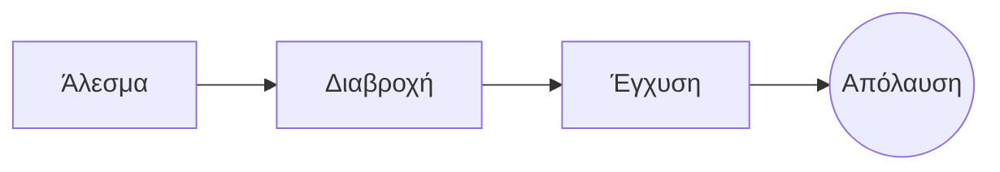

# Το τέλειο pour-over

Ένα αργό πρωινό τελετουργικό σε λίγα βήματα. Γράψτε το στον **πηγαίο κώδικα** αριστερά ή απευθείας στην *προεπισκόπηση* δεξιά: και τα δύο μένουν συγχρονισμένα και ==κάθε αλλαγή είναι μια καθαρή αλλαγή== στο Markdown.

> [!TIP]
> Νερό λίγο κάτω από το σημείο βρασμού, γύρω στους 94 °C, αναδεικνύει τη γλύκα χωρίς πικρία.

## Η αναλογία

Οι περισσότερες συνταγές καταλήγουν σε ένα μέρος καφέ προς δεκαέξι μέρη νερό:

$$
m_{\text{νερό}} = 16 \times m_{\text{καφές}}
$$

Έτσι τα $20\,\text{g}$ καφέ θέλουν $320\,\text{g}$ νερό.

## Βήμα προς βήμα



## Μέθοδοι παρασκευής

| Μέθοδος      | Άλεσμα            | Χρόνος |
|:-------------|:-----------------:|-------:|
| Pour-over    | Μέτριο προς λεπτό |   3:30 |
| French press | Χοντρό            |   4:00 |
| Εσπρέσο      | Λεπτό             |   0:28 |

## Πριν ξεκινήσετε

- [x] Φρεσκοκαβουρδισμένοι κόκκοι :coffee:
- [x] Ένας μύλος με κωνικές μυλόπετρες
- [ ] Ένας βραστήρας με λαιμό χήνας

```python
def water_for(coffee_g: float, ratio: int = 16) -> float:
    return coffee_g * ratio
```

Διαβροχή
: Η πρώτη ποσότητα νερού που αφήνει τον αλεσμένο καφέ να απελευθερώσει το αέριό του.[^1]

[^1]: Οι φρέσκοι κόκκοι φουσκώνουν περισσότερο· οι παλιοί μόλις που ανεβαίνουν.
