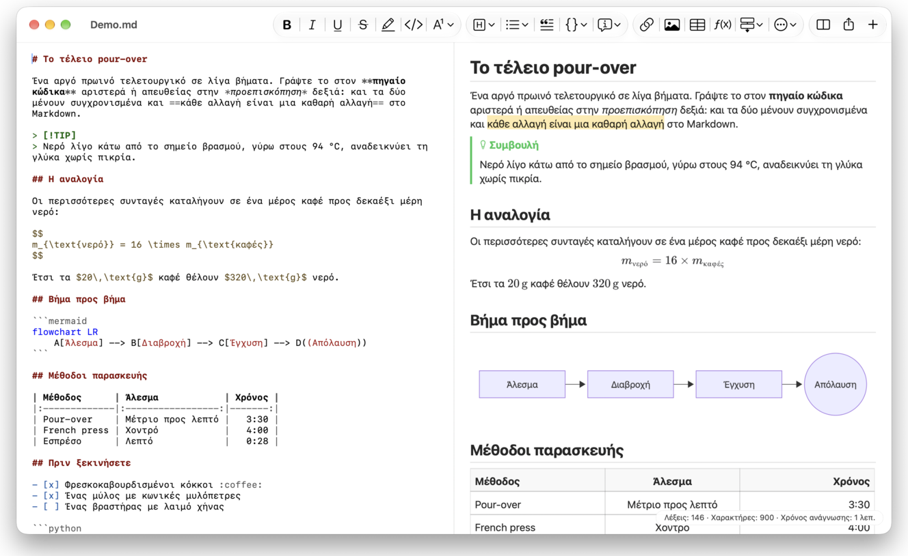
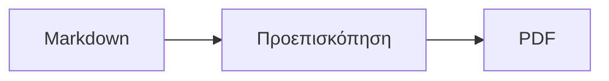

<p>&nbsp;&nbsp;&nbsp;</p>

# Splat

**Ο επεξεργαστής Markdown για macOS που σας αφήνει να γράφετε στον πηγαίο κώδικα ή απευθείας στην προεπισκόπηση.**

Το Splat βάζει αριστερά τον πηγαίο κώδικα Markdown με χρώματα σύνταξης και δεξιά μια ζωντανή, πλήρως επεξεργάσιμη προεπισκόπηση. Πληκτρολογήστε όπου θέλετε: ό,τι γράφετε στην προεπισκόπηση γίνεται μια ελάχιστη αλλαγή στον πηγαίο κώδικα, έτσι οι γραμμές που δεν αγγίξατε μένουν byte προς byte ίδιες και τα diff του Git παραμένουν καθαρά. Το Splat διαβάζει το Markdown που ήδη χρησιμοποιείτε: CommonMark και GitHub Flavored Markdown, GitHub alerts, wiki links, ενσωματώσεις και callouts του Obsidian, επεκτάσεις των Pandoc και Typora, ενσωματωμένο HTML, τύπους LaTeX και διαγράμματα Mermaid, Graphviz και PlantUML, όλα με απόδοση εκτός σύνδεσης. Εξαγωγή σε PDF, HTML ή Word με ένα κλικ. Είναι γραμμένο σε Rust με γνήσια στοιχεία ελέγχου του AppKit, μιλάει 35 γλώσσες και δεν στέλνει τίποτα μέσω δικτύου, εκτός αν το ζητήσετε.
 


[](https://github.com/sventmueller/splat/releases/latest/download/Splat.dmg)

**[Λήψη του Splat.dmg](https://github.com/sventmueller/splat/releases/latest/download/Splat.dmg)**: υπογεγραμμένο και πιστοποιημένο (notarized) από την Apple, για macOS 14 ή νεότερο σε Apple Silicon και Intel.

**Βρήκατε κάποιο σφάλμα;** Το Splat κρατά τις γραμμές που δεν αγγίξατε byte προς byte ίδιες. Αν κάποια αλλάξει παρ’ όλα αυτά ή ένα αρχείο εμφανιστεί λάθος, [ανοίξτε ένα issue](https://github.com/sventmueller/splat/issues/new/choose) και επισυνάψτε το αρχείο. Αν το Splat σας είναι χρήσιμο, ένα [αστέρι στο GitHub](https://github.com/sventmueller/splat) βοηθά και άλλους να το βρουν.
 
 

[](https://www.rust-lang.org)
[](https://www.apple.com/macos/)

[](https://github.com/madsmtm/objc2)
[](https://webkit.org)
[](https://github.com/kivikakk/comrak)
[](https://github.github.com/gfm/)
[](https://www.mathjax.org)
[](https://cortexjs.io/mathlive/)
[](https://mermaid.js.org)
[](https://graphviz.org)
[](https://plantuml.com)


[](#άδεια-χρήσης)

[Bahasa Indonesia](../id/README.md) ·
[Bahasa Melayu](../ms/README.md) ·
[Català](../ca/README.md) ·
[Čeština](../cs/README.md) ·
[Dansk](../da/README.md) ·
[Deutsch](../de/README.md) ·
[English](../../../README.md) ·
[Español](../es/README.md) ·
[Français](../fr/README.md) ·
[Hrvatski](../hr/README.md) ·
[Italiano](../it/README.md) ·
[Magyar](../hu/README.md) ·
[Nederlands](../nl/README.md) ·
[Norsk](../no/README.md) ·
[Polski](../pl/README.md) ·
[Português (Brasil)](../pt_BR/README.md) ·
[Português (Portugal)](../pt_PT/README.md) ·
[Română](../ro/README.md) ·
[Slovenčina](../sk/README.md) ·
[Slovenščina](../sl/README.md) ·
[Suomi](../fi/README.md) ·
[Svenska](../sv/README.md) ·
[Tiếng Việt](../vi/README.md) ·
[Türkçe](../tr/README.md) ·
**Ελληνικά** ·
[Русский](../ru/README.md) ·
[Українська](../uk/README.md) ·
[עברית](../he/README.md)‎ ·
[العربية](../ar/README.md)‎ ·
[हिन्दी](../hi/README.md) ·
[ไทย](../th/README.md) ·
[한국어](../ko/README.md) ·
[日本語](../ja/README.md) ·
[简体中文](../zh-Hans/README.md) ·
[繁體中文](../zh-Hant/README.md)

## Περιεχόμενα

- [Τα βασικά με μια ματιά](#τα-βασικά-με-μια-ματιά)
- [Απαιτήσεις](#απαιτήσεις)
- [Εγκατάσταση](#εγκατάσταση)
- [Πρώτα βήματα](#πρώτα-βήματα)
- [Γράψιμο](#γράψιμο)
  - [Στον πηγαίο κώδικα](#στον-πηγαίο-κώδικα)
  - [Στην προεπισκόπηση](#στην-προεπισκόπηση)
  - [Εντολές μορφοποίησης](#εντολές-μορφοποίησης)
  - [Λίστες και εργασίες](#λίστες-και-εργασίες)
  - [Πίνακες](#πίνακες)
- [Υποστηριζόμενο Markdown](#υποστηριζόμενο-markdown)
  - [CommonMark και GitHub Flavored Markdown](#commonmark-και-github-flavored-markdown)
  - [Callouts](#callouts)
  - [Επεκτεταμένη σύνταξη](#επεκτεταμένη-σύνταξη)
  - [Obsidian](#obsidian)
  - [Βιβλιογραφικές παραπομπές και αναφορές](#βιβλιογραφικές-παραπομπές-και-αναφορές)
  - [Ενσωματωμένο HTML](#ενσωματωμένο-html)
  - [Τυπογραφικά σημεία στίξης](#τυπογραφικά-σημεία-στίξης)
  - [Σύνοψη σύνταξης](#σύνοψη-σύνταξης)
- [Τύποι](#τύποι)
- [Διαγράμματα](#διαγράμματα)
- [Εικόνες](#εικόνες)
- [Σύνδεσμοι και πλοήγηση](#σύνδεσμοι-και-πλοήγηση)
- [Εξαγωγή, εκτύπωση και κοινή χρήση](#εξαγωγή-εκτύπωση-και-κοινή-χρήση)
- [Εμφάνιση και προσβασιμότητα](#εμφάνιση-και-προσβασιμότητα)
- [Γλώσσες](#γλώσσες)
- [Συντομεύσεις πληκτρολογίου](#συντομεύσεις-πληκτρολογίου)
- [Απόρρητο και ασφάλεια](#απόρρητο-και-ασφάλεια)
- [Μεγάλα έγγραφα](#μεγάλα-έγγραφα)
- [Γνωστοί περιορισμοί](#γνωστοί-περιορισμοί)
- [Αντιμετώπιση προβλημάτων](#αντιμετώπιση-προβλημάτων)
- [Για προγραμματιστές](#για-προγραμματιστές)
  - [Δημιουργία της εφαρμογής](#δημιουργία-της-εφαρμογής)
  - [Διανομή](#διανομή)
  - [Δοκιμές](#δοκιμές)
  - [Διάρθρωση του έργου](#διάρθρωση-του-έργου)
  - [Ροή δεδομένων](#ροή-δεδομένων)
  - [Κανόνες στον controller](#κανόνες-στον-controller)
  - [Προσθήκη εντολής](#προσθήκη-εντολής)
  - [Μεταφράσεις](#μεταφράσεις)
  - [Στοιχεία τρίτων](#στοιχεία-τρίτων)
- [Άδεια χρήσης](#άδεια-χρήσης)

## Τα βασικά με μια ματιά

- **Δύο τρόποι γραφής, ένα κείμενο.** Ο πηγαίος κώδικας και η προεπισκόπηση επεξεργάζονται και τα δύο. Το αρχείο Markdown είναι η μοναδική αλήθεια: υπάρχει ένα ιστορικό αναίρεσης ανά έγγραφο και κάθε αλλαγή στην προεπισκόπηση μεταφράζεται στη μικρότερη δυνατή αλλαγή του πηγαίου κώδικα.
- **Το Markdown που ήδη χρησιμοποιείτε.** CommonMark, GitHub Flavored Markdown, GitHub alerts, επεκτάσεις των Obsidian, Pandoc και Typora, shortcodes emoji, spoilers, λίστες ορισμών, άγκυρες επικεφαλίδων και HTML όπως στα README του GitHub.
- **Τύποι και διαγράμματα ενσωματωμένα.** Τύποι LaTeX μέσω MathJax, με οπτικό επεξεργαστή τύπων. Διαγράμματα Mermaid, Graphviz και PlantUML, που αποδίδονται στο Mac σας χωρίς Java, διακομιστή ή σύνδεση δικτύου.
- **Ένα κουμπί για όλα.** Κάθε δομή του Markdown έχει κουμπί στη γραμμή εργαλείων και στοιχείο μενού, και οι συνηθισμένες έχουν και συντόμευση πληκτρολογίου. Οι πίνακες έχουν δικό τους μενού για γραμμές, στήλες και στοίχιση.
- **Εξαγωγή χωρίς απώλειες.** PDF, ένα αυτόνομο αρχείο HTML ή έγγραφο Word με πραγματικές επικεφαλίδες, λίστες, πίνακες, υποσημειώσεις και εικόνες.
- **Εγγενές ως το κόκαλο.** Πραγματικά παράθυρα, καρτέλες, μενού και popovers του AppKit, Εκδόσεις, Αυτόματη αποθήκευση, μενού κοινής χρήσης, σκούρα εμφάνιση, ορθογραφικός έλεγχος, υπαγόρευση και VoiceOver. Χωρίς Electron, χωρίς web view για το ίδιο το κείμενο.
- **Γρήγορο με μεγάλα αρχεία.** Η απόδοση ενός πατήματος πλήκτρου σε έγγραφο 10 MB διαρκεί περίπου 10 ms, πριν από τη δική της δουλειά της προβολής.
- **Ιδιωτικό και προσεκτικό.** Οι εικόνες από το διαδίκτυο φορτώνονται μόνο αφού το επιτρέψετε, οι σύνδεσμοι προς άλλες εφαρμογές ζητούν πρώτα έγκριση και ό,τι αποκωδικοποιεί μη αξιόπιστα δεδομένα εικόνας εκτελείται σε βοηθητικές διεργασίες σε sandbox.
- **Στη γλώσσα σας.** Η διεπαφή και ο ενσωματωμένος σύντομος οδηγός Markdown διατίθενται σε 35 γλώσσες: Αραβικά, Καταλανικά, Κινεζικά (απλοποιημένα), Κινεζικά (παραδοσιακά), Κροατικά, Τσεχικά, Δανικά, Ολλανδικά, Αγγλικά, Φινλανδικά, Γαλλικά, Γερμανικά, Ελληνικά, Εβραϊκά, Χίντι, Ουγγρικά, Ινδονησιακά, Ιταλικά, Ιαπωνικά, Κορεατικά, Μαλαισιανά, Νορβηγικά, Πολωνικά, Πορτογαλικά (Βραζιλία), Πορτογαλικά (Πορτογαλία), Ρουμανικά, Ρωσικά, Σλοβακικά, Σλοβενικά, Ισπανικά, Σουηδικά, Ταϊλανδικά, Τουρκικά, Ουκρανικά και Βιετναμέζικα.

## Απαιτήσεις

- macOS 14 Sonoma ή νεότερο. Το Splat αναπτύσσεται και δοκιμάζεται στο macOS 27, όπου υιοθετεί αυτόματα τον σχεδιασμό Liquid Glass.
- Ένα Mac με Apple Silicon ή επεξεργαστή Intel.
- Περίπου 45 MB χώρου στον δίσκο.

## Εγκατάσταση

**Από την εικόνα δίσκου.** Κάντε λήψη του [`Splat.dmg`](https://github.com/sventmueller/splat/releases/latest/download/Splat.dmg), ανοίξτε το και σύρετε το Splat στον φάκελο Εφαρμογές. Η εικόνα είναι υπογεγραμμένη με Developer ID και πιστοποιημένη (notarized) από την Apple, γι' αυτό ανοίγει χωρίς προειδοποιήσεις.

**Με το Homebrew.** Το cask βρίσκεται σε δικό του tap:

```sh
brew install --cask sventmueller/tap/splat
```

Το `brew upgrade --cask splat` εγκαθιστά νέες εκδόσεις και το `brew uninstall --zap --cask splat` αφαιρεί επιπλέον τις ρυθμίσεις και τις προσωρινές μνήμες του Splat.

**Ενημερώσεις.** Το Splat από την εικόνα δίσκου ή το Homebrew ενημερώνεται μόνο του μέσω του [Sparkle](https://sparkle-project.org). Στη δεύτερη εκκίνηση ρωτά αν επιτρέπετε να ψάχνει μόνο του για ενημερώσεις, μία φορά την ημέρα. Η εντολή **Splat › Έλεγχος για ενημερώσεις…** ψάχνει αμέσως· οι επιλογές **Αυτόματος έλεγχος για ενημερώσεις** και **Αυτόματη λήψη και εγκατάσταση ενημερώσεων** στο ίδιο μενού αλλάζουν αργότερα την επιλογή σας. Το Splat εγκαθιστά μια ενημέρωση μόνο αν φέρει την υπογραφή του προγραμματιστή. Μια δική σας έκδοση δεν έχει εργαλείο ενημέρωσης.

**Από τον πηγαίο κώδικα.** Δείτε την ενότητα [Δημιουργία της εφαρμογής](#δημιουργία-της-εφαρμογής) για τις προϋποθέσεις και μετά:

```sh
make build
ditto target/release/Splat.app /Applications/Splat.app
open /Applications/Splat.app
```

Για να ανοίγουν τα αρχεία Markdown στο Splat με διπλό κλικ, επιλέξτε οποιοδήποτε αρχείο `.md` στο Finder, διαλέξτε **Αρχείο › Λήψη πληροφοριών**, επιλέξτε το Splat στο **Άνοιγμα με** και πατήστε **Αλλαγή όλων…**. Το Splat δηλώνει τον εαυτό του για αρχεία `.md`, `.markdown`, `.mdown` και `.mkd`.

## Πρώτα βήματα

### Το παράθυρο

Κάθε έγγραφο ανοίγει στο δικό του παράθυρο ή, αν προτιμάτε καρτέλες, ως καρτέλα:

- **Αριστερά: ο πηγαίος κώδικας.** Το Markdown σας σε SF Mono με χρώματα σύνταξης.
- **Δεξιά: η προεπισκόπηση.** Το έγγραφο αποδοσμένο, έτοιμο για επεξεργασία.
- **Πλαϊνή στήλη διάρθρωσης (προαιρετική).** Όλες οι επικεφαλίδες ως δέντρο· ένα κλικ σε μία την εμφανίζει και στα δύο πάνελ. Την εναλλάσσετε με **Προβολή › Εμφάνιση διάρθρωσης** (⌃⌘S).
- **Γραμμή εργαλείων.** Κουμπιά ομαδοποιημένα με βάση το τι αλλάζουν: χαρακτήρες, παραγράφους και εισαγόμενα στοιχεία, και μετά προεπισκόπηση ναι/όχι, Κοινή χρήση και Νέο έγγραφο. Την προσαρμόζετε με **Προβολή › Προσαρμογή γραμμής εργαλείων…**.

Σύρετε τον διαχωριστή για να δώσετε περισσότερο χώρο σε όποια πλευρά θέλετε. Η εντολή **Προβολή › Απόκρυψη προεπισκόπησης** (⌥⌘P) αφήνει μόνο τον πηγαίο κώδικα· το Splat το θυμάται ανά παράθυρο. Τα δύο πάνελ κυλίονται μαζί και μια επιλογή στο ένα επισημαίνεται στο άλλο.

### Έγγραφα, καρτέλες και εκδόσεις

Το Splat είναι μια κανονική εφαρμογή εγγράφων του macOS:

- **Αυτόματη αποθήκευση και Εκδόσεις.** Οι αλλαγές αποθηκεύονται επί τόπου. Η εντολή **Αρχείο › Επιστροφή σε › Περιήγηση σε όλες τις εκδόσεις…** σας γυρνά πίσω στον χρόνο.
- **Αλλαγές από άλλα προγράμματα.** Όταν το Git, ένα script ή άλλος επεξεργαστής αλλάζει ένα ανοιχτό έγγραφο, το Splat το φορτώνει ξανά και κρατά τον δρομέα και τη θέση κύλισης. Αν έχετε δικές σας μη αποθηκευμένες αλλαγές, το Splat τις διατηρεί και το macOS ρωτά πριν αποθηκεύσετε πάνω από την άλλη έκδοση.
- **Οι συνηθισμένες εντολές αρχείων.** Διπλότυπο (⇧⌘S), Μετονομασία…, Μετακίνηση σε… και **Αρχείο › Άνοιγμα πρόσφατου**.
- **Καρτέλες.** Η εντολή **Αρχείο › Νέα καρτέλα** ή το κουμπί **+** στη γραμμή εργαλείων ανοίγει νέο έγγραφο ως καρτέλα· το τυπικό μενού Παράθυρο συγχωνεύει, μετακινεί και εναλλάσσει καρτέλες.
- **Θέση παραθύρου.** Το Splat θυμάται το μέγεθος και τη θέση του τελευταίου παραθύρου, ακόμη και μετά από επανεκκίνηση. Αν ένα παράθυρο βρίσκεται ήδη εκεί, το νέο ανοίγει ελαφρώς μετατοπισμένο.
- **Το εικονίδιο στο Dock.** Ένα κλικ σε αυτό, αφού κλείσετε το τελευταίο παράθυρο, ανοίγει νέο έγγραφο.
- **Άνοιγμα αρχείων Markdown στο Splat.** Η εντολή **Splat › Ορισμός ως προεπιλεγμένης εφαρμογής για Markdown** κάνει το διπλό κλικ σε αρχείο `.md` ή `.markdown` να ανοίγει το Splat· το macOS ζητά επιβεβαίωση μία φορά. Το στοιχείο εμφανίζει σημάδι επιλογής όσο το Splat είναι η προεπιλογή.

Τα αρχεία πρέπει να είναι κείμενο UTF-8 ή UTF-16 με σήμανση σειράς byte (byte order mark). Το Splat αρνείται άλλες κωδικοποιήσεις αντί να μαντεύει και να αλλοιώνει το κείμενο. Η σήμανση σειράς byte παραμένει, το UTF-16 μένει UTF-16 και σε αρχείο όπου όλες οι γραμμές τελειώνουν σε CRLF, οι γραμμές που προσθέτετε παίρνουν επίσης CRLF.

**Μετά από κατάρρευση** χάνονται το πολύ τα τελευταία δευτερόλεπτα πληκτρολόγησης: κάθε πέντε δευτερόλεπτα το Splat αντιγράφει το μη αποθηκευμένο κείμενο στο `~/Library/Application Support/Splat/Unsaved` και αφαιρεί τα αντίγραφα μόλις αποθηκευτεί το έγγραφο ή το Splat τερματιστεί κανονικά. Στην επόμενη εκκίνηση μεταφέρει ό,τι άφησε εκεί μια κατάρρευση στο `~/Library/Application Support/Splat/Recovery` και το αναφέρει μία φορά, με ένα κουμπί που ανοίγει τον φάκελο. Μια κατάρρευση στην οποία το Splat προλαβαίνει ακόμη να αντιδράσει γράφει εκεί και το κείμενο κάθε ανοιχτού εγγράφου.

### Σύντομος οδηγός

Η εντολή **Βοήθεια › Σύντομος οδηγός Markdown** ανοίγει έναν σύντομο οδηγό στη γλώσσα σας ως νέο, ανώνυμο έγγραφο. Είναι ένα συνηθισμένο έγγραφο, οπότε δοκιμάστε τα πάντα εκεί, στον πηγαίο κώδικα ή στην προεπισκόπηση.

## Γράψιμο

### Στον πηγαίο κώδικα

Ο πηγαίος κώδικας είναι ένας επεξεργαστής απλού κειμένου προσαρμοσμένος για Markdown:

- **Χρώματα σύνταξης** όπως στο VS Code: επικεφαλίδες, έμφαση, σύνδεσμοι, κώδικας, πίνακες, HTML, front matter, και LaTeX και Mermaid μέσα σε τύπους και διαγράμματα. Υπάρχουν παλέτες για φωτεινή και σκούρα εμφάνιση και για Αύξηση αντίθεσης.
- **Περιφραγμένα μπλοκ κώδικα** με επισήμανση για Bash, C, C++, C#, CSS (και SCSS και Less), Go, HTML, XML, Java, JavaScript, JSON, Kotlin, PHP, Python, Ruby, Rust, SQL, Swift, TypeScript, YAML, TeX και Mermaid, μαζί με τα συνηθισμένα σύντομα ονόματά τους, όπως `js`, `py` ή `sh`.
- **Καμία απρόσμενη αντικατάσταση.** Τα έξυπνα εισαγωγικά, οι έξυπνες παύλες και η αντικατάσταση κειμένου είναι απενεργοποιημένα από προεπιλογή, επειδή χαλούν τα `--`, `---` και `"`. Ενεργοποιήστε τα από το **Επεξεργασία › Υποκαταστάσεις**.
- **Τα εργαλεία γραφής του συστήματος.** Έλεγχος ορθογραφίας και γραμματικής, υπαγόρευση, Εύρεση και αντικατάσταση (⌥⌘F) και Εκφώνηση.
- **Μεταφορά και απόθεση.** Αποθέστε ένα αρχείο εικόνας για να εισαχθεί το ``, οποιοδήποτε άλλο αρχείο για να εισαχθεί σύνδεσμος προς αυτό, και μια διεύθυνση URL για να εισαχθεί το `[url](url)`. Κάθε απόθεση είναι ένα βήμα αναίρεσης.
- **Επικόλληση εικόνων.** Μια εικόνα στο πρόχειρο, όπως ένα στιγμιότυπο οθόνης, αποθηκεύεται ως αρχείο PNG δίπλα στο έγγραφο (`Εικόνα 2026-10-29 13.09.07.png`) και εισάγεται ως εικόνα. Για αυτό πρέπει το έγγραφο να έχει αποθηκευτεί μία φορά.

### Στην προεπισκόπηση

Η προεπισκόπηση συμπεριφέρεται σαν επεξεργαστής κειμένου, αλλά ό,τι κάνετε σε αυτήν καταλήγει ως Markdown:

- **Πληκτρολόγηση.** Οι χαρακτήρες που έχουν νόημα στο Markdown, όπως τα `*` ή `#`, διαφεύγουν ώστε να εμφανίζονται όπως τους πληκτρολογήσατε.
- Το **Return** ξεκινά νέα παράγραφο ή στοιχείο λίστας. Το **⌥Return** ή το **⌃Return** εισάγει αλλαγή γραμμής.
- **Μορφοποίηση στον δρομέα.** Όταν ο δρομέας βρίσκεται στο τέλος μιας λέξης, οι επιλογές Έντονα, Πλάγια και οι άλλες μορφές χαρακτήρων ισχύουν για ό,τι πληκτρολογήσετε στη συνέχεια. Επιλέξτε ξανά τη μορφή για να σταματήσει. Μέσα σε μια λέξη, μορφοποιείται ολόκληρη η λέξη.
- **Κενές γραμμές.** Το Return σε κενή γραμμή προσθέτει άλλη μία κενή γραμμή και το Backspace την αφαιρεί. Στον πηγαίο κώδικα, κάθε επιπλέον κενή γραμμή είναι δύο ακόμη κενές γραμμές· άλλα προγράμματα Markdown τις εμφανίζουν ως κανονικό διάστημα μεταξύ παραγράφων.
- Η **Αναίρεση** λειτουργεί και στα δύο πάνελ. Τα βήματα αναίρεσης έχουν ονόματα («Αναίρεση Έντονα»), η πληκτρολόγηση είναι ένα βήμα ανά ριπή και μετά την Αναίρεση και την Επανάληψη και τα δύο πάνελ κυλίονται στην αλλαγή.
- **Οι τύποι και τα διαγράμματα** εμφανίζονται ως έτοιμα γραφικά. Κάντε κλικ σε ένα, μετακινήστε τον δρομέα πάνω του ή πατήστε Return πάνω του για να ανοίξει ο επεξεργαστής του (δείτε [Τύποι](#τύποι) και [Διαγράμματα](#διαγράμματα)).
- **Το ενσωματωμένο HTML, οι ενσωματωμένες σημειώσεις και το front matter** εμφανίζονται, αλλά τα επεξεργάζεστε στον πηγαίο κώδικα. Ένα κλικ σε αυτά τοποθετεί τον δρομέα στο αντίστοιχο σημείο εκεί.

Ό,τι δεν μπορεί να εκφράσει το Markdown αποκλείεται στην προεπισκόπηση: τα πάνελ Γραμματοσειρά και Χρώματα, ο χάρακας, και η επικόλληση ή η απόθεση εμπλουτισμένου κειμένου και εικόνων. Το HTML και το RTF που επικολλάτε φτάνουν ως απλό κείμενο.

### Εντολές μορφοποίησης

Κάθε εντολή είναι διαθέσιμη από τη γραμμή εργαλείων, τη γραμμή μενού και το μενού περιβάλλοντος και των δύο πάνελ. Τα στοιχεία μενού εμφανίζουν σημάδι επιλογής για τη μορφοποίηση στη θέση του δρομέα.

| Μενού | Εντολές |
|---|---|
| **Μορφή › Γραμματοσειρά** | Έντονα, Πλάγια, Υπογράμμιση, Διακριτή διαγραφή, Επισήμανση, Κώδικας, Εκθέτης, Δείκτης |
| **Μορφή › Επικεφαλίδα** | Κυρίως κείμενο, Επικεφαλίδα 1 έως 6 |
| **Μορφή › Λίστα** | Λίστα με κουκκίδες, Λίστα με αρίθμηση, Λίστα εργασιών |
| **Μορφή** | Παράθεση, Μπλοκ κώδικα (Χωρίς γλώσσα ή μία από 20 γλώσσες· αλλάζει και τη γλώσσα ενός υπάρχοντος μπλοκ), Πλαίσιο ειδοποίησης (Σημείωση, Συμβουλή, Σημαντικό, Προειδοποίηση, Προσοχή· ο ίδιος τύπος ξανά το αφαιρεί), Επεξεργασία τύπου ή διαγράμματος…, Κατάργηση μορφοποίησης |
| **Εισαγωγή** | Σύνδεσμος…, Εικόνα…, Πίνακας…, Τύπος, Διάγραμμα (Διάγραμμα ροής, Διάγραμμα ακολουθίας, Διάγραμμα Gantt), Πίνακας περιεχομένων, Υποσημείωση, Διαχωριστική γραμμή |
| **Πίνακας** | Εισαγωγή γραμμής από πάνω/από κάτω, Εισαγωγή στήλης αριστερά/δεξιά, Διαγραφή γραμμής, Διαγραφή στήλης, Στοίχιση (Αριστερά, Κέντρο, Δεξιά, Προεπιλογή), Στοίχιση στηλών πίνακα |
| **Προβολή** | Απόκρυψη/Εμφάνιση προεπισκόπησης, Εμφάνιση/Απόκρυψη διάρθρωσης, Τυπογραφικά σημεία στίξης, Μεγέθυνση/Σμίκρυνση, Πραγματικό μέγεθος, γραμμή εργαλείων, γραμμή καρτελών, πλήρης οθόνη |

Η υπογράμμιση, η επισήμανση, ο εκθέτης και ο δείκτης γράφονται ως `<ins>`, `<mark>`, `<sup>` και `<sub>`, που εμφανίζει και το GitHub. Το Splat διαβάζει επίσης το `<u>`, που το GitHub αφαιρεί, και τις συντομότερες μορφές `==επισήμανση==`, `^εκθέτης^` και `~δείκτης~`. Το GitHub εμφανίζει τα `==` και `^` όπως γράφτηκαν και το `~δείκτης~` ως διακριτή διαγραφή.

### Λίστες και εργασίες

- Το Return συνεχίζει μια λίστα· το Return σε κενό στοιχείο την τερματίζει.
- Το **Tab** και το **⇧Tab** αυξάνουν και μειώνουν την εσοχή των στοιχείων λίστας στην προεπισκόπηση.
- Ένα κλικ στο πλαίσιο μιας εργασίας στην προεπισκόπηση εναλλάσσει το `- [ ]` και το `- [x]`.
- Η εντολή **Μορφή › Λίστα** μετατρέπει τις επιλεγμένες παραγράφους σε λίστα ή αλλάζει το είδος της.

### Πίνακες

- Η εντολή **Εισαγωγή › Πίνακας…** ζητά τον αριθμό των γραμμών (μαζί με την κεφαλίδα) και των στηλών.
- Στην προεπισκόπηση, το **Tab** μεταβαίνει στο επόμενο κελί, το **⇧Tab** στο προηγούμενο και το **Return** στο κελί από κάτω. Το Tab στο τελευταίο κελί προσθέτει γραμμή.
- Το μενού **Πίνακας** εισάγει και διαγράφει γραμμές και στήλες και ορίζει τη στοίχιση μιας στήλης (⌘{, ⌘|, ⌘}).
- Η εντολή **Πίνακας › Στοίχιση στηλών πίνακα** συμπληρώνει τον πηγαίο κώδικα με κενά ώστε οι στήλες να ευθυγραμμίζονται.

## Υποστηριζόμενο Markdown

Το Splat αναλύει το κείμενο με το [comrak](https://github.com/kivikakk/comrak), έναν αναλυτή συμβατό με CommonMark και GFM, και ενεργοποιεί τις περισσότερες επεκτάσεις του. Ό,τι ακολουθεί αποδίδεται στην προεπισκόπηση και σε όλες τις εξαγωγές.

### CommonMark και GitHub Flavored Markdown

- Επικεφαλίδες (`#` και με υπογράμμιση), παράγραφοι, αλλαγές γραμμής, έμφαση, έντονη έμφαση, ενσωματωμένος κώδικας, παραθέσεις, διαχωριστικές γραμμές.
- Λίστες με κουκκίδες, με αρίθμηση και εμφωλευμένες· λίστες εργασιών.
- Σύνδεσμοι (ενσωματωμένοι, με αναφορά και αυτόματοι), εικόνες, ορισμοί αναφορών συνδέσμων.
- Περιφραγμένα μπλοκ κώδικα και μπλοκ κώδικα με εσοχή, με χρώματα σύνταξης.
- Πίνακες με στοίχιση στηλών.
- Διακριτή διαγραφή με `~~δύο περισπωμένες~~`.
- Υποσημειώσεις: `κείμενο[^1]` με `[^1]: Η σημείωση.` οπουδήποτε στο έγγραφο. Ένα κλικ στον δείκτη μεταβαίνει στη σημείωση.
- YAML front matter ανάμεσα σε γραμμές `---` στην κορυφή. Η προεπισκόπηση το συνοψίζει σε μία γραμμή, όπως «Μεταδεδομένα: title, date, tags».

### Callouts

Τα GitHub alerts αποδίδονται ως έγχρωμα πλαίσια με εικονίδιο και τίτλο:

```markdown
> [!NOTE]
> Χρήσιμες πληροφορίες που πρέπει να γνωρίζουν οι χρήστες.

> [!WARNING]
> Κρίσιμο περιεχόμενο που απαιτεί άμεση προσοχή.
```

Οι πέντε τύποι είναι Σημείωση, Συμβουλή, Σημαντικό, Προειδοποίηση και Προσοχή. Η εντολή **Μορφή › Πλαίσιο ειδοποίησης** μετατρέπει την παράγραφο στη θέση του δρομέα σε ένα τέτοιο πλαίσιο.

Λειτουργούν και τα callouts του Obsidian, με οποιονδήποτε τίτλο και κατάσταση αναδίπλωσης:

```markdown
> [!tip]- Κάντε κλικ στο ▸ για ανάπτυξη
> Κρυφό μέχρι να ανοιχτεί.

> [!question]+ Ανοιχτό από προεπιλογή
> Το `+` ξεκινά αναπτυγμένο, το `-` συμπτυγμένο.
```

Οι άλλοι τύποι του Obsidian εμφανίζονται με το πλησιέστερο από τα πέντε χρώματα: τα `success`, `check`, `done` και `hint` ως Συμβουλή· τα `question`, `help` και `faq` ως Σημαντικό· το `attention` ως Προειδοποίηση· τα `failure`, `fail`, `missing`, `danger`, `error` και `bug` ως Προσοχή· όλα τα υπόλοιπα ως Σημείωση.

### Επεκτεταμένη σύνταξη

| Δυνατότητα | Σύνταξη | Από |
|---|---|---|
| Επισήμανση | `==επισημασμένο κείμενο==` | Obsidian, Typora |
| Εκθέτης | `x^2^` | Pandoc, Typora |
| Δείκτης | `H~2~O` | Pandoc, Typora |
| Shortcode emoji | το `:rocket:` γίνεται 🚀 | GitHub |
| Spoiler | `\|\|κρυφό κείμενο\|\|`, επιλέξτε το για να το διαβάσετε | Discord |
| Ενσωματωμένη υποσημείωση | `κείμενο^[η ίδια η σημείωση]` | Pandoc, Obsidian |
| Λίστα ορισμών | `Όρος`, κενή γραμμή, `: Επεξήγηση` | PHP Markdown Extra, Pandoc |
| Άγκυρα επικεφαλίδας | `## Εγκατάσταση {#setup}`, σύνδεσμος με `[δείτε](#setup)` | Pandoc, kramdown |

Οι λίστες ορισμών μοιάζουν έτσι στον πηγαίο κώδικα:

```markdown
Όρος

: Επεξήγηση του όρου.
```

Χωρίς προσαρμοσμένη άγκυρα, κάθε επικεφαλίδα παίρνει μία που προκύπτει από το κείμενό της, όπως στο GitHub: η `## Πρώτα βήματα` είναι προσβάσιμη ως `#πρώτα-βήματα`.

### Obsidian

- **Wiki links.** Το `[[Σημείωση]]` συνδέει με το `Σημείωση.md` στον ίδιο φάκελο ή σε υποφάκελο. Το `[[Σημείωση|Εμφανιζόμενο κείμενο]]` εμφανίζει δικό σας κείμενο και το `[[Σημείωση#Επικεφαλίδα]]` ανοίγει τη σημείωση. Το ⌘-κλικ την ανοίγει στο Splat.
- **Ενσωματώσεις.** Το `![[Σημείωση]]` εμφανίζει την άλλη σημείωση μέσα σε αυτήν· οι σημειώσεις που είναι ενσωματωμένες σε αυτήν εμφανίζονται ως σύνδεσμοι. Το `![[diagram.png]]` εμφανίζει μια εικόνα. Όπως στο Obsidian, οι ενσωματώσεις ονομάζουν σημειώσεις και εικόνες στον φάκελο του εγγράφου ή κάτω από αυτόν, ποτέ με απόλυτη διαδρομή, και μόνο τα αρχεία Markdown εμφανίζονται ως σημειώσεις.
- **Σχόλια.** Το `%%Μόνο στον πηγαίο κώδικα%%` παραμένει ορατό στον πηγαίο κώδικα και παραλείπεται από την προεπισκόπηση και κάθε εξαγωγή, τόσο μέσα σε κείμενο όσο και σε δικές του γραμμές.
- **Ετικέτες.** Το `#ιδέα` ή το `#έργο/splat` επισημαίνεται. Το ⌘-κλικ αναζητά την ετικέτα στο έγγραφο.
- **Callouts με δυνατότητα αναδίπλωσης.** Δείτε [Callouts](#callouts).

### Βιβλιογραφικές παραπομπές και αναφορές

- **Παραπομπές Pandoc.** Το `[@doe2020]` ή το `[@doe2020; @roe2021]` εμφανίζεται ως «(Doe 2020; Roe 2021)». Οι καταχωρίσεις προέρχονται από το αρχείο BibTeX που ονομάζει το front matter ως `bibliography: refs.bib`. Χωρίς αυτό, το Splat χρησιμοποιεί τα `references.bib`, `literatur.bib` ή `bibliography.bib` δίπλα στο έγγραφο.
- **Αναφορές GitHub και GitLab.** Αν το έγγραφο βρίσκεται σε αποθετήριο Git του οποίου το απομακρυσμένο `origin` βρίσκεται στο github.com ή σε διακομιστή GitLab, τα `@name`, `#12` (issue) και `!7` (merge request, μόνο GitLab) επισημαίνονται. Το ⌘-κλικ τα ανοίγει στο πρόγραμμα περιήγησης.

### Ενσωματωμένο HTML

Το HTML όπως το βρίσκετε στα README του GitHub αποδίδεται με δικό του αναλυτή και όχι με μηχανή προγράμματος περιήγησης:

- κεντραρισμένες παράγραφοι και μπλοκ (`<p align="center">`, `<div align="center">`)
- εικόνες με μέγεθος (``)
- σύνδεσμοι, `<kbd>⌘</kbd>`, `<br>`, `<u>`, `<ins>`, `<mark>`, `<sup>`, `<sub>`
- λίστες και πίνακες, μαζί με κελιά που εκτείνονται σε στήλες (`colspan`)
- πτυσσόμενες ενότητες: `<details><summary>Περισσότερα</summary>…</details>`, που ανοίγουν με ένα κλικ στο ▸

Το Markdown ανάμεσα σε ετικέτες HTML αποδίδεται ως Markdown. Τα scripts, τα στιλ, τα πλαίσια (frames) και οι φόρμες παραλείπονται εντελώς και οι σύνδεσμοι και οι εικόνες κρατούν μόνο διευθύνσεις `http`, `https`, `mailto` και σχετικές.

### Τυπογραφικά σημεία στίξης

Η εντολή **Προβολή › Τυπογραφικά σημεία στίξης** εμφανίζει τα ίσια εισαγωγικά ως τα εισαγωγικά της γλώσσας της διεπαφής σας, το `--` ως παύλα en, το `---` ως παύλα em και το `...` ως αποσιωπητικά. Στα γερμανικά το `"Ja"` γίνεται „Ja“, στα γαλλικά «Oui», στα ιαπωνικά 「はい」, και μάλιστα όπου τα κινεζικά και τα ιαπωνικά βάζουν εισαγωγικά χωρίς κενό· οι εβραϊκές συντομογραφίες όπως το `צה"ל` παίρνουν τα gershayim τους, צה״ל. Ο πηγαίος κώδικας κρατά τους απλούς χαρακτήρες· η προεπισκόπηση και όλες οι εξαγωγές δείχνουν τους τυπογραφικούς. Η ρύθμιση είναι απενεργοποιημένη μέχρι να την ενεργοποιήσετε.

### Σύνοψη σύνταξης

| Στοιχείο | Markdown |
|---|---|
| **Έντονα** | `**Έντονα**` |
| *Πλάγια* | `*Πλάγια*` |
| Υπογράμμιση | `<ins>Υπογράμμιση</ins>` ή `<u>Υπογράμμιση</u>` |
| ~~Διακριτή διαγραφή~~ | `~~Διακριτή διαγραφή~~` |
| Επισήμανση | `<mark>Επισήμανση</mark>` ή `==Επισήμανση==` |
| `Κώδικας` | `` `Κώδικας` `` |
| x² | `x<sup>2</sup>` ή `x^2^` |
| H₂O | `H<sub>2</sub>O` ή `H~2~O` |
| [Σύνδεσμος](https://example.com) | `[Σύνδεσμος](https://example.com)` |
| Επικεφαλίδα | `# Επικεφαλίδα` έως `###### Επικεφαλίδα` |
| Παράθεση | `> Παράθεση` |
| Λίστα με κουκκίδες | `- Στοιχείο` |
| Λίστα με αρίθμηση | `1. Στοιχείο` |
| Εργασία | `- [ ] Ανοιχτή` και `- [x] Ολοκληρωμένη` |
| Μπλοκ κώδικα | ```` ```rust ```` … ```` ``` ```` |
| Πίνακας | `\| Α \| Β \|` με `\|---\|---\|` κάτω από την κεφαλίδα |
| Υποσημείωση | `Κείμενο[^1]` και `[^1]: Σημείωση` |
| Διαχωριστική γραμμή | `---` |
| Εικόνα | `` |
| Τύπος | `$E = mc^2$`, `$$ … $$` |
| Διάγραμμα | ```` ```mermaid ````, ```` ```dot ````, ```` ```plantuml ```` |
| Callout | `> [!TIP]` |
| Wiki link | `[[Σημείωση]]`, `[[Σημείωση\|Κείμενο]]` |
| Ενσωμάτωση | `![[Σημείωση]]`, `![[image.png]]` |
| Σχόλιο | `%%Σχόλιο%%` |
| Ετικέτα | `#ετικέτα` |
| Παραπομπή | `[@key]` |
| Spoiler | `\|\|Spoiler\|\|` |
| Emoji | `:tada:` |

## Τύποι

Οι τύποι αποδίδονται από το [MathJax](https://www.mathjax.org) με το TeX και τα μαθηματικά AMS, ως καθαρά διανυσματικά γραφικά. Το κείμενο μέσα στο `\text{…}` μπορεί να είναι σε οποιαδήποτε γραφή: ό,τι λείπει από τις γραμματοσειρές του MathJax προέρχεται από τις γραμματοσειρές του Mac σας, με τα αραβικά και τα εβραϊκά να τρέχουν από δεξιά προς αριστερά, και τα emoji έγχρωμα.

| Είδος | Σύνταξη |
|---|---|
| Μέσα στο κείμενο | `$E = mc^2$`, `` $`E = mc^2`$ `` (GitHub, GitLab), `\(E = mc^2\)` |
| Αυτόνομος | `$$` … `$$`, `\[` … `\]`, ή μπλοκ κώδικα με την ένδειξη `math` |

**Επεξεργασία τύπου.** Κάντε κλικ σε έναν τύπο στην προεπισκόπηση, διπλό κλικ, πατήστε Return πάνω του ή μετακινήστε τον δρομέα πάνω του για να ανοίξει ο επεξεργαστής του σε popover. Η εντολή **Εισαγωγή › Τύπος** εισάγει νέο τύπο και ανοίγει αμέσως τον επεξεργαστή.

- **Οπτικά ή LaTeX.** Ο διακόπτης στην κορυφή εναλλάσσει ανάμεσα σε έναν οπτικό επεξεργαστή ([MathLive](https://cortexjs.io/mathlive/)) και στον κώδικα LaTeX. Το Splat θυμάται την επιλογή σας.
- **Δομικά στοιχεία** για κλάσμα, τετραγωνική ρίζα, εκθέτη και δείκτη, άθροισμα και ολοκλήρωμα με όρια, όριο, παρενθέσεις που μεγαλώνουν μαζί με το περιεχόμενο, πίνακα 2×2, ελληνικά γράμματα, και σχέσεις, τελεστές και βέλη. Αφήνουν σύμβολα κράτησης θέσης □ και το **Tab** μεταβαίνει στο επόμενο.
- **Ζωντανή προεπισκόπηση.** Οι αλλαγές εμφανίζονται στο έγγραφο καθώς πληκτρολογείτε. Τα σφάλματα του MathJax εμφανίζονται σε μια γραμμή κάτω από τον κώδικα.
- **Επικύρωση ή απόρριψη.** Ένα κλικ έξω κρατά την αλλαγή ως ένα βήμα αναίρεσης· το **Esc** ή το **Ακύρωση** την απορρίπτει. Το Esc σε έναν νέο, κενό τύπο τον αφαιρεί ξανά.
- Το μενού περιβάλλοντος προσφέρει την εντολή **Επεξεργασία τύπου…** για τον τύπο κάτω από τον δείκτη.

Το VoiceOver διαβάζει έναν τύπο ως τον κώδικα LaTeX του. Το Splat αποδίδει τύπους, όχι ολόκληρα έγγραφα LaTeX: δεν υπάρχουν πακέτα, ούτε TikZ, ούτε `\documentclass`.

## Διαγράμματα

Τα διαγράμματα αποδίδονται μέσα στο Splat, εκτός σύνδεσης και σε φωτεινή και σκούρα παραλλαγή.

| Μηχανή | Μπλοκ κώδικα | Τι σχεδιάζει |
|---|---|---|
| [Mermaid](https://mermaid.js.org) | ```` ```mermaid ```` | διαγράμματα ροής, ακολουθίας, κλάσεων, καταστάσεων, οντοτήτων-συσχετίσεων, Gantt, πίτας, νοητικούς χάρτες, χρονολόγια και κάθε άλλο τύπο Mermaid |
| [Graphviz](https://graphviz.org) | ```` ```dot ```` ή ```` ```graphviz ```` | γραφήματα στη γλώσσα DOT |
| [PlantUML](https://plantuml.com) | ```` ```plantuml ```` ή ```` ```puml ```` | διαγράμματα UML· λειτουργεί χωρίς Java |



**Η επεξεργασία ενός διαγράμματος** λειτουργεί όπως η επεξεργασία ενός τύπου: κάντε κλικ σε αυτό για να ανοίξει ο κώδικας σε popover, με χρώματα σύνταξης και μηνύματα σφάλματος σε μια γραμμή κάτω από τον κώδικα. Η εντολή **Εισαγωγή › Διάγραμμα** ξεκινά από πρότυπο για διάγραμμα ροής, διάγραμμα ακολουθίας ή διάγραμμα Gantt. Δομικά στοιχεία βοηθούν με τους τρεις πιο συνηθισμένους τύπους Mermaid:

- **Διάγραμμα ροής:** Κόμβος ▾ (ορθογώνιο, στρογγυλεμένο, κύκλος, ρόμβος, βάση δεδομένων), Σύνδεση, Σύνδεση με ετικέτα, Ομάδα, Κατεύθυνση ▾
- **Διάγραμμα ακολουθίας:** Συμμετέχων, Μήνυμα, Απάντηση, Σημείωση, Βρόχος, Εναλλακτικές διαδρομές
- **Διάγραμμα Gantt:** Ενότητα, Εργασία, Ορόσημο

Οι άλλοι τύποι διαγραμμάτων επεξεργάζονται ως κώδικας. Το VoiceOver διαβάζει τον τίτλο ή το εναλλακτικό κείμενο ενός διαγράμματος.

Το πρώτο διάγραμμα μετά την εκκίνηση διαρκεί περίπου ένα δευτερόλεπτο, επειδή η μηχανή απόδοσης ξεκινά στο παρασκήνιο. Ένα διάγραμμα που διαρκεί περισσότερο από 10 δευτερόλεπτα εμφανίζει σφάλμα και η μηχανή απόδοσης ξεκινά από την αρχή για το επόμενο. Η μηχανή του PlantUML (3 MB) φορτώνεται μόνο με το πρώτο διάγραμμα PlantUML. Ένα `!include` του PlantUML από το διαδίκτυο αποκλείεται.

## Εικόνες

- **Τοπικές εικόνες** χρησιμοποιούν διαδρομές σχετικές με το έγγραφο: ``. Το Splat εμφανίζει PNG, JPEG, GIF, WebP, BMP, SVG, HEIC, TIFF, AVIF και PDF.
- **Εικόνες από το διαδίκτυο** παραμένουν αποκλεισμένες μέχρι να τις επιτρέψετε: μια γραμμή πάνω από την προεπισκόπηση εξηγεί ότι η φόρτωσή τους ενημερώνει τους διακομιστές τους ότι και πότε ανοίγετε το έγγραφο. Η επιλογή **Φόρτωση εικόνων** τις επιτρέπει για αυτό το έγγραφο· το Splat θυμάται την επιλογή ανά αρχείο.
- **Μέγεθος.** Το `` ορίζει το μέγεθος μιας εικόνας· διαφορετικά οι εικόνες προσαρμόζονται στο πλάτος της προεπισκόπησης.
- **Αλλαγές στον δίσκο.** Μια εικόνα που αντικαθιστάτε, ή μία που εμφανίζεται αφού το έγγραφο την ονόμασε, εμφανίζεται χωρίς να ανοίξετε ξανά το έγγραφο. Οι εικόνες από το διαδίκτυο που απέτυχαν λόγω δικτύου ξαναδοκιμάζονται όσο ένα έγγραφο τις εμφανίζει.
- **Μνήμη.** Οι εικόνες εμφανίζονται με έως 2560 pixel στη μεγαλύτερη πλευρά τους, κάτι που γεμίζει και μια σελίδα A4. Αποκωδικοποιούνται σε μικρότερο μέγεθος όταν γεμίσουν το ένα όγδοο της μνήμης του Mac και όσο το macOS αναφέρει πίεση μνήμης.
- **Σκούρα εμφάνιση.** Οι εικόνες με λευκό φόντο σκουραίνουν ελαφρά στη σκούρα προεπισκόπηση.
- **Επικόλληση και απόθεση.** Δείτε [Στον πηγαίο κώδικα](#στον-πηγαίο-κώδικα).

## Σύνδεσμοι και πλοήγηση

Στην προεπισκόπηση, ένα κλικ τοποθετεί τον δρομέα ώστε να επεξεργαστείτε το κείμενο του συνδέσμου· το **⌘-κλικ** ακολουθεί τον σύνδεσμο:

- Τα `http`, `https` και `mailto` ανοίγουν στο πρόγραμμα περιήγησης ή στην εφαρμογή αλληλογραφίας.
- Τα αρχεία Markdown ανοίγουν στο Splat· άλλα αρχεία και φάκελοι εμφανίζονται στο Finder.
- Το `#anchor` μεταβαίνει στην επικεφαλίδα μέσα στο έγγραφο.
- Διευθύνσεις που ανοίγουν άλλη εφαρμογή, όπως `slack://` ή `vscode://`, ζητούν πρώτα έγκριση και εμφανίζουν την πλήρη διεύθυνση και την εφαρμογή. Το **Ακύρωση** είναι προεπιλεγμένο.

Η εντολή **Εισαγωγή › Πίνακας περιεχομένων** εισάγει μια λίστα συνδέσμων προς όλες τις επικεφαλίδες. Με τον δρομέα μέσα σε αυτήν, η ίδια εντολή την ενημερώνει. Η πλαϊνή στήλη διάρθρωσης (⌃⌘S) μεταβαίνει σε οποιαδήποτε επικεφαλίδα και στα δύο πάνελ.

## Εξαγωγή, εκτύπωση και κοινή χρήση

| Μορφή | Πώς | Τι παίρνετε |
|---|---|---|
| **PDF** | **Αρχείο › Εξαγωγή ως PDF…** ή το μενού Κοινή χρήση | Σελίδες μεγέθους χαρτιού, πάντα σε φωτεινή εμφάνιση, με τύπους και διαγράμματα ως διανυσματικά γραφικά. Η εντολή **Αρχείο › Διαμόρφωση σελίδας…** ορίζει το χαρτί. |
| **Εκτύπωση** | **Αρχείο › Εκτύπωση…** (⌘P) | Η ίδια διάταξη με το PDF. |
| **HTML** | **Αρχείο › Εξαγωγή ως HTML…** ή το μενού Κοινή χρήση | Ένα αυτόνομο αρχείο: οι τοπικές εικόνες ενσωματωμένες, οι τύποι και τα διαγράμματα ως ευκρινείς εικόνες, άγκυρες επικεφαλίδων ώστε να λειτουργεί ο πίνακας περιεχομένων. Χωρίς scripts. |
| **Word** | **Αρχείο › Εξαγωγή ως έγγραφο Word…** ή το μενού Κοινή χρήση | Ένα `.docx` με τα στιλ επικεφαλίδων του Word, πραγματικές λίστες και πίνακες (μαζί με συγχωνευμένα κελιά), υποσημειώσεις ως υποσημειώσεις του Word, ενσωματωμένες εικόνες, τύπους και διαγράμματα. |
| **Markdown** | Το κουμπί **Κοινή χρήση** στη γραμμή εργαλείων | Το έγγραφο ως αρχείο `.md` για Mail, Μηνύματα, AirDrop και κάθε άλλη υπηρεσία κοινής χρήσης. |

Το μενού **Αρχείο › Κοινή χρήση** τα προσφέρει όλα σε ένα σημείο. Οι εξαγωγές χρησιμοποιούν τη ρύθμιση των τυπογραφικών σημείων στίξης και τις εικόνες από το διαδίκτυο που επιτρέψατε· στο HTML οι εικόνες από το διαδίκτυο παραμένουν σύνδεσμοι.

## Εμφάνιση και προσβασιμότητα

- Η **σκούρα εμφάνιση** ακολουθεί το σύστημα. Οι τύποι και τα διαγράμματα αποδίδονται για κάθε εμφάνιση.
- Η **Αύξηση αντίθεσης** στις Ρυθμίσεις συστήματος αλλάζει τα χρώματα σύνταξης σε παλέτες υψηλής αντίθεσης.
- **Ζουμ.** Τα ⌘+, ⌘− και ⌘0 αλλάζουν την κλίμακα και των δύο πάνελ.
- **Πλήρης οθόνη, καρτέλες και προσαρμόσιμη γραμμή εργαλείων**, όπως σε κάθε εφαρμογή του Mac.
- **VoiceOver.** Τα πάνελ φέρουν τις ετικέτες «Πηγαίος κώδικας Markdown» και «Προεπισκόπηση», οι τύποι διαβάζονται ως ο κώδικάς τους και τα διαγράμματα ως ο τίτλος τους. Κάθε εντολή είναι προσβάσιμη από το πληκτρολόγιο.

Το Splat δεν έχει παράθυρο ρυθμίσεων: οι λίγες επιλογές βρίσκονται εκεί όπου ισχύουν, στο **Προβολή** και στο **Επεξεργασία › Υποκαταστάσεις**.

## Γλώσσες

Η διεπαφή, τα μενού και ο σύντομος οδηγός Markdown είναι μεταφρασμένα σε 35 γλώσσες:

Αραβικά, Καταλανικά, Κινεζικά (απλοποιημένα), Κινεζικά (παραδοσιακά), Κροατικά, Τσεχικά, Δανικά, Ολλανδικά, Αγγλικά, Φινλανδικά, Γαλλικά, Γερμανικά, Ελληνικά, Εβραϊκά, Χίντι, Ουγγρικά, Ινδονησιακά, Ιταλικά, Ιαπωνικά, Κορεατικά, Μαλαισιανά, Νορβηγικά, Πολωνικά, Πορτογαλικά (Βραζιλία), Πορτογαλικά (Πορτογαλία), Ρουμανικά, Ρωσικά, Σλοβακικά, Σλοβενικά, Ισπανικά, Σουηδικά, Ταϊλανδικά, Τουρκικά, Ουκρανικά και Βιετναμέζικα.

Το Splat ακολουθεί τη σειρά γλωσσών στις **Ρυθμίσεις συστήματος › Γενικά › Γλώσσα και περιοχή**· εκεί, στο **Εφαρμογές**, μπορείτε επίσης να διαλέξετε γλώσσα μόνο για το Splat. Αν δεν υπάρχει μετάφραση για τη γλώσσα σας, χρησιμοποιεί τα αγγλικά. Οι όροι των μενού ακολουθούν τις δικές μεταφράσεις της Apple, ώστε το Splat να διαβάζεται όπως το υπόλοιπο Mac σας.

Το εβραϊκό και το αραβικό κείμενο διαβάζεται από δεξιά προς αριστερά όπου κι αν εμφανίζεται, ανεξάρτητα από τη γλώσσα της διεπαφής: κάθε παράγραφος, επικεφαλίδα και στοιχείο λίστας παίρνει την κατεύθυνση του πρώτου του γράμματος, οι παραθέσεις και τα callouts σχεδιάζουν τη γραμμή τους δεξιά και ένας πίνακας του οποίου το κείμενο ξεκινά από δεξιά απαριθμεί τις στήλες του από δεξιά. Τα μπλοκ κώδικα μένουν από αριστερά προς δεξιά. Οι εξαγωγές PDF, HTML και Word διατηρούν αυτές τις κατευθύνσεις. Με τα εβραϊκά ή τα αραβικά ως γλώσσα του συστήματος, το macOS αντιστρέφει επίσης το παράθυρο, οπότε η προεπισκόπηση βρίσκεται αριστερά.

## Συντομεύσεις πληκτρολογίου

| Ενέργεια | Συντόμευση |
|---|---|
| Έντονα, Πλάγια, Υπογράμμιση | ⌘B, ⌘I, ⌘U |
| Διακριτή διαγραφή | ⇧⌘X |
| Σύνδεσμος… | ⌘K |
| Κυρίως κείμενο, Επικεφαλίδα 1 έως 6 | ⌥⌘0, ⌥⌘1 έως ⌥⌘6 |
| Στοίχιση στήλης πίνακα αριστερά, στο κέντρο, δεξιά | ⌘{, ⌘\|, ⌘} |
| Απόκρυψη ή εμφάνιση της προεπισκόπησης | ⌥⌘P |
| Εμφάνιση ή απόκρυψη της διάρθρωσης | ⌃⌘S |
| Μεγέθυνση, σμίκρυνση, πραγματικό μέγεθος | ⌘+, ⌘−, ⌘0 |
| Νέο έγγραφο, άνοιγμα, αποθήκευση, διπλότυπο | ⌘N, ⌘O, ⌘S, ⇧⌘S |
| Διαμόρφωση σελίδας, εκτύπωση | ⇧⌘P, ⌘P |
| Εύρεση, εύρεση και αντικατάσταση | ⌘F, ⌥⌘F |
| Εύρεση επόμενου, προηγούμενου· χρήση επιλογής· μετάβαση στην επιλογή | ⌘G, ⇧⌘G· ⌘E· ⌘J |
| Εμφάνιση ορθογραφίας και γραμματικής· έλεγχος εγγράφου | ⌘:, ⌘; |
| Επικόλληση και αντιστοίχιση στιλ | ⌥⇧⌘V |
| Απόκρυψη γραμμής εργαλείων, εμφάνιση όλων των καρτελών, πλήρης οθόνη | ⌥⌘T, ⇧⌘\\, ⌃⌘F |
| Αλλαγή γραμμής (προεπισκόπηση) | ⌥Return ή ⌃Return |
| Επόμενο κελί / προηγούμενο κελί σε πίνακα (προεπισκόπηση) | Tab / ⇧Tab |
| Αύξηση / μείωση εσοχής στοιχείου λίστας (προεπισκόπηση) | Tab / ⇧Tab |
| Επόμενο σύμβολο κράτησης θέσης στον επεξεργαστή τύπων | Tab |
| Κλείσιμο του επεξεργαστή τύπων ή διαγραμμάτων χωρίς αλλαγές | Esc |
| Ακολούθηση συνδέσμου, ετικέτας ή αναφοράς (προεπισκόπηση) | ⌘-κλικ |

Το Splat αφήνει τις τυπικές συντομεύσεις της Apple εκεί που είναι.

## Απόρρητο και ασφάλεια

Ένα αρχείο Markdown μπορεί να προέρχεται από οποιονδήποτε, γι' αυτό το Splat αντιμετωπίζει κάθε έγγραφο ως μη αξιόπιστο.

- **Χωρίς δίκτυο από προεπιλογή.** Το Splat δεν έχει τηλεμετρία. Ψάχνει για ενημερώσεις μόνο αφού συμφωνήσετε ή επιλέξετε **Έλεγχος για ενημερώσεις…**: τότε φορτώνει ένα μικρό αρχείο feed από το GitHub και το αίτημα δεν αναφέρει τίποτα πέρα από την εφαρμογή και την έκδοσή της. Οι τύποι και τα διαγράμματα αποδίδονται τοπικά· τα web views που το κάνουν δεν έχουν πρόσβαση στο δίκτυο. Το **Βοήθεια › Αναφορά προβλήματος…** ανοίγει στο πρόγραμμα περιήγησης μια φόρμα στο GitHub· η διεύθυνσή της περιέχει την έκδοση του Splat, την έκδοση του macOS και το είδος του Mac, τίποτα από τα έγγραφά σας.
- **Οι εικόνες από το διαδίκτυο** φορτώνονται μόνο με την άδειά σας, μόνο μέσω `https`, ποτέ από διακομιστές του τοπικού σας δικτύου, έως 10 MB η καθεμία και σε ιδιωτική συνεδρία χωρίς cookies.
- **Απομονωμένη αποκωδικοποίηση.** Οι εικόνες και τα γραφικά των τύπων και των διαγραμμάτων αποκωδικοποιούνται σε βοηθητικές διεργασίες που κλείνουν κάθε αρχείο που κληρονόμησαν και κλειδώνονται σε sandbox πριν διαβάσουν το πρώτο byte: χωρίς πρόσβαση σε αρχεία, χωρίς δίκτυο. Επιστρέφουν μόνο pixel, το μέγεθος των οποίων ελέγχεται, και διακόπτονται μετά από 10 δευτερόλεπτα. Οι αποκωδικοποιητές εικόνας της ίδιας της Apple βλέπουν μόνο HEIC, TIFF, AVIF και PDF, και μόνο όταν τα δεδομένα είναι πράγματι αυτής της μορφής· εκτελούνται σε δική τους βοηθητική διεργασία, η οποία μπορεί επιπλέον να διαβάζει τους φακέλους γραμματοσειρών του συστήματος και να χρησιμοποιεί τον αποκωδικοποιητή βίντεο του συστήματος. Τα SVG, οι τύποι και τα διαγράμματα περνούν επίσης από αυτή τη διεργασία, άρα στο Splat είναι εικόνες με σταθερή ανάλυση: τέσσερα pixel ανά σημείο, έως 2560 στη μεγαλύτερη πλευρά.
- **Τα τοπικά αρχεία** φτάνουν σε ένα έγγραφο μόνο μέσω της διαδρομής που αναφέρει. Οι ενσωματώσεις εμφανίζουν σημειώσεις Markdown από τον φάκελο του εγγράφου και κάτω, και μια εικόνα που λείπει αναζητείται μόνο εκεί. Μια διαδρομή εικόνας αλλού, απόλυτη ή με αρχή `~`, φορτώνεται παρ' όλα αυτά στην προεπισκόπηση· οι εξαγωγές HTML και Word, η εκτύπωση και τα PDF παίρνουν μαζί τους μόνο ό,τι βρίσκεται στον φάκελο του εγγράφου ή στο αποθετήριο Git του, εκτός αν αυτό το αποθετήριο περιέχει και τον φάκελο αφετηρίας σας, ώστε ένα ξένο έγγραφο να μην μπορεί να τραβήξει τα αρχεία σας σε μια εξαγωγή που δίνετε παραπέρα.
- **Τα αντίγραφα μη αποθηκευμένου κειμένου** μένουν σε αυτό το Mac, στον φάκελο Library, για την ανάκτηση μετά από κατάρρευση. Φεύγουν με την αποθήκευση ή με το κανονικό τέλος του Splat· τα αντίγραφα που άφησε πίσω μια κατάρρευση μένουν στον φάκελο ανάκτησης μέχρι να τα διαγράψετε.
- **Οι σύνδεσμοι** δεν ξεκινούν ποτέ πρόγραμμα με ένα κλικ. Οι σύνδεσμοι web και mail ανοίγουν κανονικά· οι σύνδεσμοι προς άλλες εφαρμογές ζητούν πρώτα έγκριση.
- **Το HTML στα έγγραφα** διαβάζεται από τον δικό του αναλυτή του Splat. Τα scripts, τα στιλ, τα πλαίσια και οι φόρμες δεν εκτελούνται ποτέ.
- **Οι εξαγωγές** δεν περιέχουν scripts. Οι σελίδες HTML κρατούν μόνο μια σταθερή λίστα αβλαβών ετικετών και χαρακτηριστικών, όπως το GitHub, και επιπλέον μια πολιτική ασφάλειας περιεχομένου (content security policy). Τα αρχεία Word συνδέουν μόνο διευθύνσεις `http`, `https` και `mailto`.
- **Υπογραφή κώδικα** με Hardened Runtime. Το Splat εκτελείται χωρίς το App Sandbox, ώστε να μπορεί να εμφανίζει εικόνες δίπλα στα έγγραφά σας χωρίς να ρωτά για κάθε φάκελο· η απομόνωση όλης της αποκωδικοποίησης το αντισταθμίζει.

## Μεγάλα έγγραφα

Το Splat μένει αποκρίσιμο με έγγραφα αρκετών megabyte:

- Ο πηγαίος κώδικας χρησιμοποιεί το TextKit 2, που διατάσσει μόνο το ορατό τμήμα.
- Καθώς πληκτρολογείτε στην προεπισκόπηση, και στον πηγαίο κώδικα εγγράφων έως 2 MB, αναλύονται, χρωματίζονται και διατάσσονται ξανά μόνο οι επηρεαζόμενες παράγραφοι. Σε έγγραφο 10 MB, η ανάλυση και ο χρωματισμός διαρκούν περίπου 3 ms, η απόδοση περίπου 10 ms και ένα ολόκληρο πάτημα πλήκτρου στην προεπισκόπησή του περίπου 30 ms, μαζί με τη δική της δουλειά της προβολής.
- Οι μεγάλες προεπισκοπήσεις αποδίδουν πρώτα το ορατό τμήμα και το υπόλοιπο όσο η εφαρμογή είναι σε αδράνεια. Τα μπλοκ που κυλίονται στο ορατό πεδίο αποδίδονται πριν σχεδιαστούν.
- Στον πηγαίο κώδικα μεγαλύτερων εγγράφων, η ανάλυση για την προεπισκόπηση εκτελείται στο παρασκήνιο καθώς πληκτρολογείτε.
- Ένα έγγραφο μένει απλό κείμενο μόλις θα χρειαζόταν περίπου 4 GB μνήμης, δηλαδή περίπου 50 έως 120 MB συνηθισμένου Markdown, αλλά μόνο 10 έως 20 MB αν αποτελείται μόνο από πίνακες ή επικεφαλίδες: ο πηγαίος κώδικας δεν έχει χρώματα και η προεπισκόπηση εξηγεί γιατί μένει κενή. Οι εξαγωγές εξακολουθούν να λειτουργούν.
- Από περίπου 200 KB, ένα έγγραφο ανοίγει το παράθυρό του πριν αναλυθεί· στα 5 MB, τα χρώματα και η προεπισκόπηση ακολουθούν περίπου ένα τέταρτο του δευτερολέπτου αργότερα.
- Όλες οι εικόνες μαζί, συμπεριλαμβανομένων των τύπων και των διαγραμμάτων, καταλαμβάνουν το πολύ το ένα τέταρτο της μνήμης του Mac και το μισό αυτού όσο η μνήμη είναι περιορισμένη. Πέρα από αυτό, οι επιπλέον εικόνες εμφανίζονται ως δεσμευτικά θέσης μέχρι να υπάρξει ξανά χώρος.

Ορισμένες αλλαγές επεξεργάζονται ολόκληρες, με περίπου 300 ms ανά πάτημα πλήκτρου στα 10 MB: αυτές στον ορισμό ή στις αναφορές μιας υποσημείωσης, δίπλα σε ενσωματωμένη υποσημείωση, στο ίδιο το τέλος ενός εγγράφου δίπλα σε υποσημείωση, στο front matter ή σε ορισμούς αναφορών συνδέσμων, καθώς και κάθε αλλαγή σε έγγραφο με μπλοκ σχολίων `%%` ή με υποσημείωση που ορίζεται δύο φορές ή μέσα σε παράθεση ή λίστα. Η μνήμη αυξάνεται με το αρχείο, σε περίπου 115–160 MB για 1 MB Markdown και 340–510 MB για 10 MB.

## Γνωστοί περιορισμοί

- **Μία περισπωμένη σημαίνει δείκτη.** Το `~κείμενο~` είναι δείκτης όπως στο Pandoc· η διακριτή διαγραφή θέλει `~~δύο~~`. Το GitHub κάνει διακριτή διαγραφή και με μία περισπωμένη.
- **Μόνο για ανάγνωση στην προεπισκόπηση:** το ενσωματωμένο HTML, οι ενσωματωμένες σημειώσεις και το front matter επεξεργάζονται στον πηγαίο κώδικα.
- **Πολύ βαθιά εμφώλευση:** το HTML που εμφωλεύεται βαθύτερα από 64 επίπεδα, και το ενσωματωμένο HTML βαθύτερα από 16, παραχωρεί τη θέση του στο περιεχόμενό του.
- **Συγχωνευμένα κελιά πίνακα** υπάρχουν μόνο σε πίνακες HTML και μόνο κατά στήλες (`colspan`, όχι `rowspan`). Η σύνταξη πινάκων του MultiMarkdown για συγχωνευμένα κελιά δεν υποστηρίζεται.
- **Οι βιβλιογραφίες** διαβάζονται μόνο από BibTeX, όχι από CSL JSON ή YAML.
- **Οι αναφορές** χρειάζονται αποθετήριο στο github.com ή σε διακομιστή GitLab· το `!7` υπάρχει μόνο στο GitLab.
- **Τυπογραφικά σημεία στίξης:** ένα γερμανικό κλείσιμο μονού εισαγωγικού δεν ξεχωρίζει από απόστροφο και τίθεται ως ’.
- **Τύποι, όχι έγγραφα:** χωρίς πακέτα LaTeX, TikZ ή πλήρη έγγραφα.
- **Ο οπτικός επεξεργαστής τύπων** γράφει LaTeX στον συμβολισμό του MathLive: τα κενά εξαφανίζονται (το `E = mc^2` γίνεται `E=mc^2`), η απόδοση μένει ίδια.
- **Εκ σχεδιασμού:** χωρίς αρίθμηση γραμμών, χωρίς παράθυρο ρυθμίσεων, χωρίς Help Book, όχι στο App Store.
- **Λιγότερο δοκιμασμένο σε Intel.** Τα self-tests του παραθύρου εκτελούνται μόνο σε Apple Silicon· σε Intel, το CI εκτελεί `cargo test`.

## Αντιμετώπιση προβλημάτων

**Η λίστα πρόσφατων εγγράφων είναι κενή αφού ξαναδημιούργησα το Splat.** Το macOS συνδέει τα πρόσφατα έγγραφα και τις άδειες φακέλων με την υπογραφή κώδικα της εφαρμογής. Οι τοπικές εκδόσεις υπογράφονται με το πιστοποιητικό «Splat Local Signing» στην αλυσίδα κλειδιών σύνδεσής σας, ώστε οι νέες δημιουργίες να κρατούν και τα δύο. Αν το πιστοποιητικό διαγράφηκε, η επόμενη δημιουργία φτιάχνει νέο και οι λίστες ξεκινούν από την αρχή μία φορά.

**Η εφαρμογή από την εικόνα δίσκου εμφανίζει άλλα πρόσφατα έγγραφα από τη δική μου έκδοση.** Οι δύο φέρουν διαφορετικές υπογραφές, γι' αυτό το macOS κρατά ξεχωριστή λίστα και ξεχωριστές άδειες φακέλων για την καθεμία.

**Το HTML ή άλλη σύνταξη εμφανίζεται ως απλός κώδικας.** Ίσως άνοιξε το έγγραφο ένα παλιό αντίγραφο του Splat. Τερματίστε το, επιλέξτε **Αρχείο › Λήψη πληροφοριών** για το έγγραφο στο Finder και ελέγξτε ότι το **Άνοιγμα με** αναφέρει το Splat του φακέλου Εφαρμογές.

**Δεν υπάρχει Έλεγχος για ενημερώσεις… στο μενού Splat.** Μόνο η έκδοση από την εικόνα δίσκου ή το Homebrew ενημερώνεται μόνη της· μια δική σας έκδοση δεν έχει εργαλείο ενημέρωσης.

**Οι εικόνες από το διαδίκτυο δεν εμφανίζονται.** Πατήστε **Φόρτωση εικόνων** στη γραμμή πάνω από την προεπισκόπηση. Φορτώνονται μόνο εικόνες `https` από δημόσιους διακομιστές.

**Η επικόλληση στιγμιότυπου οθόνης μου ζητά πρώτα αποθήκευση.** Οι εικόνες που επικολλάτε αποθηκεύονται ως αρχεία δίπλα στο έγγραφο, κάτι που χρειάζεται μια θέση στον δίσκο. Αποθηκεύστε το και μετά επικολλήστε ξανά.

**«Το αρχείο δεν είναι κείμενο UTF-8.»** Το αρχείο είναι σε άλλη κωδικοποίηση και δεν έχει σήμανση σειράς byte (byte order mark) που να την ονομάζει. Μετατρέψτε το πρώτα, για παράδειγμα με `iconv -f ISO-8859-1 -t UTF-8 old.md > new.md`.

**Ένας τύπος ή ένα διάγραμμα εμφανίζει σφάλμα.** Κάντε κλικ σε αυτό: ο επεξεργαστής εμφανίζει το μήνυμα του MathJax, του Mermaid, του Graphviz ή του PlantUML κάτω από τον κώδικα.

## Για προγραμματιστές

Το Splat είναι μια εφαρμογή Rust που μιλά απευθείας με το AppKit και το WebKit μέσω του [objc2](https://github.com/madsmtm/objc2). Δεν υπάρχει Swift, Objective-C, project Xcode ούτε αρχείο Interface Builder.

### Δημιουργία της εφαρμογής

Προϋποθέσεις:

- macOS με τα Command Line Tools (`xcode-select --install`). Το Xcode δεν χρειάζεται· το Splat δημιουργείται χωρίς `actool`, `ibtool` και `metal`.
- Rust 1.99 (`brew install rust`). Το [rust-toolchain.toml](../../../rust-toolchain.toml) ονομάζει την ακριβή έκδοση που χρησιμοποιεί το CI· το rustup την εγκαθιστά μόνο του, ενώ το Rust του Homebrew αγνοεί το αρχείο. Η αύξησή της εκεί είναι ο τρόπος με τον οποίο φτάνουν στο έργο οι νέες προειδοποιήσεις του μεταγλωττιστή και του clippy.
- rustup, για τα `make lint`, `make check` και `make universal`: το `cargo xtask check-library` χτίζει τη βιβλιοθήκη για Linux ώστε να δείξει ότι δεν χρειάζεται macOS, και το Rust του Homebrew δεν έχει άλλους στόχους.

Το [Makefile](../../../Makefile) περιέχει σύντομα σημεία εισόδου· το `make help` τα απαριθμεί όλα:

```sh
make build                  # target/release/Splat.app, το ίδιο με το cargo xtask bundle --release
make universal              # target/splat-universal για Apple Silicon και Intel, όπως το φέρει η εικόνα δίσκου
make check                  # μορφοποίηση, clippy χωρίς προειδοποιήσεις, όλα τα tests, vendored βιβλιοθήκες· ό,τι εκτελεί το CI
make test                   # make check και μετά το self-test χωρίς παράθυρο
make test-gui               # self-tests με παράθυρο· δεσμεύουν το Mac για περίπου τέσσερα λεπτά
make test-long              # μακρύτερη τυχαιοποιημένη αναζήτηση και έλεγχος μερικής ενημέρωσης 10 MB
make fuzz                   # τυχαία είσοδος για τη μερική ανάλυση και όλες τις εξόδους
make coverage               # κάλυψη γραμμών από όλα τα tests και self-tests, με κατώτατο όριο ανά module
make coverage-library       # τα ίδια όρια για τα modules χωρίς παράθυρο, όπως στο CI
make bench FILE=<file.md>   # χρόνοι για άνοιγμα, πληκτρολόγηση και κύλιση σε μεγάλο αρχείο
make release                # πρώτα make test και μετά η πιστοποιημένη εικόνα δίσκου
```

Η ίδια η λογική δημιουργίας βρίσκεται στο Rust crate [xtask](../../../xtask/src/main.rs):

```sh
cargo xtask bundle --release   # target/release/Splat.app, Hardened Runtime, υπογεγραμμένο με "Splat Local Signing"
cargo xtask bundle             # target/debug/Splat Debug.app, ξεχωριστή εφαρμογή που δεν ανοίγει ποτέ αρχεία Markdown
cargo xtask dmg                # dist/Splat-<version>.dmg για διανομή, Developer ID, πιστοποιημένο (notarized)
cargo xtask icon               # ανακατασκευή των assets/AppIcon.icns και του εικονιδίου του README από το assets/icon-1024.png
cargo xtask vendor check       # επαλήθευση της ενσωματωμένης JavaScript με το vendor.lock
cargo xtask vendor fetch       # νέα λήψη της μετά από αλλαγή έκδοσης στο vendor.lock
```

Το `bundle` γράφει το `Info.plist`, αντιγράφει τους πόρους και τις τοπικοποιήσεις και υπογράφει την εφαρμογή με το πιστοποιητικό "Splat Local Signing". Η πρώτη δημιουργία φτιάχνει αυτό το πιστοποιητικό στην αλυσίδα κλειδιών σύνδεσής σας, με ισχύ 20 ετών. Όσο παραμένει, το Splat κρατά τα πρόσφατα έγγραφα και τις άδειες φακέλων του ανάμεσα στις δημιουργίες· με ad hoc υπογραφή, κάθε δημιουργία θα ήταν μια νέα εφαρμογή για το macOS. Οι εκδόσεις debug και self-test φέρουν δικά τους bundle ID (`local.splat.debug`, `local.splat.selftest`) και δεν δηλώνονται για αρχεία Markdown, ώστε το Finder να μην ανοίγει ποτέ έγγραφο σε παλιά έκδοση και να αφήνουν ανέγγιχτες τις ρυθμίσεις της κανονικής εφαρμογής.

Η έκδοση βρίσκεται στο [VERSION](../../../VERSION) ως `major.minor.build` και είναι αυτή που παίρνει η επόμενη δημιουργία. Κάθε επιτυχής δημιουργία release (`make build`, `cargo xtask bundle --release`, `make release`) αυξάνει τον αριθμό build κατά ένα· οι εκδόσεις debug και self-test τον αφήνουν ως έχει. Το major και το minor αυξάνονται με το χέρι: ορίστε το VERSION σε, ας πούμε, `1.1.0`, και η επόμενη δημιουργία παίρνει ακριβώς αυτό.

### Διανομή

Το `cargo xtask dmg` (ή το `make release`, που εκτελεί πρώτα το `make test`) δημιουργεί μια έκδοση release, την υπογράφει με το Developer ID σας, πιστοποιεί (notarize) την εφαρμογή στην Apple και συρράπτει το εισιτήριο, την πακετάρει σε συμπιεσμένη εικόνα δίσκου μόνο για ανάγνωση με σύνδεσμο προς το Applications, πιστοποιεί και συρράπτει και την εικόνα και ελέγχει το αποτέλεσμα με το Gatekeeper. Η εφαρμογή φέρει το δικό της εισιτήριο, ώστε και ένα αντίγραφο που εγκαταστάθηκε χωρίς το Finder, όπως κάνει το Homebrew, να ανοίγει εκτός σύνδεσης στην πρώτη εκκίνηση· οι δύο γύροι με την υπηρεσία notary διαρκούν μερικά λεπτά ο καθένας. Μόνο μια εικόνα που πέρασε κάθε βήμα γίνεται `dist/Splat-<version>.dmg`, το αντίγραφο που γίνεται commit, και ο αριθμός build αυξάνεται. Η προηγούμενη εικόνα μένει για ακόμη μία έκδοση, επειδή ο raw διακομιστής του GitHub μπορεί να σερβίρει το παλιό feed ενημερώσεων για λίγα λεπτά μετά από ένα push· οι παλαιότερες μετακινούνται στον κάδο. Μια αποτυχημένη εκτέλεση αφήνει τα `dist/` και το VERSION όπως ήταν.
Κάθε έκδοση προσθέτει την πλήρη εικόνα, περίπου 16 MB, στο ιστορικό του αποθετηρίου. Εκτελείται μόνο όταν κληθεί, ποτέ ως μέρος μιας κανονικής δημιουργίας, και χρειάζεται:

- ένα πιστοποιητικό "Developer ID Application" στην αλυσίδα κλειδιών
- μια αποθηκευμένη σύνδεση για την υπηρεσία notary της Apple με κωδικό εφαρμογής, που δημιουργείται μία φορά με `xcrun notarytool store-credentials notary --apple-id <Apple ID> --team-id <team ID>`
- το ιδιωτικό κλειδί που υπογράφει τις ενημερώσεις, στην αλυσίδα κλειδιών σύνδεσης. Το δημιούργησε το `generate_keys` του Sparkle· το δημόσιο μισό του είναι το `UPDATE_KEY` στο [xtask/src/main.rs](../../../xtask/src/main.rs) και μέσα σε κάθε εγκατεστημένο αντίγραφο, που δέχεται μόνο ενημερώσεις υπογεγραμμένες με αυτό. Κρατήστε αντίγραφο ασφαλείας σε διαχειριστή κωδικών: το `target/sparkle-2.10.1/bin/generate_keys -x <file>` το εξάγει, το `-f <file>` το εισάγει σε άλλο Mac. Χωρίς αυτό, τα εγκατεστημένα αντίγραφα δεν μπορούν ποτέ ξανά να ενημερωθούν.
- rustup (`brew install rustup`, που αφήνει στη θέση του το Rust του Homebrew)
- το `RELEASE_NOTES.md` με όσα φέρνει αυτή η έκδοση. Ο διάλογος ενημέρωσης το εμφανίζει πάνω από μια γραμμή για το πώς αναφέρεται ένα πρόβλημα, οπότε το `dmg` σταματά αν το αρχείο είναι κενό ή έχει ακόμα τις σημειώσεις της προηγούμενης έκδοσης

Αν λείπει κάποιο από αυτά, το `dmg` σταματά πριν από τη δημιουργία. Στην πρώτη εκτέλεση, το macOS ρωτά αν το Terminal επιτρέπεται να ελέγχει το Finder· χωρίς αυτή την άδεια, η εικόνα δίσκου δεν εμφανίζει ούτε το φόντο ούτε τη διάταξη των εικονιδίων της.

Μόνο η εικόνα δίσκου φέρει το εργαλείο ενημέρωσης, το [Sparkle](https://sparkle-project.org), που η δημιουργία κατεβάζει μία φορά στο `target/` από την έκδοσή του στο GitHub και ελέγχει με το checksum στο xtask. Το hardened runtime φορτώνει το framework μόνο όταν φέρει το Team ID της εφαρμογής, κάτι που έχει η υπογραφή Developer ID και λείπει από το τοπικό πιστοποιητικό· και μια ενημέρωση δεν πρέπει να αντικαταστήσει μια δική σας έκδοση. Η έκδοση self-test φέρει κι αυτή το Sparkle, για να ελέγξει το μενού ενημερώσεων με αυτό: με feed που δεν υπάρχει, χωρίς την ερώτηση του Sparkle στη δεύτερη εκκίνηση και με entitlement που επιτρέπει στην τοπικά υπογεγραμμένη εφαρμογή να φορτώσει το framework. Το `dmg` υπογράφει τη νέα εικόνα με το κλειδί ενημερώσεων και γράφει το `dist/appcast.xml`, το feed που διαβάζουν από το GitHub τα εγκατεστημένα αντίγραφα. Κάντε commit και push της εικόνας και του feed μαζί: από εκείνη τη στιγμή, τα εγκατεστημένα αντίγραφα προσφέρουν την ενημέρωση. Οι σύνδεσμοι λήψης σε αυτό το README και στις μεταφράσεις του δείχνουν στο `Splat.dmg` της πιο πρόσφατης έκδοσης στο GitHub, οπότε κάθε έκδοση έχει ένα αντίγραφο με αυτό το όνομα: `cp dist/Splat-<version>.dmg target/Splat.dmg` και μετά `gh release create v<version> dist/Splat-<version>.dmg target/Splat.dmg`.

Η εικόνα δίσκου είναι universal binary για Apple Silicon και Intel· οι άλλες δημιουργίες είναι μόνο για τον επεξεργαστή του υπολογιστή. Το Rust του Homebrew περιλαμβάνει την τυπική βιβλιοθήκη μόνο για τον επεξεργαστή του υπολογιστή, γι' αυτό το `dmg` δημιουργεί μέσω του rustup, που εγκαθιστά στην πρώτη χρήση την αλυσίδα εργαλείων και τους στόχους του [rust-toolchain.toml](../../../rust-toolchain.toml), και σταματά αν το πρόγραμμα ή το Sparkle δεν έχει κώδικα για κάποιον από τους δύο επεξεργαστές. Το `make universal` δημιουργεί μόνο το πρόγραμμα.
Η εφαρμογή μέσα της φέρει διαφορετική υπογραφή από μια τοπική δημιουργία, γι' αυτό το macOS κρατά ξεχωριστά πρόσφατα έγγραφα και άδειες φακέλων για τις δύο.

### Δοκιμές

| Εντολή | Ελέγχει |
|---|---|
| `cargo test --release` | unit tests, τυχαιοποιημένα tests και tests μεταφράσεων |
| `SPLAT_FUZZ_ROUNDS=20000 cargo test --release` | μακρύτερη τυχαιοποιημένη αναζήτηση· το `SPLAT_FUZZ_SEED` αλλάζει τις εισόδους |
| `SPLAT_I18N_ONLY=fr cargo test --release i18n` | μία γλώσσα, ενώ οι άλλες είναι ελλιπείς |
| `cargo clippy --release --all-targets [--features selftest]` | lints, μαζί με την αιτιολόγηση κάθε μπλοκ `unsafe`, το μήκος των συναρτήσεων και, στη βιβλιοθήκη, τις μετατροπές αριθμών |
| `cargo xtask check-library` | η βιβλιοθήκη χτίζεται για Linux, άρα τίποτα σε αυτήν δεν χρειάζεται macOS |
| `cargo xtask vendor check` | οι βιβλιοθήκες JavaScript ταιριάζουν με το `vendor.lock` byte προς byte |
| `cargo xtask selftest probe` | χωρίς παράθυρο, καθένα με το αναμενόμενο αποτέλεσμά του: τύποι, διαγράμματα, εικόνες web απέναντι σε έναν server μέσα στη διεργασία, αποκλεισμένες διευθύνσεις, το κείμενο που γράφει κάθε εντολή, κάθε μορφή εικόνας μέσω και των δύο εξαγωγών, μια σελίδα που σταματά να απαντά και οι άμυνες των προβολών web απέναντι σε μια σελίδα χωρίς αυτές. Διαρκεί περίπου μισό λεπτό. Ό,τι χρειάζεται την εφαρμογή μπροστά παραλείπεται σε κλειδωμένη οθόνη |
| `cargo xtask selftest gui [--stop-after "<check>"] [--scenarios] [--only "<group>"] [--in-back]` | η εφαρμογή που τρέχει, κλικ προς κλικ. Ανοίγει παράθυρο και πληκτρολογεί σε αυτό· το Mac είναι απασχολημένο για περίπου τέσσερα λεπτά. Το `--scenarios` εκτελεί μόνο το δεύτερο μέρος, σε περίπου ενάμισι λεπτό. Το `--only` εκτελεί μία ομάδα αυτού του μέρους, στο δικό της έγγραφο, και σε κλειδωμένη οθόνη. το `--in-back` αφήνει έξω ό,τι χρειάζεται την εφαρμογή μπροστά· χωρίς αυτό ένας τέτοιος έλεγχος αποτυγχάνει |
| `cargo xtask selftest resize` | πλαταίνει το παράθυρο αφού μετακινηθεί ο διαχωριστής: ο πηγαίος κώδικας αναδιπλώνεται ξανά ενώ αλλάζει το μέγεθος του παραθύρου. Διαρκεί περίπου δέκα δευτερόλεπτα |
| `cargo xtask selftest typing [--by-hand]` | πληκτρολογεί κατά τη διάρκεια αποθηκεύσεων, με πλήκτρα μέσω της ουράς συμβάντων της εφαρμογής ή, με `--by-hand`, με το χέρι: ό,τι πληκτρολογείται μένει και φαίνεται ως μη αποθηκευμένο. Διαρκεί περίπου ένα λεπτό |
| `cargo xtask selftest bench <file.md> [--keystroke-ms <n>]` | χρόνοι για άνοιγμα, πληκτρολόγηση και κύλιση σε μεγάλο αρχείο; το `--keystroke-ms` αποτυγχάνει όταν το γρηγορότερο πάτημα διαρκεί περισσότερο |
| `cargo test --release -- --ignored partial_updates` | ένα πάτημα πλήκτρου σε 10 MB: μερική έναντι πλήρους ενημέρωσης, το ίδιο αποτέλεσμα το πολύ στο ένα τέταρτο του χρόνου |
| `cargo test --release --test hostile` | έγγραφα φτιαγμένα να ξεχειλίσουν τη στοίβα ή να χρειαστούν τετραγωνικό χρόνο, καθένα σε δύο μεγέθη των οποίων οι χρόνοι πρέπει να αυξάνονται όπως το κείμενο, μέσω ανάλυσης, διάταξης, και των δύο εξαγωγών, πατημάτων πλήκτρων και εντολών |
| `make mutants` | σφάλματα που εισάγονται ένα προς ένα στα `crates/splat-markdown`, `crates/splat-preview` και `crates/splat-file-state`, μέσω του [cargo-mutants](https://mutants.rs) (`cargo install cargo-mutants`)· λέει ποια δεν τα προσέχει κανένα test. Διαρκεί ώρες· το `FILE=crates/splat-preview/src/bridge/mod.rs` το περιορίζει |
| `make fuzz` | τυχαία είσοδος μέσω [cargo-fuzz](https://github.com/rust-fuzz/cargo-fuzz), που χρειάζεται το nightly του rustup: πατήματα πλήκτρων που πρέπει να διαβάζονται όπως η πλήρης ανάλυση, όλες οι έξοδοι, επεξεργασίες στην προεπισκόπηση, όλες οι εντολές και ένα αρχείο που αποθηκεύεται όπως άνοιξε. Το `SECONDS=600` ψάχνει περισσότερο |
| `cargo test --release --test fuzz_seeds` | τα seeds στο `fuzz/seeds/` μέσα από τους ελέγχους αυτών των στόχων fuzzing, χωρίς fuzzer· μέρος κάθε `cargo test` |
| `cargo test --profile checked --workspace` | οι δοκιμές με ό,τι ελέγχει επιπλέον μια έκδοση αποσφαλμάτωσης: μετά από κάθε μερική ανάλυση τα μπλοκ ταιριάζουν στο κείμενό τους, και ό,τι μεταφέρει είναι ό,τι λέει το κείμενο. Μέρος του `make test-long` |
| `cargo test --release --test entry_points --test structure` | από τον κώδικα: ό,τι καλεί το σύστημα προστατεύεται από panics, και τα modules εξαρτώνται μόνο προς τα κάτω |
| `cargo test --release --test decoder` | η διεργασία αποκωδικοποίησης αποκωδικοποιεί εικόνες και δεν φτάνει ούτε σε αρχεία ούτε στο δίκτυο |
| `make coverage` | κάλυψη γραμμών από το `cargo test` και όλα τα self-tests, μέσω του [cargo-llvm-cov](https://github.com/taiki-e/cargo-llvm-cov) (`brew install cargo-llvm-cov llvm`)· αποτυγχάνει κάτω από τα όρια. Δεσμεύει το Mac για περίπου πέντε λεπτά |
| `make coverage-library` | τα crates `splat-markdown`, `splat-preview`, `splat-file-state` και `splat-i18n` έναντι των υψηλότερων ορίων τους, μετρημένα μόνο από το `cargo test` |

Τα unit tests βρίσκονται δίπλα στον κώδικα που ελέγχουν. Το `crates/splat-testkit/tests/` περιέχει ό,τι φτάνει στο μοντέλο και στην προεπισκόπηση απ' έξω: τα τυχαιοποιημένα tests στο `robustness.rs`, που μοιράζονται τη γεννήτρια του `splat-testkit` με εκείνα του `sync.rs`, τα έγγραφα που φτιάχνονται για να προκαλούν βλάβη στο `hostile.rs`, και τα seeds των στόχων fuzzing στο `fuzz_seeds.rs`. Το `tests/` περιέχει ό,τι εξετάζει ολόκληρο το πρόγραμμα: τον κώδικά του, τις μεταφράσεις του και το test του decoder, που ξεκινά το μεταγλωττισμένο πρόγραμμα. Οι αποφάσεις στο `src/editor/` που δεν χρειάζονται παράθυρο ζουν σε ελεύθερες συναρτήσεις με δικά τους tests: ό,τι γνωρίζει ο controller και πώς αλλάζει αυτό στο `state.rs`, οι κανόνες απόδοσης στο `render_queue.rs`, το αντίγραφο κειμένου στο `sync.rs`, τα στυλ παραγράφων, οι γραμματοσειρές και τα χρώματα ως τιμές στο `render.rs`, τι σημαίνουν τα αναγνωριστικά της γραμμής εργαλείων στο `toolbar.rs`, τι σημαίνει ένα κλικ σε σύνδεσμο στο `navigation.rs`.

Ένα βήμα του self-test παραθύρου περιμένει μια ονομασμένη συνθήκη, όχι κάποιο χρόνο· μόνο ό,τι δεν δίνει σήμα, όπως η απουσία κάποιου πράγματος, κρατά μια παύση με τον λόγο της. Η μάταιη αναμονή είναι ένας αποτυχημένος έλεγχος που κατονομάζει αυτό που δεν ήρθε ποτέ, ένα βήμα που κάνει panic είναι κι αυτό αποτυχημένος έλεγχος, και η εκτέλεση συνεχίζεται και στις δύο περιπτώσεις. Ένας έλεγχος που δεν μπορεί να πει τίποτα σε αυτή την εκτέλεση αναφέρει `SELFTEST SKIP`: το xtask τον απαριθμεί, και ούτε περνά ούτε αποτυγχάνει. Το xtask απαιτεί από κάθε λειτουργία, και από το `--scenarios` χωριστά, περίπου τα εννέα δέκατα των ελέγχων της. Το self-test παραθύρου εκτελεί ένα δεύτερο μέρος μετά το κύριο click-through, στο `src/editor/selftest/scenarios.rs`: κάθε εντολή μορφοποίησης και πίνακα, τα διαλογικά παράθυρα, κλικ σε συνδέσμους, επικόλληση, απόθεση, εξαγωγές, ένα αρχείο που άλλαξε άλλο πρόγραμμα, μια μεγάλη αλλαγή, εικόνες που αλλάζουν στον δίσκο, πίεση μνήμης, ένα τεράστιο έγγραφο και η ανάκτηση μετά από κατάρρευση. Κάθε ομάδα του ανοίγει δικό της έγγραφο, ώστε μια αποτυχία σε μία να μη φτάνει στην επόμενη, και καθεμία μπορεί να εκτελεστεί μόνη της με `--only`. Το self-test χωρίς παράθυρο επίσης χαλάει σκόπιμα την αποθήκευση: ένας φάκελος που δεν δέχεται τίποτα, ένα αρχείο μόνο για ανάγνωση, ένας φάκελος που εξαφανίστηκε, ένας γεμάτος δίσκος και ένα panic σε κάθε callback μιας αποθήκευσης, και τίποτα από αυτά δεν επιτρέπεται να κοστίσει κείμενο.

Η κάλυψη έχει δύο όρια: κάθε module τουλάχιστον 84 % των γραμμών του, όλα τα modules μαζί τουλάχιστον 96 %. Το `make coverage` μετρά το `cargo test` μαζί με τα self-tests και αποτυγχάνει κάτω από οποιοδήποτε· το `make coverage-library` κρατά ό,τι δεν χρειάζεται παράθυρο στο 90 % και στο 97 %. Τα όρια και οι λίγες εξαιρέσεις, όπως το panic hook στο `main.rs` που εκτελείται μόνο σε κατάρρευση, βρίσκονται στο [xtask](../../../xtask/src/coverage.rs) δίπλα στους λόγους τους. Οι μετρημένες δημιουργίες πηγαίνουν στο `target/coverage/`, ώστε ο κώδικας μέτρησης να μη φτάνει ποτέ στο `target/release/` ή σε εικόνα δίσκου. Η βοηθητική διεργασία αποκωδικοποίησης ανοίγει το αρχείο μέτρησής της πριν κλειδωθεί, οπότε μετράται κι αυτή.

Το CI ([.github/workflows/ci.yml](../../../.github/workflows/ci.yml)) εκτελεί `make check`, `make coverage-library` και την universal δημιουργία σε Apple Silicon και `cargo test` σε Intel για κάθε push στο `main` και κάθε pull request. Κάθε νύχτα, το [.github/workflows/nightly.yml](../../../.github/workflows/nightly.yml) εκτελεί `make test-long` με νέες τυχαίες εισόδους. Τα self-tests και η εικόνα δίσκου μένουν στο Mac του προγραμματιστή: χρειάζονται οθόνη και τα πιστοποιητικά υπογραφής στην αλυσίδα κλειδιών.

Η έξοδος των self-tests πηγαίνει στο `target/selftest/`. Το self-test δημιουργεί ξεχωριστή εφαρμογή (`target/release/Splat Selftest.app`, bundle ID `local.splat.selftest`) και αφήνει ανέγγιχτες τις ρυθμίσεις, τα πρόσφατα έγγραφα και τις συσχετίσεις αρχείων της κανονικής εφαρμογής.

### Διάρθρωση του έργου

Ό,τι δεν χρειάζεται παράθυρο είναι ένα δικό του crate κάτω από το `crates/`, που χτίζεται χωρίς macOS, ώστε ο μεταγλωττιστής να επιβάλλει τον τρόπο με τον οποίο εξαρτώνται το ένα από το άλλο. Η εφαρμογή στο `src/` (πακέτο `splat-app`, πρόγραμμα `splat`) χτίζεται πάνω τους.

- `crates/splat-markdown/`: το δέντρο που διαβάζουν όλοι οι καταναλωτές, το `Doc` στο `doc/`, που κατέχει το κείμενό του, και η μοναδική σύνδεση με τον αναλυτή στο `reader/`: το comrak δεν κατονομάζεται πουθενά αλλού, και το `reader/assumptions.rs` περιέχει όσα υποθέτει ο κώδικας γι' αυτό. Τα χρώματα σύνταξης και όλες οι εντολές ως καθαρές επεξεργασίες κειμένου (`Edit`) στο `commands/`. Επίσης η νέα ανάλυση μετά από επεξεργασία (`incremental.rs`), ο αναγνώστης του ενσωματωμένου HTML (`markup.rs`), η τυπογραφία, οι ετικέτες, οι αναφορές και οι παραπομπές μέσα στο κείμενο (`typography.rs`), πώς φαίνεται το κείμενο και ποιο Markdown και HTML το προκαλεί (`style.rs`), τι μπορεί να είναι μια διεύθυνση (`url.rs`), και η εξαγωγή HTML και Word (`html.rs`, `docx.rs` με `docx/html.rs` και `docx/xml.rs`). Μια θέση έχει τον τύπο της: `Byte` στο πηγαίο κείμενο, `U16` στην προβολή του πηγαίου κώδικα, `Shown` στην προβολή της προεπισκόπησης (`text.rs`).
- `crates/splat-preview/`: η διάταξη της προεπισκόπησης στο `layout/`, με το ενσωματωμένο HTML στο `layout/html.rs`, και η αντιστοίχιση ανάμεσα σε προεπισκόπηση και πηγαίο κώδικα (`Bridge`, `Index`). Ένα `Bridge` απορρίπτει μια διάταξη άλλης έκδοσης του `Doc`.
- `crates/splat-file-state/`: ποιο κείμενο περιέχει ένα αρχείο, σε ποια μορφή και τι σημαίνει μια ματιά σε αυτό.
- `crates/splat-i18n/` με `resources/*.lproj`: 35 γλώσσες· τα κλειδιά είναι τα γερμανικά κείμενα, και η εφαρμογή εγκαθιστά τον πίνακα της γλώσσας του περιβάλλοντος κατά την εκκίνηση.
- `crates/splat-testkit/`: η γεννήτρια των τυχαιοποιημένων tests και οι έλεγχοι των στόχων fuzzing.
- `src/editor/`: το παράθυρο. Ένα αντικείμενο `EditorController` εξυπηρετεί το AppKit ως delegate και των δύο προβολών και προωθεί σε components, μικρά structs πάνω από τον controller και την κατάσταση που κατέχουν, των οποίων τα πεδία δεν φτάνουν τα άλλα modules:

| Module | Αρμοδιότητα |
|---|---|
| `controller.rs` | κλάση, μέθοδοι delegate που προωθούν, `invalidate`, και ό,τι λέει το υπόλοιπο πρόγραμμα σε έναν επεξεργαστή· μόνο αυτό φτάνει στα στοιχεία |
| `panes.rs` | `Panes`: οι προβολές κειμένου, η διάρθρωση, εμφάνιση και απόκρυψη των πλαισίων, και ό,τι δίνει πρόσβαση στις προβολές |
| `controller/layers.rs` | ποιος φτάνει ποιον: ένα στοιχείο παίρνει μια λαβή του ελεγκτή που προσφέρει ό,τι βρίσκεται κάτω του, και ο μεταγλωττιστής το επιβάλλει |
| `state.rs` | τι γνωρίζει ο controller για το έγγραφο και κάθε τρόπος που αυτό αλλάζει· τα πεδία του είναι ιδιωτικά και δεν αγγίζει καμία προβολή |
| `model.rs` | δανείζει την κατάσταση και το αντίγραφο κειμένου σε closures που δεν φτάνουν καμία προβολή |
| `actions.rs` | μητρώο εντολών: selector, τίτλος, συντόμευση, σύμβολο, πότε ισχύει η εντολή |
| `editing.rs` | `Editing`: εκτέλεση και επικύρωση εντολών, πληκτρολόγηση στην προεπισκόπηση |
| `update.rs` | `Updater`: ανάλυση, χρωματισμός, ενημέρωση της προεπισκόπησης· μετά από επεξεργασία μόνο οι επηρεαζόμενες παράγραφοι |
| `sync.rs` | αντίγραφο κειμένου και λογιστική των μπλοκ, χωρίς AppKit και με τυχαιοποιημένα tests |
| `progressive.rs` | `Progressive`: απόδοση μεγάλων προεπισκοπήσεων βήμα προς βήμα |
| `selection.rs`, `scroll.rs` | `Selection`, `ScrollSync`: επιλογή και θέση κύλισης των δύο πάνελ σε συγχρονισμό |
| `atom.rs`, `atom/edit.rs` | `AtomEditor`: ο επεξεργαστής τύπων και διαγραμμάτων |
| `navigation.rs`, `links.rs` | `Links`: σύνδεσμοι, wiki links, ετικέτες, πλαίσια εργασιών, αναδίπλωση, υποσημειώσεις |
| `env.rs` | ό,τι διαβάζει η προεπισκόπηση απ' έξω από το κείμενο: τυπογραφικά σημεία στίξης, το αποθετήριο για τα `@name` και `#12`, το αρχείο BibTeX, οι ενσωματωμένες σημειώσεις |
| `render.rs`, `images.rs`, `picture.rs`, `remote.rs`, `safe_image.rs` | κείμενο προεπισκόπησης, τοπικές και απομακρυσμένες εικόνες· το `Pictures` στο `images.rs` |
| `attributes.rs` | χαρακτηριστικά κειμένου· κάθε κλειδί παίρνει μόνο τιμή του τύπου που περιμένει |
| `shadow.rs` | αντίγραφα μη αποθηκευμένου κειμένου για την ανάκτηση μετά από κατάρρευση |
| `decoder.rs` | βοηθητικές διεργασίες σε sandbox που αποκωδικοποιούν εικόνες και γραφικά |
| `export.rs`, `outline.rs` | `Sharing`: εξαγωγή HTML και Word, το αρχείο κοινής χρήσης, εκτύπωση· η πλαϊνή στήλη διάρθρωσης |
| `js.rs`, `mathfield.rs`, `render_queue.rs` | WebKit για MathJax, Mermaid, Graphviz, PlantUML και τον οπτικό επεξεργαστή τύπων· οι κανόνες για το τι αποδίδεται πότε, ανεξάρτητα από το WebKit |
| `webkit.rs` | κλήσεις προς το WebKit· μόνο η διάρκεια ζωής του navigation delegate μένει στα `js.rs` και `mathfield.rs` |
| `controller/window.rs`, `toolbar.rs`, `views.rs`, `dialogs.rs`, `style.rs` | δημιουργία παραθύρου, γραμμή εργαλείων, προβολές κειμένου, διαλογικά παράθυρα, χρώματα |

- `src/menu.rs`, `src/app.rs`, `src/document.rs`: γραμμή μενού, app delegate, έγγραφο (`MDDocument`, υποκλάση του `NSDocument`).
- `src/util/`: νήματα εργασίας (`lanes.rs`), τόμοι που μπορεί να σταματήσουν να απαντούν (`volumes.rs`), βοηθητικά του AppKit, αρχεία και διεργασίες. `src/diag.rs`: ό,τι πάει στραβά μακριά από τα μάτια του χρήστη πηγαίνει στο καταγραφικό του συστήματος, χωρίς κανένα κείμενο εγγράφου.
- `src/large_alloc.rs`: οι μεγάλες δεσμεύσεις έρχονται απευθείας από τον πυρήνα και επιστρέφουν σε αυτόν όταν ελευθερώνονται, ώστε η μνήμη να επιστρέφει μετά από μεγάλες επεξεργασίες.
- `resources/js/`: σελίδες web και βιβλιοθήκες· εκδόσεις και checksums στο [vendor.lock](../../../vendor.lock).
- `xtask/`: δημιουργία πακέτου, υπογραφή, η εικόνα δίσκου, το εικονίδιο, το vendoring, ο εκτελεστής των self-tests και τα όρια κάλυψης.

### Ροή δεδομένων

Το κείμενο του πηγαίου κώδικα στην αριστερή προβολή κειμένου είναι η μοναδική πηγή αλήθειας.

1. Κάθε αλλαγή χαρακτήρα εκεί ενημερώνει επί τόπου το αντίγραφο κειμένου (`Snapshot`), χωρίς να διαβάσει ξανά το κείμενο.
2. Μια ενημέρωση αναλύει το αντίγραφο, ξαναχρωματίζει τον πηγαίο κώδικα μόνο όπου άλλαξαν τα χρώματα, διατάσσει την προεπισκόπηση και αντικαθιστά μόνο τα μπλοκ των οποίων το περιεχόμενο άλλαξε.
3. Μετά από μια επεξεργασία, αναλύονται, χρωματίζονται και διατάσσονται ξανά μόνο οι επηρεαζόμενες παράγραφοι, εφόσον οι γείτονές τους μένουν ίδιοι· το [docs/partial-parse.md](../../../docs/partial-parse.md) λέει γιατί αυτό δίνει ό,τι και μια πλήρης ανάλυση και τι να κοιτάξετε όταν αλλάζει το comrak. Τα έγγραφα με μπλοκ σχολίων `%%`, οι αλλαγές στο front matter και, σε έγγραφο με ορισμούς αναφορών συνδέσμων, οι αλλαγές σε τμήμα που περιέχει αγκύλη επεξεργάζονται ολόκληρα. Το comrak αναγνωρίζει μια αναφορά υποσημείωσης μόνο με τον ορισμό της στην ίδια ανάλυση και μετακινεί τους ορισμούς πίσω από το κείμενο, γι' αυτό το τμήμα αναλύεται με έναν εφεδρικό ορισμό ανά ετικέτα και παίρνει τους αριθμούς του από το παλιό δέντρο· μια αλλαγή στις αναφορές ή στους ορισμούς του τμήματος, ή δίπλα σε ενσωματωμένη υποσημείωση, επεξεργάζεται ολόκληρη.
4. Τα μπλοκ HTML που ανοίγουν `<details>` ή `<div align>` και το κλείνουν αργότερα επηρεάζουν τα μπλοκ Markdown ανάμεσά τους· ένα μπλοκ που επαναχρησιμοποιείται πρέπει να έχει το ίδιο περιβάλλον.
5. Καθώς πληκτρολογείτε στον πηγαίο κώδικα ενός εγγράφου έως 2 MB, η μερική ενημέρωση εκτελείται αμέσως· όταν δεν εφαρμόζεται, ή σε μεγαλύτερο έγγραφο, η ανάλυση και η διάταξη εκτελούνται στο παρασκήνιο. Καθώς πληκτρολογείτε στην προεπισκόπηση, εκτελούνται αμέσως, επειδή ο δρομέας της προεπισκόπησης εξαρτάται από το αποτέλεσμα.
6. Η είσοδος στην προεπισκόπηση μεταφράζεται από το `Bridge` σε επεξεργασία του πηγαίου κώδικα και ακολουθεί από εκεί την ίδια διαδρομή. Το Markdown έχει υπερβολικά πολλούς τρόπους να μετατρέπει κείμενο σε σύνταξη για να αρκούν οι κανόνες, γι' αυτό το `preview/verify.rs` αναλύει ξανά το αλλαγμένο τμήμα και συγκρίνει ό,τι δείχνει με ό,τι πληκτρολογήθηκε· μια επεξεργασία που δεν στέκει διαφεύγει περαιτέρω ή απορρίπτεται.
7. Οι ενσωματωμένες θέσεις του comrak αποτυγχάνουν σε λίγα σημεία, για παράδειγμα πίσω από έναν ορισμό αναφοράς συνδέσμου. Το `reader/positions.rs` τις ελέγχει με τον πηγαίο κώδικα όταν διαβάζει ένα μπλοκ και τις διαβάζει ξανά από τον πηγαίο κώδικα όπου δεν ταιριάζουν.

### Κανόνες στον controller

1. Οι δικές του αλλαγές του controller στις προβολές εκτελούνται μέσα στο `Panes::silently`· τα callbacks του delegate τις αγνοούν. Παντού αλλού οι προβολές μπορούν μόνο να διαβαστούν, οπότε το ελέγχει ο compiler. Ό,τι πρέπει να ακούσουν τα callbacks, ή ό,τι δίνει μια προβολή στο AppKit, το δηλώνει περνώντας από το `Panes::for_appkit`.
2. Η κατάσταση δανείζεται μόνο για ανάγνωση και υπολογισμό, ποτέ σε όλη τη διάρκεια μιας κλήσης που αλλάζει, διατάσσει ή κυλά μια προβολή: το `Model` τη δανείζει σε closures `Send`, και καμία προβολή δεν είναι `Send`, οπότε το ελέγχει ο compiler. Αλλάζει μόνο μέσω των δικών της μεθόδων, των οποίων τα tests δεν χρειάζονται παράθυρο.
3. Τα μηνύματα απ' έξω (μια εικόνα φορτώθηκε, ένας τύπος αποδόθηκε) φτάνουν με καθυστέρηση μέσω των `renders_arrived` και `image_arrived`, ποτέ στη μέση μιας ενημέρωσης.
4. Η επανασχεδίαση χωρίς αλλαγή κειμένου περνά μόνο από το `invalidate(reason)`.
5. Το αντίγραφο κειμένου δεν κρατιέται κατά τη διάρκεια μιας αλλαγής του πηγαίου κώδικα, αλλιώς η αλλαγή αντιγράφει ολόκληρο το κείμενο: το `with_text` το δανείζει μόνο για τη διάρκεια ενός closure `Send`.
6. Μια νέα εντολή χρειάζεται καταχώριση στο `actions.rs`, μέθοδο στο `controller.rs` και κλάδο στο `Editing::perform`.
7. Κάθε μπλοκ `unsafe` φέρει την αιτιολόγησή του ως σχόλιο `// SAFETY:`. Τα byte φτάνουν στους αποκωδικοποιητές εικόνας του συστήματος μόνο στη βοηθητική διεργασία, μέσω του `decoder::decode_native`· ένα test σαρώνει τον πηγαίο κώδικα για άλλες κλήσεις.
8. Τίποτα στο κύριο νήμα δεν περιμένει τους φακέλους του χρήστη, αφού ένας δικτυακός τόμος μπορεί να πάψει να απαντά: τα αρχεία εξετάζονται στο νήμα `DISK` και η προεπισκόπηση διαβάζει τις απαντήσεις μέσω του `Env::known`. Μόνο μια ενέργεια που περιμένει ο χρήστης, όπως μια εξαγωγή ή η αποθήκευση, μπορεί να αγγίξει απευθείας τον δίσκο.
9. Ό,τι πρέπει να τελειώσει τελειώνει και μετά από panic, αφού το κύριο νήμα επιβιώνει από αυτό: μια υψωμένη σημαία περνά από το `with_raised`, μια επεξεργασία του χώρου αποθήκευσης κειμένου από το `editing`, και ό,τι δεν πρέπει να ξέρει η αναίρεση από το `without_undo`. Ένα test βρίσκει όσα είναι γραμμένα με το χέρι.
10. Μια διεύθυνση σε ένα έγγραφο έχει μία ανάγνωση, στο `splat_markdown::url`· ένα test βρίσκει σχήματα που συγκρίνονται με το χέρι.

### Προσθήκη εντολής

Η γραμμή μενού, η γραμμή εργαλείων και το μενού περιβάλλοντος χτίζουν όλα τα στοιχεία τους από το μητρώο στο [src/editor/actions.rs](../../../src/editor/actions.rs), και η επικύρωση των μενού διαβάζει εκεί πότε ισχύει μια εντολή και αν εμφανίζει σημάδι επιλογής. Μια νέα εντολή χρειάζεται:

1. μια παραλλαγή του `Action` με το `Spec` της: selector, τίτλο, ετικέτα γραμμής εργαλείων, tooltip (που αρχίζει με ρήμα, το πολύ 75 χαρακτήρες), συντόμευση, SF Symbol και πότε ισχύει
2. τη μέθοδο στο `src/editor/controller.rs`
3. έναν κλάδο στο `Editing::perform`
4. τα κείμενά της σε κάθε `Localizable.strings`

Το test `every_command_has_a_method_and_every_method_a_command` ελέγχει ότι το μητρώο και οι μέθοδοι ταιριάζουν. Οι τυπικές συντομεύσεις της Apple, όπως ⌘E, ⌘J, ⌘T, ⌘;, ⇧⌘C, ⌥⌘C, ⌥⌘V, ⇧⌘P, ⌥⌘T, ⌃⌘F και ⌘, μένουν ανέγγιχτες.

### Μεταφράσεις

Ο κώδικας χρησιμοποιεί το γερμανικό κείμενο ως κλειδί: το `t("Fett")` το αναζητά κατά την εκτέλεση, το `n("Fett")` σημειώνει μια σταθερά για μεταγενέστερη αναζήτηση. Κάθε `resources/<language>.lproj/` περιέχει:

- `Localizable.strings`: κάθε κείμενο της διεπαφής, με όρους μενού σύμφωνα με τα γλωσσάρια της ίδιας της Apple
- `InfoPlist.strings`: τα ονόματα που εμφανίζει το macOS για την εφαρμογή και τον τύπο εγγράφου της
- `QuickReference.md`: ο σύντομος οδηγός Markdown

Το `cargo xtask bundle` απαριθμεί κάθε φάκελο `.lproj` ως τοπικοποίηση και το `CFBundleDevelopmentRegion` είναι τα αγγλικά, ώστε τα μενού του συστήματος και το παράθυρο αποθήκευσης να ακολουθούν την ίδια γλώσσα. Το test i18n ελέγχει ότι κάθε γλώσσα έχει κάθε κείμενο και ότι κάθε σύντομος οδηγός έχει το περίγραμμα του γερμανικού.

Το `assets/readme/<language>/` περιέχει αυτό το README σε εκείνη τη γλώσσα, το στιγμιότυπο οθόνης του και το έγγραφο επίδειξης που δείχνει το στιγμιότυπο. Μια αλλαγή σε αυτό το README ανήκει και σε αυτά τα αντίγραφα.

### Στοιχεία τρίτων

| Στοιχείο | Έκδοση | Χρήση | Άδεια |
|---|---|---|---|
| [comrak](https://github.com/kivikakk/comrak) | 0.59 με [μία αλλαγμένη γραμμή](../../../vendor/comrak/PATCH.md) | αναλυτής Markdown | BSD-2-Clause |
| [objc2](https://github.com/madsmtm/objc2), objc2-foundation, block2 | 0.6 / 0.3 | runtime Objective-C, Foundation, blocks | MIT |
| objc2-app-kit, objc2-web-kit, dispatch2 | 0.3 | bindings για AppKit, WebKit και Grand Central Dispatch | Zlib, Apache-2.0 ή MIT |
| [svg2pdf](https://github.com/typst/svg2pdf) | 0.13 | τύποι και εικόνες SVG ως διανυσματικό PDF | MIT ή Apache-2.0 |
| [image](https://github.com/image-rs/image) | 0.25 | αποκωδικοποίηση PNG, JPEG, GIF, WebP και BMP | MIT ή Apache-2.0 |
| [unicode-width](https://github.com/unicode-rs/unicode-width) | 0.2 | στοίχιση στηλών πίνακα | MIT ή Apache-2.0 |
| [entities](https://github.com/p-jackson/entities) | 1 | τα ονόματα των αναφορών χαρακτήρων HTML | MIT |
| [MathJax](https://www.mathjax.org) | 4.1.3 | απόδοση τύπων | Apache-2.0 |
| [MathLive](https://cortexjs.io/mathlive/) | 0.111.4 | οπτικός επεξεργαστής τύπων, με γραμματοσειρές KaTeX | MIT |
| [Mermaid](https://mermaid.js.org) | 12.3.0 | διαγράμματα Mermaid | MIT |
| [Viz.js](https://github.com/mdaines/viz-js) | 3.24.0 | Graphviz μεταγλωττισμένο σε WebAssembly, περιέχει το Graphviz (EPL-1.0) και το Expat (MIT) | MIT |
| [PlantUML](https://github.com/plantuml/plantuml) (`@plantuml/core`) | 1.2026.9 | διαγράμματα PlantUML, μεταγλωττισμένα σε JavaScript | MIT |
| [Sparkle](https://sparkle-project.org) | 2.10.1 | ενημερώσεις της έκδοσης από την εικόνα δίσκου | MIT, με τμήματα υπό άδειες BSD και zlib |

Οι βιβλιοθήκες JavaScript αποθηκεύονται στο `resources/js/` ακριβώς όπως δημοσιεύτηκαν· το [vendor.lock](../../../vendor.lock) καταγράφει τις πηγές και τα checksums SHA-256 τους. Τα κείμενα των αδειών τους, μαζί με εκείνα του Graphviz και του Expat μέσα στο Viz.js, βρίσκονται δίπλα τους ως `resources/js/LICENSE-*` και περιλαμβάνονται στην εφαρμογή. Το Sparkle δεν αποθηκεύεται στο αποθετήριο: το `cargo xtask dmg` κατεβάζει την έκδοσή του και την ελέγχει με το checksum στο xtask, και η άδειά του περιλαμβάνεται στην εφαρμογή ως `LICENSE-sparkle`.

## Άδεια χρήσης

Το Splat διατίθεται με άδεια είτε

- Άδεια Apache, έκδοση 2.0 ([LICENSE-APACHE](../../../LICENSE-APACHE))
- Άδεια MIT ([LICENSE-MIT](../../../LICENSE-MIT))

κατ' επιλογήν σας.

Εκτός αν δηλώσετε ρητά διαφορετικά, κάθε συνεισφορά που υποβάλλετε σκόπιμα για ενσωμάτωση στο Splat, όπως ορίζεται στην άδεια Apache-2.0, θα διατίθεται με διπλή άδεια όπως παραπάνω, χωρίς πρόσθετους όρους ή προϋποθέσεις.
