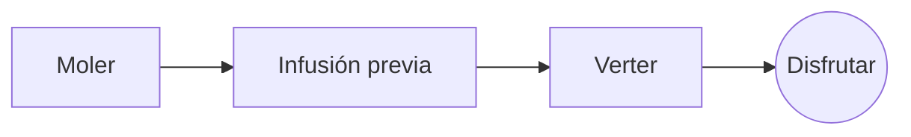

# El café de filtro perfecto

Un ritual matinal lento en pocos pasos. Escríbelo en el **código fuente** a la izquierda o directamente en la *previsualización* a la derecha: ambos se mantienen sincronizados, y ==cada edición es un cambio limpio== en el Markdown.

> [!TIP]
> El agua justo después de hervir, a unos 94 °C, realza la dulzura sin amargor.

## La proporción

La mayoría de las recetas se quedan en una parte de café por dieciséis de agua:

$$
m_{\text{agua}} = 16 \times m_{\text{café}}
$$

Así que $20\,\text{g}$ de café piden $320\,\text{g}$ de agua.

## Paso a paso



## Métodos de preparación

| Método          | Molienda   | Tiempo |
|:----------------|:----------:|-------:|
| Filtro          | Medio-fina |   3:30 |
| Prensa francesa | Gruesa     |   4:00 |
| Espresso        | Fina       |   0:28 |

## Antes de empezar

- [x] Granos recién tostados :coffee:
- [x] Un molinillo de muelas
- [ ] Una tetera con pico de cuello de cisne

```python
def water_for(coffee_g: float, ratio: int = 16) -> float:
    return coffee_g * ratio
```

Infusión previa
: El primer chorrito de agua que deja escapar el gas de los posos.[^1]

[^1]: Los granos frescos se hinchan más; los viejos apenas suben.
