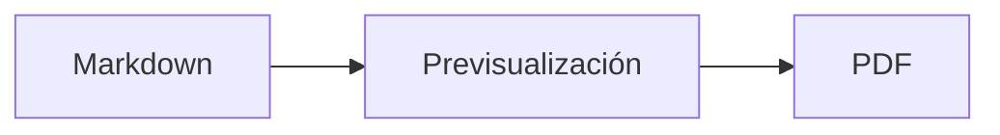

<p>&nbsp;&nbsp;&nbsp;</p>

# Splat

**El editor de Markdown para macOS que te deja escribir en el código fuente o directamente en la previsualización.**

Splat muestra a la izquierda tu código fuente Markdown con colores de sintaxis y a la derecha una previsualización en directo, totalmente editable. Escribe en cualquiera de las dos: lo que escribas en la previsualización se convierte en un cambio mínimo en el código fuente, así que las líneas que no has tocado siguen idénticas byte a byte y tus diffs de Git se mantienen limpios. Splat entiende el Markdown que ya usas: CommonMark y GitHub Flavored Markdown, alertas de GitHub, enlaces wiki, incrustaciones y recuadros de Obsidian, extensiones de Pandoc y Typora, HTML incrustado, fórmulas LaTeX y diagramas de Mermaid, Graphviz y PlantUML, todo renderizado sin conexión. Exporta a PDF, HTML o Word con un clic. Está escrito en Rust sobre controles genuinos de AppKit, habla 35 idiomas y no envía nada por la red a menos que se lo pidas.
 


[](https://raw.githubusercontent.com/sventmueller/splat/main/dist/Splat-1.0.3.dmg)

**[Descargar Splat-1.0.3.dmg](https://raw.githubusercontent.com/sventmueller/splat/main/dist/Splat-1.0.3.dmg)**: firmado y notarizado por Apple, para macOS 14 o posterior en Apple Silicon e Intel.
 
 

[](https://www.rust-lang.org)
[](https://www.apple.com/macos/)

[](https://github.com/madsmtm/objc2)
[](https://webkit.org)
[](https://github.com/kivikakk/comrak)
[](https://github.github.com/gfm/)
[](https://www.mathjax.org)
[](https://cortexjs.io/mathlive/)
[](https://mermaid.js.org)
[](https://graphviz.org)
[](https://plantuml.com)


[](#licencia)

[Bahasa Indonesia](../id/README.md) ·
[Bahasa Melayu](../ms/README.md) ·
[Català](../ca/README.md) ·
[Čeština](../cs/README.md) ·
[Dansk](../da/README.md) ·
[Deutsch](../de/README.md) ·
[English](../../../README.md) ·
**Español** ·
[Français](../fr/README.md) ·
[Hrvatski](../hr/README.md) ·
[Italiano](../it/README.md) ·
[Magyar](../hu/README.md) ·
[Nederlands](../nl/README.md) ·
[Norsk](../no/README.md) ·
[Polski](../pl/README.md) ·
[Português (Brasil)](../pt_BR/README.md) ·
[Português (Portugal)](../pt_PT/README.md) ·
[Română](../ro/README.md) ·
[Slovenčina](../sk/README.md) ·
[Slovenščina](../sl/README.md) ·
[Suomi](../fi/README.md) ·
[Svenska](../sv/README.md) ·
[Tiếng Việt](../vi/README.md) ·
[Türkçe](../tr/README.md) ·
[Ελληνικά](../el/README.md) ·
[Русский](../ru/README.md) ·
[Українська](../uk/README.md) ·
[עברית](../he/README.md)‎ ·
[العربية](../ar/README.md)‎ ·
[हिन्दी](../hi/README.md) ·
[ไทย](../th/README.md) ·
[한국어](../ko/README.md) ·
[日本語](../ja/README.md) ·
[简体中文](../zh-Hans/README.md) ·
[繁體中文](../zh-Hant/README.md)

## Contenido

- [Resumen de funciones](#resumen-de-funciones)
- [Requisitos](#requisitos)
- [Instalación](#instalación)
- [Primeros pasos](#primeros-pasos)
- [Escritura](#escritura)
  - [En el código fuente](#en-el-código-fuente)
  - [En la previsualización](#en-la-previsualización)
  - [Comandos de formato](#comandos-de-formato)
  - [Listas y tareas](#listas-y-tareas)
  - [Tablas](#tablas)
- [Markdown compatible](#markdown-compatible)
  - [CommonMark y GitHub Flavored Markdown](#commonmark-y-github-flavored-markdown)
  - [Recuadros](#recuadros)
  - [Sintaxis ampliada](#sintaxis-ampliada)
  - [Obsidian](#obsidian)
  - [Citas y referencias](#citas-y-referencias)
  - [HTML incrustado](#html-incrustado)
  - [Puntuación tipográfica](#puntuación-tipográfica)
  - [Resumen de sintaxis](#resumen-de-sintaxis)
- [Fórmulas](#fórmulas)
- [Diagramas](#diagramas)
- [Imágenes](#imágenes)
- [Enlaces y navegación](#enlaces-y-navegación)
- [Exportar, imprimir y compartir](#exportar-imprimir-y-compartir)
- [Apariencia y accesibilidad](#apariencia-y-accesibilidad)
- [Idiomas](#idiomas)
- [Atajos de teclado](#atajos-de-teclado)
- [Privacidad y seguridad](#privacidad-y-seguridad)
- [Documentos grandes](#documentos-grandes)
- [Limitaciones conocidas](#limitaciones-conocidas)
- [Solución de problemas](#solución-de-problemas)
- [Para desarrolladores](#para-desarrolladores)
  - [Compilación](#compilación)
  - [Distribución](#distribución)
  - [Pruebas](#pruebas)
  - [Estructura del proyecto](#estructura-del-proyecto)
  - [Flujo de datos](#flujo-de-datos)
  - [Reglas en el controlador](#reglas-en-el-controlador)
  - [Añadir un comando](#añadir-un-comando)
  - [Traducciones](#traducciones)
  - [Componentes de terceros](#componentes-de-terceros)
- [Licencia](#licencia)

## Resumen de funciones

- **Dos formas de escribir, un solo texto.** El código fuente y la previsualización son editables. El archivo Markdown es la única verdad: hay un solo historial de deshacer por documento, y cada edición en la previsualización se traduce en el cambio más pequeño posible en el código fuente.
- **El Markdown que ya usas.** CommonMark, GitHub Flavored Markdown, alertas de GitHub, extensiones de Obsidian, Pandoc y Typora, shortcodes de emoji, spoilers, listas de definiciones, anclas de encabezamientos y HTML como en los README de GitHub.
- **Fórmulas y diagramas integrados.** Fórmulas LaTeX con MathJax y un editor visual de fórmulas. Diagramas en Mermaid, Graphviz y PlantUML, renderizados en tu Mac sin Java, sin servidor y sin conexión de red.
- **Un botón para todo.** Cada elemento de Markdown tiene un botón en la barra de herramientas y una opción de menú, y los más habituales también un atajo de teclado. Las tablas tienen su propio menú para filas, columnas y alineación.
- **Exporta sin perder nada.** PDF, un único archivo HTML autocontenido o un documento de Word con encabezamientos, listas, tablas, notas al pie e imágenes de verdad.
- **Nativa hasta la médula.** Ventanas, pestañas, menús, popovers, Versiones, Autoguardado, el menú de compartir, modo oscuro, corrección ortográfica, dictado y VoiceOver de AppKit, sin imitaciones. Sin Electron y sin vista web para el texto en sí.
- **Rápida con archivos grandes.** Una pulsación de tecla en un documento de 10 MB tarda unos 25 ms.
- **Privada y cuidadosa.** Las imágenes de la web se cargan solo cuando lo permites, los enlaces a otras apps preguntan antes y todo lo que decodifica datos de imagen no fiables se ejecuta en procesos auxiliares aislados en un sandbox.
- **En tu idioma.** La interfaz y la referencia rápida de Markdown integrada están disponibles en 35 idiomas: alemán, árabe, catalán, checo, chino (simplificado), chino (tradicional), coreano, croata, danés, eslovaco, esloveno, español, finés, francés, griego, hebreo, hindi, húngaro, indonesio, inglés, italiano, japonés, malayo, neerlandés, noruego, polaco, portugués (Brasil), portugués (Portugal), rumano, ruso, sueco, tailandés, turco, ucraniano y vietnamita.

## Requisitos

- macOS 14 Sonoma o posterior. Splat se desarrolla y se prueba en macOS 27, donde adopta automáticamente el diseño Liquid Glass.
- Un Mac con Apple Silicon o con procesador Intel.
- Unos 45 MB de espacio en disco.

## Instalación

**Desde la imagen de disco.** Descarga [`dist/Splat-1.0.3.dmg`](https://raw.githubusercontent.com/sventmueller/splat/main/dist/Splat-1.0.3.dmg), ábrela y arrastra Splat a la carpeta Aplicaciones. La imagen está firmada con un Developer ID y notarizada por Apple, así que se abre sin avisos.

**Con Homebrew.** El cask está en un tap propio:

```sh
brew install --cask sventmueller/tap/splat
```

`brew upgrade --cask splat` instala las versiones nuevas, y `brew uninstall --zap --cask splat` elimina además los ajustes y las cachés de Splat.

**Actualizaciones.** Splat, instalado desde la imagen de disco o con Homebrew, se mantiene al día por sí solo con [Sparkle](https://sparkle-project.org). En el segundo arranque pregunta si puede buscar actualizaciones por su cuenta, una vez al día. **Splat › Buscar actualizaciones…** busca al instante; **Buscar actualizaciones automáticamente** y **Descargar e instalar actualizaciones automáticamente**, en el mismo menú, cambian después tu elección. Splat solo instala una actualización si lleva la firma del desarrollador. Una compilación propia no tiene actualizador.

**Desde el código fuente.** Consulta [Compilación](#compilación) para ver los requisitos previos y después:

```sh
make build
ditto target/release/Splat.app /Applications/Splat.app
open /Applications/Splat.app
```

Para abrir archivos Markdown con Splat haciendo doble clic, selecciona cualquier archivo `.md` en el Finder, elige **Archivo › Obtener información**, escoge Splat en **Abrir con** y haz clic en **Cambiar todo…**. Splat se registra para los archivos `.md`, `.markdown`, `.mdown` y `.mkd`.

## Primeros pasos

### La ventana

Cada documento se abre en su propia ventana, o en una pestaña si prefieres las pestañas:

- **Izquierda: el código fuente.** Tu Markdown en SF Mono con colores de sintaxis.
- **Derecha: la previsualización.** El documento renderizado, listo para editar.
- **Barra lateral de esquema (opcional).** Todos los encabezamientos en forma de árbol; un clic en uno lo muestra en ambos paneles. Se activa con **Visualización › Mostrar esquema** (⌃⌘S).
- **Barra de herramientas.** Botones agrupados según lo que cambian: caracteres, párrafos y elementos insertados, y después mostrar u ocultar la previsualización, Compartir y Nuevo documento. Se personaliza con **Visualización › Personalizar barra de herramientas…**.

Arrastra el divisor para dar más espacio a un lado. **Visualización › Ocultar previsualización** (⌥⌘P) deja solo el código fuente; Splat lo recuerda por ventana. Ambos paneles se desplazan a la vez, y la selección en un panel se resalta en el otro.

### Documentos, pestañas y versiones

Splat es una app de documentos normal de macOS:

- **Autoguardado y Versiones.** Los cambios se guardan en el propio archivo. **Archivo › Volver a › Explorar todas las versiones…** te lleva atrás en el tiempo.
- **Cambios desde otros programas.** Cuando Git, un script u otro editor modifica un documento abierto, Splat lo recarga y conserva el cursor y la posición de desplazamiento. Si tienes cambios propios sin guardar, Splat los conserva, y macOS pregunta antes de sobrescribir la otra versión.
- **Los comandos de archivo de siempre.** Duplicar (⇧⌘S), Renombrar…, Trasladar a… y **Archivo › Abrir recientes**.
- **Pestañas.** **Archivo › Nueva pestaña** o el botón **+** de la barra de herramientas abre un documento nuevo como pestaña; el menú Ventana estándar fusiona, traslada y recorre las pestañas.
- **Posición de las ventanas.** Se recuerdan el tamaño y la posición de tu última ventana, también entre reinicios. Si ya hay una ventana en ese sitio, la nueva se abre algo desplazada.
- **El icono del Dock.** Un clic en él, después de cerrar la última ventana, abre un documento nuevo.
- **Abrir archivos Markdown con Splat.** **Splat › Definir como app por omisión para Markdown** hace que un doble clic en un archivo `.md` o `.markdown` abra Splat; macOS pide confirmación una vez. La opción muestra una marca mientras Splat es la app por omisión.

Los archivos deben ser texto UTF-8, o UTF-16 con marca de orden de bytes. Splat rechaza otras codificaciones en vez de adivinar y estropear el texto. La marca de orden de bytes se conserva, UTF-16 sigue siendo UTF-16, y en un archivo cuyas líneas terminan todas en CRLF, las líneas que añadas también terminan en CRLF.

**Tras un cierre inesperado**, como mucho se pierden los últimos segundos de escritura: cada cinco segundos, Splat copia el texto sin guardar en `~/Library/Application Support/Splat/Unsaved` y borra las copias cuando el documento se guarda o Splat se cierra con normalidad. En el siguiente arranque, lo que dejó un cierre inesperado pasa a `~/Library/Application Support/Splat/Recovery` y se avisa una sola vez, con un botón que abre la carpeta. Un cierre inesperado al que Splat aún puede reaccionar escribe allí también el texto de todos los documentos abiertos.

### Referencia rápida

**Ayuda › Referencia rápida de Markdown** abre una guía de consulta en tu idioma como documento nuevo sin título. Es un documento normal, así que puedes probarlo todo ahí mismo, en el código fuente o en la previsualización.

## Escritura

### En el código fuente

El código fuente es un editor de texto sin formato ajustado para Markdown:

- **Colores de sintaxis** como en VS Code: encabezamientos, énfasis, enlaces, código, tablas, HTML, front matter, y LaTeX y Mermaid dentro de fórmulas y diagramas. Hay paletas para los modos claro, oscuro y Aumentar contraste.
- **Los bloques de código delimitados** se resaltan para Bash, C, C++, C#, CSS (también SCSS y Less), Go, HTML, XML, Java, JavaScript, JSON, Kotlin, PHP, Python, Ruby, Rust, SQL, Swift, TypeScript, YAML, TeX y Mermaid, incluidos sus nombres abreviados habituales como `js`, `py` o `sh`.
- **Sin sustituciones sorpresa.** Las comillas tipográficas, los guiones inteligentes y la sustitución de texto están desactivados por omisión, porque estropean `--`, `---` y `"`. Actívalos en **Edición › Sustituciones**.
- **Las herramientas de escritura del sistema.** Corrección ortográfica y gramatical, dictado, Buscar y reemplazar (⌥⌘F) y Habla.
- **Arrastrar y soltar.** Suelta un archivo de imagen para insertar ``, cualquier otro archivo para insertar un enlace a él, y una URL para insertar `[url](url)`. Cada acción de soltar es un solo paso de deshacer.
- **Pegar imágenes.** Una imagen del portapapeles, como una captura de pantalla, se guarda como archivo PNG junto al documento (`Imagen 2026-10-29 13.09.07.png`) y se inserta como imagen. Para ello, el documento debe estar guardado al menos una vez.

### En la previsualización

La previsualización se comporta como un procesador de textos, pero todo lo que haces en ella acaba como Markdown:

- **Escribir.** Los caracteres que significan algo en Markdown, como `*` o `#`, se escapan para que aparezcan tal como los escribes.
- **Return** empieza un párrafo o un elemento de lista nuevo. **⌥Return** o **⌃Return** inserta un salto de línea.
- **Formato en el cursor.** Con el cursor al final de una palabra, Negrita, Cursiva y los demás formatos de carácter se aplican a lo que escribas a continuación. Vuelve a elegir el formato para detenerlo. Dentro de una palabra, se da formato a la palabra entera.
- **Líneas vacías.** Return en una línea vacía añade otra línea vacía, y Retroceso la quita. En el código fuente, cada línea vacía adicional son dos líneas en blanco más; otros programas de Markdown las muestran como un espacio normal entre párrafos.
- **Deshacer** funciona en ambos paneles. Las acciones de deshacer llevan nombre («Deshacer Negrita»), escribir es un paso por ráfaga y, tras Deshacer y Rehacer, ambos paneles se desplazan hasta el cambio.
- **Las fórmulas y los diagramas** aparecen como gráficos terminados. Haz clic en uno, sitúa el cursor sobre él o pulsa Return sobre él para abrir su editor (consulta [Fórmulas](#fórmulas) y [Diagramas](#diagramas)).
- **El HTML incrustado, las notas incrustadas y el front matter** se muestran, pero se editan en el código fuente. Un clic en ellos coloca el cursor en el lugar correspondiente del código fuente.

Todo lo que Markdown no puede expresar está bloqueado en la previsualización: los paneles Tipos de letra y Colores, la regla, y pegar o soltar texto enriquecido e imágenes. El HTML y el RTF pegados llegan como texto sin formato.

### Comandos de formato

Todos los comandos están disponibles en la barra de herramientas, en la barra de menús y en el menú contextual de ambos paneles. Las opciones de menú muestran una marca para el formato que hay en el cursor.

| Menú | Comandos |
|---|---|
| **Formato › Tipo de letra** | Negrita, Cursiva, Subrayado, Tachado, Resaltado, Código, Superíndice, Subíndice |
| **Formato › Encabezamiento** | Cuerpo de texto, Encabezamiento 1 a 6 |
| **Formato › Lista** | Lista con viñetas, Lista numerada, Lista de tareas |
| **Formato** | Cita, Bloque de código (Sin lenguaje o uno de 20 lenguajes; también cambia el lenguaje de un bloque existente), Recuadro (Nota, Consejo, Importante, Advertencia, Precaución; el mismo tipo otra vez lo quita), Editar fórmula o diagrama…, Borrar formato |
| **Insertar** | Enlace…, Imagen…, Tabla…, Fórmula, Diagrama (Diagrama de flujo, Diagrama de secuencia, Diagrama de Gantt), Tabla de contenido, Nota al pie, Separador |
| **Tabla** | Insertar fila encima/debajo, Insertar columna a la izquierda/derecha, Eliminar fila, Eliminar columna, Alineación (Izquierda, Centrado, Derecha, Por omisión), Alinear columnas de la tabla |
| **Visualización** | Ocultar/mostrar previsualización, Mostrar/ocultar esquema, Puntuación tipográfica, Acercar/alejar, Tamaño real, barra de herramientas, barra de pestañas, pantalla completa |

El subrayado, el resaltado, el superíndice y el subíndice se escriben como `<ins>`, `<mark>`, `<sup>` y `<sub>`, que GitHub también muestra. Splat lee además `<u>`, que GitHub elimina, y las formas más cortas `==resaltado==`, `^sup^` y `~sub~`. GitHub muestra `==` y `^` tal cual y `~sub~` como tachado.

### Listas y tareas

- Return continúa una lista; Return en un elemento vacío la termina.
- **Tab** y **⇧Tab** aumentan y reducen la sangría de los elementos de lista en la previsualización.
- Un clic en la casilla de una tarea en la previsualización alterna `- [ ]` y `- [x]`.
- **Formato › Lista** convierte los párrafos seleccionados en una lista o cambia su tipo.

### Tablas

- **Insertar › Tabla…** pide el número de filas (incluida la de encabezado) y de columnas.
- En la previsualización, **Tab** pasa a la celda siguiente, **⇧Tab** a la anterior y **Return** a la celda de abajo. Tab en la última celda añade una fila.
- El menú **Tabla** inserta y elimina filas y columnas y define la alineación de una columna (⌘{, ⌘|, ⌘}).
- **Tabla › Alinear columnas de la tabla** rellena el código fuente para que las columnas queden alineadas.

## Markdown compatible

Splat analiza el texto con [comrak](https://github.com/kivikakk/comrak), un parser compatible con CommonMark y GFM, y activa la mayoría de sus extensiones. Todo lo que sigue se renderiza en la previsualización y en todas las exportaciones.

### CommonMark y GitHub Flavored Markdown

- Encabezamientos (`#` y subrayados), párrafos, saltos de línea, énfasis, énfasis fuerte, código en línea, citas en bloque, separadores.
- Listas con viñetas, numeradas y anidadas; listas de tareas.
- Enlaces (en línea, de referencia y automáticos), imágenes, definiciones de referencia de enlaces.
- Bloques de código delimitados y con sangría, con colores de sintaxis.
- Tablas con alineación de columnas.
- Tachado con `~~dos tildes~~`.
- Notas al pie: `texto[^1]` con `[^1]: La nota.` en cualquier lugar del documento. Un clic en la marca salta a la nota.
- Front matter YAML entre líneas `---` al principio. La previsualización lo resume en una línea, por ejemplo «Metadatos: title, date, tags».

### Recuadros

Las alertas de GitHub se renderizan como cuadros de colores con icono y título:

```markdown
> [!NOTE]
> Información útil que los usuarios deberían conocer.

> [!WARNING]
> Contenido crítico que exige atención inmediata.
```

Los cinco tipos son Nota, Consejo, Importante, Advertencia y Precaución. **Formato › Recuadro** convierte en uno el párrafo en el que está el cursor.

Los recuadros de Obsidian también funcionan, con cualquier título y un estado de plegado:

```markdown
> [!tip]- Haz clic en ▸ para desplegar
> Oculto hasta que se abre.

> [!question]+ Abierto por omisión
> Un `+` empieza desplegado, un `-` contraído.
```

Los demás tipos de Obsidian se muestran con el más cercano de los cinco colores: `success`, `check`, `done` y `hint` como Consejo; `question`, `help` y `faq` como Importante; `attention` como Advertencia; `failure`, `fail`, `missing`, `danger`, `error` y `bug` como Precaución; todo lo demás como Nota.

### Sintaxis ampliada

| Función | Sintaxis | Procede de |
|---|---|---|
| Resaltado | `==texto marcado==` | Obsidian, Typora |
| Superíndice | `x^2^` | Pandoc, Typora |
| Subíndice | `H~2~O` | Pandoc, Typora |
| Shortcode de emoji | `:rocket:` se convierte en 🚀 | GitHub |
| Spoiler | `\|\|texto oculto\|\|`, selecciónalo para leerlo | Discord |
| Nota al pie en línea | `texto^[la propia nota]` | Pandoc, Obsidian |
| Lista de definiciones | `Término`, línea en blanco, `: Explicación` | PHP Markdown Extra, Pandoc |
| Ancla de encabezamiento | `## Instalación {#setup}`, enlaza con `[ver](#setup)` | Pandoc, kramdown |

Las listas de definiciones tienen este aspecto en el código fuente:

```markdown
Término

: Explicación del término.
```

Sin un ancla propia, cada encabezamiento recibe una derivada de su texto, como en GitHub: `## Primeros pasos` se alcanza como `#primeros-pasos`.

### Obsidian

- **Enlaces wiki.** `[[Nota]]` enlaza con `Nota.md` en la misma carpeta o en una carpeta de más abajo. `[[Nota|Texto mostrado]]` muestra tu propio texto, y `[[Nota#Encabezamiento]]` abre la nota. ⌘-clic la abre en Splat.
- **Incrustaciones.** `![[Nota]]` muestra la otra nota dentro de esta; las notas incrustadas en ella aparecen como enlaces. `![[diagrama.png]]` muestra una imagen. Como en Obsidian, las incrustaciones nombran notas e imágenes de la carpeta del documento o de más abajo, nunca con una ruta absoluta, y solo los archivos Markdown se muestran como notas.
- **Comentarios.** `%%Solo en el código fuente%%` sigue visible en el código fuente y se omite en la previsualización y en todas las exportaciones, tanto en línea como en líneas propias.
- **Etiquetas.** `#idea` o `#proyecto/splat` se resalta. ⌘-clic busca la etiqueta en el documento.
- **Recuadros plegables.** Consulta [Recuadros](#recuadros).

### Citas y referencias

- **Citas de Pandoc.** `[@doe2020]` o `[@doe2020; @roe2021]` se lee como «(Doe 2020; Roe 2021)». Las entradas proceden del archivo BibTeX que el front matter nombra como `bibliography: refs.bib`. Sin él, Splat usa `references.bib`, `literatur.bib` o `bibliography.bib` junto al documento.
- **Referencias de GitHub y GitLab.** Si el documento está en un repositorio Git cuyo remoto `origin` está en github.com o en un host de GitLab, se resaltan `@nombre`, `#12` (incidencia) y `!7` (merge request, solo en GitLab). ⌘-clic las abre en el navegador.

### HTML incrustado

El HTML tal como aparece en los README de GitHub se renderiza, con un lector propio en lugar de un motor de navegador:

- párrafos y bloques centrados (`<p align="center">`, `<div align="center">`)
- imágenes con tamaño (``)
- enlaces, `<kbd>⌘</kbd>`, `<br>`, `<u>`, `<ins>`, `<mark>`, `<sup>`, `<sub>`
- listas y tablas, incluidas las celdas que abarcan varias columnas (`colspan`)
- secciones plegables: `<details><summary>Más</summary>…</details>`, que se abren con un clic en ▸

El Markdown entre etiquetas HTML se renderiza como Markdown. Los scripts, los estilos, los marcos y los formularios se omiten por completo, y los enlaces y las imágenes conservan solo las direcciones `http`, `https`, `mailto` y relativas.

### Puntuación tipográfica

**Visualización › Puntuación tipográfica** muestra las comillas rectas como las comillas del idioma de tu interfaz, `--` como raya corta, `---` como raya larga y `...` como puntos suspensivos. En alemán, `"Ja"` se convierte en „Ja“, en francés en «Oui», en japonés en 「はい」, también donde el chino y el japonés ponen las comillas sin espacio; las abreviaturas hebreas como `צה"ל` reciben sus guershayim, צה״ל. El código fuente conserva los caracteres sin formato; la previsualización y todas las exportaciones muestran los tipográficos. El ajuste está desactivado hasta que lo actives.

### Resumen de sintaxis

| Elemento | Markdown |
|---|---|
| **Negrita** | `**Negrita**` |
| *Cursiva* | `*Cursiva*` |
| Subrayado | `<ins>Subrayado</ins>` o `<u>Subrayado</u>` |
| ~~Tachado~~ | `~~Tachado~~` |
| Resaltado | `<mark>Resaltado</mark>` o `==Resaltado==` |
| `Código` | `` `Código` `` |
| x² | `x<sup>2</sup>` o `x^2^` |
| H₂O | `H<sub>2</sub>O` o `H~2~O` |
| [Enlace](https://example.com) | `[Enlace](https://example.com)` |
| Encabezamiento | `# Encabezamiento` a `###### Encabezamiento` |
| Cita | `> Cita` |
| Lista con viñetas | `- Elemento` |
| Lista numerada | `1. Elemento` |
| Tarea | `- [ ] Pendiente` y `- [x] Hecha` |
| Bloque de código | ```` ```rust ```` … ```` ``` ```` |
| Tabla | `\| A \| B \|` con `\|---\|---\|` debajo del encabezado |
| Nota al pie | `Texto[^1]` y `[^1]: Nota` |
| Separador | `---` |
| Imagen | `` |
| Fórmula | `$E = mc^2$`, `$$ … $$` |
| Diagrama | ```` ```mermaid ````, ```` ```dot ````, ```` ```plantuml ```` |
| Recuadro | `> [!TIP]` |
| Enlace wiki | `[[Nota]]`, `[[Nota\|Texto]]` |
| Incrustación | `![[Nota]]`, `![[imagen.png]]` |
| Comentario | `%%Comentario%%` |
| Etiqueta | `#etiqueta` |
| Cita bibliográfica | `[@clave]` |
| Spoiler | `\|\|Spoiler\|\|` |
| Emoji | `:tada:` |

## Fórmulas

Las fórmulas las renderiza [MathJax](https://www.mathjax.org) con su matemática TeX y AMS, como nítidos gráficos vectoriales. El texto de `\text{…}` puede estar en cualquier escritura: lo que les falta a las fuentes de MathJax sale de las fuentes de tu Mac, con el árabe y el hebreo escritos de derecha a izquierda, y los emoji en color.

| Tipo | Sintaxis |
|---|---|
| En línea | `$E = mc^2$`, `` $`E = mc^2`$ `` (GitHub, GitLab), `\(E = mc^2\)` |
| En bloque | `$$` … `$$`, `\[` … `\]`, o un bloque de código marcado como `math` |

**Editar una fórmula.** Haz clic en una fórmula en la previsualización, haz doble clic, pulsa Return sobre ella o sitúa el cursor sobre ella para abrir su editor en un popover. **Insertar › Fórmula** inserta una nueva y abre el editor de inmediato.

- **Visual o LaTeX.** El conmutador de arriba alterna entre un editor visual ([MathLive](https://cortexjs.io/mathlive/)) y el código LaTeX. Splat recuerda tu elección.
- **Bloques** para fracción, raíz cuadrada, superíndice y subíndice, suma e integral con límites, límite, paréntesis que crecen con el contenido, matriz 2×2, letras griegas, y relaciones, operadores y flechas. Dejan marcadores de posición □, y **Tab** salta al siguiente.
- **Previsualización en directo.** Los cambios aparecen en el documento mientras escribes. Los errores de MathJax se muestran en una línea debajo del código.
- **Confirmar o descartar.** Hacer clic fuera conserva el cambio como un solo paso de deshacer; **Esc** o **Cancelar** lo descarta. Pulsar Esc en una fórmula nueva y vacía la elimina de nuevo.
- El menú contextual ofrece **Editar fórmula…** para la fórmula que hay bajo el puntero.

VoiceOver lee una fórmula como su código LaTeX. Splat renderiza fórmulas, no documentos LaTeX completos: no hay paquetes, ni TikZ, ni `\documentclass`.

## Diagramas

Los diagramas se renderizan dentro de Splat, sin conexión y en una variante clara y otra oscura.

| Motor | Bloque de código | Qué dibuja |
|---|---|---|
| [Mermaid](https://mermaid.js.org) | ```` ```mermaid ```` | diagramas de flujo, de secuencia, de clases, de estados, entidad-relación, de Gantt, de sectores, mapas mentales, líneas de tiempo y todos los demás tipos de Mermaid |
| [Graphviz](https://graphviz.org) | ```` ```dot ```` o ```` ```graphviz ```` | grafos en el lenguaje DOT |
| [PlantUML](https://plantuml.com) | ```` ```plantuml ```` o ```` ```puml ```` | diagramas UML; funciona sin Java |



**Editar un diagrama** funciona como editar una fórmula: haz clic en él para abrir el código en un popover, con colores de sintaxis y mensajes de error en una línea debajo del código. **Insertar › Diagrama** parte de una plantilla de diagrama de flujo, de secuencia o de Gantt. Los bloques ayudan con los tres tipos más habituales de Mermaid:

- **Diagrama de flujo:** Nodo ▾ (rectángulo, redondeado, círculo, rombo, base de datos), Conexión, Conexión con etiqueta, Grupo, Dirección ▾
- **Diagrama de secuencia:** Participante, Mensaje, Respuesta, Nota, Bucle, Rutas alternativas
- **Diagrama de Gantt:** Sección, Tarea, Hito

Los demás tipos de diagrama se editan como código. VoiceOver lee el título o el texto alternativo de un diagrama.

El primer diagrama tras el arranque tarda cerca de un segundo, porque el motor de renderizado se inicia en segundo plano. Un diagrama que tarda más de 10 segundos muestra un error, y el motor de renderizado se reinicia para el siguiente. El motor de PlantUML (7 MB) se carga solo con el primer diagrama de PlantUML. Un `!include` de PlantUML desde la web está bloqueado.

## Imágenes

- **Las imágenes locales** usan rutas relativas al documento: ``. Splat muestra PNG, JPEG, GIF, WebP, BMP, SVG, HEIC, TIFF, AVIF y PDF.
- **Las imágenes de la web** siguen bloqueadas hasta que las permites: una barra sobre la previsualización explica que cargarlas informa a sus servidores de que abres el documento y cuándo. **Cargar imágenes** las permite para este documento; Splat recuerda la elección por archivo.
- **Tamaño.** `` da tamaño a una imagen; si no, las imágenes se ajustan al ancho de la previsualización.
- **Cambios en el disco.** Una imagen que sustituyes, o una que aparece después de que el documento la nombrara, se muestra sin volver a abrir el documento. Las imágenes de la web que fallaron por la red se reintentan mientras un documento las muestra.
- **Memoria.** Las imágenes se muestran con hasta 2560 píxeles en su lado más largo, lo que también llena una página A4. Se decodifican más pequeñas cuando ocupan una octava parte de la memoria del Mac, y mientras macOS indica presión de memoria.
- **Modo oscuro.** Las imágenes con fondo blanco se atenúan ligeramente en la previsualización oscura.
- **Pegar y soltar.** Consulta [En el código fuente](#en-el-código-fuente).

## Enlaces y navegación

En la previsualización, un clic coloca el cursor para que puedas editar el texto del enlace; **⌘-clic** sigue el enlace:

- `http`, `https` y `mailto` se abren en tu navegador o en tu app de correo.
- Los archivos Markdown se abren en Splat; los demás archivos y carpetas se muestran en el Finder.
- `#ancla` salta al encabezamiento del documento.
- Las direcciones que abren otra app, como `slack://` o `vscode://`, preguntan antes y muestran la dirección completa y la app. **Cancelar** está preseleccionado.

**Insertar › Tabla de contenido** inserta una lista con enlaces de todos los encabezamientos. Con el cursor dentro de ella, el mismo comando la actualiza. La barra lateral de esquema (⌃⌘S) salta a cualquier encabezamiento en ambos paneles.

## Exportar, imprimir y compartir

| Formato | Cómo | Qué obtienes |
|---|---|---|
| **PDF** | **Archivo › Exportar como PDF…** o el menú Compartir | Páginas del tamaño del papel, siempre en la apariencia clara, con fórmulas y diagramas como gráficos vectoriales. **Archivo › Ajustar página…** define el papel. |
| **Imprimir** | **Archivo › Imprimir…** (⌘P) | La misma maquetación que el PDF. |
| **HTML** | **Archivo › Exportar como HTML…** o el menú Compartir | Un archivo autocontenido: imágenes locales incrustadas, fórmulas y diagramas como imágenes nítidas, y anclas de encabezamientos para que funcione la tabla de contenido. Sin scripts. |
| **Word** | **Archivo › Exportar como documento de Word…** o el menú Compartir | Un `.docx` con los estilos de encabezamiento de Word, listas y tablas reales (incluidas las celdas combinadas), notas al pie como notas al pie de Word, imágenes incrustadas, fórmulas y diagramas. |
| **Markdown** | El botón **Compartir** de la barra de herramientas | El documento como archivo `.md` para Mail, Mensajes, AirDrop y cualquier otro servicio de compartir. |

El menú **Archivo › Compartir** ofrece todo esto en un solo lugar. Las exportaciones respetan el ajuste de puntuación tipográfica y las imágenes de la web que hayas permitido; en HTML, las imágenes de la web siguen siendo enlaces.

## Apariencia y accesibilidad

- **El modo oscuro** sigue al sistema. Las fórmulas y los diagramas se renderizan para cada apariencia.
- **Aumentar contraste** en Ajustes del Sistema cambia los colores de sintaxis a paletas de alto contraste.
- **Zoom.** ⌘+, ⌘− y ⌘0 escalan ambos paneles.
- **Pantalla completa, pestañas y una barra de herramientas personalizable**, como en cualquier app del Mac.
- **VoiceOver.** Los paneles se llaman «Código fuente Markdown» y «Previsualización», las fórmulas se leen como su código y los diagramas como su título. Todos los comandos son accesibles con el teclado.

Splat no tiene ventana de ajustes: las pocas opciones están donde se aplican, en **Visualización** y **Edición › Sustituciones**.

## Idiomas

La interfaz, los menús y la referencia rápida de Markdown están traducidos a 35 idiomas:

alemán, árabe, catalán, checo, chino (simplificado), chino (tradicional), coreano, croata, danés, eslovaco, esloveno, español, finés, francés, griego, hebreo, hindi, húngaro, indonesio, inglés, italiano, japonés, malayo, neerlandés, noruego, polaco, portugués (Brasil), portugués (Portugal), rumano, ruso, sueco, tailandés, turco, ucraniano y vietnamita.

Splat sigue el orden de idiomas de **Ajustes del Sistema › General › Idioma y región**; allí también puedes elegir un idioma solo para Splat en **Aplicaciones**. Si no hay traducción para tu idioma, usa el inglés. Los términos de los menús siguen las traducciones de Apple, así que Splat se lee como el resto de tu Mac.

El texto en hebreo y en árabe se lee de derecha a izquierda dondequiera que aparezca, sea cual sea el idioma de la interfaz: cada párrafo, encabezamiento y elemento de lista toma la dirección de su primera letra, las citas y los recuadros dibujan su barra a la derecha, y una tabla cuyo texto empieza de derecha a izquierda coloca sus columnas desde la derecha. Los bloques de código siguen de izquierda a derecha. Las exportaciones a PDF, HTML y Word conservan estas direcciones. Con el hebreo o el árabe como idioma del sistema, macOS también refleja la ventana, de modo que la previsualización queda a la izquierda.

## Atajos de teclado

| Acción | Atajo |
|---|---|
| Negrita, Cursiva, Subrayado | ⌘B, ⌘I, ⌘U |
| Tachado | ⇧⌘X |
| Enlace… | ⌘K |
| Cuerpo de texto, Encabezamiento 1 a 6 | ⌥⌘0, ⌥⌘1 a ⌥⌘6 |
| Alinear la columna de la tabla a la izquierda, al centro, a la derecha | ⌘{, ⌘\|, ⌘} |
| Ocultar o mostrar la previsualización | ⌥⌘P |
| Mostrar u ocultar el esquema | ⌃⌘S |
| Acercar, alejar, tamaño real | ⌘+, ⌘−, ⌘0 |
| Nuevo documento, abrir, guardar, duplicar | ⌘N, ⌘O, ⌘S, ⇧⌘S |
| Ajustar página, imprimir | ⇧⌘P, ⌘P |
| Buscar, buscar y reemplazar | ⌘F, ⌥⌘F |
| Buscar siguiente, anterior; usar la selección; ir a la selección | ⌘G, ⇧⌘G; ⌘E; ⌘J |
| Mostrar ortografía y gramática; comprobar documento | ⌘:, ⌘; |
| Pegar con el mismo estilo | ⌥⇧⌘V |
| Ocultar barra de herramientas, mostrar todas las pestañas, pantalla completa | ⌥⌘T, ⇧⌘\\, ⌃⌘F |
| Salto de línea (previsualización) | ⌥Return o ⌃Return |
| Celda siguiente / anterior en una tabla (previsualización) | Tab / ⇧Tab |
| Aumentar / reducir la sangría de un elemento de lista (previsualización) | Tab / ⇧Tab |
| Marcador de posición siguiente en el editor de fórmulas | Tab |
| Cerrar el editor de fórmulas o de diagramas sin cambios | Esc |
| Seguir un enlace, una etiqueta o una referencia (previsualización) | ⌘-clic |

Splat deja los atajos estándar de Apple donde están.

## Privacidad y seguridad

Un archivo Markdown puede venir de cualquiera, así que Splat trata todo documento como no fiable.

- **Sin red por omisión.** Splat no tiene telemetría. Busca actualizaciones solo cuando lo aceptas o eliges **Buscar actualizaciones…**: entonces carga un pequeño archivo de feed desde GitHub, y la solicitud no nombra más que la app y su versión. Las fórmulas y los diagramas se renderizan en local; las vistas web que lo hacen no pueden acceder a la red.
- **Las imágenes de la web** se cargan solo con tu permiso, solo por `https`, nunca desde hosts de tu red local, de 10 MB como máximo cada una y en una sesión privada sin cookies.
- **Decodificación aislada.** Las imágenes y los gráficos de fórmulas y diagramas se decodifican en procesos auxiliares que cierran todos los archivos heredados y se encierran en un sandbox antes de leer el primer byte: sin acceso a archivos, sin red. Solo devuelven píxeles, cuyo tamaño se comprueba, y se detienen tras 10 segundos. Los decodificadores de imagen propios de Apple solo ven HEIC, TIFF, AVIF y PDF, y solo cuando los datos son realmente de ese formato; se ejecutan en un auxiliar propio, que además puede leer las carpetas de tipos de letra del sistema y usar el decodificador de vídeo del sistema. Los SVG, las fórmulas y los diagramas pasan también por ese auxiliar, así que en Splat son imágenes con una resolución fija: cuatro píxeles por punto, hasta 2560 en el lado más largo.
- **Los archivos locales** llegan a un documento solo por la ruta que este nombra. Las incrustaciones muestran notas Markdown de la carpeta del documento y de más abajo, y una imagen que falta se busca solo allí. Una ruta de imagen en otro lugar, absoluta o que empieza por `~`, se sigue cargando, y las exportaciones a HTML y Word la incrustan: mira la exportación de un documento que no has escrito tú antes de pasarla a otros.
- **Las copias del texto sin guardar** se quedan en este Mac, en tu carpeta Library, para la recuperación tras un cierre inesperado. Desaparecen al guardar o al terminar Splat con normalidad; las copias que dejó un cierre inesperado permanecen en la carpeta de recuperación hasta que las borres.
- **Los enlaces** nunca inician un programa con un clic. Los enlaces web y de correo se abren como siempre; los enlaces a otras apps preguntan antes.
- **El HTML de los documentos** lo lee el propio parser de Splat. Los scripts, los estilos, los marcos y los formularios nunca se ejecutan.
- **Las exportaciones** no llevan scripts. Las páginas HTML conservan solo una lista fija de etiquetas y atributos inofensivos, como hace GitHub, más una política de seguridad de contenido. Los archivos de Word enlazan solo direcciones `http`, `https` y `mailto`.
- **Firma de código** con Hardened Runtime. Splat se ejecuta sin App Sandbox para poder mostrar imágenes junto a tus documentos sin pedir permiso para cada carpeta; el aislamiento de toda la decodificación lo compensa.

## Documentos grandes

Splat sigue respondiendo con documentos de varios megabytes:

- El código fuente usa TextKit 2, que maqueta solo la parte visible.
- Mientras escribes en la previsualización, y en el código fuente de documentos de hasta 2 MB, solo se vuelven a analizar, colorear y maquetar los párrafos afectados: unos 25 ms en un documento de 10 MB, y unos 50 ms por pulsación en su previsualización, con el trabajo propio de la vista.
- Las previsualizaciones grandes renderizan primero la parte visible y el resto mientras la app está inactiva. Los bloques que se desplazan a la vista se renderizan antes de dibujarse.
- En el código fuente de los documentos más grandes, el análisis para la previsualización se ejecuta en segundo plano mientras escribes.
- A partir de 64 MB, un documento sigue siendo texto sin formato: el código fuente no tiene colores y la previsualización explica por qué sigue vacía. Las exportaciones siguen funcionando.
- A partir de unos 200 KB, un documento abre su ventana antes de analizarse; con 5 MB, los colores y la previsualización llegan aproximadamente un cuarto de segundo después.

Algunos cambios se procesan por completo, con unos 300 ms por pulsación a 10 MB: los de la definición o las referencias de una nota al pie, junto a una nota al pie en línea, justo al final de un documento junto a una nota al pie, en el front matter o cerca de definiciones de referencia de enlaces, y todo cambio en un documento con bloques de comentarios `%%` o con una nota al pie definida dos veces o dentro de una cita o lista. La memoria crece con el archivo, hasta unos 115–160 MB para 1 MB de Markdown y 340–510 MB para 10 MB.

## Limitaciones conocidas

- **Una sola tilde significa subíndice.** `~texto~` es subíndice como en Pandoc; el tachado necesita `~~dos~~`. GitHub también tacha con una sola tilde.
- **Solo lectura en la previsualización:** el HTML incrustado, las notas incrustadas y el front matter se editan en el código fuente.
- **Anidamiento muy profundo:** el HTML anidado a más de 64 niveles, y el HTML en línea a más de 16, cede el paso a su contenido.
- **Las celdas combinadas de tablas** existen solo en tablas HTML, y solo entre columnas (`colspan`, sin `rowspan`). La sintaxis de tablas de MultiMarkdown para celdas combinadas no es compatible.
- **Las bibliografías** se leen solo de BibTeX, no de CSL JSON ni de YAML.
- **Las referencias** necesitan un repositorio en github.com o en un host de GitLab; `!7` existe solo en GitLab.
- **Puntuación tipográfica:** una comilla simple de cierre alemana no se distingue de un apóstrofo y se escribe como ’.
- **Fórmulas, no documentos:** sin paquetes de LaTeX, sin TikZ y sin documentos completos.
- **El editor visual de fórmulas** escribe LaTeX en la notación de MathLive: los espacios desaparecen (`E = mc^2` pasa a `E=mc^2`), y el resultado renderizado es el mismo.
- **Por diseño:** sin números de línea, sin ventana de ajustes, sin Help Book y no está en la App Store.
- **Menos probada en Intel.** Las pruebas automáticas de la ventana se ejecutan solo en Apple Silicon; en Intel, la CI ejecuta `cargo test`.

## Solución de problemas

**La lista de documentos recientes está vacía tras recompilar Splat.** macOS vincula los documentos recientes y los permisos de carpeta a la firma de código de la app. Las compilaciones locales se firman con el certificado «Splat Local Signing» de tu llavero de inicio de sesión, así que las recompilaciones conservan ambos. Si se borró el certificado, la siguiente compilación crea uno nuevo y las listas empiezan de cero una vez.

**La app de la imagen de disco muestra otros documentos recientes que mi propia compilación.** Las dos llevan firmas distintas, así que macOS mantiene una lista aparte y permisos de carpeta aparte para cada una.

**El HTML u otra sintaxis se muestra como código sin formato.** Puede que haya abierto el documento una copia antigua de Splat. Ciérrala, elige **Archivo › Obtener información** en el documento desde el Finder y comprueba que **Abrir con** nombra el Splat de tu carpeta Aplicaciones.

**No hay Buscar actualizaciones… en el menú de Splat.** Solo la versión de la imagen de disco o de Homebrew se actualiza por sí sola; una compilación propia no tiene actualizador.

**Las imágenes de la web no aparecen.** Haz clic en **Cargar imágenes** en la barra sobre la previsualización. Solo se cargan las imágenes `https` de hosts públicos.

**Al pegar una captura de pantalla se me pide guardar primero.** Las imágenes pegadas se guardan como archivos junto al documento, lo que requiere un lugar en el disco. Guárdalo y vuelve a pegar.

**«El archivo no es texto UTF-8.»** El archivo está en otra codificación y no tiene una marca de orden de bytes que la indique. Conviértelo antes, por ejemplo con `iconv -f ISO-8859-1 -t UTF-8 old.md > new.md`.

**Una fórmula o un diagrama muestra un error.** Haz clic en él: el editor muestra el mensaje de MathJax, Mermaid, Graphviz o PlantUML debajo del código.

## Para desarrolladores

Splat es una aplicación en Rust que habla directamente con AppKit y WebKit a través de [objc2](https://github.com/madsmtm/objc2). No hay Swift, ni Objective-C, ni proyecto de Xcode, ni archivo de Interface Builder.

### Compilación

Requisitos previos:

- macOS con las Command Line Tools (`xcode-select --install`). No hace falta Xcode; Splat se compila sin `actool`, `ibtool` ni `metal`.
- Rust 1.99 (`brew install rust`). [rust-toolchain.toml](../../../rust-toolchain.toml) nombra la versión exacta que usa la CI; rustup la instala por sí solo, el Rust de Homebrew ignora el archivo. Subirla ahí es como los nuevos avisos del compilador y de clippy llegan al proyecto.

El [Makefile](../../../Makefile) reúne puntos de entrada cortos; `make help` los lista todos:

```sh
make build                  # target/release/Splat.app, igual que cargo xtask bundle --release
make universal              # target/splat-universal para Apple Silicon e Intel, tal como lo lleva la imagen de disco
make check                  # formato, clippy sin avisos, todas las pruebas, bibliotecas incluidas; lo que ejecuta la CI
make test                   # make check y después la prueba automática sin ventana
make test-gui               # pruebas automáticas con ventana; ocupan el Mac unos cuatro minutos
make test-long              # búsqueda aleatoria más larga y la comprobación de la actualización parcial de 10 MB
make coverage               # cobertura de líneas de todas las pruebas y pruebas automáticas, con un mínimo por módulo
make coverage-library       # los mismos mínimos para los módulos sin ventana, como en la CI
make bench FILE=<file.md>   # tiempos de apertura, escritura y desplazamiento en un archivo grande
make release                # primero make test, después la imagen de disco notarizada
```

La propia lógica de compilación está en el crate de Rust [xtask](../../../xtask/src/main.rs):

```sh
cargo xtask bundle --release   # target/release/Splat.app, Hardened Runtime, firmada con "Splat Local Signing"
cargo xtask bundle             # target/debug/Splat Debug.app, una app aparte que nunca abre archivos Markdown
cargo xtask dmg                # dist/Splat-<version>.dmg para distribución, Developer ID, notarizada
cargo xtask icon               # reconstruye assets/AppIcon.icns y el icono del README desde assets/icon-1024.png
cargo xtask vendor check       # comprueba el JavaScript incluido con vendor.lock
cargo xtask vendor fetch       # lo descarga de nuevo tras cambiar una versión en vendor.lock
```

`bundle` escribe el `Info.plist`, copia los recursos y las localizaciones, y firma la app con el certificado «Splat Local Signing». La primera compilación crea ese certificado en tu llavero de inicio de sesión, válido durante 20 años. Mientras siga ahí, Splat conserva sus documentos recientes y sus permisos de carpeta entre recompilaciones; con una firma ad hoc, cada compilación sería una app nueva para macOS. Las compilaciones de depuración y de pruebas automáticas llevan identificadores de bundle propios (`local.splat.debug`, `local.splat.selftest`) y no se registran para archivos Markdown, así que el Finder nunca abre un documento en una compilación obsoleta y no tocan los ajustes de la app normal.

La versión está en [VERSION](../../../VERSION) como `major.minor.build` y es la que recibe la siguiente compilación. Cada compilación de release que termina bien (`make build`, `cargo xtask bundle --release`, `make release`) sube el número de compilación en uno; las compilaciones de depuración y de pruebas automáticas no lo tocan. Major y minor se suben a mano: pon VERSION en, por ejemplo, `1.1.0`, y la siguiente compilación recibe exactamente eso.

### Distribución

`cargo xtask dmg` (o `make release`, que ejecuta antes `make test`) compila un release, lo firma con tu Developer ID, notariza la app con Apple y grapa el ticket, la empaqueta en una imagen de disco comprimida y de solo lectura con un enlace a Aplicaciones, notariza y grapa también la imagen y comprueba el resultado con Gatekeeper. La app lleva su propio ticket para que una copia instalada sin el Finder, como hace Homebrew, también se abra sin conexión en el primer arranque; las dos rondas con el servicio de notarización tardan unos minutos cada una. Solo una imagen que haya superado todos los pasos pasa a ser `dist/Splat-<version>.dmg`, la copia que se confirma en el repositorio: los enlaces de descarga de este README y de sus traducciones la siguen, y el número de compilación sube. La imagen anterior se queda una versión más, ya que el servidor raw de GitHub puede seguir sirviendo el feed de actualizaciones antiguo unos minutos tras un push; las más antiguas se mueven a la papelera. Una ejecución fallida deja `dist/`, los README y VERSION como estaban.
Cada release añade al historial del repositorio la imagen completa, de unos 16 MB. Se ejecuta solo cuando se invoca, nunca como parte de una compilación normal, y necesita:

- un certificado «Developer ID Application» en el llavero
- un inicio de sesión guardado para el servicio de notarización de Apple con una contraseña específica de app, creado una vez con `xcrun notarytool store-credentials notary --apple-id <Apple ID> --team-id <team ID>`
- la clave privada que firma las actualizaciones, en el llavero de inicio de sesión. La creó `generate_keys` de Sparkle; su mitad pública es `UPDATE_KEY` en [xtask/src/main.rs](../../../xtask/src/main.rs) y está dentro de cada copia instalada, que solo acepta actualizaciones firmadas con ella. Guarda una copia de seguridad en un gestor de contraseñas: `target/sparkle-2.10.1/bin/generate_keys -x <file>` la exporta, `-f <file>` la importa en otro Mac. Sin ella, las copias instaladas no podrán volver a actualizarse nunca.
- rustup (`brew install rustup`, que deja en su sitio el Rust de Homebrew)

Si falta alguno, `dmg` se detiene antes de compilar. En la primera ejecución, macOS pregunta si Terminal puede controlar el Finder; sin ese permiso, la imagen de disco no muestra ni su fondo ni la disposición de los iconos.

Solo la imagen de disco lleva el actualizador, [Sparkle](https://sparkle-project.org), que la compilación descarga una vez en `target/` desde su release de GitHub y comprueba con la suma de verificación de xtask. El Hardened Runtime carga el framework solo cuando lleva el Team ID de la app, que la firma de Developer ID tiene y el certificado local no; y una actualización no debe sustituir una compilación propia. La compilación de pruebas automáticas lleva también Sparkle, para comprobar con él el menú de actualización: con un feed que no existe, sin la pregunta de Sparkle en el segundo arranque, y con un entitlement que permite a la app firmada en local cargar el framework. `dmg` firma la nueva imagen con la clave de actualización y escribe `dist/appcast.xml`, el feed que leen desde GitHub las copias instaladas. Confirma y sube juntos la imagen, el feed y los README: a partir de ese momento, las copias instaladas ofrecen la actualización.

La imagen de disco es un binario universal para Apple Silicon e Intel; las demás compilaciones son solo para el procesador del equipo. El Rust de Homebrew trae la biblioteca estándar solo para el procesador del equipo, así que `dmg` compila con rustup, que instala en el primer uso la toolchain y los targets de [rust-toolchain.toml](../../../rust-toolchain.toml), y se detiene si al programa o a Sparkle le falta el código de alguno de los dos procesadores. `make universal` compila solo el programa.
La app que lleva tiene una firma distinta de la de una compilación local, así que macOS mantiene documentos recientes y permisos de carpeta aparte para las dos.

### Pruebas

| Comando | Comprueba |
|---|---|
| `cargo test --release` | pruebas unitarias, aleatorias y de traducción |
| `SPLAT_FUZZ_ROUNDS=20000 cargo test --release` | una búsqueda aleatoria más larga; `SPLAT_FUZZ_SEED` varía las entradas |
| `SPLAT_I18N_ONLY=fr cargo test --release i18n` | un solo idioma, mientras los demás están incompletos |
| `cargo clippy --release --all-targets [--features selftest]` | lints, incluida la justificación de cada bloque `unsafe`, la longitud de las funciones y, en la biblioteca, las conversiones de números |
| `cargo xtask vendor check` | las bibliotecas JavaScript coinciden con `vendor.lock` byte a byte |
| `cargo xtask selftest probe` | sin ventana, cada una con su resultado esperado: fórmulas, diagramas, imágenes web contra un servidor dentro del proceso, direcciones bloqueadas, las defensas de las vistas web |
| `cargo xtask selftest gui [--stop-after "<check>"] [--scenarios]` | la app en marcha, clic a clic. Abre una ventana y escribe en ella; el Mac queda ocupado unos cuatro minutos. `--scenarios` ejecuta solo la segunda parte, en un minuto y medio |
| `cargo xtask selftest resize` | ensancha la ventana tras mover el divisor: el código fuente se vuelve a ajustar mientras se cambia el tamaño de la ventana. Tarda unos diez segundos |
| `cargo xtask selftest bench <file.md>` | tiempos de apertura, escritura y desplazamiento en un archivo grande |
| `cargo test --release -- --ignored partial_updates` | una pulsación de tecla en 10 MB: actualización parcial frente a completa, resultado y límite de tiempo |
| `cargo test --release --test hostile` | documentos construidos para desbordar la pila o tardar un tiempo cuadrático, a través del análisis, la maquetación, ambas exportaciones, pulsaciones de teclas y comandos |
| `make mutants` | fallos introducidos uno a uno en `src/markdown/` y `src/preview/` con [cargo-mutants](https://mutants.rs) (`cargo install cargo-mutants`); indica cuáles no detecta ninguna prueba. Tarda horas; `FILE=src/preview/bridge.rs` lo acota |
| `cargo test --release --test decoder` | el proceso decodificador decodifica imágenes y no llega ni a archivos ni a la red |
| `make coverage` | cobertura de líneas de `cargo test` y de todas las pruebas automáticas, con [cargo-llvm-cov](https://github.com/taiki-e/cargo-llvm-cov) (`brew install cargo-llvm-cov llvm`); falla por debajo de los mínimos. Ocupa el Mac unos cinco minutos |
| `make coverage-library` | los mínimos para `src/markdown/`, `src/preview/` e `i18n.rs`, medidos solo con `cargo test` |

Las pruebas unitarias están junto al código que prueban. `tests/` contiene lo que llega a la biblioteca desde fuera: las pruebas aleatorias de `robustness.rs`, que comparten el generador de `src/fuzz.rs` con las de `sync.rs`, los documentos hechos para hacer daño en `hostile.rs` y la prueba del decodificador, que inicia el programa compilado. Las decisiones de `src/editor/` que no necesitan ventana viven en funciones libres con pruebas propias: todo lo que sabe el controlador y cómo cambia, en `state.rs`; las reglas de renderizado, en `render_queue.rs`; la copia del texto, en `sync.rs`. Un paso de la prueba automática de la ventana que espera en vano hace fallar la ejecución. La prueba automática de la ventana ejecuta una segunda parte tras su recorrido principal de clics, en `src/editor/selftest/scenarios.rs`: todos los comandos de formato y de tablas, los diálogos, los clics en enlaces, pegar, soltar, las exportaciones, un cambio grande, imágenes que cambian en el disco, presión de memoria, un documento enorme y la recuperación tras un cierre inesperado.

La cobertura tiene dos mínimos: cada módulo al menos el 80 % de sus líneas, y todos los módulos juntos al menos el 85 %. `make coverage` mide `cargo test` junto con las pruebas automáticas y falla por debajo de cualquiera de los dos; los mínimos y las pocas excepciones, como el panic hook de `main.rs` que solo se ejecuta en un cierre inesperado, están en [xtask](../../../xtask/src/coverage.rs) junto a sus motivos. Las compilaciones con medición van a `target/coverage/`, así que medir el código nunca llega a `target/release/` ni a una imagen de disco. El auxiliar decodificador abre su archivo de medición antes de encerrarse, así que también se mide.

La CI ([.github/workflows/ci.yml](../../../.github/workflows/ci.yml)) ejecuta `make check`, `make coverage-library` y la compilación universal en Apple Silicon, y `cargo test` en Intel, en cada push a `main` y en cada pull request. Cada noche, [.github/workflows/nightly.yml](../../../.github/workflows/nightly.yml) ejecuta `make test-long` con entradas aleatorias nuevas. Las pruebas automáticas y la imagen de disco se quedan en el Mac del desarrollador: necesitan una pantalla y los certificados de firma en el llavero.

La salida de las pruebas automáticas va a `target/selftest/`. La prueba automática compila una app aparte (`target/release/Splat Selftest.app`, bundle ID `local.splat.selftest`) y deja intactos los ajustes, los documentos recientes y las asociaciones de archivos de la app normal.

### Estructura del proyecto

`src/lib.rs` convierte todo lo que no necesita ventana en una biblioteca propia, `splat`: `markdown/`, `preview/`, `i18n.rs` y el generador de pruebas `fuzz.rs`. La app de `src/main.rs` se apoya en ella.

- `src/markdown/`: el enlace con el parser (comrak), los colores de sintaxis y todos los comandos como ediciones de texto puras (`Edit`). También el nuevo análisis tras una edición (`incremental.rs`), el lector del HTML incrustado (`markup.rs`), la tipografía, las etiquetas, las referencias y las citas en el texto corrido (`typography.rs`), el aspecto del texto y qué Markdown y HTML lo producen (`style.rs`), qué puede ser una dirección (`url.rs`), y la exportación a HTML y a Word (`html.rs`, `docx.rs` con `docx/html.rs` y `docx/xml.rs`). La previsualización y ambas exportaciones leen el mismo árbol, `Doc`. Sin AppKit.
- `src/preview/`: la maquetación de la previsualización, el HTML incrustado en ella (`layout/html.rs`) y la correspondencia entre previsualización y código fuente (`Bridge`, `Index`). Sin AppKit.
- `src/editor/`: la ventana. Un único objeto `EditorController` sirve a AppKit como delegado de ambas vistas; su trabajo se reparte por responsabilidades:

| Módulo | Responsabilidad |
|---|---|
| `mod.rs` | clase, métodos delegados, `invalidate` |
| `state.rs` | lo que el controlador sabe del documento y todas las formas en que cambia; sus campos son privados y no toca ninguna vista |
| `actions.rs` | registro de comandos: selector, título, atajo, símbolo, cuándo se aplica el comando |
| `editing.rs` | ejecutar y validar comandos, escribir en la previsualización |
| `update.rs` | análisis, coloreado, actualización de la previsualización; tras una edición, solo los párrafos afectados |
| `sync.rs` | copia del texto y contabilidad de bloques, sin AppKit y con pruebas aleatorias |
| `progressive.rs` | renderizado de previsualizaciones grandes paso a paso |
| `selection.rs`, `scroll.rs` | selección y posición de desplazamiento de ambos paneles, sincronizadas |
| `atom.rs`, `atom_edit.rs` | el editor de fórmulas y diagramas |
| `navigation.rs`, `links.rs` | enlaces, enlaces wiki, etiquetas, casillas de tareas, plegado, notas al pie |
| `env.rs` | lo que la previsualización lee fuera del texto: puntuación tipográfica, el repositorio para `@name` y `#12`, el archivo BibTeX, notas incrustadas |
| `render.rs`, `images.rs`, `remote.rs`, `safe_image.rs` | texto de la previsualización, imágenes locales y remotas |
| `attributes.rs` | atributos de texto; cada clave solo recibe un valor del tipo que espera |
| `shadow.rs` | copias del texto sin guardar para la recuperación tras un cierre inesperado |
| `decoder.rs` | procesos auxiliares en sandbox que decodifican imágenes y gráficos |
| `export.rs`, `outline.rs` | exportación a HTML y a Word; la barra lateral de esquema |
| `js.rs`, `mathfield.rs`, `render_queue.rs` | WebKit para MathJax, Mermaid, Graphviz, PlantUML y el editor visual de fórmulas; las reglas de qué se renderiza y cuándo, al margen de WebKit |
| `webkit.rs` | llamadas a WebKit; solo la vida útil del delegado de navegación queda en `js.rs` y `mathfield.rs` |
| `window.rs`, `toolbar.rs`, `views.rs`, `dialogs.rs`, `style.rs` | ventana, barra de herramientas, vistas de texto, diálogos, colores |

- `src/menu.rs`, `src/app.rs`, `src/document.rs`: barra de menús, delegado de la app, documento (`MDDocument`, una subclase de `NSDocument`).
- `src/i18n.rs` con `resources/*.lproj`: 35 idiomas; las claves son los textos en alemán.
- `src/large_alloc.rs`: las asignaciones grandes vienen directamente del kernel y vuelven a él al liberarse, de modo que la memoria se recupera tras ediciones grandes.
- `resources/js/`: páginas web y bibliotecas; versiones y sumas de verificación en [vendor.lock](../../../vendor.lock).
- `xtask/`: empaquetado, firma, la imagen de disco, el icono, vendoring, el ejecutor de pruebas automáticas y los mínimos de cobertura.

### Flujo de datos

El texto del código fuente en la vista de texto de la izquierda es la única fuente de verdad.

1. Cada cambio de carácter allí actualiza la copia del texto (`Snapshot`) en el sitio, sin volver a leer el texto.
2. Una actualización analiza la copia, vuelve a colorear el código fuente solo donde han cambiado los colores, maqueta la previsualización y sustituye solo los bloques cuyo contenido ha cambiado.
3. Tras una edición, solo se vuelven a analizar, colorear y maquetar los párrafos afectados, mientras sus vecinos sigan igual; `reparse_part_and_color` indica cuándo no es así. Los documentos con bloques de comentarios `%%`, los cambios en el front matter y los cambios cerca de definiciones de referencia de enlaces se procesan por completo. comrak reconoce la referencia a una nota al pie solo con su definición en el mismo análisis y mueve las definiciones detrás del texto, así que la parte se analiza con una definición provisional por etiqueta y toma sus números del árbol anterior; un cambio en las referencias o las definiciones de la parte, o junto a una nota al pie en línea, se procesa por completo.
4. Los bloques HTML que abren `<details>` o `<div align>` y lo cierran más adelante afectan a los bloques Markdown intermedios; un bloque reutilizado debe tener el mismo entorno.
5. Mientras escribes en el código fuente de un documento de hasta 2 MB, la actualización parcial se ejecuta de inmediato; cuando no es aplicable, o en un documento más grande, el análisis y la maquetación se ejecutan en segundo plano. Mientras escribes en la previsualización, se ejecutan de inmediato, porque el cursor de la previsualización depende del resultado.
6. La entrada en la previsualización la traduce `Bridge` en una edición del código fuente y desde ahí sigue el mismo camino. Markdown tiene demasiadas maneras de convertir texto en sintaxis para bastarse con reglas, así que `preview/verify.rs` vuelve a analizar la parte modificada y compara lo que muestra con lo que se escribió; una edición que no se sostiene se escapa más o se rechaza.
7. Las posiciones en línea de comrak fallan en unos pocos casos, por ejemplo detrás de una definición de referencia de enlaces. `markdown/positions.rs` las comprueba con el código fuente al leer un bloque y las vuelve a leer del código fuente donde no encajan.

### Reglas en el controlador

1. Los cambios del propio controlador en las vistas se ejecutan dentro de `silently()`; las llamadas del delegado los ignoran.
2. `state` se toma prestado solo para leer y calcular, nunca durante una llamada que cambie, maquete o desplace una vista. Cambia únicamente mediante sus propios métodos, cuyas pruebas no necesitan ventana.
3. Los mensajes del exterior (una imagen cargada, una fórmula renderizada) llegan diferidos mediante `renders_arrived` y `image_arrived`, nunca en medio de una actualización.
4. El redibujado sin cambio de texto pasa solo por `invalidate(reason)`.
5. Un `Rc<Snapshot>` no se mantiene durante un cambio del código fuente, o ese cambio copia todo el texto.
6. Un comando nuevo necesita una entrada en `actions.rs`, un método en `mod.rs` y una rama en `editing::perform`.
7. Cada bloque `unsafe` lleva su justificación como comentario `// SAFETY:`. Los bytes llegan a los decodificadores de imagen del sistema en la app solo a través de `decoder::system_image`.
8. Nada en el hilo principal espera a las carpetas del usuario, ya que un volumen de red puede dejar de responder: los archivos se examinan en el hilo `DISK`, y la previsualización lee las respuestas mediante `Env::known`. Solo una acción que el usuario espera, como una exportación o guardar, puede tocar el disco directamente.

### Añadir un comando

La barra de menús, la barra de herramientas y el menú contextual construyen sus elementos desde el registro de [src/editor/actions.rs](../../../src/editor/actions.rs), y la validación de menús lee allí cuándo se aplica un comando y si muestra una marca. Un comando nuevo necesita:

1. una variante de `Action` con su `Spec`: selector, título, etiqueta de la barra de herramientas, ayuda emergente (que empiece por un verbo, de 75 caracteres como máximo), atajo, símbolo SF y cuándo se aplica
2. el método en `src/editor/mod.rs`
3. una rama en `editing::perform`
4. sus textos en cada `Localizable.strings`

La prueba `every_command_has_a_method_and_every_method_a_command` comprueba que el registro y los métodos coinciden. Los atajos estándar de Apple como ⌘E, ⌘J, ⌘T, ⌘;, ⇧⌘C, ⌥⌘C, ⌥⌘V, ⇧⌘P, ⌥⌘T, ⌃⌘F y ⌘, quedan intactos.

### Traducciones

El código usa el texto alemán como clave: `t("Fett")` lo busca en tiempo de ejecución, `n("Fett")` marca una constante para buscarla más tarde. Cada `resources/<language>.lproj/` contiene:

- `Localizable.strings`: todos los textos de la interfaz, con los términos de menú según los glosarios de Apple
- `InfoPlist.strings`: los nombres que macOS muestra para la app y su tipo de documento
- `QuickReference.md`: la referencia rápida de Markdown

`cargo xtask bundle` lista cada carpeta `.lproj` como una localización, y `CFBundleDevelopmentRegion` es inglés, así que los menús del sistema y el diálogo de guardar siguen el mismo idioma. La prueba i18n comprueba que cada idioma tiene todos los textos y que cada referencia rápida tiene el esquema de la alemana.

`assets/readme/<language>/` contiene este README en ese idioma, su captura de pantalla y el documento de demostración que muestra la captura. Un cambio en este README debe hacerse también en esas copias.

### Componentes de terceros

| Componente | Versión | Para qué se usa | Licencia |
|---|---|---|---|
| [comrak](https://github.com/kivikakk/comrak) | 0.59 | parser de Markdown | BSD-2-Clause |
| [objc2](https://github.com/madsmtm/objc2), objc2-foundation, block2 | 0.6 / 0.3 | runtime de Objective-C, Foundation, bloques | MIT |
| objc2-app-kit, objc2-web-kit, dispatch2 | 0.3 | bindings de AppKit, WebKit y Grand Central Dispatch | Zlib, Apache-2.0 o MIT |
| [svg2pdf](https://github.com/typst/svg2pdf) | 0.13 | fórmulas e imágenes SVG como PDF vectorial | MIT o Apache-2.0 |
| [image](https://github.com/image-rs/image) | 0.25 | decodificación de PNG, JPEG, GIF, WebP y BMP | MIT o Apache-2.0 |
| [unicode-width](https://github.com/unicode-rs/unicode-width) | 0.2 | alineación de columnas de tablas | MIT o Apache-2.0 |
| [entities](https://github.com/p-jackson/entities) | 1 | los nombres de las referencias de caracteres HTML | MIT |
| [MathJax](https://www.mathjax.org) | 3.2.2 | renderizado de fórmulas | Apache-2.0 |
| [MathLive](https://cortexjs.io/mathlive/) | 0.111.1 | editor visual de fórmulas, con fuentes KaTeX | MIT |
| [Mermaid](https://mermaid.js.org) | 12.2.0 | diagramas de Mermaid | MIT |
| [Viz.js](https://github.com/mdaines/viz-js) | 3.24.0 | Graphviz compilado a WebAssembly, contiene Graphviz (EPL-1.0) y Expat (MIT) | MIT |
| [PlantUML](https://github.com/plantuml/plantuml) (`@plantuml/core`) | 1.2026.6 | diagramas de PlantUML, compilados a JavaScript | MIT |
| [Sparkle](https://sparkle-project.org) | 2.10.1 | actualizaciones de la versión de la imagen de disco | MIT, con partes bajo licencias BSD y zlib |

Las bibliotecas JavaScript se guardan en `resources/js/` exactamente como se publicaron; [vendor.lock](../../../vendor.lock) registra sus fuentes y sumas de verificación SHA-256. Sus textos de licencia, incluidos los de Graphviz y Expat dentro de Viz.js, están junto a ellas como `resources/js/LICENSE-*` y se incluyen en la app. Sparkle no se guarda en el repositorio: `cargo xtask dmg` descarga su release y la comprueba con la suma de verificación de xtask, y su licencia se incluye en la app como `LICENSE-sparkle`.

## Licencia

Splat se distribuye bajo cualquiera de las dos licencias siguientes:

- Licencia Apache, versión 2.0 ([LICENSE-APACHE](../../../LICENSE-APACHE))
- Licencia MIT ([LICENSE-MIT](../../../LICENSE-MIT))

a tu elección.

Salvo que declares expresamente lo contrario, toda contribución enviada intencionadamente para su inclusión en Splat por tu parte, tal como se define en la licencia Apache-2.0, tendrá doble licencia como arriba, sin términos ni condiciones adicionales.
