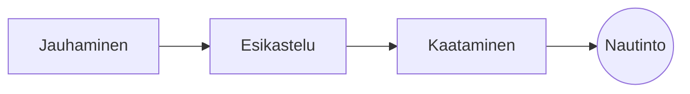

# Täydellinen suodatinkahvi

Hidas aamurituaali muutamassa vaiheessa. Kirjoita se **lähdetekstiin** vasemmalla tai suoraan *esikatseluun* oikealla: molemmat pysyvät synkassa, ja ==jokainen muokkaus on siisti muutos== Markdowniin.

> [!TIP]
> Juuri kiehumispisteen alapuolella oleva vesi, noin 94 °C, tuo esiin makeuden ilman karvautta.

## Suhde

Useimmat reseptit päätyvät yhteen osaan kahvia kuuteentoista osaan vettä:

$$
m_{\text{vesi}} = 16 \times m_{\text{kahvi}}
$$

Eli $20\,\text{g}$ kahvia tarvitsee $320\,\text{g}$ vettä.

## Vaihe vaiheelta



## Valmistustavat

| Tapa          | Jauhatus   | Aika |
|:--------------|:----------:|-----:|
| Suodatinkahvi | Keskihieno | 3.30 |
| Prässikannu   | Karkea     | 4.00 |
| Espresso      | Hieno      | 0.28 |

## Ennen aloitusta

- [x] Tuoreeksi paahdettuja papuja :coffee:
- [x] Terämylly
- [ ] Hanhenkaulakannu

```python
def water_for(coffee_g: float, ratio: int = 16) -> float:
    return coffee_g * ratio
```

Esikastelu
: Ensimmäinen vesiryöppy, jonka ansiosta jauhettu kahvi vapauttaa kaasunsa.[^1]

[^1]: Tuoreet pavut kukkivat eniten; vanhat tuskin nousevat lainkaan.
