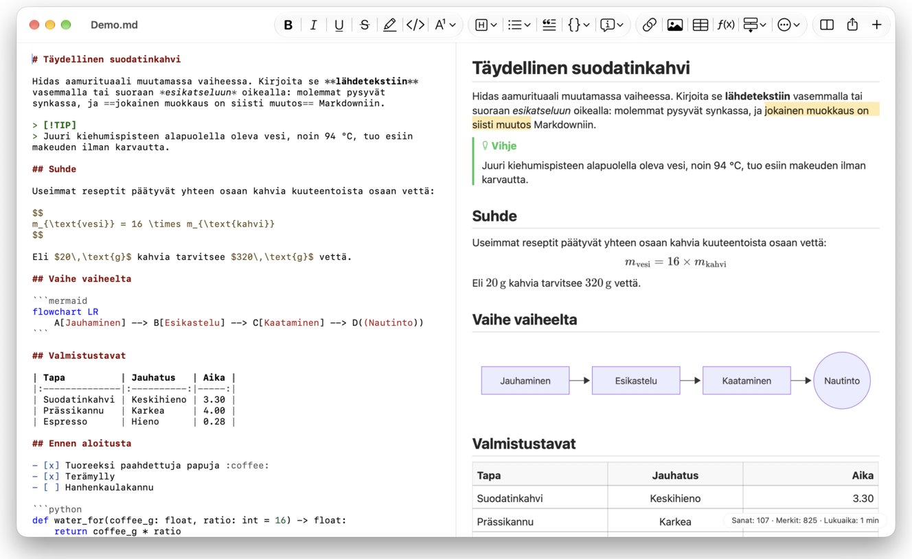
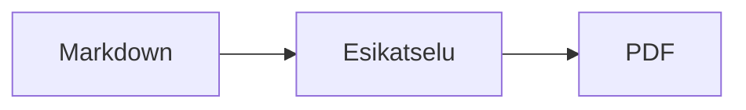

<p>&nbsp;&nbsp;&nbsp;</p>

# Splat

**Markdown-editori macOS:lle, jolla voit kirjoittaa lähdetekstiin tai suoraan esikatseluun.**

Splat näyttää Markdown-lähdetekstin syntaksiväreineen vasemmalla ja elävän, täysin muokattavan esikatselun oikealla. Voit kirjoittaa kumpaan tahansa: esikatseluun kirjoittamasi muuttuu lähdetekstiin mahdollisimman pienenä muutoksena, joten koskemattomat rivit pysyvät tavu tavulta samoina ja Git-diffit pysyvät siisteinä. Splat lukee jo käyttämääsi Markdownia: CommonMarkia ja GitHub Flavored Markdownia, GitHubin huomautuslaatikoita, Obsidianin wikilinkkejä, upotuksia ja huomautuslaatikoita, Pandocin ja Typoran laajennuksia, upotettua HTML:ää, LaTeX-kaavoja sekä Mermaid-, Graphviz- ja PlantUML-kaavioita, kaikki renderöitynä offline-tilassa. Selaa kokonaista muistiinpanokansiota ja etsi siitä, katso, mikä on muuttunut viimeisimmän Git-commitin jälkeen, sijoita Wordista tai verkkosivulta Markdownina ja vie PDF:ksi, HTML:ksi tai Wordiksi yhdellä napsautuksella. Se on kirjoitettu Rustilla aitojen AppKit-ohjainten päälle, puhuu 35 kieltä eikä lähetä mitään verkon yli, ellet pyydä.
 


[](https://github.com/sventmueller/splat/releases/latest/download/Splat.dmg)

**[Lataa Splat.dmg](https://github.com/sventmueller/splat/releases/latest/download/Splat.dmg)**: Applen allekirjoittama ja notarisoima, macOS 14:lle tai uudemmalle, Apple Silicon- ja Intel-Maceille.

**Löysitkö virheen?** Splat pitää rivit, joihin et ole koskenut, tavu tavulta samoina. Jos jokin silti muuttuu tai tiedosto näkyy väärin, [avaa issue](https://github.com/sventmueller/splat/issues/new/choose) ja liitä tiedosto mukaan. Jos Splat on sinulle hyödyllinen, [tähti GitHubissa](https://github.com/sventmueller/splat) auttaa muita löytämään sen.
 
 

[](https://www.rust-lang.org)
[](https://www.apple.com/macos/)

[](https://github.com/madsmtm/objc2)
[](https://webkit.org)
[](https://github.com/kivikakk/comrak)
[](https://github.github.com/gfm/)
[](https://www.mathjax.org)
[](https://cortexjs.io/mathlive/)
[](https://mermaid.js.org)
[](https://graphviz.org)
[](https://plantuml.com)


[](#lisenssi)

[Bahasa Indonesia](../id/README.md) ·
[Bahasa Melayu](../ms/README.md) ·
[Català](../ca/README.md) ·
[Čeština](../cs/README.md) ·
[Dansk](../da/README.md) ·
[Deutsch](../de/README.md) ·
[English](../../../README.md) ·
[Español](../es/README.md) ·
[Français](../fr/README.md) ·
[Hrvatski](../hr/README.md) ·
[Italiano](../it/README.md) ·
[Magyar](../hu/README.md) ·
[Nederlands](../nl/README.md) ·
[Norsk](../no/README.md) ·
[Polski](../pl/README.md) ·
[Português (Brasil)](../pt_BR/README.md) ·
[Português (Portugal)](../pt_PT/README.md) ·
[Română](../ro/README.md) ·
[Slovenčina](../sk/README.md) ·
[Slovenščina](../sl/README.md) ·
**Suomi** ·
[Svenska](../sv/README.md) ·
[Tiếng Việt](../vi/README.md) ·
[Türkçe](../tr/README.md) ·
[Ελληνικά](../el/README.md) ·
[Русский](../ru/README.md) ·
[Українська](../uk/README.md) ·
[עברית](../he/README.md)‎ ·
[العربية](../ar/README.md)‎ ·
[हिन्दी](../hi/README.md) ·
[ไทย](../th/README.md) ·
[한국어](../ko/README.md) ·
[日本語](../ja/README.md) ·
[简体中文](../zh-Hans/README.md) ·
[繁體中文](../zh-Hant/README.md)

## Sisältö

- [Pähkinänkuoressa](#pähkinänkuoressa)
- [Vaatimukset](#vaatimukset)
- [Asennus](#asennus)
- [Aloittaminen](#aloittaminen)
- [Kirjoittaminen](#kirjoittaminen)
  - [Lähdetekstissä](#lähdetekstissä)
  - [Esikatselussa](#esikatselussa)
  - [Muotoilukomennot](#muotoilukomennot)
  - [Luettelot ja tehtävät](#luettelot-ja-tehtävät)
  - [Taulukot](#taulukot)
  - [Muotoillun tekstin sijoittaminen](#muotoillun-tekstin-sijoittaminen)
  - [Metatiedot](#metatiedot)
- [Tuettu Markdown](#tuettu-markdown)
  - [CommonMark ja GitHub Flavored Markdown](#commonmark-ja-github-flavored-markdown)
  - [Huomautuslaatikot](#huomautuslaatikot)
  - [Laajennettu syntaksi](#laajennettu-syntaksi)
  - [Obsidian](#obsidian)
  - [Lähde- ja kirjallisuusviitteet](#lähde--ja-kirjallisuusviitteet)
  - [Upotettu HTML](#upotettu-html)
  - [Typografiset välimerkit](#typografiset-välimerkit)
  - [Syntaksiyhteenveto](#syntaksiyhteenveto)
- [Kaavat](#kaavat)
- [Kaaviot](#kaaviot)
- [Kuvat](#kuvat)
- [Linkit ja siirtyminen](#linkit-ja-siirtyminen)
- [Muistiinpanot kansiossa](#muistiinpanot-kansiossa)
- [Muutokset viimeisimmän commitin jälkeen](#muutokset-viimeisimmän-commitin-jälkeen)
- [Vienti, tulostus ja jakaminen](#vienti-tulostus-ja-jakaminen)
- [Word-dokumenttien tuominen](#word-dokumenttien-tuominen)
- [Ulkoasu ja saavutettavuus](#ulkoasu-ja-saavutettavuus)
- [Kielet](#kielet)
- [Pikanäppäimet](#pikanäppäimet)
- [Tietosuoja ja turvallisuus](#tietosuoja-ja-turvallisuus)
- [Suuret dokumentit](#suuret-dokumentit)
- [Tunnetut rajoitukset](#tunnetut-rajoitukset)
- [Vianmääritys](#vianmääritys)
- [Kehittäjille](#kehittäjille)
  - [Kolmannen osapuolen komponentit](#kolmannen-osapuolen-komponentit)
- [Lisenssi](#lisenssi)

## Pähkinänkuoressa

- **Kaksi tapaa kirjoittaa, yksi teksti.** Lähdeteksti ja esikatselu ovat molemmat muokattavia. Markdown-tiedosto on ainoa totuus: jokaisella dokumentilla on yksi kumoamishistoria, ja jokainen esikatselussa tehty muutos käännetään lähdetekstiin pienimpänä mahdollisena muutoksena.
- **Jo käyttämäsi Markdown.** CommonMark, GitHub Flavored Markdown, GitHubin huomautuslaatikot, Obsidian, Pandocin ja Typoran laajennukset, emoji-lyhytkoodit, spoilerit, määritelmäluettelot, otsikkoankkurit ja HTML sellaisena kuin GitHubin README-tiedostoissa.
- **Kaavat ja kaaviot sisäänrakennettuina.** LaTeX-kaavat MathJaxilla ja visuaalinen kaavaeditori. Mermaid-, Graphviz- ja PlantUML-kaaviot renderöidään Macillasi ilman Javaa, palvelinta tai verkkoyhteyttä.
- **Painike kaikelle.** Jokaiselle Markdown-rakenteelle on työkalupalkin painike ja valikkokohta, yleisimmille myös pikanäppäin. Taulukoilla on oma valikkonsa riveille, sarakkeille ja tasaukselle.
- **Kansio, ei vain tiedosto.** Sivupalkki luetteloi dokumentin ympärillä olevat muistiinpanot ja etsii niistä kaikista. Muistiinpanon uudelleennimeäminen muuttaa siihen osoittavat linkit, ja jokainen tavu niiden ympärillä säilyy.
- **Muutokset yhdellä silmäyksellä.** Git-repositoriossa tekstin vieressä olevat palkit merkitsevät sen, mikä eroaa viimeisimmästä commitista, molemmissa ruuduissa.
- **Wordista ja verkosta Markdowniksi.** Sijoita muotoiltu teksti Markdownina ja laskentataulukon solut taulukkona, ja tuo kokonaisia Word-dokumentteja kuvineen.
- **Vie menettämättä mitään.** PDF, yksittäinen itsenäinen HTML-tiedosto tai Word-dokumentti, jossa on aidot otsikot, luettelot, taulukot, alaviitteet ja kuvat. Lisää sivunumerot, yläotsakkeet ja nimiösivu tai käytä yrityksesi Word-työpohjaa.
- **Natiivi läpikotaisin.** Aidot AppKit-ikkunat, välilehdet, valikot, ponnahdusikkunat, versiot, automaattinen tallennus, jakovalikko, tumma tila, oikeinkirjoituksen tarkistus, sanelu ja VoiceOver. Ei Electronia, ei verkkonäkymää itse tekstille.
- **Nopea suurillakin tiedostoilla.** Näppäinpainalluksen piirtäminen 10 Mt:n dokumentissa kestää noin 10 ms ennen näkymän omaa työtä.
- **Yksityinen ja huolellinen.** Verkon kuvat latautuvat vasta luvallasi, linkit muihin appeihin kysyvät ensin, ja kaikki epäluotettavan kuvadatan purkaminen tapahtuu hiekkalaatikossa toimivissa apuprosesseissa.
- **Omalla kielelläsi.** Käyttöliittymä ja sisäänrakennettu Markdown-pikaopas ovat saatavilla 35 kielellä: arabia, englanti, espanja, heprea, hindi, hollanti, indonesia, italia, japani, katalaani, kiina (yksinkertaistettu), kiina (perinteinen), korea, kreikka, kroatia, malaiji, norja, portugali (Brasilia), portugali (Portugali), puola, ranska, romania, ruotsi, saksa, slovakki, sloveeni, suomi, tanska, thai, turkki, tšekki, ukraina, unkari, venäjä ja vietnam.

## Vaatimukset

- macOS 14 Sonoma tai uudempi. Splatia kehitetään ja testataan macOS 27:llä, jossa se ottaa Liquid Glass -ulkoasun käyttöön automaattisesti.
- Mac, jossa on Apple Silicon tai Intel-suoritin.
- Noin 45 Mt levytilaa.

## Asennus

**Levykuvasta.** Lataa [`Splat.dmg`](https://github.com/sventmueller/splat/releases/latest/download/Splat.dmg), avaa se ja vedä Splat Ohjelmat-kansioon. Kuva on allekirjoitettu Developer ID:llä ja Apple on notarisoinut sen, joten se aukeaa ilman varoituksia.

**Homebrew'lla.** Cask sijaitsee omassa tapissaan:

```sh
brew install --cask sventmueller/tap/splat
```

`brew upgrade --cask splat` asentaa uudet versiot, ja `brew uninstall --zap --cask splat` poistaa myös Splatin asetukset ja välimuistit.

**Päivitykset.** Levykuvasta tai Homebrew'lla asennettu Splat päivittää itsensä [Sparklen](https://sparkle-project.org) avulla. Toisella käynnistyskerralla se kysyy, saako se etsiä päivityksiä itse kerran päivässä. **Splat › Etsi päivityksiä…** etsii heti; **Etsi päivityksiä automaattisesti** ja **Lataa ja asenna päivitykset automaattisesti** samassa valikossa muuttavat valintaasi myöhemmin. Splat asentaa päivityksen vain, jos siinä on kehittäjän allekirjoitus. Itse rakennetussa versiossa ei ole päivitysohjelmaa.

**Lähdekoodista.** Katso esivaatimukset kohdasta [Rakentaminen](../../../docs/development.md#building) ja suorita sitten:

```sh
make build
ditto target/release/Splat.app /Applications/Splat.app
open /Applications/Splat.app
```

Jos haluat avata Markdown-tiedostot Splatilla kaksoisnapsautuksella, valitse mikä tahansa `.md`-tiedosto Finderissa, valitse **Tiedosto › Näytä tiedot**, valitse Splat kohdasta **Avaa apilla** ja napsauta **Vaihda kaikki…**. Splat rekisteröi itsensä `.md`-, `.markdown`-, `.mdown`- ja `.mkd`-tiedostoille.

## Aloittaminen

### Ikkuna

Jokainen dokumentti avautuu omaan ikkunaansa tai välilehteen, jos pidät välilehdistä:

- **Vasemmalla: lähdeteksti.** Markdownisi SF Monolla ja syntaksiväreillä.
- **Oikealla: esikatselu.** Renderöity dokumentti, valmiina muokattavaksi.
- **Sivupalkki (valinnainen).** Kaikki otsikot puuna, otsikon napsautus näyttää sen molemmissa ruuduissa: **Näytä › Näytä jäsennys** (⌃⌘S). Kahdella muulla välilehdellä ovat [kansion muistiinpanot](#muistiinpanot-kansiossa) ja niiden haku.
- **Työkalupalkki.** Painikkeet ryhmiteltyinä sen mukaan, mitä ne muuttavat: merkit, kappaleet ja lisättävät elementit, sitten esikatselun näyttö päälle tai pois, Jaa ja Uusi dokumentti. Muokkaa sitä valinnalla **Näytä › Muokkaa työkalupalkkia…**.

Vedä jakajaa antaaksesi jommallekummalle puolelle enemmän tilaa. **Näytä › Kätke esikatselu** (⌥⌘P) jättää vain lähdetekstin; Splat muistaa tämän ikkunakohtaisesti. Molemmat ruudut vierittyvät yhdessä, ja toisessa ruudussa tehty valinta korostuu toisessa.

Ikkunan kulmassa näkyvät tekstin sanat ja merkit ja sen lukuaika sekä valinnan vastaavat tiedot, kun valinta on olemassa. Linkkien osoitteita, HTML-tageja, metatietoja, kommentteja, kaavoja ja kaavioita ei lasketa. **Näytä › Kätke sanamäärä** poistaa sen näkyvistä.

### Dokumentit, välilehdet ja versiot

Splat on tavallinen macOS-dokumenttisovellus:

- **Automaattinen tallennus ja versiot.** Muutokset tallennetaan paikalleen. **Tiedosto › Palauta › Selaa kaikkia versioita…** vie sinut ajassa taaksepäin.
- **Muutokset muista ohjelmista.** Kun Git, skripti tai toinen editori muuttaa avointa dokumenttia, Splat lataa sen uudelleen ja säilyttää kohdistimen ja vierityskohdan. Jos sinulla on omia tallentamattomia muutoksia, Splat säilyttää ne, ja macOS kysyy ennen kuin toisen version päälle tallennetaan.
- **Tavalliset tiedostokomennot.** Monista (⇧⌘S), Nimeä uudelleen…, Siirrä kohteeseen… ja **Tiedosto › Avaa äskeinen**.
- **Välilehdet.** **Tiedosto › Uusi välilehti** tai työkalupalkin **+**-painike avaa uuden dokumentin välilehteen; Ikkuna-valikko yhdistää, siirtää ja selaa välilehtiä tavalliseen tapaan.
- **Ikkunan sijoittelu.** Viimeisen ikkunasi koko ja sijainti muistetaan, myös uudelleenkäynnistysten yli. Jos samassa kohdassa on jo ikkuna, uusi avautuu hieman siirrettynä.
- **Dock-kuvake.** Sen napsautus avaa uuden dokumentin, kun olet sulkenut viimeisen ikkunan.
- **Avaa Markdown-tiedostot Splatilla.** **Splat › Aseta Markdownin oletusapiksi** saa `.md`- tai `.markdown`-tiedoston kaksoisnapsautuksen avaamaan Splatin; macOS pyytää vahvistuksen kerran. Kohdassa näkyy valintamerkki, kun Splat on oletus.

Tiedostojen on oltava UTF-8-tekstiä tai UTF-16:ta tavujärjestysmerkillä. Splat kieltäytyy muista koodauksista sen sijaan, että arvaisi ja turmelisi tekstin. Tavujärjestysmerkki säilyy, UTF-16 pysyy UTF-16:na, ja tiedostossa, jonka kaikki rivit päättyvät CRLF:ään, myös lisäämäsi rivit saavat CRLF:n.

**Kaatumisen jälkeen** menetät korkeintaan viimeisten sekuntien kirjoituksen: Splat kopioi tallentamattoman tekstin viiden sekunnin välein kansioon `~/Library/Application Support/Splat/Unsaved` ja poistaa kopiot, kun dokumentti tallennetaan tai Splat sulkeutuu normaalisti. Seuraava käynnistys siirtää kaatumisen jättämän sisällön kansioon `~/Library/Application Support/Splat/Recovery` ja ilmoittaa siitä kerran painikkeella, joka avaa kansion. Kaatuminen, johon Splat vielä ehtii reagoida, kirjoittaa sinne myös jokaisen avoimen dokumentin tekstin.

### Pikaopas

**Ohje › Markdown-pikaopas** avaa omalla kielelläsi kirjoitetun muistilapun uutena, nimeämättömänä dokumenttina. Se on tavallinen dokumentti, joten kokeile kaikkea suoraan siinä, lähdetekstissä tai esikatselussa.

## Kirjoittaminen

### Lähdetekstissä

Lähdeteksti on Markdownille viritetty pelkän tekstin editori:

- **Syntaksivärit** kuten VS Codessa: otsikot, painotukset, linkit, koodi, taulukot, HTML, front matter sekä LaTeX ja Mermaid kaavojen ja kaavioiden sisällä. Paletit on tehty vaaleaan ja tummaan tilaan sekä Lisää kontrastia -asetukselle.
- **Aitaukselliset koodilohkot** korostetaan Bashille, C:lle, C++:lle, C#:lle, CSS:lle (myös SCSS ja Less), Go:lle, HTML:lle, XML:lle, Javalle, JavaScriptille, JSON:lle, Kotlinille, PHP:lle, Pythonille, Rubylle, Rustille, SQL:lle, Swiftille, TypeScriptille, YAML:lle, TeX:lle ja Mermaidille, myös niiden tavallisilla lyhenteillä kuten `js`, `py` tai `sh`.
- **Ei yllättäviä korvauksia.** Kaarevat lainausmerkit, ajatusviivat ja tekstin korvaus ovat oletuksena pois päältä, koska ne rikkovat merkit `--`, `---` ja `"`. Voit ottaa ne käyttöön kohdassa **Muokkaa › Korvaukset**.
- **Järjestelmän kirjoitustyökalut.** Oikeinkirjoituksen ja kieliopin tarkistus, sanelu, Etsi ja korvaa (⌥⌘F) sekä puhe.
- **Vetäminen ja pudottaminen.** Pudota kuvatiedosto lisätäksesi ``, mikä tahansa muu tiedosto lisätäksesi linkin siihen ja URL lisätäksesi `[url](url)`. Jokainen pudotus on yksi kumoamisvaihe.
- **Kuvien sijoitus.** Leikepöydällä oleva kuva, kuten kuvakaappaus, tallennetaan PNG-tiedostona dokumentin viereen (`Kuva 2026-10-29 13.09.07.png`) ja lisätään kuvana. Dokumentti täytyy tallentaa kerran, jotta tämä onnistuu.

### Esikatselussa

Esikatselu toimii kuin tekstinkäsittelyohjelma, mutta kaikesta, mitä siinä teet, tulee Markdownia:

- **Kirjoittaminen.** Merkit, joilla on Markdownissa merkitys, kuten `*` tai `#`, suojataan niin, että ne näkyvät sellaisinaan kuin ne kirjoitit.
- **Return** aloittaa uuden kappaleen tai luettelokohdan. **⌥Return** tai **⌃Return** lisää rivinvaihdon.
- **Muotoilu kohdistimen kohdalla.** Kun kohdistin on sanan lopussa, Lihavoi, Kursivoi ja muut merkkimuotoilut koskevat sitä, mitä kirjoitat seuraavaksi. Valitse muotoilu uudelleen lopettaaksesi sen. Sanan sisällä muotoillaan koko sana.
- **Tyhjät rivit.** Return tyhjällä rivillä lisää uuden tyhjän rivin, ja askelpalautin poistaa sen. Lähdetekstissä jokainen ylimääräinen tyhjä rivi on kaksi lisätyhjää riviä; muut Markdown-ohjelmat näyttävät ne tavallisena kappalevälinä.
- **Peru** toimii molempien ruutujen yli. Kumottavilla toiminnoilla on nimet (”Peru Lihavoi”), kirjoitus on yksi vaihe per jakso, ja kumoamisen ja uudelleentekemisen jälkeen molemmat ruudut vierittyvät muutoksen kohdalle.
- **Kaavat ja kaaviot** näkyvät valmiina grafiikkana. Napsauta sitä, siirrä kohdistin sen päälle tai paina sen kohdalla Return avataksesi sen editorin (katso [Kaavat](#kaavat) ja [Kaaviot](#kaaviot)).
- **Upotettu HTML, upotetut muistiinpanot ja front matter** näytetään, mutta niitä muokataan lähdetekstissä. Niiden napsautus siirtää kohdistimen vastaavaan kohtaan siellä.

Kaikki, mitä Markdown ei voi ilmaista, on estetty esikatselussa: Fontti- ja Väri-paneelit, viivoitin sekä muotoillun tekstin ja kuvien sijoittaminen tai pudottaminen. Sijoitettu HTML ja RTF tulevat pelkkänä tekstinä, ellet valitse kohtaa [Sijoita Markdownina](#muotoillun-tekstin-sijoittaminen).

### Muotoilukomennot

Jokainen komento on käytettävissä työkalupalkista, valikkorivistä ja kummankin ruudun kontekstivalikosta. Valikkokohdissa näkyy valintamerkki kohdistimen kohdan muotoilulle.

| Valikko | Komennot |
|---|---|
| **Muoto › Fontti** | Lihavoi, Kursivoi, Alleviivaa, Yliviivaa, Korosta, Koodi, Yläindeksoi, Alaindeksoi |
| **Muoto › Otsikko** | Leipäteksti, Otsikko 1–6 |
| **Muoto › Luettelo** | Luettelomerkitty luettelo, Numeroitu luettelo, Tehtäväluettelo |
| **Muoto** | Lainaus, Koodilohko (Ei kieltä tai yksi 20 kielestä; vaihtaa myös olemassa olevan lohkon kielen), Huomautuslaatikko (Huomautus, Vihje, Tärkeää, Varoitus, Huomio; sama tyyppi uudelleen poistaa sen), Muokkaa kaavaa tai kaaviota…, Poista muotoilu |
| **Lisää** | Linkki…, Kuva…, Taulukko…, Kaava, Kaavio (Vuokaavio, Sekvenssikaavio, Gantt-kaavio), Sisällysluettelo, Alaviite, Erotin |
| **Taulukko** | Lisää rivi yläpuolelle/alapuolelle, Lisää sarake vasemmalle/oikealle, Poista rivi, Poista sarake, Tasaus (Vasemmalle, Keskitä, Oikealle, Oletus), Tasaa taulukon sarakkeet |
| **Näytä** | Kätke/Näytä esikatselu, Näytä/Kätke jäsennys, Typografiset välimerkit, Lähennä/Loitonna, Todellinen koko, työkalupalkki, välilehtipalkki, koko näyttö |

Alleviivaus, korostus, yläindeksi ja alaindeksi kirjoitetaan muodossa `<ins>`, `<mark>`, `<sup>` ja `<sub>`, jotka GitHub näyttää myös. Splat lukee myös `<u>`:n, jonka GitHub poistaa, sekä lyhyemmät `==korostus==`, `^ylä^` ja `~ala~`. GitHub näyttää `==` ja `^` sellaisinaan ja `~ala~` yliviivauksena.

### Luettelot ja tehtävät

- Return jatkaa luetteloa; Return tyhjällä kohdalla päättää sen.
- **Tab** sisentää ja **⇧Tab** ulontaa luettelokohtia esikatselussa.
- Tehtävän valintaruudun napsautus esikatselussa vaihtaa merkinnän `- [ ]` ja `- [x]` välillä.
- **Muoto › Luettelo** muuttaa valitut kappaleet luetteloksi tai vaihtaa sen tyyppiä.

### Taulukot

- **Lisää › Taulukko…** kysyy rivien (otsikkorivi mukaan lukien) ja sarakkeiden määrän.
- Esikatselussa **Tab** siirtyy seuraavaan soluun, **⇧Tab** edelliseen ja **Return** alla olevaan soluun. Tab viimeisessä solussa lisää rivin.
- **Taulukko**-valikko lisää ja poistaa rivejä ja sarakkeita sekä asettaa sarakkeen tasauksen (⌘{, ⌘|, ⌘}).
- **Taulukko › Tasaa taulukon sarakkeet** täyttää lähdetekstiä välilyönneillä, jotta sarakkeet asettuvat riviin.

### Muotoillun tekstin sijoittaminen

**Muokkaa › Sijoita Markdownina** (⌃⌘V), joka on myös molempien ruutujen kontekstivalikossa, muuttaa leikepöydän sisällön Markdowniksi valinnan kohdalle yhtenä kumoamisvaiheena. ⌘V lisää edelleen pelkkää tekstiä.

- **Selaimesta, Wordista, Google Docsista, Confluencesta, Muistiinpanoista tai Pagesista:** otsikot, lihavointi, kursivointi, alleviivaus, yliviivaus, ylä- ja alaindeksi, linkit, luettelot sisäkkäisyyksineen, lainaukset, koodi ja taulukot tulevat mukana.
- **Laskentataulukosta:** soluista tulee taulukko, jossa on otsikkorivi ja numerosarakkeet tasattuna oikealle. Samoin käy sarkaimilla, puolipisteillä tai pilkuilla erotetulle tekstille, jos jokaisella rivillä on yhtä monta saraketta.
- **Kuvat**, joilla on verkko-osoite, pysyvät linkkeinä. Sijoitetun HTML:n sisällä olevasta kuvasta tulee tiedosto dokumentin viereen, ja dokumentti täytyy tallentaa kerran, jotta tämä onnistuu. Wordin väliaikaiset kuvatiedostot eivät tule mukaan, mutta niiden vaihtoehtoinen teksti säilyy.
- **Linkeistä** säilyvät vain osoitteet `http`, `https`, `mailto`, suhteelliset osoitteet ja `#`-osoitteet; muista linkeistä jää vain teksti.

### Metatiedot

**Muoto › Muokkaa metatietoja…** tai esikatselun yläreunan metatietorivin napsautus avaa lomakkeen, jossa on YAML-front matterin kentät. Kenttiä voi muuttaa, lisätä ja poistaa. Luettelon sisältävä kenttä säilyy luettelona: sen arvot ovat peräkkäin pilkuilla erotettuina, ja pilkun sisältävä arvo on lainausmerkeissä. Uudesta kentästä, jonka nimi on `tags`, `aliases`, `keywords`, `categories`, `authors` tai `cssclasses`, tulee myös luettelo. Sisäkkäiset kentät ja monirivinen teksti näkyvät siellä, ja niitä muokataan lähdetekstissä.

Lomakkeen tekemä muutos on yksi kumoamisvaihe ja ulottuu vain muuttamiesi kenttien riveille: kaikkien muiden kommentit, järjestys, poikkeavat välit, lainausmerkit ja rivinvaihdot säilyvät tavu tavulta samoina. Dokumentti, jossa ei ole metatietoja, saa lohkon alkuunsa.

## Tuettu Markdown

Splat jäsentää [comrakilla](https://github.com/kivikakk/comrak), CommonMark- ja GFM-yhteensopivalla jäsentimellä, ja ottaa käyttöön useimmat sen laajennukset. Kaikki alla oleva renderöityy esikatseluun ja kaikkiin vienteihin.

### CommonMark ja GitHub Flavored Markdown

- Otsikot (`#` ja alleviivatut), kappaleet, rivinvaihdot, painotus, vahva painotus, tekstinsisäinen koodi, lainauslohkot, erottimet.
- Luettelomerkityt, numeroidut ja sisäkkäiset luettelot; tehtäväluettelot.
- Linkit (tekstinsisäiset, viite- ja automaattiset), kuvat, linkkiviitemääritelmät.
- Aitaukselliset ja sisennetyt koodilohkot syntaksiväreillä.
- Taulukot sarakkeiden tasauksella.
- Yliviivaus merkinnällä `~~kaksi aaltoviivaa~~`.
- Alaviitteet: `teksti[^1]` ja `[^1]: Alaviite.` missä tahansa dokumentissa. Merkin napsautus hyppää alaviitteeseen.
- YAML-front matter `---`-rivien välissä alussa. Esikatselu tiivistää sen yhteen riviin, esimerkiksi ”Metatiedot: title, date, tags”.

### Huomautuslaatikot

GitHubin huomautuslaatikot renderöidään värillisinä laatikoina kuvakkeella ja otsikolla:

```markdown
> [!NOTE]
> Hyödyllistä tietoa, jonka käyttäjien pitäisi tietää.

> [!WARNING]
> Kriittistä sisältöä, joka vaatii välitöntä huomiota.
```

Viisi tyyppiä ovat Huomautus, Vihje, Tärkeää, Varoitus ja Huomio. **Muoto › Huomautuslaatikko** muuttaa kohdistimen kohdalla olevan kappaleen sellaiseksi.

Obsidianin huomautuslaatikot toimivat myös, millä tahansa otsikolla ja laajennustilalla:

```markdown
> [!tip]- Laajenna osoittamalla ▸
> Piilossa, kunnes avataan.

> [!question]+ Auki oletuksena
> Merkki `+` aloittaa laajennettuna, `-` tiivistettynä.
```

Obsidianin muut tyypit näytetään viidestä lähimmällä värillä: `success`, `check`, `done` ja `hint` Vihjeenä; `question`, `help` ja `faq` Tärkeänä; `attention` Varoituksena; `failure`, `fail`, `missing`, `danger`, `error` ja `bug` Huomiona; kaikki muut Huomautuksena.

### Laajennettu syntaksi

| Ominaisuus | Syntaksi | Lähde |
|---|---|---|
| Korostus | `==korostettu teksti==` | Obsidian, Typora |
| Yläindeksi | `x^2^` | Pandoc, Typora |
| Alaindeksi | `H~2~O` | Pandoc, Typora |
| Emoji-lyhytkoodi | `:rocket:` muuttuu muotoon 🚀 | GitHub |
| Spoileri | `\|\|piilotettu teksti\|\|`, lue valitsemalla | Discord |
| Tekstinsisäinen alaviite | `teksti^[alaviite itse]` | Pandoc, Obsidian |
| Määritelmäluettelo | `Käsite`, tyhjä rivi, `: Selitys` | PHP Markdown Extra, Pandoc |
| Otsikkoankkuri | `## Asennus {#setup}`, linkki muodossa `[katso](#setup)` | Pandoc, kramdown |

Määritelmäluettelot näyttävät lähdetekstissä tältä:

```markdown
Käsite

: Käsitteen selitys.
```

Ilman omaa ankkuria jokainen otsikko saa sellaisen tekstistään johdettuna, kuten GitHubissa: `## Aloittaminen` löytyy ankkurilla `#aloittaminen`.

### Obsidian

- **Wikilinkit.** `[[Muistiinpano]]` linkittää tiedostoon `Muistiinpano.md` samassa tai alemmassa kansiossa. `[[Muistiinpano|Näytettävä teksti]]` näyttää oman tekstisi, ja `[[Muistiinpano#Otsikko]]` avaa muistiinpanon. ⌘-osoitus avaa sen Splatissa.
- **Upotukset.** `![[Muistiinpano]]` näyttää toisen muistiinpanon tämän sisällä; siihen upotetut muistiinpanot näkyvät linkkeinä. `![[kaavio.png]]` näyttää kuvan. Kuten Obsidianissa, upotukset nimeävät muistiinpanoja ja kuvia dokumentin kansiossa tai sen alla, eivät koskaan absoluuttisella polulla, ja vain Markdown-tiedostot näkyvät muistiinpanoina.
- **Kommentit.** `%%Vain lähdetekstissä%%` pysyy näkyvissä lähdetekstissä ja jätetään pois esikatselusta ja jokaisesta viennistä, sekä tekstin seassa että omilla riveillään.
- **Tunnisteet.** `#idea` tai `#project/splat` korostetaan. ⌘-osoitus etsii tunnistetta dokumentista ja sivupalkissa koko kansiosta.
- **Laajennettavat huomautuslaatikot.** Katso [Huomautuslaatikot](#huomautuslaatikot).

### Lähde- ja kirjallisuusviitteet

- **Pandoc-lähdeviitteet.** `[@doe2020]` tai `[@doe2020; @roe2021]` näkyy muodossa ”(Doe 2020; Roe 2021)”. Merkinnät haetaan BibTeX-tiedostosta, jonka front matter nimeää rivillä `bibliography: refs.bib`. Ilman sitä Splat käyttää dokumentin vieressä olevaa tiedostoa `references.bib`, `literatur.bib` tai `bibliography.bib`.
- **GitHub- ja GitLab-viittaukset.** Jos dokumentti on Git-repositoriossa, jonka `origin`-remote on osoitteessa github.com tai GitLab-palvelimella, `@name`, `#12` (issue) ja `!7` (merge request, vain GitLab) korostetaan. ⌘-osoitus avaa ne selaimessa.

### Upotettu HTML

HTML, sellaisena kuin sen tapaa GitHubin README-tiedostoissa, renderöidään omalla lukijalla selaimen moottorin sijaan:

- keskitetyt kappaleet ja lohkot (`<p align="center">`, `<div align="center">`)
- kuvat koon kanssa (``)
- linkit, `<kbd>⌘</kbd>`, `<br>`, `<u>`, `<ins>`, `<mark>`, `<sup>`, `<sub>`
- luettelot ja taulukot, mukaan lukien useaan sarakkeeseen ulottuvat solut (`colspan`)
- laajennettavat osiot: `<details><summary>Lisää</summary>…</details>`, avataan napsauttamalla ▸

HTML-tagien välinen Markdown renderöidään Markdownina. Skriptit, tyylit, kehykset ja lomakkeet jätetään kokonaan pois, ja linkeistä ja kuvista säilyvät vain osoitteet `http`, `https`, `mailto` ja suhteelliset osoitteet.

### Typografiset välimerkit

**Näytä › Typografiset välimerkit** näyttää suorat lainausmerkit käyttöliittymäkielesi lainausmerkkeinä, merkinnän `--` ajatusviivana (–), merkinnän `---` pitkänä ajatusviivana (—) ja merkinnän `...` kolmena pisteenä. Saksassa `"Ja"` muuttuu muotoon „Ja“, ranskassa «Oui», japanissa 「はい」, myös siellä, missä kiina ja japani sijoittavat lainausmerkit ilman välilyöntiä; heprean lyhenteet kuten `צה"ל` saavat gershayimin, צה״ל. Lähdeteksti säilyttää pelkät merkit; esikatselu ja kaikki viennit näyttävät typografiset. Asetus on pois päältä, kunnes otat sen käyttöön.

### Syntaksiyhteenveto

| Elementti | Markdown |
|---|---|
| **Lihavoitu** | `**Lihavoitu**` |
| *Kursivoitu* | `*Kursivoitu*` |
| Alleviivattu | `<ins>Alleviivattu</ins>` tai `<u>Alleviivattu</u>` |
| ~~Yliviivattu~~ | `~~Yliviivattu~~` |
| Korostettu | `<mark>Korostettu</mark>` tai `==Korostettu==` |
| `Koodi` | `` `Koodi` `` |
| x² | `x<sup>2</sup>` tai `x^2^` |
| H₂O | `H<sub>2</sub>O` tai `H~2~O` |
| [Linkki](https://example.com) | `[Linkki](https://example.com)` |
| Otsikko | `# Otsikko` – `###### Otsikko` |
| Lainaus | `> Lainaus` |
| Luettelomerkitty luettelo | `- Kohta` |
| Numeroitu luettelo | `1. Kohta` |
| Tehtävä | `- [ ] Avoin` ja `- [x] Valmis` |
| Koodilohko | ```` ```rust ```` … ```` ``` ```` |
| Taulukko | `\| A \| B \|` ja otsikkorivin alla `\|---\|---\|` |
| Alaviite | `Teksti[^1]` ja `[^1]: Huomautus` |
| Erotin | `---` |
| Kuva | `` |
| Kaava | `$E = mc^2$`, `$$ … $$` |
| Kaavio | ```` ```mermaid ````, ```` ```dot ````, ```` ```plantuml ```` |
| Huomautuslaatikko | `> [!TIP]` |
| Wikilinkki | `[[Muistiinpano]]`, `[[Muistiinpano\|Teksti]]` |
| Upotus | `![[Muistiinpano]]`, `![[kuva.png]]` |
| Kommentti | `%%Kommentti%%` |
| Tunniste | `#tunniste` |
| Lähdeviite | `[@avain]` |
| Spoileri | `\|\|Spoileri\|\|` |
| Emoji | `:tada:` |

## Kaavat

[MathJax](https://www.mathjax.org) renderöi kaavat TeX- ja AMS-matematiikkatuellaan terävinä vektorigrafiikkana. Teksti merkinnässä `\text{…}` voi olla millä tahansa kirjoitusjärjestelmällä: sen, mitä MathJaxin fonteista puuttuu, tarjoavat Macisi fontit, arabia ja heprea kulkevat oikealta vasemmalle ja emoji näkyvät värillisinä.

| Laji | Syntaksi |
|---|---|
| Tekstinsisäinen | `$E = mc^2$`, `` $`E = mc^2`$ `` (GitHub, GitLab), `\(E = mc^2\)` |
| Erillinen | `$$` … `$$`, `\[` … `\]` tai koodilohko, jonka kieli on `math` |

**Kaavan muokkaus.** Napsauta kaavaa esikatselussa, kaksoisnapsauta sitä, paina sen kohdalla Return tai siirrä kohdistin sen päälle avataksesi sen editorin ponnahdusikkunassa. **Lisää › Kaava** lisää uuden ja avaa editorin heti.

- **Visuaalinen tai LaTeX.** Yläreunan kytkin vaihtaa visuaalisen editorin ([MathLive](https://cortexjs.io/mathlive/)) ja LaTeX-koodin välillä. Splat muistaa valintasi.
- **Rakennuspalikat** murtoluvulle, neliöjuurelle, ylä- ja alaindeksille, summalle ja integraalille rajoineen, raja-arvolle, sisällön mukana kasvaville sulkeille, 2×2-matriisille, kreikkalaisille kirjaimille sekä relaatioille, operaattoreille ja nuolille. Ne jättävät paikkamerkit □, ja **Tab** siirtyy seuraavaan.
- **Reaaliaikainen esikatselu.** Muutokset näkyvät dokumentissa kirjoittaessasi. MathJaxin virheet näytetään koodin alapuolella olevalla rivillä.
- **Hyväksy tai hylkää.** Muualle napsauttaminen säilyttää muutoksen yhtenä kumoamisvaiheena; **Esc** tai **Kumoa** hylkää sen. Uuden, tyhjän kaavan Esc poistaa jälleen.
- Kontekstivalikossa on osoittimen alla olevalle kaavalle **Muokkaa kaavaa…**.

VoiceOver lukee kaavan LaTeX-koodina. Splat renderöi kaavoja, ei kokonaisia LaTeX-dokumentteja: paketteja, TikZiä tai `\documentclass`-komentoa ei ole.

## Kaaviot

Kaaviot renderöidään Splatin sisällä, offline-tilassa sekä vaaleana että tummana versiona.

| Moottori | Koodilohko | Mitä se piirtää |
|---|---|---|
| [Mermaid](https://mermaid.js.org) | ```` ```mermaid ```` | vuokaaviot, sekvenssi-, luokka-, tila-, entiteettisuhde-, Gantt-, ympyrä- ja mielikartat, aikajanat ja kaikki muut Mermaid-tyypit |
| [Graphviz](https://graphviz.org) | ```` ```dot ```` tai ```` ```graphviz ```` | DOT-kielen graafit |
| [PlantUML](https://plantuml.com) | ```` ```plantuml ```` tai ```` ```puml ```` | UML-kaaviot; toimii ilman Javaa |



**Kaavion muokkaus** toimii kuten kaavan: napsauta sitä avataksesi koodin ponnahdusikkunassa, jossa on syntaksivärit ja virheilmoitukset koodin alapuolella olevalla rivillä. **Lisää › Kaavio** aloittaa vuokaavion, sekvenssikaavion tai Gantt-kaavion mallista. Rakennuspalikat auttavat kolmessa yleisimmässä Mermaid-tyypissä:

- **Vuokaavio:** Solmu ▾ (suorakaide, pyöristetty, ympyrä, vinoneliö, tietokanta), Yhteys, Tekstillä varustettu yhteys, Ryhmä, Suunta ▾
- **Sekvenssikaavio:** Osallistuja, Viesti, Vastaus, Muistiinpano, Silmukka, Vaihtoehtoiset polut
- **Gantt-kaavio:** Osio, Tehtävä, Virstanpylväs

Muita kaaviotyyppejä muokataan koodina. VoiceOver lukee kaavion otsikon tai vaihtoehtoisen tekstin.

Ensimmäinen kaavio käynnistyksen jälkeen kestää noin sekunnin, koska renderöintimoottori käynnistyy taustalla. Yli 10 sekuntia kestävä kaavio näyttää virheen, ja renderöintimoottori käynnistyy seuraavaa varten uudelleen. PlantUML:n moottori (3 Mt) latautuu vasta ensimmäisen PlantUML-kaavion yhteydessä. PlantUML:n `!include` verkosta estetään.

## Kuvat

- **Paikalliset kuvat** käyttävät dokumenttiin nähden suhteellisia polkuja: ``. Splat näyttää PNG-, JPEG-, GIF-, WebP-, BMP-, SVG-, HEIC-, TIFF-, AVIF- ja PDF-tiedostot.
- **Verkon kuvat** pysyvät estettyinä, kunnes sallit ne: esikatselun yläpuolella oleva palkki kertoo, että niiden lataaminen kertoo niiden palvelimille, että ja milloin avaat dokumentin. **Lataa kuvat** sallii ne tälle dokumentille; Splat muistaa valinnan tiedostokohtaisesti.
- **Koko.** `` määrittää kuvan koon; muuten kuvat sovitetaan esikatselun leveyteen.
- **Muutokset levyllä.** Korvaamasi tai vasta dokumentin mainitsemisen jälkeen ilmestyvä kuva näkyy avaamatta dokumenttia uudelleen. Verkon kuvia, jotka epäonnistuivat verkon vuoksi, yritetään uudelleen, kun dokumentti niitä näyttää.
- **Muisti.** Kuvat näytetään enintään 2560 pikselin pisimmällä sivullaan, mikä täyttää myös A4-sivun. Ne puretaan pienempinä, kun ne täyttävät kahdeksasosan Macin muistista, ja kun macOS ilmoittaa muistipaineesta.
- **Tumma tila.** Valkotaustaiset kuvat himmennetään hieman tummassa esikatselussa.
- **Sijoittaminen ja pudottaminen.** Katso [Lähdetekstissä](#lähdetekstissä).

## Linkit ja siirtyminen

Esikatselussa napsautus asettaa kohdistimen, jotta voit muokata linkin tekstiä; **⌘-napsautus** seuraa linkkiä:

- `http`, `https` ja `mailto` avautuvat selaimessasi tai sähköpostiohjelmassasi.
- Markdown-tiedostot avautuvat Splatissa; muut tiedostot ja kansiot näytetään Finderissa.
- `#anchor` hyppää dokumentin otsikkoon.
- Osoitteet, jotka avaavat toisen apin, kuten `slack://` tai `vscode://`, kysyvät ensin ja näyttävät koko osoitteen ja apin. **Kumoa** on esivalittuna.

**Lisää › Sisällysluettelo** lisää linkitetyn luettelon kaikista otsikoista. Kun kohdistin on sen sisällä, sama komento päivittää sen. Jäsennyssivupalkki (⌃⌘S) siirtyy mihin tahansa otsikkoon molemmissa ruuduissa.

## Muistiinpanot kansiossa

Sivupalkin yläreunan painikkeet vaihtavat jäsennyksen, tiedostojen ja haun välillä.

- **Tiedostot** (**Näytä › Näytä tiedostot**, ⌃⌘E). Kaikki Markdown-tiedostot dokumentin kansiossa tai, jos dokumentti on Git-repositoriossa, koko repositoriossa. Napsautus tai Return avaa muistiinpanon tämän ikkunan välilehdeksi; jos se on jo auki, se tulee eteen. Kansion nimen vieressä oleva painike näyttää toisen kansion tässä ikkunassa. Kätketyt tiedostot, `node_modules`, `target`, `Pods`, `DerivedData`, `__pycache__` ja kansiot, joissa ei ole muistiinpanoja, jäävät pois. Suoraan kotikansiossasi oleva dokumentti näyttää vain vieressään olevat muistiinpanot, jotta Splat ei kävisi läpi kaikkia kansioitasi ja kysyisi lupaa jokaiseen niistä.
- **Haku** (**Muokkaa › Etsi › Etsi kaikista muistiinpanoista…**, ⇧⌘F). Löytää tekstin kaikista muistiinpanoista kirjainkoosta ja aksenttien koodaustavasta riippumatta. `#tag` löytää tunnisteen, `#project` myös tunnisteen `#project/splat`, eikä mitään koodin sisältä. Tuloksen napsautus avaa muistiinpanon siitä kohdasta.
- **Linkit muistiinpanoon.** Muistiinpanon kontekstivalikko luetteloi muistiinpanot, jotka linkittävät siihen wikilinkillä, upotuksella, suhteellisella linkillä tai linkkiviitemääritelmällä.
- **Muistiinpanon uudelleennimeäminen.** Sama valikko nimeää sen uudelleen ja muuttaa nuo linkit. Splat kertoo ensin, kuinka monesta linkistä kuinka monessa tiedostossa on kyse. Kussakin linkissä muuttuu vain nimi, ja tiedoston jokainen muu tavu säilyy. Avoimet dokumentit ottavat muutoksen kumoamisvaiheena; muissa tiedostoissa vain Git tai versiot voivat perua sen. Tiedosto, jota toinen ohjelma on sillä välin muuttanut, pysäyttää kaikkien linkkien uudelleennimeämisen, ja Splat kertoo, mistä tiedostosta on kyse.

Luettelo seuraa kansiota, kun ikkuna tulee eteen. Haku käsittelee tiedostoja sellaisina kuin ne ovat levyllä, ja teksti, jota et ole vielä tallentanut, otetaan huomioon seuraavasta automaattisesta tallennuksesta alkaen.

## Muutokset viimeisimmän commitin jälkeen

Git-repositoriossa olevassa dokumentissa tekstin vieressä olevat palkit merkitsevät sen, mikä eroaa viimeisimmästä commitista, lähdetekstissä ja esikatselussa: vihreä lisätyille riveille, sininen muutetuille riveille ja lyhyt punainen merkki sinne, mistä jotain on poistettu. Ne seuraavat mukana kirjoittaessasi ja haaran siirtyessä. **Näytä › Muutokset viimeisimmän commitin jälkeen** poistaa ne käytöstä kaikista ikkunoista.

Rivejä, jotka eroavat vain rivinvaihdoltaan, ei lasketa, joten CRLF-tiedosto LF-commitia vasten ei näytä muutosta. Uudessa tiedostossa ei ole merkkejä ennen sen ensimmäistä commitia, eikä niitä ole myöskään yli 32 Mt:n dokumentissa.

## Vienti, tulostus ja jakaminen

| Muoto | Miten | Mitä saat |
|---|---|---|
| **PDF** | **Tiedosto › Vie PDF:nä…** tai Jaa-valikko | Paperin kokoiset sivut, aina vaaleassa ulkoasussa, kaavat ja kaaviot vektorigrafiikkana. **Tiedosto › Arkin määritys…** asettaa paperin. |
| **Tulostus** | **Tiedosto › Tulosta…** (⌘P) | Sama taitto kuin PDF:ssä. |
| **HTML** | **Tiedosto › Vie HTML:nä…** tai Jaa-valikko | Yksi itsenäinen tiedosto: paikalliset kuvat upotettuina, kaavat ja kaaviot teräväpiirtokuvina, otsikkoankkurit, jotta sisällysluettelo toimii. Ei skriptejä. |
| **Word** | **Tiedosto › Vie Word-dokumenttina…** tai Jaa-valikko | `.docx`, jossa on Wordin otsikkotyylit, aidot luettelot ja taulukot (myös yhdistetyt solut), alaviitteet Wordin alaviitteinä, upotetut kuvat, kaavat ja kaaviot. |
| **Markdown** | Työkalupalkin **Jaa**-painike | Dokumentti `.md`-tiedostona Mailia, Viestejä, AirDropia ja kaikkia muita jakopalveluja varten. |

**Tiedosto › Jaa** -valikko tarjoaa kaikki nämä yhdessä paikassa. Viennit käyttävät typografisten välimerkkien asetusta ja verkosta sallimiasi kuvia; verkon kuvat pysyvät HTML:ssä linkkeinä.

**Tiedosto › Vientivalinnat…** määrittää, mitä PDF, tulostus ja Word lisäävät tekstiin, kaikille dokumenteille:

- **Sivunumerot** PDF:n ja tulosteen alaotsakkeessa, muodossa `2 / 9`.
- **Yläotsake ja alaotsake** PDF:lle ja tulosteelle. `{title}`, `{author}`, `{date}`, `{page}` ja `{pages}` tarkoittavat arvojaan, kolme ensimmäistä dokumentin metatiedoista.
- **Nimiösivu** PDF:lle, tulosteelle ja Wordille, ja siinä `title`, `subtitle`, `author` ja `date` metatiedoista tai otsikkona dokumentin nimi. Siinä ei ole ylä- eikä alaotsaketta.
- **Word-työpohja**, `.docx` tai `.dotx`, jonka ulkoasun vienti ottaa käyttöön: sen tyylit, myös lokalisoidut nimet, teeman, sivukoon, marginaalit, ylä- ja alaotsakkeet. Työpohja, jota ei voi lukea, pysäyttää viennin ja kertoo siitä sen sijaan, että antaisi sinulle dokumentin ilman sitä.

## Word-dokumenttien tuominen

**Tiedosto › Tuo Word-dokumentti…** kysyy `.docx`- tai `.dotx`-tiedostoa ja sitä, minne sen Markdown menee, ja avaa sitten tuloksen. Kuvat päätyvät sen viereen kansioon, joka on nimetty dokumentin mukaan päätteellä `-images`.

Otsikot ja luettelot siirtyvät sellaisina kuin Wordin tyylit ja numerointi ne määrittelevät, myös dokumenteissa, joiden tyyleillä on lokalisoidut nimet. Lihavointi, kursivointi, alleviivaus, yliviivaus, korostus, ylä- ja alaindeksi, linkit, lainaukset, koodi, alaviitteet, loppuviitteet ja taulukot tulevat mukana, useamman sarakkeen solut HTML-taulukkona. Kaavoista tulee LaTeXia. Jäljitetyt muutokset katsotaan hyväksytyiksi, ja sisällysluettelo jää pois, koska **Lisää › Sisällysluettelo** tekee uuden. Vanhat `.doc`-tiedostot ja salasanalla suojatut dokumentit hylätään.

## Ulkoasu ja saavutettavuus

- **Tumma tila** seuraa järjestelmää. Kaavat ja kaaviot renderöidään kullekin ulkoasulle.
- **Lisää kontrastia** Järjestelmäasetuksissa vaihtaa syntaksivärit korkean kontrastin paletteihin.
- **Zoomaus.** ⌘+, ⌘− ja ⌘0 skaalaavat molempia ruutuja.
- **Koko näyttö, välilehdet ja muokattava työkalupalkki**, kuten jokaisessa Mac-apissa.
- **VoiceOver.** Ruudut on nimetty ”Markdown-lähdeteksti” ja ”Esikatselu”, kaavat luetaan koodinaan ja kaaviot otsikkonaan. Jokaiseen komentoon pääsee näppäimistöllä.

Splatissa ei ole asetusikkunaa: harvat asetukset ovat siellä, missä niitä tarvitaan, kohdissa **Näytä**, **Muokkaa › Korvaukset** ja **Tiedosto › Vientivalinnat…**.

## Kielet

Käyttöliittymä, valikot ja Markdown-pikaopas on käännetty 35 kielelle:

arabia, englanti, espanja, heprea, hindi, hollanti, indonesia, italia, japani, katalaani, kiina (yksinkertaistettu), kiina (perinteinen), korea, kreikka, kroatia, malaiji, norja, portugali (Brasilia), portugali (Portugali), puola, ranska, romania, ruotsi, saksa, slovakki, sloveeni, suomi, tanska, thai, turkki, tšekki, ukraina, unkari, venäjä ja vietnam.

Splat seuraa kielijärjestystä kohdassa **Järjestelmäasetukset › Yleiset › Kieli ja alue**; voit myös valita siellä kielen pelkästään Splatille kohdassa **Apit**. Jos omalle kielellesi ei ole käännöstä, se käyttää englantia. Valikkotermit noudattavat Applen omia käännöksiä, joten Splat tuntuu samalta kuin muu Macisi.

Heprean ja arabian teksti luetaan oikealta vasemmalle kaikkialla, missä se esiintyy, käyttöliittymän kielestä riippumatta: jokainen kappale, otsikko ja luettelokohta saa suuntansa ensimmäisestä kirjaimestaan, lainaukset ja huomautuslaatikot piirtävät palkkinsa oikealle, ja taulukko, jonka teksti alkaa oikealta vasemmalle, listaa sarakkeensa oikealta. Koodilohkot pysyvät vasemmalta oikealle. PDF-, HTML- ja Word-viennit säilyttävät nämä suunnat. Kun järjestelmän kieli on heprea tai arabia, macOS peilaa myös ikkunan, joten esikatselu on vasemmalla.

## Pikanäppäimet

| Toiminto | Pikanäppäin |
|---|---|
| Lihavoi, Kursivoi, Alleviivaa | ⌘B, ⌘I, ⌘U |
| Yliviivaa | ⇧⌘X |
| Linkki… | ⌘K |
| Leipäteksti, Otsikko 1–6 | ⌥⌘0, ⌥⌘1–⌥⌘6 |
| Tasaa taulukon sarake vasemmalle, keskelle, oikealle | ⌘{, ⌘\|, ⌘} |
| Kätke tai näytä esikatselu | ⌥⌘P |
| Näytä tai kätke jäsennys | ⌃⌘S |
| Näytä tai kätke tiedostot | ⌃⌘E |
| Etsi kaikista muistiinpanoista | ⇧⌘F |
| Sijoita Markdownina | ⌃⌘V |
| Lähennä, loitonna, todellinen koko | ⌘+, ⌘−, ⌘0 |
| Uusi dokumentti, avaa, tallenna, monista | ⌘N, ⌘O, ⌘S, ⇧⌘S |
| Arkin määritys, tulosta | ⇧⌘P, ⌘P |
| Etsi, etsi ja korvaa | ⌘F, ⌥⌘F |
| Etsi seuraava, edellinen; käytä valintaa; siirry valintaan | ⌘G, ⇧⌘G; ⌘E; ⌘J |
| Näytä oikeinkirjoitus ja kielioppi; tarkista dokumentti | ⌘:, ⌘; |
| Sijoita ja sovita tyyli | ⌥⇧⌘V |
| Kätke työkalupalkki, näytä kaikki välilehdet, koko näyttö | ⌥⌘T, ⇧⌘\\, ⌃⌘F |
| Rivinvaihto (esikatselu) | ⌥Return tai ⌃Return |
| Seuraava solu / edellinen solu taulukossa (esikatselu) | Tab / ⇧Tab |
| Sisennä / ulonna luettelokohta (esikatselu) | Tab / ⇧Tab |
| Seuraava paikkamerkki kaavaeditorissa | Tab |
| Sulje kaava- tai kaavioeditori ilman muutoksia | Esc |
| Seuraa linkkiä, tunnistetta tai viittausta (esikatselu) | ⌘-napsautus |

Splat jättää Applen vakiopikanäppäimet ennalleen.

## Tietosuoja ja turvallisuus

Markdown-tiedosto voi tulla keneltä tahansa, joten Splat kohtelee jokaista dokumenttia epäluotettavana.

- **Ei verkkoa oletuksena.** Splat ei kerää telemetriaa. Se etsii päivityksiä vasta, kun suostut tai valitset **Etsi päivityksiä…**: silloin se lataa GitHubista pienen syötetiedoston, ja pyyntö kertoo vain apin ja sen version. Kaavat ja kaaviot renderöidään paikallisesti; ne renderöivät verkkonäkymät eivät pääse verkkoon. **Ohje › Ilmoita ongelmasta…** avaa selaimessa lomakkeen GitHubissa; sen osoite sisältää Splatin version, macOSin version ja Mac-tyypin, ei mitään dokumenteistasi.
- **Verkon kuvat** latautuvat vasta luvallasi, vain `https`-yhteydellä, eivät koskaan paikallisverkon isännistä, enintään 10 Mt kukin ja yksityisessä istunnossa ilman evästeitä.
- **Eristetty purku.** Kuvat sekä kaavojen ja kaavioiden grafiikka puretaan apuprosesseissa, jotka sulkevat kaikki perimänsä tiedostot ja lukitsevat itsensä hiekkalaatikkoon ennen ensimmäisen tavun lukemista: ei tiedostojen käyttöä, ei verkkoa. Ne palauttavat vain pikseleitä, joiden koko tarkistetaan, ja ne pysäytetään 10 sekunnin jälkeen. Applen omat kuvanpurkajat näkevät vain HEIC-, TIFF-, AVIF- ja PDF-aineistoa, ja vain kun data todella on sitä muotoa; ne toimivat omassa apuprosessissaan, joka saa lisäksi lukea järjestelmän fonttikansioita ja käyttää järjestelmän videodekooderia. SVG:t, kaavat ja kaaviot kulkevat myös tämän apuprosessin kautta, joten ne ovat Splatissa kuvia, joilla on kiinteä erottelutarkkuus: neljä pikseliä pistettä kohti, enintään 2560 pidemmällä sivulla.
- **Paikalliset tiedostot** tavoittavat dokumentin vain sen nimeämän polun kautta. Upotukset näyttävät Markdown-muistiinpanoja dokumentin kansiosta ja sen alta, ja puuttuvaa kuvaa etsitään vain sieltä. Muualla oleva kuvapolku, absoluuttinen tai `~`:lla alkava, latautuu esikatselussa silti; HTML- ja Word-viennit, tulostus ja PDF:t ottavat mukaan vain sen, mikä on dokumentin kansiossa tai sen Git-tietovarastossa, paitsi jos tämä tietovarasto sisältää myös kotikansiosi, joten toisen tekemä dokumentti ei voi vetää tiedostojasi vientiin, jonka annat eteenpäin.
- **Muistiinpanokansiot** luetaan vain silloin, kun sivupalkki näyttää ne, ja muistiinpanon uudelleennimeäminen muuttaa muita tiedostoja vasta, kun olet vahvistanut, kuinka monta.
- **Git-repositoriot** lukee Splat itse. Se ei koskaan suorita `git`-ohjelmaa, jonka asetukset toisen tekemässä repositoriossa voivat käynnistää muita ohjelmia, eikä se lue enempää kuin avoimen dokumentin version viimeisimmästä commitista. Se ei kirjoita sinne mitään eikä käytä verkkoa.
- **Word-dokumentit ja sijoitettu teksti** luetaan Splatin omilla jäsentimillä, ja koolle, sisäkkäisyydelle ja tiedoston purkautumiselle on rajat. Niiden linkeistä säilyvät vain osoitteet, jotka Splat muutenkin sallii, eivätkä Word-tiedoston kuvien nimet koskaan ratkaise, minne ne kirjoitetaan.
- **Tallentamattoman tekstin kopiot** pysyvät tällä Macilla Kirjasto-kansiossasi kaatumisen jälkeistä palautusta varten. Ne poistuvat tallennuksen tai Splatin normaalin päättymisen myötä; kaatumisen jättämät kopiot pysyvät palautuskansiossa, kunnes poistat ne.
- **Linkit** eivät koskaan käynnistä ohjelmaa napsautuksella. Web- ja sähköpostilinkit avautuvat tavalliseen tapaan; linkit muihin appeihin kysyvät ensin.
- **Dokumenttien HTML** luetaan Splatin omalla jäsentimellä. Skriptit, tyylit, kehykset ja lomakkeet eivät koskaan suoriteta.
- **Viennit** eivät sisällä skriptejä. HTML-sivuille jää vain kiinteä luettelo vaarattomia tageja ja attribuutteja, kuten GitHubissa, sekä sisältöturvakäytäntö. Word-tiedostoissa linkitetään vain osoitteet `http`, `https` ja `mailto`.
- **Koodiallekirjoitus** Hardened Runtimella. Splat toimii ilman App Sandboxia, jotta se voi näyttää dokumenttiesi vieressä olevat kuvat kysymättä jokaista kansiota; kaiken purkamisen eristys kompensoi tämän.

## Suuret dokumentit

Splat pysyy vastaavana useiden megatavujen dokumenteillakin:

- Lähdeteksti käyttää TextKit 2:ta, joka taittaa vain näkyvän osan.
- Kun kirjoitat esikatselussa ja enintään 2 Mt:n dokumenttien lähdetekstissä, vain muuttuneet kappaleet jäsennetään, väritetään ja taitetaan uudelleen: noin 30 ms 10 Mt. 10 Mt:n dokumentissa jäsentäminen ja värittäminen kestävät noin 3 ms, piirtäminen noin 10 ms ja koko näppäinpainallus sen esikatselussa noin 30 ms näkymän oman työn kanssa.
- Suuret esikatselut renderöivät ensin näkyvän osan ja loput appin ollessa joutilaana. Näkymään vieritetyt lohkot renderöidään ennen kuin ne piirretään.
- Suurempien dokumenttien lähdetekstissä esikatselun jäsennys ajetaan taustalla kirjoittaessasi.
- Dokumentti pysyy pelkkänä tekstinä, kun se veisi noin 4 Gt muistia, eli noin 50–120 Mt tavallista Markdownia mutta vain 10–20 Mt pelkkiä taulukoita tai otsikoita: lähdetekstissä ei ole värejä ja esikatselu kertoo, miksi se pysyy tyhjänä. Viennit toimivat edelleen.
- Noin 200 kt:stä alkaen dokumentti avaa ikkunansa ennen kuin se jäsennetään; 5 Mt:n kohdalla värit ja esikatselu seuraavat noin neljännessekunnin kuluttua.
- Kaikki kuvat yhteensä, kaavat ja kaaviot mukaan lukien, vievät enintään neljänneksen Macin muistista ja puolet siitä, kun muistia on vähän. Sen ylittävät kuvat näkyvät paikkamerkkeinä, kunnes tilaa taas on.

Jotkin muutokset käsitellään kokonaan, noin 300 ms näppäinpainallusta kohti 10 Mt:n dokumentissa: alaviitteen määritelmän tai viittausten muutokset, muutokset tekstinsisäisen alaviitteen vieressä, dokumentin aivan lopussa alaviitteen vieressä, front matterissa tai linkkiviitemääritelmissä sekä jokainen muutos dokumentissa, jossa on `%%`-kommenttilohkoja tai kahdesti määritelty alaviite tai alaviite lainauksen tai luettelon sisällä. Muisti kasvaa tiedoston mukana, noin 115–160 Mt:iin 1 Mt:n Markdownille ja 340–510 Mt:iin 10 Mt:lle.

## Tunnetut rajoitukset

- **Yksittäinen aaltoviiva tarkoittaa alaindeksiä.** `~teksti~` on alaindeksi kuten Pandocissa; yliviivaus vaatii `~~kaksi~~`. GitHub yliviivaa myös yhdellä aaltoviivalla.
- **Vain luku esikatselussa:** upotettua HTML:ää ja upotettuja muistiinpanoja muokataan lähdetekstissä, front matteria sen lomakkeessa tai lähdetekstissä.
- **Hyvin syvä sisäkkäisyys:** yli 64 tasoa syvälle sisäkkäinen HTML ja yli 16 tasoa syvä tekstinsisäinen HTML väistyy sisältönsä tieltä.
- **Yhdistetyt taulukkosolut** ovat olemassa vain HTML-taulukoissa ja vain sarakkeiden yli (`colspan`, ei `rowspan`). MultiMarkdownin taulukkosyntaksia yhdistetyille soluille ei tueta.
- **Kirjallisuusluettelot** luetaan vain BibTeXistä, ei CSL JSONista eikä YAMLista.
- **Viittaukset** vaativat repositorion osoitteessa github.com tai GitLab-palvelimella; `!7` on olemassa vain GitLabissa.
- **Typografiset välimerkit:** saksan sulkeva yksittäinen lainausmerkki ei erotu heittomerkistä, ja se asetetaan muodossa ’.
- **Kaavat, ei dokumentit:** ei LaTeX-paketteja, TikZiä eikä kokonaisia dokumentteja.
- **Visuaalinen kaavaeditori** kirjoittaa LaTeXia MathLiven merkinnöin: välilyönnit katoavat (`E = mc^2` muuttuu muotoon `E=mc^2`), renderöinti pysyy samana.
- **Sanamäärä:** thai, lao, khmer ja burma kirjoitetaan ilman välilyöntejä, ja ne lasketaan tekstijaksoittain eikä sanoittain. `3.14` ja `snake_case` ovat kumpikin kaksi sanaa.
- **Muistiinpanon uudelleennimeäminen** ei muuta linkkejä upotetussa HTML:ssä, ja wikilinkki pysyy ennallaan, jos uudessa nimessä on `#`, `|`, `^`, `[`, `]` tai `\`.
- **Muutosmerkinnät** lukevat repositorioita, joissa on SHA-1-objekteja ja tavallisia tai pakattuja viitteitä; repositorio, jossa on SHA-256 tai reftable, ei näytä niitä. Git-suodattimen, kuten LFS:n, alaista tiedostoa verrataan siihen, minkä suodatin on tallentanut.
- **Word-tuonti** jättää pois ylä- ja alaotsakkeiden sekä kommenttien tekstin, ja `.emz`- tai SVG-kuvista säilyy vain vaihtoehtoinen teksti.
- **Sijoita Markdownina** lukee RTF:n länsimaisena tekstinä ja ottaa siinä otsikot vain fonttikoista. Useimmat ohjelmat tarjoavat myös HTML:ää, jota se suosii.
- **Tarkoituksella:** ei rivinumeroita, ei asetusikkunaa, ei Help Bookia, ei App Storessa.
- **Vähemmän testattu Intelillä.** Ikkunan itsetestit ajetaan vain Apple Siliconilla; Intelillä CI ajaa `cargo test`.

## Vianmääritys

**Viimeisimpien dokumenttien luettelo on tyhjä, kun rakensin Splatin uudelleen.** macOS sitoo viimeisimmät dokumentit ja kansioiden käyttöoikeudet apin koodiallekirjoitukseen. Paikalliset versiot allekirjoitetaan kirjautumisavainnipun varmenteella ”Splat Local Signing”, joten uudelleenrakennukset säilyttävät molemmat. Jos varmenne on poistettu, seuraava rakennus luo uuden ja luettelot alkavat alusta kerran.

**Levykuvan appi näyttää eri viimeisimmät dokumentit kuin oma versioni.** Näillä kahdella on eri allekirjoitukset, joten macOS pitää kummallekin erillisen luettelon ja erilliset kansioiden käyttöoikeudet.

**HTML tai muu syntaksi näkyy pelkkänä koodina.** Splatin vanhentunut kopio on voinut avata dokumentin. Lopeta se, valitse dokumentille Finderissa **Tiedosto › Näytä tiedot** ja tarkista, että **Avaa apilla** nimeää Ohjelmat-kansiossasi olevan Splatin.

**Splat-valikossa ei ole kohtaa Etsi päivityksiä….** Vain levykuvasta tai Homebrew'lla asennettu versio päivittää itsensä; itse rakennetussa versiossa ei ole päivitysohjelmaa.

**Verkon kuvat eivät näy.** Napsauta esikatselun yläpuolella olevassa palkissa **Lataa kuvat**. Vain julkisten isäntien `https`-kuvat latautuvat.

**Kuvakaappauksen sijoittaminen pyytää tallentamaan ensin.** Sijoitetut kuvat tallennetaan tiedostoina dokumentin viereen, mikä vaatii paikan levyltä. Tallenna dokumentti ja sijoita sitten uudelleen.

**”Tiedosto ei ole UTF-8-tekstiä.”** Tiedosto on toisessa koodauksessa, eikä siinä ole tavujärjestysmerkkiä, joka nimeäisi sen. Muunna se ensin, esimerkiksi komennolla `iconv -f ISO-8859-1 -t UTF-8 old.md > new.md`.

**Kaava tai kaavio näyttää virheen.** Napsauta sitä: editori näyttää MathJaxin, Mermaidin, Graphvizin tai PlantUML:n viestin koodin alapuolella.

## Kehittäjille

Rakentaminen, testaus, koodin rakenne ja sen noudattamat säännöt on kuvattu tiedostossa [docs/development.md](../../../docs/development.md) (englanniksi).

### Kolmannen osapuolen komponentit

| Komponentti | Versio | Käyttö | Lisenssi |
|---|---|---|---|
| [comrak](https://github.com/kivikakk/comrak) | 0.59, [yksi rivi muutettuna](../../../vendor/comrak/PATCH.md) | Markdown-jäsennin | BSD-2-Clause |
| [objc2](https://github.com/madsmtm/objc2), objc2-foundation, block2 | 0.6 / 0.3 | Objective-C-ajoympäristö, Foundation, lohkot | MIT |
| objc2-app-kit, objc2-web-kit, dispatch2 | 0.3 | AppKit-, WebKit- ja Grand Central Dispatch -sidokset | Zlib, Apache-2.0 tai MIT |
| [svg2pdf](https://github.com/typst/svg2pdf) | 0.13 | kaavat ja SVG-kuvat vektori-PDF:nä | MIT tai Apache-2.0 |
| [image](https://github.com/image-rs/image) | 0.25 | PNG-, JPEG-, GIF-, WebP- ja BMP-tiedostojen purku | MIT tai Apache-2.0 |
| [unicode-width](https://github.com/unicode-rs/unicode-width) | 0.2 | taulukon sarakkeiden tasaus | MIT tai Apache-2.0 |
| [entities](https://github.com/p-jackson/entities) | 1 | HTML-merkkiviitteiden nimet | MIT |
| [miniz_oxide](https://github.com/Frommi/miniz_oxide) | 0.9 | Word-tiedostojen ja Git-objektien purku | MIT, Zlib tai Apache-2.0 |
| [roxmltree](https://github.com/RazrFalcon/roxmltree) | 0.21 | Word-tiedostojen XML:n lukeminen | MIT tai Apache-2.0 |
| [unicode-normalization](https://github.com/unicode-rs/unicode-normalization) | 0.1 | nimet ja haku yhdistettyjen ja hajotettujen kirjainten yli | MIT tai Apache-2.0, Unicode-3.0 |
| [emojis](https://github.com/rossmacarthur/emojis) | 0.9 | pitää `:shortcode:`-tyyppisen tekstin kirjaimellisena tuodussa tekstissä | MIT tai Apache-2.0, Unicode-3.0 |
| [MathJax](https://www.mathjax.org) | 4.1.3 | kaavojen renderöinti | Apache-2.0 |
| [MathLive](https://cortexjs.io/mathlive/) | 0.111.4 | visuaalinen kaavaeditori KaTeX-fonteilla | MIT |
| [Mermaid](https://mermaid.js.org) | 12.3.0 | Mermaid-kaaviot | MIT |
| [Viz.js](https://github.com/mdaines/viz-js) | 3.24.0 | WebAssemblyksi käännetty Graphviz, sisältää Graphvizin (EPL-1.0) ja Expatin (MIT) | MIT |
| [PlantUML](https://github.com/plantuml/plantuml) (`@plantuml/core`) | 1.2026.9 | PlantUML-kaaviot, käännetty JavaScriptiksi | MIT |
| [Sparkle](https://sparkle-project.org) | 2.10.1 | levykuvaversion päivitykset | MIT, osin BSD- ja zlib-lisensseillä |

JavaScript-kirjastot tallennetaan hakemistoon `resources/js/` täsmälleen sellaisina kuin ne on julkaistu; [vendor.lock](../../../vendor.lock) kirjaa niiden lähteet ja SHA-256-tarkistussummat. Niiden lisenssitekstit, myös Viz.js:n sisällä olevien Graphvizin ja Expatin, ovat niiden vieressä tiedostoina `resources/js/LICENSE-*` ja kulkevat apin mukana. Sparklea ei tallenneta repositorioon: `cargo xtask dmg` lataa sen julkaisun ja tarkistaa sen xtaskin tarkistussummaa vasten, ja sen lisenssi kulkee apin mukana tiedostona `LICENSE-sparkle`.

## Lisenssi

Splatin lisenssi on jompikumpi seuraavista

- Apache-lisenssi, versio 2.0 ([LICENSE-APACHE](../../../LICENSE-APACHE))
- MIT-lisenssi ([LICENSE-MIT](../../../LICENSE-MIT))

valintasi mukaan.

Ellet nimenomaisesti toisin ilmoita, jokainen Splatiin sisällytettäväksi tarkoituksella toimittamasi lahjoitus, sellaisena kuin se on määritelty Apache-2.0-lisenssissä, lisensoidaan kaksoislisenssillä kuten yllä ilman lisäehtoja.
