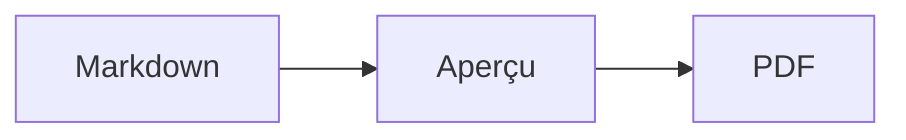

<p>&nbsp;&nbsp;&nbsp;</p>

# Splat

**L’éditeur Markdown pour macOS qui permet d’écrire dans la source ou directement dans l’aperçu.**

Splat affiche à gauche votre source Markdown avec coloration syntaxique et, à droite, un aperçu en direct entièrement modifiable. Tapez dans l’un ou l’autre : ce que vous écrivez dans l’aperçu devient une modification minimale de la source, de sorte que les lignes que vous n’avez pas touchées restent identiques à l’octet près et que vos diffs Git restent propres. Splat lit le Markdown que vous utilisez déjà : CommonMark et GitHub Flavored Markdown, alertes GitHub, liens wiki, intégrations et encadrés d’Obsidian, extensions de Pandoc et de Typora, HTML intégré, formules LaTeX et diagrammes Mermaid, Graphviz et PlantUML, le tout rendu hors ligne. Exportez en PDF, en HTML ou en Word en un clic. Splat est écrit en Rust avec de véritables contrôles AppKit, parle 35 langues et n’envoie rien sur le réseau, sauf si vous le demandez.
 


[](https://raw.githubusercontent.com/sventmueller/splat/main/dist/Splat-1.0.5.dmg)

**[Télécharger Splat-1.0.5.dmg](https://raw.githubusercontent.com/sventmueller/splat/main/dist/Splat-1.0.5.dmg)** : signé et notarisé par Apple, pour macOS 14 ou ultérieur, sur Apple Silicon et Intel.
 
 

[](https://www.rust-lang.org)
[](https://www.apple.com/macos/)

[](https://github.com/madsmtm/objc2)
[](https://webkit.org)
[](https://github.com/kivikakk/comrak)
[](https://github.github.com/gfm/)
[](https://www.mathjax.org)
[](https://cortexjs.io/mathlive/)
[](https://mermaid.js.org)
[](https://graphviz.org)
[](https://plantuml.com)


[](#licence)

[Bahasa Indonesia](../id/README.md) ·
[Bahasa Melayu](../ms/README.md) ·
[Català](../ca/README.md) ·
[Čeština](../cs/README.md) ·
[Dansk](../da/README.md) ·
[Deutsch](../de/README.md) ·
[English](../../../README.md) ·
[Español](../es/README.md) ·
**Français** ·
[Hrvatski](../hr/README.md) ·
[Italiano](../it/README.md) ·
[Magyar](../hu/README.md) ·
[Nederlands](../nl/README.md) ·
[Norsk](../no/README.md) ·
[Polski](../pl/README.md) ·
[Português (Brasil)](../pt_BR/README.md) ·
[Português (Portugal)](../pt_PT/README.md) ·
[Română](../ro/README.md) ·
[Slovenčina](../sk/README.md) ·
[Slovenščina](../sl/README.md) ·
[Suomi](../fi/README.md) ·
[Svenska](../sv/README.md) ·
[Tiếng Việt](../vi/README.md) ·
[Türkçe](../tr/README.md) ·
[Ελληνικά](../el/README.md) ·
[Русский](../ru/README.md) ·
[Українська](../uk/README.md) ·
[עברית](../he/README.md)‎ ·
[العربية](../ar/README.md)‎ ·
[हिन्दी](../hi/README.md) ·
[ไทย](../th/README.md) ·
[한국어](../ko/README.md) ·
[日本語](../ja/README.md) ·
[简体中文](../zh-Hans/README.md) ·
[繁體中文](../zh-Hant/README.md)

## Sommaire

- [Aperçu des fonctionnalités](#aperçu-des-fonctionnalités)
- [Configuration requise](#configuration-requise)
- [Installation](#installation)
- [Premiers pas](#premiers-pas)
- [Écrire](#écrire)
  - [Dans la source](#dans-la-source)
  - [Dans l’aperçu](#dans-laperçu)
  - [Commandes de mise en forme](#commandes-de-mise-en-forme)
  - [Listes et tâches](#listes-et-tâches)
  - [Tableaux](#tableaux)
- [Markdown pris en charge](#markdown-pris-en-charge)
  - [CommonMark et GitHub Flavored Markdown](#commonmark-et-github-flavored-markdown)
  - [Encadrés](#encadrés)
  - [Syntaxe étendue](#syntaxe-étendue)
  - [Obsidian](#obsidian)
  - [Citations et références](#citations-et-références)
  - [HTML intégré](#html-intégré)
  - [Ponctuation typographique](#ponctuation-typographique)
  - [Aperçu de la syntaxe](#aperçu-de-la-syntaxe)
- [Formules](#formules)
- [Diagrammes](#diagrammes)
- [Images](#images)
- [Liens et navigation](#liens-et-navigation)
- [Exporter, imprimer et partager](#exporter-imprimer-et-partager)
- [Apparence et accessibilité](#apparence-et-accessibilité)
- [Langues](#langues)
- [Raccourcis clavier](#raccourcis-clavier)
- [Confidentialité et sécurité](#confidentialité-et-sécurité)
- [Documents volumineux](#documents-volumineux)
- [Limites connues](#limites-connues)
- [Dépannage](#dépannage)
- [Pour les développeurs](#pour-les-développeurs)
  - [Compilation](#compilation)
  - [Distribution](#distribution)
  - [Tests](#tests)
  - [Organisation du projet](#organisation-du-projet)
  - [Flux de données](#flux-de-données)
  - [Règles dans le contrôleur](#règles-dans-le-contrôleur)
  - [Ajouter une commande](#ajouter-une-commande)
  - [Traductions](#traductions)
  - [Composants tiers](#composants-tiers)
- [Licence](#licence)

## Aperçu des fonctionnalités

- **Deux façons d’écrire, un seul texte.** La source et l’aperçu sont tous deux modifiables. Le fichier Markdown est la seule référence : il y a un seul historique d’annulation par document, et chaque modification faite dans l’aperçu est traduite en la plus petite modification possible de la source.
- **Le Markdown que vous utilisez déjà.** CommonMark, GitHub Flavored Markdown, alertes GitHub, extensions d’Obsidian, de Pandoc et de Typora, codes courts d’émojis, spoilers, listes de définitions, ancres de titres et HTML comme dans les README GitHub.
- **Formules et diagrammes intégrés.** Formules LaTeX via MathJax, avec un éditeur de formules visuel. Diagrammes Mermaid, Graphviz et PlantUML, rendus sur votre Mac sans Java, sans serveur et sans connexion réseau.
- **Un bouton pour tout.** Chaque élément Markdown a son bouton dans la barre d’outils et son élément de menu, et les plus courants ont aussi un raccourci clavier. Les tableaux ont leur propre menu pour les lignes, les colonnes et l’alignement.
- **Exporter sans rien perdre.** PDF, un fichier HTML unique et autonome, ou un document Word avec de vrais titres, listes, tableaux, notes de bas de page et images.
- **Natif jusqu’au bout.** De vraies fenêtres, de vrais onglets, menus et popovers AppKit, les Versions, l’enregistrement automatique, le menu de partage, le mode sombre, la vérification orthographique, la dictée et VoiceOver. Pas d’Electron, pas de vue web pour le texte lui-même.
- **Rapide avec les gros fichiers.** Le rendu d’une frappe dans un document de 10 Mo prend environ 25 ms, avant le travail propre à la vue.
- **Discret et prudent.** Les images du web ne se chargent qu’après votre autorisation, les liens vers d’autres apps demandent d’abord confirmation, et tout ce qui décode des données d’image non fiables s’exécute dans des processus auxiliaires isolés.
- **Dans votre langue.** L’interface et l’aide-mémoire Markdown intégré existent en 35 langues : allemand, anglais, arabe, catalan, chinois (simplifié), chinois (traditionnel), coréen, croate, danois, espagnol, finnois, français, grec, hébreu, hindi, hongrois, indonésien, italien, japonais, malais, néerlandais, norvégien, polonais, portugais (Brésil), portugais (Portugal), roumain, russe, slovaque, slovène, suédois, tchèque, thaï, turc, ukrainien et vietnamien.

## Configuration requise

- macOS 14 Sonoma ou ultérieur. Splat est développé et testé sous macOS 27, où il adopte automatiquement le design Liquid Glass.
- Un Mac avec Apple Silicon ou un processeur Intel.
- Environ 45 Mo d’espace disque.

## Installation

**Depuis l’image disque.** Téléchargez [`dist/Splat-1.0.5.dmg`](https://raw.githubusercontent.com/sventmueller/splat/main/dist/Splat-1.0.5.dmg), ouvrez-la et faites glisser Splat dans le dossier Applications. L’image est signée avec un Developer ID et notarisée par Apple : elle s’ouvre donc sans avertissement.

**Avec Homebrew.** Le cask se trouve dans un tap à part :

```sh
brew install --cask sventmueller/tap/splat
```

`brew upgrade --cask splat` installe les nouvelles versions, et `brew uninstall --zap --cask splat` supprime aussi les réglages et les caches de Splat.

**Mises à jour.** Splat, installé depuis l’image disque ou avec Homebrew, se met à jour tout seul grâce à [Sparkle](https://sparkle-project.org). Au deuxième lancement, il demande s’il peut rechercher des mises à jour de lui-même, une fois par jour. **Splat › Rechercher les mises à jour…** lance la recherche tout de suite ; **Rechercher automatiquement les mises à jour** et **Télécharger et installer automatiquement les mises à jour** dans le même menu permettent de changer ce choix plus tard. Splat n’installe une mise à jour que si elle porte la signature du développeur. Une version compilée par vos soins n’a pas de mise à jour automatique.

**Depuis les sources.** Consultez [Building](#compilation) pour les prérequis, puis :

```sh
make build
ditto target/release/Splat.app /Applications/Splat.app
open /Applications/Splat.app
```

Pour ouvrir les fichiers Markdown avec Splat par un double-clic, sélectionnez un fichier `.md` dans le Finder, choisissez **Fichier › Lire les informations**, sélectionnez Splat sous **Ouvrir avec** et cliquez sur **Tout modifier…**. Splat s’enregistre lui-même pour les fichiers `.md`, `.markdown`, `.mdown` et `.mkd`.

## Premiers pas

### La fenêtre

Chaque document s’ouvre dans sa propre fenêtre, ou dans un onglet si vous préférez les onglets :

- **À gauche : la source.** Votre Markdown en SF Mono avec coloration syntaxique.
- **À droite : l’aperçu.** Le document rendu, prêt à être modifié.
- **Barre latérale du plan (facultative).** Tous les titres sous forme d’arborescence ; un clic sur l’un d’eux l’affiche dans les deux volets. Affichez-la avec **Présentation › Afficher le plan** (⌃⌘S).
- **Barre d’outils.** Des boutons regroupés selon ce qu’ils modifient : les caractères, les paragraphes et les éléments insérés, puis l’aperçu activé ou désactivé, Partager et Nouveau document. Personnalisez-la avec **Présentation › Personnaliser la barre d’outils…**.

Faites glisser le séparateur pour donner plus de place à l’un ou l’autre côté. **Présentation › Masquer l’aperçu** (⌥⌘P) laisse la source seule ; Splat s’en souvient pour chaque fenêtre. Les deux volets défilent ensemble, et une sélection dans l’un est mise en évidence dans l’autre.

### Documents, onglets et versions

Splat est une app de documents macOS classique :

- **Enregistrement automatique et Versions.** Les modifications sont enregistrées sur place. **Fichier › Revenir à › Parcourir toutes les versions…** vous ramène dans le passé.
- **Modifications venant d’autres programmes.** Lorsque Git, un script ou un autre éditeur modifie un document ouvert, Splat le recharge et conserve le point d’insertion et la position de défilement. Si vous avez vous-même des modifications non enregistrées, Splat les conserve, et macOS demande confirmation avant d’écraser l’autre version.
- **Les commandes de fichier habituelles.** Dupliquer (⇧⌘S), Renommer…, Déplacer vers… et **Fichier › Ouvrir l’élément récent**.
- **Onglets.** **Fichier › Nouvel onglet** ou le bouton **+** de la barre d’outils ouvre un nouveau document dans un onglet ; le menu Fenêtre standard fusionne les fenêtres, déplace les onglets et passe de l’un à l’autre.
- **Position des fenêtres.** La taille et la position de votre dernière fenêtre sont mémorisées, y compris après un redémarrage. Si une fenêtre se trouve déjà à cet endroit, la nouvelle s’ouvre légèrement décalée.
- **L’icône du Dock.** Un clic dessus, après la fermeture de la dernière fenêtre, ouvre un nouveau document.
- **Ouvrir les fichiers Markdown dans Splat.** **Splat › Définir comme app par défaut pour Markdown** fait ouvrir Splat par un double-clic sur un fichier `.md` ou `.markdown` ; macOS demande une fois de confirmer. L’élément affiche une coche tant que Splat est l’app par défaut.

Les fichiers doivent être du texte UTF-8, ou UTF-16 avec une marque d’ordre des octets. Splat refuse les autres encodages plutôt que de deviner et d’altérer le texte. Une marque d’ordre des octets est conservée, l’UTF-16 reste de l’UTF-16, et dans un fichier dont toutes les lignes se terminent par CRLF, les lignes que vous ajoutez reçoivent elles aussi CRLF.

**Après un plantage**, au plus les dernières secondes de frappe sont perdues : toutes les cinq secondes, Splat copie le texte non enregistré dans `~/Library/Application Support/Splat/Unsaved`, puis supprime ces copies dès qu’un document est enregistré ou que Splat se ferme normalement. Au démarrage suivant, ce qu’un plantage a laissé là est déplacé vers `~/Library/Application Support/Splat/Recovery`, ce que Splat signale une fois, avec un bouton qui ouvre le dossier. Lorsqu’un plantage laisse encore à Splat le temps de réagir, il y écrit aussi le texte de tous les documents ouverts.

### Aide-mémoire

**Aide › Aide-mémoire Markdown** ouvre, dans un nouveau document sans titre, un aide-mémoire dans votre langue. C’est un document ordinaire : essayez tout directement dedans, dans la source ou dans l’aperçu.

## Écrire

### Dans la source

La source est un éditeur de texte brut adapté au Markdown :

- **Coloration syntaxique** comme dans VS Code : titres, emphase, liens, code, tableaux, HTML, front matter, ainsi que LaTeX et Mermaid dans les formules et les diagrammes. Il existe des palettes pour le mode clair, le mode sombre et Augmenter le contraste.
- **Les blocs de code délimités** sont colorés pour Bash, C, C++, C#, CSS (aussi SCSS et Less), Go, HTML, XML, Java, JavaScript, JSON, Kotlin, PHP, Python, Ruby, Rust, SQL, Swift, TypeScript, YAML, TeX et Mermaid, y compris leurs noms abrégés usuels comme `js`, `py` ou `sh`.
- **Aucune substitution surprise.** Les guillemets courbes, les tirets intelligents et le remplacement de texte sont désactivés par défaut, car ils faussent `--`, `---` et `"`. Activez-les sous **Édition › Substitutions**.
- **Les outils d’écriture du système.** Vérification de l’orthographe et de la grammaire, dictée, Rechercher et remplacer… (⌥⌘F) et Parole.
- **Glisser-déposer.** Déposez un fichier image pour insérer ``, n’importe quel autre fichier pour insérer un lien vers lui, et une URL pour insérer `[url](url)`. Chaque dépôt compte pour une seule étape d’annulation.
- **Coller des images.** Une image du presse-papiers, comme une capture d’écran, est enregistrée en fichier PNG à côté du document (`Image 2026-10-29 13.09.07.png`) et insérée comme image. Pour cela, le document doit avoir été enregistré une fois.

### Dans l’aperçu

L’aperçu se comporte comme un traitement de texte, mais tout ce que vous y faites aboutit en Markdown :

- **Saisie.** Les caractères qui ont un sens en Markdown, comme `*` ou `#`, sont échappés pour apparaître tels que vous les tapez.
- **Return** commence un nouveau paragraphe ou un nouvel élément de liste. **⌥Return** ou **⌃Return** insère un saut de ligne.
- **Mise en forme au point d’insertion.** Quand le curseur se trouve à la fin d’un mot, Gras, Italique et les autres mises en forme de caractères s’appliquent à ce que vous tapez ensuite. Choisissez de nouveau la mise en forme pour l’arrêter. À l’intérieur d’un mot, le mot entier est mis en forme.
- **Lignes vides.** Return sur une ligne vide ajoute une autre ligne vide, et la touche Supprimer la retire. Dans la source, chaque ligne vide supplémentaire correspond à deux lignes blanches de plus ; les autres programmes Markdown les affichent comme un espacement normal entre paragraphes.
- **Annuler** fonctionne dans les deux volets. Les éléments d’annulation portent un nom (« Annuler Gras »), la saisie compte pour une étape par rafale, et après Annuler et Rétablir, les deux volets défilent jusqu’à la modification.
- **Les formules et les diagrammes** apparaissent comme des graphiques terminés. Cliquez sur l’un d’eux, placez le curseur dessus ou appuyez sur Return pour ouvrir son éditeur (voir [Formulas](#formules) et [Diagrams](#diagrammes)).
- **Le HTML intégré, les notes intégrées et le front matter** sont affichés, mais vous les modifiez dans la source. Un clic dessus place le curseur à l’endroit correspondant dans la source.

Tout ce que le Markdown ne peut pas exprimer est bloqué dans l’aperçu : les panneaux Polices et Couleurs, la règle, ainsi que le collage ou le dépôt de texte enrichi et d’images. Le HTML et le RTF collés arrivent en texte brut.

### Commandes de mise en forme

Chaque commande est disponible dans la barre d’outils, dans la barre des menus et dans le menu contextuel des deux volets. Les éléments de menu affichent une coche pour la mise en forme au point d’insertion.

| Menu | Commandes |
|---|---|
| **Format › Police** | Gras, Italique, Souligné, Barré, Surbrillance, Code, Exposant, Indice |
| **Format › Titre** | Corps de texte, Titre 1 à 6 |
| **Format › Liste** | Liste à puces, Liste numérotée, Liste de tâches |
| **Format** | Citation, Bloc de code (Aucun langage ou l’un des 20 langages ; change aussi le langage d’un bloc existant), Encadré (Note, Astuce, Important, Attention, Mise en garde ; le même type une seconde fois le supprime), Modifier la formule ou le diagramme…, Effacer la mise en forme |
| **Insérer** | Lien…, Image…, Tableau…, Formule, Diagramme (Diagramme de flux, Diagramme de séquence, Diagramme de Gantt), Table des matières, Note de bas de page, Séparateur |
| **Tableau** | Insérer une ligne au-dessus/en dessous, Insérer une colonne à gauche/à droite, Supprimer la ligne, Supprimer la colonne, Alignement (Gauche, Centré, Droite, Par défaut), Aligner les colonnes du tableau |
| **Présentation** | Masquer/Afficher l’aperçu, Afficher/Masquer le plan, Ponctuation typographique, Agrandir/Réduire, Taille réelle, barre d’outils, barre d’onglets, plein écran |

Le soulignement, la surbrillance, l’exposant et l’indice s’écrivent `<ins>`, `<mark>`, `<sup>` et `<sub>`, que GitHub affiche aussi. Splat lit également `<u>`, que GitHub supprime, ainsi que les formes plus courtes `==surbrillance==`, `^exp^` et `~ind~`. GitHub affiche `==` et `^` tels quels et `~ind~` comme du texte barré.

### Listes et tâches

- Return poursuit une liste ; Return sur un élément vide la termine.
- **Tab** et **⇧Tab** indentent et désindentent les éléments de liste dans l’aperçu.
- Un clic sur une case à cocher de tâche dans l’aperçu bascule entre `- [ ]` et `- [x]`.
- **Format › Liste** transforme les paragraphes sélectionnés en liste ou change son type.

### Tableaux

- **Insérer › Tableau…** demande le nombre de lignes (y compris l’en-tête) et de colonnes.
- Dans l’aperçu, **Tab** passe à la cellule suivante, **⇧Tab** à la précédente et **Return** à la cellule du dessous. Tab dans la dernière cellule ajoute une ligne.
- Le menu **Tableau** insère et supprime des lignes et des colonnes et règle l’alignement d’une colonne (⌘{, ⌘|, ⌘}).
- **Tableau › Aligner les colonnes du tableau** complète la source par des espaces pour que les colonnes soient alignées.

## Markdown pris en charge

Splat analyse le texte avec [comrak](https://github.com/kivikakk/comrak), un analyseur compatible avec CommonMark et GFM, et active la plupart de ses extensions. Tout ce qui suit s’affiche dans l’aperçu et dans tous les exports.

### CommonMark et GitHub Flavored Markdown

- Titres (`#` et soulignés), paragraphes, sauts de ligne, emphase, emphase forte, code en ligne, citations, séparateurs.
- Listes à puces, numérotées et imbriquées ; listes de tâches.
- Liens (en ligne, de référence et automatiques), images, définitions de références de liens.
- Blocs de code délimités et indentés avec coloration syntaxique.
- Tableaux avec alignement des colonnes.
- Texte barré avec `~~deux tildes~~`.
- Notes de bas de page : `texte[^1]` avec `[^1]: La note.` n’importe où dans le document. Un clic sur le repère mène à la note.
- Front matter YAML entre des lignes `---` en haut du document. L’aperçu le résume en une ligne, par exemple « Métadonnées : title, date, tags ».

### Encadrés

Les alertes GitHub s’affichent sous forme de boîtes colorées avec une icône et un titre :

```markdown
> [!NOTE]
> Informations utiles que les utilisateurs devraient connaître.

> [!WARNING]
> Contenu critique qui exige une attention immédiate.
```

Les cinq types sont Note, Astuce, Important, Attention et Mise en garde. **Format › Encadré** transforme le paragraphe où se trouve le curseur en encadré.

Les encadrés d’Obsidian fonctionnent aussi, avec un titre libre et un état de repli :

```markdown
> [!tip]- Cliquez sur ▸ pour développer
> Masqué tant qu’il n’est pas ouvert.

> [!question]+ Ouvert par défaut
> Un `+` démarre développé, un `-` replié.
```

Les autres types d’Obsidian sont affichés dans la couleur la plus proche parmi les cinq : `success`, `check`, `done` et `hint` comme Astuce ; `question`, `help` et `faq` comme Important ; `attention` comme Attention ; `failure`, `fail`, `missing`, `danger`, `error` et `bug` comme Mise en garde ; tout le reste comme Note.

### Syntaxe étendue

| Fonction | Syntaxe | Origine |
|---|---|---|
| Surbrillance | `==texte marqué==` | Obsidian, Typora |
| Exposant | `x^2^` | Pandoc, Typora |
| Indice | `H~2~O` | Pandoc, Typora |
| Code court d’émoji | `:rocket:` devient 🚀 | GitHub |
| Spoiler | `\|\|texte masqué\|\|`, à sélectionner pour le lire | Discord |
| Note de bas de page en ligne | `texte^[la note elle-même]` | Pandoc, Obsidian |
| Liste de définitions | `Terme`, ligne vide, `: Explication` | PHP Markdown Extra, Pandoc |
| Ancre de titre | `## Installation {#setup}`, lien avec `[voir](#setup)` | Pandoc, kramdown |

Dans la source, les listes de définitions ressemblent à ceci :

```markdown
Terme

: Explication du terme.
```

Sans ancre personnalisée, chaque titre reçoit une ancre dérivée de son texte, comme sur GitHub : `## Premiers pas` est accessible par `#premiers-pas`.

### Obsidian

- **Liens wiki.** `[[Note]]` renvoie à `Note.md` dans le même dossier ou dans un sous-dossier. `[[Note|Texte affiché]]` affiche votre propre texte, et `[[Note#Titre]]` ouvre la note. ⌘-clic l’ouvre dans Splat.
- **Intégrations.** `![[Note]]` affiche l’autre note dans celle-ci ; les notes qui y sont intégrées apparaissent sous forme de liens. `![[diagram.png]]` affiche une image. Comme dans Obsidian, les intégrations désignent des notes et des images situées dans le dossier du document ou en dessous, jamais par un chemin absolu, et seuls les fichiers Markdown s’affichent comme notes.
- **Commentaires.** `%%Seulement dans la source%%` reste visible dans la source et est omis de l’aperçu et de tous les exports, en ligne comme sur des lignes à part.
- **Étiquettes.** `#idée` ou `#projet/splat` est mis en évidence. ⌘-clic recherche l’étiquette dans le document.
- **Encadrés repliables.** Voir [Callouts](#encadrés).

### Citations et références

- **Citations Pandoc.** `[@doe2020]` ou `[@doe2020; @roe2021]` se lit « (Doe 2020 ; Roe 2021) ». Les entrées proviennent du fichier BibTeX que le front matter désigne par `bibliography: refs.bib`. À défaut, Splat utilise `references.bib`, `literatur.bib` ou `bibliography.bib` à côté du document.
- **Références GitHub et GitLab.** Si le document se trouve dans un dépôt Git dont le dépôt distant `origin` est sur github.com ou sur un hôte GitLab, `@name`, `#12` (ticket) et `!7` (merge request, GitLab uniquement) sont mis en évidence. ⌘-clic les ouvre dans le navigateur.

### HTML intégré

Le HTML tel qu’on le trouve dans les README GitHub est rendu, avec son propre lecteur plutôt qu’un moteur de navigateur :

- paragraphes et blocs centrés (`<p align="center">`, `<div align="center">`)
- images avec une taille (``)
- liens, `<kbd>⌘</kbd>`, `<br>`, `<u>`, `<ins>`, `<mark>`, `<sup>`, `<sub>`
- listes et tableaux, y compris les cellules qui s’étendent sur plusieurs colonnes (`colspan`)
- sections repliables : `<details><summary>Plus</summary>…</details>`, qui s’ouvrent d’un clic sur ▸

Le Markdown placé entre des balises HTML est rendu comme du Markdown. Les scripts, les styles, les cadres et les formulaires sont totalement omis, et les liens et les images ne conservent que les adresses `http`, `https`, `mailto` et relatives.

### Ponctuation typographique

**Présentation › Ponctuation typographique** affiche les guillemets droits sous la forme des guillemets de la langue de votre interface, `--` comme un tiret demi-cadratin, `---` comme un tiret cadratin et `...` comme des points de suspension. En allemand, `"Ja"` devient „Ja“, en français «Oui», en japonais 「はい」, y compris là où le chinois et le japonais composent les guillemets sans espace ; les abréviations hébraïques comme `צה"ל` reçoivent leur guershayim, צה״ל. La source conserve les caractères simples ; l’aperçu et tous les exports affichent les caractères typographiques. Le réglage est désactivé tant que vous ne l’activez pas.

### Aperçu de la syntaxe

| Élément | Markdown |
|---|---|
| **Gras** | `**Gras**` |
| *Italique* | `*Italique*` |
| Souligné | `<ins>Souligné</ins>` ou `<u>Souligné</u>` |
| ~~Barré~~ | `~~Barré~~` |
| Surbrillance | `<mark>Surbrillance</mark>` ou `==Surbrillance==` |
| `Code` | `` `Code` `` |
| x² | `x<sup>2</sup>` ou `x^2^` |
| H₂O | `H<sub>2</sub>O` ou `H~2~O` |
| [Lien](https://example.com) | `[Lien](https://example.com)` |
| Titre | `# Titre` à `###### Titre` |
| Citation | `> Citation` |
| Liste à puces | `- Élément` |
| Liste numérotée | `1. Élément` |
| Tâche | `- [ ] À faire` et `- [x] Terminé` |
| Bloc de code | ```` ```rust ```` … ```` ``` ```` |
| Tableau | `\| A \| B \|` avec `\|---\|---\|` sous l’en-tête |
| Note de bas de page | `Texte[^1]` et `[^1]: Note` |
| Séparateur | `---` |
| Image | `` |
| Formule | `$E = mc^2$`, `$$ … $$` |
| Diagramme | ```` ```mermaid ````, ```` ```dot ````, ```` ```plantuml ```` |
| Encadré | `> [!TIP]` |
| Lien wiki | `[[Note]]`, `[[Note\|Texte]]` |
| Intégration | `![[Note]]`, `![[image.png]]` |
| Commentaire | `%%Commentaire%%` |
| Étiquette | `#étiquette` |
| Citation bibliographique | `[@key]` |
| Spoiler | `\|\|Spoiler\|\|` |
| Émoji | `:tada:` |

## Formules

Les formules sont rendues par [MathJax](https://www.mathjax.org) avec ses mathématiques TeX et AMS, sous forme de graphiques vectoriels nets. Le texte dans `\text{…}` peut être écrit dans n’importe quelle écriture : ce qui manque aux polices de MathJax provient des polices de votre Mac, l’arabe et l’hébreu s’écrivant de droite à gauche, et les émojis s’affichant en couleur.

| Type | Syntaxe |
|---|---|
| En ligne | `$E = mc^2$`, `` $`E = mc^2`$ `` (GitHub, GitLab), `\(E = mc^2\)` |
| Bloc | `$$` … `$$`, `\[` … `\]`, ou un bloc de code marqué `math` |

**Modifier une formule.** Cliquez sur une formule dans l’aperçu, double-cliquez dessus, appuyez sur Return dessus ou placez le curseur dessus pour ouvrir son éditeur dans un popover. **Insérer › Formule** en insère une nouvelle et ouvre aussitôt l’éditeur.

- **Visuel ou LaTeX.** Le sélecteur en haut bascule entre un éditeur visuel ([MathLive](https://cortexjs.io/mathlive/)) et le code LaTeX. Splat retient votre choix.
- **Des blocs** pour la fraction, la racine carrée, l’exposant et l’indice, la somme et l’intégrale avec bornes, la limite, les parenthèses qui s’adaptent au contenu, la matrice 2×2, les lettres grecques, ainsi que les relations, les opérateurs et les flèches. Ils laissent des espaces réservés □, et **Tab** passe au suivant.
- **Aperçu en direct.** Les modifications apparaissent dans le document pendant la saisie. Les erreurs de MathJax s’affichent sur une ligne sous le code.
- **Valider ou annuler.** Un clic à l’extérieur conserve la modification en une seule étape d’annulation ; **Esc** ou **Annuler** la rejette. Quitter par Esc une formule nouvelle et vide la supprime de nouveau.
- Le menu contextuel propose **Modifier la formule…** pour la formule située sous le pointeur.

VoiceOver lit une formule sous la forme de son code LaTeX. Splat rend des formules, pas des documents LaTeX complets : il n’y a ni paquets, ni TikZ, ni `\documentclass`.

## Diagrammes

Les diagrammes sont rendus dans Splat, hors ligne et en variante claire et sombre.

| Moteur | Bloc de code | Ce qu’il dessine |
|---|---|---|
| [Mermaid](https://mermaid.js.org) | ```` ```mermaid ```` | diagrammes de flux, de séquence, de classes, d’états, entité-relation, de Gantt, circulaires, cartes mentales, chronologies et tous les autres types Mermaid |
| [Graphviz](https://graphviz.org) | ```` ```dot ```` ou ```` ```graphviz ```` | graphes en langage DOT |
| [PlantUML](https://plantuml.com) | ```` ```plantuml ```` ou ```` ```puml ```` | diagrammes UML ; fonctionne sans Java |



**Modifier un diagramme** fonctionne comme modifier une formule : cliquez dessus pour ouvrir le code dans un popover, avec coloration syntaxique et messages d’erreur sur une ligne sous le code. **Insérer › Diagramme** part d’un modèle de diagramme de flux, de diagramme de séquence ou de diagramme de Gantt. Des blocs facilitent les trois types Mermaid les plus courants :

- **Diagramme de flux :** Nœud ▾ (rectangle, arrondi, cercle, losange, base de données), Connexion, Connexion avec libellé, Groupe, Direction ▾
- **Diagramme de séquence :** Participant, Message, Réponse, Note, Boucle, Chemins alternatifs
- **Diagramme de Gantt :** Section, Tâche, Jalon

Les autres types de diagrammes se modifient sous forme de code. VoiceOver lit le titre ou le texte alternatif d’un diagramme.

Le premier diagramme après le lancement prend environ une seconde, car le moteur de rendu démarre en arrière-plan. Un diagramme qui prend plus de 10 secondes affiche une erreur, et le moteur de rendu redémarre à neuf pour le suivant. Le moteur de PlantUML (7 Mo) ne se charge qu’avec le premier diagramme PlantUML. Un `!include` PlantUML provenant du web est bloqué.

## Images

- **Les images locales** utilisent des chemins relatifs au document : ``. Splat affiche PNG, JPEG, GIF, WebP, BMP, SVG, HEIC, TIFF, AVIF et PDF.
- **Les images du web** restent bloquées jusqu’à ce que vous les autorisiez : une barre au-dessus de l’aperçu explique qu’en les chargeant, leurs serveurs apprennent que vous ouvrez le document, et à quel moment. **Charger les images** les autorise pour ce document ; Splat retient le choix pour chaque fichier.
- **Taille.** `` fixe la taille d’une image ; sinon, les images s’adaptent à la largeur de l’aperçu.
- **Modifications sur le disque.** Une image que vous remplacez, ou une image qui apparaît après que le document l’a nommée, s’affiche sans qu’il soit nécessaire de rouvrir le document. Les images du web qui ont échoué à cause du réseau sont rechargées tant qu’un document les affiche.
- **Mémoire.** Les images s’affichent jusqu’à 2560 pixels sur leur plus grand côté, ce qui remplit aussi une page A4. Elles sont décodées en plus petit dès qu’elles occupent un huitième de la mémoire du Mac, et tant que macOS signale une pression sur la mémoire.
- **Mode sombre.** Les images à fond blanc sont légèrement atténuées dans l’aperçu sombre.
- **Coller et déposer.** Voir [In the source](#dans-la-source).

## Liens et navigation

Dans l’aperçu, un clic place le curseur pour que vous puissiez modifier le texte du lien ; **⌘-clic** suit le lien :

- `http`, `https` et `mailto` s’ouvrent dans votre navigateur ou votre app de messagerie.
- Les fichiers Markdown s’ouvrent dans Splat ; les autres fichiers et dossiers sont affichés dans le Finder.
- `#anchor` mène au titre dans le document.
- Les adresses qui ouvrent une autre app, comme `slack://` ou `vscode://`, demandent d’abord confirmation et affichent l’adresse complète et l’app. **Annuler** est présélectionné.

**Insérer › Table des matières** insère une liste avec liens vers tous les titres. Avec le curseur à l’intérieur, la même commande la met à jour. La barre latérale du plan (⌃⌘S) mène à n’importe quel titre dans les deux volets.

## Exporter, imprimer et partager

| Format | Comment | Ce que vous obtenez |
|---|---|---|
| **PDF** | **Fichier › Exporter au format PDF…** ou le menu Partager | Pages au format papier, toujours en apparence claire, formules et diagrammes en graphiques vectoriels. **Fichier › Format d’impression…** règle le papier. |
| **Impression** | **Fichier › Imprimer…** (⌘P) | La même mise en page que le PDF. |
| **HTML** | **Fichier › Exporter au format HTML…** ou le menu Partager | Un fichier autonome : images locales intégrées, formules et diagrammes en images nettes, ancres de titres pour que la table des matières fonctionne. Pas de scripts. |
| **Word** | **Fichier › Exporter au format Word…** ou le menu Partager | Un fichier `.docx` avec les styles de titre de Word, de vraies listes et de vrais tableaux (y compris les cellules fusionnées), des notes de bas de page Word, les images, les formules et les diagrammes intégrés. |
| **Markdown** | Le bouton **Partager** de la barre d’outils | Le document sous forme de fichier `.md` pour Mail, Messages, AirDrop et tous les autres services de partage. |

Le menu **Fichier › Partager** les propose tous au même endroit. Les exports tiennent compte du réglage de la ponctuation typographique et des images du web que vous avez autorisées ; dans le HTML, les images du web restent des liens.

## Apparence et accessibilité

- **Le mode sombre** suit le système. Les formules et les diagrammes sont rendus pour chaque apparence.
- **Augmenter le contraste** dans Réglages Système fait passer la coloration syntaxique à des palettes à fort contraste.
- **Zoom.** ⌘+, ⌘− et ⌘0 changent l’échelle des deux volets.
- **Plein écran, onglets et barre d’outils personnalisable**, comme dans toute app du Mac.
- **VoiceOver.** Les volets s’appellent « Source Markdown » et « Aperçu », les formules sont lues sous la forme de leur code et les diagrammes sous celle de leur titre. Chaque commande est accessible au clavier.

Splat n’a pas de fenêtre de réglages : les quelques options se trouvent là où elles s’appliquent, dans **Présentation** et **Édition › Substitutions**.

## Langues

L’interface, les menus et l’aide-mémoire Markdown sont traduits en 35 langues :

allemand, anglais, arabe, catalan, chinois (simplifié), chinois (traditionnel), coréen, croate, danois, espagnol, finnois, français, grec, hébreu, hindi, hongrois, indonésien, italien, japonais, malais, néerlandais, norvégien, polonais, portugais (Brésil), portugais (Portugal), roumain, russe, slovaque, slovène, suédois, tchèque, thaï, turc, ukrainien et vietnamien.

Splat suit l’ordre des langues défini dans **Réglages Système › Général › Langue et région** ; vous pouvez aussi y choisir une langue pour Splat seul sous **Applications**. Sans traduction pour votre langue, il utilise l’anglais. Les termes des menus reprennent les traductions d’Apple, de sorte que Splat se lit comme le reste de votre Mac.

Le texte hébreu et arabe se lit de droite à gauche partout où il apparaît, quelle que soit la langue de l’interface : chaque paragraphe, titre et élément de liste prend la direction de sa première lettre, les citations et les encadrés tracent leur barre à droite, et un tableau dont le texte commence de droite à gauche liste ses colonnes à partir de la droite. Les blocs de code restent de gauche à droite. Les exports PDF, HTML et Word conservent ces directions. Lorsque l’hébreu ou l’arabe est la langue du système, macOS inverse aussi la fenêtre, si bien que l’aperçu se trouve à gauche.

## Raccourcis clavier

| Action | Raccourci |
|---|---|
| Gras, Italique, Souligné | ⌘B, ⌘I, ⌘U |
| Barré | ⇧⌘X |
| Lien… | ⌘K |
| Corps de texte, Titre 1 à 6 | ⌥⌘0, ⌥⌘1 à ⌥⌘6 |
| Aligner la colonne du tableau à gauche, au centre, à droite | ⌘{, ⌘\|, ⌘} |
| Masquer ou afficher l’aperçu | ⌥⌘P |
| Afficher ou masquer le plan | ⌃⌘S |
| Agrandir, réduire, taille réelle | ⌘+, ⌘−, ⌘0 |
| Nouveau document, ouvrir, enregistrer, dupliquer | ⌘N, ⌘O, ⌘S, ⇧⌘S |
| Format d’impression, imprimer | ⇧⌘P, ⌘P |
| Rechercher, rechercher et remplacer | ⌘F, ⌥⌘F |
| Rechercher le suivant, le précédent ; utiliser la sélection ; aller à la sélection | ⌘G, ⇧⌘G ; ⌘E ; ⌘J |
| Afficher l’orthographe et la grammaire ; vérifier le document | ⌘:, ⌘; |
| Coller et adapter le style | ⌥⇧⌘V |
| Masquer la barre d’outils, afficher tous les onglets, plein écran | ⌥⌘T, ⇧⌘\\, ⌃⌘F |
| Saut de ligne (aperçu) | ⌥Return ou ⌃Return |
| Cellule suivante / précédente d’un tableau (aperçu) | Tab / ⇧Tab |
| Indenter / désindenter un élément de liste (aperçu) | Tab / ⇧Tab |
| Espace réservé suivant dans l’éditeur de formules | Tab |
| Fermer l’éditeur de formules ou de diagrammes sans modifications | Esc |
| Suivre un lien, une étiquette ou une référence (aperçu) | ⌘-clic |

Splat laisse les raccourcis standard d’Apple là où ils sont.

## Confidentialité et sécurité

Un fichier Markdown peut venir de n’importe qui, c’est pourquoi Splat traite chaque document comme non fiable.

- **Pas de réseau par défaut.** Splat n’a aucune télémétrie. Il ne recherche des mises à jour qu’une fois que vous l’avez accepté ou que vous choisissez **Rechercher les mises à jour…** : il charge alors un petit fichier de flux depuis GitHub, et la requête ne nomme rien d’autre que l’app et sa version. Les formules et les diagrammes sont rendus localement ; les vues web qui s’en chargent ne peuvent pas accéder au réseau.
- **Les images du web** ne se chargent qu’avec votre autorisation, uniquement via `https`, jamais depuis des hôtes de votre réseau local, au plus 10 Mo chacune, et dans une session privée sans cookies.
- **Décodage isolé.** Les images et les graphiques des formules et des diagrammes sont décodés dans des processus auxiliaires qui ferment tous les fichiers hérités et s’enferment dans un bac à sable avant de lire le premier octet : pas d’accès aux fichiers, pas de réseau. Ils ne renvoient que des pixels, dont la taille est vérifiée, et sont arrêtés au bout de 10 secondes. Les décodeurs d’images d’Apple ne voient que le HEIC, le TIFF, l’AVIF et le PDF, et seulement lorsque les données sont vraiment de ce format ; ils s’exécutent dans un processus auxiliaire distinct, qui peut en plus lire les dossiers de polices du système et utiliser le décodeur vidéo du système. Les SVG, les formules et les diagrammes passent aussi par ce processus, ce sont donc dans Splat des images à résolution fixe : quatre pixels par point, jusqu’à 2560 sur le plus grand côté.
- **Les fichiers locaux** n’atteignent un document que par le chemin qu’il nomme. Les intégrations affichent des notes Markdown du dossier du document et de ses sous-dossiers, et une image manquante n’est recherchée que là. Un chemin d’image situé ailleurs, absolu ou commençant par `~`, se charge quand même, et les exports HTML et Word l’intègrent : regardez l’export d’un document que vous n’avez pas écrit avant de le transmettre.
- **Les copies du texte non enregistré** restent sur ce Mac, dans votre dossier Bibliothèque, pour la récupération après un plantage. Elles disparaissent avec l’enregistrement ou la fermeture normale de Splat ; les copies qu’un plantage a laissées restent dans le dossier de récupération jusqu’à ce que vous les supprimiez.
- **Les liens** ne lancent jamais un programme par un clic. Les liens web et de messagerie s’ouvrent comme d’habitude ; les liens vers d’autres apps demandent d’abord confirmation.
- **Le HTML des documents** est lu par l’analyseur de Splat. Les scripts, les styles, les cadres et les formulaires ne s’exécutent jamais.
- **Les exports** ne contiennent aucun script. Les pages HTML ne gardent qu’une liste fixe de balises et d’attributs inoffensifs, comme le fait GitHub, ainsi qu’une politique de sécurité du contenu. Les fichiers Word ne créent de liens que pour les adresses `http`, `https` et `mailto`.
- **Signature du code** avec le Hardened Runtime. Splat s’exécute sans l’App Sandbox pour pouvoir afficher les images situées à côté de vos documents sans demander l’accès à chaque dossier ; l’isolation de tout le décodage compense cela.

## Documents volumineux

Splat reste réactif avec des documents de plusieurs mégaoctets :

- La source utilise TextKit 2, qui ne met en page que la partie visible.
- Pendant la saisie dans l’aperçu, et dans la source des documents jusqu’à 2 Mo, seuls les paragraphes concernés sont de nouveau analysés, colorés et mis en page. Dans un document de 10 Mo, l’analyse et la coloration prennent environ 20 ms, le rendu environ 25 ms, et une frappe complète dans son aperçu environ 60 ms avec le travail propre à la vue.
- Les aperçus volumineux rendent d’abord la partie visible, puis le reste lorsque l’app est inactive. Les blocs qui défilent dans la zone visible sont rendus avant d’être dessinés.
- Dans la source des documents plus volumineux, l’analyse pour l’aperçu s’exécute en arrière-plan pendant la saisie.
- Un document reste en texte brut dès qu’il demanderait environ 4 Go de mémoire, soit environ 50 à 120 Mo de Markdown ordinaire, mais seulement 10 à 20 Mo s’il ne contient que des tableaux ou des titres : la source n’a pas de couleurs et l’aperçu dit pourquoi il reste vide. Les exports fonctionnent toujours.
- À partir d’environ 200 Ko, un document ouvre sa fenêtre avant d’être analysé ; à 5 Mo, les couleurs et l’aperçu suivent environ un quart de seconde plus tard.

Certaines modifications sont traitées en entier, à environ 300 ms par frappe pour 10 Mo : celles apportées à la définition ou aux références d’une note de bas de page, à côté d’une note en ligne, tout à la fin d’un document à côté d’une note de bas de page, au front matter ou près des définitions de références de liens, ainsi que toute modification dans un document avec des blocs de commentaires `%%` ou avec une note de bas de page définie deux fois ou à l’intérieur d’une citation ou d’une liste. La mémoire augmente avec le fichier, jusqu’à environ 115–160 Mo pour 1 Mo de Markdown et 340–510 Mo pour 10 Mo.

## Limites connues

- **Un tilde simple signifie indice.** `~texte~` est un indice comme dans Pandoc ; le texte barré demande `~~deux~~`. GitHub barre aussi avec un seul tilde.
- **Lecture seule dans l’aperçu :** le HTML intégré, les notes intégrées et le front matter se modifient dans la source.
- **Imbrication très profonde :** le HTML imbriqué sur plus de 64 niveaux, et le HTML en ligne sur plus de 16, cède la place à son contenu.
- **Les cellules de tableau fusionnées** n’existent que dans les tableaux HTML, et seulement sur plusieurs colonnes (`colspan`, pas de `rowspan`). La syntaxe de tableau de MultiMarkdown pour les cellules fusionnées n’est pas prise en charge.
- **Les bibliographies** ne sont lues qu’au format BibTeX, pas en CSL JSON ni en YAML.
- **Les références** nécessitent un dépôt sur github.com ou sur un hôte GitLab ; `!7` n’existe que sur GitLab.
- **Ponctuation typographique :** en allemand, un guillemet simple fermant ne se distingue pas d’une apostrophe et est composé comme ’.
- **Des formules, pas des documents :** pas de paquets LaTeX, de TikZ ni de documents complets.
- **L’éditeur de formules visuel** écrit le LaTeX dans la notation de MathLive : les espaces disparaissent (`E = mc^2` devient `E=mc^2`), le rendu reste le même.
- **Par conception :** pas de numéros de ligne, pas de fenêtre de réglages, pas de Help Book, pas dans l’App Store.
- **Moins testé sur Intel.** Les autotests de fenêtre ne tournent que sur Apple Silicon ; sur Intel, la CI exécute `cargo test`.

## Dépannage

**La liste des documents récents est vide après que j’ai recompilé Splat.** macOS lie les documents récents et les autorisations de dossiers à la signature du code de l’app. Les versions locales sont signées avec le certificat « Splat Local Signing » de votre trousseau de session, si bien que les recompilations conservent les deux. Si le certificat a été supprimé, la compilation suivante en crée un nouveau et les listes repartent de zéro, une seule fois.

**L’app de l’image disque affiche d’autres documents récents que ma propre version.** Les deux portent des signatures différentes, si bien que macOS tient une liste distincte et des autorisations de dossiers distinctes pour chacune.

**Le HTML ou une autre syntaxe s’affiche comme du code brut.** Une copie obsolète de Splat a peut-être ouvert le document. Quittez-la, choisissez **Fichier › Lire les informations** pour le document dans le Finder et vérifiez que **Ouvrir avec** désigne le Splat de votre dossier Applications.

**Il n’y a pas de Rechercher les mises à jour… dans le menu Splat.** Seule la version de l’image disque ou de Homebrew se met à jour toute seule ; une version compilée par vos soins n’a pas de mise à jour automatique.

**Les images du web n’apparaissent pas.** Cliquez sur **Charger les images** dans la barre au-dessus de l’aperçu. Seules les images `https` provenant d’hôtes publics se chargent.

**Le collage d’une capture d’écran me demande d’enregistrer d’abord.** Les images collées sont enregistrées sous forme de fichiers à côté du document, ce qui exige un emplacement sur le disque. Enregistrez-le, puis collez de nouveau.

**« Le fichier n’est pas du texte UTF-8. »** Le fichier est dans un autre encodage et n’a pas de marque d’ordre des octets qui le désignerait. Convertissez-le d’abord, par exemple avec `iconv -f ISO-8859-1 -t UTF-8 old.md > new.md`.

**Une formule ou un diagramme affiche une erreur.** Cliquez dessus : l’éditeur affiche le message de MathJax, de Mermaid, de Graphviz ou de PlantUML sous le code.

## Pour les développeurs

Splat est une application Rust qui parle directement à AppKit et à WebKit par [objc2](https://github.com/madsmtm/objc2). Il n’y a ni Swift, ni Objective-C, ni projet Xcode, ni fichier Interface Builder.

### Compilation

Prérequis :

- macOS avec les Command Line Tools (`xcode-select --install`). Xcode n’est pas nécessaire ; Splat se compile sans `actool`, `ibtool` ni `metal`.
- Rust 1.99 (`brew install rust`). [rust-toolchain.toml](../../../rust-toolchain.toml) indique la version exacte qu’utilise la CI ; rustup l’installe tout seul, le Rust de Homebrew ignore le fichier. C’est en la relevant là que les nouveaux avertissements du compilateur et de clippy atteignent le projet.
- rustup, pour `make lint`, `make check` et `make universal` : `cargo xtask check-library` compile la bibliothèque pour Linux afin de montrer qu’elle n’a pas besoin de macOS, et le Rust de Homebrew n’a pas d’autres cibles.

Le [Makefile](../../../Makefile) contient des points d’entrée courts ; `make help` les liste tous :

```sh
make build                  # target/release/Splat.app, comme cargo xtask bundle --release
make universal              # target/splat-universal pour Apple Silicon et Intel, tel que l’image disque le contient
make check                  # formatage, clippy sans avertissement, tous les tests, bibliothèques intégrées ; ce que la CI exécute
make test                   # make check, puis l’autotest sans fenêtre
make test-gui               # autotests avec fenêtre ; ils occupent le Mac pendant environ quatre minutes
make test-long              # recherche aléatoire plus longue et vérification de la mise à jour partielle sur 10 Mo
make coverage               # couverture de lignes de tous les tests et autotests, avec un seuil par module
make coverage-library       # les mêmes seuils pour les modules sans fenêtre, comme dans la CI
make bench FILE=<file.md>   # durées d’ouverture, de saisie et de défilement d’un gros fichier
make release                # d’abord make test, puis l’image disque notarisée
```

La logique de compilation elle-même se trouve dans le crate Rust [xtask](../../../xtask/src/main.rs) :

```sh
cargo xtask bundle --release   # target/release/Splat.app, Hardened Runtime, signé avec « Splat Local Signing »
cargo xtask bundle             # target/debug/Splat Debug.app, une app distincte qui n’ouvre jamais de fichiers Markdown
cargo xtask dmg                # dist/Splat-<version>.dmg pour la distribution, Developer ID, notarisé
cargo xtask icon               # reconstruit assets/AppIcon.icns et l’icône du README à partir de assets/icon-1024.png
cargo xtask vendor check       # vérifie le JavaScript intégré par rapport à vendor.lock
cargo xtask vendor fetch       # le télécharge de nouveau après avoir changé une version dans vendor.lock
```

`bundle` écrit le fichier `Info.plist`, copie les ressources et les localisations, et signe l’app avec le certificat « Splat Local Signing ». La première compilation crée ce certificat dans votre trousseau de session, valable 20 ans. Tant qu’il reste, Splat conserve ses documents récents et ses autorisations de dossiers d’une recompilation à l’autre ; avec une signature ad hoc, chaque compilation serait une nouvelle app pour macOS. Les versions de débogage et d’autotest portent leurs propres identifiants de bundle (`local.splat.debug`, `local.splat.selftest`) et ne s’enregistrent pas pour les fichiers Markdown, si bien que le Finder n’ouvre jamais un document dans une version obsolète et que ces versions laissent les réglages de l’app normale tranquilles.

La version se trouve dans [VERSION](../../../VERSION) sous la forme `major.minor.build` et correspond à celle que reçoit la compilation suivante. Chaque compilation de release réussie (`make build`, `cargo xtask bundle --release`, `make release`) augmente le numéro de build d’une unité ; les versions de débogage et d’autotest n’y touchent pas. Majeur et mineur se changent à la main : mettez VERSION à, disons, `1.1.0`, et la compilation suivante reçoit exactement cette version.

### Distribution

`cargo xtask dmg` (ou `make release`, qui exécute d’abord `make test`) compile une release, la signe avec votre Developer ID, fait notariser l’app par Apple et agrafe le ticket, l’empaquette dans une image disque compressée en lecture seule avec un lien vers Applications, notarise et agrafe aussi l’image, puis vérifie le résultat avec Gatekeeper. L’app porte son propre ticket pour qu’une copie installée sans le Finder, comme le fait Homebrew, s’ouvre hors ligne dès le premier lancement ; les deux passages par le service de notarisation prennent chacun quelques minutes. Seule une image qui a passé toutes les étapes devient `dist/Splat-<version>.dmg`, la copie qui est validée : les liens de téléchargement de ce README et de ses traductions la suivent, et le numéro de build augmente. L’image précédente reste pour une version de plus, car le serveur raw de GitHub peut servir l’ancien flux de mises à jour pendant quelques minutes après un push ; les plus anciennes sont mises à la corbeille. Une exécution qui échoue laisse `dist/`, les README et VERSION tels qu’ils étaient. Chaque release ajoute l’image complète, environ 16 Mo, à l’historique du dépôt. Elle ne s’exécute que lorsqu’on l’appelle, jamais dans le cadre d’une compilation normale, et nécessite :

- un certificat « Developer ID Application » dans le trousseau
- des identifiants enregistrés pour le service de notarisation d’Apple avec un mot de passe spécifique à l’app, créés une fois avec `xcrun notarytool store-credentials notary --apple-id <Apple ID> --team-id <team ID>`
- la clé privée qui signe les mises à jour, dans le trousseau de session. `generate_keys` de Sparkle l’a créée ; sa moitié publique est `UPDATE_KEY` dans [xtask/src/main.rs](../../../xtask/src/main.rs) et à l’intérieur de chaque copie installée, qui n’accepte que les mises à jour signées avec elle. Conservez une sauvegarde dans un gestionnaire de mots de passe : `target/sparkle-2.10.1/bin/generate_keys -x <file>` l’exporte, `-f <file>` l’importe sur un autre Mac. Sans elle, les copies installées ne pourront plus jamais être mises à jour.
- rustup (`brew install rustup`, qui laisse en place le Rust de Homebrew)

Si l’un d’eux manque, `dmg` s’arrête avant la compilation. Au premier lancement, macOS demande si Terminal peut contrôler le Finder ; sans cette autorisation, l’image disque n’affiche ni son arrière-plan ni la disposition des icônes.

Seule l’image disque contient le programme de mise à jour, [Sparkle](https://sparkle-project.org), que la compilation télécharge une fois dans `target/` depuis sa release GitHub et vérifie par rapport à la somme de contrôle dans xtask. Le Hardened Runtime ne charge le framework que s’il porte le Team ID de l’app, ce qu’a la signature Developer ID et que n’a pas le certificat local ; et une mise à jour ne doit pas remplacer une version compilée par vos soins. La version d’autotest contient aussi Sparkle, afin de vérifier le menu de mise à jour par rapport à lui : avec un flux qui n’existe pas, sans la question de Sparkle au deuxième lancement, et avec un droit (entitlement) qui permet à l’app signée localement de charger le framework. `dmg` signe la nouvelle image avec la clé de mise à jour et écrit `dist/appcast.xml`, le flux que les copies installées lisent depuis GitHub. Validez et poussez ensemble l’image, le flux et les README : à partir de là, les copies installées proposent la mise à jour.

L’image disque est un binaire universel pour Apple Silicon et Intel ; les autres compilations ne visent que le processeur de l’hôte. Le Rust de Homebrew ne fournit la bibliothèque standard que pour le processeur de l’hôte, c’est pourquoi `dmg` compile via rustup, qui installe à la première utilisation la chaîne d’outils et les cibles de [rust-toolchain.toml](../../../rust-toolchain.toml), et s’arrête si le programme ou Sparkle n’a pas le code pour l’un des deux processeurs. `make universal` ne compile que le programme. L’app qu’elle contient porte une signature différente de celle d’une version locale, si bien que macOS tient des documents récents et des autorisations de dossiers distincts pour les deux.

### Tests

| Commande | Vérifie |
|---|---|
| `cargo test --release` | les tests unitaires, aléatoires et de traduction |
| `SPLAT_FUZZ_ROUNDS=20000 cargo test --release` | une recherche aléatoire plus longue ; `SPLAT_FUZZ_SEED` fait varier les entrées |
| `SPLAT_I18N_ONLY=fr cargo test --release i18n` | une seule langue, tant que les autres sont incomplètes |
| `cargo clippy --release --all-targets [--features selftest]` | les lints, y compris la justification de chaque bloc `unsafe`, la longueur des fonctions et, dans la bibliothèque, les conversions de nombres |
| `cargo xtask check-library` | la bibliothèque se compile pour Linux, donc rien en elle n’a besoin de macOS |
| `cargo xtask vendor check` | les bibliothèques JavaScript correspondent à `vendor.lock` octet pour octet |
| `cargo xtask selftest probe` | sans fenêtre, chacun avec son résultat attendu : formules, diagrammes, images web face à un serveur dans le processus, adresses bloquées, le texte qu’écrit chaque commande, chaque format d’image à travers les deux exports, une page qui cesse de répondre et les défenses des vues web face à une page qui n’en a pas. Dure environ une demi-minute. Ce qui a besoin de l’app au premier plan est ignoré quand l’écran est verrouillé |
| `cargo xtask selftest gui [--stop-after "<check>"] [--scenarios]` | l’app en marche, clic par clic. Ouvre une fenêtre et y tape du texte ; le Mac est occupé pendant environ quatre minutes. `--scenarios` n’exécute que la seconde partie, en environ une minute et demie |
| `cargo xtask selftest resize` | élargit la fenêtre après avoir déplacé le séparateur : la source se remet en page pendant que la fenêtre est redimensionnée. Dure environ dix secondes |
| `cargo xtask selftest bench <file.md>` | durées d’ouverture, de saisie et de défilement d’un gros fichier |
| `cargo test --release -- --ignored partial_updates` | une frappe dans 10 Mo : mise à jour partielle contre mise à jour complète, le même résultat en au plus un quart du temps |
| `cargo test --release --test hostile` | des documents conçus pour faire déborder la pile ou prendre un temps quadratique, chacun en deux tailles dont les temps doivent croître comme le texte, à travers l’analyse, la mise en page, les deux exports, les frappes et les commandes |
| `make mutants` | des fautes introduites une à une dans `src/markdown/` et `src/preview/`, via [cargo-mutants](https://mutants.rs) (`cargo install cargo-mutants`) ; indique lesquelles aucun test ne remarque. Prend des heures ; `FILE=src/preview/bridge.rs` restreint la recherche |
| `cargo test --release --test decoder` | le processus de décodage décode les images et n’accède ni aux fichiers ni au réseau |
| `make coverage` | couverture de lignes de `cargo test` et de tous les autotests, via [cargo-llvm-cov](https://github.com/taiki-e/cargo-llvm-cov) (`brew install cargo-llvm-cov llvm`) ; échoue sous les seuils. Occupe le Mac pendant environ cinq minutes |
| `make coverage-library` | `src/markdown/`, `src/preview/` et `i18n.rs` face à leurs seuils plus élevés, mesurés par `cargo test` seul |

Les tests unitaires se trouvent à côté du code qu’ils testent. `tests/` contient ce qui atteint la bibliothèque de l’extérieur : les tests aléatoires dans `robustness.rs`, qui partagent le générateur de `src/fuzz.rs` avec ceux de `sync.rs`, les documents conçus pour nuire dans `hostile.rs`, et le test du décodeur, qui lance le programme compilé. Les décisions de `src/editor/` qui n’ont pas besoin de fenêtre se trouvent dans des fonctions libres avec leurs propres tests : tout ce que le contrôleur sait et la façon dont cela change dans `state.rs`, les règles du rendu dans `render_queue.rs`, la copie du texte dans `sync.rs`, les styles de paragraphe, les polices et les couleurs comme valeurs dans `render.rs`, ce que désignent les identifiants de la barre d’outils dans `toolbar.rs`, ce que signifie un clic sur un lien dans `navigation.rs`.

Une étape de l’autotest de fenêtre attend une condition nommée, pas une durée ; seul ce qui ne donne aucun signal, comme l’absence de quelque chose, garde une pause avec sa raison. Attendre en vain est une vérification échouée qui nomme ce qui n’est jamais venu, une étape qui panique est elle aussi une vérification échouée, et l’exécution continue dans les deux cas. Une vérification qui ne peut rien dire dans cette exécution signale `SELFTEST SKIP` : xtask la liste, et elle ne réussit ni n’échoue. xtask exige de chaque mode, et de `--scenarios` pour lui-même, environ neuf dixièmes de ses vérifications. L’autotest de fenêtre exécute une seconde partie après son parcours principal de clics, dans `src/editor/selftest/scenarios.rs` : chaque commande de mise en forme et de tableau, les dialogues, les clics sur les liens, le collage, le dépôt, les exports, une grosse modification, des images qui changent sur le disque, la pression sur la mémoire, un document énorme et la récupération après un plantage.

La couverture a deux seuils : chaque module au moins 84 % de ses lignes, tous les modules ensemble au moins 96 %. `make coverage` mesure `cargo test` avec les autotests et échoue sous l’un ou l’autre ; `make coverage-library` tient ce qui n’a pas besoin de fenêtre à 90 % et 97 %. Les seuils et les rares exceptions, comme le hook de panique dans `main.rs` qui ne s’exécute que lors d’un plantage, se trouvent dans [xtask](../../../xtask/src/coverage.rs) avec leurs raisons. Les compilations mesurées vont dans `target/coverage/`, si bien que le code de mesure n’atteint jamais `target/release/` ni une image disque. Le processus auxiliaire de décodage ouvre son fichier de mesure avant de s’enfermer, il est donc mesuré lui aussi.

La CI ([.github/workflows/ci.yml](../../../.github/workflows/ci.yml)) exécute `make check`, `make coverage-library` et la compilation universelle sur Apple Silicon, ainsi que `cargo test` sur Intel, à chaque push sur `main` et à chaque pull request. Chaque nuit, [.github/workflows/nightly.yml](../../../.github/workflows/nightly.yml) exécute `make test-long` avec de nouvelles entrées aléatoires. Les autotests et l’image disque restent sur le Mac du développeur : ils nécessitent un écran et les certificats de signature dans le trousseau.

La sortie des autotests va dans `target/selftest/`. L’autotest compile une app distincte (`target/release/Splat Selftest.app`, identifiant de bundle `local.splat.selftest`) et ne touche ni aux réglages, ni aux documents récents, ni aux associations de fichiers de l’app normale.

### Organisation du projet

`src/lib.rs` fait de tout ce qui n’a pas besoin de fenêtre une bibliothèque à part, `splat` : `markdown/`, `preview/`, `i18n.rs` et le générateur de tests `fuzz.rs`. Elle se compile sans macOS. L’app dans `src/main.rs` s’appuie dessus.

- `src/markdown/` : l’arbre que lit chaque consommateur, `Doc` dans `doc/`, qui possède son texte, et la seule liaison avec l’analyseur dans `reader/` : comrak n’est nommé nulle part ailleurs, et `reader/assumptions.rs` consigne ce que le code suppose de lui. La coloration syntaxique et toutes les commandes sous forme de modifications de texte pures (`Edit`) dans `commands/`. Également la ré-analyse après une modification (`incremental.rs`), le lecteur du HTML intégré (`markup.rs`), la typographie, les étiquettes, les références et les citations dans le texte courant (`typography.rs`), l’aspect du texte et le Markdown et le HTML qui le produisent (`style.rs`), ce qu’une adresse peut être (`url.rs`), ainsi que l’export HTML et Word (`html.rs`, `docx.rs` avec `docx/html.rs` et `docx/xml.rs`). Une position a son type : `Byte` dans le texte source, `U16` dans la vue de la source, `Shown` dans la vue de l’aperçu (`text.rs`). Pas d’AppKit.
- `src/preview/` : la mise en page de l’aperçu dans `layout/`, avec le HTML intégré dans `layout/html.rs`, et la correspondance entre l’aperçu et la source (`Bridge`, `Index`). Un `Bridge` refuse une mise en page d’une autre version du `Doc`. Pas d’AppKit.
- `src/editor/` : la fenêtre. Un seul objet `EditorController` sert AppKit comme délégué des deux vues et transmet à des composants, de petits structs au-dessus du contrôleur et de l’état qu’ils possèdent, dont les autres modules ne peuvent pas atteindre les champs :

| Module | Responsabilité |
|---|---|
| `mod.rs` | classe, méthodes de délégué qui transmettent, `invalidate` |
| `panes.rs` | `Panes` : les vues de texte, le plan, l’affichage et le masquage des volets, et ce qui donne accès aux vues |
| `state.rs` | ce que le contrôleur sait du document et toutes les façons dont cela change ; ses champs sont privés, et il ne touche aucune vue |
| `model.rs` | prête l’état et la copie du texte à des closures qui n’atteignent aucune vue |
| `actions.rs` | registre des commandes : sélecteur, titre, raccourci, symbole, quand la commande s’applique |
| `editing.rs` | `Editing`: exécution et validation des commandes, saisie dans l’aperçu |
| `update.rs` | `Updater`: analyse, coloration, mise à jour de l’aperçu ; après une modification, seulement les paragraphes concernés |
| `sync.rs` | copie du texte et suivi des blocs, sans AppKit et avec des tests aléatoires |
| `progressive.rs` | `Progressive`: rendu des aperçus volumineux par étapes |
| `selection.rs`, `scroll.rs` | `Selection`, `ScrollSync`: sélection et position de défilement des deux volets en phase |
| `atom.rs`, `atom/edit.rs` | `AtomEditor`: l’éditeur de formules et de diagrammes |
| `navigation.rs`, `links.rs` | `Links`: liens, liens wiki, étiquettes, cases à cocher de tâches, repli, notes de bas de page |
| `env.rs` | ce que l’aperçu lit en dehors du texte : la ponctuation typographique, le dépôt pour `@name` et `#12`, le fichier BibTeX, les notes intégrées |
| `render.rs`, `images.rs`, `remote.rs`, `safe_image.rs` | texte de l’aperçu, images locales et distantes ; `Pictures` dans `images.rs` |
| `attributes.rs` | attributs de texte ; chaque clé ne reçoit qu’une valeur du type qu’elle attend |
| `shadow.rs` | copies du texte non enregistré pour la récupération après un plantage |
| `decoder.rs` | processus auxiliaires isolés qui décodent les images et les graphiques |
| `export.rs`, `outline.rs` | `Sharing` : export HTML et Word, le fichier de partage, l’impression ; la barre latérale du plan |
| `js.rs`, `mathfield.rs`, `render_queue.rs` | WebKit pour MathJax, Mermaid, Graphviz, PlantUML et l’éditeur de formules visuel ; les règles de ce qui est rendu et quand, indépendamment de WebKit |
| `webkit.rs` | appels dans WebKit ; seule la durée de vie du délégué de navigation reste avec `js.rs` et `mathfield.rs` |
| `window.rs`, `toolbar.rs`, `views.rs`, `dialogs.rs`, `style.rs` | construction de la fenêtre, barre d’outils, vues de texte, dialogues, couleurs |

- `src/menu.rs`, `src/app.rs`, `src/document.rs` : barre des menus, délégué de l’app, document (`MDDocument`, une sous-classe de `NSDocument`).
- `src/i18n.rs` avec `resources/*.lproj` : 35 langues ; les clés sont les textes allemands, et l’app installe au démarrage la table de la langue de l’interface.
- `src/util/` : fils de travail (`lanes.rs`), volumes qui peuvent cesser de répondre (`volumes.rs`), aides AppKit, fichiers et processus. `src/diag.rs` : ce qui tourne mal hors de la vue de l’utilisateur va dans le journal système, sans aucun texte d’un document.
- `src/large_alloc.rs` : les grosses allocations viennent directement du noyau et lui sont rendues à leur libération, si bien que la mémoire revient après de grosses modifications.
- `resources/js/` : pages web et bibliothèques ; versions et sommes de contrôle dans [vendor.lock](../../../vendor.lock).
- `xtask/` : empaquetage, signature, image disque, icône, intégration des bibliothèques, exécuteur d’autotests et seuils de couverture.

### Flux de données

Le texte source de la vue de texte de gauche est l’unique source de vérité.

1. Chaque modification de caractère y met à jour sur place la copie du texte (`Snapshot`), sans relire le texte.
2. Une mise à jour analyse la copie, recolore la source uniquement là où les couleurs ont changé, met en page l’aperçu et ne remplace que les blocs dont le contenu a changé.
3. Après une modification, seuls les paragraphes concernés sont de nouveau analysés, colorés et mis en page, tant que leurs voisins restent les mêmes ; `reparse_part_and_color` indique quand ce n’est pas le cas. Les documents avec des blocs de commentaires `%%`, les modifications du front matter et, dans un document avec des définitions de références de liens, celles d’une partie contenant un crochet sont traités en entier. comrak ne reconnaît une référence de note de bas de page qu’avec sa définition dans la même analyse et déplace les définitions derrière le texte ; la partie est donc analysée avec une définition de substitution par étiquette et reprend ses numéros de l’ancien arbre ; une modification des références ou des définitions dans la partie, ou à côté d’une note en ligne, est traitée en entier.
4. Les blocs HTML qui ouvrent `<details>` ou `<div align>` et le ferment plus loin affectent les blocs Markdown situés entre les deux ; un bloc réutilisé doit avoir le même environnement.
5. Pendant la saisie dans la source d’un document jusqu’à 2 Mo, la mise à jour partielle s’exécute immédiatement ; quand elle ne s’applique pas, ou dans un document plus volumineux, l’analyse et la mise en page s’exécutent en arrière-plan. Pendant la saisie dans l’aperçu, elles s’exécutent immédiatement, car le curseur de l’aperçu dépend du résultat.
6. La saisie dans l’aperçu est traduite par `Bridge` en une modification de la source et suit ensuite le même chemin. Le Markdown a trop de façons de transformer du texte en syntaxe pour que des règles suffisent, c’est pourquoi `preview/verify.rs` analyse de nouveau la partie modifiée et compare ce qu’elle affiche avec ce qui a été saisi ; une modification qui ne tient pas est échappée davantage ou refusée.
7. Les positions en ligne de comrak sont fausses à quelques endroits, par exemple derrière une définition de référence de lien. `markdown/reader/positions.rs` les vérifie par rapport à la source lors de la lecture d’un bloc et les relit depuis la source lorsqu’elles ne correspondent pas.

### Règles dans le contrôleur

1. Les propres modifications du contrôleur sur les vues s’exécutent dans `Panes::silently` ; les rappels du délégué les ignorent. Partout ailleurs les vues ne peuvent être que lues, si bien que le compilateur le vérifie. Ce que les rappels doivent entendre, ou ce qui remet une vue à AppKit, le dit en passant par `Panes::for_appkit`.
2. L’état n’est emprunté que pour lire et calculer, jamais pendant un appel qui modifie, met en page ou fait défiler une vue : `Model` le prête à des closures `Send`, et aucune vue n’est `Send`, si bien que le compilateur le vérifie. Il ne change que par ses propres méthodes, dont les tests n’ont pas besoin de fenêtre.
3. Les messages venant de l’extérieur (une image chargée, une formule rendue) arrivent en différé par `renders_arrived` et `image_arrived`, jamais au milieu d’une mise à jour.
4. Un nouveau dessin sans modification du texte passe uniquement par `invalidate(reason)`.
5. La copie du texte n’est pas conservée pendant une modification de la source, sinon cette modification copie tout le texte : `with_text` ne la prête que le temps d’une closure `Send`.
6. Une nouvelle commande a besoin d’une entrée dans `actions.rs`, d’une méthode dans `mod.rs` et d’une branche dans `Editing::perform`.
7. Chaque bloc `unsafe` porte sa justification dans un commentaire `// SAFETY:`. Les octets n’atteignent les décodeurs d’images du système que dans le processus auxiliaire, par `decoder::decode_native` ; un test passe les sources au crible pour y trouver d’autres appels.
8. Rien sur le fil principal n’attend les dossiers de l’utilisateur, puisqu’un volume réseau peut cesser de répondre : les fichiers sont examinés sur le fil `DISK`, et l’aperçu lit les réponses par `Env::known`. Seule une action que l’utilisateur attend, comme un export ou un enregistrement, peut toucher directement le disque.

### Ajouter une commande

La barre des menus, la barre d’outils et le menu contextuel construisent tous leurs éléments à partir du registre de [src/editor/actions.rs](../../../src/editor/actions.rs), et la validation des menus y lit quand une commande s’applique et si elle affiche une coche. Une nouvelle commande nécessite :

1. une variante de `Action` avec son `Spec` : sélecteur, titre, libellé de la barre d’outils, info-bulle (commençant par un verbe, au plus 75 caractères), raccourci, symbole SF et quand elle s’applique
2. la méthode dans `src/editor/mod.rs`
3. une branche dans `Editing::perform`
4. ses textes dans chaque `Localizable.strings`

Le test `every_command_has_a_method_and_every_method_a_command` vérifie que le registre et les méthodes correspondent. Les raccourcis standard d’Apple comme ⌘E, ⌘J, ⌘T, ⌘;, ⇧⌘C, ⌥⌘C, ⌥⌘V, ⇧⌘P, ⌥⌘T, ⌃⌘F et ⌘, restent intacts.

### Traductions

Le code utilise le texte allemand comme clé : `t("Fett")` le recherche à l’exécution, `n("Fett")` marque une constante pour une recherche ultérieure. Chaque `resources/<language>.lproj/` contient :

- `Localizable.strings` : tous les textes de l’interface, les termes des menus d’après les glossaires d’Apple
- `InfoPlist.strings` : les noms que macOS affiche pour l’app et son type de document
- `QuickReference.md` : l’aide-mémoire Markdown

`cargo xtask bundle` déclare chaque dossier `.lproj` comme une localisation, et `CFBundleDevelopmentRegion` est l’anglais, de sorte que les menus système et la boîte de dialogue d’enregistrement suivent la même langue. Le test i18n vérifie que chaque langue a chaque texte et que chaque aide-mémoire a le plan de l’aide-mémoire allemand.

`assets/readme/<language>/` contient ce README dans cette langue, sa capture d’écran et le document de démonstration que la capture montre. Une modification de ce README doit aussi être reportée dans ces copies.

### Composants tiers

| Composant | Version | Utilisé pour | Licence |
|---|---|---|---|
| [comrak](https://github.com/kivikakk/comrak) | 0.59 | analyseur Markdown | BSD-2-Clause |
| [objc2](https://github.com/madsmtm/objc2), objc2-foundation, block2 | 0.6 / 0.3 | runtime Objective-C, Foundation, blocs | MIT |
| objc2-app-kit, objc2-web-kit, dispatch2 | 0.3 | liaisons AppKit, WebKit et Grand Central Dispatch | Zlib, Apache-2.0 ou MIT |
| [svg2pdf](https://github.com/typst/svg2pdf) | 0.13 | formules et images SVG en PDF vectoriel | MIT ou Apache-2.0 |
| [image](https://github.com/image-rs/image) | 0.25 | décodage de PNG, JPEG, GIF, WebP et BMP | MIT ou Apache-2.0 |
| [unicode-width](https://github.com/unicode-rs/unicode-width) | 0.2 | alignement des colonnes de tableau | MIT ou Apache-2.0 |
| [entities](https://github.com/p-jackson/entities) | 1 | les noms des références de caractères HTML | MIT |
| [MathJax](https://www.mathjax.org) | 3.2.2 | rendu des formules | Apache-2.0 |
| [MathLive](https://cortexjs.io/mathlive/) | 0.111.1 | éditeur de formules visuel, avec les polices KaTeX | MIT |
| [Mermaid](https://mermaid.js.org) | 12.2.0 | diagrammes Mermaid | MIT |
| [Viz.js](https://github.com/mdaines/viz-js) | 3.24.0 | Graphviz compilé en WebAssembly, contient Graphviz (EPL-1.0) et Expat (MIT) | MIT |
| [PlantUML](https://github.com/plantuml/plantuml) (`@plantuml/core`) | 1.2026.6 | diagrammes PlantUML, compilés en JavaScript | MIT |
| [Sparkle](https://sparkle-project.org) | 2.10.1 | mises à jour de la version de l’image disque | MIT, avec des parties sous licences BSD et zlib |

Les bibliothèques JavaScript sont stockées dans `resources/js/` exactement telles que publiées ; [vendor.lock](../../../vendor.lock) enregistre leurs sources et leurs sommes de contrôle SHA-256. Leurs textes de licence, y compris ceux de Graphviz et d’Expat dans Viz.js, se trouvent à côté sous la forme `resources/js/LICENSE-*` et sont livrés dans l’app. Sparkle n’est pas stocké dans le dépôt : `cargo xtask dmg` télécharge sa release et la vérifie par rapport à la somme de contrôle dans xtask, et sa licence est livrée dans l’app sous le nom `LICENSE-sparkle`.

## Licence

Splat est placé sous l’une ou l’autre des licences suivantes

- Licence Apache, version 2.0 ([LICENSE-APACHE](../../../LICENSE-APACHE))
- Licence MIT ([LICENSE-MIT](../../../LICENSE-MIT))

à votre choix.

Sauf indication contraire de votre part, toute contribution soumise intentionnellement pour inclusion dans Splat par vous, telle que définie dans la licence Apache-2.0, est placée sous la double licence ci-dessus, sans conditions supplémentaires.
