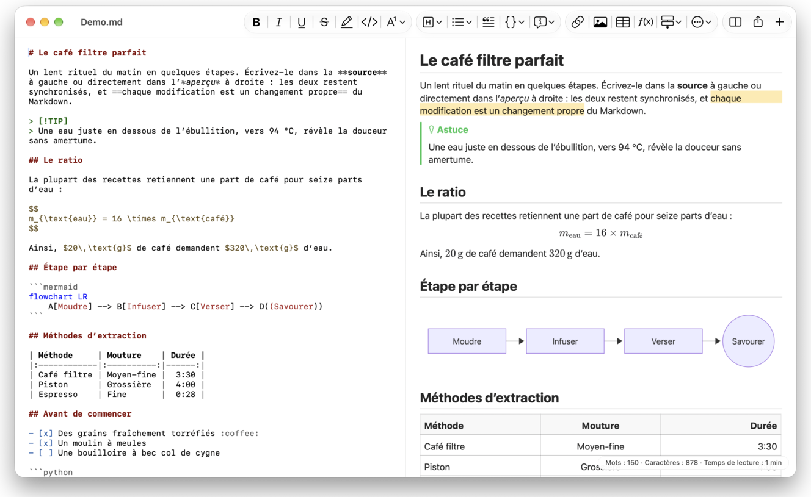
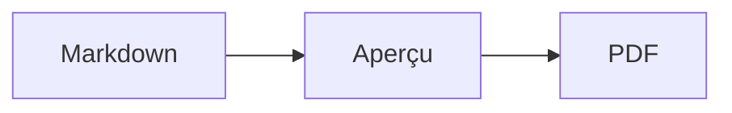

<p>&nbsp;&nbsp;&nbsp;</p>

# Splat

**L’éditeur Markdown pour macOS qui permet d’écrire dans la source ou directement dans l’aperçu.**

Splat affiche à gauche votre source Markdown avec coloration syntaxique et, à droite, un aperçu en direct entièrement modifiable. Tapez dans l’un ou l’autre : ce que vous écrivez dans l’aperçu devient une modification minimale de la source, de sorte que les lignes que vous n’avez pas touchées restent identiques à l’octet près et que vos diffs Git restent propres. Splat lit le Markdown que vous utilisez déjà : CommonMark et GitHub Flavored Markdown, alertes GitHub, liens wiki, intégrations et encadrés d’Obsidian, extensions de Pandoc et de Typora, HTML intégré, formules LaTeX et diagrammes Mermaid, Graphviz et PlantUML, le tout rendu hors ligne. Parcourez tout un dossier de notes et faites-y des recherches, voyez ce qui a changé depuis le dernier commit Git, collez au format Markdown depuis Word ou une page web, et exportez en PDF, en HTML ou en Word en un clic. Splat est écrit en Rust avec de véritables contrôles AppKit, parle 35 langues et n’a aucune télémétrie.
 


[](https://github.com/sventmueller/splat/releases/latest/download/Splat.dmg)

**[Télécharger Splat.dmg](https://github.com/sventmueller/splat/releases/latest/download/Splat.dmg)** : signé et notarisé par Apple, pour macOS 14 ou ultérieur, sur Apple Silicon et Intel.

**Vous avez trouvé un bogue ?** Splat garde les lignes que vous n’avez pas touchées identiques à l’octet près. Si l’une d’elles change quand même, ou si un fichier s’affiche mal, [ouvrez une issue](https://github.com/sventmueller/splat/issues/new/choose) et joignez le fichier. Si Splat vous est utile, une [étoile sur GitHub](https://github.com/sventmueller/splat) aide d’autres personnes à le trouver.
 
 

[](https://www.rust-lang.org)
[](https://www.apple.com/macos/)

[](https://github.com/madsmtm/objc2)
[](https://webkit.org)
[](https://github.com/kivikakk/comrak)
[](https://github.github.com/gfm/)
[](https://www.mathjax.org)
[](https://cortexjs.io/mathlive/)
[](https://mermaid.js.org)
[](https://graphviz.org)
[](https://plantuml.com)


[](#licence)

[Bahasa Indonesia](../id/README.md) ·
[Bahasa Melayu](../ms/README.md) ·
[Català](../ca/README.md) ·
[Čeština](../cs/README.md) ·
[Dansk](../da/README.md) ·
[Deutsch](../de/README.md) ·
[English](../../../README.md) ·
[Español](../es/README.md) ·
**Français** ·
[Hrvatski](../hr/README.md) ·
[Italiano](../it/README.md) ·
[Magyar](../hu/README.md) ·
[Nederlands](../nl/README.md) ·
[Norsk](../no/README.md) ·
[Polski](../pl/README.md) ·
[Português (Brasil)](../pt_BR/README.md) ·
[Português (Portugal)](../pt_PT/README.md) ·
[Română](../ro/README.md) ·
[Slovenčina](../sk/README.md) ·
[Slovenščina](../sl/README.md) ·
[Suomi](../fi/README.md) ·
[Svenska](../sv/README.md) ·
[Tiếng Việt](../vi/README.md) ·
[Türkçe](../tr/README.md) ·
[Ελληνικά](../el/README.md) ·
[Русский](../ru/README.md) ·
[Українська](../uk/README.md) ·
[עברית](../he/README.md)‎ ·
[العربية](../ar/README.md)‎ ·
[हिन्दी](../hi/README.md) ·
[ไทย](../th/README.md) ·
[한국어](../ko/README.md) ·
[日本語](../ja/README.md) ·
[简体中文](../zh-Hans/README.md) ·
[繁體中文](../zh-Hant/README.md)

## Sommaire

- [Aperçu des fonctionnalités](#aperçu-des-fonctionnalités)
- [Configuration requise](#configuration-requise)
- [Installation](#installation)
- [Premiers pas](#premiers-pas)
- [Écrire](#écrire)
  - [Dans la source](#dans-la-source)
  - [Dans l’aperçu](#dans-laperçu)
  - [Commandes de mise en forme](#commandes-de-mise-en-forme)
  - [Listes et tâches](#listes-et-tâches)
  - [Tableaux](#tableaux)
  - [Coller du texte mis en forme](#coller-du-texte-mis-en-forme)
  - [Métadonnées](#métadonnées)
- [Markdown pris en charge](#markdown-pris-en-charge)
  - [CommonMark et GitHub Flavored Markdown](#commonmark-et-github-flavored-markdown)
  - [Encadrés](#encadrés)
  - [Syntaxe étendue](#syntaxe-étendue)
  - [Obsidian](#obsidian)
  - [Citations et références](#citations-et-références)
  - [HTML intégré](#html-intégré)
  - [Ponctuation typographique](#ponctuation-typographique)
  - [Aperçu de la syntaxe](#aperçu-de-la-syntaxe)
- [Formules](#formules)
- [Diagrammes](#diagrammes)
- [Images](#images)
- [Liens et navigation](#liens-et-navigation)
- [Notes dans un dossier](#notes-dans-un-dossier)
- [Modifications depuis le dernier commit](#modifications-depuis-le-dernier-commit)
- [Exporter, imprimer et partager](#exporter-imprimer-et-partager)
- [Importer des documents Word](#importer-des-documents-word)
- [Apparence et accessibilité](#apparence-et-accessibilité)
- [Langues](#langues)
- [Raccourcis clavier](#raccourcis-clavier)
- [Confidentialité et sécurité](#confidentialité-et-sécurité)
- [Documents volumineux](#documents-volumineux)
- [Limites connues](#limites-connues)
- [Dépannage](#dépannage)
- [Pour les développeurs](#pour-les-développeurs)
  - [Composants tiers](#composants-tiers)
- [Licence](#licence)

## Aperçu des fonctionnalités

- **Deux façons d’écrire, un seul texte.** La source et l’aperçu sont tous deux modifiables. Le fichier Markdown est la seule référence : il y a un seul historique d’annulation par document, et chaque modification faite dans l’aperçu est traduite en la plus petite modification possible de la source.
- **Le Markdown que vous utilisez déjà.** CommonMark, GitHub Flavored Markdown, alertes GitHub, extensions d’Obsidian, de Pandoc et de Typora, codes courts d’émojis, spoilers, listes de définitions, ancres de titres et HTML comme dans les README GitHub.
- **Formules et diagrammes intégrés.** Formules LaTeX via MathJax, avec un éditeur de formules visuel. Diagrammes Mermaid, Graphviz et PlantUML, rendus sur votre Mac sans Java, sans serveur et sans connexion réseau.
- **Un bouton pour tout.** Chaque élément Markdown a son bouton dans la barre d’outils et son élément de menu, et les plus courants ont aussi un raccourci clavier. Les tableaux ont leur propre menu pour les lignes, les colonnes et l’alignement.
- **Un dossier, pas seulement un fichier.** La barre latérale liste les notes autour d’un document et cherche dans chacune d’elles. Renommer une note modifie les liens vers elle, et tous les octets autour restent intacts.
- **Les modifications en un coup d’œil.** Dans un dépôt Git, des barres à côté du texte signalent ce qui diffère du dernier commit, dans les deux volets.
- **De Word et du web vers Markdown.** Collez du texte mis en forme au format Markdown, des cellules de tableur sous forme de tableau, et importez des documents Word entiers avec leurs images.
- **Exporter sans rien perdre.** PDF, un fichier HTML unique et autonome, ou un document Word avec de vrais titres, listes, tableaux, notes de bas de page et images. Ajoutez des numéros de page, des en-têtes et une page de titre, ou utilisez le modèle Word de votre entreprise.
- **Natif jusqu’au bout.** De vraies fenêtres, de vrais onglets, menus et popovers AppKit, les Versions, l’enregistrement automatique, le menu de partage, le mode sombre, la vérification orthographique, la dictée et VoiceOver. Pas d’Electron, pas de vue web pour le texte lui-même.
- **Rapide avec les gros fichiers.** Le rendu d’une frappe dans un document de 10 Mo prend environ 10 ms, avant le travail propre à la vue.
- **Discret et prudent.** Splat s’exécute dans l’App Sandbox, les liens vers d’autres apps demandent d’abord confirmation, et tout ce qui décode des données d’image non fiables s’exécute dans un service distinct, isolé dans un bac à sable.
- **Dans votre langue.** L’interface et l’aide-mémoire Markdown intégré existent en 35 langues : allemand, anglais, arabe, catalan, chinois (simplifié), chinois (traditionnel), coréen, croate, danois, espagnol, finnois, français, grec, hébreu, hindi, hongrois, indonésien, italien, japonais, malais, néerlandais, norvégien, polonais, portugais (Brésil), portugais (Portugal), roumain, russe, slovaque, slovène, suédois, tchèque, thaï, turc, ukrainien et vietnamien.

## Configuration requise

- macOS 14 Sonoma ou ultérieur. Splat est développé et testé sous macOS 27, où il adopte automatiquement le design Liquid Glass.
- Un Mac avec Apple Silicon ou un processeur Intel.
- Environ 45 Mo d’espace disque.

## Installation

**Depuis l’image disque.** Téléchargez [`Splat.dmg`](https://github.com/sventmueller/splat/releases/latest/download/Splat.dmg), ouvrez-la et faites glisser Splat dans le dossier Applications. L’image est signée avec un Developer ID et notarisée par Apple : elle s’ouvre donc sans avertissement.

**Avec Homebrew.** Le cask se trouve dans un tap à part :

```sh
brew install --cask sventmueller/tap/splat
```

`brew upgrade --cask splat` installe les nouvelles versions, et `brew uninstall --zap --cask splat` supprime aussi les réglages et les caches de Splat.

**Mises à jour.** Splat, installé depuis l’image disque ou avec Homebrew, se met à jour tout seul grâce à [Sparkle](https://sparkle-project.org). Au deuxième lancement, il demande s’il peut rechercher des mises à jour de lui-même, une fois par jour. **Splat › Rechercher les mises à jour…** lance la recherche tout de suite ; **Rechercher automatiquement les mises à jour** et **Télécharger et installer automatiquement les mises à jour** dans le même menu permettent de changer ce choix plus tard. Splat n’installe une mise à jour que si elle porte la signature du développeur. Une version compilée par vos soins n’a pas de mise à jour automatique.

**Depuis les sources.** Consultez [Building](../../../docs/development.md#building) pour les prérequis, puis :

```sh
make build
ditto target/release/Splat.app /Applications/Splat.app
open /Applications/Splat.app
```

Pour ouvrir les fichiers Markdown avec Splat par un double-clic, sélectionnez un fichier `.md` dans le Finder, choisissez **Fichier › Lire les informations**, sélectionnez Splat sous **Ouvrir avec** et cliquez sur **Tout modifier…**. Splat s’enregistre lui-même pour les fichiers `.md`, `.markdown`, `.mdown` et `.mkd`.

## Premiers pas

### La fenêtre

Chaque document s’ouvre dans sa propre fenêtre, ou dans un onglet si vous préférez les onglets :

- **À gauche : la source.** Votre Markdown en SF Mono avec coloration syntaxique.
- **À droite : l’aperçu.** Le document rendu, prêt à être modifié.
- **Barre latérale (facultative).** Tous les titres sous forme d’arborescence, un clic sur l’un d’eux l’affiche dans les deux volets : **Présentation › Afficher le plan** (⌃⌘S). Deux autres onglets contiennent les [notes du dossier](#notes-dans-un-dossier) et une recherche parmi elles. Le bouton à côté du titre de la fenêtre l’affiche et la masque, et les nouvelles fenêtres l’ouvrent telle que la dernière l’a laissée.
- **Barre d’outils.** Des boutons regroupés selon ce qu’ils modifient : les caractères, les paragraphes et les éléments insérés, puis l’aperçu activé ou désactivé, Partager et Nouveau document. Personnalisez-la avec **Présentation › Personnaliser la barre d’outils…**.

Faites glisser le séparateur pour donner plus de place à l’un ou l’autre côté. **Présentation › Masquer l’aperçu** (⌥⌘P) laisse la source seule ; Splat s’en souvient pour chaque fenêtre. Les deux volets défilent ensemble, et une sélection dans l’un est mise en évidence dans l’autre.

Le coin de la fenêtre affiche les mots et les caractères du texte ainsi que son temps de lecture, et ceux de la sélection tant qu’il y en a une. Les adresses de liens, les balises HTML, les métadonnées, les commentaires, les formules et les diagrammes ne comptent pas. Il reste masqué jusqu’à ce que **Présentation › Afficher le nombre de mots** l’active.

### Documents, onglets et versions

Splat est une app de documents macOS classique :

- **Enregistrement automatique et Versions.** Les modifications sont enregistrées sur place. **Fichier › Revenir à › Parcourir toutes les versions…** vous ramène dans le passé.
- **Modifications venant d’autres programmes.** Lorsque Git, un script ou un autre éditeur modifie un document ouvert, Splat le recharge et conserve le point d’insertion et la position de défilement. Si vous avez vous-même des modifications non enregistrées, Splat les conserve, et macOS demande confirmation avant d’écraser l’autre version.
- **Les commandes de fichier habituelles.** Dupliquer (⇧⌘S), Renommer…, Déplacer vers… et **Fichier › Ouvrir l’élément récent**.
- **Onglets.** **Fichier › Nouvel onglet** ou le bouton **+** de la barre d’outils ouvre un nouveau document dans un onglet ; le menu Fenêtre standard fusionne les fenêtres, déplace les onglets et passe de l’un à l’autre.
- **Position des fenêtres.** La taille et la position de votre dernière fenêtre sont mémorisées, y compris après un redémarrage. Si une fenêtre se trouve déjà à cet endroit, la nouvelle s’ouvre légèrement décalée.
- **L’icône du Dock.** Un clic dessus, après la fermeture de la dernière fenêtre, ouvre un nouveau document.
- **Ouvrir les fichiers Markdown dans Splat.** **Splat › Définir comme app par défaut pour Markdown** fait ouvrir Splat par un double-clic sur un fichier `.md` ou `.markdown` ; macOS demande une fois de confirmer. L’élément affiche une coche tant que Splat est l’app par défaut.

Les fichiers doivent être du texte UTF-8, ou UTF-16 avec une marque d’ordre des octets. Splat refuse les autres encodages plutôt que de deviner et d’altérer le texte. Une marque d’ordre des octets est conservée, l’UTF-16 reste de l’UTF-16, et dans un fichier dont toutes les lignes se terminent par CRLF, les lignes que vous ajoutez reçoivent elles aussi CRLF.

**Après un plantage**, au plus les dernières secondes de frappe sont perdues : toutes les cinq secondes, Splat copie le texte non enregistré dans `~/Library/Application Support/Splat/Unsaved`, puis supprime ces copies dès qu’un document est enregistré ou que Splat se ferme normalement. Au démarrage suivant, ce qu’un plantage a laissé là est déplacé vers `~/Library/Application Support/Splat/Recovery`, ce que Splat signale une fois, avec un bouton qui ouvre le dossier. Lorsqu’un plantage laisse encore à Splat le temps de réagir, il y écrit aussi le texte de tous les documents ouverts.

### Aide-mémoire

**Aide › Aide-mémoire Markdown** ouvre, dans un nouveau document sans titre, un aide-mémoire dans votre langue. C’est un document ordinaire : essayez tout directement dedans, dans la source ou dans l’aperçu.

## Écrire

### Dans la source

La source est un éditeur de texte brut adapté au Markdown :

- **Coloration syntaxique** comme dans VS Code : titres, emphase, liens, code, tableaux, HTML, front matter, ainsi que LaTeX et Mermaid dans les formules et les diagrammes. Il existe des palettes pour le mode clair, le mode sombre et Augmenter le contraste.
- **Les blocs de code délimités** sont colorés pour Bash, C, C++, C#, CSS (aussi SCSS et Less), Go, HTML, XML, Java, JavaScript, JSON, Kotlin, PHP, Python, Ruby, Rust, SQL, Swift, TypeScript, YAML, TeX et Mermaid, y compris leurs noms abrégés usuels comme `js`, `py` ou `sh`.
- **Aucune substitution surprise.** Les guillemets courbes, les tirets intelligents et le remplacement de texte sont désactivés par défaut, car ils faussent `--`, `---` et `"`. Activez-les sous **Édition › Substitutions**.
- **Les outils d’écriture du système.** Vérification de l’orthographe et de la grammaire, dictée, Rechercher et remplacer… (⌥⌘F) et Parole.
- **Glisser-déposer.** Déposez un fichier image pour insérer ``, n’importe quel autre fichier pour insérer un lien vers lui, et une URL pour insérer `[url](url)`. Chaque dépôt compte pour une seule étape d’annulation.
- **Coller des images.** Une image du presse-papiers, comme une capture d’écran, est enregistrée en fichier PNG à côté du document (`Image 2026-10-29 13.09.07.png`) et insérée comme image. Pour cela, le document doit avoir été enregistré une fois.

### Dans l’aperçu

L’aperçu se comporte comme un traitement de texte, mais tout ce que vous y faites aboutit en Markdown :

- **Saisie.** Les caractères qui ont un sens en Markdown, comme `*` ou `#`, sont échappés pour apparaître tels que vous les tapez.
- **Return** commence un nouveau paragraphe ou un nouvel élément de liste. **⌥Return** ou **⌃Return** insère un saut de ligne.
- **Mise en forme au point d’insertion.** Quand le curseur se trouve à la fin d’un mot, Gras, Italique et les autres mises en forme de caractères s’appliquent à ce que vous tapez ensuite. Choisissez de nouveau la mise en forme pour l’arrêter. À l’intérieur d’un mot, le mot entier est mis en forme.
- **Lignes vides.** Return sur une ligne vide ajoute une autre ligne vide, et la touche Supprimer la retire. Dans la source, chaque ligne vide supplémentaire correspond à deux lignes blanches de plus ; les autres programmes Markdown les affichent comme un espacement normal entre paragraphes.
- **Annuler** fonctionne dans les deux volets. Les éléments d’annulation portent un nom (« Annuler Gras »), la saisie compte pour une étape par rafale, et après Annuler et Rétablir, les deux volets défilent jusqu’à la modification.
- **Les formules et les diagrammes** apparaissent comme des graphiques terminés. Cliquez sur l’un d’eux, placez le curseur dessus ou appuyez sur Return pour ouvrir son éditeur (voir [Formulas](#formules) et [Diagrams](#diagrammes)).
- **Le HTML intégré, les notes intégrées et le front matter** sont affichés, mais vous les modifiez dans la source. Un clic dessus place le curseur à l’endroit correspondant dans la source.

Tout ce que le Markdown ne peut pas exprimer est bloqué dans l’aperçu : les panneaux Polices et Couleurs, la règle, ainsi que le collage ou le dépôt de texte enrichi et d’images. Le HTML et le RTF collés arrivent en texte brut, sauf si vous choisissez [Coller au format Markdown](#coller-du-texte-mis-en-forme).

### Commandes de mise en forme

Chaque commande est disponible dans la barre d’outils, dans la barre des menus et dans le menu contextuel des deux volets. Les éléments de menu affichent une coche pour la mise en forme au point d’insertion.

| Menu | Commandes |
|---|---|
| **Format › Police** | Gras, Italique, Souligné, Barré, Surbrillance, Code, Exposant, Indice |
| **Format › Titre** | Corps de texte, Titre 1 à 6 |
| **Format › Liste** | Liste à puces, Liste numérotée, Liste de tâches |
| **Format** | Citation, Bloc de code (Aucun langage ou l’un des 20 langages ; change aussi le langage d’un bloc existant), Encadré (Note, Astuce, Important, Attention, Mise en garde ; le même type une seconde fois le supprime), Modifier la formule ou le diagramme…, Effacer la mise en forme |
| **Insérer** | Lien…, Image…, Tableau…, Formule, Diagramme (Diagramme de flux, Diagramme de séquence, Diagramme de Gantt), Table des matières, Note de bas de page, Séparateur |
| **Tableau** | Insérer une ligne au-dessus/en dessous, Insérer une colonne à gauche/à droite, Supprimer la ligne, Supprimer la colonne, Alignement (Gauche, Centré, Droite, Par défaut), Aligner les colonnes du tableau |
| **Présentation** | Masquer/Afficher l’aperçu, Afficher/Masquer le plan, Ponctuation typographique, Agrandir/Réduire, Taille réelle, barre d’outils, barre d’onglets, plein écran |

Le soulignement, la surbrillance, l’exposant et l’indice s’écrivent `<ins>`, `<mark>`, `<sup>` et `<sub>`, que GitHub affiche aussi. Splat lit également `<u>`, que GitHub supprime, ainsi que les formes plus courtes `==surbrillance==`, `^exp^` et `~ind~`. GitHub affiche `==` et `^` tels quels et `~ind~` comme du texte barré.

### Listes et tâches

- Return poursuit une liste ; Return sur un élément vide la termine.
- **Tab** et **⇧Tab** indentent et désindentent les éléments de liste dans l’aperçu.
- Un clic sur une case à cocher de tâche dans l’aperçu bascule entre `- [ ]` et `- [x]`.
- **Format › Liste** transforme les paragraphes sélectionnés en liste ou change son type.

### Tableaux

- **Insérer › Tableau…** demande le nombre de lignes (y compris l’en-tête) et de colonnes.
- Dans l’aperçu, **Tab** passe à la cellule suivante, **⇧Tab** à la précédente et **Return** à la cellule du dessous. Tab dans la dernière cellule ajoute une ligne.
- Le menu **Tableau** insère et supprime des lignes et des colonnes et règle l’alignement d’une colonne (⌘{, ⌘|, ⌘}).
- **Tableau › Aligner les colonnes du tableau** complète la source par des espaces pour que les colonnes soient alignées.

### Coller du texte mis en forme

**Édition › Coller au format Markdown** (⌃⌘V), également dans le menu contextuel des deux volets, transforme le contenu du presse-papiers en Markdown à l’emplacement de la sélection, en une seule étape d’annulation. ⌘V continue d’insérer du texte brut.

- **Depuis un navigateur, Word, Google Docs, Confluence, Notes ou Pages :** les titres, le gras, l’italique, le souligné, le barré, l’exposant et l’indice, les liens, les listes avec leur imbrication, les citations, le code et les tableaux sont repris.
- **Depuis un tableur :** les cellules deviennent un tableau avec une ligne d’en-tête et des colonnes de nombres alignées à droite. Il en va de même du texte séparé par des tabulations, des points-virgules ou des virgules, si chaque ligne a le même nombre de colonnes.
- **Les images** dotées d’une adresse web restent des liens. Une image contenue dans le HTML collé devient un fichier à côté du document, qui doit pour cela avoir été enregistré une fois. Les fichiers image temporaires de Word ne sont pas repris, et leur texte alternatif reste.
- **Les liens** ne conservent que les adresses `http`, `https`, `mailto`, relatives et `#` ; de tout autre lien, seul le texte reste.

### Métadonnées

**Format › Modifier les métadonnées…**, ou un clic sur la ligne de métadonnées en haut de l’aperçu, ouvre un formulaire avec les champs du front matter YAML. Les champs peuvent être modifiés, ajoutés et supprimés. Un champ contenant une liste la conserve sous forme de liste : ses valeurs se suivent, séparées par des virgules, et une valeur contenant une virgule se place entre guillemets. Un nouveau champ nommé `tags`, `aliases`, `keywords`, `categories`, `authors` ou `cssclasses` devient lui aussi une liste. Les champs imbriqués et le texte sur plusieurs lignes y sont visibles et se modifient dans la source.

Ce que le formulaire modifie forme une seule étape d’annulation et ne touche que les lignes des champs que vous avez changés : les commentaires, l’ordre, les espacements inhabituels, les guillemets et les fins de ligne de tous les autres restent identiques à l’octet près. Un document sans métadonnées reçoit un bloc à son début.

## Markdown pris en charge

Splat analyse le texte avec [comrak](https://github.com/kivikakk/comrak), un analyseur compatible avec CommonMark et GFM, et active la plupart de ses extensions. Tout ce qui suit s’affiche dans l’aperçu et dans tous les exports.

### CommonMark et GitHub Flavored Markdown

- Titres (`#` et soulignés), paragraphes, sauts de ligne, emphase, emphase forte, code en ligne, citations, séparateurs.
- Listes à puces, numérotées et imbriquées ; listes de tâches.
- Liens (en ligne, de référence et automatiques), images, définitions de références de liens.
- Blocs de code délimités et indentés avec coloration syntaxique.
- Tableaux avec alignement des colonnes.
- Texte barré avec `~~deux tildes~~`.
- Notes de bas de page : `texte[^1]` avec `[^1]: La note.` n’importe où dans le document. Un clic sur le repère mène à la note.
- Front matter YAML entre des lignes `---` en haut du document. L’aperçu le résume en une ligne, par exemple « Métadonnées : title, date, tags ».

### Encadrés

Les alertes GitHub s’affichent sous forme de boîtes colorées avec une icône et un titre :

```markdown
> [!NOTE]
> Informations utiles que les utilisateurs devraient connaître.

> [!WARNING]
> Contenu critique qui exige une attention immédiate.
```

Les cinq types sont Note, Astuce, Important, Attention et Mise en garde. **Format › Encadré** transforme le paragraphe où se trouve le curseur en encadré.

Les encadrés d’Obsidian fonctionnent aussi, avec un titre libre et un état de repli :

```markdown
> [!tip]- Cliquez sur ▸ pour développer
> Masqué tant qu’il n’est pas ouvert.

> [!question]+ Ouvert par défaut
> Un `+` démarre développé, un `-` replié.
```

Les autres types d’Obsidian sont affichés dans la couleur la plus proche parmi les cinq : `success`, `check`, `done` et `hint` comme Astuce ; `question`, `help` et `faq` comme Important ; `attention` comme Attention ; `failure`, `fail`, `missing`, `danger`, `error` et `bug` comme Mise en garde ; tout le reste comme Note.

### Syntaxe étendue

| Fonction | Syntaxe | Origine |
|---|---|---|
| Surbrillance | `==texte marqué==` | Obsidian, Typora |
| Exposant | `x^2^` | Pandoc, Typora |
| Indice | `H~2~O` | Pandoc, Typora |
| Code court d’émoji | `:rocket:` devient 🚀 | GitHub |
| Spoiler | `\|\|texte masqué\|\|`, à sélectionner pour le lire | Discord |
| Note de bas de page en ligne | `texte^[la note elle-même]` | Pandoc, Obsidian |
| Liste de définitions | `Terme`, ligne vide, `: Explication` | PHP Markdown Extra, Pandoc |
| Ancre de titre | `## Installation {#setup}`, lien avec `[voir](#setup)` | Pandoc, kramdown |

Dans la source, les listes de définitions ressemblent à ceci :

```markdown
Terme

: Explication du terme.
```

Sans ancre personnalisée, chaque titre reçoit une ancre dérivée de son texte, comme sur GitHub : `## Premiers pas` est accessible par `#premiers-pas`.

### Obsidian

- **Liens wiki.** `[[Note]]` renvoie à `Note.md` dans le même dossier ou dans un sous-dossier. `[[Note|Texte affiché]]` affiche votre propre texte, et `[[Note#Titre]]` ouvre la note. ⌘-clic l’ouvre dans Splat.
- **Intégrations.** `![[Note]]` affiche l’autre note dans celle-ci ; les notes qui y sont intégrées apparaissent sous forme de liens. `![[diagram.png]]` affiche une image. Comme dans Obsidian, les intégrations désignent des notes et des images situées dans le dossier du document ou en dessous, jamais par un chemin absolu, et seuls les fichiers Markdown s’affichent comme notes.
- **Commentaires.** `%%Seulement dans la source%%` reste visible dans la source et est omis de l’aperçu et de tous les exports, en ligne comme sur des lignes à part.
- **Étiquettes.** `#idée` ou `#projet/splat` est mis en évidence. ⌘-clic recherche l’étiquette dans le document et, dans la barre latérale, dans tout le dossier.
- **Encadrés repliables.** Voir [Callouts](#encadrés).

### Citations et références

- **Citations Pandoc.** `[@doe2020]` ou `[@doe2020; @roe2021]` se lit « (Doe 2020 ; Roe 2021) ». Les entrées proviennent du fichier BibTeX que le front matter désigne par `bibliography: refs.bib`. À défaut, Splat utilise `references.bib`, `literatur.bib` ou `bibliography.bib` à côté du document.
- **Références GitHub et GitLab.** Si le document se trouve dans un dépôt Git dont le dépôt distant `origin` est sur github.com ou sur un hôte GitLab, `@name`, `#12` (ticket) et `!7` (merge request, GitLab uniquement) sont mis en évidence. ⌘-clic les ouvre dans le navigateur.

### HTML intégré

Le HTML tel qu’on le trouve dans les README GitHub est rendu, avec son propre lecteur plutôt qu’un moteur de navigateur :

- paragraphes et blocs centrés (`<p align="center">`, `<div align="center">`)
- images avec une taille (``)
- liens, `<kbd>⌘</kbd>`, `<br>`, `<u>`, `<ins>`, `<mark>`, `<sup>`, `<sub>`
- listes et tableaux, y compris les cellules qui s’étendent sur plusieurs colonnes (`colspan`)
- sections repliables : `<details><summary>Plus</summary>…</details>`, qui s’ouvrent d’un clic sur ▸

Le Markdown placé entre des balises HTML est rendu comme du Markdown. Les scripts, les styles, les cadres et les formulaires sont totalement omis, et les liens et les images ne conservent que les adresses `http`, `https`, `mailto` et relatives.

### Ponctuation typographique

**Présentation › Ponctuation typographique** affiche les guillemets droits sous la forme des guillemets de la langue de votre interface, `--` comme un tiret demi-cadratin, `---` comme un tiret cadratin et `...` comme des points de suspension. En allemand, `"Ja"` devient „Ja“, en français «Oui», en japonais 「はい」, y compris là où le chinois et le japonais composent les guillemets sans espace ; les abréviations hébraïques comme `צה"ל` reçoivent leur guershayim, צה״ל. La source conserve les caractères simples ; l’aperçu et tous les exports affichent les caractères typographiques. Le réglage est désactivé tant que vous ne l’activez pas.

### Aperçu de la syntaxe

| Élément | Markdown |
|---|---|
| **Gras** | `**Gras**` |
| *Italique* | `*Italique*` |
| Souligné | `<ins>Souligné</ins>` ou `<u>Souligné</u>` |
| ~~Barré~~ | `~~Barré~~` |
| Surbrillance | `<mark>Surbrillance</mark>` ou `==Surbrillance==` |
| `Code` | `` `Code` `` |
| x² | `x<sup>2</sup>` ou `x^2^` |
| H₂O | `H<sub>2</sub>O` ou `H~2~O` |
| [Lien](https://example.com) | `[Lien](https://example.com)` |
| Titre | `# Titre` à `###### Titre` |
| Citation | `> Citation` |
| Liste à puces | `- Élément` |
| Liste numérotée | `1. Élément` |
| Tâche | `- [ ] À faire` et `- [x] Terminé` |
| Bloc de code | ```` ```rust ```` … ```` ``` ```` |
| Tableau | `\| A \| B \|` avec `\|---\|---\|` sous l’en-tête |
| Note de bas de page | `Texte[^1]` et `[^1]: Note` |
| Séparateur | `---` |
| Image | `` |
| Formule | `$E = mc^2$`, `$$ … $$` |
| Diagramme | ```` ```mermaid ````, ```` ```dot ````, ```` ```plantuml ```` |
| Encadré | `> [!TIP]` |
| Lien wiki | `[[Note]]`, `[[Note\|Texte]]` |
| Intégration | `![[Note]]`, `![[image.png]]` |
| Commentaire | `%%Commentaire%%` |
| Étiquette | `#étiquette` |
| Citation bibliographique | `[@key]` |
| Spoiler | `\|\|Spoiler\|\|` |
| Émoji | `:tada:` |

## Formules

Les formules sont rendues par [MathJax](https://www.mathjax.org) avec ses mathématiques TeX et AMS, sous forme de graphiques vectoriels nets. Le texte dans `\text{…}` peut être écrit dans n’importe quelle écriture : ce qui manque aux polices de MathJax provient des polices de votre Mac, l’arabe et l’hébreu s’écrivant de droite à gauche, et les émojis s’affichant en couleur.

| Type | Syntaxe |
|---|---|
| En ligne | `$E = mc^2$`, `` $`E = mc^2`$ `` (GitHub, GitLab), `\(E = mc^2\)` |
| Bloc | `$$` … `$$`, `\[` … `\]`, ou un bloc de code marqué `math` |

**Modifier une formule.** Cliquez sur une formule dans l’aperçu, double-cliquez dessus, appuyez sur Return dessus ou placez le curseur dessus pour ouvrir son éditeur dans un popover. **Insérer › Formule** en insère une nouvelle et ouvre aussitôt l’éditeur.

- **Visuel ou LaTeX.** Le sélecteur en haut bascule entre un éditeur visuel ([MathLive](https://cortexjs.io/mathlive/)) et le code LaTeX. Splat retient votre choix.
- **Des blocs** pour la fraction, la racine carrée, l’exposant et l’indice, la somme et l’intégrale avec bornes, la limite, les parenthèses qui s’adaptent au contenu, la matrice 2×2, les lettres grecques, ainsi que les relations, les opérateurs et les flèches. Ils laissent des espaces réservés □, et **Tab** passe au suivant.
- **Aperçu en direct.** Les modifications apparaissent dans le document pendant la saisie. Les erreurs de MathJax s’affichent sur une ligne sous le code.
- **Valider ou annuler.** Un clic à l’extérieur conserve la modification en une seule étape d’annulation ; **Esc** ou **Annuler** la rejette. Quitter par Esc une formule nouvelle et vide la supprime de nouveau.
- Le menu contextuel propose **Modifier la formule…** pour la formule située sous le pointeur.

VoiceOver lit une formule sous la forme de son code LaTeX. Splat rend des formules, pas des documents LaTeX complets : il n’y a ni paquets, ni TikZ, ni `\documentclass`.

## Diagrammes

Les diagrammes sont rendus dans Splat, hors ligne et en variante claire et sombre.

| Moteur | Bloc de code | Ce qu’il dessine |
|---|---|---|
| [Mermaid](https://mermaid.js.org) | ```` ```mermaid ```` | diagrammes de flux, de séquence, de classes, d’états, entité-relation, de Gantt, circulaires, cartes mentales, chronologies et tous les autres types Mermaid |
| [Graphviz](https://graphviz.org) | ```` ```dot ```` ou ```` ```graphviz ```` | graphes en langage DOT |
| [PlantUML](https://plantuml.com) | ```` ```plantuml ```` ou ```` ```puml ```` | diagrammes UML ; fonctionne sans Java |



**Modifier un diagramme** fonctionne comme modifier une formule : cliquez dessus pour ouvrir le code dans un popover, avec coloration syntaxique et messages d’erreur sur une ligne sous le code. **Insérer › Diagramme** part d’un modèle de diagramme de flux, de diagramme de séquence ou de diagramme de Gantt. Des blocs facilitent les trois types Mermaid les plus courants :

- **Diagramme de flux :** Nœud ▾ (rectangle, arrondi, cercle, losange, base de données), Connexion, Connexion avec libellé, Groupe, Direction ▾
- **Diagramme de séquence :** Participant, Message, Réponse, Note, Boucle, Chemins alternatifs
- **Diagramme de Gantt :** Section, Tâche, Jalon

Les autres types de diagrammes se modifient sous forme de code. VoiceOver lit le titre ou le texte alternatif d’un diagramme.

Le premier diagramme après le lancement prend environ une seconde, car le moteur de rendu démarre en arrière-plan. Un diagramme qui prend plus de 10 secondes affiche une erreur, et le moteur de rendu redémarre à neuf pour le suivant. Le moteur de PlantUML (3 Mo) ne se charge qu’avec le premier diagramme PlantUML. Un `!include` PlantUML provenant du web est bloqué.

## Images

- **Les images locales** utilisent des chemins relatifs au document : ``. Splat affiche PNG, JPEG, GIF, WebP, BMP, SVG, HEIC, TIFF, AVIF et PDF.
- **Les images du web** se chargent dès qu’un document les affiche, via `https` et jusqu’à 10 Mo chacune. Comme les images d’un e-mail, elles indiquent à leurs serveurs que le document est ouvert, et à quel moment.
- **Taille.** `` fixe la taille d’une image ; sinon, les images s’adaptent à la largeur de l’aperçu.
- **Modifications sur le disque.** Une image que vous remplacez, ou une image qui apparaît après que le document l’a nommée, s’affiche sans qu’il soit nécessaire de rouvrir le document. Les images du web qui ont échoué à cause du réseau sont rechargées tant qu’un document les affiche.
- **Mémoire.** Les images s’affichent jusqu’à 2560 pixels sur leur plus grand côté, ce qui remplit aussi une page A4. Elles sont décodées en plus petit dès qu’elles occupent un huitième de la mémoire du Mac, et tant que macOS signale une pression sur la mémoire.
- **Mode sombre.** Les images à fond blanc sont légèrement atténuées dans l’aperçu sombre.
- **Coller et déposer.** Voir [In the source](#dans-la-source).

## Liens et navigation

Dans l’aperçu, un clic place le curseur pour que vous puissiez modifier le texte du lien ; **⌘-clic** suit le lien :

- `http`, `https` et `mailto` s’ouvrent dans votre navigateur ou votre app de messagerie.
- Les fichiers Markdown s’ouvrent dans Splat ; les autres fichiers et dossiers sont affichés dans le Finder.
- `#anchor` mène au titre dans le document.
- Les adresses qui ouvrent une autre app, comme `slack://` ou `vscode://`, demandent d’abord confirmation et affichent l’adresse complète et l’app. **Annuler** est présélectionné.

**Insérer › Table des matières** insère une liste avec liens vers tous les titres. Avec le curseur à l’intérieur, la même commande la met à jour. La barre latérale du plan (⌃⌘S) mène à n’importe quel titre dans les deux volets.

## Notes dans un dossier

Les boutons en haut de la barre latérale basculent entre le plan, les fichiers et une recherche.

- **Fichiers** (**Présentation › Afficher les fichiers**, ⌃⌘E). Tous les fichiers Markdown du dossier du document ou, s’il se trouve dans un dépôt Git, de tout ce dépôt. Un clic ou Return ouvre une note dans un onglet de cette fenêtre ; si elle est déjà ouverte, elle passe au premier plan. Le bouton à côté du nom du dossier affiche un autre dossier dans cette fenêtre. Les fichiers masqués, `node_modules`, `target`, `Pods`, `DerivedData`, `__pycache__` et les dossiers sans notes restent à l’écart. Un document placé directement dans votre dossier Départ n’affiche que les notes situées à côté de lui, pour que Splat ne parcoure pas tous vos dossiers en demandant l’accès à chacun.
- **Recherche** (**Édition › Rechercher › Rechercher dans toutes les notes…**, ⇧⌘F). Trouve du texte dans toutes les notes, quelle qu’en soit la casse et quel que soit le codage de ses accents. `#tag` trouve une étiquette, `#project` aussi `#project/splat`, et rien à l’intérieur du code. Un clic sur un résultat ouvre la note à cet endroit.
- **Liens vers une note.** Le menu contextuel d’une note liste les notes qui pointent vers elle, par lien wiki, intégration, lien relatif ou définition de référence de lien.
- **Renommer une note.** Le même menu la renomme et modifie ces liens. Splat indique d’abord combien de liens dans combien de fichiers cela représente. Seul le nom change dans chaque lien, et tous les autres octets du fichier restent intacts. Les documents ouverts reçoivent la modification comme une étape d’annulation ; dans les autres fichiers, seuls Git ou les Versions peuvent la défaire. Un fichier qu’un autre programme a modifié entre-temps arrête le renommage de tous les liens, et Splat le nomme.

La liste suit le dossier lorsque la fenêtre passe au premier plan. La recherche voit les fichiers tels qu’ils sont sur le disque, et le texte que vous n’avez pas encore enregistré compte à partir du prochain enregistrement automatique.

## Modifications depuis le dernier commit

Dans un document situé dans un dépôt Git, des barres à côté du texte signalent ce qui diffère du dernier commit, dans la source et dans l’aperçu : vert pour les lignes ajoutées, bleu pour les lignes modifiées, et une courte marque rouge là où quelque chose a été supprimé. Elles suivent pendant la saisie et lorsque la branche bouge. **Présentation › Modifications depuis le dernier commit** les désactive, pour toutes les fenêtres.

Les lignes qui ne diffèrent que par leur fin de ligne ne comptent pas : un fichier en CRLF face à un commit en LF n’affiche donc aucune modification. Un nouveau fichier n’a aucune marque avant son premier commit, pas plus qu’un document de plus de 32 Mo.

## Exporter, imprimer et partager

| Format | Comment | Ce que vous obtenez |
|---|---|---|
| **PDF** | **Fichier › Exporter au format PDF…** ou le menu Partager | Pages au format papier, toujours en apparence claire, formules et diagrammes en graphiques vectoriels. **Fichier › Format d’impression…** règle le papier. |
| **Impression** | **Fichier › Imprimer…** (⌘P) | La même mise en page que le PDF. |
| **HTML** | **Fichier › Exporter au format HTML…** ou le menu Partager | Un fichier autonome : images locales intégrées, formules et diagrammes en images nettes, ancres de titres pour que la table des matières fonctionne. Pas de scripts. |
| **Word** | **Fichier › Exporter au format Word…** ou le menu Partager | Un fichier `.docx` avec les styles de titre de Word, de vraies listes et de vrais tableaux (y compris les cellules fusionnées), des notes de bas de page Word, les images, les formules et les diagrammes intégrés. |
| **Markdown** | Le bouton **Partager** de la barre d’outils | Le document sous forme de fichier `.md` pour Mail, Messages, AirDrop et tous les autres services de partage. |

Le menu **Fichier › Partager** les propose tous au même endroit. Les exports tiennent compte du réglage de la ponctuation typographique et des images du web que l’aperçu a chargées ; dans le HTML, les images du web restent des liens.

**Fichier › Options d’exportation…** définit ce que le PDF, l’impression et Word ajoutent au texte, pour tous les documents :

- **Numéros de page** dans le pied de page du PDF et de l’impression, sous la forme `2 / 9`.
- **En-tête et pied de page** pour le PDF et l’impression. `{title}`, `{author}`, `{date}`, `{page}` et `{pages}` représentent leurs valeurs, les trois premières venant des métadonnées du document.
- **Une page de titre** pour le PDF, l’impression et Word, avec `title`, `subtitle`, `author` et `date` tirés des métadonnées, ou le nom du document comme titre. Elle n’a ni en-tête ni pied de page.
- **Un modèle Word**, un `.docx` ou `.dotx` dont l’export reprend l’apparence : ses styles, y compris avec des noms localisés, son thème, le format de page, les marges, les en-têtes et les pieds de page. Un modèle illisible arrête l’export et le signale, plutôt que de vous donner un document sans lui.

## Importer des documents Word

**Fichier › Importer un document Word…** demande un fichier `.docx` ou `.dotx` et l’endroit où placer son Markdown, puis ouvre le résultat. Les images arrivent dans un dossier à côté de celui-ci, nommé d’après le document avec `-images`.

Les titres et les listes arrivent tels que les définissent les styles et la numérotation de Word, y compris dans les documents dont les styles ont des noms localisés. Le gras, l’italique, le souligné, le barré, la surbrillance, l’exposant et l’indice, les liens, les citations, le code, les notes de bas de page, les notes de fin et les tableaux sont repris, les cellules couvrant plusieurs colonnes sous forme de tableau HTML. Les formules deviennent du LaTeX. Les modifications suivies comptent comme acceptées, et une table des matières reste à l’écart, puisque **Insérer › Table des matières** en crée une nouvelle. Les anciens fichiers `.doc` et les documents protégés par un mot de passe sont refusés.

## Apparence et accessibilité

- **Le mode sombre** suit le système. Les formules et les diagrammes sont rendus pour chaque apparence.
- **Augmenter le contraste** dans Réglages Système fait passer la coloration syntaxique à des palettes à fort contraste.
- **Zoom.** ⌘+, ⌘− et ⌘0 changent l’échelle des deux volets.
- **Plein écran, onglets et barre d’outils personnalisable**, comme dans toute app du Mac.
- **VoiceOver.** Les volets s’appellent « Source Markdown » et « Aperçu », les formules sont lues sous la forme de leur code et les diagrammes sous celle de leur titre. Chaque commande est accessible au clavier.

Splat n’a pas de fenêtre de réglages : les quelques options se trouvent là où elles s’appliquent, dans **Présentation**, **Édition › Substitutions** et **Fichier › Options d’exportation…**.

## Langues

L’interface, les menus et l’aide-mémoire Markdown sont traduits en 35 langues :

allemand, anglais, arabe, catalan, chinois (simplifié), chinois (traditionnel), coréen, croate, danois, espagnol, finnois, français, grec, hébreu, hindi, hongrois, indonésien, italien, japonais, malais, néerlandais, norvégien, polonais, portugais (Brésil), portugais (Portugal), roumain, russe, slovaque, slovène, suédois, tchèque, thaï, turc, ukrainien et vietnamien.

Splat suit l’ordre des langues défini dans **Réglages Système › Général › Langue et région** ; vous pouvez aussi y choisir une langue pour Splat seul sous **Applications**. Sans traduction pour votre langue, il utilise l’anglais. Les termes des menus reprennent les traductions d’Apple, de sorte que Splat se lit comme le reste de votre Mac.

Le texte hébreu et arabe se lit de droite à gauche partout où il apparaît, quelle que soit la langue de l’interface : chaque paragraphe, titre et élément de liste prend la direction de sa première lettre, les citations et les encadrés tracent leur barre à droite, et un tableau dont le texte commence de droite à gauche liste ses colonnes à partir de la droite. Les blocs de code restent de gauche à droite. Les exports PDF, HTML et Word conservent ces directions. Lorsque l’hébreu ou l’arabe est la langue du système, macOS inverse aussi la fenêtre, si bien que l’aperçu se trouve à gauche.

## Raccourcis clavier

| Action | Raccourci |
|---|---|
| Gras, Italique, Souligné | ⌘B, ⌘I, ⌘U |
| Barré | ⇧⌘X |
| Code | ⌥⇧⌘C |
| Lien… | ⌘K |
| Corps de texte, Titre 1 à 6 | ⌥⌘0, ⌥⌘1 à ⌥⌘6 |
| Aligner la colonne du tableau à gauche, au centre, à droite | ⌘{, ⌘\|, ⌘} |
| Masquer ou afficher l’aperçu | ⌥⌘P |
| Afficher ou masquer le plan | ⌃⌘S |
| Afficher ou masquer les fichiers | ⌃⌘E |
| Rechercher dans toutes les notes | ⇧⌘F |
| Coller au format Markdown | ⌃⌘V |
| Agrandir, réduire, taille réelle | ⌘+, ⌘−, ⌘0 |
| Nouveau document, ouvrir, enregistrer, dupliquer | ⌘N, ⌘O, ⌘S, ⇧⌘S |
| Format d’impression, imprimer | ⇧⌘P, ⌘P |
| Rechercher, rechercher et remplacer | ⌘F, ⌥⌘F |
| Rechercher le suivant, le précédent ; utiliser la sélection ; aller à la sélection | ⌘G, ⇧⌘G ; ⌘E ; ⌘J |
| Afficher l’orthographe et la grammaire ; vérifier le document | ⌘:, ⌘; |
| Coller et adapter le style | ⌥⇧⌘V |
| Masquer la barre d’outils, afficher tous les onglets, plein écran | ⌥⌘T, ⇧⌘\\, ⌃⌘F |
| Saut de ligne (aperçu) | ⌥Return ou ⌃Return |
| Cellule suivante / précédente d’un tableau (aperçu) | Tab / ⇧Tab |
| Indenter / désindenter un élément de liste (aperçu) | Tab / ⇧Tab |
| Espace réservé suivant dans l’éditeur de formules | Tab |
| Fermer l’éditeur de formules ou de diagrammes sans modifications | Esc |
| Suivre un lien, une étiquette ou une référence (aperçu) | ⌘-clic |

Splat laisse les raccourcis standard d’Apple là où ils sont.

## Confidentialité et sécurité

Un fichier Markdown peut venir de n’importe qui, c’est pourquoi Splat traite chaque document comme non fiable.

- **Aucune télémétrie.** Splat ne transmet rien sur la façon dont vous l’utilisez. Il ne recherche des mises à jour qu’une fois que vous l’avez accepté ou que vous choisissez **Rechercher les mises à jour…** : il charge alors un petit fichier de flux depuis GitHub, et la requête ne nomme rien d’autre que l’app et sa version. Les formules et les diagrammes sont rendus localement ; les vues web qui s’en chargent ne peuvent pas accéder au réseau. **Aide › Signaler un problème…** ouvre un formulaire sur GitHub dans votre navigateur ; son adresse contient la version de Splat, celle de macOS et le type de Mac, rien de vos documents.
- **Les images du web** se chargent dès qu’un document les affiche, depuis n’importe quel hôte, uniquement via `https`, au plus 10 Mo chacune, et dans une session privée sans cookies. Leurs serveurs apprennent que le document est ouvert, et à quel moment.
- **Décodage isolé.** Les images et les graphiques des formules et des diagrammes sont décodés dans un service distinct, que macOS lance dans son propre bac à sable : aucun de vos fichiers, pas de réseau. Il ne renvoie que des pixels, dont la taille est vérifiée, et s’arrête de lui-même lorsqu’un décodage dure plus de 10 secondes ou demande trop de mémoire. Les décodeurs d’images d’Apple ne voient que le HEIC, le TIFF, l’AVIF et le PDF, et seulement lorsque les données sont vraiment de ce format. Les SVG, les formules et les diagrammes passent aussi par ce service, ce sont donc dans Splat des images à résolution fixe : quatre pixels par point, jusqu’à 2560 sur le plus grand côté.
- **Les fichiers locaux** n’atteignent un document que par le chemin qu’il nomme, et seulement depuis un dossier auquel vous avez autorisé l’accès : Splat peut lire un document que vous ouvrez, mais les images, les notes, la bibliographie et le dépôt qui l’entourent seulement une fois que vous avez autorisé l’accès à leur dossier avec **Autoriser l’accès au dossier…** dans la barre au-dessus de l’aperçu. Une autorisation couvre tous les sous-dossiers et reste mémorisée. Les intégrations affichent des notes Markdown du dossier du document et de ses sous-dossiers, et une image manquante n’est recherchée que là. Un chemin d’image situé ailleurs, absolu ou commençant par `~`, se charge dans l’aperçu depuis un dossier autorisé ; les exportations HTML et Word, l’impression et les PDF n’emportent que ce qui se trouve dans le dossier du document ou dans son dépôt Git, sauf si ce dépôt contient aussi votre dossier Départ, pour qu’un document venu d’ailleurs ne puisse pas entraîner vos fichiers dans une exportation que vous transmettez.
- **Les dossiers de notes** ne sont lus que tant que la barre latérale les affiche, et renommer une note ne modifie d’autres fichiers qu’après que vous avez confirmé combien.
- **Les dépôts Git** sont lus par Splat lui-même. Il n’exécute jamais le programme `git`, dont la configuration dans un dépôt venu d’ailleurs peut lancer d’autres programmes, et il ne lit rien de plus que la version du document ouvert dans le dernier commit. Il n’y écrit rien et n’utilise aucun réseau.
- **Les documents Word et le texte collé** sont lus par les analyseurs propres à Splat, avec des limites sur la taille, l’imbrication et le degré de décompression d’un fichier. Leurs liens ne conservent que les adresses que Splat autorise ailleurs, et les noms des images d’un fichier Word ne décident jamais de l’endroit où elles sont écrites.
- **Les copies du texte non enregistré** restent sur ce Mac, dans votre dossier Bibliothèque, pour la récupération après un plantage. Elles disparaissent avec l’enregistrement ou la fermeture normale de Splat ; les copies qu’un plantage a laissées restent dans le dossier de récupération jusqu’à ce que vous les supprimiez.
- **Les liens** ne lancent jamais un programme par un clic. Les liens web et de messagerie s’ouvrent comme d’habitude ; les liens vers d’autres apps demandent d’abord confirmation.
- **Le HTML des documents** est lu par l’analyseur de Splat. Les scripts, les styles, les cadres et les formulaires ne s’exécutent jamais.
- **Les exports** ne contiennent aucun script. Les pages HTML ne gardent qu’une liste fixe de balises et d’attributs inoffensifs, comme le fait GitHub, ainsi qu’une politique de sécurité du contenu. Les fichiers Word ne créent de liens que pour les adresses `http`, `https` et `mailto`, en dehors des liens qu’apporte un modèle Word que vous avez choisi.
- **Signature du code** avec le Hardened Runtime et l’App Sandbox. Splat peut lire et écrire les documents que vous ouvrez et les dossiers auxquels vous autorisez l’accès, accéder au réseau pour les images du web et pour les mises à jour, et imprimer ; rien d’autre.

## Documents volumineux

Splat reste réactif avec des documents de plusieurs mégaoctets :

- La source utilise TextKit 2, qui ne met en page que la partie visible.
- Pendant la saisie dans l’aperçu, et dans la source des documents jusqu’à 2 Mo, seuls les paragraphes concernés sont de nouveau analysés, colorés et mis en page. Dans un document de 10 Mo, l’analyse et la coloration prennent environ 3 ms, le rendu environ 10 ms, et une frappe complète dans son aperçu environ 30 ms avec le travail propre à la vue.
- Les aperçus volumineux rendent d’abord la partie visible, puis le reste lorsque l’app est inactive. Les blocs qui défilent dans la zone visible sont rendus avant d’être dessinés.
- Dans la source des documents plus volumineux, l’analyse pour l’aperçu s’exécute en arrière-plan pendant la saisie.
- Un document reste en texte brut dès qu’il demanderait environ 4 Go de mémoire, soit environ 50 à 120 Mo de Markdown ordinaire, mais seulement 10 à 20 Mo s’il ne contient que des tableaux ou des titres : la source n’a pas de couleurs et l’aperçu dit pourquoi il reste vide. Les exports fonctionnent toujours.
- À partir d’environ 200 Ko, un document ouvre sa fenêtre avant d’être analysé ; à 5 Mo, les couleurs et l’aperçu suivent environ un quart de seconde plus tard.
- Toutes les images ensemble, formules et diagrammes compris, occupent au plus un quart de la mémoire du Mac, et la moitié de cela quand la mémoire manque. Au-delà, les images suivantes s’affichent comme des espaces réservés jusqu’à ce qu’il y ait de nouveau de la place.

Certaines modifications sont traitées en entier, à environ 300 ms par frappe pour 10 Mo : celles apportées à la définition ou aux références d’une note de bas de page, à côté d’une note en ligne, tout à la fin d’un document à côté d’une note de bas de page, au front matter ou aux définitions de références de liens, ainsi que toute modification dans un document avec des blocs de commentaires `%%`, avec une note de bas de page définie deux fois ou à l’intérieur d’une citation ou d’une liste, ou avec plus de 1000 notes en ligne ou marques de formule non fermées. La mémoire augmente avec le fichier, jusqu’à environ 115–160 Mo pour 1 Mo de Markdown et 340–510 Mo pour 10 Mo.

## Limites connues

- **Un tilde simple signifie indice.** `~texte~` est un indice comme dans Pandoc ; le texte barré demande `~~deux~~`. GitHub barre aussi avec un seul tilde.
- **Lecture seule dans l’aperçu :** le HTML intégré et les notes intégrées se modifient dans la source, le front matter dans son formulaire ou dans la source.
- **Imbrication très profonde :** le HTML imbriqué sur plus de 64 niveaux, et le HTML en ligne sur plus de 16, cède la place à son contenu.
- **Les cellules de tableau fusionnées** n’existent que dans les tableaux HTML, et seulement sur plusieurs colonnes (`colspan`, pas de `rowspan`). La syntaxe de tableau de MultiMarkdown pour les cellules fusionnées n’est pas prise en charge.
- **Les bibliographies** ne sont lues qu’au format BibTeX, pas en CSL JSON ni en YAML.
- **Les références** nécessitent un dépôt sur github.com ou sur un hôte GitLab ; `!7` n’existe que sur GitLab.
- **Ponctuation typographique :** en allemand, un guillemet simple fermant ne se distingue pas d’une apostrophe et est composé comme ’.
- **Des formules, pas des documents :** pas de paquets LaTeX, de TikZ ni de documents complets.
- **L’éditeur de formules visuel** écrit le LaTeX dans la notation de MathLive : les espaces disparaissent (`E = mc^2` devient `E=mc^2`), le rendu reste le même.
- **Nombre de mots :** le thaï, le lao, le khmer et le birman s’écrivent sans espaces et se comptent par segment de texte, non par mot. `3.14` et `snake_case` comptent chacun pour deux mots.
- **Renommer une note** ne modifie pas les liens dans le HTML intégré, et un lien wiki reste tel quel si le nouveau nom contient `#`, `|`, `^`, `[`, `]` ou `\`.
- **Les marques de modification** lisent les dépôts avec des objets SHA-1 et des refs simples ou compactées ; un dépôt en SHA-256 ou reftable n’en affiche aucune. Un fichier soumis à un filtre Git comme LFS est comparé à ce que le filtre a stocké.
- **L’import Word** ne reprend pas le texte des en-têtes, des pieds de page et des commentaires, et les images en `.emz` ou SVG ne conservent que leur texte alternatif.
- **Coller au format Markdown** lit le RTF comme du texte occidental et n’y prend les titres que d’après les tailles de police. La plupart des programmes proposent aussi du HTML, que la commande préfère.
- **Par conception :** pas de numéros de ligne, pas de fenêtre de réglages, pas de Help Book, pas dans l’App Store.
- **Moins testé sur Intel.** Les autotests de fenêtre ne tournent que sur Apple Silicon ; sur Intel, la CI exécute `cargo test`.

## Dépannage

**La liste des documents récents est vide après que j’ai recompilé Splat.** macOS lie les documents récents et les autorisations de dossiers à la signature du code de l’app. Les versions locales sont signées avec le certificat « Splat Local Signing » de votre trousseau de session, si bien que les recompilations conservent les deux. Si le certificat a été supprimé, la compilation suivante en crée un nouveau et les listes repartent de zéro, une seule fois.

**L’app de l’image disque affiche d’autres documents récents que ma propre version.** Les deux portent des signatures différentes, si bien que macOS tient une liste distincte et des autorisations de dossiers distinctes pour chacune.

**Le HTML ou une autre syntaxe s’affiche comme du code brut.** Une copie obsolète de Splat a peut-être ouvert le document. Quittez-la, choisissez **Fichier › Lire les informations** pour le document dans le Finder et vérifiez que **Ouvrir avec** désigne le Splat de votre dossier Applications.

**Il n’y a pas de Rechercher les mises à jour… dans le menu Splat.** Seule la version de l’image disque ou de Homebrew se met à jour toute seule ; une version compilée par vos soins n’a pas de mise à jour automatique.

**Les images du web n’apparaissent pas.** Seules les images `https` se chargent, jusqu’à 10 Mo chacune. Une image qui a échoué à cause du réseau est rechargée tant que le document l’affiche.

**Le collage d’une capture d’écran me demande d’enregistrer d’abord.** Les images collées sont enregistrées sous forme de fichiers à côté du document, ce qui exige un emplacement sur le disque. Enregistrez-le, puis collez de nouveau.

**« Le fichier n’est pas du texte UTF-8. »** Le fichier est dans un autre encodage et n’a pas de marque d’ordre des octets qui le désignerait. Convertissez-le d’abord, par exemple avec `iconv -f ISO-8859-1 -t UTF-8 old.md > new.md`.

**Une formule ou un diagramme affiche une erreur.** Cliquez dessus : l’éditeur affiche le message de MathJax, de Mermaid, de Graphviz ou de PlantUML sous le code.

## Pour les développeurs

La compilation, les tests, l’organisation du code et les règles qu’il suit sont décrits dans [docs/development.md](../../../docs/development.md) (en anglais).

### Composants tiers

| Composant | Version | Utilisé pour | Licence |
|---|---|---|---|
| [comrak](https://github.com/kivikakk/comrak) | 0.59 avec [une ligne modifiée](../../../vendor/comrak/PATCH.md) | analyseur Markdown | BSD-2-Clause |
| [objc2](https://github.com/madsmtm/objc2), objc2-foundation, block2 | 0.6 / 0.3 | runtime Objective-C, Foundation, blocs | MIT |
| objc2-app-kit, objc2-web-kit, dispatch2 | 0.3 | liaisons AppKit, WebKit et Grand Central Dispatch | Zlib, Apache-2.0 ou MIT |
| [krilla](https://github.com/LaurenzV/krilla), krilla-svg, [usvg](https://github.com/linebender/resvg) | 0.8 / 0.47 | formules et images SVG en PDF vectoriel | MIT ou Apache-2.0 |
| [image](https://github.com/image-rs/image) | 0.25 | décodage de PNG, JPEG, GIF, WebP et BMP | MIT ou Apache-2.0 |
| [unicode-width](https://github.com/unicode-rs/unicode-width) | 0.2 | alignement des colonnes de tableau | MIT ou Apache-2.0 |
| [entities](https://github.com/p-jackson/entities) | 1 | les noms des références de caractères HTML | MIT |
| [miniz_oxide](https://github.com/Frommi/miniz_oxide) | 0.9 | décompression des fichiers Word et des objets Git | MIT, Zlib ou Apache-2.0 |
| [roxmltree](https://github.com/RazrFalcon/roxmltree) | 0.21 | lecture du XML des fichiers Word | MIT ou Apache-2.0 |
| [encoding_rs](https://github.com/hsivonen/encoding_rs) | 0.8 | lecture de texte RTF écrit dans d’anciennes pages de code | MIT ou Apache-2.0, BSD-3-Clause |
| [unicode-normalization](https://github.com/unicode-rs/unicode-normalization) | 0.1 | noms et recherche indépendamment des lettres composées ou décomposées | MIT ou Apache-2.0, Unicode-3.0 |
| [emojis](https://github.com/rossmacarthur/emojis) | 0.9 | conservation littérale du texte de type `:shortcode:` dans le texte importé | MIT ou Apache-2.0, Unicode-3.0 |
| [MathJax](https://www.mathjax.org) | 4.1.3 | rendu des formules | Apache-2.0 |
| [MathLive](https://cortexjs.io/mathlive/) | 0.111.4 | éditeur de formules visuel, avec les polices KaTeX | MIT |
| [Mermaid](https://mermaid.js.org) | 12.3.0 | diagrammes Mermaid | MIT |
| [Viz.js](https://github.com/mdaines/viz-js) | 3.24.0 | Graphviz compilé en WebAssembly, contient Graphviz (EPL-1.0) et Expat (MIT) | MIT |
| [PlantUML](https://github.com/plantuml/plantuml) (`@plantuml/core`) | 1.2026.9 | diagrammes PlantUML, compilés en JavaScript | MIT |
| [Sparkle](https://sparkle-project.org) | 2.10.1 | mises à jour de la version de l’image disque | MIT, avec des parties sous licences BSD et zlib |

Les bibliothèques JavaScript sont stockées dans `resources/js/` exactement telles que publiées ; [vendor.lock](../../../vendor.lock) enregistre leurs sources et leurs sommes de contrôle SHA-256. Leurs textes de licence, y compris ceux de Graphviz et d’Expat dans Viz.js, se trouvent à côté sous la forme `resources/js/LICENSE-*` et sont livrés dans l’app. Sparkle n’est pas stocké dans le dépôt : `cargo xtask dmg` télécharge sa release et la vérifie par rapport à la somme de contrôle dans xtask, et sa licence est livrée dans l’app sous le nom `LICENSE-sparkle`.

## Licence

Splat est placé sous l’une ou l’autre des licences suivantes

- Licence Apache, version 2.0 ([LICENSE-APACHE](../../../LICENSE-APACHE))
- Licence MIT ([LICENSE-MIT](../../../LICENSE-MIT))

à votre choix.

Sauf indication contraire de votre part, toute contribution soumise intentionnellement pour inclusion dans Splat par vous, telle que définie dans la licence Apache-2.0, est placée sous la double licence ci-dessus, sans conditions supplémentaires.
