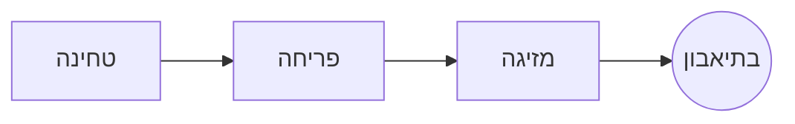

# מזיגה איטית של קפה

טקס בוקר איטי בכמה צעדים. כותבים ב**קוד המקור** מימין או ישירות ב*תצוגה המקדימה* משמאל: שניהם נשארים מסונכרנים, ו==כל עריכה היא שינוי נקי== ב-Markdown.

> [!TIP]
> מים רגע אחרי רתיחה, בסביבות 94 °C, מוציאים מתיקות בלי מרירות.

## היחס

רוב המתכונים מתייצבים על חלק אחד קפה לשישה-עשר חלקי מים:

$$
m_{\text{מים}} = 16 \times m_{\text{קפה}}
$$

כך ש-$20\,\text{ג׳}$ של קפה דורשים $320\,\text{ג׳}$ של מים.

## צעד אחר צעד



## שיטות חליטה

| שיטה        | טחינה       |  זמן |
|:------------|:-----------:|-----:|
| מזיגה איטית | דקה-בינונית | 3:30 |
| קפה צרפתי   | גסה         | 4:00 |
| אספרסו      | דקה         | 0:28 |

## לפני שמתחילים

- [x] פולים טריים קלויים :coffee:
- [x] מטחנת קפה עם להבים
- [ ] קומקום עם צוואר ברבור

```python
def water_for(coffee_g: float, ratio: int = 16) -> float:
    return coffee_g * ratio
```

פריחה
: ההזלפה הראשונה של מים, שמאפשרת לקפה הטחון לשחרר את הגז שלו.[^1]

[^1]: פולים טריים פורחים הכי הרבה; ישנים כמעט לא תופחים.
