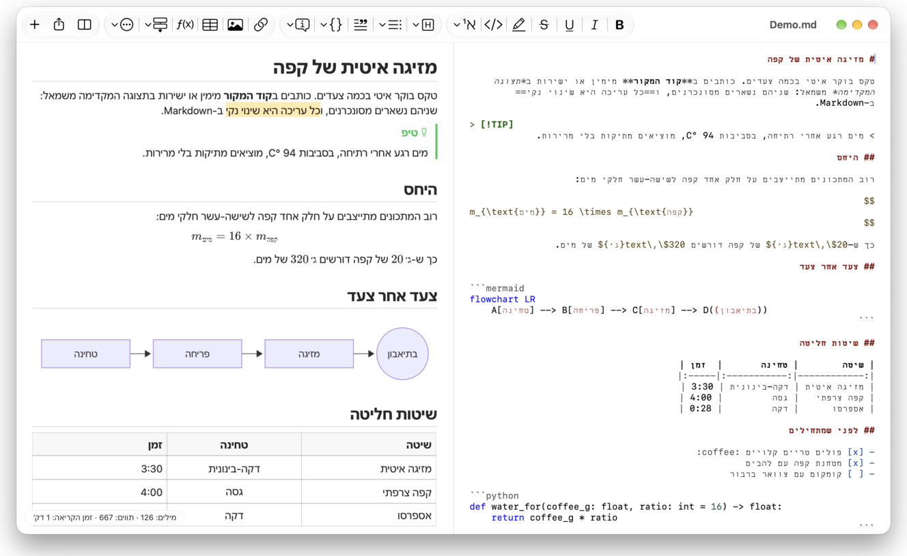
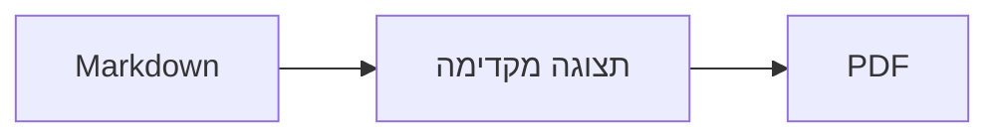

<p>&nbsp;&nbsp;&nbsp;</p>

# Splat

**עורך ה-Markdown ל-macOS שמאפשר לכתוב בקוד המקור או ישירות בתצוגה המקדימה.**

Splat מציג את קוד המקור של ה-Markdown עם צבעי תחביר מימין, ותצוגה מקדימה חיה וניתנת לעריכה מלאה משמאל. אפשר להקליד בכל אחד מהם: כל מה שנכתב בתצוגה המקדימה הופך לשינוי מינימלי בקוד המקור, כך ששורות שלא נגעתם בהן נשארות זהות בייט אחר בייט, וה-diff של Git נשאר נקי. Splat קורא את ה-Markdown שכבר בשימוש אצלכם: CommonMark ו-GitHub Flavored Markdown, התראות של GitHub, קישורי wiki, הטמעות ותיבות הערה של Obsidian, הרחבות של Pandoc ושל Typora, HTML משובץ, נוסחאות LaTeX ותרשימי Mermaid, Graphviz ו-PlantUML, וכולם מעובדים ללא חיבור לרשת. אפשר לעיין בתיקיה שלמה של פתקים ולחפש בה, לראות מה השתנה מאז ה-Commit האחרון ב-Git, להדביק מ-Word או מדף אינטרנט כ-Markdown, ולייצא ל-PDF, ל-HTML או ל-Word בלחיצה אחת. היישום כתוב ב-Rust על רכיבי AppKit אמיתיים, זמין ב-35 שפות, ואינו שולח דבר דרך הרשת אלא אם מבקשים ממנו.
 


[](https://github.com/sventmueller/splat/releases/latest/download/Splat.dmg)

**[הורדת Splat.dmg](https://github.com/sventmueller/splat/releases/latest/download/Splat.dmg)**: חתום ומאושר (notarized) על ידי Apple, ל-macOS 14 ואילך, ב-Apple Silicon וב-Intel.

**מצאתם באג?** Splat שומר על שורות שלא נגעתם בהן זהות בייט אחר בייט. אם בכל זאת אחת מהן משתנה, או שקובץ מוצג באופן שגוי, אפשר [לפתוח issue](https://github.com/sventmueller/splat/issues/new/choose) ולצרף את הקובץ. אם Splat מועיל לכם, [כוכב ב-GitHub](https://github.com/sventmueller/splat) עוזר לאחרים למצוא אותו.
 
 

[](https://www.rust-lang.org)
[](https://www.apple.com/macos/)

[](https://github.com/madsmtm/objc2)
[](https://webkit.org)
[](https://github.com/kivikakk/comrak)
[](https://github.github.com/gfm/)
[](https://www.mathjax.org)
[](https://cortexjs.io/mathlive/)
[](https://mermaid.js.org)
[](https://graphviz.org)
[](https://plantuml.com)


[](#רישיון)

[Bahasa Indonesia](../id/README.md) ·
[Bahasa Melayu](../ms/README.md) ·
[Català](../ca/README.md) ·
[Čeština](../cs/README.md) ·
[Dansk](../da/README.md) ·
[Deutsch](../de/README.md) ·
[English](../../../README.md) ·
[Español](../es/README.md) ·
[Français](../fr/README.md) ·
[Hrvatski](../hr/README.md) ·
[Italiano](../it/README.md) ·
[Magyar](../hu/README.md) ·
[Nederlands](../nl/README.md) ·
[Norsk](../no/README.md) ·
[Polski](../pl/README.md) ·
[Português (Brasil)](../pt_BR/README.md) ·
[Português (Portugal)](../pt_PT/README.md) ·
[Română](../ro/README.md) ·
[Slovenčina](../sk/README.md) ·
[Slovenščina](../sl/README.md) ·
[Suomi](../fi/README.md) ·
[Svenska](../sv/README.md) ·
[Tiếng Việt](../vi/README.md) ·
[Türkçe](../tr/README.md) ·
[Ελληνικά](../el/README.md) ·
[Русский](../ru/README.md) ·
[Українська](../uk/README.md) ·
**עברית**‎ ·
[العربية](../ar/README.md)‎ ·
[हिन्दी](../hi/README.md) ·
[ไทย](../th/README.md) ·
[한국어](../ko/README.md) ·
[日本語](../ja/README.md) ·
[简体中文](../zh-Hans/README.md) ·
[繁體中文](../zh-Hant/README.md)

## תוכן העניינים

- [התכונות במבט אחד](#התכונות-במבט-אחד)
- [דרישות](#דרישות)
- [התקנה](#התקנה)
- [תחילת העבודה](#תחילת-העבודה)
- [כתיבה](#כתיבה)
  - [בקוד המקור](#בקוד-המקור)
  - [בתצוגה המקדימה](#בתצוגה-המקדימה)
  - [פקודות עיצוב](#פקודות-עיצוב)
  - [רשימות ומשימות](#רשימות-ומשימות)
  - [טבלאות](#טבלאות)
  - [הדבקת טקסט מעוצב](#הדבקת-טקסט-מעוצב)
  - [מטא-נתונים](#מטא-נתונים)
- [Markdown נתמך](#markdown-נתמך)
  - [CommonMark ו-GitHub Flavored Markdown](#commonmark-ו-github-flavored-markdown)
  - [תיבות הערה](#תיבות-הערה)
  - [כתיב מורחב](#כתיב-מורחב)
  - [Obsidian](#obsidian)
  - [ציטוטים והפניות](#ציטוטים-והפניות)
  - [HTML משובץ](#html-משובץ)
  - [סימני פיסוק טיפוגרפיים](#סימני-פיסוק-טיפוגרפיים)
  - [סקירת התחביר](#סקירת-התחביר)
- [נוסחאות](#נוסחאות)
- [תרשימים](#תרשימים)
- [תמונות](#תמונות)
- [קישורים וניווט](#קישורים-וניווט)
- [פתקים בתיקיה](#פתקים-בתיקיה)
- [שינויים מאז ה-Commit האחרון](#שינויים-מאז-ה-commit-האחרון)
- [ייצוא, הדפסה ושיתוף](#ייצוא-הדפסה-ושיתוף)
- [ייבוא מסמכי Word](#ייבוא-מסמכי-word)
- [מראה ונגישות](#מראה-ונגישות)
- [שפות](#שפות)
- [קיצורי מקלדת](#קיצורי-מקלדת)
- [פרטיות ואבטחה](#פרטיות-ואבטחה)
- [מסמכים גדולים](#מסמכים-גדולים)
- [מגבלות ידועות](#מגבלות-ידועות)
- [פתרון בעיות](#פתרון-בעיות)
- [למפתחים](#למפתחים)
  - [רכיבי צד שלישי](#רכיבי-צד-שלישי)
- [רישיון](#רישיון)

## התכונות במבט אחד

- **שתי דרכים לכתוב, טקסט אחד.** אפשר לערוך גם את קוד המקור וגם את התצוגה המקדימה. קובץ ה-Markdown הוא האמת היחידה: לכל מסמך היסטוריית ביטולים אחת, וכל עריכה בתצוגה המקדימה מתורגמת לשינוי הקטן ביותר בקוד המקור.
- **ה-Markdown שכבר בשימוש אצלכם.** CommonMark, GitHub Flavored Markdown, התראות של GitHub, Obsidian, הרחבות של Pandoc ושל Typora, קודי אימוג׳י, ספוילרים, רשימות הגדרות, עוגנים בכותרות ו-HTML כמו בקובצי README של GitHub.
- **נוסחאות ותרשימים מובנים.** נוסחאות LaTeX דרך MathJax, עם עורך נוסחאות חזותי. תרשימי Mermaid, Graphviz ו-PlantUML, המעובדים ב-Mac שלכם בלי Java, בלי שרת ובלי חיבור לרשת.
- **כפתור לכל דבר.** לכל מבנה של Markdown יש כפתור בסרגל הכלים ופריט בתפריט, ולנפוצים שבהם גם קיצור מקלדת. לטבלאות יש תפריט משלהן לשורות, לעמודות וליישור.
- **תיקיה, לא רק קובץ.** סרגל הצד מציג את הפתקים שסביב המסמך ומחפש בכולם. שינוי שם של פתק משנה את הקישורים אליו, וכל בייט שסביבם נשאר ללא שינוי.
- **שינויים במבט אחד.** במאגר Git, פסים לצד הטקסט מסמנים מה שונה מה-Commit האחרון, בשני החלקים.
- **מ-Word ומהאינטרנט אל Markdown.** מדביקים טקסט מעוצב כ-Markdown, תאים מגיליון אלקטרוני כטבלה, ומייבאים מסמכי Word שלמים עם התמונות שלהם.
- **ייצוא בלי לאבד דבר.** PDF, קובץ HTML יחיד ועצמאי, או מסמך Word עם כותרות, רשימות, טבלאות, הערות שוליים ותמונות אמיתיות. אפשר להוסיף מספרי עמודים, כותרות עליונות ועמוד שער, או להשתמש בתבנית ה-Word של החברה שלכם.
- **מקורי עד היסוד.** חלונות, כרטיסיות, תפריטים וחלונות קופצים (popovers) אמיתיים של AppKit, גירסאות, שמירה אוטומטית, תפריט השיתוף, מצב כהה, בדיקת איות, הכתבה ו-VoiceOver. בלי Electron, ובלי תצוגת אינטרנט לטקסט עצמו.
- **מהיר גם בקבצים גדולים.** רינדור של הקשה על מקש במסמך של 10 MB לוקח כ-10 אלפיות השנייה, לפני העבודה של התצוגה עצמה.
- **פרטי וזהיר.** תמונות מהאינטרנט נטענות רק אחרי שאישרתם, קישורים ליישומים אחרים מבקשים אישור קודם, וכל מה שמפענח נתוני תמונה לא מהימנים רץ בתהליכי עזר מבודדים (sandbox).
- **בשפה שלכם.** הממשק ומדריך ה-Markdown המהיר המובנה זמינים ב-35 שפות: ערבית, קטלאנית, סינית (מפושטת), סינית (מסורתית), קרואטית, צ׳כית, דנית, הולנדית, אנגלית, פינית, צרפתית, גרמנית, יוונית, עברית, הינדי, הונגרית, אינדונזית, איטלקית, יפנית, קוריאנית, מלאית, נורווגית, פולנית, פורטוגזית (ברזיל), פורטוגזית (פורטוגל), רומנית, רוסית, סלובקית, סלובנית, ספרדית, שוודית, תאילנדית, טורקית, אוקראינית ווייטנאמית.

## דרישות

- macOS 14 Sonoma ואילך. Splat מפותח ונבדק ב-macOS 27, שבו הוא מאמץ את עיצוב Liquid Glass אוטומטית.
- Mac עם Apple Silicon או עם מעבד Intel.
- כ-45 MB של שטח בדיסק.

## התקנה

**מתוך קובץ ה-disk image.** יש להוריד את [`Splat.dmg`](https://github.com/sventmueller/splat/releases/latest/download/Splat.dmg), לפתוח אותו ולגרור את Splat אל תיקיית היישומים (Applications). הקובץ חתום עם Developer ID ומאושר (notarized) על ידי Apple, ולכן נפתח בלי אזהרות.

**עם Homebrew.** ה-cask נמצא ב-tap נפרד:

```sh
brew install --cask sventmueller/tap/splat
```

הפקודה `brew upgrade --cask splat` מתקינה גירסאות חדשות, והפקודה `brew uninstall --zap --cask splat` מסירה גם את ההגדרות ואת המטמון של Splat.

**עדכונים.** Splat שהותקן מקובץ ה-disk image או דרך Homebrew מתעדכן בעצמו באמצעות [Sparkle](https://sparkle-project.org). בהפעלה השנייה הוא שואל אם מותר לו לחפש עדכונים בעצמו, פעם ביום. **Splat › חיפוש עדכונים…** מחפש מיד; **חיפוש עדכונים באופן אוטומטי** ו-**הורדה והתקנה של עדכונים באופן אוטומטי** באותו תפריט משנים את הבחירה מאוחר יותר. Splat מתקין עדכון רק אם הוא נושא את חתימת המפתח. גירסה שבניתם בעצמכם אינה כוללת מנגנון עדכון.

**מקוד המקור.** הדרישות המוקדמות מופיעות ב-[בנייה](../../../docs/development.md#building), ואז:

```sh
make build
ditto target/release/Splat.app /Applications/Splat.app
open /Applications/Splat.app
```

כדי לפתוח קובצי Markdown עם Splat בלחיצה כפולה, יש לבחור קובץ `.md` כלשהו ב-Finder, לבחור **קובץ › הצגת פרטים**, לבחור את Splat תחת **פתיחה באמצעות** וללחוץ על **שינוי הכול…**. Splat רושם את עצמו לקובצי `.md`, `.markdown`, `.mdown` ו-`.mkd`.

## תחילת העבודה

### החלון

כל מסמך נפתח בחלון משלו, או ככרטיסיה אם אתם מעדיפים כרטיסיות:

- **מימין: קוד המקור.** ה-Markdown שלכם בגופן SF Mono עם צבעי תחביר.
- **משמאל: התצוגה המקדימה.** המסמך המעובד, מוכן לעריכה.
- **סרגל צד (לא חובה).** כל הכותרות כעץ, לחיצה על אחת מהן מציגה אותה בשני החלקים: **תצוגה › הצגת המתאר** (⌃⌘S). בשתי כרטיסיות נוספות נמצאים [הפתקים בתיקיה](#פתקים-בתיקיה) וחיפוש בהם.
- **סרגל כלים.** כפתורים מקובצים לפי מה שהם משנים: תווים, פסקאות ורכיבים שמוספים, ואז תצוגה מקדימה פעילה/כבויה, שיתוף ומסמך חדש. אפשר להתאים אותו עם **תצוגה › התאמה אישית של סרגל הכלים…**.

גוררים את המפריד כדי לתת לצד אחד יותר מקום. **תצוגה › הסתרת התצוגה המקדימה** (⌥⌘P) משאירה רק את קוד המקור; Splat זוכר זאת לכל חלון בנפרד. שני החלקים נגללים יחד, ומה שנבחר באחד מודגש בשני.

פינת החלון מציגה את מספר המילים והתווים של הטקסט ואת זמן הקריאה שלו, וכן את אלה של הבחירה כל עוד יש בחירה. כתובות של קישורים, תגי HTML, מטא-נתונים, הערות, נוסחאות ותרשימים אינם נספרים. **תצוגה › הסתרת ספירת המילים** מסירה אותם.

### מסמכים, כרטיסיות וגירסאות

Splat הוא יישום מסמכים רגיל של macOS:

- **שמירה אוטומטית וגירסאות.** שינויים נשמרים במקומם. **קובץ › חזרה לגירסה › עיון בכל הגירסאות…** מחזיר אתכם אחורה בזמן.
- **שינויים מתוכנות אחרות.** כש-Git, סקריפט או עורך אחר משנים מסמך פתוח, Splat טוען אותו מחדש ושומר על מיקום הסמן ועל מיקום הגלילה. אם יש לכם שינויים שלא נשמרו, Splat שומר אותם, ו-macOS שואל לפני שמירה מעל הגירסה האחרת.
- **פקודות הקובץ הרגילות.** שכפול (⇧⌘S), שינוי שם…, העברה אל…, ו-**קובץ › פתיחת האחרונים**.
- **כרטיסיות.** **קובץ › כרטיסיה חדשה** או הכפתור **+** בסרגל הכלים פותחים מסמך חדש ככרטיסיה; תפריט החלון הרגיל ממזג, מעביר ומחליף בין כרטיסיות.
- **מיקום החלון.** הגודל והמיקום של החלון האחרון שלכם נזכרים, גם אחרי הפעלה מחדש. אם כבר יש שם חלון, החדש נפתח מוזז מעט.
- **סמל ה-Dock.** לחיצה עליו אחרי סגירת החלון האחרון פותחת מסמך חדש.
- **פתיחת קובצי Markdown ב-Splat.** **Splat › הגדרה כיישום ברירת המחדל עבור Markdown** גורם לכך שלחיצה כפולה על קובץ `.md` או `.markdown` תפתח את Splat; macOS מבקש אישור פעם אחת. ליד הפריט מופיע סימן ✓ כל עוד Splat הוא יישום ברירת המחדל.

הקבצים צריכים להיות טקסט UTF-8, או UTF-16 עם סימן סדר בייטים (BOM). Splat מסרב לקידודים אחרים במקום לנחש ולהשחית את הטקסט. סימן סדר הבייטים נשמר, UTF-16 נשאר UTF-16, ובקובץ שכל שורותיו מסתיימות ב-CRLF, גם השורות שאתם מוסיפים מקבלות CRLF.


**אחרי קריסה** הולכות לאיבוד לכל היותר כמה שניות אחרונות של הקלדה: Splat מעתיק טקסט שלא נשמר אל `~/Library/Application Support/Splat/Unsaved` כל חמש שניות, ומסיר את ההעתקים כשהמסמך נשמר או כש-Splat נסגר כרגיל. בהפעלה הבאה הוא מעביר את מה שקריסה השאירה שם אל `~/Library/Application Support/Splat/Recovery` ומודיע על כך פעם אחת, עם כפתור שפותח את התיקיה. קריסה ש-Splat עדיין מסוגל להגיב אליה כותבת לשם גם את הטקסט של כל מסמך פתוח.

### מדריך מהיר

**עזרה › מדריך מהיר ל-Markdown** פותח דף עזר בשפה שלכם כמסמך חדש ללא שם. זהו מסמך רגיל, ולכן אפשר לנסות בו הכול, בקוד המקור או בתצוגה המקדימה.

## כתיבה

### בקוד המקור

קוד המקור הוא עורך טקסט פשוט שמותאם ל-Markdown:

- **צבעי תחביר** כמו ב-VS Code: כותרות, הדגשות, קישורים, קוד, טבלאות, HTML, front matter, ו-LaTeX ו-Mermaid בתוך נוסחאות ותרשימים. יש פלטות לצבעים בהירים, כהים ולהגברת ניגודיות.
- **בלוקי קוד תחומים** מקבלים הדגשת תחביר עבור Bash, C, C++, C#, CSS (גם SCSS ו-Less), Go, HTML, XML, Java, JavaScript, JSON, Kotlin, PHP, Python, Ruby, Rust, SQL, Swift, TypeScript, YAML, TeX ו-Mermaid, כולל השמות הקצרים הנפוצים שלהם, כמו `js`, `py` או `sh`.
- **בלי החלפות מפתיעות.** מירכאות חכמות, מקפים חכמים והחלפת מלל כבויים כברירת מחדל, כי הם שוברים את `--`, את `---` ואת `"`. מפעילים אותם תחת **עריכה › החלפות**.
- **כלי הכתיבה של המערכת.** בדיקת איות ודקדוק, הכתבה, חיפוש והחלפה (⌥⌘F) והקראה.
- **גרירה ושחרור.** שחרור קובץ תמונה מוסיף ``, שחרור כל קובץ אחר מוסיף קישור אליו, ושחרור כתובת URL מוסיף `[url](url)`. כל שחרור הוא צעד ביטול אחד.
- **הדבקת תמונות.** תמונה שבלוח ההעתקה, כמו צילום מסך, נשמרת כקובץ PNG לצד המסמך (`תמונה 2026-10-29 13.09.07.png`) ומוכנסת כתמונה. לשם כך צריך לשמור את המסמך פעם אחת.

### בתצוגה המקדימה

התצוגה המקדימה מתנהגת כמו מעבד תמלילים, אבל כל מה שעושים בה מסתיים כ-Markdown:

- **הקלדה.** תווים שיש להם משמעות ב-Markdown, כמו `*` או `#`, עוברים escape כדי שיופיעו כפי שהוקלדו.
- **Return** פותח פסקה חדשה או פריט חדש ברשימה. **⌥Return** או **⌃Return** מוסיפים מעבר שורה.
- **עיצוב בסמן.** כשהסמן בסוף מילה, עבה, נטוי ושאר עיצובי התווים חלים על מה שמקלידים אחר כך. בוחרים שוב את העיצוב כדי להפסיק אותו. בתוך מילה, המילה כולה מעוצבת.
- **שורות ריקות.** Return בשורה ריקה מוסיף עוד שורה ריקה, ו-⌫ מסיר אותה. בקוד המקור כל שורה ריקה נוספת היא שתי שורות ריקות; תוכנות Markdown אחרות מציגות אותן כמרווח רגיל בין פסקאות.
- **ביטול הפעולה האחרונה** פועל בשני החלקים יחד. לפעולות הביטול יש שמות (״ביטול עבה״), הקלדה היא צעד אחד לכל רצף, ואחרי ביטול ושחזור שני החלקים גוללים אל השינוי.
- **נוסחאות ותרשימים** מופיעים כגרפיקה מוגמרת. לוחצים על אחד מהם, מזיזים אליו את הסמן או לוחצים עליו Return כדי לפתוח את העורך שלו (ראו [נוסחאות](#נוסחאות) ו-[תרשימים](#תרשימים)).
- **HTML משובץ, פתקים משובצים ו-front matter** מוצגים, אבל עורכים אותם בקוד המקור. לחיצה עליהם מציבה את הסמן במקום המתאים שם.

כל מה ש-Markdown אינו יכול לבטא חסום בתצוגה המקדימה: חלונות הגופנים והצבעים, הסרגל, והדבקה או שחרור של טקסט עשיר ושל תמונות. HTML ו-RTF שמודבקים מגיעים כטקסט פשוט, אלא אם בוחרים ב-[הדבקה כ-Markdown](#הדבקת-טקסט-מעוצב).

### פקודות עיצוב

כל פקודה זמינה מסרגל הכלים, מסרגל התפריטים ומתפריט ההקשר של שני החלקים. פריטי התפריט מציגים סימן ✓ לעיצוב שבסמן.

| תפריט | פקודות |
|---|---|
| **עיצוב › גופן** | עבה, נטוי, קו תחתון, קו חוצה, הדגשה, קוד, כתב עילי, כתב תחתי |
| **עיצוב › כותרת** | גוף המלל, כותרת 1 עד 6 |
| **עיצוב › רשימה** | רשימה עם תבליטים, רשימה ממוספרת, רשימת משימות |
| **עיצוב** | ציטוט, בלוק קוד (ללא שפה או אחת מ-20 שפות; משנה גם את השפה של בלוק קיים), תיבת הערה (הערה, טיפ, חשוב, אזהרה, זהירות; בחירה חוזרת באותו סוג מסירה אותה), עריכת נוסחה או תרשים…, הסרת העיצוב |
| **הוספה** | קישור…, תמונה…, טבלה…, נוסחה, תרשים (תרשים זרימה, תרשים רצף, תרשים גאנט), תוכן העניינים, הערת שוליים, קו מפריד |
| **טבלה** | הוספת שורה מעל/מתחת, הוספת עמודה משמאל/מימין, מחיקת שורה, מחיקת עמודה, יישור (יישור לשמאל, יישור לאמצע, יישור לימין, ברירת המחדל), יישור עמודות הטבלה |
| **תצוגה** | הסתרת/הצגת התצוגה המקדימה, הצגת/הסתרת המתאר, סימני פיסוק טיפוגרפיים, הגדלה/הקטנה, גודל אמיתי, סרגל כלים, שורת כרטיסיות, מסך מלא |

קו תחתון, הדגשה, כתב עילי וכתב תחתי נכתבים כ-`<ins>`, `<mark>`, `<sup>` ו-`<sub>`, ש-GitHub מציג גם הוא. Splat קורא גם את `<u>`, ש-GitHub מסיר, ואת הכתיב הקצר `==highlight==`, `^sup^` ו-`~sub~`. GitHub מציג את `==` ואת `^` כפי שהם כתובים, ואת `~sub~` כקו חוצה.

### רשימות ומשימות

- Return ממשיך רשימה; Return בפריט ריק מסיים אותה.
- **Tab** ו-**⇧Tab** מזיחים ומחזירים פריטי רשימה בתצוגה המקדימה.
- לחיצה על תיבת סימון של משימה בתצוגה המקדימה מחליפה בין `- [ ]` לבין `- [x]`.
- **עיצוב › רשימה** הופך את הפסקאות שנבחרו לרשימה או משנה את סוגה.

### טבלאות

- **הוספה › טבלה…** שואל את מספר השורות (כולל שורת הכותרת) ואת מספר העמודות.
- בתצוגה המקדימה, **Tab** עובר לתא הבא, **⇧Tab** לתא הקודם ו-**Return** לתא שמתחת. Tab בתא האחרון מוסיף שורה.
- התפריט **טבלה** מוסיף ומוחק שורות ועמודות וקובע את יישור העמודה (⌘{, ⌘|, ⌘}).
- **טבלה › יישור עמודות הטבלה** מרפד את קוד המקור כך שהעמודות מתיישרות.

### הדבקת טקסט מעוצב

**עריכה › הדבקה כ-Markdown** (⌃⌘V), הזמינה גם בתפריט ההקשר של שני החלקים, הופכת את מה שבלוח ההעתקה ל-Markdown במקום הבחירה, כצעד ביטול אחד. ⌘V ממשיך להוסיף טקסט פשוט.

- **מדפדפן, מ-Word, מ-Google Docs, מ-Confluence, מ״פתקים״ או מ-Pages:** כותרות, עבה, נטוי, קו תחתון, קו חוצה, כתב עילי וכתב תחתי, קישורים, רשימות עם הקינון שלהן, ציטוטים, קוד וטבלאות נשמרים.
- **מגיליון אלקטרוני:** תאים הופכים לטבלה עם שורת כותרת ועמודות מספרים מיושרות לימין. כך גם טקסט שמופרד בטאבים, בנקודה-פסיק או בפסיקים, אם בכל שורה יש אותו מספר עמודות.
- **תמונות** עם כתובת אינטרנט נשארות קישורים. תמונה בתוך ה-HTML המודבק הופכת לקובץ לצד המסמך, ולשם כך צריך לשמור אותו פעם אחת. קובצי התמונה הזמניים של Word אינם מועברים, והטקסט החלופי שלהם נשמר.
- **קישורים** שומרים רק כתובות `http`, `https`, `mailto`, כתובות יחסיות וכתובות `#`; מכל קישור אחר נשאר הטקסט.

### מטא-נתונים

**עיצוב › עריכת מטא-נתונים…**, או לחיצה על שורת המטא-נתונים בראש התצוגה המקדימה, פותחים טופס עם השדות של ה-YAML front matter. אפשר לשנות, להוסיף ולהסיר שדות. שדה עם רשימה נשאר רשימה: הערכים שלו מופיעים בזה אחר זה עם פסיקים, וערך שמכיל פסיק מופיע במירכאות. גם שדה חדש בשם `tags`, `aliases`, `keywords`, `categories`, `authors` או `cssclasses` הופך לרשימה. שדות מקוננים וטקסט מרובה שורות מוצגים שם ונערכים בקוד המקור.

מה שהטופס משנה הוא צעד ביטול אחד ומגיע רק לשורות של השדות ששיניתם: הערות, הסדר, רווחים חריגים, מירכאות וסופי שורות של כל השדות האחרים נשארים זהים בייט אחר בייט. מסמך בלי מטא-נתונים מקבל בלוק בתחילתו.

## Markdown נתמך

Splat מנתח עם [comrak](https://github.com/kivikakk/comrak), מנתח התואם ל-CommonMark ול-GFM, ומפעיל את רוב ההרחבות שלו. כל מה שלהלן מוצג בתצוגה המקדימה ובכל הייצואים.

### CommonMark ו-GitHub Flavored Markdown

- כותרות (`#` וקו תחתון), פסקאות, מעברי שורה, הדגשה, הדגשה חזקה, קוד בתוך השורה, ציטוטי בלוק, קווים מפרידים.
- רשימות עם תבליטים, ממוספרות ומקוננות; רשימות משימות.
- קישורים (בתוך השורה, בהפניה ואוטומטיים), תמונות, הגדרות של הפניות לקישורים.
- בלוקי קוד תחומים ומוזחים עם צבעי תחביר.
- טבלאות עם יישור עמודות.
- קו חוצה עם `~~two tildes~~`.
- הערות שוליים: `text[^1]` עם `[^1]: The note.` בכל מקום במסמך. לחיצה על הסימון קופצת אל ההערה.
- YAML front matter בין שורות `---` בראש המסמך. התצוגה המקדימה מסכמת אותו בשורה אחת, כמו ״מטא-נתונים: title, date, tags״.

### תיבות הערה

התראות של GitHub מוצגות כתיבות צבעוניות עם סמל וכותרת:

```markdown
> [!NOTE]
> מידע שימושי שכדאי למשתמשים לדעת.

> [!WARNING]
> תוכן קריטי שדורש תשומת לב מיידית.
```

חמשת הסוגים הם הערה, טיפ, חשוב, אזהרה וזהירות. **עיצוב › תיבת הערה** הופך את הפסקה שבסמן לאחת מהן.

תיבות הערה של Obsidian פועלות גם הן, עם כל כותרת ועם מצב קיפול:

```markdown
> [!tip]- לחצו על ▸ כדי להרחיב
> מוסתר עד שפותחים.

> [!question]+ פתוח כברירת מחדל
> `+` מתחיל מורחב, `-` מכווץ.
```

הסוגים האחרים של Obsidian מוצגים בצבע הקרוב ביותר מבין החמישה: `success`, `check`, `done` ו-`hint` כטיפ; `question`, `help` ו-`faq` כחשוב; `attention` כאזהרה; `failure`, `fail`, `missing`, `danger`, `error` ו-`bug` כזהירות; וכל השאר כהערה.

### כתיב מורחב

| תכונה | כתיב | מקור |
|---|---|---|
| הדגשה | `==מלל מסומן==` | Obsidian, Typora |
| כתב עילי | `x^2^` | Pandoc, Typora |
| כתב תחתי | `H~2~O` | Pandoc, Typora |
| קוד אימוג׳י | `:rocket:` הופך ל-🚀 | GitHub |
| ספוילר | `\|\|מלל מוסתר\|\|`, יש לסמן אותו כדי לקרוא | Discord |
| הערת שוליים בתוך השורה | `טקסט^[ההערה עצמה]` | Pandoc, Obsidian |
| רשימת הגדרות | `מונח`, שורה ריקה, `: הסבר` | PHP Markdown Extra, Pandoc |
| עוגן בכותרת | `## התקנה {#setup}`, קישור עם `[ראו](#setup)` | Pandoc, kramdown |

רשימות הגדרות נראות כך בקוד המקור:

```markdown
מונח

: הסבר על המונח.
```

בלי עוגן מותאם אישית, כל כותרת מקבלת עוגן שנגזר מהטקסט שלה, כמו ב-GitHub: אל `## תחילת העבודה` אפשר להגיע דרך `#תחילת-העבודה`.

### Obsidian

- **קישורי wiki.** `[[פתק]]` מקשר אל `פתק.md` באותה תיקיה או בתיקיה שמתחתיה. `[[פתק|מלל מוצג]]` מציג מלל משלכם, ו-`[[פתק#כותרת]]` פותח את הפתק. לחיצה עם ⌘ פותחת אותו ב-Splat.
- **הטמעות.** `![[פתק]]` מציג את הפתק האחר בתוך זה; פתקים שמוטמעים בו מופיעים כקישורים. `![[diagram.png]]` מציג תמונה. כמו ב-Obsidian, הטמעות מציינות פתקים ותמונות בתיקיית המסמך או מתחתיה, אף פעם לא בנתיב מוחלט, ורק קובצי Markdown מוצגים כפתקים.
- **הערות.** `%%רק בקוד המקור%%` נשאר גלוי בקוד המקור ונשמט מהתצוגה המקדימה ומכל ייצוא, בתוך שורה וגם בשורות נפרדות.
- **תגים.** `#רעיון` או `#project/splat` מודגשים. לחיצה עם ⌘ מחפשת את התג במסמך, ובסרגל הצד גם בכל התיקיה.
- **תיבות הערה מתקפלות.** ראו [תיבות הערה](#תיבות-הערה).

### ציטוטים והפניות

- **ציטוטים של Pandoc.** `[@doe2020]` או `[@doe2020; @roe2021]` נקראים כמו "(Doe 2020; Roe 2021)". הרשומות באות מקובץ ה-BibTeX שה-front matter מציין כ-`bibliography: refs.bib`. בלעדיו Splat משתמש ב-`references.bib`, ב-`literatur.bib` או ב-`bibliography.bib` שלצד המסמך.
- **הפניות של GitHub ושל GitLab.** אם המסמך נמצא במאגר Git ששרת ה-`origin` שלו הוא github.com או שרת GitLab, הביטויים `@name`, `#12` (issue) ו-`!7` (merge request, ב-GitLab בלבד) מודגשים. לחיצה עם ⌘ פותחת אותם בדפדפן.

### HTML משובץ

HTML כפי שמוצאים בקובצי README של GitHub מוצג, באמצעות קורא משלו ולא מנוע דפדפן:

- פסקאות ובלוקים ממורכזים (`<p align="center">`, `<div align="center">`)
- תמונות עם גודל (``)
- קישורים, `<kbd>⌘</kbd>`, `<br>`, `<u>`, `<ins>`, `<mark>`, `<sup>`, `<sub>`
- רשימות וטבלאות, כולל תאים שמשתרעים על פני כמה עמודות (`colspan`)
- חלקים מתקפלים: `<details><summary>עוד</summary>…</details>`, שנפתחים בלחיצה על ▸

Markdown שבין תגי HTML מוצג כ-Markdown. סקריפטים, סגנונות, מסגרות וטפסים מושמטים לגמרי, ובקישורים ובתמונות נשארות רק כתובות `http`, `https`, `mailto` וכתובות יחסיות.

### סימני פיסוק טיפוגרפיים

**תצוגה › סימני פיסוק טיפוגרפיים** מציג מירכאות ישרות כמירכאות של שפת הממשק שלכם, `--` כמקף בינוני, `---` כמקף ארוך ו-`...` כסימן שלוש נקודות. בגרמנית `"Ja"` הופך ל-„Ja“, בצרפתית ל-«Oui», ביפנית ל-「はい」, גם במקום שבו סינית ויפנית מציבות מירכאות בלי רווח; בעברית ראשי תיבות כמו `צה"ל` מקבלים גרשיים, צה״ל. קוד המקור שומר את התווים הפשוטים; התצוגה המקדימה וכל הייצואים מציגים את הטיפוגרפיים. ההגדרה כבויה עד שמפעילים אותה.

### סקירת התחביר

| רכיב | Markdown |
|---|---|
| **עבה** | `**עבה**` |
| *נטוי* | `*נטוי*` |
| קו תחתון | `<ins>קו תחתון</ins>` או `<u>קו תחתון</u>` |
| ~~קו חוצה~~ | `~~קו חוצה~~` |
| הדגשה | `<mark>הדגשה</mark>` או `==הדגשה==` |
| `קוד` | `` `קוד` `` |
| x² | `x<sup>2</sup>` או `x^2^` |
| H₂O | `H<sub>2</sub>O` או `H~2~O` |
| [קישור](https://example.com) | `[קישור](https://example.com)` |
| כותרת | `# כותרת` עד `###### כותרת` |
| ציטוט | `> ציטוט` |
| רשימה עם תבליטים | `- פריט` |
| רשימה ממוספרת | `1. פריט` |
| משימה | `- [ ] פתוחה` ו-`- [x] הושלמה` |
| בלוק קוד | ```` ```rust ```` … ```` ``` ```` |
| טבלה | `\| א \| ב \|` עם `\|---\|---\|` מתחת לשורת הכותרת |
| הערת שוליים | `טקסט[^1]` ו-`[^1]: הערה` |
| קו מפריד | `---` |
| תמונה | `` |
| נוסחה | `$E = mc^2$`, `$$ … $$` |
| תרשים | ```` ```mermaid ````, ```` ```dot ````, ```` ```plantuml ```` |
| תיבת הערה | `> [!TIP]` |
| קישור wiki | `[[פתק]]`, `[[פתק\|מלל]]` |
| הטמעה | `![[פתק]]`, `![[image.png]]` |
| הערה | `%%הערה%%` |
| תג | `#תג` |
| ציטוט ממקור | `[@key]` |
| ספוילר | `\|\|ספוילר\|\|` |
| אימוג׳י | `:tada:` |

## נוסחאות

נוסחאות מעובדות על ידי [MathJax](https://www.mathjax.org) עם TeX ו-AMS math שלו, כגרפיקה וקטורית חדה. טקסט בתוך `\text{…}` יכול להיות בכל כתב: מה שחסר בגופנים של MathJax נלקח מהגופנים של ה-Mac שלכם, כשערבית ועברית רצות מימין לשמאל, ואימוג׳י בצבע.

| סוג | כתיב |
|---|---|
| בתוך השורה | `$E = mc^2$`, `` $`E = mc^2`$ `` (GitHub, GitLab), `\(E = mc^2\)` |
| בשורה נפרדת | `$$` … `$$`, `\[` … `\]`, או בלוק קוד שמסומן `math` |

**עריכת נוסחה.** לוחצים על נוסחה בתצוגה המקדימה, לוחצים עליה פעמיים, לוחצים עליה Return או מזיזים אליה את הסמן כדי לפתוח את העורך שלה בחלון קופץ (popover). **הוספה › נוסחה** מוסיף נוסחה חדשה ופותח את העורך מיד.

- **חזותי או LaTeX.** המתג שבראש החלון עובר בין עורך חזותי ([MathLive](https://cortexjs.io/mathlive/)) לבין קוד LaTeX. Splat זוכר את הבחירה.
- **אבני בניין** לשבר, שורש ריבועי, כתב עילי ותחתי, סכום ואינטגרל עם גבולות, גבול, סוגריים שגדלים עם התוכן, מטריצה 2×2, אותיות יווניות, ויחסים, אופרטורים וחצים. הן משאירות ממלאי מקום □, ו-**Tab** קופץ אל הבא.
- **תצוגה מקדימה חיה.** שינויים מופיעים במסמך תוך כדי הקלדה. שגיאות מ-MathJax מוצגות בשורה מתחת לקוד.
- **אישור או ביטול.** לחיצה מחוץ לחלון משמרת את השינוי כצעד ביטול אחד; **Esc** או **ביטול** זורקים אותו. יציאה מנוסחה חדשה וריקה עם Esc מסירה אותה שוב.
- תפריט ההקשר מציע **עריכת הנוסחה…** לנוסחה שמתחת למצביע.

VoiceOver מקריא נוסחה כקוד ה-LaTeX שלה. Splat מעבד נוסחאות, לא מסמכי LaTeX שלמים: אין חבילות, אין TikZ ואין `\documentclass`.

## תרשימים

תרשימים מעובדים בתוך Splat, ללא רשת ובגרסה בהירה וכהה.

| מנוע | בלוק קוד | מה הוא מצייר |
|---|---|---|
| [Mermaid](https://mermaid.js.org) | ```` ```mermaid ```` | תרשימי זרימה, רצף, מחלקות, מצבים, ישויות וקשרים, גאנט, עוגה, מפות חשיבה, צירי זמן וכל סוג אחר של Mermaid |
| [Graphviz](https://graphviz.org) | ```` ```dot ```` או ```` ```graphviz ```` | גרפים בשפת DOT |
| [PlantUML](https://plantuml.com) | ```` ```plantuml ```` או ```` ```puml ```` | תרשימי UML; פועל בלי Java |



**עריכת תרשים** פועלת כמו עריכת נוסחה: לוחצים עליו כדי לפתוח את הקוד בחלון קופץ, עם צבעי תחביר והודעות שגיאה בשורה מתחת לקוד. **הוספה › תרשים** מתחיל מתבנית לתרשים זרימה, לתרשים רצף או לתרשים גאנט. אבני בניין עוזרות בשלושת סוגי Mermaid הנפוצים ביותר:

- **תרשים זרימה:** צומת ▾ (מלבן, מעוגל, עיגול, מעוין, מסד נתונים), חיבור, חיבור עם תווית, קבוצה, כיוון ▾
- **תרשים רצף:** משתתף, הודעה, תשובה, הערה, לולאה, נתיבים חלופיים
- **תרשים גאנט:** חלק, משימה, אבן דרך

סוגי תרשימים אחרים נערכים כקוד. VoiceOver מקריא את הכותרת של התרשים או את הטקסט החלופי שלו.

התרשים הראשון אחרי ההפעלה לוקח כשנייה, כי מנוע העיבוד עולה ברקע. תרשים שלוקח יותר מ-10 שניות מציג שגיאה, ומנוע העיבוד מתחיל מחדש לקראת התרשים הבא. המנוע של PlantUML (3 MB) נטען רק עם תרשים ה-PlantUML הראשון. `!include` של PlantUML מהאינטרנט חסום.

## תמונות

- **תמונות מקומיות** משתמשות בנתיבים יחסיים למסמך: ``. Splat מציג PNG, JPEG, GIF, WebP, BMP, SVG, HEIC, TIFF, AVIF ו-PDF.
- **תמונות מהאינטרנט** נשארות חסומות עד שמאשרים אותן: סרגל מעל התצוגה המקדימה מסביר שטעינתן מיידעת את השרתים שלהן על כך שפתחתם את המסמך ומתי. **טעינת תמונות** מתירה אותן למסמך הזה; Splat זוכר את הבחירה לכל קובץ.
- **גודל.** `` קובע את גודל התמונה; אחרת התמונות מתאימות לרוחב התצוגה המקדימה.
- **שינויים בדיסק.** תמונה שהוחלפה, או כזו שמופיעה אחרי שהמסמך כבר ציין אותה, מוצגת בלי לפתוח את המסמך מחדש. תמונות מהאינטרנט שנכשלו בגלל הרשת נטענות שוב כל עוד מסמך מציג אותן.
- **זיכרון.** תמונות מוצגות עד 2560 פיקסלים בצד הארוך ביותר, וזה ממלא גם עמוד A4. הן מפוענחות בגודל קטן יותר כשהן ממלאות שמינית מזיכרון ה-Mac, ובזמן ש-macOS מדווח על עומס זיכרון.
- **מצב כהה.** תמונות עם רקע לבן מעומעמות מעט בתצוגה המקדימה הכהה.
- **הדבקה ושחרור.** ראו [בקוד המקור](#בקוד-המקור).

## קישורים וניווט

בתצוגה המקדימה, לחיצה מציבה את הסמן כדי שאפשר יהיה לערוך את טקסט הקישור; **לחיצה עם ⌘** עוקבת אחרי הקישור:

- `http`, `https` ו-`mailto` נפתחים בדפדפן או ביישום הדואר שלכם.
- קובצי Markdown נפתחים ב-Splat; קבצים ותיקיות אחרים מוצגים ב-Finder.
- `#anchor` קופץ אל הכותרת במסמך.
- כתובות שפותחות יישום אחר, כמו `slack://` או `vscode://`, מבקשות אישור קודם ומציגות את הכתובת המלאה ואת היישום. **ביטול** מסומן מראש.

**הוספה › תוכן העניינים** מוסיף רשימה מקושרת של כל הכותרות. כשהסמן בתוכה, אותה פקודה מעדכנת אותה. סרגל הצד של המתאר (⌃⌘S) קופץ לכל כותרת בשני החלקים.

## פתקים בתיקיה

הכפתורים בראש סרגל הצד עוברים בין המתאר, הקבצים והחיפוש.

- **קבצים** (**תצוגה › הצגת הקבצים**, ⌃⌘E). כל קובצי ה-Markdown בתיקיית המסמך, או בכל המאגר אם המסמך נמצא במאגר Git. לחיצה או Return פותחים פתק ככרטיסיה בחלון הזה; אם הוא כבר פתוח, הוא עובר לחזית. הכפתור שליד שם התיקיה מציג תיקיה אחרת בחלון הזה. קבצים נסתרים, `node_modules`, `target`, `Pods`, `DerivedData`, `__pycache__` ותיקיות בלי פתקים אינם נכללים. מסמך שנמצא ישירות בתיקיית הבית שלכם מציג רק את הפתקים שלצדו, כדי ש-Splat לא יעבור על כל התיקיות שלכם ויבקש אישור לכל אחת מהן.
- **חיפוש** (**עריכה › חיפוש › חיפוש בכל הפתקים…**, ⇧⌘F). מוצא טקסט בכל הפתקים, בלי קשר לאותיות גדולות או קטנות ולאופן שבו סימני ההטעמה שלו מקודדים. `#tag` מוצא תג, `#project` גם את `#project/splat`, ושום דבר בתוך קוד. לחיצה על תוצאה פותחת את הפתק באותו מקום.
- **קישורים לפתק.** תפריט ההקשר של פתק מציג את הפתקים שמקשרים אליו, בקישור wiki, בהטמעה, בקישור יחסי או בהגדרת הפניה.
- **שינוי שם של פתק.** אותו תפריט משנה את שמו ואת הקישורים האלה. Splat מציין קודם כמה קישורים בכמה קבצים זה אומר. בכל קישור משתנה רק השם, וכל בייט אחר בקובץ נשאר ללא שינוי. מסמכים פתוחים מקבלים את השינוי כצעד ביטול; בקבצים אחרים רק Git או הגירסאות יכולים לבטל אותו. קובץ שתוכנה אחרת שינתה בינתיים עוצר את שינוי השם בכל הקישורים, ו-Splat מציין את שמו.

הרשימה מתעדכנת לפי התיקיה כשהחלון עובר לחזית. החיפוש בודק את הקבצים כפי שהם בדיסק, וטקסט שעדיין לא שמרתם נספר מהשמירה האוטומטית הבאה.

## שינויים מאז ה-Commit האחרון

במסמך שנמצא במאגר Git, פסים לצד הטקסט מסמנים מה שונה מה-Commit האחרון, בקוד המקור ובתצוגה המקדימה: ירוק לשורות שנוספו, כחול לשורות ששונו, וסימן אדום קצר במקום שבו משהו הוסר. הם מתעדכנים תוך כדי הקלדה וכשה-branch זז. **תצוגה › שינויים מאז ה-Commit האחרון** מכבה אותם, בכל החלונות.

שורות שנבדלות רק בסוף השורה אינן נספרות, כך שקובץ עם CRLF מול Commit עם LF אינו מציג שינוי. בקובץ חדש אין סימנים עד ה-Commit הראשון שלו, וגם לא במסמך גדול מ-32 MB.

## ייצוא, הדפסה ושיתוף

| פורמט | איך | מה מקבלים |
|---|---|---|
| **PDF** | **קובץ › ייצוא כ-PDF…** או תפריט השיתוף | עמודים בגודל נייר, תמיד במראה הבהיר, נוסחאות ותרשימים כגרפיקה וקטורית. **קובץ › הגדרת עמוד…** קובע את הנייר. |
| **הדפסה** | **קובץ › הדפסה…** (⌘P) | אותה פריסה כמו ב-PDF. |
| **HTML** | **קובץ › ייצוא כ-HTML…** או תפריט השיתוף | קובץ עצמאי אחד: תמונות מקומיות מוטמעות, נוסחאות ותרשימים כתמונות חדות, עוגנים בכותרות כך שתוכן העניינים עובד. ללא סקריפטים. |
| **Word** | **קובץ › ייצוא כמסמך Word…** או תפריט השיתוף | קובץ `.docx` עם סגנונות הכותרות של Word, רשימות וטבלאות אמיתיות (כולל תאים ממוזגים), הערות שוליים כהערות שוליים של Word, תמונות מוטמעות, נוסחאות ותרשימים. |
| **Markdown** | הכפתור **שיתוף** בסרגל הכלים | המסמך כקובץ `.md` ל-Mail, ל״הודעות״, ל-AirDrop ולכל שירות שיתוף אחר. |

התפריט **קובץ › שיתוף** מציע את כל אלה במקום אחד. הייצואים משתמשים בהגדרת סימני הפיסוק הטיפוגרפיים ובתמונות שהתרתם מהאינטרנט; תמונות מהאינטרנט נשארות קישורים ב-HTML.

**קובץ › אפשרויות ייצוא…** קובע מה PDF, הדפסה ו-Word מוסיפים לטקסט, לכל המסמכים:

- **מספרי עמודים** בכותרת התחתונה של PDF ושל הדפסה, בצורה `2 / 9`.
- **כותרת עליונה וכותרת תחתונה** ל-PDF ולהדפסה. `{title}`, `{author}`, `{date}`, `{page}` ו-`{pages}` מייצגים את הערכים שלהם, שלושת הראשונים מהמטא-נתונים של המסמך.
- **עמוד שער** ל-PDF, להדפסה ול-Word, עם `title`, `subtitle`, `author` ו-`date` מהמטא-נתונים, או עם שם המסמך ככותרת. אין בו כותרת עליונה ולא כותרת תחתונה.
- **תבנית Word**, קובץ `.docx` או `.dotx` שהייצוא מאמץ את המראה שלו: הסגנונות שלו, כולל שמות מתורגמים, ערכת הנושא, גודל העמוד, השוליים, הכותרות העליונות והכותרות התחתונות. תבנית שאי אפשר לקרוא עוצרת את הייצוא ואומרת זאת, ולא נותנת לכם מסמך בלעדיה.

## ייבוא מסמכי Word

**קובץ › ייבוא מסמך Word…** מבקש קובץ `.docx` או `.dotx` ואת המקום שאליו ילך ה-Markdown שלו, ואז פותח את התוצאה. תמונות מגיעות לתיקיה שלצדו, בשם המסמך עם `-images`.

כותרות ורשימות עוברות כפי שהסגנונות והמספור של Word מגדירים אותן, גם במסמכים שלסגנונות שלהם יש שמות מתורגמים. עבה, נטוי, קו תחתון, קו חוצה, הדגשה, כתב עילי וכתב תחתי, קישורים, ציטוטים, קוד, הערות שוליים, הערות סיום וטבלאות נשמרים, ותאים שמתפרסים על כמה עמודות הופכים לטבלת HTML. נוסחאות הופכות ל-LaTeX. שינויים במעקב נחשבים כמאושרים, ותוכן עניינים אינו נכלל, כי **הוספה › תוכן העניינים** יוצר חדש. קובצי `.doc` ישנים ומסמכים מוגנים בסיסמה נדחים.

## מראה ונגישות

- **מצב כהה** עוקב אחרי המערכת. נוסחאות ותרשימים מעובדים לכל מראה.
- **הגברת הניגודיות** בהגדרות המערכת מעבירה את צבעי התחביר לפלטות בניגודיות גבוהה.
- **זום.** ⌘+, ⌘− ו-⌘0 משנים את קנה המידה של שני החלקים.
- **מסך מלא, כרטיסיות וסרגל כלים הניתן להתאמה אישית**, כמו בכל יישום Mac.
- **VoiceOver.** החלקים מסומנים "קוד המקור של Markdown" ו"תצוגה מקדימה", נוסחאות מוקראות כקוד שלהן ותרשימים לפי הכותרת שלהם. כל פקודה נגישה מהמקלדת.

ל-Splat אין חלון הגדרות: האפשרויות המעטות נמצאות במקום שבו הן חלות, ב-**תצוגה**, ב-**עריכה › החלפות** וב-**קובץ › אפשרויות ייצוא…**.

## שפות

הממשק, התפריטים ומדריך ה-Markdown המהיר מתורגמים ל-35 שפות:

ערבית, קטלאנית, סינית (מפושטת), סינית (מסורתית), קרואטית, צ׳כית, דנית, הולנדית, אנגלית, פינית, צרפתית, גרמנית, יוונית, עברית, הינדי, הונגרית, אינדונזית, איטלקית, יפנית, קוריאנית, מלאית, נורווגית, פולנית, פורטוגזית (ברזיל), פורטוגזית (פורטוגל), רומנית, רוסית, סלובקית, סלובנית, ספרדית, שוודית, תאילנדית, טורקית, אוקראינית ווייטנאמית.

Splat עוקב אחרי סדר השפות ב-**הגדרות המערכת › כללי › שפה ואזור**; שם אפשר גם לבחור שפה ל-Splat בלבד תחת **יישומים**. אם אין תרגום לשפה שלכם, הוא משתמש באנגלית. מונחי התפריטים נשענים על התרגומים של Apple עצמה, ולכן Splat נקרא כמו שאר ה-Mac שלכם.

טקסט בעברית ובערבית נקרא מימין לשמאל בכל מקום שבו הוא מופיע, בלי קשר לשפת הממשק: כל פסקה, כותרת ופריט ברשימה מקבלים את הכיוון של האות הראשונה שלהם, ציטוטים ותיבות הערה מציירים את הפס שלהם מימין, וטבלה שהטקסט בה מתחיל מימין לשמאל מסדרת את העמודות שלה מימין. בלוקי קוד נשארים משמאל לימין. ייצואי PDF, HTML ו-Word שומרים על הכיוונים האלה. כשעברית או ערבית היא שפת המערכת, macOS גם משקף את החלון, כך שהתצוגה המקדימה נמצאת משמאל.

## קיצורי מקלדת

| פעולה | קיצור |
|---|---|
| עבה, נטוי, קו תחתון | ⌘B, ⌘I, ⌘U |
| קו חוצה | ⇧⌘X |
| קישור… | ⌘K |
| גוף המלל, כותרת 1 עד 6 | ⌥⌘0, ⌥⌘1 עד ⌥⌘6 |
| יישור עמודת טבלה לשמאל, לאמצע, לימין | ⌘{, ⌘\|, ⌘} |
| הסתרה או הצגה של התצוגה המקדימה | ⌥⌘P |
| הצגה או הסתרה של המתאר | ⌃⌘S |
| הצגה או הסתרה של הקבצים | ⌃⌘E |
| חיפוש בכל הפתקים | ⇧⌘F |
| הדבקה כ-Markdown | ⌃⌘V |
| הגדלה, הקטנה, גודל אמיתי | ⌘+, ⌘−, ⌘0 |
| מסמך חדש, פתיחה, שמירה, שכפול | ⌘N, ⌘O, ⌘S, ⇧⌘S |
| הגדרת עמוד, הדפסה | ⇧⌘P, ⌘P |
| חיפוש, חיפוש והחלפה | ⌘F, ⌥⌘F |
| מציאת הבא, הקודם; שימוש בבחירה; מעבר לבחירה | ⌘G, ⇧⌘G; ⌘E; ⌘J |
| הצגת איות ודקדוק; בדיקת המסמך | ⌘:, ⌘; |
| הדבקה והתאמה לסגנון | ⌥⇧⌘V |
| הסתרת סרגל הכלים, הצגת כל הכרטיסיות, מסך מלא | ⌥⌘T, ⇧⌘\\, ⌃⌘F |
| מעבר שורה (תצוגה מקדימה) | ⌥Return או ⌃Return |
| התא הבא / התא הקודם בטבלה (תצוגה מקדימה) | Tab / ⇧Tab |
| הזחה / הזחה החוצה של פריט ברשימה (תצוגה מקדימה) | Tab / ⇧Tab |
| ממלא המקום הבא בעורך הנוסחאות | Tab |
| סגירת עורך הנוסחאות או התרשימים בלי שינויים | Esc |
| מעקב אחרי קישור, תג או הפניה (תצוגה מקדימה) | לחיצה עם ⌘ |

Splat משאיר את הקיצורים הרגילים של Apple במקומם.

## פרטיות ואבטחה

קובץ Markdown יכול להגיע מכל אחד, ולכן Splat מתייחס לכל מסמך כאל לא מהימן.

- **ללא רשת כברירת מחדל.** ל-Splat אין טלמטריה. הוא מחפש עדכונים רק אחרי שהסכמתם או בחרתם **חיפוש עדכונים…**: אז הוא טוען מ-GitHub קובץ הזנה קטן, והבקשה מציינת רק את היישום ואת גירסתו. נוסחאות ותרשימים מעובדים מקומית; תצוגות האינטרנט שעושות זאת אינן יכולות להגיע לרשת. **עזרה › דיווח על בעיה…** פותח טופס ב-GitHub בדפדפן; הכתובת שלו כוללת את גירסת Splat, את גירסת macOS ואת סוג ה-Mac, ושום דבר מהמסמכים שלכם.
- **תמונות מהאינטרנט** נטענות רק באישורכם, רק דרך `https`, אף פעם לא משרתים ברשת המקומית שלכם, עד 10 MB לכל אחת, ובסשן פרטי בלי עוגיות.
- **פענוח מבודד.** תמונות והגרפיקה של נוסחאות ותרשימים מפוענחות בתהליכי עזר שסוגרים כל קובץ שירשו ונועלים את עצמם ב-sandbox לפני שהם קוראים את הבייט הראשון: בלי גישה לקבצים ובלי רשת. הם מחזירים רק פיקסלים, שגודלם נבדק, ונעצרים אחרי 10 שניות. מפענחי התמונות של Apple עצמה רואים רק HEIC, TIFF, AVIF ו-PDF, ורק כשהנתונים באמת בפורמט הזה; הם רצים בתהליך עזר משלהם, שרשאי בנוסף לקרוא את תיקיות הגופנים של המערכת ולהשתמש במפענח הווידאו של המערכת. גם SVG, נוסחאות ותרשימים עוברים דרך תהליך העזר הזה, ולכן הם תמונות ברזולוציה קבועה ב-Splat: ארבעה פיקסלים לנקודה, עד 2560 בצד הארוך.
- **קבצים מקומיים** מגיעים למסמך רק דרך הנתיב שהוא מציין. הטמעות מציגות פתקי Markdown מתיקיית המסמך ומתחתיה, ותמונה חסרה מחופשת רק שם. נתיב תמונה במקום אחר, מוחלט או כזה שמתחיל ב-`~`, עדיין נטען בתצוגה המקדימה; ייצואי HTML ו-Word, הדפסה וקובצי PDF לוקחים איתם רק מה שנמצא בתיקיית המסמך או במאגר ה-Git שלו, אלא אם המאגר הזה מכיל גם את תיקיית הבית שלכם, כך שמסמך ממישהו אחר לא יכול למשוך את הקבצים שלכם לייצוא שאתם מעבירים הלאה.
- **תיקיות של פתקים** נקראות רק כל עוד סרגל הצד מציג אותן, ושינוי שם של פתק משנה קבצים אחרים רק אחרי שאישרתם כמה.
- **מאגרי Git** נקראים על ידי Splat עצמו. הוא אף פעם לא מריץ את התוכנה `git`, שהתצורה שלה במאגר של מישהו אחר יכולה להפעיל תוכנות אחרות, והוא קורא לא יותר מהגירסה של המסמך הפתוח ב-Commit האחרון. הוא לא כותב שם דבר ולא יוצא לרשת.
- **מסמכי Word וטקסט מודבק** נקראים על ידי המנתחים של Splat עצמו, עם מגבלות על גודל, על קינון ועל המידה שבה קובץ רשאי להתפרס. קישורים בהם שומרים רק את הכתובות ש-Splat מתיר במקומות אחרים, ושמות של תמונות בקובץ Word לעולם אינם קובעים לאן הן נכתבות.
- **העתקים של טקסט שלא נשמר** נשארים ב-Mac הזה, בתיקיית Library שלכם, לצורך השחזור אחרי קריסה. הם נעלמים עם השמירה או עם הסיום הרגיל של Splat; ההעתקים שקריסה השאירה נשארים בתיקיית השחזור עד שתמחקו אותם.
- **קישורים** לעולם אינם מפעילים תוכנה בלחיצה. קישורי אינטרנט ודואר נפתחים כרגיל; קישורים ליישומים אחרים מבקשים אישור קודם.
- **HTML במסמכים** נקרא על ידי המנתח של Splat עצמו. סקריפטים, סגנונות, מסגרות וטפסים לעולם אינם רצים.
- **ייצואים** אינם כוללים סקריפטים. דפי HTML שומרים רק רשימה קבועה של תגים ותכונות בלתי מזיקים, כמו ב-GitHub, ובנוסף מדיניות אבטחת תוכן (content security policy). קובצי Word מקשרים רק כתובות `http`, `https` ו-`mailto`.
- **חתימת קוד** עם Hardened Runtime. Splat רץ בלי App Sandbox כדי שיוכל להציג תמונות שלצד המסמכים שלכם בלי לבקש אישור לכל תיקיה; הבידוד של כל הפענוח מאזן זאת.

## מסמכים גדולים

Splat נשאר מגיב גם במסמכים של כמה מגה-בייטים:

- קוד המקור משתמש ב-TextKit 2, שמסדר רק את החלק הגלוי.
- בזמן הקלדה בתצוגה המקדימה, ובקוד המקור של מסמכים עד 2 MB, רק הפסקאות שהושפעו מנותחות, נצבעות ומסודרות מחדש. במסמך של 10 MB, הניתוח והצביעה לוקחים כ-3 אלפיות השנייה, הרינדור כ-10 אלפיות השנייה, והקשה שלמה בתצוגה המקדימה שלו כ-30 אלפיות השנייה, כולל העבודה של התצוגה עצמה.
- תצוגות מקדימות גדולות מעבדות קודם את החלק הגלוי ואת השאר כשהיישום פנוי. בלוקים שנגללים לתוך התצוגה מעובדים לפני שהם מצוירים.
- בקוד המקור של מסמכים גדולים יותר, הניתוח לתצוגה המקדימה רץ ברקע בזמן ההקלדה.
- מסמך נשאר טקסט פשוט כשהוא היה דורש כ-4 GB זיכרון, כלומר כ-50 עד 120 MB של Markdown רגיל, אבל רק 10 עד 20 MB אם הוא כולו טבלאות או כותרות: בקוד המקור אין צבעים והתצוגה המקדימה מסבירה למה היא נשארת ריקה. הייצוא עדיין עובד.
- מכ-200 KB מסמך פותח את החלון שלו לפני שהוא מנותח; ב-5 MB, הצבעים והתצוגה המקדימה מגיעים כרבע שנייה מאוחר יותר.
- כל התמונות יחד, כולל נוסחאות ותרשימים, תופסות לכל היותר רבע מהזיכרון של ה-Mac, ומחצית מזה כשהזיכרון מצומצם. מעבר לכך, תמונות נוספות מוצגות כמצייני מקום עד שיש שוב מקום.

כמה שינויים מעובדים במלואם, בכ-300 אלפיות השנייה להקשה ב-10 MB: שינויים בהגדרה או בהפניות של הערת שוליים, ליד הערת שוליים בתוך השורה, בסוף המסמך ממש ליד הערת שוליים, ב-front matter או בהגדרות של הפניות לקישורים, וכל שינוי במסמך עם בלוקי הערות `%%` או עם הערת שוליים שמוגדרת פעמיים או בתוך ציטוט או רשימה. הזיכרון גדל עם הקובץ, לכ-115–160 MB עבור 1 MB של Markdown ו-340–510 MB עבור 10 MB.

## מגבלות ידועות

- **טילדה בודדת פירושה כתב תחתי.** `~text~` הוא כתב תחתי כמו ב-Pandoc; קו חוצה דורש `~~two~~`. גם GitHub מוחק בקו חוצה עם טילדה אחת.
- **לקריאה בלבד בתצוגה המקדימה:** HTML משובץ ופתקים משובצים נערכים בקוד המקור, ו-front matter בטופס שלו או בקוד המקור.
- **קינון עמוק מאוד:** HTML מקונן עמוק מ-64 רמות, ו-HTML בתוך השורה עמוק מ-16, מפנה את מקומו לתוכן שלו.
- **תאים ממוזגים בטבלה** קיימים רק בטבלאות HTML, ורק לרוחב עמודות (`colspan`, בלי `rowspan`). התחביר של MultiMarkdown לתאים ממוזגים אינו נתמך.
- **ביבליוגרפיות** נקראות מ-BibTeX בלבד, לא מ-CSL JSON ולא מ-YAML.
- **הפניות** דורשות מאגר ב-github.com או בשרת GitLab; `!7` קיים רק ב-GitLab.
- **סימני פיסוק טיפוגרפיים:** מירכאה בודדת סוגרת בגרמנית אינה ניתנת להבחנה מגרש, ולכן היא מוצבת כ-’.
- **נוסחאות, לא מסמכים:** בלי חבילות LaTeX, בלי TikZ ובלי מסמכים שלמים.
- **עורך הנוסחאות החזותי** כותב LaTeX בכתיב של MathLive: רווחים נעלמים (`E = mc^2` הופך ל-`E=mc^2`), והעיבוד נשאר זהה.
- **ספירת מילים:** תאילנדית, לאית, חמרית ובורמזית נכתבות בלי רווחים ונספרות לפי רצף טקסט, לא לפי מילה. `3.14` ו-`snake_case` הם שתי מילים כל אחד.
- **שינוי שם של פתק** אינו משנה קישורים ב-HTML משובץ, וקישור wiki נשאר כפי שהוא אם השם החדש מכיל `#`, `|`, `^`, `[`, `]` או `\`.
- **סימוני שינויים** קוראים מאגרים עם אובייקטי SHA-1 ועם refs רגילים או ארוזים; מאגר עם SHA-256 או reftable אינו מציג סימונים. קובץ שנתון למסנן Git כמו LFS מושווה למה שהמסנן אחסן.
- **ייבוא Word** אינו מעביר טקסט בכותרות עליונות, בכותרות תחתונות ובהערות, ותמונות בפורמט `.emz` או SVG שומרות רק את הטקסט החלופי שלהן.
- **הדבקה כ-Markdown** קוראת RTF כטקסט מערבי, ולוקחת בו כותרות רק מגדלי גופן. רוב התוכנות מציעות גם HTML, והיא מעדיפה אותו.
- **בכוונה:** בלי מספרי שורות, בלי חלון הגדרות, בלי Help Book, לא ב-App Store.
- **נבדק פחות ב-Intel.** בדיקות החלון העצמיות רצות רק ב-Apple Silicon; ב-Intel, CI מריץ `cargo test`.

## פתרון בעיות

**רשימת המסמכים האחרונים ריקה אחרי שבניתי את Splat מחדש.** macOS קושר מסמכים אחרונים והרשאות לתיקיות לחתימת הקוד של היישום. בניות מקומיות חתומות בתעודה "Splat Local Signing" בצרור המפתחות של ההתחברות שלכם, ולכן בנייה חוזרת שומרת את שניהם. אם התעודה נמחקה, הבנייה הבאה יוצרת חדשה והרשימות מתחילות מחדש פעם אחת.

**היישום מקובץ ה-disk image מציג מסמכים אחרונים אחרים מהבנייה שלי.** לשניהם חתימות שונות, ולכן macOS מנהל רשימה נפרדת והרשאות נפרדות לתיקיות לכל אחד מהם.

**HTML או תחביר אחר מוצגים כקוד פשוט.** ייתכן שעותק מיושן של Splat פתח את המסמך. יש לסגור אותו, לבחור **קובץ › הצגת פרטים** על המסמך ב-Finder ולבדוק ש-**פתיחה באמצעות** מציין את Splat שבתיקיית היישומים (Applications) שלכם.

**אין ״חיפוש עדכונים…״ בתפריט Splat.** רק הגירסה מקובץ ה-disk image או מ-Homebrew מתעדכנת בעצמה; גירסה שבניתם בעצמכם אינה כוללת מנגנון עדכון.

**תמונות מהאינטרנט לא מופיעות.** יש ללחוץ על **טעינת תמונות** בסרגל שמעל התצוגה המקדימה. נטענות רק תמונות `https` משרתים ציבוריים.

**הדבקת צילום מסך מבקשת ממני לשמור קודם.** תמונות מודבקות נשמרות כקבצים לצד המסמך, וזה דורש מקום בדיסק. יש לשמור את המסמך ואז להדביק שוב.

**״הקובץ אינו מלל UTF-8 ולא ניתן לפתוח אותו כ-Markdown.״** הקובץ בקידוד אחר ואין בו סימן סדר בייטים שיציין אותו. יש להמיר אותו קודם, למשל עם `iconv -f ISO-8859-1 -t UTF-8 old.md > new.md`.

**נוסחה או תרשים מציגים שגיאה.** יש ללחוץ עליהם: העורך מציג את ההודעה של MathJax, של Mermaid, של Graphviz או של PlantUML מתחת לקוד.

## למפתחים

הבנייה, הבדיקות, מבנה הקוד והכללים שהוא פועל לפיהם מתוארים ב-[docs/development.md](../../../docs/development.md) (באנגלית).

### רכיבי צד שלישי

| רכיב | גירסה | משמש ל | רישיון |
|---|---|---|---|
| [comrak](https://github.com/kivikakk/comrak) | 0.59 עם [שורה אחת ששונתה](../../../vendor/comrak/PATCH.md) | מנתח Markdown | BSD-2-Clause |
| [objc2](https://github.com/madsmtm/objc2), objc2-foundation, block2 | 0.6 / 0.3 | סביבת הריצה של Objective-C, Foundation, בלוקים | MIT |
| objc2-app-kit, objc2-web-kit, dispatch2 | 0.3 | קשירות ל-AppKit, ל-WebKit ול-Grand Central Dispatch | Zlib, Apache-2.0 or MIT |
| [svg2pdf](https://github.com/typst/svg2pdf) | 0.13 | נוסחאות ותמונות SVG כ-PDF וקטורי | MIT or Apache-2.0 |
| [image](https://github.com/image-rs/image) | 0.25 | פענוח PNG, JPEG, GIF, WebP ו-BMP | MIT or Apache-2.0 |
| [unicode-width](https://github.com/unicode-rs/unicode-width) | 0.2 | יישור עמודות בטבלה | MIT or Apache-2.0 |
| [entities](https://github.com/p-jackson/entities) | 1 | שמות הפניות התווים של HTML | MIT |
| [miniz_oxide](https://github.com/Frommi/miniz_oxide) | 0.9 | פריסת קובצי Word ואובייקטי Git | MIT, Zlib or Apache-2.0 |
| [roxmltree](https://github.com/RazrFalcon/roxmltree) | 0.21 | קריאת ה-XML של קובצי Word | MIT or Apache-2.0 |
| [unicode-normalization](https://github.com/unicode-rs/unicode-normalization) | 0.1 | שמות וחיפוש על פני אותיות מורכבות ומפורקות | MIT or Apache-2.0, Unicode-3.0 |
| [emojis](https://github.com/rossmacarthur/emojis) | 0.9 | שמירה מילולית על טקסט דמוי `:shortcode:` בטקסט מיובא | MIT or Apache-2.0, Unicode-3.0 |
| [MathJax](https://www.mathjax.org) | 4.1.3 | עיבוד נוסחאות | Apache-2.0 |
| [MathLive](https://cortexjs.io/mathlive/) | 0.111.4 | עורך נוסחאות חזותי, עם גופני KaTeX | MIT |
| [Mermaid](https://mermaid.js.org) | 12.3.0 | תרשימי Mermaid | MIT |
| [Viz.js](https://github.com/mdaines/viz-js) | 3.24.0 | Graphviz שהודר ל-WebAssembly, מכיל את Graphviz (EPL-1.0) ואת Expat (MIT) | MIT |
| [PlantUML](https://github.com/plantuml/plantuml) (`@plantuml/core`) | 1.2026.9 | תרשימי PlantUML, מהודרים ל-JavaScript | MIT |
| [Sparkle](https://sparkle-project.org) | 2.10.1 | עדכונים של גירסת ה-disk image | MIT, עם חלקים ברישיונות BSD ו-zlib |

ספריות ה-JavaScript נשמרות ב-`resources/js/` בדיוק כפי שפורסמו; [vendor.lock](../../../vendor.lock) מתעד את המקורות שלהן ואת סכומי הביקורת SHA-256. טקסטי הרישיון שלהן, כולל אלה של Graphviz ושל Expat בתוך Viz.js, נמצאים לצדן כ-`resources/js/LICENSE-*` ומצורפים ליישום. Sparkle אינו נשמר במאגר: `cargo xtask dmg` מוריד את ה-release שלו ובודק אותו מול סכום הביקורת ב-xtask, והרישיון שלו מצורף ליישום כ-`LICENSE-sparkle`.

## רישיון

Splat מורשה לפי אחד משני אלה

- רישיון Apache, גירסה 2.0 ([LICENSE-APACHE](../../../LICENSE-APACHE))
- רישיון MIT ([LICENSE-MIT](../../../LICENSE-MIT))

לבחירתכם.

אלא אם צוין אחרת במפורש, כל תרומה שהוגשה במכוון לשילוב ב-Splat על ידכם, כהגדרתה ברישיון Apache-2.0, תורשה ברישיון כפול כאמור לעיל, ללא תנאים נוספים.
