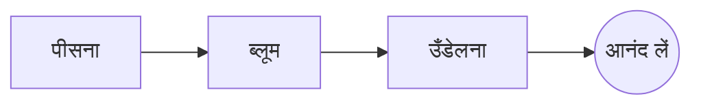

# परफ़ेक्ट पोर-ओवर

कुछ कदमों में एक धीमी सुबह की रस्म। इसे बाईं ओर **सोर्स** में लिखिए या दाईं ओर सीधे *प्रीव्यू* में: दोनों तालमेल में रहते हैं, और ==हर संपादन Markdown में एक साफ़ बदलाव== होता है।

> [!TIP]
> उबाल से ठीक पहले का पानी, लगभग 94 °C, कड़वाहट के बिना मिठास उभारता है।

## अनुपात

ज़्यादातर रेसिपी एक भाग कॉफ़ी और सोलह भाग पानी पर ठहरती हैं:

$$
m_{\text{पानी}} = 16 \times m_{\text{कॉफ़ी}}
$$

तो $20\,\text{ग्रा}$ कॉफ़ी को $320\,\text{ग्रा}$ पानी चाहिए।

## कदम दर कदम



## ब्रू करने के तरीके

| तरीका   | पिसाई     |  समय |
|:--------|:---------:|-----:|
| पोर-ओवर | मध्यम-महीन | 3:30 |
| फ़्रेंच प्रेस | मोटी      | 4:00 |
| एस्प्रेसो  | महीन      | 0:28 |

## शुरू करने से पहले

- [x] ताज़ा भुने बीन्स :coffee:
- [x] एक बर्र ग्राइंडर
- [ ] गूज़नेक टोंटी वाली केतली

```python
def water_for(coffee_g: float, ratio: int = 16) -> float:
    return coffee_g * ratio
```

ब्लूम
: पानी की पहली बौछार, जिससे पिसी कॉफ़ी अपनी गैस छोड़ती है।[^1]

[^1]: ताज़े बीन्स सबसे ज़्यादा ब्लूम करते हैं; पुराने मुश्किल से फूलते हैं।
