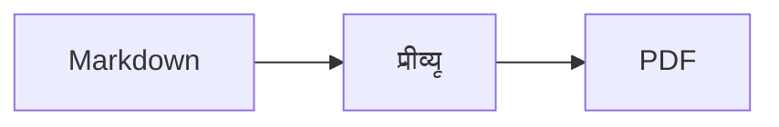

<p>&nbsp;&nbsp;&nbsp;</p>

# Splat

**macOS के लिए Markdown एडिटर, जिसमें आप सोर्स में या सीधे प्रीव्यू में लिख सकते हैं।**

Splat बाईं ओर सिंटैक्स के रंगों वाला आपका Markdown सोर्स रखता है और दाईं ओर लाइव, पूरी तरह संपादन-योग्य प्रीव्यू। किसी में भी टाइप कीजिए: प्रीव्यू में आप जो भी लिखते हैं, वह सोर्स में एक न्यूनतम बदलाव बन जाता है, इसलिए जिन पंक्तियों को आपने छुआ नहीं, वे बाइट-दर-बाइट वैसी ही रहती हैं और आपके Git diff साफ़ रहते हैं। Splat वही Markdown पढ़ता है जिसका आप पहले से इस्तेमाल करते हैं: CommonMark और GitHub Flavored Markdown, GitHub अलर्ट, Obsidian के विकी लिंक, एम्बेड और कॉलआउट, Pandoc और Typora के एक्सटेंशन, एम्बेडेड HTML, LaTeX सूत्र, और Mermaid, Graphviz तथा PlantUML डायग्राम, सब ऑफ़लाइन रेंडर होते हैं। एक क्लिक में PDF, HTML या Word में एक्सपोर्ट कीजिए। यह Rust में, असली AppKit कंट्रोल पर लिखा गया है, 35 भाषाएँ बोलता है, और जब तक आप न कहें, नेटवर्क पर कुछ नहीं भेजता।
 


[](https://raw.githubusercontent.com/sventmueller/splat/main/dist/Splat-1.0.6.dmg)

**[Splat-1.0.6.dmg डाउनलोड करें](https://raw.githubusercontent.com/sventmueller/splat/main/dist/Splat-1.0.6.dmg)**: Apple द्वारा साइन और नोटराइज़ किया हुआ, Apple Silicon और Intel पर macOS 14 या उसके बाद के लिए।
 
 

[](https://www.rust-lang.org)
[](https://www.apple.com/macos/)

[](https://github.com/madsmtm/objc2)
[](https://webkit.org)
[](https://github.com/kivikakk/comrak)
[](https://github.github.com/gfm/)
[](https://www.mathjax.org)
[](https://cortexjs.io/mathlive/)
[](https://mermaid.js.org)
[](https://graphviz.org)
[](https://plantuml.com)


[](#लाइसेंस)

[Bahasa Indonesia](../id/README.md) ·
[Bahasa Melayu](../ms/README.md) ·
[Català](../ca/README.md) ·
[Čeština](../cs/README.md) ·
[Dansk](../da/README.md) ·
[Deutsch](../de/README.md) ·
[English](../../../README.md) ·
[Español](../es/README.md) ·
[Français](../fr/README.md) ·
[Hrvatski](../hr/README.md) ·
[Italiano](../it/README.md) ·
[Magyar](../hu/README.md) ·
[Nederlands](../nl/README.md) ·
[Norsk](../no/README.md) ·
[Polski](../pl/README.md) ·
[Português (Brasil)](../pt_BR/README.md) ·
[Português (Portugal)](../pt_PT/README.md) ·
[Română](../ro/README.md) ·
[Slovenčina](../sk/README.md) ·
[Slovenščina](../sl/README.md) ·
[Suomi](../fi/README.md) ·
[Svenska](../sv/README.md) ·
[Tiếng Việt](../vi/README.md) ·
[Türkçe](../tr/README.md) ·
[Ελληνικά](../el/README.md) ·
[Русский](../ru/README.md) ·
[Українська](../uk/README.md) ·
[עברית](../he/README.md)‎ ·
[العربية](../ar/README.md)‎ ·
**हिन्दी** ·
[ไทย](../th/README.md) ·
[한국어](../ko/README.md) ·
[日本語](../ja/README.md) ·
[简体中文](../zh-Hans/README.md) ·
[繁體中文](../zh-Hant/README.md)

## विषय-सूची

- [एक नज़र में खूबियाँ](#एक-नज़र-में-खूबियाँ)
- [आवश्यकताएँ](#आवश्यकताएँ)
- [इंस्टॉलेशन](#इंस्टॉलेशन)
- [शुरुआत करना](#शुरुआत-करना)
- [लिखना](#लिखना)
  - [सोर्स में](#सोर्स-में)
  - [प्रीव्यू में](#प्रीव्यू-में)
  - [फ़ॉर्मैटिंग कमांड](#फ़ॉर्मैटिंग-कमांड)
  - [सूचियाँ और कार्य](#सूचियाँ-और-कार्य)
  - [टेबल](#टेबल)
- [समर्थित Markdown](#समर्थित-markdown)
  - [CommonMark और GitHub Flavored Markdown](#commonmark-और-github-flavored-markdown)
  - [कॉलआउट](#कॉलआउट)
  - [विस्तारित सिंटैक्स](#विस्तारित-सिंटैक्स)
  - [Obsidian](#obsidian)
  - [उद्धरण और संदर्भ](#उद्धरण-और-संदर्भ)
  - [एम्बेडेड HTML](#एम्बेडेड-html)
  - [टाइपोग्राफ़िक विराम चिह्न](#टाइपोग्राफ़िक-विराम-चिह्न)
  - [सिंटैक्स का सार](#सिंटैक्स-का-सार)
- [सूत्र](#सूत्र)
- [डायग्राम](#डायग्राम)
- [इमेज](#इमेज)
- [लिंक और नेविगेशन](#लिंक-और-नेविगेशन)
- [एक्सपोर्ट, प्रिंट और शेयर करना](#एक्सपोर्ट-प्रिंट-और-शेयर-करना)
- [रूप और एक्सेसिबिलिटी](#रूप-और-एक्सेसिबिलिटी)
- [भाषाएँ](#भाषाएँ)
- [कीबोर्ड शॉर्टकट](#कीबोर्ड-शॉर्टकट)
- [गोपनीयता और सुरक्षा](#गोपनीयता-और-सुरक्षा)
- [बड़े दस्तावेज़](#बड़े-दस्तावेज़)
- [ज्ञात सीमाएँ](#ज्ञात-सीमाएँ)
- [समस्या निवारण](#समस्या-निवारण)
- [डेवलपर्स के लिए](#डेवलपर्स-के-लिए)
  - [बिल्ड करना](#बिल्ड-करना)
  - [वितरण](#वितरण)
  - [टेस्टिंग](#टेस्टिंग)
  - [प्रोजेक्ट का ढाँचा](#प्रोजेक्ट-का-ढाँचा)
  - [डेटा प्रवाह](#डेटा-प्रवाह)
  - [कंट्रोलर के नियम](#कंट्रोलर-के-नियम)
  - [कमांड जोड़ना](#कमांड-जोड़ना)
  - [अनुवाद](#अनुवाद)
  - [तृतीय-पक्ष घटक](#तृतीय-पक्ष-घटक)
- [लाइसेंस](#लाइसेंस)

## एक नज़र में खूबियाँ

- **लिखने के दो तरीके, एक ही टेक्स्ट।** सोर्स और प्रीव्यू दोनों संपादन-योग्य हैं। सच्चाई सिर्फ़ Markdown फ़ाइल है: हर दस्तावेज़ का एक ही undo इतिहास है, और प्रीव्यू का हर बदलाव सोर्स में सबसे छोटे बदलाव में अनुवादित होता है।
- **वही Markdown जो आप पहले से इस्तेमाल करते हैं।** CommonMark, GitHub Flavored Markdown, GitHub अलर्ट, Obsidian, Pandoc और Typora के एक्सटेंशन, इमोजी शॉर्टकोड, स्पॉइलर, परिभाषा सूचियाँ, हेडिंग एंकर और GitHub README जैसा HTML।
- **सूत्र और डायग्राम अंदर ही मौजूद।** MathJax से LaTeX सूत्र, साथ में विज़ुअल सूत्र एडिटर। Mermaid, Graphviz और PlantUML में डायग्राम, जो आपके Mac पर ही रेंडर होते हैं: Java, सर्वर या नेटवर्क कनेक्शन की ज़रूरत नहीं।
- **हर चीज़ के लिए एक बटन।** Markdown के हर निर्माण के लिए टूलबार बटन और मेनू आइटम है, आम निर्माणों के लिए कीबोर्ड शॉर्टकट भी। पंक्तियों, कॉलम और अलाइनमेंट के लिए टेबल का अपना मेनू है।
- **बिना कुछ खोए एक्सपोर्ट।** PDF, एक अकेली स्व-निहित HTML फ़ाइल, या असली हेडिंग, सूचियों, टेबल, फ़ुटनोट और इमेज वाला Word दस्तावेज़।
- **पूरी तरह नेटिव।** असली AppKit विंडो, टैब, मेनू, पॉपओवर, संस्करण, Auto Save, शेयर मेनू, डार्क मोड, वर्तनी जाँच, डिक्टेशन और VoiceOver। Electron नहीं, और टेक्स्ट के लिए वेब व्यू भी नहीं।
- **बड़ी फ़ाइलों के साथ भी तेज़।** 10 MB के दस्तावेज़ में एक कीस्ट्रोक को रेंडर करने में लगभग 25 ms लगते हैं, व्यू के अपने काम से पहले।
- **निजी और सावधान।** वेब की इमेज आपकी अनुमति के बाद ही लोड होती हैं, दूसरे ऐप के लिंक पहले पूछते हैं, और अविश्वसनीय इमेज डेटा को डिकोड करने वाली हर चीज़ सैंडबॉक्स वाले हेल्पर प्रोसेस में चलती है।
- **आपकी भाषा में।** इंटरफ़ेस और अंतर्निहित Markdown त्वरित संदर्भ 35 भाषाओं में मिलते हैं: अरबी, कैटलन, चीनी (सरलीकृत), चीनी (पारंपरिक), क्रोएशियाई, चेक, डेनिश, डच, अंग्रेज़ी, फ़िनिश, फ़्रेंच, जर्मन, ग्रीक, हिब्रू, हिन्दी, हंगेरियन, इंडोनेशियाई, इतालवी, जापानी, कोरियाई, मलय, नॉर्वेजियन, पोलिश, पुर्तगाली (ब्राज़ील), पुर्तगाली (पुर्तगाल), रोमानियाई, रूसी, स्लोवाक, स्लोवेनियाई, स्पैनिश, स्वीडिश, थाई, तुर्की, यूक्रेनी और वियतनामी।

## आवश्यकताएँ

- macOS 14 Sonoma या उसके बाद। Splat का विकास और परीक्षण macOS 27 पर होता है, जहाँ यह Liquid Glass डिज़ाइन अपने आप अपना लेता है।
- Apple Silicon या Intel प्रोसेसर वाला Mac।
- लगभग 45 MB डिस्क स्थान।

## इंस्टॉलेशन

**डिस्क इमेज से।** [`dist/Splat-1.0.6.dmg`](https://raw.githubusercontent.com/sventmueller/splat/main/dist/Splat-1.0.6.dmg) डाउनलोड कीजिए, उसे खोलिए और Splat को ऐप्लिकेशन फ़ोल्डर पर खींच दीजिए। इमेज Developer ID से साइन की गई है और Apple द्वारा नोटराइज़ की गई है, इसलिए यह बिना चेतावनी के खुलती है।

**Homebrew से।** cask का अपना अलग tap है:

```sh
brew install --cask sventmueller/tap/splat
```

`brew upgrade --cask splat` नए संस्करण इंस्टॉल करता है, और `brew uninstall --zap --cask splat` Splat की सेटिंग और कैश भी हटा देता है।

**अपडेट।** डिस्क इमेज या Homebrew से इंस्टॉल किया गया Splat [Sparkle](https://sparkle-project.org) के ज़रिए खुद को अप टू डेट रखता है। दूसरी बार खुलने पर वह पूछता है कि क्या वह दिन में एक बार अपने आप अपडेट ढूँढ सकता है। **Splat › अपडेट जाँचें…** तुरंत जाँचता है; उसी मेनू में **अपडेट अपने आप जाँचें** और **अपडेट अपने आप डाउनलोड और इंस्टॉल करें** से आप बाद में अपना चुनाव बदल सकते हैं। Splat कोई अपडेट तभी इंस्टॉल करता है, जब उस पर डेवलपर के हस्ताक्षर हों। आपके अपने बनाए बिल्ड में अपडेटर नहीं होता।

**सोर्स से।** पूर्वापेक्षाओं के लिए [बिल्ड करना](#बिल्ड-करना) देखिए, फिर:

```sh
make build
ditto target/release/Splat.app /Applications/Splat.app
open /Applications/Splat.app
```

Markdown फ़ाइलों को डबल-क्लिक से Splat में खोलने के लिए Finder में कोई भी `.md` फ़ाइल चुनिए, **फ़ाइल › जानकारी प्राप्त करें** चुनिए, **इसमें खोलें** में Splat चुनिए और **सभी बदलें…** पर क्लिक कीजिए। Splat खुद को `.md`, `.markdown`, `.mdown` और `.mkd` फ़ाइलों के लिए रजिस्टर करता है।

## शुरुआत करना

### विंडो

हर दस्तावेज़ अपनी विंडो में खुलता है, या टैब पसंद हों तो टैब के रूप में:

- **बाएँ: सोर्स।** SF Mono में आपका Markdown, सिंटैक्स के रंगों के साथ।
- **दाएँ: प्रीव्यू।** रेंडर किया हुआ दस्तावेज़, संपादन के लिए तैयार।
- **आउटलाइन साइडबार (वैकल्पिक)।** सभी हेडिंग एक पेड़ के रूप में; किसी पर क्लिक करने से वह दोनों पैन में दिखता है। इसे **दृश्य › आउटलाइन दिखाएँ** (⌃⌘S) से चालू या बंद कीजिए।
- **टूलबार।** बटन इस आधार पर समूहित हैं कि वे क्या बदलते हैं: वर्ण, अनुच्छेद और डाले गए एलिमेंट, फिर प्रीव्यू चालू/बंद, शेयर और नया दस्तावेज़। इसे **दृश्य › टूलबार कस्टमाइज़ करें…** से अपने अनुसार ढालिए।

डिवाइडर को खींचकर किसी भी तरफ़ ज़्यादा जगह दीजिए। **दृश्य › प्रीव्यू छिपाएँ** (⌥⌘P) सिर्फ़ सोर्स छोड़ देता है; Splat यह हर विंडो के लिए याद रखता है। दोनों पैन साथ-साथ स्क्रॉल होते हैं, और एक पैन में चुना हुआ हिस्सा दूसरे में हाइलाइट होता है।

### दस्तावेज़, टैब और संस्करण

Splat एक आम macOS दस्तावेज़ ऐप है:

- **Auto Save और संस्करण।** बदलाव उसी जगह सहेजे जाते हैं। **फ़ाइल › इस पर रिवर्ट करें › सभी संस्करण ब्राउज़ करें…** आपको समय में पीछे ले जाता है।
- **दूसरे प्रोग्राम के बदलाव।** जब Git, कोई स्क्रिप्ट या कोई दूसरा एडिटर किसी खुले दस्तावेज़ को बदलता है, तो Splat उसे दोबारा लोड करता है और कर्सर व स्क्रॉल की स्थिति बनाए रखता है। अगर आपके अपने बिना सहेजे बदलाव हैं, तो Splat उन्हें रखता है, और दूसरे संस्करण के ऊपर सहेजने से पहले macOS पूछता है।
- **फ़ाइल के आम कमांड।** नक़ल बनाएँ (⇧⌘S), नाम बदलें…, इसमें मूव करें…, और **फ़ाइल › हालिया खोलें**।
- **टैब।** **फ़ाइल › नया टैब** या टूलबार का **+** बटन नए दस्तावेज़ को टैब में खोलता है; मानक विंडो मेनू टैब को मिलाता है, मूव करता है और बारी-बारी से दिखाता है।
- **विंडो की जगह।** आपकी आख़िरी विंडो का आकार और स्थान याद रखा जाता है, रीस्टार्ट के बाद भी। अगर वहाँ पहले से कोई विंडो है, तो नई विंडो थोड़ा हटकर खुलती है।
- **Dock आइकन।** आख़िरी विंडो बंद करने के बाद उस पर क्लिक करने से नया दस्तावेज़ खुलता है।
- **Markdown फ़ाइलें Splat में खोलें।** **Splat › Markdown के लिए डिफ़ॉल्ट ऐप के रूप में सेट करें** `.md` या `.markdown` फ़ाइल पर डबल-क्लिक करने से Splat खुलने लगता है; macOS पुष्टि के लिए एक बार पूछता है। जब तक Splat डिफ़ॉल्ट है, यह आइटम चेकमार्क दिखाता है।

फ़ाइलें UTF-8 टेक्स्ट होनी चाहिए, या बाइट ऑर्डर मार्क वाली UTF-16। Splat अंदाज़ा लगाकर टेक्स्ट बिगाड़ने के बजाय दूसरी एन्कोडिंग को मना कर देता है। बाइट ऑर्डर मार्क बना रहता है, UTF-16 UTF-16 ही रहता है, और जिस फ़ाइल की सभी पंक्तियाँ CRLF पर ख़त्म होती हैं, उसमें आपकी जोड़ी हुई पंक्तियों को भी CRLF मिलता है।

**क्रैश के बाद** टाइपिंग के ज़्यादा से ज़्यादा आख़िरी कुछ सेकंड ही खोते हैं: हर पाँच सेकंड में Splat बिना सहेजा टेक्स्ट `~/Library/Application Support/Splat/Unsaved` में कॉपी करता है, और दस्तावेज़ सहेजे जाने या Splat के सामान्य रूप से बंद होने पर ये कॉपियाँ हटा देता है। अगली शुरुआत में क्रैश के बाद वहाँ बचा हुआ सब कुछ `~/Library/Application Support/Splat/Recovery` में चला जाता है और एक बार इसकी सूचना मिलती है, साथ में एक बटन जो फ़ोल्डर खोलता है। जिस क्रैश पर Splat अब भी प्रतिक्रिया दे सकता है, वह हर खुले दस्तावेज़ का टेक्स्ट भी वहीं लिख देता है।

### त्वरित संदर्भ

**सहायता › Markdown त्वरित संदर्भ** आपकी भाषा में एक चीट शीट को नए, बिना शीर्षक वाले दस्तावेज़ के रूप में खोलता है। यह एक सामान्य दस्तावेज़ है, इसलिए सब कुछ वहीं आज़माइए, सोर्स में या प्रीव्यू में।

## लिखना

### सोर्स में

सोर्स Markdown के लिए ढाला गया प्लेन-टेक्स्ट एडिटर है:

- **सिंटैक्स के रंग** VS Code की तरह: हेडिंग, ज़ोर, लिंक, कोड, टेबल, HTML, front matter, और सूत्रों व डायग्राम के अंदर LaTeX और Mermaid। हल्के, गहरे और बढ़े हुए कंट्रास्ट के लिए अलग पैलेट हैं।
- **फ़ेंस्ड कोड ब्लॉक** Bash, C, C++, C#, CSS (SCSS और Less भी), Go, HTML, XML, Java, JavaScript, JSON, Kotlin, PHP, Python, Ruby, Rust, SQL, Swift, TypeScript, YAML, TeX और Mermaid के लिए हाइलाइट होते हैं, उनके `js`, `py` या `sh` जैसे आम छोटे नामों समेत।
- **कोई चौंकाने वाला प्रतिस्थापन नहीं।** स्मार्ट कोट, स्मार्ट डैश और टेक्स्ट रिप्लेसमेंट डिफ़ॉल्ट रूप से बंद हैं, क्योंकि वे `--`, `---` और `"` को बिगाड़ देते हैं। इन्हें **संपादन › सब्स्टिट्यूशन** में चालू कीजिए।
- **सिस्टम के लेखन टूल।** वर्तनी और व्याकरण की जाँच, डिक्टेशन, ढूँढें और बदलें (⌥⌘F), और बोली।
- **ड्रैग और ड्रॉप।** इमेज फ़ाइल छोड़ने पर `` डलता है, कोई दूसरी फ़ाइल छोड़ने पर उसका लिंक, और URL छोड़ने पर `[url](url)`। हर ड्रॉप एक undo चरण है।
- **इमेज पेस्ट करना।** क्लिपबोर्ड पर मौजूद तस्वीर, जैसे स्क्रीनशॉट, दस्तावेज़ के पास PNG फ़ाइल (`इमेज 2026-10-29 13.09.07.png`) के रूप में सहेजी जाती है और इमेज के रूप में डाल दी जाती है। इसके लिए दस्तावेज़ को एक बार सहेजना ज़रूरी है।

### प्रीव्यू में

प्रीव्यू एक वर्ड प्रोसेसर की तरह चलता है, लेकिन उसमें आप जो भी करते हैं, वह Markdown बनकर सोर्स में पहुँचता है:

- **टाइपिंग।** Markdown में अर्थ रखने वाले वर्ण, जैसे `*` या `#`, एस्केप कर दिए जाते हैं ताकि वे वैसे ही दिखें जैसे टाइप किए गए।
- **रिटर्न** नया अनुच्छेद या सूची आइटम शुरू करता है। **⌥Return** या **⌃Return** पंक्ति विराम डालता है।
- **कर्सर पर फ़ॉर्मैटिंग।** कर्सर शब्द के अंत में हो, तो बोल्ड, इटैलिक और बाकी वर्ण फ़ॉर्मैट उस पर लागू होते हैं जो आप आगे टाइप करते हैं। रोकने के लिए वही फ़ॉर्मैट दोबारा चुनिए। शब्द के अंदर होने पर पूरा शब्द फ़ॉर्मैट होता है।
- **ख़ाली पंक्तियाँ।** ख़ाली पंक्ति पर रिटर्न एक और ख़ाली पंक्ति जोड़ता है, और बैकस्पेस उसे हटा देता है। सोर्स में हर अतिरिक्त ख़ाली पंक्ति दो और रिक्त पंक्तियाँ होती है; दूसरे Markdown प्रोग्राम उन्हें सामान्य अनुच्छेद अंतराल की तरह दिखाते हैं।
- **पहले जैसा करें** दोनों पैन में काम करता है। इसके आइटम के नाम होते हैं (“पहले जैसा करें बोल्ड”), टाइपिंग का हर सिलसिला एक चरण होता है, और पहले जैसा करें व फिर करें के बाद दोनों पैन बदलाव तक स्क्रॉल हो जाते हैं।
- **सूत्र और डायग्राम** तैयार ग्राफ़िक के रूप में दिखते हैं। किसी पर क्लिक कीजिए, कर्सर उस पर ले जाइए या उस पर रिटर्न दबाइए, तो उसका एडिटर खुल जाता है ([सूत्र](#सूत्र) और [डायग्राम](#डायग्राम) देखिए)।
- **एम्बेडेड HTML, एम्बेडेड नोट और front matter** दिखाए जाते हैं, लेकिन उन्हें आप सोर्स में संपादित करते हैं। उन पर क्लिक करने से कर्सर वहाँ के संबंधित स्थान पर पहुँच जाता है।

जो कुछ Markdown व्यक्त नहीं कर सकता, वह प्रीव्यू में बंद है: फ़ॉन्ट और रंग पैनल, रूलर, और रिच टेक्स्ट व इमेज को पेस्ट या ड्रॉप करना। पेस्ट किए गए HTML और RTF सादे टेक्स्ट के रूप में आते हैं।

### फ़ॉर्मैटिंग कमांड

हर कमांड टूलबार, मेनू बार और दोनों पैन के संदर्भ मेनू से उपलब्ध है। मेनू आइटम कर्सर की फ़ॉर्मैटिंग के लिए चेकमार्क दिखाते हैं।

| मेनू | कमांड |
|---|---|
| **फ़ॉर्मैट › फ़ॉन्ट** | बोल्ड, इटैलिक, रेखांकित करें, स्ट्राइकथ्रू, हाइलाइट, कोड, सुपरस्क्रिप्ट, सबस्क्रिप्ट |
| **फ़ॉर्मैट › हेडिंग** | बॉडी टेक्स्ट, हेडिंग 1 से 6 |
| **फ़ॉर्मैट › सूची** | बुलेट सूची, संख्या सूची, कार्य सूची |
| **फ़ॉर्मैट** | उद्धरण, कोड ब्लॉक (कोई भाषा नहीं या 20 भाषाओं में से एक; मौजूदा ब्लॉक की भाषा भी बदलता है), कॉलआउट (नोट, सुझाव, महत्वपूर्ण, चेतावनी, सावधानी; वही प्रकार दोबारा चुनने पर हट जाता है), सूत्र या डायग्राम संपादित करें…, फ़ॉर्मैटिंग हटाएँ |
| **डालें** | लिंक…, इमेज…, टेबल…, सूत्र, डायग्राम (फ़्लोचार्ट, सीक्वेंस डायग्राम, गैंट चार्ट), विषय-सूची, फ़ुटनोट, क्षैतिज रेखा |
| **टेबल** | ऊपर/नीचे पंक्ति डालें, बाईं/दाईं ओर कॉलम डालें, पंक्ति डिलीट करें, कॉलम डिलीट करें, अलाइनमेंट (बाएँ, मध्य, दाएँ, डिफ़ॉल्ट), टेबल कॉलम अलाइन करें |
| **दृश्य** | प्रीव्यू छिपाएँ/दिखाएँ, आउटलाइन दिखाएँ/छिपाएँ, टाइपोग्राफ़िक विराम चिह्न, ज़ूम इन/आउट, वास्तविक आकार, टूलबार, टैब बार, फ़ुल स्क्रीन |

रेखांकित, हाइलाइट, सुपरस्क्रिप्ट और सबस्क्रिप्ट `<ins>`, `<mark>`, `<sup>` और `<sub>` के रूप में लिखे जाते हैं, जिन्हें GitHub भी दिखाता है। Splat `<u>` भी पढ़ता है, जिसे GitHub हटा देता है, और छोटे रूप `==highlight==`, `^sup^` और `~sub~` भी। GitHub `==` और `^` को जैसा टाइप किया गया है वैसा ही दिखाता है और `~sub~` को स्ट्राइकथ्रू के रूप में।

### सूचियाँ और कार्य

- रिटर्न सूची को आगे बढ़ाता है; ख़ाली आइटम पर रिटर्न उसे ख़त्म कर देता है।
- **Tab** और **⇧Tab** प्रीव्यू में सूची आइटम को इंडेंट और आउटडेंट करते हैं।
- प्रीव्यू में कार्य के चेकबॉक्स पर क्लिक करने से `- [ ]` और `- [x]` टॉगल होते हैं।
- **फ़ॉर्मैट › सूची** चुने हुए अनुच्छेदों को सूची में बदलता है या उसका प्रकार बदलता है।

### टेबल

- **डालें › टेबल…** पंक्तियों (हेडर सहित) और कॉलम की संख्या पूछता है।
- प्रीव्यू में **Tab** अगले सेल पर, **⇧Tab** पिछले सेल पर और **रिटर्न** नीचे के सेल पर जाता है। आख़िरी सेल में Tab एक पंक्ति जोड़ता है।
- **टेबल** मेनू पंक्तियाँ और कॉलम डालता व हटाता है और कॉलम का अलाइनमेंट तय करता है (⌘{, ⌘|, ⌘})।
- **टेबल › टेबल कॉलम अलाइन करें** सोर्स में पैडिंग जोड़ता है ताकि कॉलम एक सीध में आएँ।

## समर्थित Markdown

Splat [comrak](https://github.com/kivikakk/comrak) से पार्स करता है, जो CommonMark और GFM के अनुकूल पार्सर है, और उसके ज़्यादातर एक्सटेंशन चालू रखता है। नीचे की हर चीज़ प्रीव्यू में और सभी एक्सपोर्ट में रेंडर होती है।

### CommonMark और GitHub Flavored Markdown

- हेडिंग (`#` वाली और रेखांकित), अनुच्छेद, पंक्ति विराम, ज़ोर, गहरा ज़ोर, इनलाइन कोड, ब्लॉक उद्धरण, क्षैतिज रेखाएँ।
- बुलेट, संख्या और नेस्टेड सूचियाँ; कार्य सूचियाँ।
- लिंक (इनलाइन, रेफ़रेंस और स्वचालित), इमेज, लिंक रेफ़रेंस परिभाषाएँ।
- सिंटैक्स के रंगों वाले फ़ेंस्ड और इंडेंटेड कोड ब्लॉक।
- कॉलम अलाइनमेंट वाली टेबल।
- `~~two tildes~~` से स्ट्राइकथ्रू।
- फ़ुटनोट: `text[^1]` और दस्तावेज़ में कहीं भी `[^1]: The note.`। मार्कर पर क्लिक करने से नोट पर पहुँच जाते हैं।
- सबसे ऊपर `---` पंक्तियों के बीच YAML front matter। प्रीव्यू उसे एक पंक्ति में समेट देता है, जैसे “मेटाडेटा: title, date, tags”।

### कॉलआउट

GitHub अलर्ट आइकन और शीर्षक वाले रंगीन बॉक्स के रूप में रेंडर होते हैं:

```markdown
> [!NOTE]
> वह उपयोगी जानकारी जो उपयोगकर्ताओं को पता होनी चाहिए।

> [!WARNING]
> ज़रूरी सामग्री जिस पर तुरंत ध्यान देना आवश्यक है।
```

पाँच प्रकार हैं: नोट, सुझाव, महत्वपूर्ण, चेतावनी और सावधानी। **फ़ॉर्मैट › कॉलआउट** कर्सर वाले अनुच्छेद को इनमें से एक में बदलता है।

Obsidian के कॉलआउट भी चलते हैं, किसी भी शीर्षक और फ़ोल्ड स्थिति के साथ:

```markdown
> [!tip]- फैलाने के लिए ▸ पर क्लिक करें
> खुलने तक छिपा हुआ।

> [!question]+ डिफ़ॉल्ट रूप से खुला
> `+` फैला हुआ शुरू होता है, `-` समेटा हुआ।
```

Obsidian के बाकी प्रकार पाँचों में से सबसे नज़दीकी रंग में दिखते हैं: `success`, `check`, `done` और `hint` सुझाव के रूप में; `question`, `help` और `faq` महत्वपूर्ण के रूप में; `attention` चेतावनी के रूप में; `failure`, `fail`, `missing`, `danger`, `error` और `bug` सावधानी के रूप में; बाकी सब नोट के रूप में।

### विस्तारित सिंटैक्स

| सुविधा | सिंटैक्स | कहाँ से |
|---|---|---|
| हाइलाइट | `==marked text==` | Obsidian, Typora |
| सुपरस्क्रिप्ट | `x^2^` | Pandoc, Typora |
| सबस्क्रिप्ट | `H~2~O` | Pandoc, Typora |
| इमोजी शॉर्टकोड | `:rocket:` से 🚀 बनता है | GitHub |
| स्पॉइलर | `\|\|hidden text\|\|`, पढ़ने के लिए इसे चुनें | Discord |
| इनलाइन फ़ुटनोट | `text^[the note itself]` | Pandoc, Obsidian |
| परिभाषा सूची | `Term`, ख़ाली पंक्ति, `: Explanation` | PHP Markdown Extra, Pandoc |
| हेडिंग एंकर | `## Install {#setup}`, लिंक `[see](#setup)` से | Pandoc, kramdown |

परिभाषा सूचियाँ सोर्स में ऐसी दिखती हैं:

```markdown
शब्द

: शब्द की व्याख्या।
```

कस्टम एंकर के बिना हर हेडिंग को उसके टेक्स्ट से एक एंकर मिलता है, जैसा GitHub पर होता है: `## शुरुआत करना` को `#शुरुआत-करना` से खोला जा सकता है।

### Obsidian

- **विकी लिंक।** `[[Note]]` उसी फ़ोल्डर या उसके नीचे के किसी फ़ोल्डर की `Note.md` से लिंक करता है। `[[Note|Shown text]]` आपका अपना टेक्स्ट दिखाता है, और `[[Note#Heading]]` नोट खोलता है। ⌘-क्लिक उसे Splat में खोलता है।
- **एम्बेड।** `![[Note]]` दूसरे नोट को इस नोट के अंदर दिखाता है; उसमें एम्बेड किए गए नोट लिंक के रूप में दिखते हैं। `![[diagram.png]]` इमेज दिखाता है। Obsidian की तरह, एम्बेड दस्तावेज़ के फ़ोल्डर या उसके नीचे के नोट और इमेज का नाम लेते हैं, कभी निरपेक्ष पथ से नहीं, और केवल Markdown फ़ाइलें नोट के रूप में दिखती हैं।
- **टिप्पणियाँ।** `%%Only in the source%%` सोर्स में दिखता रहता है और प्रीव्यू तथा हर एक्सपोर्ट से बाहर रहता है, इनलाइन हो या अपनी अलग पंक्तियों पर।
- **टैग।** `#idea` या `#project/splat` हाइलाइट होते हैं। ⌘-क्लिक दस्तावेज़ में उस टैग को ढूँढता है।
- **समेटे जा सकने वाले कॉलआउट।** [कॉलआउट](#कॉलआउट) देखिए।

### उद्धरण और संदर्भ

- **Pandoc उद्धरण।** `[@doe2020]` या `[@doe2020; @roe2021]` “(Doe 2020; Roe 2021)” की तरह पढ़ा जाता है। प्रविष्टियाँ उस BibTeX फ़ाइल से आती हैं जिसका नाम front matter में `bibliography: refs.bib` के रूप में दिया गया है। इसके बिना Splat दस्तावेज़ के पास `references.bib`, `literatur.bib` या `bibliography.bib` इस्तेमाल करता है।
- **GitHub और GitLab संदर्भ।** अगर दस्तावेज़ किसी ऐसे Git रिपॉज़िटरी में है जिसका `origin` रिमोट github.com या किसी GitLab होस्ट पर है, तो `@name`, `#12` (issue) और `!7` (merge request, केवल GitLab) हाइलाइट होते हैं। ⌘-क्लिक उन्हें ब्राउज़र में खोलता है।

### एम्बेडेड HTML

GitHub README में मिलने वाला HTML रेंडर होता है, ब्राउज़र इंजन से नहीं बल्कि अपने रीडर से:

- बीच में रखे अनुच्छेद और ब्लॉक (`<p align="center">`, `<div align="center">`)
- आकार वाली इमेज (``)
- लिंक, `<kbd>⌘</kbd>`, `<br>`, `<u>`, `<ins>`, `<mark>`, `<sup>`, `<sub>`
- सूचियाँ और टेबल, कॉलम पर फैले सेल समेत (`colspan`)
- समेटे जा सकने वाले सेक्शन: `<details><summary>अधिक</summary>…</details>`, जो ▸ पर क्लिक करने से खुलते हैं

HTML टैग के बीच का Markdown, Markdown के रूप में रेंडर होता है। स्क्रिप्ट, स्टाइल, फ़्रेम और फ़ॉर्म पूरी तरह छोड़ दिए जाते हैं, और लिंक व इमेज में केवल `http`, `https`, `mailto` और रिलेटिव पते बचे रहते हैं।

### टाइपोग्राफ़िक विराम चिह्न

**दृश्य › टाइपोग्राफ़िक विराम चिह्न** सीधे उद्धरण चिह्नों को आपकी इंटरफ़ेस भाषा के उद्धरण चिह्नों में, `--` को एन डैश में, `---` को एम डैश में और `...` को एलिप्सिस में दिखाता है। जर्मन में `"Ja"` „Ja“ बन जाता है, फ़्रेंच में «Oui», जापानी में 「はい」, वहाँ भी जहाँ चीनी और जापानी उद्धरण बिना स्पेस के लगाते हैं; `צה"ל` जैसे हिब्रू संक्षेपों को उनका गर्शायिम मिलता है, צה״ל। सोर्स सादे वर्ण ही रखता है; प्रीव्यू और सभी एक्सपोर्ट टाइपोग्राफ़िक वर्ण दिखाते हैं। यह सेटिंग आपके चालू करने तक बंद रहती है।

### सिंटैक्स का सार

| एलिमेंट | Markdown |
|---|---|
| **बोल्ड** | `**Bold**` |
| *इटैलिक* | `*Italic*` |
| रेखांकित | `<ins>Underline</ins>` या `<u>Underline</u>` |
| ~~स्ट्राइकथ्रू~~ | `~~Strikethrough~~` |
| हाइलाइट | `<mark>Highlight</mark>` या `==Highlight==` |
| `कोड` | `` `Code` `` |
| x² | `x<sup>2</sup>` या `x^2^` |
| H₂O | `H<sub>2</sub>O` या `H~2~O` |
| [लिंक](https://example.com) | `[Link](https://example.com)` |
| हेडिंग | `# Heading` से `###### Heading` तक |
| उद्धरण | `> Quote` |
| बुलेट सूची | `- Item` |
| संख्या सूची | `1. Item` |
| कार्य | `- [ ] Open` और `- [x] Done` |
| कोड ब्लॉक | ```` ```rust ```` … ```` ``` ```` |
| टेबल | `\| A \| B \|`, हेडर के नीचे `\|---\|---\|` के साथ |
| फ़ुटनोट | `Text[^1]` और `[^1]: Note` |
| क्षैतिज रेखा | `---` |
| इमेज | `` |
| सूत्र | `$E = mc^2$`, `$$ … $$` |
| डायग्राम | ```` ```mermaid ````, ```` ```dot ````, ```` ```plantuml ```` |
| कॉलआउट | `> [!TIP]` |
| विकी लिंक | `[[Note]]`, `[[Note\|Text]]` |
| एम्बेड | `![[Note]]`, `![[image.png]]` |
| टिप्पणी | `%%Comment%%` |
| टैग | `#tag` |
| उद्धरण-संदर्भ | `[@key]` |
| स्पॉइलर | `\|\|Spoiler\|\|` |
| इमोजी | `:tada:` |

## सूत्र

सूत्र [MathJax](https://www.mathjax.org) से, उसके TeX और AMS गणित के साथ, साफ़ वेक्टर ग्राफ़िक के रूप में रेंडर होते हैं। `\text{…}` में टेक्स्ट किसी भी लिपि में हो सकता है: MathJax के फ़ॉन्ट में जो नहीं है, वह आपके Mac के फ़ॉन्ट से आता है, अरबी और हिब्रू दाएँ से बाएँ चलती हैं, और इमोजी रंगीन दिखते हैं।

| प्रकार | सिंटैक्स |
|---|---|
| इनलाइन | `$E = mc^2$`, `` $`E = mc^2`$ `` (GitHub, GitLab), `\(E = mc^2\)` |
| डिस्प्ले | `$$` … `$$`, `\[` … `\]`, या `math` से चिह्नित कोड ब्लॉक |

**सूत्र संपादित करना।** प्रीव्यू में किसी सूत्र पर क्लिक कीजिए, डबल-क्लिक कीजिए, उस पर रिटर्न दबाइए या कर्सर उस पर ले जाइए, तो उसका एडिटर पॉपओवर में खुलता है। **डालें › सूत्र** नया सूत्र डालता है और एडिटर तुरंत खोल देता है।

- **विज़ुअल या LaTeX।** ऊपर का स्विच विज़ुअल एडिटर ([MathLive](https://cortexjs.io/mathlive/)) और LaTeX कोड के बीच बदलता है। Splat आपका चुनाव याद रखता है।
- **बिल्डिंग ब्लॉक** भिन्न, वर्गमूल, सुपरस्क्रिप्ट और सबस्क्रिप्ट, सीमाओं सहित योग और समाकल, सीमा, कॉन्टेंट के साथ बढ़ने वाले कोष्ठक, 2×2 मैट्रिक्स, ग्रीक अक्षर, और संबंध, ऑपरेटर और तीर के लिए हैं। वे □ प्लेसहोल्डर छोड़ते हैं, और **Tab** अगले पर ले जाता है।
- **लाइव प्रीव्यू।** टाइप करते समय बदलाव दस्तावेज़ में दिखते हैं। MathJax की त्रुटियाँ कोड के नीचे एक पंक्ति में दिखती हैं।
- **लागू करें या छोड़ें।** बाहर क्लिक करने पर बदलाव एक ही undo चरण के रूप में रह जाता है; **Esc** या **रद्द करें** उसे फेंक देता है। नए, ख़ाली सूत्र में Esc दबाने से वह फिर हट जाता है।
- संदर्भ मेनू पॉइंटर के नीचे वाले सूत्र के लिए **सूत्र संपादित करें…** देता है।

VoiceOver सूत्र को उसके LaTeX कोड के रूप में पढ़ता है। Splat सूत्र रेंडर करता है, पूरे LaTeX दस्तावेज़ नहीं: कोई पैकेज नहीं, कोई TikZ नहीं और कोई `\documentclass` नहीं।

## डायग्राम

डायग्राम Splat के अंदर ही, ऑफ़लाइन और हल्के व गहरे रूप में रेंडर होते हैं।

| इंजन | कोड ब्लॉक | क्या बनाता है |
|---|---|---|
| [Mermaid](https://mermaid.js.org) | ```` ```mermaid ```` | फ़्लोचार्ट, सीक्वेंस, क्लास, स्टेट, एंटिटी रिलेशनशिप, गैंट, पाई, माइंड मैप, टाइमलाइन और Mermaid के बाकी सभी प्रकार |
| [Graphviz](https://graphviz.org) | ```` ```dot ```` या ```` ```graphviz ```` | DOT भाषा में ग्राफ़ |
| [PlantUML](https://plantuml.com) | ```` ```plantuml ```` या ```` ```puml ```` | UML डायग्राम; Java के बिना चलता है |



**डायग्राम संपादित करना** सूत्र संपादित करने जैसा ही है: उस पर क्लिक करने से कोड पॉपओवर में खुलता है, सिंटैक्स के रंगों के साथ और त्रुटि संदेश कोड के नीचे एक पंक्ति में। **डालें › डायग्राम** फ़्लोचार्ट, सीक्वेंस डायग्राम या गैंट चार्ट के टेम्पलेट से शुरू करता है। बिल्डिंग ब्लॉक Mermaid के तीन सबसे आम प्रकारों में मदद करते हैं:

- **फ़्लोचार्ट:** नोड ▾ (आयत, गोल कोनों वाला आयत, वृत्त, समचतुर्भुज, डेटाबेस), कनेक्शन, लेबल सहित, दल, दिशा ▾
- **सीक्वेंस डायग्राम:** प्रतिभागी, संदेश, जवाब, नोट, लूप, वैकल्पिक रास्ते
- **गैंट चार्ट:** सेक्शन, कार्य, माइलस्टोन

बाकी डायग्राम प्रकार कोड के रूप में संपादित होते हैं। VoiceOver डायग्राम का शीर्षक या वैकल्पिक टेक्स्ट पढ़ता है।

लॉन्च के बाद पहले डायग्राम में लगभग एक सेकंड लगता है, क्योंकि रेंडरिंग इंजन बैकग्राउंड में शुरू होता है। जिस डायग्राम में 10 सेकंड से ज़्यादा लगें, वह त्रुटि दिखाता है, और अगले डायग्राम के लिए रेंडरिंग इंजन नए सिरे से शुरू होता है। PlantUML का इंजन (3 MB) केवल पहले PlantUML डायग्राम के साथ लोड होता है। वेब से PlantUML का `!include` ब्लॉक कर दिया जाता है।

## इमेज

- **स्थानीय इमेज** दस्तावेज़ के सापेक्ष पथ इस्तेमाल करती हैं: ``। Splat PNG, JPEG, GIF, WebP, BMP, SVG, HEIC, TIFF, AVIF और PDF दिखाता है।
- **वेब की इमेज** आपकी अनुमति तक ब्लॉक रहती हैं: प्रीव्यू के ऊपर की एक बार समझाती है कि उन्हें लोड करने से उनके सर्वर को पता चलता है कि आप दस्तावेज़ कब खोलते हैं। **इमेज लोड करें** उन्हें इस दस्तावेज़ के लिए अनुमति देता है; Splat यह चुनाव हर फ़ाइल के लिए याद रखता है।
- **आकार।** `` इमेज का आकार तय करता है; वरना इमेज प्रीव्यू की चौड़ाई में समा जाती हैं।
- **डिस्क पर बदलाव।** आपकी बदली हुई इमेज, या वह जो दस्तावेज़ में नाम आने के बाद दिखी, दस्तावेज़ दोबारा खोले बिना दिखती है। नेटवर्क की वजह से जो वेब इमेज विफल रहीं, उन्हें दस्तावेज़ के दिखाते रहने तक दोबारा आज़माया जाता है।
- **मेमोरी।** इमेज सबसे लंबी तरफ़ 2560 पिक्सेल तक दिखती हैं, जो A4 पृष्ठ भी भर देता है। जब वे Mac की मेमोरी का आठवाँ हिस्सा भर लेती हैं, और जब तक macOS मेमोरी दबाव बताता है, वे छोटे आकार में डिकोड होती हैं।
- **डार्क मोड।** सफ़ेद बैकग्राउंड वाली इमेज डार्क प्रीव्यू में थोड़ी मंद कर दी जाती हैं।
- **पेस्ट और ड्रॉप करना।** [सोर्स में](#सोर्स-में) देखिए।

## लिंक और नेविगेशन

प्रीव्यू में क्लिक कर्सर रखता है ताकि आप लिंक का टेक्स्ट संपादित कर सकें; **⌘-क्लिक** लिंक पर जाता है:

- `http`, `https` और `mailto` आपके ब्राउज़र या मेल ऐप में खुलते हैं।
- Markdown फ़ाइलें Splat में खुलती हैं; दूसरी फ़ाइलें और फ़ोल्डर Finder में दिखाए जाते हैं।
- `#anchor` दस्तावेज़ में उस हेडिंग पर पहुँचाता है।
- दूसरा ऐप खोलने वाले पते, जैसे `slack://` या `vscode://`, पहले पूछते हैं और पूरा पता व ऐप दिखाते हैं। **रद्द करें** पहले से चुना होता है।

**डालें › विषय-सूची** सभी हेडिंग की लिंक वाली सूची डालता है। कर्सर उसके अंदर हो, तो वही कमांड उसे अपडेट करता है। आउटलाइन साइडबार (⌃⌘S) दोनों पैन में किसी भी हेडिंग पर पहुँचाता है।

## एक्सपोर्ट, प्रिंट और शेयर करना

| फ़ॉर्मैट | कैसे | आपको क्या मिलता है |
|---|---|---|
| **PDF** | **फ़ाइल › PDF के रूप में एक्सपोर्ट करें…** या शेयर मेनू | कागज़ के आकार के पृष्ठ, हमेशा हल्के रूप में, सूत्र और डायग्राम वेक्टर ग्राफ़िक के रूप में। **फ़ाइल › पृष्ठ सेटअप…** कागज़ तय करता है। |
| **प्रिंट** | **फ़ाइल › प्रिंट करें…** (⌘P) | PDF जैसा ही लेआउट। |
| **HTML** | **फ़ाइल › HTML के रूप में एक्सपोर्ट करें…** या शेयर मेनू | एक स्व-निहित फ़ाइल: स्थानीय इमेज एम्बेड की हुई, सूत्र और डायग्राम तीखी इमेज के रूप में, हेडिंग एंकर ताकि विषय-सूची काम करे। कोई स्क्रिप्ट नहीं। |
| **Word** | **फ़ाइल › Word दस्तावेज़ के रूप में एक्सपोर्ट करें…** या शेयर मेनू | Word की हेडिंग शैलियों वाली `.docx`, असली सूचियाँ और टेबल (मिलाए गए सेल समेत), Word फ़ुटनोट के रूप में फ़ुटनोट, एम्बेड की हुई इमेज, सूत्र और डायग्राम। |
| **Markdown** | टूलबार का **शेयर करें** बटन | दस्तावेज़ `.md` फ़ाइल के रूप में, मेल, संदेश, AirDrop और हर दूसरी शेयर सेवा के लिए। |

**फ़ाइल › शेयर करें** मेनू ये सब एक ही जगह देता है। एक्सपोर्ट टाइपोग्राफ़िक विराम चिह्न की सेटिंग और वेब से आपकी अनुमति वाली इमेज का इस्तेमाल करते हैं; HTML में वेब की इमेज लिंक ही रहती हैं।

## रूप और एक्सेसिबिलिटी

- **डार्क मोड** सिस्टम का अनुसरण करता है। सूत्र और डायग्राम हर रूप के लिए रेंडर होते हैं।
- सिस्टम सेटिंग में **कॉन्ट्रास्ट बढ़ाएँ** सिंटैक्स के रंगों को उच्च-कंट्रास्ट पैलेट पर ले जाता है।
- **ज़ूम।** ⌘+, ⌘− और ⌘0 दोनों पैन को छोटा-बड़ा करते हैं।
- **फ़ुल स्क्रीन, टैब और कस्टमाइज़ होने वाला टूलबार**, हर Mac ऐप की तरह।
- **VoiceOver।** पैन के लेबल “Markdown सोर्स” और “प्रीव्यू” हैं, सूत्र अपने कोड के रूप में और डायग्राम अपने शीर्षक के रूप में पढ़े जाते हैं। हर कमांड कीबोर्ड से पहुँच में है।

Splat में सेटिंग विंडो नहीं है: थोड़े-से विकल्प वहीं रहते हैं जहाँ वे लागू होते हैं, **दृश्य** और **संपादन › सब्स्टिट्यूशन** में।

## भाषाएँ

इंटरफ़ेस, मेनू और Markdown त्वरित संदर्भ 35 भाषाओं में अनूदित हैं:

अरबी, कैटलन, चीनी (सरलीकृत), चीनी (पारंपरिक), क्रोएशियाई, चेक, डेनिश, डच, अंग्रेज़ी, फ़िनिश, फ़्रेंच, जर्मन, ग्रीक, हिब्रू, हिन्दी, हंगेरियन, इंडोनेशियाई, इतालवी, जापानी, कोरियाई, मलय, नॉर्वेजियन, पोलिश, पुर्तगाली (ब्राज़ील), पुर्तगाली (पुर्तगाल), रोमानियाई, रूसी, स्लोवाक, स्लोवेनियाई, स्पैनिश, स्वीडिश, थाई, तुर्की, यूक्रेनी और वियतनामी।

Splat **सिस्टम सेटिंग › सामान्य › भाषा और क्षेत्र** में तय भाषाओं के क्रम का पालन करता है; वहीं **ऐप्लिकेशन** के अंतर्गत आप केवल Splat के लिए अलग भाषा भी चुन सकते हैं। आपकी भाषा का अनुवाद न होने पर वह अंग्रेज़ी इस्तेमाल करता है। मेनू के शब्द Apple के अपने अनुवादों का पालन करते हैं, इसलिए Splat आपके बाकी Mac जैसा ही पढ़ा जाता है।

हिब्रू और अरबी टेक्स्ट जहाँ भी दिखे, इंटरफ़ेस की भाषा कोई भी हो, दाएँ से बाएँ पढ़ा जाता है: हर अनुच्छेद, हेडिंग और सूची आइटम अपने पहले अक्षर की दिशा लेता है, उद्धरण और कॉलआउट अपनी पट्टी दाईं ओर बनाते हैं, और जिस टेबल का टेक्स्ट दाएँ से बाएँ शुरू होता है, उसके कॉलम दाईं ओर से गिने जाते हैं। कोड ब्लॉक बाएँ से दाएँ ही रहते हैं। PDF, HTML और Word एक्सपोर्ट ये दिशाएँ बनाए रखते हैं। सिस्टम भाषा हिब्रू या अरबी होने पर macOS विंडो को भी उलट देता है, इसलिए प्रीव्यू बाईं ओर होता है।

## कीबोर्ड शॉर्टकट

| क्रिया | शॉर्टकट |
|---|---|
| बोल्ड, इटैलिक, रेखांकित करें | ⌘B, ⌘I, ⌘U |
| स्ट्राइकथ्रू | ⇧⌘X |
| लिंक… | ⌘K |
| बॉडी टेक्स्ट, हेडिंग 1 से 6 | ⌥⌘0, ⌥⌘1 से ⌥⌘6 |
| टेबल कॉलम को बाएँ, मध्य, दाएँ अलाइन करें | ⌘{, ⌘\|, ⌘} |
| प्रीव्यू छिपाएँ या दिखाएँ | ⌥⌘P |
| आउटलाइन दिखाएँ या छिपाएँ | ⌃⌘S |
| ज़ूम इन, आउट, वास्तविक आकार | ⌘+, ⌘−, ⌘0 |
| नया दस्तावेज़, खोलें, सहेजें, नक़ल बनाएँ | ⌘N, ⌘O, ⌘S, ⇧⌘S |
| पृष्ठ सेटअप, प्रिंट | ⇧⌘P, ⌘P |
| ढूँढें, ढूँढें और बदलें | ⌘F, ⌥⌘F |
| अगला, पिछला ढूँढें; चयन का उपयोग करें; चयन पर जाएँ | ⌘G, ⇧⌘G; ⌘E; ⌘J |
| वर्तनी और व्याकरण दिखाएँ; दस्तावेज़ जाँचें | ⌘:, ⌘; |
| पेस्ट करें और शैली मिलाएँ | ⌥⇧⌘V |
| टूलबार छिपाएँ, सभी टैब दिखाएँ, फ़ुल स्क्रीन | ⌥⌘T, ⇧⌘\\, ⌃⌘F |
| पंक्ति विराम (प्रीव्यू) | ⌥Return या ⌃Return |
| टेबल में अगला सेल / पिछला सेल (प्रीव्यू) | Tab / ⇧Tab |
| सूची आइटम इंडेंट / आउटडेंट करें (प्रीव्यू) | Tab / ⇧Tab |
| सूत्र एडिटर में अगला प्लेसहोल्डर | Tab |
| सूत्र या डायग्राम एडिटर को बिना बदलाव बंद करें | Esc |
| लिंक, टैग या संदर्भ खोलें (प्रीव्यू) | ⌘-क्लिक |

Splat Apple के मानक शॉर्टकट को उनकी जगह रहने देता है।

## गोपनीयता और सुरक्षा

Markdown फ़ाइल किसी से भी आ सकती है, इसलिए Splat हर दस्तावेज़ को अविश्वसनीय मानता है।

- **डिफ़ॉल्ट रूप से नेटवर्क नहीं।** Splat में टेलीमेट्री नहीं है। यह अपडेट तभी ढूँढता है जब आप सहमत हों या **अपडेट जाँचें…** चुनें: तब वह GitHub से एक छोटी फ़ीड फ़ाइल लोड करता है, और अनुरोध में ऐप और उसके संस्करण के सिवा कुछ नहीं होता। सूत्र और डायग्राम स्थानीय रूप से रेंडर होते हैं; जो वेब व्यू यह करते हैं, वे नेटवर्क तक नहीं पहुँच सकते।
- **वेब की इमेज** केवल आपकी अनुमति के बाद, केवल `https` पर, कभी आपके स्थानीय नेटवर्क के होस्ट से नहीं, हर एक अधिकतम 10 MB की, और कुकी के बिना निजी सेशन में लोड होती हैं।
- **अलग किया हुआ डिकोडिंग।** इमेज और सूत्रों व डायग्राम के ग्राफ़िक हेल्पर प्रोसेस में डिकोड होते हैं, जो विरासत में मिली हर फ़ाइल बंद कर देते हैं और पहला बाइट पढ़ने से पहले ख़ुद को सैंडबॉक्स में बंद कर लेते हैं: न फ़ाइल तक पहुँच, न नेटवर्क। वे केवल पिक्सेल लौटाते हैं, जिनका आकार जाँचा जाता है, और 10 सेकंड बाद रोक दिए जाते हैं। Apple के अपने इमेज डिकोडर केवल HEIC, TIFF, AVIF और PDF देखते हैं, और तभी जब डेटा सचमुच उसी फ़ॉर्मैट का हो; वे अपने अलग हेल्पर में चलते हैं, जो इसके अलावा सिस्टम के फ़ॉन्ट फ़ोल्डर पढ़ सकता है और सिस्टम का वीडियो डिकोडर इस्तेमाल कर सकता है। SVG, सूत्र और डायग्राम भी उसी हेल्पर से गुज़रते हैं, इसलिए Splat में वे तय रेज़ोल्यूशन वाली तस्वीरें हैं: प्रति पॉइंट चार पिक्सेल, लंबी तरफ़ 2560 तक।
- **स्थानीय फ़ाइलें** दस्तावेज़ तक केवल उसी पथ से पहुँचती हैं जो वह बताता है। एम्बेड दस्तावेज़ के फ़ोल्डर और उसके नीचे के Markdown नोट दिखाते हैं, और गुम तस्वीर केवल वहीं खोजी जाती है। कहीं और का इमेज पथ, निरपेक्ष या `~` से शुरू होने वाला, फिर भी लोड होता है, और HTML व Word एक्सपोर्ट उसे एम्बेड करते हैं: जो दस्तावेज़ आपने नहीं लिखा, उसका एक्सपोर्ट आगे देने से पहले देख लीजिए।
- **बिना सहेजे टेक्स्ट की कॉपियाँ** क्रैश के बाद रिकवरी के लिए इसी Mac पर, आपके Library फ़ोल्डर में रहती हैं। वे सहेजने या Splat के सामान्य रूप से बंद होने पर हट जाती हैं; क्रैश के बाद बची कॉपियाँ आपके हटाने तक रिकवरी फ़ोल्डर में रहती हैं।
- **लिंक** क्लिक से कभी कोई प्रोग्राम शुरू नहीं करते। वेब और मेल लिंक सामान्य रूप से खुलते हैं; दूसरे ऐप के लिंक पहले पूछते हैं।
- **दस्तावेज़ों में HTML** को Splat का अपना पार्सर पढ़ता है। स्क्रिप्ट, स्टाइल, फ़्रेम और फ़ॉर्म कभी नहीं चलते।
- **एक्सपोर्ट** में स्क्रिप्ट नहीं होतीं। HTML पृष्ठ GitHub की तरह हानिरहित टैग और एट्रिब्यूट की एक तय सूची ही रखते हैं, और साथ में कंटेंट सिक्योरिटी पॉलिसी। Word फ़ाइलें केवल `http`, `https` और `mailto` पते लिंक करती हैं।
- **कोड साइनिंग** Hardened Runtime के साथ। Splat App Sandbox के बिना चलता है ताकि वह हर फ़ोल्डर के लिए पूछे बिना आपके दस्तावेज़ों के पास की इमेज दिखा सके; सारे डिकोडिंग का अलगाव इसकी भरपाई करता है।

## बड़े दस्तावेज़

Splat कई मेगाबाइट के दस्तावेज़ों के साथ भी प्रतिक्रियाशील रहता है:

- सोर्स TextKit 2 इस्तेमाल करता है, जो केवल दिखने वाला हिस्सा लेआउट करता है।
- प्रीव्यू में टाइप करते समय, और 2 MB तक के दस्तावेज़ों के सोर्स में, केवल प्रभावित अनुच्छेद दोबारा पार्स, रंगे और लेआउट किए जाते हैं। 10 MB के दस्तावेज़ में पार्स करने और रंगने में लगभग 20 ms, रेंडर करने में लगभग 25 ms, और उसके प्रीव्यू में पूरे एक कीस्ट्रोक में व्यू के अपने काम समेत लगभग 60 ms लगते हैं।
- बड़े प्रीव्यू पहले दिखने वाला हिस्सा रेंडर करते हैं और बाकी तब, जब ऐप खाली हो। स्क्रॉल करके दिखने में आए ब्लॉक ड्रॉ होने से पहले रेंडर किए जाते हैं।
- बड़े दस्तावेज़ों के सोर्स में, आपके टाइप करते समय प्रीव्यू के लिए पार्सिंग बैकग्राउंड में चलती है।
- दस्तावेज़ सादा टेक्स्ट रहता है जब उसे लगभग 4 GB मेमोरी चाहिए होती, यानी सामान्य Markdown के लगभग 50 से 120 MB, लेकिन केवल टेबल या शीर्षकों वाले दस्तावेज़ के सिर्फ़ 10 से 20 MB: सोर्स में रंग नहीं होते और प्रीव्यू बताता है कि वह ख़ाली क्यों है। एक्सपोर्ट फिर भी काम करते हैं।
- लगभग 200 KB से दस्तावेज़ पार्स होने से पहले अपनी विंडो खोल देता है; 5 MB पर रंग और प्रीव्यू लगभग एक चौथाई सेकंड बाद आते हैं।

कुछ बदलाव पूरी तरह प्रोसेस होते हैं, 10 MB पर प्रति कीस्ट्रोक लगभग 300 ms में: फ़ुटनोट की परिभाषा या संदर्भों में, इनलाइन फ़ुटनोट के पास, दस्तावेज़ के बिलकुल अंत में फ़ुटनोट के पास, front matter में या लिंक रेफ़रेंस परिभाषाओं के पास होने वाले बदलाव, और `%%` टिप्पणी ब्लॉक वाले या दो बार परिभाषित, या उद्धरण अथवा सूची के अंदर परिभाषित फ़ुटनोट वाले दस्तावेज़ में हर बदलाव। मेमोरी फ़ाइल के साथ बढ़ती है, 1 MB के Markdown के लिए लगभग 115–160 MB और 10 MB के लिए 340–510 MB तक।

## ज्ञात सीमाएँ

- **एक टिल्ड का मतलब सबस्क्रिप्ट है।** `~text~` Pandoc की तरह सबस्क्रिप्ट है; स्ट्राइकथ्रू के लिए `~~two~~` चाहिए। GitHub एक टिल्ड से भी स्ट्राइकथ्रू करता है।
- **प्रीव्यू में केवल पढ़ने योग्य:** एम्बेडेड HTML, एम्बेडेड नोट और front matter सोर्स में संपादित होते हैं।
- **बहुत गहरी नेस्टिंग:** 64 स्तर से गहरा HTML और 16 से गहरा इनलाइन HTML अपनी सामग्री के लिए जगह छोड़ देता है।
- **मिलाए गए टेबल सेल** केवल HTML टेबल में होते हैं, और केवल कॉलम पर (`colspan`, `rowspan` नहीं)। मिलाए गए सेल के लिए MultiMarkdown का टेबल सिंटैक्स समर्थित नहीं है।
- **ग्रंथसूची** केवल BibTeX से पढ़ी जाती है, CSL JSON या YAML से नहीं।
- **संदर्भों** के लिए github.com या किसी GitLab होस्ट पर रिपॉज़िटरी चाहिए; `!7` केवल GitLab पर होता है।
- **टाइपोग्राफ़िक विराम चिह्न:** जर्मन का बंद होने वाला एकल उद्धरण चिह्न एपॉस्ट्रॉफ़ी से अलग पहचाना नहीं जा सकता और ’ के रूप में लगता है।
- **सूत्र, दस्तावेज़ नहीं:** कोई LaTeX पैकेज, TikZ या पूरे दस्तावेज़ नहीं।
- **विज़ुअल सूत्र एडिटर** MathLive के नोटेशन में LaTeX लिखता है: स्पेस ग़ायब हो जाते हैं (`E = mc^2` बनता है `E=mc^2`), रेंडरिंग वही रहती है।
- **डिज़ाइन के अनुसार:** कोई लाइन नंबर नहीं, कोई सेटिंग विंडो नहीं, कोई Help Book नहीं, App Store में नहीं।
- **Intel पर कम परखा गया।** विंडो सेल्फ़-टेस्ट केवल Apple Silicon पर चलते हैं; Intel पर CI `cargo test` चलाता है।

## समस्या निवारण

**Splat दोबारा बनाने के बाद हाल के दस्तावेज़ों की सूची ख़ाली है।** macOS हाल के दस्तावेज़ और फ़ोल्डर की अनुमतियाँ ऐप के कोड सिग्नेचर से जोड़ता है। स्थानीय बिल्ड आपकी लॉगिन कीचेन के प्रमाणपत्र “Splat Local Signing” से साइन होते हैं, इसलिए दोबारा बनाने पर दोनों बने रहते हैं। अगर प्रमाणपत्र हटा दिया गया था, तो अगला बिल्ड नया बनाता है और सूचियाँ एक बार फिर से शुरू होती हैं।

**डिस्क इमेज वाला ऐप मेरे अपने बिल्ड से अलग हाल के दस्तावेज़ दिखाता है।** दोनों के सिग्नेचर अलग हैं, इसलिए macOS हर एक के लिए अलग सूची और अलग फ़ोल्डर अनुमतियाँ रखता है।

**HTML या दूसरा सिंटैक्स सादे कोड के रूप में दिखता है।** हो सकता है दस्तावेज़ Splat की किसी पुरानी कॉपी ने खोला हो। उसे बंद कीजिए, Finder में दस्तावेज़ पर **फ़ाइल › जानकारी प्राप्त करें** चुनिए और देखिए कि **इसमें खोलें** आपके ऐप्लिकेशन फ़ोल्डर वाले Splat का नाम बताता है।

**Splat मेनू में अपडेट जाँचें… नहीं है।** केवल डिस्क इमेज या Homebrew वाला संस्करण खुद को अपडेट करता है; आपके अपने बिल्ड में अपडेटर नहीं होता।

**वेब की इमेज नहीं दिखतीं।** प्रीव्यू के ऊपर की पट्टी में **इमेज लोड करें** पर क्लिक कीजिए। केवल सार्वजनिक होस्ट की `https` इमेज लोड होती हैं।

**स्क्रीनशॉट पेस्ट करने पर पहले सहेजने को कहा जाता है।** पेस्ट की गई इमेज दस्तावेज़ के पास फ़ाइल के रूप में रखी जाती हैं, जिसके लिए डिस्क पर जगह चाहिए। दस्तावेज़ सहेजिए, फिर दोबारा पेस्ट कीजिए।

**“यह फ़ाइल UTF-8 टेक्स्ट नहीं है।”** फ़ाइल दूसरी एन्कोडिंग में है और उसमें कोई बाइट ऑर्डर मार्क नहीं है जो उसका नाम बताए। पहले उसे बदल लीजिए, जैसे `iconv -f ISO-8859-1 -t UTF-8 old.md > new.md` से।

**किसी सूत्र या डायग्राम में त्रुटि दिखती है।** उस पर क्लिक कीजिए: एडिटर कोड के नीचे MathJax, Mermaid, Graphviz या PlantUML का संदेश दिखाता है।

## डेवलपर्स के लिए

Splat एक Rust ऐप्लिकेशन है जो [objc2](https://github.com/madsmtm/objc2) के ज़रिए सीधे AppKit और WebKit से बात करता है। इसमें न Swift है, न Objective-C, न Xcode प्रोजेक्ट और न Interface Builder फ़ाइल।

### बिल्ड करना

पूर्वापेक्षाएँ:

- Command Line Tools वाला macOS (`xcode-select --install`)। Xcode की ज़रूरत नहीं; Splat `actool`, `ibtool` और `metal` के बिना बनता है।
- Rust 1.99 (`brew install rust`)। [rust-toolchain.toml](../../../rust-toolchain.toml) वही सटीक संस्करण बताती है जो CI इस्तेमाल करता है; rustup उसे अपने आप इंस्टॉल कर लेता है, Homebrew का Rust इस फ़ाइल को अनदेखा करता है। नए कंपाइलर और clippy चेतावनियाँ प्रोजेक्ट तक इसी को बढ़ाने से पहुँचती हैं।
- rustup, `make lint`, `make check` और `make universal` के लिए: `cargo xtask check-library` लाइब्रेरी को Linux के लिए बनाता है ताकि दिखे कि उसे macOS नहीं चाहिए, और Homebrew के Rust में कोई दूसरा टारगेट नहीं होता।

[Makefile](../../../Makefile) में छोटे प्रवेश बिंदु हैं; `make help` सब सूचीबद्ध करता है:

```sh
make build                  # target/release/Splat.app, cargo xtask bundle --release जैसा ही
make universal              # Apple Silicon और Intel के लिए target/splat-universal, जैसा डिस्क इमेज में जाता है
make check                  # फ़ॉर्मैटिंग, बिना चेतावनी के clippy, सभी टेस्ट, वेंडर की गई लाइब्रेरी; जो CI चलाता है
make test                   # make check, फिर बिना विंडो का सेल्फ़-टेस्ट
make test-gui               # विंडो वाले सेल्फ़-टेस्ट; वे Mac को लगभग चार मिनट व्यस्त रखते हैं
make test-long              # लंबी रैंडम खोज और 10 MB का आंशिक-अपडेट परीक्षण
make coverage               # सभी टेस्ट और सेल्फ़-टेस्ट की लाइन कवरेज, हर मॉड्यूल की न्यूनतम सीमा के साथ
make coverage-library       # बिना विंडो वाले मॉड्यूल की वही सीमाएँ, जैसे CI में
make bench FILE=<file.md>   # बड़ी फ़ाइल खोलने, टाइप करने और स्क्रॉल करने की टाइमिंग
make release                # पहले make test, फिर नोटराइज़ की हुई डिस्क इमेज
```

बिल्ड का तर्क खुद Rust क्रेट [xtask](../../../xtask/src/main.rs) में है:

```sh
cargo xtask bundle --release   # target/release/Splat.app, Hardened Runtime, "Splat Local Signing" से साइन किया हुआ
cargo xtask bundle             # target/debug/Splat Debug.app, अलग ऐप जो Markdown फ़ाइलें कभी नहीं खोलता
cargo xtask dmg                # वितरण के लिए dist/Splat-<version>.dmg, Developer ID, नोटराइज़ किया हुआ
cargo xtask icon               # assets/icon-1024.png से assets/AppIcon.icns और README आइकन दोबारा बनाएँ
cargo xtask vendor check       # बंडल किए गए JavaScript को vendor.lock से जाँचें
cargo xtask vendor fetch       # vendor.lock में संस्करण बदलने के बाद उसे दोबारा डाउनलोड करें
```

`bundle` `Info.plist` लिखता है, रिसोर्स और स्थानीयकरण कॉपी करता है, और ऐप को प्रमाणपत्र “Splat Local Signing” से साइन करता है। पहला बिल्ड वह प्रमाणपत्र आपकी लॉगिन कीचेन में बनाता है, जो 20 साल के लिए वैध है। जब तक वह रहता है, Splat दोबारा बनाने पर भी अपने हाल के दस्तावेज़ और फ़ोल्डर अनुमतियाँ रखता है; ad hoc सिग्नेचर के साथ हर बिल्ड macOS के लिए नया ऐप होता। डीबग और सेल्फ़-टेस्ट बिल्ड के अपने बंडल ID (`local.splat.debug`, `local.splat.selftest`) हैं और वे Markdown फ़ाइलों के लिए रजिस्टर नहीं होते, इसलिए Finder कभी किसी पुराने बिल्ड में दस्तावेज़ नहीं खोलता और वे सामान्य ऐप की सेटिंग को छेड़ते नहीं।

संस्करण [VERSION](../../../VERSION) में `major.minor.build` के रूप में रहता है और वही है जो अगले बिल्ड को मिलता है। हर सफल रिलीज़ बिल्ड (`make build`, `cargo xtask bundle --release`, `make release`) बिल्ड नंबर एक बढ़ा देता है; डीबग और सेल्फ़-टेस्ट बिल्ड उसे नहीं छूते। Major और minor हाथ से बढ़ाए जाते हैं: VERSION को, मान लीजिए, `1.1.0` कर दीजिए, तो अगला बिल्ड ठीक वही पाता है।

### वितरण

`cargo xtask dmg` (या `make release`, जो पहले `make test` चलाता है) रिलीज़ बनाता है, उसे आपकी Developer ID से साइन करता है, ऐप को Apple से नोटराइज़ करता है और टिकट स्टेपल करता है, उसे ऐप्लिकेशन के लिंक के साथ संपीड़ित, केवल पढ़ने योग्य डिस्क इमेज में पैक करता है, इमेज को भी नोटराइज़ और स्टेपल करता है और नतीजे को Gatekeeper से जाँचता है। ऐप अपना टिकट खुद रखता है ताकि Finder के बिना इंस्टॉल की गई कॉपी, जैसा Homebrew करता है, पहली बार खुलने पर भी ऑफ़लाइन खुले; नोटरी सेवा के साथ दोनों दौर में हर एक में कुछ मिनट लगते हैं। केवल वही इमेज `dist/Splat-<version>.dmg` बनती है जो हर चरण पार कर गई, यानी कमिट की जाने वाली कॉपी: इस README और इसके अनुवादों के डाउनलोड लिंक उसी का अनुसरण करते हैं, और बिल्ड नंबर बढ़ जाता है। पिछली इमेज एक और रिलीज़ तक रहती है, क्योंकि पुश के कुछ मिनट बाद तक GitHub का raw सर्वर पुरानी अपडेट फ़ीड दे सकता है; उससे पुरानी ट्रैश में डाल दी जाती हैं। विफल रन `dist/`, README और VERSION को वैसा ही छोड़ता है जैसे वे थे।
हर रिलीज़ रिपॉज़िटरी के इतिहास में पूरी इमेज जोड़ती है, लगभग 16 MB। यह केवल बुलाने पर चलता है, सामान्य बिल्ड के हिस्से के रूप में कभी नहीं, और इसके लिए चाहिए:

- कीचेन में “Developer ID Application” प्रमाणपत्र
- Apple की नोटरी सेवा के लिए ऐप-विशिष्ट पासवर्ड के साथ सहेजा गया लॉगिन, जो एक बार `xcrun notarytool store-credentials notary --apple-id <Apple ID> --team-id <team ID>` से बनाया जाता है
- अपडेट साइन करने वाली निजी कुंजी, लॉगिन कीचेन में। इसे Sparkle के `generate_keys` ने बनाया था; इसका सार्वजनिक हिस्सा [xtask/src/main.rs](../../../xtask/src/main.rs) में `UPDATE_KEY` है और हर इंस्टॉल की गई कॉपी के अंदर भी, जो केवल उसी से साइन किए अपडेट स्वीकार करती है। बैकअप पासवर्ड मैनेजर में रखिए: `target/sparkle-2.10.1/bin/generate_keys -x <file>` उसे एक्सपोर्ट करता है, `-f <file>` दूसरे Mac पर इंपोर्ट करता है। उसके बिना इंस्टॉल की गई कॉपियाँ फिर कभी अपडेट नहीं हो सकतीं।
- rustup (`brew install rustup`, जो Homebrew के Rust को जगह पर रहने देता है)

इनमें से कुछ भी न हो, तो `dmg` बिल्ड करने से पहले रुक जाता है। पहली बार चलाने पर macOS पूछता है कि क्या Terminal Finder को नियंत्रित कर सकता है; उस अनुमति के बिना डिस्क इमेज न अपना बैकग्राउंड दिखाती है, न आइकन की व्यवस्था।

अपडेटर केवल डिस्क इमेज में होता है, [Sparkle](https://sparkle-project.org), जिसे बिल्ड अपनी GitHub रिलीज़ से एक बार `target/` में डाउनलोड करता है और xtask में दिए चेकसम से जाँचता है। हार्डेंड रनटाइम फ़्रेमवर्क को तभी लोड करता है जब उसमें ऐप का Team ID हो, जो Developer ID सिग्नेचर में होता है और स्थानीय प्रमाणपत्र में नहीं; और कोई अपडेट आपके अपने बिल्ड को बदल नहीं सकता। सेल्फ़-टेस्ट बिल्ड में भी Sparkle होता है, अपडेट मेनू को उसके विरुद्ध जाँचने के लिए: ऐसी फ़ीड के साथ जो मौजूद नहीं है, दूसरी बार खुलने पर Sparkle के सवाल के बिना, और ऐसे एंटाइटलमेंट के साथ जो स्थानीय रूप से साइन किए ऐप को फ़्रेमवर्क लोड करने देता है। `dmg` नई इमेज को अपडेट कुंजी से साइन करता है और `dist/appcast.xml` लिखता है, वह फ़ीड जो इंस्टॉल की गई कॉपियाँ GitHub से पढ़ती हैं। इमेज, फ़ीड और README को एक साथ कमिट और पुश कीजिए: तभी से इंस्टॉल की गई कॉपियाँ अपडेट की पेशकश करती हैं।

डिस्क इमेज Apple Silicon और Intel के लिए यूनिवर्सल बाइनरी है; दूसरे बिल्ड केवल होस्ट प्रोसेसर के लिए हैं। Homebrew का Rust मानक लाइब्रेरी केवल होस्ट प्रोसेसर के लिए देता है, इसलिए `dmg` rustup से बनाता है, जो पहले इस्तेमाल पर [rust-toolchain.toml](../../../rust-toolchain.toml) का टूलचेन और टारगेट इंस्टॉल करता है, और अगर प्रोग्राम या Sparkle में किसी भी प्रोसेसर का कोड न हो तो रुक जाता है। `make universal` केवल प्रोग्राम बनाता है।
उसमें मौजूद ऐप का सिग्नेचर स्थानीय बिल्ड से अलग होता है, इसलिए macOS दोनों के लिए अलग हाल के दस्तावेज़ और फ़ोल्डर अनुमतियाँ रखता है।

### टेस्टिंग

| कमांड | क्या जाँचता है |
|---|---|
| `cargo test --release` | यूनिट, रैंडम और अनुवाद के टेस्ट |
| `SPLAT_FUZZ_ROUNDS=20000 cargo test --release` | लंबी रैंडम खोज; `SPLAT_FUZZ_SEED` इनपुट बदलता है |
| `SPLAT_I18N_ONLY=fr cargo test --release i18n` | एक भाषा, जब बाकी अधूरी हों |
| `cargo clippy --release --all-targets [--features selftest]` | लिंट, जिनमें हर `unsafe` ब्लॉक का औचित्य, फ़ंक्शन की लंबाई और, लाइब्रेरी में, संख्या रूपांतरण शामिल हैं |
| `cargo xtask check-library` | लाइब्रेरी Linux के लिए बनती है, यानी उसमें कुछ भी macOS नहीं माँगता |
| `cargo xtask vendor check` | JavaScript लाइब्रेरी `vendor.lock` से बाइट दर बाइट मेल खाती हैं |
| `cargo xtask selftest probe` | बिना विंडो, हर एक अपने अपेक्षित नतीजे के साथ: फ़ॉर्मूले, डायग्राम, प्रोसेस के भीतर के सर्वर के सामने वेब इमेज, ब्लॉक किए गए पते, हर कमांड जो टेक्स्ट लिखती है, हर इमेज फ़ॉर्मैट दोनों एक्सपोर्ट से होकर, एक पेज जो जवाब देना बंद कर देता है, और वेब व्यू की सुरक्षाएँ ऐसे पेज के सामने जिसमें वे नहीं हैं। लगभग आधा मिनट लगता है। जिसे ऐप सामने चाहिए, वह लॉक स्क्रीन पर छोड़ दिया जाता है |
| `cargo xtask selftest gui [--stop-after "<check>"] [--scenarios]` | चलता हुआ ऐप, क्लिक दर क्लिक। विंडो खोलता है और उसमें टाइप करता है; Mac लगभग चार मिनट व्यस्त रहता है। `--scenarios` केवल दूसरा हिस्सा चलाता है, लगभग डेढ़ मिनट में |
| `cargo xtask selftest resize` | डिवाइडर हिलाने के बाद विंडो चौड़ी करता है: विंडो का आकार बदलते समय सोर्स दोबारा रैप होता है। लगभग दस सेकंड लगते हैं |
| `cargo xtask selftest bench <file.md>` | बड़ी फ़ाइल खोलने, टाइप करने और स्क्रॉल करने की टाइमिंग |
| `cargo test --release -- --ignored partial_updates` | 10 MB में एक कीस्ट्रोक: आंशिक बनाम पूरा अपडेट, वही नतीजा ज़्यादा से ज़्यादा चौथाई समय में |
| `cargo test --release --test hostile` | स्टैक ओवरफ़्लो कराने या द्विघात समय लेने के लिए बनाए गए दस्तावेज़, हर एक दो आकारों में जिनका समय टेक्स्ट के साथ ही बढ़ना चाहिए, पार्सिंग, लेआउट, दोनों एक्सपोर्ट, कीस्ट्रोक और कमांड से होकर |
| `make mutants` | `src/markdown/` और `src/preview/` में एक-एक करके डाली गई खामियाँ, [cargo-mutants](https://mutants.rs) (`cargo install cargo-mutants`) के ज़रिए; बताता है कि किन्हें कोई टेस्ट नहीं पकड़ता। घंटों लगते हैं; `FILE=src/preview/bridge.rs` दायरा घटाता है |
| `cargo test --release --test decoder` | डिकोडर प्रोसेस इमेज डिकोड करता है और न फ़ाइलों तक पहुँचता है, न नेटवर्क तक |
| `make coverage` | `cargo test` और सभी सेल्फ़-टेस्ट की लाइन कवरेज, [cargo-llvm-cov](https://github.com/taiki-e/cargo-llvm-cov) (`brew install cargo-llvm-cov llvm`) के ज़रिए; सीमाओं से नीचे जाने पर विफल। Mac को लगभग पाँच मिनट व्यस्त रखता है |
| `make coverage-library` | `src/markdown/`, `src/preview/` और `i18n.rs` अपनी ऊँची सीमाओं के सामने, केवल `cargo test` से मापे गए |

यूनिट टेस्ट उस कोड के पास रहते हैं जिसे वे परखते हैं। `tests/` में वह है जो बाहर से लाइब्रेरी तक पहुँचता है: `robustness.rs` के रैंडम टेस्ट, जो `src/fuzz.rs` का जनरेटर `sync.rs` के टेस्ट के साथ साझा करते हैं, `hostile.rs` में नुकसान पहुँचाने के लिए बनाए गए दस्तावेज़, और डिकोडर टेस्ट, जो बना हुआ प्रोग्राम शुरू करता है। `src/editor/` के जिन फ़ैसलों को विंडो नहीं चाहिए, वे अपने टेस्ट वाले स्वतंत्र फ़ंक्शन में रहते हैं: कंट्रोलर जो कुछ जानता है और वह कैसे बदलता है `state.rs` में, रेंडरिंग के नियम `render_queue.rs` में, टेक्स्ट की कॉपी `sync.rs` में, अनुच्छेद शैलियाँ, फ़ॉन्ट और रंग मान के रूप में `render.rs` में, टूलबार के आइडेंटिफ़ायर का क्या मतलब है `toolbar.rs` में, लिंक पर क्लिक का क्या अर्थ है `navigation.rs` में।

विंडो सेल्फ़-टेस्ट का एक चरण किसी नामित शर्त का इंतज़ार करता है, समय का नहीं; केवल वह जो कोई संकेत नहीं देता, जैसे किसी चीज़ का न होना, अपने कारण के साथ ठहराव रखता है। बेकार इंतज़ार एक विफल जाँच है जो बताती है कि क्या कभी नहीं आया, पैनिक करने वाला चरण भी विफल जाँच है, और दोनों स्थितियों में रन चलता रहता है। जो जाँच इस रन में कुछ नहीं कह सकती, वह `SELFTEST SKIP` बताती है: xtask उसे सूचीबद्ध करता है, और वह न पास होती है न विफल। xtask हर मोड से, और `--scenarios` से अलग से, उसकी जाँचों का लगभग नौ-दसवाँ हिस्सा माँगता है। विंडो सेल्फ़-टेस्ट अपने मुख्य क्लिक-थ्रू के बाद `src/editor/selftest/scenarios.rs` में दूसरा हिस्सा चलाता है: हर फ़ॉर्मैटिंग और टेबल कमांड, डायलॉग, लिंक क्लिक, पेस्ट, ड्रॉप, एक्सपोर्ट, बड़ा बदलाव, डिस्क पर बदलती इमेज, मेमोरी दबाव, विशाल दस्तावेज़ और क्रैश के बाद रिकवरी।

कवरेज की दो सीमाएँ हैं: हर मॉड्यूल की कम से कम 84 % पंक्तियाँ, और सभी मॉड्यूल मिलाकर कम से कम 96 %। `make coverage` `cargo test` को सेल्फ़-टेस्ट के साथ मापता है और किसी भी सीमा से नीचे जाने पर विफल होता है; `make coverage-library` जिसे विंडो नहीं चाहिए उसे 90 % और 97 % पर रखता है। सीमाएँ और गिनती के अपवाद, जैसे `main.rs` का पैनिक हुक जो केवल क्रैश में चलता है, [xtask](../../../xtask/src/coverage.rs) में उनके कारणों के साथ हैं। मापे गए बिल्ड `target/coverage/` में जाते हैं, इसलिए मापने वाला कोड कभी `target/release/` या डिस्क इमेज तक नहीं पहुँचता। डिकोडर हेल्पर ख़ुद को बंद करने से पहले अपनी माप फ़ाइल खोल लेता है, इसलिए वह भी मापा जाता है।

CI ([.github/workflows/ci.yml](../../../.github/workflows/ci.yml)) `main` पर हर पुश और हर पुल रिक्वेस्ट के लिए `make check`, `make coverage-library` और यूनिवर्सल बिल्ड Apple Silicon पर, और Intel पर `cargo test` चलाता है। हर रात [.github/workflows/nightly.yml](../../../.github/workflows/nightly.yml) नए रैंडम इनपुट के साथ `make test-long` चलाता है। सेल्फ़-टेस्ट और डिस्क इमेज डेवलपर के Mac पर ही रहते हैं: उन्हें स्क्रीन और कीचेन में साइनिंग प्रमाणपत्र चाहिए।

सेल्फ़-टेस्ट का आउटपुट `target/selftest/` में जाता है। सेल्फ़-टेस्ट एक अलग ऐप बनाता है (`target/release/Splat Selftest.app`, बंडल ID `local.splat.selftest`) और सामान्य ऐप की सेटिंग, हाल के दस्तावेज़ और फ़ाइल संबंध अछूते छोड़ता है।

### प्रोजेक्ट का ढाँचा

`src/lib.rs` हर उस चीज़ को, जिसे विंडो नहीं चाहिए, अपनी अलग लाइब्रेरी `splat` बना देता है: `markdown/`, `preview/`, `i18n.rs` और टेस्ट जनरेटर `fuzz.rs`। वह macOS के बिना बनती है। `src/main.rs` का ऐप उसी पर बना है।

- `src/markdown/`: वह पेड़ जिसे हर उपभोक्ता पढ़ता है, `doc/` में `Doc`, जो अपने टेक्स्ट का मालिक है, और `reader/` में पार्सर से इकलौता बाइंडिंग: comrak का नाम कहीं और नहीं आता, और `reader/assumptions.rs` में दर्ज है कि कोड उसके बारे में क्या मानता है। सिंटैक्स के रंग, और सभी कमांड `commands/` में शुद्ध टेक्स्ट बदलाव (`Edit`) के रूप में। साथ में संपादन के बाद दोबारा पार्सिंग (`incremental.rs`), एम्बेडेड HTML का रीडर (`markup.rs`), टाइपोग्राफ़ी, टैग, चलते टेक्स्ट में संदर्भ और उद्धरण (`typography.rs`), टेक्स्ट कैसा दिखता है और कौन-सा Markdown और HTML उसे वैसा बनाता है (`style.rs`), पता क्या हो सकता है (`url.rs`), और HTML व Word एक्सपोर्ट (`html.rs`, `docx.rs` के साथ `docx/html.rs` और `docx/xml.rs`)। हर स्थिति का अपना प्रकार है: सोर्स टेक्स्ट में `Byte`, सोर्स व्यू में `U16`, प्रीव्यू व्यू में `Shown` (`text.rs`)। AppKit नहीं।
- `src/preview/`: `layout/` में प्रीव्यू का लेआउट, `layout/html.rs` में उसमें एम्बेडेड HTML, और प्रीव्यू व सोर्स के बीच मैपिंग (`Bridge`, `Index`)। `Bridge` `Doc` के किसी दूसरे संस्करण के लेआउट को ठुकरा देता है। AppKit नहीं।
- `src/editor/`: विंडो। एक `EditorController` ऑब्जेक्ट दोनों व्यू के डेलीगेट के रूप में AppKit को सेवा देता है और कॉम्पोनेंट को आगे भेजता है, जो कंट्रोलर और अपनी मिल्कियत की स्थिति के ऊपर छोटे struct हैं, जिनके फ़ील्ड तक बाकी मॉड्यूल नहीं पहुँच सकते:

| मॉड्यूल | ज़िम्मेदारी |
|---|---|
| `mod.rs` | क्लास, डेलीगेट मेथड जो आगे भेजते हैं, `invalidate` |
| `panes.rs` | `Panes`: टेक्स्ट व्यू, आउटलाइन, पेन दिखाना और छिपाना, और जो व्यू तक पहुँच देता है |
| `state.rs` | कंट्रोलर दस्तावेज़ के बारे में जो जानता है और वह जिन तरीकों से बदलता है; इसके फ़ील्ड निजी हैं, और यह किसी व्यू को नहीं छूता |
| `model.rs` | स्थिति और टेक्स्ट की कॉपी को उन closure को उधार देता है जो किसी व्यू तक नहीं पहुँच सकते |
| `actions.rs` | कमांड रजिस्ट्री: सिलेक्टर, शीर्षक, शॉर्टकट, चिह्न, कमांड कब लागू होती है |
| `editing.rs` | `Editing`: कमांड चलाना और जाँचना, प्रीव्यू में टाइपिंग |
| `update.rs` | `Updater`: पार्सिंग, रंगना, प्रीव्यू अपडेट करना; संपादन के बाद केवल प्रभावित अनुच्छेद |
| `sync.rs` | टेक्स्ट कॉपी और ब्लॉक का हिसाब, AppKit के बिना और रैंडम टेस्ट के साथ |
| `progressive.rs` | `Progressive`: बड़े प्रीव्यू को चरण दर चरण रेंडर करना |
| `selection.rs`, `scroll.rs` | `Selection`, `ScrollSync`: दोनों पैन का चयन और स्क्रॉल स्थिति, तालमेल में |
| `atom.rs`, `atom/edit.rs` | `AtomEditor`: सूत्र और डायग्राम एडिटर |
| `navigation.rs`, `links.rs` | `Links`: लिंक, विकी लिंक, टैग, कार्य चेकबॉक्स, फ़ोल्डिंग, फ़ुटनोट |
| `env.rs` | प्रीव्यू टेक्स्ट के बाहर से जो पढ़ता है: टाइपोग्राफ़िक विराम चिह्न, `@name` और `#12` के लिए रिपॉज़िटरी, BibTeX फ़ाइल, एम्बेडेड नोट |
| `render.rs`, `images.rs`, `remote.rs`, `safe_image.rs` | प्रीव्यू टेक्स्ट, स्थानीय और रिमोट इमेज; `images.rs` में `Pictures` |
| `attributes.rs` | टेक्स्ट एट्रिब्यूट; हर कुंजी को केवल अपेक्षित प्रकार का मान मिलता है |
| `shadow.rs` | क्रैश के बाद रिकवरी के लिए बिना सहेजे टेक्स्ट की कॉपियाँ |
| `decoder.rs` | सैंडबॉक्स वाले हेल्पर प्रोसेस जो इमेज और ग्राफ़िक डिकोड करते हैं |
| `export.rs`, `outline.rs` | `Sharing`: HTML और Word एक्सपोर्ट, शेयर फ़ाइल, प्रिंटिंग; आउटलाइन साइडबार |
| `js.rs`, `mathfield.rs`, `render_queue.rs` | MathJax, Mermaid, Graphviz, PlantUML और विज़ुअल सूत्र एडिटर के लिए WebKit; क्या कब रेंडर होगा इसके नियम, WebKit से अलग |
| `webkit.rs` | WebKit में कॉल; केवल नेविगेशन डेलीगेट की आयु `js.rs` और `mathfield.rs` के पास रहती है |
| `window.rs`, `toolbar.rs`, `views.rs`, `dialogs.rs`, `style.rs` | विंडो बनाना, टूलबार, टेक्स्ट व्यू, डायलॉग, रंग |

- `src/menu.rs`, `src/app.rs`, `src/document.rs`: मेनू बार, ऐप डेलीगेट, दस्तावेज़ (`MDDocument`, एक `NSDocument` सबक्लास)।
- `src/i18n.rs` और `resources/*.lproj`: 35 भाषाएँ; कुंजियाँ जर्मन टेक्स्ट हैं, और ऐप शुरू होते ही इंटरफ़ेस भाषा की तालिका लगा लेता है।
- `src/util/`: वर्कर थ्रेड (`lanes.rs`), वे वॉल्यूम जो जवाब देना बंद कर सकते हैं (`volumes.rs`), AppKit के सहायक, फ़ाइलें और प्रोसेस। `src/diag.rs`: जो उपयोगकर्ता की नज़र से दूर गड़बड़ होता है वह सिस्टम लॉग में जाता है, किसी दस्तावेज़ के टेक्स्ट के बिना।
- `src/large_alloc.rs`: बड़े आवंटन सीधे कर्नेल से आते हैं और मुक्त होने पर उसे लौट जाते हैं, ताकि बड़े संपादनों के बाद मेमोरी लौट आए।
- `resources/js/`: वेब पृष्ठ और लाइब्रेरी; संस्करण और चेकसम [vendor.lock](../../../vendor.lock) में।
- `xtask/`: बंडलिंग, साइनिंग, डिस्क इमेज, आइकन, वेंडरिंग, सेल्फ़-टेस्ट रनर और कवरेज की सीमाएँ।

### डेटा प्रवाह

बाएँ टेक्स्ट व्यू का सोर्स टेक्स्ट ही एकमात्र सच्चाई है।

1. वहाँ हर वर्ण का बदलाव टेक्स्ट कॉपी (`Snapshot`) को, टेक्स्ट दोबारा पढ़े बिना, उसी जगह अपडेट करता है।
2. अपडेट कॉपी को पार्स करता है, सोर्स को केवल वहीं दोबारा रंगता है जहाँ रंग बदले, प्रीव्यू का लेआउट बनाता है और केवल उन्हीं ब्लॉक को बदलता है जिनकी सामग्री बदली।
3. संपादन के बाद केवल प्रभावित अनुच्छेद दोबारा पार्स, रंगे और लेआउट किए जाते हैं, जब तक उनके पड़ोसी वैसे ही रहें; `reparse_part_and_color` बताता है कि वे कब नहीं रहते। `%%` टिप्पणी ब्लॉक वाले दस्तावेज़, front matter के बदलाव और, लिंक रेफ़रेंस परिभाषाओं वाले दस्तावेज़ में, ऐसे हिस्से के बदलाव जिसमें ब्रैकेट है, पूरी तरह प्रोसेस होते हैं। comrak फ़ुटनोट संदर्भ तभी पहचानता है जब उसकी परिभाषा उसी पार्स में हो, और परिभाषाओं को टेक्स्ट के पीछे ले जाता है, इसलिए हिस्सा हर लेबल की एक स्थानापन्न परिभाषा के साथ पार्स होता है और उसके नंबर पुराने पेड़ से लेता है; हिस्से में संदर्भों या परिभाषाओं का बदलाव, या इनलाइन फ़ुटनोट के पास का बदलाव, पूरी तरह प्रोसेस होता है।
4. जो HTML ब्लॉक `<details>` या `<div align>` खोलते हैं और उसे बाद में बंद करते हैं, वे बीच के Markdown ब्लॉक को प्रभावित करते हैं; दोबारा इस्तेमाल होने वाले ब्लॉक का परिवेश वही होना चाहिए।
5. 2 MB तक के दस्तावेज़ के सोर्स में टाइप करते समय आंशिक अपडेट तुरंत चलता है; जब वह लागू न हो, या दस्तावेज़ बड़ा हो, तो पार्सिंग और लेआउट बैकग्राउंड में चलते हैं। प्रीव्यू में टाइप करते समय वे तुरंत चलते हैं, क्योंकि प्रीव्यू का कर्सर नतीजे पर निर्भर है।
6. प्रीव्यू का इनपुट `Bridge` द्वारा सोर्स के संपादन में अनुवादित होता है और वहाँ से वही रास्ता लेता है। Markdown के पास टेक्स्ट को सिंटैक्स बनाने के इतने तरीके हैं कि अकेले नियम काफ़ी नहीं, इसलिए `preview/verify.rs` बदले हुए हिस्से को दोबारा पार्स करता है और जो वह दिखाता है उसकी तुलना टाइप किए टेक्स्ट से करता है; जो संपादन टिकता नहीं, उसे और एस्केप किया जाता है या मना कर दिया जाता है।
7. comrak की इनलाइन पोज़िशन कुछ जगह गलत हो जाती हैं, जैसे लिंक रेफ़रेंस परिभाषा के पीछे। `markdown/reader/positions.rs` ब्लॉक पढ़ते समय उन्हें सोर्स से मिलाता है और जहाँ वे मेल नहीं खातीं, उन्हें सोर्स से दोबारा पढ़ता है।

### कंट्रोलर के नियम

1. कंट्रोलर के व्यू में अपने बदलाव `Panes::silently` के अंदर चलते हैं; डेलीगेट कॉलबैक उन्हें अनदेखा करते हैं। बाक़ी हर जगह व्यू केवल पढ़े जा सकते हैं, इसलिए कंपाइलर इसे जाँचता है। जो कुछ कॉलबैक को सुनना है, या जो किसी व्यू को AppKit को सौंपता है, वह `Panes::for_appkit` से गुज़रकर यह बताता है।
2. स्थिति केवल पढ़ने और गणना करने के लिए उधार ली जाती है, किसी ऐसी कॉल के पार कभी नहीं जो व्यू को बदलती, लेआउट करती या स्क्रॉल करती है: `Model` उसे `Send` closure को उधार देता है, और कोई व्यू `Send` नहीं है, इसलिए कंपाइलर इसे जाँचता है। यह केवल अपने मेथड से बदलती है, जिनके टेस्ट को विंडो नहीं चाहिए।
3. बाहर के संदेश (इमेज लोड हुई, सूत्र रेंडर हुआ) `renders_arrived` और `image_arrived` से देर से पहुँचते हैं, अपडेट के बीच में कभी नहीं।
4. टेक्स्ट बदले बिना दोबारा ड्रॉ केवल `invalidate(reason)` से होता है।
5. टेक्स्ट की कॉपी सोर्स के बदलाव के पार नहीं थामी जाती, वरना वह बदलाव पूरे टेक्स्ट की कॉपी बनाता है: `with_text` उसे केवल एक `Send` closure की अवधि भर उधार देता है।
6. नई कमांड को `actions.rs` में एक प्रविष्टि, `mod.rs` में एक मेथड और `Editing::perform` में एक शाखा चाहिए।
7. हर `unsafe` ब्लॉक अपना औचित्य `// SAFETY:` टिप्पणी के रूप में रखता है। बाइट सिस्टम के इमेज डिकोडर तक केवल हेल्पर प्रोसेस में, `decoder::decode_native` से पहुँचते हैं; एक टेस्ट दूसरी कॉलों के लिए सोर्स को छानता है।
8. मुख्य थ्रेड पर कुछ भी उपयोगकर्ता के फ़ोल्डर का इंतज़ार नहीं करता, क्योंकि नेटवर्क वॉल्यूम जवाब देना बंद कर सकता है: फ़ाइलें थ्रेड `DISK` पर देखी जाती हैं, और प्रीव्यू जवाब `Env::known` से पढ़ता है। केवल वह क्रिया जिसका उपयोगकर्ता इंतज़ार करता है, जैसे एक्सपोर्ट या सहेजना, डिस्क को सीधे छू सकती है।

### कमांड जोड़ना

मेनू बार, टूलबार और संदर्भ मेनू अपने आइटम [src/editor/actions.rs](../../../src/editor/actions.rs) की रजिस्ट्री से बनाते हैं, और मेनू वैलिडेशन वहीं से पढ़ता है कि कमांड कब लागू होती है और चेकमार्क दिखाती है या नहीं। नई कमांड को चाहिए:

1. `Action` का एक वेरिएंट अपने `Spec` के साथ: सिलेक्टर, शीर्षक, टूलबार लेबल, टूलटिप (क्रिया से शुरू, अधिकतम 75 वर्ण), शॉर्टकट, SF Symbol और वह कब लागू होती है
2. `src/editor/mod.rs` में मेथड
3. `Editing::perform` में एक शाखा
4. हर `Localizable.strings` में उसके टेक्स्ट

टेस्ट `every_command_has_a_method_and_every_method_a_command` जाँचता है कि रजिस्ट्री और मेथड मेल खाते हैं। Apple के मानक शॉर्टकट जैसे ⌘E, ⌘J, ⌘T, ⌘;, ⇧⌘C, ⌥⌘C, ⌥⌘V, ⇧⌘P, ⌥⌘T, ⌃⌘F और ⌘, अछूते रहते हैं।

### अनुवाद

कोड जर्मन टेक्स्ट को कुंजी के रूप में इस्तेमाल करता है: `t("Fett")` उसे रन टाइम पर खोजता है, `n("Fett")` बाद की खोज के लिए किसी स्थिरांक को चिह्नित करता है। हर `resources/<language>.lproj/` में है:

- `Localizable.strings`: इंटरफ़ेस का हर टेक्स्ट, मेनू के शब्द Apple की अपनी शब्दावली के अनुसार
- `InfoPlist.strings`: वे नाम जो macOS ऐप और उसके दस्तावेज़ प्रकार के लिए दिखाता है
- `QuickReference.md`: Markdown त्वरित संदर्भ

`cargo xtask bundle` हर `.lproj` फ़ोल्डर को एक स्थानीयकरण के रूप में सूचीबद्ध करता है, और `CFBundleDevelopmentRegion` अंग्रेज़ी है, इसलिए सिस्टम मेनू और सेव डायलॉग उसी भाषा का पालन करते हैं। i18n टेस्ट जाँचता है कि हर भाषा में हर टेक्स्ट है और हर त्वरित संदर्भ में जर्मन वाले की रूपरेखा है।

`assets/readme/<language>/` में इस README की उस भाषा की प्रति, उसका स्क्रीनशॉट और वह डेमो दस्तावेज़ है जिसे स्क्रीनशॉट दिखाता है। इस README में कोई बदलाव इन प्रतियों में भी होना चाहिए।

### तृतीय-पक्ष घटक

| घटक | संस्करण | किसलिए | लाइसेंस |
|---|---|---|---|
| [comrak](https://github.com/kivikakk/comrak) | 0.59 | Markdown पार्सर | BSD-2-Clause |
| [objc2](https://github.com/madsmtm/objc2), objc2-foundation, block2 | 0.6 / 0.3 | Objective-C रनटाइम, Foundation, ब्लॉक | MIT |
| objc2-app-kit, objc2-web-kit, dispatch2 | 0.3 | AppKit, WebKit और Grand Central Dispatch बाइंडिंग | Zlib, Apache-2.0 या MIT |
| [svg2pdf](https://github.com/typst/svg2pdf) | 0.13 | सूत्र और SVG इमेज वेक्टर PDF के रूप में | MIT या Apache-2.0 |
| [image](https://github.com/image-rs/image) | 0.25 | PNG, JPEG, GIF, WebP और BMP डिकोड करना | MIT या Apache-2.0 |
| [unicode-width](https://github.com/unicode-rs/unicode-width) | 0.2 | टेबल कॉलम अलाइन करना | MIT या Apache-2.0 |
| [entities](https://github.com/p-jackson/entities) | 1 | HTML कैरेक्टर रेफ़रेंस के नाम | MIT |
| [MathJax](https://www.mathjax.org) | 4.1.3 | सूत्र रेंडर करना | Apache-2.0 |
| [MathLive](https://cortexjs.io/mathlive/) | 0.111.4 | विज़ुअल सूत्र एडिटर, KaTeX फ़ॉन्ट के साथ | MIT |
| [Mermaid](https://mermaid.js.org) | 12.3.0 | Mermaid डायग्राम | MIT |
| [Viz.js](https://github.com/mdaines/viz-js) | 3.24.0 | WebAssembly में कंपाइल किया Graphviz, जिसमें Graphviz (EPL-1.0) और Expat (MIT) शामिल हैं | MIT |
| [PlantUML](https://github.com/plantuml/plantuml) (`@plantuml/core`) | 1.2026.9 | PlantUML डायग्राम, JavaScript में कंपाइल किए हुए | MIT |
| [Sparkle](https://sparkle-project.org) | 2.10.1 | डिस्क इमेज संस्करण के अपडेट | MIT, कुछ हिस्से BSD और zlib लाइसेंस के अंतर्गत |

JavaScript लाइब्रेरी `resources/js/` में ठीक वैसी ही रखी हैं जैसी प्रकाशित हुईं; [vendor.lock](../../../vendor.lock) उनके स्रोत और SHA-256 चेकसम दर्ज करती है। उनके लाइसेंस टेक्स्ट, Viz.js के अंदर Graphviz और Expat के समेत, उनके पास `resources/js/LICENSE-*` के रूप में हैं और ऐप के अंदर भेजे जाते हैं। Sparkle रिपॉज़िटरी में नहीं रखा जाता: `cargo xtask dmg` उसकी रिलीज़ डाउनलोड करता है और xtask के चेकसम से जाँचता है, और उसका लाइसेंस ऐप के अंदर `LICENSE-sparkle` के रूप में आता है।

## लाइसेंस

Splat निम्न में से किसी एक के अंतर्गत लाइसेंस प्राप्त है

- Apache लाइसेंस, संस्करण 2.0 ([LICENSE-APACHE](../../../LICENSE-APACHE))
- MIT लाइसेंस ([LICENSE-MIT](../../../LICENSE-MIT))

आपकी पसंद के अनुसार।

जब तक आप स्पष्ट रूप से कुछ और न कहें, Apache-2.0 लाइसेंस में परिभाषित के अनुसार Splat में शामिल किए जाने के लिए आपके द्वारा जानबूझकर प्रस्तुत किया गया कोई भी योगदान ऊपर बताए अनुसार दोहरे लाइसेंस के अंतर्गत होगा, बिना किसी अतिरिक्त नियम या शर्त के।
