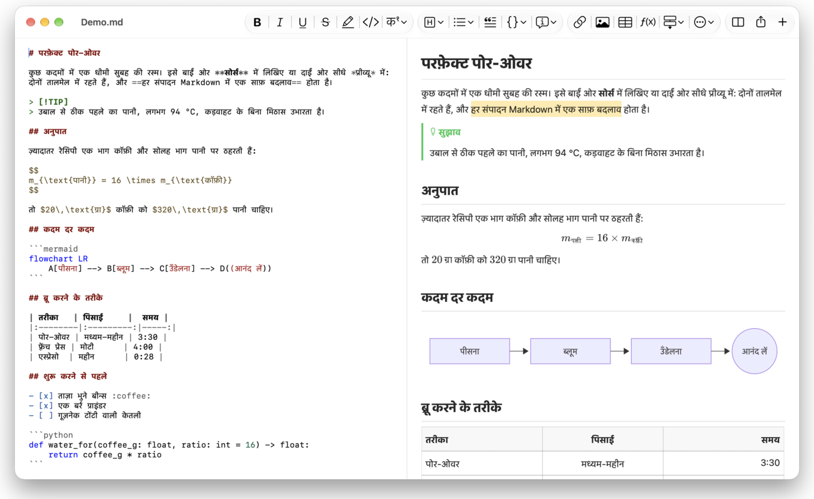
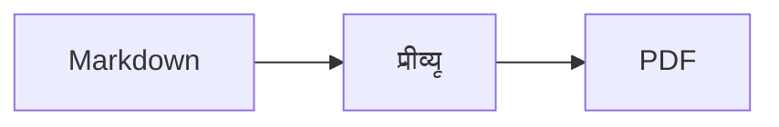

<p>&nbsp;&nbsp;&nbsp;</p>

# Splat

**macOS के लिए Markdown एडिटर, जिसमें आप सोर्स में या सीधे प्रीव्यू में लिख सकते हैं।**

Splat बाईं ओर सिंटैक्स के रंगों वाला आपका Markdown सोर्स रखता है और दाईं ओर लाइव, पूरी तरह संपादन-योग्य प्रीव्यू। किसी में भी टाइप कीजिए: प्रीव्यू में आप जो भी लिखते हैं, वह सोर्स में एक न्यूनतम बदलाव बन जाता है, इसलिए जिन पंक्तियों को आपने छुआ नहीं, वे बाइट-दर-बाइट वैसी ही रहती हैं और आपके Git diff साफ़ रहते हैं। Splat वही Markdown पढ़ता है जिसका आप पहले से इस्तेमाल करते हैं: CommonMark और GitHub Flavored Markdown, GitHub अलर्ट, Obsidian के विकी लिंक, एम्बेड और कॉलआउट, Pandoc और Typora के एक्सटेंशन, एम्बेडेड HTML, LaTeX सूत्र, और Mermaid, Graphviz तथा PlantUML डायग्राम, सब ऑफ़लाइन रेंडर होते हैं। नोट्स के पूरे फ़ोल्डर को ब्राउज़ कीजिए और उसमें खोजिए, देखिए कि पिछले Git Commit के बाद क्या बदला, Word या वेब पेज से Markdown के रूप में पेस्ट कीजिए, और एक क्लिक में PDF, HTML या Word में एक्सपोर्ट कीजिए। यह Rust में, असली AppKit कंट्रोल पर लिखा गया है, 35 भाषाएँ बोलता है, और इसमें कोई टेलीमेट्री नहीं है।
 


[](https://github.com/sventmueller/splat/releases/latest/download/Splat.dmg)

**[Splat.dmg डाउनलोड करें](https://github.com/sventmueller/splat/releases/latest/download/Splat.dmg)**: Apple द्वारा साइन और नोटराइज़ किया हुआ, Apple Silicon और Intel पर macOS 14 या उसके बाद के लिए।

**कोई बग मिला?** Splat उन पंक्तियों को, जिन्हें आपने छुआ नहीं, बाइट-दर-बाइट वैसा ही रखता है। अगर फिर भी कोई पंक्ति बदल जाए या कोई फ़ाइल ग़लत दिखे, तो [एक issue खोलिए](https://github.com/sventmueller/splat/issues/new/choose) और फ़ाइल संलग्न कीजिए। अगर Splat आपके काम का है, तो [GitHub पर एक स्टार](https://github.com/sventmueller/splat) दूसरों को इसे ढूँढने में मदद करता है।
 
 

[](https://www.rust-lang.org)
[](https://www.apple.com/macos/)

[](https://github.com/madsmtm/objc2)
[](https://webkit.org)
[](https://github.com/kivikakk/comrak)
[](https://github.github.com/gfm/)
[](https://www.mathjax.org)
[](https://cortexjs.io/mathlive/)
[](https://mermaid.js.org)
[](https://graphviz.org)
[](https://plantuml.com)


[](#लाइसेंस)

[Bahasa Indonesia](../id/README.md) ·
[Bahasa Melayu](../ms/README.md) ·
[Català](../ca/README.md) ·
[Čeština](../cs/README.md) ·
[Dansk](../da/README.md) ·
[Deutsch](../de/README.md) ·
[English](../../../README.md) ·
[Español](../es/README.md) ·
[Français](../fr/README.md) ·
[Hrvatski](../hr/README.md) ·
[Italiano](../it/README.md) ·
[Magyar](../hu/README.md) ·
[Nederlands](../nl/README.md) ·
[Norsk](../no/README.md) ·
[Polski](../pl/README.md) ·
[Português (Brasil)](../pt_BR/README.md) ·
[Português (Portugal)](../pt_PT/README.md) ·
[Română](../ro/README.md) ·
[Slovenčina](../sk/README.md) ·
[Slovenščina](../sl/README.md) ·
[Suomi](../fi/README.md) ·
[Svenska](../sv/README.md) ·
[Tiếng Việt](../vi/README.md) ·
[Türkçe](../tr/README.md) ·
[Ελληνικά](../el/README.md) ·
[Русский](../ru/README.md) ·
[Українська](../uk/README.md) ·
[עברית](../he/README.md)‎ ·
[العربية](../ar/README.md)‎ ·
**हिन्दी** ·
[ไทย](../th/README.md) ·
[한국어](../ko/README.md) ·
[日本語](../ja/README.md) ·
[简体中文](../zh-Hans/README.md) ·
[繁體中文](../zh-Hant/README.md)

## विषय-सूची

- [एक नज़र में खूबियाँ](#एक-नज़र-में-खूबियाँ)
- [आवश्यकताएँ](#आवश्यकताएँ)
- [इंस्टॉलेशन](#इंस्टॉलेशन)
- [शुरुआत करना](#शुरुआत-करना)
- [लिखना](#लिखना)
  - [सोर्स में](#सोर्स-में)
  - [प्रीव्यू में](#प्रीव्यू-में)
  - [फ़ॉर्मैटिंग कमांड](#फ़ॉर्मैटिंग-कमांड)
  - [सूचियाँ और कार्य](#सूचियाँ-और-कार्य)
  - [टेबल](#टेबल)
  - [फ़ॉर्मैट किया गया टेक्स्ट पेस्ट करना](#फ़ॉर्मैट-किया-गया-टेक्स्ट-पेस्ट-करना)
  - [मेटाडेटा](#मेटाडेटा)
- [समर्थित Markdown](#समर्थित-markdown)
  - [CommonMark और GitHub Flavored Markdown](#commonmark-और-github-flavored-markdown)
  - [कॉलआउट](#कॉलआउट)
  - [विस्तारित सिंटैक्स](#विस्तारित-सिंटैक्स)
  - [Obsidian](#obsidian)
  - [उद्धरण और संदर्भ](#उद्धरण-और-संदर्भ)
  - [एम्बेडेड HTML](#एम्बेडेड-html)
  - [टाइपोग्राफ़िक विराम चिह्न](#टाइपोग्राफ़िक-विराम-चिह्न)
  - [सिंटैक्स का सार](#सिंटैक्स-का-सार)
- [सूत्र](#सूत्र)
- [डायग्राम](#डायग्राम)
- [इमेज](#इमेज)
- [लिंक और नेविगेशन](#लिंक-और-नेविगेशन)
- [फ़ोल्डर में नोट](#फ़ोल्डर-में-नोट)
- [पिछले Commit के बाद के बदलाव](#पिछले-commit-के-बाद-के-बदलाव)
- [एक्सपोर्ट, प्रिंट और शेयर करना](#एक्सपोर्ट-प्रिंट-और-शेयर-करना)
- [Word दस्तावेज़ इंपोर्ट करना](#word-दस्तावेज़-इंपोर्ट-करना)
- [रूप और एक्सेसिबिलिटी](#रूप-और-एक्सेसिबिलिटी)
- [भाषाएँ](#भाषाएँ)
- [कीबोर्ड शॉर्टकट](#कीबोर्ड-शॉर्टकट)
- [गोपनीयता और सुरक्षा](#गोपनीयता-और-सुरक्षा)
- [बड़े दस्तावेज़](#बड़े-दस्तावेज़)
- [ज्ञात सीमाएँ](#ज्ञात-सीमाएँ)
- [समस्या निवारण](#समस्या-निवारण)
- [डेवलपर्स के लिए](#डेवलपर्स-के-लिए)
  - [तृतीय-पक्ष घटक](#तृतीय-पक्ष-घटक)
- [लाइसेंस](#लाइसेंस)

## एक नज़र में खूबियाँ

- **लिखने के दो तरीके, एक ही टेक्स्ट।** सोर्स और प्रीव्यू दोनों संपादन-योग्य हैं। सच्चाई सिर्फ़ Markdown फ़ाइल है: हर दस्तावेज़ का एक ही undo इतिहास है, और प्रीव्यू का हर बदलाव सोर्स में सबसे छोटे बदलाव में अनुवादित होता है।
- **वही Markdown जो आप पहले से इस्तेमाल करते हैं।** CommonMark, GitHub Flavored Markdown, GitHub अलर्ट, Obsidian, Pandoc और Typora के एक्सटेंशन, इमोजी शॉर्टकोड, स्पॉइलर, परिभाषा सूचियाँ, हेडिंग एंकर और GitHub README जैसा HTML।
- **सूत्र और डायग्राम अंदर ही मौजूद।** MathJax से LaTeX सूत्र, साथ में विज़ुअल सूत्र एडिटर। Mermaid, Graphviz और PlantUML में डायग्राम, जो आपके Mac पर ही रेंडर होते हैं: Java, सर्वर या नेटवर्क कनेक्शन की ज़रूरत नहीं।
- **हर चीज़ के लिए एक बटन।** Markdown के हर निर्माण के लिए टूलबार बटन और मेनू आइटम है, आम निर्माणों के लिए कीबोर्ड शॉर्टकट भी। पंक्तियों, कॉलम और अलाइनमेंट के लिए टेबल का अपना मेनू है।
- **सिर्फ़ फ़ाइल नहीं, पूरा फ़ोल्डर।** साइडबार दस्तावेज़ के आसपास के नोट की सूची दिखाता है और उन सब में खोजता है। किसी नोट का नाम बदलने पर उसके लिंक भी बदल जाते हैं, और उनके आसपास का हर बाइट वैसा ही रहता है।
- **बदलाव एक नज़र में।** Git रिपॉज़िटरी में टेक्स्ट के बगल की पट्टियाँ दोनों पैन में दिखाती हैं कि पिछले Commit से क्या अलग है।
- **Word और वेब से Markdown में।** फ़ॉर्मैट किए गए टेक्स्ट को Markdown के रूप में और स्प्रेडशीट के सेल को टेबल के रूप में पेस्ट कीजिए, और पूरे Word दस्तावेज़ उनकी इमेज समेत इंपोर्ट कीजिए।
- **बिना कुछ खोए एक्सपोर्ट।** PDF, एक अकेली स्व-निहित HTML फ़ाइल, या असली हेडिंग, सूचियों, टेबल, फ़ुटनोट और इमेज वाला Word दस्तावेज़। पृष्ठ संख्या, हेडर और शीर्षक पृष्ठ जोड़िए, या अपनी कंपनी का Word टेम्पलेट इस्तेमाल कीजिए।
- **पूरी तरह नेटिव।** असली AppKit विंडो, टैब, मेनू, पॉपओवर, संस्करण, Auto Save, शेयर मेनू, डार्क मोड, वर्तनी जाँच, डिक्टेशन और VoiceOver। Electron नहीं, और टेक्स्ट के लिए वेब व्यू भी नहीं।
- **बड़ी फ़ाइलों के साथ भी तेज़।** 10 MB के दस्तावेज़ में एक कीस्ट्रोक को रेंडर करने में लगभग 10 ms लगते हैं, व्यू के अपने काम से पहले।
- **निजी और सावधान।** Splat App Sandbox में चलता है, दूसरे ऐप के लिंक पहले पूछते हैं, और अविश्वसनीय इमेज डेटा को डिकोड करने वाली हर चीज़ सैंडबॉक्स वाली अपनी अलग सर्विस में चलती है।
- **आपकी भाषा में।** इंटरफ़ेस और अंतर्निहित Markdown त्वरित संदर्भ 35 भाषाओं में मिलते हैं: अरबी, कैटलन, चीनी (सरलीकृत), चीनी (पारंपरिक), क्रोएशियाई, चेक, डेनिश, डच, अंग्रेज़ी, फ़िनिश, फ़्रेंच, जर्मन, ग्रीक, हिब्रू, हिन्दी, हंगेरियन, इंडोनेशियाई, इतालवी, जापानी, कोरियाई, मलय, नॉर्वेजियन, पोलिश, पुर्तगाली (ब्राज़ील), पुर्तगाली (पुर्तगाल), रोमानियाई, रूसी, स्लोवाक, स्लोवेनियाई, स्पैनिश, स्वीडिश, थाई, तुर्की, यूक्रेनी और वियतनामी।

## आवश्यकताएँ

- macOS 14 Sonoma या उसके बाद। Splat का विकास और परीक्षण macOS 27 पर होता है, जहाँ यह Liquid Glass डिज़ाइन अपने आप अपना लेता है।
- Apple Silicon या Intel प्रोसेसर वाला Mac।
- लगभग 45 MB डिस्क स्थान।

## इंस्टॉलेशन

**डिस्क इमेज से।** [`Splat.dmg`](https://github.com/sventmueller/splat/releases/latest/download/Splat.dmg) डाउनलोड कीजिए, उसे खोलिए और Splat को ऐप्लिकेशन फ़ोल्डर पर खींच दीजिए। इमेज Developer ID से साइन की गई है और Apple द्वारा नोटराइज़ की गई है, इसलिए यह बिना चेतावनी के खुलती है।

**Homebrew से।** cask का अपना अलग tap है:

```sh
brew install --cask sventmueller/tap/splat
```

`brew upgrade --cask splat` नए संस्करण इंस्टॉल करता है, और `brew uninstall --zap --cask splat` Splat की सेटिंग और कैश भी हटा देता है।

**अपडेट।** डिस्क इमेज या Homebrew से इंस्टॉल किया गया Splat [Sparkle](https://sparkle-project.org) के ज़रिए खुद को अप टू डेट रखता है। दूसरी बार खुलने पर वह पूछता है कि क्या वह दिन में एक बार अपने आप अपडेट ढूँढ सकता है। **Splat › अपडेट जाँचें…** तुरंत जाँचता है; उसी मेनू में **अपडेट अपने आप जाँचें** और **अपडेट अपने आप डाउनलोड और इंस्टॉल करें** से आप बाद में अपना चुनाव बदल सकते हैं। Splat कोई अपडेट तभी इंस्टॉल करता है, जब उस पर डेवलपर के हस्ताक्षर हों। आपके अपने बनाए बिल्ड में अपडेटर नहीं होता।

**सोर्स से।** पूर्वापेक्षाओं के लिए [बिल्ड करना](../../../docs/development.md#building) देखिए, फिर:

```sh
make build
ditto target/release/Splat.app /Applications/Splat.app
open /Applications/Splat.app
```

Markdown फ़ाइलों को डबल-क्लिक से Splat में खोलने के लिए Finder में कोई भी `.md` फ़ाइल चुनिए, **फ़ाइल › जानकारी प्राप्त करें** चुनिए, **इसमें खोलें** में Splat चुनिए और **सभी बदलें…** पर क्लिक कीजिए। Splat खुद को `.md`, `.markdown`, `.mdown` और `.mkd` फ़ाइलों के लिए रजिस्टर करता है।

## शुरुआत करना

### विंडो

हर दस्तावेज़ अपनी विंडो में खुलता है, या टैब पसंद हों तो टैब के रूप में:

- **बाएँ: सोर्स।** SF Mono में आपका Markdown, सिंटैक्स के रंगों के साथ।
- **दाएँ: प्रीव्यू।** रेंडर किया हुआ दस्तावेज़, संपादन के लिए तैयार।
- **साइडबार (वैकल्पिक)।** सभी हेडिंग एक पेड़ के रूप में, किसी पर क्लिक करने से वह दोनों पैन में दिखता है: **दृश्य › आउटलाइन दिखाएँ** (⌃⌘S)। दो और टैब में [फ़ोल्डर के नोट](#फ़ोल्डर-में-नोट) और उनमें खोज होती है। विंडो के शीर्षक के पास का बटन इसे दिखाता और छिपाता है, और नई विंडो इसे वैसे ही खोलती हैं जैसे पिछली विंडो ने इसे छोड़ा था।
- **टूलबार।** बटन इस आधार पर समूहित हैं कि वे क्या बदलते हैं: वर्ण, अनुच्छेद और डाले गए एलिमेंट, फिर प्रीव्यू चालू/बंद, शेयर और नया दस्तावेज़। इसे **दृश्य › टूलबार कस्टमाइज़ करें…** से अपने अनुसार ढालिए।

डिवाइडर को खींचकर किसी भी तरफ़ ज़्यादा जगह दीजिए। **दृश्य › प्रीव्यू छिपाएँ** (⌥⌘P) सिर्फ़ सोर्स छोड़ देता है; Splat यह हर विंडो के लिए याद रखता है। दोनों पैन साथ-साथ स्क्रॉल होते हैं, और एक पैन में चुना हुआ हिस्सा दूसरे में हाइलाइट होता है।

विंडो के कोने में टेक्स्ट के शब्दों और वर्णों की संख्या और उसे पढ़ने में लगने वाला समय दिखता है, और जब तक चयन हो, उसके भी। लिंक के पते, HTML टैग, मेटाडेटा, टिप्पणियाँ, सूत्र और डायग्राम नहीं गिने जाते। यह शुरू में छिपा रहता है; **दृश्य › शब्द गणना दिखाएँ** इसे दिखाता है।

### दस्तावेज़, टैब और संस्करण

Splat एक आम macOS दस्तावेज़ ऐप है:

- **Auto Save और संस्करण।** बदलाव उसी जगह सहेजे जाते हैं। **फ़ाइल › इस पर रिवर्ट करें › सभी संस्करण ब्राउज़ करें…** आपको समय में पीछे ले जाता है।
- **दूसरे प्रोग्राम के बदलाव।** जब Git, कोई स्क्रिप्ट या कोई दूसरा एडिटर किसी खुले दस्तावेज़ को बदलता है, तो Splat उसे दोबारा लोड करता है और कर्सर व स्क्रॉल की स्थिति बनाए रखता है। अगर आपके अपने बिना सहेजे बदलाव हैं, तो Splat उन्हें रखता है, और दूसरे संस्करण के ऊपर सहेजने से पहले macOS पूछता है।
- **फ़ाइल के आम कमांड।** नक़ल बनाएँ (⇧⌘S), नाम बदलें…, इसमें मूव करें…, और **फ़ाइल › हालिया खोलें**।
- **टैब।** **फ़ाइल › नया टैब** या टूलबार का **+** बटन नए दस्तावेज़ को टैब में खोलता है; मानक विंडो मेनू टैब को मिलाता है, मूव करता है और बारी-बारी से दिखाता है।
- **विंडो की जगह।** आपकी आख़िरी विंडो का आकार और स्थान याद रखा जाता है, रीस्टार्ट के बाद भी। अगर वहाँ पहले से कोई विंडो है, तो नई विंडो थोड़ा हटकर खुलती है।
- **Dock आइकन।** आख़िरी विंडो बंद करने के बाद उस पर क्लिक करने से नया दस्तावेज़ खुलता है।
- **Markdown फ़ाइलें Splat में खोलें।** **Splat › Markdown के लिए डिफ़ॉल्ट ऐप के रूप में सेट करें** `.md` या `.markdown` फ़ाइल पर डबल-क्लिक करने से Splat खुलने लगता है; macOS पुष्टि के लिए एक बार पूछता है। जब तक Splat डिफ़ॉल्ट है, यह आइटम चेकमार्क दिखाता है।

फ़ाइलें UTF-8 टेक्स्ट होनी चाहिए, या बाइट ऑर्डर मार्क वाली UTF-16। Splat अंदाज़ा लगाकर टेक्स्ट बिगाड़ने के बजाय दूसरी एन्कोडिंग को मना कर देता है। बाइट ऑर्डर मार्क बना रहता है, UTF-16 UTF-16 ही रहता है, और जिस फ़ाइल की सभी पंक्तियाँ CRLF पर ख़त्म होती हैं, उसमें आपकी जोड़ी हुई पंक्तियों को भी CRLF मिलता है।

**क्रैश के बाद** टाइपिंग के ज़्यादा से ज़्यादा आख़िरी कुछ सेकंड ही खोते हैं: हर पाँच सेकंड में Splat बिना सहेजा टेक्स्ट `~/Library/Application Support/Splat/Unsaved` में कॉपी करता है, और दस्तावेज़ सहेजे जाने या Splat के सामान्य रूप से बंद होने पर ये कॉपियाँ हटा देता है। अगली शुरुआत में क्रैश के बाद वहाँ बचा हुआ सब कुछ `~/Library/Application Support/Splat/Recovery` में चला जाता है और एक बार इसकी सूचना मिलती है, साथ में एक बटन जो फ़ोल्डर खोलता है। जिस क्रैश पर Splat अब भी प्रतिक्रिया दे सकता है, वह हर खुले दस्तावेज़ का टेक्स्ट भी वहीं लिख देता है।

### त्वरित संदर्भ

**सहायता › Markdown त्वरित संदर्भ** आपकी भाषा में एक चीट शीट को नए, बिना शीर्षक वाले दस्तावेज़ के रूप में खोलता है। यह एक सामान्य दस्तावेज़ है, इसलिए सब कुछ वहीं आज़माइए, सोर्स में या प्रीव्यू में।

## लिखना

### सोर्स में

सोर्स Markdown के लिए ढाला गया प्लेन-टेक्स्ट एडिटर है:

- **सिंटैक्स के रंग** VS Code की तरह: हेडिंग, ज़ोर, लिंक, कोड, टेबल, HTML, front matter, और सूत्रों व डायग्राम के अंदर LaTeX और Mermaid। हल्के, गहरे और बढ़े हुए कंट्रास्ट के लिए अलग पैलेट हैं।
- **फ़ेंस्ड कोड ब्लॉक** Bash, C, C++, C#, CSS (SCSS और Less भी), Go, HTML, XML, Java, JavaScript, JSON, Kotlin, PHP, Python, Ruby, Rust, SQL, Swift, TypeScript, YAML, TeX और Mermaid के लिए हाइलाइट होते हैं, उनके `js`, `py` या `sh` जैसे आम छोटे नामों समेत।
- **कोई चौंकाने वाला प्रतिस्थापन नहीं।** स्मार्ट कोट, स्मार्ट डैश और टेक्स्ट रिप्लेसमेंट डिफ़ॉल्ट रूप से बंद हैं, क्योंकि वे `--`, `---` और `"` को बिगाड़ देते हैं। इन्हें **संपादन › सब्स्टिट्यूशन** में चालू कीजिए।
- **सिस्टम के लेखन टूल।** वर्तनी और व्याकरण की जाँच, डिक्टेशन, ढूँढें और बदलें (⌥⌘F), और बोली।
- **ड्रैग और ड्रॉप।** इमेज फ़ाइल छोड़ने पर `` डलता है, कोई दूसरी फ़ाइल छोड़ने पर उसका लिंक, और URL छोड़ने पर `[url](url)`। हर ड्रॉप एक undo चरण है।
- **इमेज पेस्ट करना।** क्लिपबोर्ड पर मौजूद तस्वीर, जैसे स्क्रीनशॉट, दस्तावेज़ के पास PNG फ़ाइल (`इमेज 2026-10-29 13.09.07.png`) के रूप में सहेजी जाती है और इमेज के रूप में डाल दी जाती है। इसके लिए दस्तावेज़ को एक बार सहेजना ज़रूरी है।

### प्रीव्यू में

प्रीव्यू एक वर्ड प्रोसेसर की तरह चलता है, लेकिन उसमें आप जो भी करते हैं, वह Markdown बनकर सोर्स में पहुँचता है:

- **टाइपिंग।** Markdown में अर्थ रखने वाले वर्ण, जैसे `*` या `#`, एस्केप कर दिए जाते हैं ताकि वे वैसे ही दिखें जैसे टाइप किए गए।
- **रिटर्न** नया अनुच्छेद या सूची आइटम शुरू करता है। **⌥Return** या **⌃Return** पंक्ति विराम डालता है।
- **कर्सर पर फ़ॉर्मैटिंग।** कर्सर शब्द के अंत में हो, तो बोल्ड, इटैलिक और बाकी वर्ण फ़ॉर्मैट उस पर लागू होते हैं जो आप आगे टाइप करते हैं। रोकने के लिए वही फ़ॉर्मैट दोबारा चुनिए। शब्द के अंदर होने पर पूरा शब्द फ़ॉर्मैट होता है।
- **ख़ाली पंक्तियाँ।** ख़ाली पंक्ति पर रिटर्न एक और ख़ाली पंक्ति जोड़ता है, और बैकस्पेस उसे हटा देता है। सोर्स में हर अतिरिक्त ख़ाली पंक्ति दो और रिक्त पंक्तियाँ होती है; दूसरे Markdown प्रोग्राम उन्हें सामान्य अनुच्छेद अंतराल की तरह दिखाते हैं।
- **पहले जैसा करें** दोनों पैन में काम करता है। इसके आइटम के नाम होते हैं (“पहले जैसा करें बोल्ड”), टाइपिंग का हर सिलसिला एक चरण होता है, और पहले जैसा करें व फिर करें के बाद दोनों पैन बदलाव तक स्क्रॉल हो जाते हैं।
- **सूत्र और डायग्राम** तैयार ग्राफ़िक के रूप में दिखते हैं। किसी पर क्लिक कीजिए, कर्सर उस पर ले जाइए या उस पर रिटर्न दबाइए, तो उसका एडिटर खुल जाता है ([सूत्र](#सूत्र) और [डायग्राम](#डायग्राम) देखिए)।
- **एम्बेडेड HTML, एम्बेडेड नोट और front matter** दिखाए जाते हैं, लेकिन उन्हें आप सोर्स में संपादित करते हैं। उन पर क्लिक करने से कर्सर वहाँ के संबंधित स्थान पर पहुँच जाता है।

जो कुछ Markdown व्यक्त नहीं कर सकता, वह प्रीव्यू में बंद है: फ़ॉन्ट और रंग पैनल, रूलर, और रिच टेक्स्ट व इमेज को पेस्ट या ड्रॉप करना। पेस्ट किए गए HTML और RTF सादे टेक्स्ट के रूप में आते हैं, जब तक कि आप [Markdown के रूप में पेस्ट करें](#फ़ॉर्मैट-किया-गया-टेक्स्ट-पेस्ट-करना) न चुनें।

### फ़ॉर्मैटिंग कमांड

हर कमांड टूलबार, मेनू बार और दोनों पैन के संदर्भ मेनू से उपलब्ध है। मेनू आइटम कर्सर की फ़ॉर्मैटिंग के लिए चेकमार्क दिखाते हैं।

| मेनू | कमांड |
|---|---|
| **फ़ॉर्मैट › फ़ॉन्ट** | बोल्ड, इटैलिक, रेखांकित करें, स्ट्राइकथ्रू, हाइलाइट, कोड, सुपरस्क्रिप्ट, सबस्क्रिप्ट |
| **फ़ॉर्मैट › हेडिंग** | बॉडी टेक्स्ट, हेडिंग 1 से 6 |
| **फ़ॉर्मैट › सूची** | बुलेट सूची, संख्या सूची, कार्य सूची |
| **फ़ॉर्मैट** | उद्धरण, कोड ब्लॉक (कोई भाषा नहीं या 20 भाषाओं में से एक; मौजूदा ब्लॉक की भाषा भी बदलता है), कॉलआउट (नोट, सुझाव, महत्वपूर्ण, चेतावनी, सावधानी; वही प्रकार दोबारा चुनने पर हट जाता है), सूत्र या डायग्राम संपादित करें…, फ़ॉर्मैटिंग हटाएँ |
| **डालें** | लिंक…, इमेज…, टेबल…, सूत्र, डायग्राम (फ़्लोचार्ट, सीक्वेंस डायग्राम, गैंट चार्ट), विषय-सूची, फ़ुटनोट, क्षैतिज रेखा |
| **टेबल** | ऊपर/नीचे पंक्ति डालें, बाईं/दाईं ओर कॉलम डालें, पंक्ति डिलीट करें, कॉलम डिलीट करें, अलाइनमेंट (बाएँ, मध्य, दाएँ, डिफ़ॉल्ट), टेबल कॉलम अलाइन करें |
| **दृश्य** | प्रीव्यू छिपाएँ/दिखाएँ, आउटलाइन दिखाएँ/छिपाएँ, टाइपोग्राफ़िक विराम चिह्न, ज़ूम इन/आउट, वास्तविक आकार, टूलबार, टैब बार, फ़ुल स्क्रीन |

रेखांकित, हाइलाइट, सुपरस्क्रिप्ट और सबस्क्रिप्ट `<ins>`, `<mark>`, `<sup>` और `<sub>` के रूप में लिखे जाते हैं, जिन्हें GitHub भी दिखाता है। Splat `<u>` भी पढ़ता है, जिसे GitHub हटा देता है, और छोटे रूप `==highlight==`, `^sup^` और `~sub~` भी। GitHub `==` और `^` को जैसा टाइप किया गया है वैसा ही दिखाता है और `~sub~` को स्ट्राइकथ्रू के रूप में।

### सूचियाँ और कार्य

- रिटर्न सूची को आगे बढ़ाता है; ख़ाली आइटम पर रिटर्न उसे ख़त्म कर देता है।
- **Tab** और **⇧Tab** प्रीव्यू में सूची आइटम को इंडेंट और आउटडेंट करते हैं।
- प्रीव्यू में कार्य के चेकबॉक्स पर क्लिक करने से `- [ ]` और `- [x]` टॉगल होते हैं।
- **फ़ॉर्मैट › सूची** चुने हुए अनुच्छेदों को सूची में बदलता है या उसका प्रकार बदलता है।

### टेबल

- **डालें › टेबल…** पंक्तियों (हेडर सहित) और कॉलम की संख्या पूछता है।
- प्रीव्यू में **Tab** अगले सेल पर, **⇧Tab** पिछले सेल पर और **रिटर्न** नीचे के सेल पर जाता है। आख़िरी सेल में Tab एक पंक्ति जोड़ता है।
- **टेबल** मेनू पंक्तियाँ और कॉलम डालता व हटाता है और कॉलम का अलाइनमेंट तय करता है (⌘{, ⌘|, ⌘})।
- **टेबल › टेबल कॉलम अलाइन करें** सोर्स में पैडिंग जोड़ता है ताकि कॉलम एक सीध में आएँ।

### फ़ॉर्मैट किया गया टेक्स्ट पेस्ट करना

**संपादन › Markdown के रूप में पेस्ट करें** (⌃⌘V), जो दोनों पैन के संदर्भ मेनू में भी है, क्लिपबोर्ड की सामग्री को चयन की जगह Markdown में बदलकर डालता है, एक undo चरण के रूप में। ⌘V पहले की तरह सादा टेक्स्ट डालता है।

- **ब्राउज़र, Word, Google Docs, Confluence, नोट्स या Pages से:** हेडिंग, बोल्ड, इटैलिक, रेखांकन, स्ट्राइकथ्रू, सुपरस्क्रिप्ट और सबस्क्रिप्ट, लिंक, अपनी नेस्टिंग समेत सूचियाँ, उद्धरण, कोड और टेबल साथ आते हैं।
- **स्प्रेडशीट से:** सेल एक टेबल बन जाते हैं, जिसमें हेडर पंक्ति होती है और संख्याओं के कॉलम दाएँ अलाइन होते हैं। टैब, सेमीकोलन या कॉमा से अलग किया गया टेक्स्ट भी टेबल बन जाता है, अगर हर पंक्ति में कॉलम की संख्या बराबर हो।
- **इमेज** जिनका वेब पता है, लिंक ही रहती हैं। पेस्ट किए गए HTML के अंदर की इमेज दस्तावेज़ के पास एक फ़ाइल बन जाती है, जिसके लिए दस्तावेज़ को एक बार सहेजना ज़रूरी है। Word की अस्थायी इमेज फ़ाइलें पीछे छूट जाती हैं, और उनका वैकल्पिक टेक्स्ट बचा रहता है।
- **लिंक** में केवल `http`, `https`, `mailto`, रिलेटिव और `#` पते बचे रहते हैं; किसी दूसरे लिंक का केवल टेक्स्ट बचता है।

### मेटाडेटा

**फ़ॉर्मैट › मेटाडेटा संपादित करें…**, या प्रीव्यू के ऊपर मेटाडेटा की पंक्ति पर क्लिक, YAML front matter के फ़ील्ड वाला एक फ़ॉर्म खोलता है। फ़ील्ड बदले, जोड़े और हटाए जा सकते हैं। सूची वाला फ़ील्ड सूची ही रहता है: उसके मान कॉमा के साथ एक के पीछे एक आते हैं, और जिस मान में कॉमा हो, वह उद्धरण चिह्नों में आता है। `tags`, `aliases`, `keywords`, `categories`, `authors` या `cssclasses` नाम का नया फ़ील्ड भी सूची बन जाता है। नेस्टेड फ़ील्ड और कई पंक्तियों वाला टेक्स्ट वहाँ देखे जा सकते हैं और सोर्स में संपादित होते हैं।

फ़ॉर्म जो बदलता है, वह एक undo चरण है और केवल उन्हीं फ़ील्ड की पंक्तियों तक पहुँचता है जिन्हें आपने बदला: बाकी सभी फ़ील्ड की टिप्पणियाँ, क्रम, अनियमित स्पेसिंग, उद्धरण चिह्न और पंक्ति के अंत बाइट-दर-बाइट वैसे ही रहते हैं। बिना मेटाडेटा वाले दस्तावेज़ की शुरुआत में एक ब्लॉक जुड़ जाता है।

## समर्थित Markdown

Splat [comrak](https://github.com/kivikakk/comrak) से पार्स करता है, जो CommonMark और GFM के अनुकूल पार्सर है, और उसके ज़्यादातर एक्सटेंशन चालू रखता है। नीचे की हर चीज़ प्रीव्यू में और सभी एक्सपोर्ट में रेंडर होती है।

### CommonMark और GitHub Flavored Markdown

- हेडिंग (`#` वाली और रेखांकित), अनुच्छेद, पंक्ति विराम, ज़ोर, गहरा ज़ोर, इनलाइन कोड, ब्लॉक उद्धरण, क्षैतिज रेखाएँ।
- बुलेट, संख्या और नेस्टेड सूचियाँ; कार्य सूचियाँ।
- लिंक (इनलाइन, रेफ़रेंस और स्वचालित), इमेज, लिंक रेफ़रेंस परिभाषाएँ।
- सिंटैक्स के रंगों वाले फ़ेंस्ड और इंडेंटेड कोड ब्लॉक।
- कॉलम अलाइनमेंट वाली टेबल।
- `~~two tildes~~` से स्ट्राइकथ्रू।
- फ़ुटनोट: `text[^1]` और दस्तावेज़ में कहीं भी `[^1]: The note.`। मार्कर पर क्लिक करने से नोट पर पहुँच जाते हैं।
- सबसे ऊपर `---` पंक्तियों के बीच YAML front matter। प्रीव्यू उसे एक पंक्ति में समेट देता है, जैसे “मेटाडेटा: title, date, tags”।

### कॉलआउट

GitHub अलर्ट आइकन और शीर्षक वाले रंगीन बॉक्स के रूप में रेंडर होते हैं:

```markdown
> [!NOTE]
> वह उपयोगी जानकारी जो उपयोगकर्ताओं को पता होनी चाहिए।

> [!WARNING]
> ज़रूरी सामग्री जिस पर तुरंत ध्यान देना आवश्यक है।
```

पाँच प्रकार हैं: नोट, सुझाव, महत्वपूर्ण, चेतावनी और सावधानी। **फ़ॉर्मैट › कॉलआउट** कर्सर वाले अनुच्छेद को इनमें से एक में बदलता है।

Obsidian के कॉलआउट भी चलते हैं, किसी भी शीर्षक और फ़ोल्ड स्थिति के साथ:

```markdown
> [!tip]- फैलाने के लिए ▸ पर क्लिक करें
> खुलने तक छिपा हुआ।

> [!question]+ डिफ़ॉल्ट रूप से खुला
> `+` फैला हुआ शुरू होता है, `-` समेटा हुआ।
```

Obsidian के बाकी प्रकार पाँचों में से सबसे नज़दीकी रंग में दिखते हैं: `success`, `check`, `done` और `hint` सुझाव के रूप में; `question`, `help` और `faq` महत्वपूर्ण के रूप में; `attention` चेतावनी के रूप में; `failure`, `fail`, `missing`, `danger`, `error` और `bug` सावधानी के रूप में; बाकी सब नोट के रूप में।

### विस्तारित सिंटैक्स

| सुविधा | सिंटैक्स | कहाँ से |
|---|---|---|
| हाइलाइट | `==marked text==` | Obsidian, Typora |
| सुपरस्क्रिप्ट | `x^2^` | Pandoc, Typora |
| सबस्क्रिप्ट | `H~2~O` | Pandoc, Typora |
| इमोजी शॉर्टकोड | `:rocket:` से 🚀 बनता है | GitHub |
| स्पॉइलर | `\|\|hidden text\|\|`, पढ़ने के लिए इसे चुनें | Discord |
| इनलाइन फ़ुटनोट | `text^[the note itself]` | Pandoc, Obsidian |
| परिभाषा सूची | `Term`, ख़ाली पंक्ति, `: Explanation` | PHP Markdown Extra, Pandoc |
| हेडिंग एंकर | `## Install {#setup}`, लिंक `[see](#setup)` से | Pandoc, kramdown |

परिभाषा सूचियाँ सोर्स में ऐसी दिखती हैं:

```markdown
शब्द

: शब्द की व्याख्या।
```

कस्टम एंकर के बिना हर हेडिंग को उसके टेक्स्ट से एक एंकर मिलता है, जैसा GitHub पर होता है: `## शुरुआत करना` को `#शुरुआत-करना` से खोला जा सकता है।

### Obsidian

- **विकी लिंक।** `[[Note]]` उसी फ़ोल्डर या उसके नीचे के किसी फ़ोल्डर की `Note.md` से लिंक करता है। `[[Note|Shown text]]` आपका अपना टेक्स्ट दिखाता है, और `[[Note#Heading]]` नोट खोलता है। ⌘-क्लिक उसे Splat में खोलता है।
- **एम्बेड।** `![[Note]]` दूसरे नोट को इस नोट के अंदर दिखाता है; उसमें एम्बेड किए गए नोट लिंक के रूप में दिखते हैं। `![[diagram.png]]` इमेज दिखाता है। Obsidian की तरह, एम्बेड दस्तावेज़ के फ़ोल्डर या उसके नीचे के नोट और इमेज का नाम लेते हैं, कभी निरपेक्ष पथ से नहीं, और केवल Markdown फ़ाइलें नोट के रूप में दिखती हैं।
- **टिप्पणियाँ।** `%%Only in the source%%` सोर्स में दिखता रहता है और प्रीव्यू तथा हर एक्सपोर्ट से बाहर रहता है, इनलाइन हो या अपनी अलग पंक्तियों पर।
- **टैग।** `#idea` या `#project/splat` हाइलाइट होते हैं। ⌘-क्लिक दस्तावेज़ में और, साइडबार में, पूरे फ़ोल्डर में उस टैग को ढूँढता है।
- **समेटे जा सकने वाले कॉलआउट।** [कॉलआउट](#कॉलआउट) देखिए।

### उद्धरण और संदर्भ

- **Pandoc उद्धरण।** `[@doe2020]` या `[@doe2020; @roe2021]` “(Doe 2020; Roe 2021)” की तरह पढ़ा जाता है। प्रविष्टियाँ उस BibTeX फ़ाइल से आती हैं जिसका नाम front matter में `bibliography: refs.bib` के रूप में दिया गया है। इसके बिना Splat दस्तावेज़ के पास `references.bib`, `literatur.bib` या `bibliography.bib` इस्तेमाल करता है।
- **GitHub और GitLab संदर्भ।** अगर दस्तावेज़ किसी ऐसे Git रिपॉज़िटरी में है जिसका `origin` रिमोट github.com या किसी GitLab होस्ट पर है, तो `@name`, `#12` (issue) और `!7` (merge request, केवल GitLab) हाइलाइट होते हैं। ⌘-क्लिक उन्हें ब्राउज़र में खोलता है।

### एम्बेडेड HTML

GitHub README में मिलने वाला HTML रेंडर होता है, ब्राउज़र इंजन से नहीं बल्कि अपने रीडर से:

- बीच में रखे अनुच्छेद और ब्लॉक (`<p align="center">`, `<div align="center">`)
- आकार वाली इमेज (``)
- लिंक, `<kbd>⌘</kbd>`, `<br>`, `<u>`, `<ins>`, `<mark>`, `<sup>`, `<sub>`
- सूचियाँ और टेबल, कॉलम पर फैले सेल समेत (`colspan`)
- समेटे जा सकने वाले सेक्शन: `<details><summary>अधिक</summary>…</details>`, जो ▸ पर क्लिक करने से खुलते हैं

HTML टैग के बीच का Markdown, Markdown के रूप में रेंडर होता है। स्क्रिप्ट, स्टाइल, फ़्रेम और फ़ॉर्म पूरी तरह छोड़ दिए जाते हैं, और लिंक व इमेज में केवल `http`, `https`, `mailto` और रिलेटिव पते बचे रहते हैं।

### टाइपोग्राफ़िक विराम चिह्न

**दृश्य › टाइपोग्राफ़िक विराम चिह्न** सीधे उद्धरण चिह्नों को आपकी इंटरफ़ेस भाषा के उद्धरण चिह्नों में, `--` को एन डैश में, `---` को एम डैश में और `...` को एलिप्सिस में दिखाता है। जर्मन में `"Ja"` „Ja“ बन जाता है, फ़्रेंच में «Oui», जापानी में 「はい」, वहाँ भी जहाँ चीनी और जापानी उद्धरण बिना स्पेस के लगाते हैं; `צה"ל` जैसे हिब्रू संक्षेपों को उनका गर्शायिम मिलता है, צה״ל। सोर्स सादे वर्ण ही रखता है; प्रीव्यू और सभी एक्सपोर्ट टाइपोग्राफ़िक वर्ण दिखाते हैं। यह सेटिंग आपके चालू करने तक बंद रहती है।

### सिंटैक्स का सार

| एलिमेंट | Markdown |
|---|---|
| **बोल्ड** | `**Bold**` |
| *इटैलिक* | `*Italic*` |
| रेखांकित | `<ins>Underline</ins>` या `<u>Underline</u>` |
| ~~स्ट्राइकथ्रू~~ | `~~Strikethrough~~` |
| हाइलाइट | `<mark>Highlight</mark>` या `==Highlight==` |
| `कोड` | `` `Code` `` |
| x² | `x<sup>2</sup>` या `x^2^` |
| H₂O | `H<sub>2</sub>O` या `H~2~O` |
| [लिंक](https://example.com) | `[Link](https://example.com)` |
| हेडिंग | `# Heading` से `###### Heading` तक |
| उद्धरण | `> Quote` |
| बुलेट सूची | `- Item` |
| संख्या सूची | `1. Item` |
| कार्य | `- [ ] Open` और `- [x] Done` |
| कोड ब्लॉक | ```` ```rust ```` … ```` ``` ```` |
| टेबल | `\| A \| B \|`, हेडर के नीचे `\|---\|---\|` के साथ |
| फ़ुटनोट | `Text[^1]` और `[^1]: Note` |
| क्षैतिज रेखा | `---` |
| इमेज | `` |
| सूत्र | `$E = mc^2$`, `$$ … $$` |
| डायग्राम | ```` ```mermaid ````, ```` ```dot ````, ```` ```plantuml ```` |
| कॉलआउट | `> [!TIP]` |
| विकी लिंक | `[[Note]]`, `[[Note\|Text]]` |
| एम्बेड | `![[Note]]`, `![[image.png]]` |
| टिप्पणी | `%%Comment%%` |
| टैग | `#tag` |
| उद्धरण-संदर्भ | `[@key]` |
| स्पॉइलर | `\|\|Spoiler\|\|` |
| इमोजी | `:tada:` |

## सूत्र

सूत्र [MathJax](https://www.mathjax.org) से, उसके TeX और AMS गणित के साथ, साफ़ वेक्टर ग्राफ़िक के रूप में रेंडर होते हैं। `\text{…}` में टेक्स्ट किसी भी लिपि में हो सकता है: MathJax के फ़ॉन्ट में जो नहीं है, वह आपके Mac के फ़ॉन्ट से आता है, अरबी और हिब्रू दाएँ से बाएँ चलती हैं, और इमोजी रंगीन दिखते हैं।

| प्रकार | सिंटैक्स |
|---|---|
| इनलाइन | `$E = mc^2$`, `` $`E = mc^2`$ `` (GitHub, GitLab), `\(E = mc^2\)` |
| डिस्प्ले | `$$` … `$$`, `\[` … `\]`, या `math` से चिह्नित कोड ब्लॉक |

**सूत्र संपादित करना।** प्रीव्यू में किसी सूत्र पर क्लिक कीजिए, डबल-क्लिक कीजिए, उस पर रिटर्न दबाइए या कर्सर उस पर ले जाइए, तो उसका एडिटर पॉपओवर में खुलता है। **डालें › सूत्र** नया सूत्र डालता है और एडिटर तुरंत खोल देता है।

- **विज़ुअल या LaTeX।** ऊपर का स्विच विज़ुअल एडिटर ([MathLive](https://cortexjs.io/mathlive/)) और LaTeX कोड के बीच बदलता है। Splat आपका चुनाव याद रखता है।
- **बिल्डिंग ब्लॉक** भिन्न, वर्गमूल, सुपरस्क्रिप्ट और सबस्क्रिप्ट, सीमाओं सहित योग और समाकल, सीमा, कॉन्टेंट के साथ बढ़ने वाले कोष्ठक, 2×2 मैट्रिक्स, ग्रीक अक्षर, और संबंध, ऑपरेटर और तीर के लिए हैं। वे □ प्लेसहोल्डर छोड़ते हैं, और **Tab** अगले पर ले जाता है।
- **लाइव प्रीव्यू।** टाइप करते समय बदलाव दस्तावेज़ में दिखते हैं। MathJax की त्रुटियाँ कोड के नीचे एक पंक्ति में दिखती हैं।
- **लागू करें या छोड़ें।** बाहर क्लिक करने पर बदलाव एक ही undo चरण के रूप में रह जाता है; **Esc** या **रद्द करें** उसे फेंक देता है। नए, ख़ाली सूत्र में Esc दबाने से वह फिर हट जाता है।
- संदर्भ मेनू पॉइंटर के नीचे वाले सूत्र के लिए **सूत्र संपादित करें…** देता है।

VoiceOver सूत्र को उसके LaTeX कोड के रूप में पढ़ता है। Splat सूत्र रेंडर करता है, पूरे LaTeX दस्तावेज़ नहीं: कोई पैकेज नहीं, कोई TikZ नहीं और कोई `\documentclass` नहीं।

## डायग्राम

डायग्राम Splat के अंदर ही, ऑफ़लाइन और हल्के व गहरे रूप में रेंडर होते हैं।

| इंजन | कोड ब्लॉक | क्या बनाता है |
|---|---|---|
| [Mermaid](https://mermaid.js.org) | ```` ```mermaid ```` | फ़्लोचार्ट, सीक्वेंस, क्लास, स्टेट, एंटिटी रिलेशनशिप, गैंट, पाई, माइंड मैप, टाइमलाइन और Mermaid के बाकी सभी प्रकार |
| [Graphviz](https://graphviz.org) | ```` ```dot ```` या ```` ```graphviz ```` | DOT भाषा में ग्राफ़ |
| [PlantUML](https://plantuml.com) | ```` ```plantuml ```` या ```` ```puml ```` | UML डायग्राम; Java के बिना चलता है |



**डायग्राम संपादित करना** सूत्र संपादित करने जैसा ही है: उस पर क्लिक करने से कोड पॉपओवर में खुलता है, सिंटैक्स के रंगों के साथ और त्रुटि संदेश कोड के नीचे एक पंक्ति में। **डालें › डायग्राम** फ़्लोचार्ट, सीक्वेंस डायग्राम या गैंट चार्ट के टेम्पलेट से शुरू करता है। बिल्डिंग ब्लॉक Mermaid के तीन सबसे आम प्रकारों में मदद करते हैं:

- **फ़्लोचार्ट:** नोड ▾ (आयत, गोल कोनों वाला आयत, वृत्त, समचतुर्भुज, डेटाबेस), कनेक्शन, लेबल सहित, दल, दिशा ▾
- **सीक्वेंस डायग्राम:** प्रतिभागी, संदेश, जवाब, नोट, लूप, वैकल्पिक रास्ते
- **गैंट चार्ट:** सेक्शन, कार्य, माइलस्टोन

बाकी डायग्राम प्रकार कोड के रूप में संपादित होते हैं। VoiceOver डायग्राम का शीर्षक या वैकल्पिक टेक्स्ट पढ़ता है।

लॉन्च के बाद पहले डायग्राम में लगभग एक सेकंड लगता है, क्योंकि रेंडरिंग इंजन बैकग्राउंड में शुरू होता है। जिस डायग्राम में 10 सेकंड से ज़्यादा लगें, वह त्रुटि दिखाता है, और अगले डायग्राम के लिए रेंडरिंग इंजन नए सिरे से शुरू होता है। PlantUML का इंजन (3 MB) केवल पहले PlantUML डायग्राम के साथ लोड होता है। वेब से PlantUML का `!include` ब्लॉक कर दिया जाता है।

## इमेज

- **स्थानीय इमेज** दस्तावेज़ के सापेक्ष पथ इस्तेमाल करती हैं: ``। Splat PNG, JPEG, GIF, WebP, BMP, SVG, HEIC, TIFF, AVIF और PDF दिखाता है।
- **वेब की इमेज** जैसे ही कोई दस्तावेज़ उन्हें दिखाता है, लोड हो जाती हैं, `https` पर और हर एक अधिकतम 10 MB की। ईमेल में इमेज की तरह, वे अपने सर्वर को बताती हैं कि दस्तावेज़ खोला गया है और कब।
- **आकार।** `` इमेज का आकार तय करता है; वरना इमेज प्रीव्यू की चौड़ाई में समा जाती हैं।
- **डिस्क पर बदलाव।** आपकी बदली हुई इमेज, या वह जो दस्तावेज़ में नाम आने के बाद दिखी, दस्तावेज़ दोबारा खोले बिना दिखती है। नेटवर्क की वजह से जो वेब इमेज विफल रहीं, उन्हें दस्तावेज़ के दिखाते रहने तक दोबारा आज़माया जाता है।
- **मेमोरी।** इमेज सबसे लंबी तरफ़ 2560 पिक्सेल तक दिखती हैं, जो A4 पृष्ठ भी भर देता है। जब वे Mac की मेमोरी का आठवाँ हिस्सा भर लेती हैं, और जब तक macOS मेमोरी दबाव बताता है, वे छोटे आकार में डिकोड होती हैं।
- **डार्क मोड।** सफ़ेद बैकग्राउंड वाली इमेज डार्क प्रीव्यू में थोड़ी मंद कर दी जाती हैं।
- **पेस्ट और ड्रॉप करना।** [सोर्स में](#सोर्स-में) देखिए।

## लिंक और नेविगेशन

प्रीव्यू में क्लिक कर्सर रखता है ताकि आप लिंक का टेक्स्ट संपादित कर सकें; **⌘-क्लिक** लिंक पर जाता है:

- `http`, `https` और `mailto` आपके ब्राउज़र या मेल ऐप में खुलते हैं।
- Markdown फ़ाइलें Splat में खुलती हैं; दूसरी फ़ाइलें और फ़ोल्डर Finder में दिखाए जाते हैं।
- `#anchor` दस्तावेज़ में उस हेडिंग पर पहुँचाता है।
- दूसरा ऐप खोलने वाले पते, जैसे `slack://` या `vscode://`, पहले पूछते हैं और पूरा पता व ऐप दिखाते हैं। **रद्द करें** पहले से चुना होता है।

**डालें › विषय-सूची** सभी हेडिंग की लिंक वाली सूची डालता है। कर्सर उसके अंदर हो, तो वही कमांड उसे अपडेट करता है। आउटलाइन साइडबार (⌃⌘S) दोनों पैन में किसी भी हेडिंग पर पहुँचाता है।

## फ़ोल्डर में नोट

साइडबार के ऊपर के बटन आउटलाइन, फ़ाइलों और खोज के बीच स्विच करते हैं।

- **फ़ाइलें** (**दृश्य › फ़ाइलें दिखाएँ**, ⌃⌘E)। दस्तावेज़ के फ़ोल्डर की सभी Markdown फ़ाइलें या, अगर वह किसी Git रिपॉज़िटरी में है, तो पूरी रिपॉज़िटरी की। क्लिक या रिटर्न नोट को इसी विंडो के टैब के रूप में खोलता है; अगर वह पहले से खुला है, तो सामने आ जाता है। फ़ोल्डर के नाम के बगल का बटन इसी विंडो में कोई दूसरा फ़ोल्डर दिखाता है। छिपी फ़ाइलें, `node_modules`, `target`, `Pods`, `DerivedData`, `__pycache__` और बिना नोट वाले फ़ोल्डर बाहर रहते हैं। सीधे आपके होम फ़ोल्डर में रखा दस्तावेज़ केवल अपने पास के नोट दिखाता है, ताकि Splat आपके सारे फ़ोल्डरों से न गुज़रे और हर एक के लिए न पूछे।
- **खोज** (**संपादन › ढूँढें › सभी नोट्स में खोजें…**, ⇧⌘F)। सभी नोट में टेक्स्ट ढूँढता है, चाहे उसके अक्षर छोटे हों या बड़े और उसके एक्सेंट किसी भी तरह एन्कोड हों। `#tag` टैग ढूँढता है, `#project` `#project/splat` को भी, और कोड के अंदर कुछ नहीं। किसी परिणाम पर क्लिक नोट को उसी जगह खोलता है।
- **किसी नोट के लिंक।** नोट का संदर्भ मेनू उन नोट की सूची दिखाता है जो उससे लिंक करते हैं, विकी लिंक, एम्बेड, रिलेटिव लिंक या रेफ़रेंस परिभाषा से।
- **नोट का नाम बदलना।** वही मेनू उसका नाम बदलता है और उन लिंक को भी। Splat पहले बताता है कि इसका मतलब कितनी फ़ाइलों में कितने लिंक हैं। हर लिंक में केवल नाम बदलता है, और फ़ाइल का हर दूसरा बाइट वैसा ही रहता है। खुले दस्तावेज़ बदलाव को एक undo चरण के रूप में लेते हैं; दूसरी फ़ाइलों में उसे केवल Git या संस्करण ही पलट सकते हैं। अगर किसी दूसरे प्रोग्राम ने इस बीच कोई फ़ाइल बदली है, तो सभी लिंक का नाम बदलना रुक जाता है, और Splat उस फ़ाइल का नाम बताता है।

विंडो के सामने आने पर सूची फ़ोल्डर के अनुसार अपडेट होती है। खोज फ़ाइलों को वैसे देखती है जैसी वे डिस्क पर हैं, और जो टेक्स्ट आपने अभी नहीं सहेजा, वह अगले Auto Save से गिना जाता है।

## पिछले Commit के बाद के बदलाव

Git रिपॉज़िटरी में रखे दस्तावेज़ में टेक्स्ट के बगल की पट्टियाँ दिखाती हैं कि पिछले Commit से क्या अलग है, सोर्स में भी और प्रीव्यू में भी: जोड़ी गई पंक्तियों के लिए हरा, बदली गई पंक्तियों के लिए नीला, और जहाँ कुछ हटाया गया वहाँ एक छोटा लाल निशान। ये टाइप करते समय और ब्रांच बदलने पर अपडेट होती रहती हैं। **दृश्य › पिछले Commit के बाद के बदलाव** इन्हें सभी विंडो के लिए बंद कर देता है।

जो पंक्तियाँ केवल पंक्ति के अंत में अलग हैं, वे नहीं गिनी जातीं, इसलिए LF वाले Commit के सामने CRLF वाली फ़ाइल कोई बदलाव नहीं दिखाती। नई फ़ाइल पर उसके पहले Commit तक कोई निशान नहीं होता, और न ही 32 MB से बड़े दस्तावेज़ पर।

## एक्सपोर्ट, प्रिंट और शेयर करना

| फ़ॉर्मैट | कैसे | आपको क्या मिलता है |
|---|---|---|
| **PDF** | **फ़ाइल › PDF के रूप में एक्सपोर्ट करें…** या शेयर मेनू | कागज़ के आकार के पृष्ठ, हमेशा हल्के रूप में, सूत्र और डायग्राम वेक्टर ग्राफ़िक के रूप में। **फ़ाइल › पृष्ठ सेटअप…** कागज़ तय करता है। |
| **प्रिंट** | **फ़ाइल › प्रिंट करें…** (⌘P) | PDF जैसा ही लेआउट। |
| **HTML** | **फ़ाइल › HTML के रूप में एक्सपोर्ट करें…** या शेयर मेनू | एक स्व-निहित फ़ाइल: स्थानीय इमेज एम्बेड की हुई, सूत्र और डायग्राम तीखी इमेज के रूप में, हेडिंग एंकर ताकि विषय-सूची काम करे। कोई स्क्रिप्ट नहीं। |
| **Word** | **फ़ाइल › Word दस्तावेज़ के रूप में एक्सपोर्ट करें…** या शेयर मेनू | Word की हेडिंग शैलियों वाली `.docx`, असली सूचियाँ और टेबल (मिलाए गए सेल समेत), Word फ़ुटनोट के रूप में फ़ुटनोट, एम्बेड की हुई इमेज, सूत्र और डायग्राम। |
| **Markdown** | टूलबार का **शेयर करें** बटन | दस्तावेज़ `.md` फ़ाइल के रूप में, मेल, संदेश, AirDrop और हर दूसरी शेयर सेवा के लिए। |

**फ़ाइल › शेयर करें** मेनू ये सब एक ही जगह देता है। एक्सपोर्ट टाइपोग्राफ़िक विराम चिह्न की सेटिंग और प्रीव्यू द्वारा लोड की गई वेब इमेज का इस्तेमाल करते हैं; HTML में वेब की इमेज लिंक ही रहती हैं।

**फ़ाइल › एक्सपोर्ट विकल्प…** तय करता है कि PDF, प्रिंटिंग और Word टेक्स्ट में क्या जोड़ते हैं, सभी दस्तावेज़ों के लिए:

- **पृष्ठ संख्या** PDF और प्रिंट के फ़ुटर में, `2 / 9` के रूप में।
- **हेडर और फ़ुटर** PDF और प्रिंट के लिए। `{title}`, `{author}`, `{date}`, `{page}` और `{pages}` अपने मानों को दर्शाते हैं, पहले तीन दस्तावेज़ के मेटाडेटा से।
- **शीर्षक पृष्ठ** PDF, प्रिंट और Word के लिए, मेटाडेटा के `title`, `subtitle`, `author` और `date` के साथ, या शीर्षक के रूप में दस्तावेज़ के नाम के साथ। इसमें न हेडर होता है न फ़ुटर।
- **Word टेम्पलेट**, एक `.docx` या `.dotx` जिसका रूप एक्सपोर्ट अपनाता है: उसकी शैलियाँ, स्थानीयकृत नामों समेत, उसकी थीम, पृष्ठ का आकार, मार्जिन, हेडर और फ़ुटर। जो टेम्पलेट पढ़ा न जा सके, वह एक्सपोर्ट रोक देता है और यह बताता है, बजाय इसके कि आपको उसके बिना दस्तावेज़ दे।

## Word दस्तावेज़ इंपोर्ट करना

**फ़ाइल › Word दस्तावेज़ इंपोर्ट करें…** एक `.docx` या `.dotx` फ़ाइल माँगता है और पूछता है कि उसका Markdown कहाँ जाए, फिर नतीजा खोलता है। इमेज उसके बगल के एक फ़ोल्डर में जाती हैं, जिसका नाम दस्तावेज़ के नाम में `-images` जोड़कर बनता है।

हेडिंग और सूचियाँ वैसे ही आती हैं जैसे Word की शैलियाँ और नंबरिंग उन्हें तय करती हैं, उन दस्तावेज़ों में भी जिनकी शैलियों के नाम स्थानीयकृत हैं। बोल्ड, इटैलिक, रेखांकन, स्ट्राइकथ्रू, हाइलाइट, सुपरस्क्रिप्ट और सबस्क्रिप्ट, लिंक, उद्धरण, कोड, फ़ुटनोट, एंडनोट और टेबल साथ आते हैं, कई कॉलम में फैले सेल HTML टेबल के रूप में। सूत्र LaTeX बन जाते हैं। ट्रैक किए गए बदलाव स्वीकृत माने जाते हैं, और विषय-सूची बाहर रहती है, क्योंकि **डालें › विषय-सूची** नई बनाता है। पुरानी `.doc` फ़ाइलें और पासवर्ड से सुरक्षित दस्तावेज़ अस्वीकार कर दिए जाते हैं।

## रूप और एक्सेसिबिलिटी

- **डार्क मोड** सिस्टम का अनुसरण करता है। सूत्र और डायग्राम हर रूप के लिए रेंडर होते हैं।
- सिस्टम सेटिंग में **कॉन्ट्रास्ट बढ़ाएँ** सिंटैक्स के रंगों को उच्च-कंट्रास्ट पैलेट पर ले जाता है।
- **ज़ूम।** ⌘+, ⌘− और ⌘0 दोनों पैन को छोटा-बड़ा करते हैं।
- **फ़ुल स्क्रीन, टैब और कस्टमाइज़ होने वाला टूलबार**, हर Mac ऐप की तरह।
- **VoiceOver।** पैन के लेबल “Markdown सोर्स” और “प्रीव्यू” हैं, सूत्र अपने कोड के रूप में और डायग्राम अपने शीर्षक के रूप में पढ़े जाते हैं। हर कमांड कीबोर्ड से पहुँच में है।

Splat में सेटिंग विंडो नहीं है: थोड़े-से विकल्प वहीं रहते हैं जहाँ वे लागू होते हैं, **दृश्य**, **संपादन › सब्स्टिट्यूशन** और **फ़ाइल › एक्सपोर्ट विकल्प…** में।

## भाषाएँ

इंटरफ़ेस, मेनू और Markdown त्वरित संदर्भ 35 भाषाओं में अनूदित हैं:

अरबी, कैटलन, चीनी (सरलीकृत), चीनी (पारंपरिक), क्रोएशियाई, चेक, डेनिश, डच, अंग्रेज़ी, फ़िनिश, फ़्रेंच, जर्मन, ग्रीक, हिब्रू, हिन्दी, हंगेरियन, इंडोनेशियाई, इतालवी, जापानी, कोरियाई, मलय, नॉर्वेजियन, पोलिश, पुर्तगाली (ब्राज़ील), पुर्तगाली (पुर्तगाल), रोमानियाई, रूसी, स्लोवाक, स्लोवेनियाई, स्पैनिश, स्वीडिश, थाई, तुर्की, यूक्रेनी और वियतनामी।

Splat **सिस्टम सेटिंग › सामान्य › भाषा और क्षेत्र** में तय भाषाओं के क्रम का पालन करता है; वहीं **ऐप्लिकेशन** के अंतर्गत आप केवल Splat के लिए अलग भाषा भी चुन सकते हैं। आपकी भाषा का अनुवाद न होने पर वह अंग्रेज़ी इस्तेमाल करता है। मेनू के शब्द Apple के अपने अनुवादों का पालन करते हैं, इसलिए Splat आपके बाकी Mac जैसा ही पढ़ा जाता है।

हिब्रू और अरबी टेक्स्ट जहाँ भी दिखे, इंटरफ़ेस की भाषा कोई भी हो, दाएँ से बाएँ पढ़ा जाता है: हर अनुच्छेद, हेडिंग और सूची आइटम अपने पहले अक्षर की दिशा लेता है, उद्धरण और कॉलआउट अपनी पट्टी दाईं ओर बनाते हैं, और जिस टेबल का टेक्स्ट दाएँ से बाएँ शुरू होता है, उसके कॉलम दाईं ओर से गिने जाते हैं। कोड ब्लॉक बाएँ से दाएँ ही रहते हैं। PDF, HTML और Word एक्सपोर्ट ये दिशाएँ बनाए रखते हैं। सिस्टम भाषा हिब्रू या अरबी होने पर macOS विंडो को भी उलट देता है, इसलिए प्रीव्यू बाईं ओर होता है।

## कीबोर्ड शॉर्टकट

| क्रिया | शॉर्टकट |
|---|---|
| बोल्ड, इटैलिक, रेखांकित करें | ⌘B, ⌘I, ⌘U |
| स्ट्राइकथ्रू | ⇧⌘X |
| कोड | ⌥⇧⌘C |
| लिंक… | ⌘K |
| बॉडी टेक्स्ट, हेडिंग 1 से 6 | ⌥⌘0, ⌥⌘1 से ⌥⌘6 |
| टेबल कॉलम को बाएँ, मध्य, दाएँ अलाइन करें | ⌘{, ⌘\|, ⌘} |
| प्रीव्यू छिपाएँ या दिखाएँ | ⌥⌘P |
| आउटलाइन दिखाएँ या छिपाएँ | ⌃⌘S |
| फ़ाइलें दिखाएँ या छिपाएँ | ⌃⌘E |
| सभी नोट्स में खोजें | ⇧⌘F |
| Markdown के रूप में पेस्ट करें | ⌃⌘V |
| ज़ूम इन, आउट, वास्तविक आकार | ⌘+, ⌘−, ⌘0 |
| नया दस्तावेज़, खोलें, सहेजें, नक़ल बनाएँ | ⌘N, ⌘O, ⌘S, ⇧⌘S |
| पृष्ठ सेटअप, प्रिंट | ⇧⌘P, ⌘P |
| ढूँढें, ढूँढें और बदलें | ⌘F, ⌥⌘F |
| अगला, पिछला ढूँढें; चयन का उपयोग करें; चयन पर जाएँ | ⌘G, ⇧⌘G; ⌘E; ⌘J |
| वर्तनी और व्याकरण दिखाएँ; दस्तावेज़ जाँचें | ⌘:, ⌘; |
| पेस्ट करें और शैली मिलाएँ | ⌥⇧⌘V |
| टूलबार छिपाएँ, सभी टैब दिखाएँ, फ़ुल स्क्रीन | ⌥⌘T, ⇧⌘\\, ⌃⌘F |
| पंक्ति विराम (प्रीव्यू) | ⌥Return या ⌃Return |
| टेबल में अगला सेल / पिछला सेल (प्रीव्यू) | Tab / ⇧Tab |
| सूची आइटम इंडेंट / आउटडेंट करें (प्रीव्यू) | Tab / ⇧Tab |
| सूत्र एडिटर में अगला प्लेसहोल्डर | Tab |
| सूत्र या डायग्राम एडिटर को बिना बदलाव बंद करें | Esc |
| लिंक, टैग या संदर्भ खोलें (प्रीव्यू) | ⌘-क्लिक |

Splat Apple के मानक शॉर्टकट को उनकी जगह रहने देता है।

## गोपनीयता और सुरक्षा

Markdown फ़ाइल किसी से भी आ सकती है, इसलिए Splat हर दस्तावेज़ को अविश्वसनीय मानता है।

- **कोई टेलीमेट्री नहीं।** आप Splat का इस्तेमाल कैसे करते हैं, इसके बारे में यह कुछ नहीं बताता। यह अपडेट तभी ढूँढता है जब आप सहमत हों या **अपडेट जाँचें…** चुनें: तब वह GitHub से एक छोटी फ़ीड फ़ाइल लोड करता है, और अनुरोध में ऐप और उसके संस्करण के सिवा कुछ नहीं होता। सूत्र और डायग्राम स्थानीय रूप से रेंडर होते हैं; जो वेब व्यू यह करते हैं, वे नेटवर्क तक नहीं पहुँच सकते। **सहायता › समस्या की रिपोर्ट करें…** आपके ब्राउज़र में GitHub पर एक फ़ॉर्म खोलता है; उसके पते में Splat का संस्करण, macOS का संस्करण और Mac का प्रकार होता है, आपके दस्तावेज़ों से कुछ नहीं।
- **वेब की इमेज** जैसे ही कोई दस्तावेज़ उन्हें दिखाता है, किसी भी होस्ट से, केवल `https` पर, हर एक अधिकतम 10 MB की, और कुकी के बिना निजी सेशन में लोड होती हैं। उनके सर्वर को पता चलता है कि दस्तावेज़ खोला गया है और कब।
- **अलग किया हुआ डिकोडिंग।** इमेज और सूत्रों व डायग्राम के ग्राफ़िक एक अलग सर्विस में डिकोड होते हैं, जिसे macOS उसके अपने सैंडबॉक्स में शुरू करता है: आपकी कोई फ़ाइल नहीं, न नेटवर्क। वह केवल पिक्सेल लौटाती है, जिनका आकार जाँचा जाता है, और जब कोई डिकोड 10 सेकंड से ज़्यादा समय या बहुत ज़्यादा मेमोरी लेता है, तो वह ख़ुद बंद हो जाती है। Apple के अपने इमेज डिकोडर केवल HEIC, TIFF, AVIF और PDF देखते हैं, और तभी जब डेटा सचमुच उसी फ़ॉर्मैट का हो। SVG, सूत्र और डायग्राम भी उसी सर्विस से गुज़रते हैं, इसलिए Splat में वे तय रेज़ोल्यूशन वाली तस्वीरें हैं: प्रति पॉइंट चार पिक्सेल, लंबी तरफ़ 2560 तक।
- **स्थानीय फ़ाइलें** दस्तावेज़ तक केवल उसी पथ से पहुँचती हैं जो वह बताता है, और केवल उस फ़ोल्डर से जिसका ऐक्सेस आपने दिया है: Splat आपका खोला हुआ दस्तावेज़ पढ़ सकता है, लेकिन उसके आसपास की तस्वीरें, नोट, ग्रंथसूची और रिपॉज़िटरी तभी, जब आप प्रीव्यू के ऊपर की पट्टी में **फ़ोल्डर का ऐक्सेस दें…** से उनके फ़ोल्डर का ऐक्सेस दें। एक बार दिया गया ऐक्सेस सभी सबफ़ोल्डर पर लागू होता है और याद रखा जाता है। एम्बेड दस्तावेज़ के फ़ोल्डर और उसके नीचे के Markdown नोट दिखाते हैं, और गुम तस्वीर केवल वहीं खोजी जाती है। कहीं और का इमेज पथ, निरपेक्ष या `~` से शुरू होने वाला, ऐक्सेस दिए गए फ़ोल्डर से प्रीव्यू में लोड होता है; HTML और Word एक्सपोर्ट, प्रिंटिंग और PDF केवल वही साथ लेते हैं जो दस्तावेज़ के फ़ोल्डर या उसकी Git रिपॉज़िटरी में है, जब तक कि उस रिपॉज़िटरी में आपका होम फ़ोल्डर भी न हो, ताकि किसी और का दस्तावेज़ आपकी फ़ाइलों को उस एक्सपोर्ट में न खींच सके जिसे आप आगे भेजते हैं।
- **नोट के फ़ोल्डर** केवल तभी पढ़े जाते हैं जब साइडबार उन्हें दिखा रहा हो, और नोट का नाम बदलना दूसरी फ़ाइलों को तभी बदलता है जब आपने उनकी संख्या की पुष्टि कर दी हो।
- **Git रिपॉज़िटरी** को Splat ख़ुद पढ़ता है। वह कभी `git` प्रोग्राम नहीं चलाता, जिसकी किसी और की रिपॉज़िटरी में रखी कॉन्फ़िगरेशन दूसरे प्रोग्राम शुरू कर सकती है, और वह खुले दस्तावेज़ के पिछले Commit के संस्करण से ज़्यादा कुछ नहीं पढ़ता। वह वहाँ कुछ नहीं लिखता और नेटवर्क पर नहीं जाता।
- **Word दस्तावेज़ और पेस्ट किया गया टेक्स्ट** Splat के अपने पार्सर पढ़ते हैं, आकार, नेस्टिंग और इस पर सीमाओं के साथ कि कोई फ़ाइल कितनी खुल सकती है। उनके लिंक में केवल वही पते बचे रहते हैं जिनकी Splat दूसरी जगह अनुमति देता है, और Word फ़ाइल में इमेज के नाम कभी तय नहीं करते कि वे कहाँ लिखी जाएँगी।
- **बिना सहेजे टेक्स्ट की कॉपियाँ** क्रैश के बाद रिकवरी के लिए इसी Mac पर, आपके Library फ़ोल्डर में रहती हैं। वे सहेजने या Splat के सामान्य रूप से बंद होने पर हट जाती हैं; क्रैश के बाद बची कॉपियाँ आपके हटाने तक रिकवरी फ़ोल्डर में रहती हैं।
- **लिंक** क्लिक से कभी कोई प्रोग्राम शुरू नहीं करते। वेब और मेल लिंक सामान्य रूप से खुलते हैं; दूसरे ऐप के लिंक पहले पूछते हैं।
- **दस्तावेज़ों में HTML** को Splat का अपना पार्सर पढ़ता है। स्क्रिप्ट, स्टाइल, फ़्रेम और फ़ॉर्म कभी नहीं चलते।
- **एक्सपोर्ट** में स्क्रिप्ट नहीं होतीं। HTML पृष्ठ GitHub की तरह हानिरहित टैग और एट्रिब्यूट की एक तय सूची ही रखते हैं, और साथ में कंटेंट सिक्योरिटी पॉलिसी। Word फ़ाइलें केवल `http`, `https` और `mailto` पते लिंक करती हैं, सिवाय उन लिंक के जो आपका चुना हुआ Word टेम्पलेट साथ लाता है।
- **कोड साइनिंग** Hardened Runtime और App Sandbox के साथ। Splat आपके खोले गए दस्तावेज़ों और जिन फ़ोल्डरों का ऐक्सेस आप देते हैं, उन्हें पढ़ और लिख सकता है, वेब इमेज और अपडेट के लिए नेटवर्क तक पहुँच सकता है, और प्रिंट कर सकता है; इसके अलावा कुछ नहीं।

## बड़े दस्तावेज़

Splat कई मेगाबाइट के दस्तावेज़ों के साथ भी प्रतिक्रियाशील रहता है:

- सोर्स TextKit 2 इस्तेमाल करता है, जो केवल दिखने वाला हिस्सा लेआउट करता है।
- प्रीव्यू में टाइप करते समय, और 2 MB तक के दस्तावेज़ों के सोर्स में, केवल प्रभावित अनुच्छेद दोबारा पार्स, रंगे और लेआउट किए जाते हैं। 10 MB के दस्तावेज़ में पार्स करने और रंगने में लगभग 3 ms, रेंडर करने में लगभग 10 ms, और उसके प्रीव्यू में पूरे एक कीस्ट्रोक में व्यू के अपने काम समेत लगभग 30 ms लगते हैं।
- बड़े प्रीव्यू पहले दिखने वाला हिस्सा रेंडर करते हैं और बाकी तब, जब ऐप खाली हो। स्क्रॉल करके दिखने में आए ब्लॉक ड्रॉ होने से पहले रेंडर किए जाते हैं।
- बड़े दस्तावेज़ों के सोर्स में, आपके टाइप करते समय प्रीव्यू के लिए पार्सिंग बैकग्राउंड में चलती है।
- दस्तावेज़ सादा टेक्स्ट रहता है जब उसे लगभग 4 GB मेमोरी चाहिए होती, यानी सामान्य Markdown के लगभग 50 से 120 MB, लेकिन केवल टेबल या शीर्षकों वाले दस्तावेज़ के सिर्फ़ 10 से 20 MB: सोर्स में रंग नहीं होते और प्रीव्यू बताता है कि वह ख़ाली क्यों है। एक्सपोर्ट फिर भी काम करते हैं।
- लगभग 200 KB से दस्तावेज़ पार्स होने से पहले अपनी विंडो खोल देता है; 5 MB पर रंग और प्रीव्यू लगभग एक चौथाई सेकंड बाद आते हैं।
- सभी इमेज मिलाकर, फ़ॉर्मूले और डायग्राम सहित, Mac की मेमोरी का अधिकतम एक चौथाई लेती हैं, और मेमोरी कम होने पर उसका आधा। इससे आगे की इमेज प्लेसहोल्डर के रूप में दिखती हैं, जब तक फिर से जगह न हो जाए।

कुछ बदलाव पूरी तरह प्रोसेस होते हैं, 10 MB पर प्रति कीस्ट्रोक लगभग 300 ms में: फ़ुटनोट की परिभाषा या संदर्भों में, इनलाइन फ़ुटनोट के पास, दस्तावेज़ के बिलकुल अंत में फ़ुटनोट के पास, front matter में या लिंक रेफ़रेंस परिभाषाओं में होने वाले बदलाव, और `%%` टिप्पणी ब्लॉक वाले, दो बार परिभाषित या उद्धरण अथवा सूची के अंदर परिभाषित फ़ुटनोट वाले, या 1000 से अधिक इनलाइन फ़ुटनोट अथवा बंद न किए गए सूत्र चिह्नों वाले दस्तावेज़ में हर बदलाव। मेमोरी फ़ाइल के साथ बढ़ती है, 1 MB के Markdown के लिए लगभग 115–160 MB और 10 MB के लिए 340–510 MB तक।

## ज्ञात सीमाएँ

- **एक टिल्ड का मतलब सबस्क्रिप्ट है।** `~text~` Pandoc की तरह सबस्क्रिप्ट है; स्ट्राइकथ्रू के लिए `~~two~~` चाहिए। GitHub एक टिल्ड से भी स्ट्राइकथ्रू करता है।
- **प्रीव्यू में केवल पढ़ने योग्य:** एम्बेडेड HTML और एम्बेडेड नोट सोर्स में संपादित होते हैं, front matter अपने फ़ॉर्म में या सोर्स में।
- **बहुत गहरी नेस्टिंग:** 64 स्तर से गहरा HTML और 16 से गहरा इनलाइन HTML अपनी सामग्री के लिए जगह छोड़ देता है।
- **मिलाए गए टेबल सेल** केवल HTML टेबल में होते हैं, और केवल कॉलम पर (`colspan`, `rowspan` नहीं)। मिलाए गए सेल के लिए MultiMarkdown का टेबल सिंटैक्स समर्थित नहीं है।
- **ग्रंथसूची** केवल BibTeX से पढ़ी जाती है, CSL JSON या YAML से नहीं।
- **संदर्भों** के लिए github.com या किसी GitLab होस्ट पर रिपॉज़िटरी चाहिए; `!7` केवल GitLab पर होता है।
- **टाइपोग्राफ़िक विराम चिह्न:** जर्मन का बंद होने वाला एकल उद्धरण चिह्न एपॉस्ट्रॉफ़ी से अलग पहचाना नहीं जा सकता और ’ के रूप में लगता है।
- **सूत्र, दस्तावेज़ नहीं:** कोई LaTeX पैकेज, TikZ या पूरे दस्तावेज़ नहीं।
- **विज़ुअल सूत्र एडिटर** MathLive के नोटेशन में LaTeX लिखता है: स्पेस ग़ायब हो जाते हैं (`E = mc^2` बनता है `E=mc^2`), रेंडरिंग वही रहती है।
- **शब्द गणना:** थाई, लाओ, खमेर और म्यांमार बिना स्पेस के लिखी जाती हैं और शब्द के हिसाब से नहीं, टेक्स्ट के हर सिलसिले के हिसाब से गिनी जाती हैं। `3.14` और `snake_case` दो-दो शब्द हैं।
- **नोट का नाम बदलना** एम्बेडेड HTML के लिंक नहीं बदलता, और अगर नए नाम में `#`, `|`, `^`, `[`, `]` या `\` हो, तो विकी लिंक जैसा है वैसा ही रहता है।
- **बदलाव के निशान** SHA-1 ऑब्जेक्ट और सादे या पैक किए हुए ref वाली रिपॉज़िटरी पढ़ते हैं; SHA-256 या reftable वाली रिपॉज़िटरी कोई निशान नहीं दिखाती। LFS जैसे Git फ़िल्टर के तहत आने वाली फ़ाइल की तुलना उससे होती है जो फ़िल्टर ने संग्रहीत किया।
- **Word इंपोर्ट** में हेडर, फ़ुटर और टिप्पणियों का टेक्स्ट पीछे छूट जाता है, और `.emz` या SVG के रूप में इमेज का केवल वैकल्पिक टेक्स्ट बचता है।
- **Markdown के रूप में पेस्ट करें** RTF को पश्चिमी टेक्स्ट के रूप में पढ़ता है, और वहाँ हेडिंग केवल फ़ॉन्ट आकार से पहचानता है। ज़्यादातर प्रोग्राम HTML भी देते हैं, और यह उसी को प्राथमिकता देता है।
- **डिज़ाइन के अनुसार:** कोई लाइन नंबर नहीं, कोई सेटिंग विंडो नहीं, कोई Help Book नहीं, App Store में नहीं।
- **Intel पर कम परखा गया।** विंडो सेल्फ़-टेस्ट केवल Apple Silicon पर चलते हैं; Intel पर CI `cargo test` चलाता है।

## समस्या निवारण

**Splat दोबारा बनाने के बाद हाल के दस्तावेज़ों की सूची ख़ाली है।** macOS हाल के दस्तावेज़ और फ़ोल्डर की अनुमतियाँ ऐप के कोड सिग्नेचर से जोड़ता है। स्थानीय बिल्ड आपकी लॉगिन कीचेन के प्रमाणपत्र “Splat Local Signing” से साइन होते हैं, इसलिए दोबारा बनाने पर दोनों बने रहते हैं। अगर प्रमाणपत्र हटा दिया गया था, तो अगला बिल्ड नया बनाता है और सूचियाँ एक बार फिर से शुरू होती हैं।

**डिस्क इमेज वाला ऐप मेरे अपने बिल्ड से अलग हाल के दस्तावेज़ दिखाता है।** दोनों के सिग्नेचर अलग हैं, इसलिए macOS हर एक के लिए अलग सूची और अलग फ़ोल्डर अनुमतियाँ रखता है।

**HTML या दूसरा सिंटैक्स सादे कोड के रूप में दिखता है।** हो सकता है दस्तावेज़ Splat की किसी पुरानी कॉपी ने खोला हो। उसे बंद कीजिए, Finder में दस्तावेज़ पर **फ़ाइल › जानकारी प्राप्त करें** चुनिए और देखिए कि **इसमें खोलें** आपके ऐप्लिकेशन फ़ोल्डर वाले Splat का नाम बताता है।

**Splat मेनू में अपडेट जाँचें… नहीं है।** केवल डिस्क इमेज या Homebrew वाला संस्करण खुद को अपडेट करता है; आपके अपने बिल्ड में अपडेटर नहीं होता।

**वेब की इमेज नहीं दिखतीं।** केवल `https` इमेज लोड होती हैं, हर एक अधिकतम 10 MB की। नेटवर्क की वजह से विफल रही इमेज को दस्तावेज़ के दिखाते रहने तक दोबारा आज़माया जाता है।

**स्क्रीनशॉट पेस्ट करने पर पहले सहेजने को कहा जाता है।** पेस्ट की गई इमेज दस्तावेज़ के पास फ़ाइल के रूप में रखी जाती हैं, जिसके लिए डिस्क पर जगह चाहिए। दस्तावेज़ सहेजिए, फिर दोबारा पेस्ट कीजिए।

**“यह फ़ाइल UTF-8 टेक्स्ट नहीं है।”** फ़ाइल दूसरी एन्कोडिंग में है और उसमें कोई बाइट ऑर्डर मार्क नहीं है जो उसका नाम बताए। पहले उसे बदल लीजिए, जैसे `iconv -f ISO-8859-1 -t UTF-8 old.md > new.md` से।

**किसी सूत्र या डायग्राम में त्रुटि दिखती है।** उस पर क्लिक कीजिए: एडिटर कोड के नीचे MathJax, Mermaid, Graphviz या PlantUML का संदेश दिखाता है।

## डेवलपर्स के लिए

बिल्ड करना, परीक्षण, कोड की संरचना और वे नियम जिनका कोड पालन करता है, [docs/development.md](../../../docs/development.md) में बताए गए हैं (अंग्रेज़ी में)।

### तृतीय-पक्ष घटक

| घटक | संस्करण | किसलिए | लाइसेंस |
|---|---|---|---|
| [comrak](https://github.com/kivikakk/comrak) | 0.59, [एक पंक्ति बदली हुई](../../../vendor/comrak/PATCH.md) | Markdown पार्सर | BSD-2-Clause |
| [objc2](https://github.com/madsmtm/objc2), objc2-foundation, block2 | 0.6 / 0.3 | Objective-C रनटाइम, Foundation, ब्लॉक | MIT |
| objc2-app-kit, objc2-web-kit, dispatch2 | 0.3 | AppKit, WebKit और Grand Central Dispatch बाइंडिंग | Zlib, Apache-2.0 या MIT |
| [krilla](https://github.com/LaurenzV/krilla), krilla-svg, [usvg](https://github.com/linebender/resvg) | 0.8 / 0.47 | सूत्र और SVG इमेज वेक्टर PDF के रूप में | MIT या Apache-2.0 |
| [image](https://github.com/image-rs/image) | 0.25 | PNG, JPEG, GIF, WebP और BMP डिकोड करना | MIT या Apache-2.0 |
| [unicode-width](https://github.com/unicode-rs/unicode-width) | 0.2 | टेबल कॉलम अलाइन करना | MIT या Apache-2.0 |
| [entities](https://github.com/p-jackson/entities) | 1 | HTML कैरेक्टर रेफ़रेंस के नाम | MIT |
| [miniz_oxide](https://github.com/Frommi/miniz_oxide) | 0.9 | Word फ़ाइलों और Git ऑब्जेक्ट को अनपैक करना | MIT, Zlib या Apache-2.0 |
| [roxmltree](https://github.com/RazrFalcon/roxmltree) | 0.21 | Word फ़ाइलों का XML पढ़ना | MIT या Apache-2.0 |
| [encoding_rs](https://github.com/hsivonen/encoding_rs) | 0.8 | पुराने कोड पेज में लिखे RTF टेक्स्ट को पढ़ना | MIT या Apache-2.0, BSD-3-Clause |
| [unicode-normalization](https://github.com/unicode-rs/unicode-normalization) | 0.1 | संयुक्त और विघटित अक्षरों के पार नाम और खोज | MIT या Apache-2.0, Unicode-3.0 |
| [emojis](https://github.com/rossmacarthur/emojis) | 0.9 | इंपोर्ट किए गए टेक्स्ट में `:shortcode:` जैसे टेक्स्ट को ज्यों का त्यों रखना | MIT या Apache-2.0, Unicode-3.0 |
| [MathJax](https://www.mathjax.org) | 4.1.3 | सूत्र रेंडर करना | Apache-2.0 |
| [MathLive](https://cortexjs.io/mathlive/) | 0.111.4 | विज़ुअल सूत्र एडिटर, KaTeX फ़ॉन्ट के साथ | MIT |
| [Mermaid](https://mermaid.js.org) | 12.3.0 | Mermaid डायग्राम | MIT |
| [Viz.js](https://github.com/mdaines/viz-js) | 3.24.0 | WebAssembly में कंपाइल किया Graphviz, जिसमें Graphviz (EPL-1.0) और Expat (MIT) शामिल हैं | MIT |
| [PlantUML](https://github.com/plantuml/plantuml) (`@plantuml/core`) | 1.2026.9 | PlantUML डायग्राम, JavaScript में कंपाइल किए हुए | MIT |
| [Sparkle](https://sparkle-project.org) | 2.10.1 | डिस्क इमेज संस्करण के अपडेट | MIT, कुछ हिस्से BSD और zlib लाइसेंस के अंतर्गत |

JavaScript लाइब्रेरी `resources/js/` में ठीक वैसी ही रखी हैं जैसी प्रकाशित हुईं; [vendor.lock](../../../vendor.lock) उनके स्रोत और SHA-256 चेकसम दर्ज करती है। उनके लाइसेंस टेक्स्ट, Viz.js के अंदर Graphviz और Expat के समेत, उनके पास `resources/js/LICENSE-*` के रूप में हैं और ऐप के अंदर भेजे जाते हैं। Sparkle रिपॉज़िटरी में नहीं रखा जाता: `cargo xtask dmg` उसकी रिलीज़ डाउनलोड करता है और xtask के चेकसम से जाँचता है, और उसका लाइसेंस ऐप के अंदर `LICENSE-sparkle` के रूप में आता है।

## लाइसेंस

Splat निम्न में से किसी एक के अंतर्गत लाइसेंस प्राप्त है

- Apache लाइसेंस, संस्करण 2.0 ([LICENSE-APACHE](../../../LICENSE-APACHE))
- MIT लाइसेंस ([LICENSE-MIT](../../../LICENSE-MIT))

आपकी पसंद के अनुसार।

जब तक आप स्पष्ट रूप से कुछ और न कहें, Apache-2.0 लाइसेंस में परिभाषित के अनुसार Splat में शामिल किए जाने के लिए आपके द्वारा जानबूझकर प्रस्तुत किया गया कोई भी योगदान ऊपर बताए अनुसार दोहरे लाइसेंस के अंतर्गत होगा, बिना किसी अतिरिक्त नियम या शर्त के।
