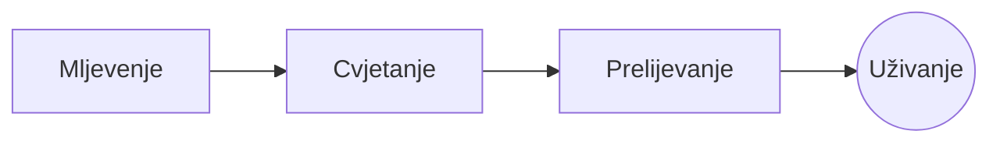

# Savršeni pour-over

Spori jutarnji ritual u nekoliko koraka. Napišite ga u **izvornom kodu** lijevo ili izravno u *pregledu* desno: oboje ostaje usklađeno, a ==svaka izmjena je čista promjena== Markdowna.

> [!TIP]
> Voda tik ispod vrelišta, oko 94 °C, ističe slatkoću bez gorčine.

## Omjer

Većina recepata svodi se na jedan dio kave na šesnaest dijelova vode:

$$
m_{\text{voda}} = 16 \times m_{\text{kava}}
$$

Dakle, $20\,\text{g}$ kave traži $320\,\text{g}$ vode.

## Korak po korak



## Metode pripreme

| Metoda          | Mljevenje    | Vrijeme |
|:----------------|:------------:|--------:|
| Pour-over       | Srednje fino |    3:30 |
| Francuska preša | Grubo        |    4:00 |
| Espresso        | Fino         |    0:28 |

## Prije početka

- [x] Svježe prženo zrnje :coffee:
- [x] Mlin za kavu sa žrvnjevima
- [ ] Kuhalo za vodu s dugim zakrivljenim izljevom

```python
def water_for(coffee_g: float, ratio: int = 16) -> float:
    return coffee_g * ratio
```

Cvjetanje
: Prvo prelijevanje vodom zbog kojeg talog ispušta plin.[^1]

[^1]: Svježe zrnje najviše cvjeta; staro se jedva podigne.
