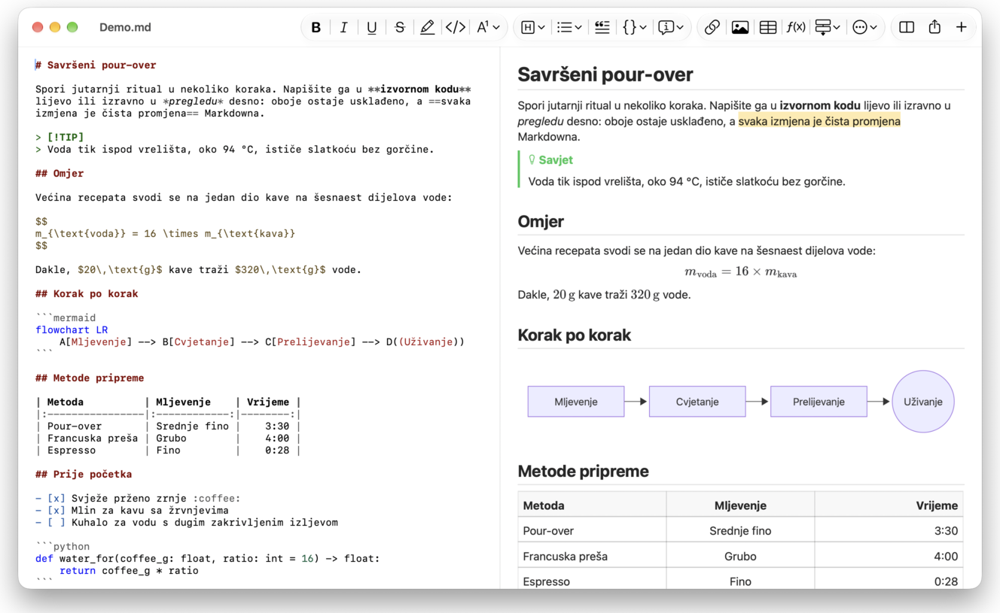
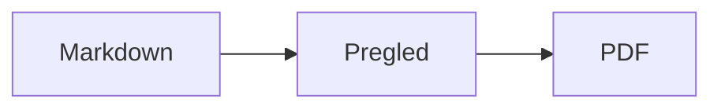

<p>&nbsp;&nbsp;&nbsp;</p>

# Splat

**Markdown uređivač za macOS u kojem pišete u izvornom kodu ili izravno u pregledu.**

Splat prikazuje vaš izvorni Markdown kod s bojanjem sintakse lijevo, a desno živi pregled koji u potpunosti možete uređivati. Tipkajte u jednom ili u drugom: sve što napišete u pregledu postaje minimalna promjena izvornog koda, pa retci koje niste dirali ostaju bajt po bajt isti, a vaši Git diffovi ostaju čisti. Splat čita Markdown koji već koristite: CommonMark i GitHub Flavored Markdown, GitHub upozorenja, Obsidianove wiki linkove, ugrađene bilješke i okvire s napomenom, Pandocova i Typorina proširenja, ugrađeni HTML, LaTeX formule te Mermaid, Graphviz i PlantUML dijagrame, sve prikazano izvan mreže. Pregledavajte i pretražujte cijelu mapu bilješki, vidite što se promijenilo od zadnjeg Git commita, lijepite iz Worda ili s web stranice kao Markdown i izvezite u PDF, HTML ili Word jednim klikom. Napisan je u Rustu na pravim AppKit kontrolama, govori 35 jezika i ništa ne šalje mrežom ako to ne zatražite.
 


[](https://github.com/sventmueller/splat/releases/latest/download/Splat.dmg)

**[Preuzmite Splat.dmg](https://github.com/sventmueller/splat/releases/latest/download/Splat.dmg)**: potpisan i ovjeren (notariziran) od Applea, za macOS 14 ili noviji na Apple Siliconu i Intelu.

**Pronašli ste grešku?** Splat retke koje niste dirali ostavlja bajt po bajt iste. Ako se neki ipak promijeni ili se datoteka prikaže pogrešno, [otvorite issue](https://github.com/sventmueller/splat/issues/new/choose) i priložite datoteku. Ako vam je Splat koristan, [zvjezdica na GitHubu](https://github.com/sventmueller/splat) pomaže drugima da ga pronađu.
 
 

[](https://www.rust-lang.org)
[](https://www.apple.com/macos/)

[](https://github.com/madsmtm/objc2)
[](https://webkit.org)
[](https://github.com/kivikakk/comrak)
[](https://github.github.com/gfm/)
[](https://www.mathjax.org)
[](https://cortexjs.io/mathlive/)
[](https://mermaid.js.org)
[](https://graphviz.org)
[](https://plantuml.com)


[](#licenca)

[Bahasa Indonesia](../id/README.md) ·
[Bahasa Melayu](../ms/README.md) ·
[Català](../ca/README.md) ·
[Čeština](../cs/README.md) ·
[Dansk](../da/README.md) ·
[Deutsch](../de/README.md) ·
[English](../../../README.md) ·
[Español](../es/README.md) ·
[Français](../fr/README.md) ·
**Hrvatski** ·
[Italiano](../it/README.md) ·
[Magyar](../hu/README.md) ·
[Nederlands](../nl/README.md) ·
[Norsk](../no/README.md) ·
[Polski](../pl/README.md) ·
[Português (Brasil)](../pt_BR/README.md) ·
[Português (Portugal)](../pt_PT/README.md) ·
[Română](../ro/README.md) ·
[Slovenčina](../sk/README.md) ·
[Slovenščina](../sl/README.md) ·
[Suomi](../fi/README.md) ·
[Svenska](../sv/README.md) ·
[Tiếng Việt](../vi/README.md) ·
[Türkçe](../tr/README.md) ·
[Ελληνικά](../el/README.md) ·
[Русский](../ru/README.md) ·
[Українська](../uk/README.md) ·
[עברית](../he/README.md)‎ ·
[العربية](../ar/README.md)‎ ·
[हिन्दी](../hi/README.md) ·
[ไทย](../th/README.md) ·
[한국어](../ko/README.md) ·
[日本語](../ja/README.md) ·
[简体中文](../zh-Hans/README.md) ·
[繁體中文](../zh-Hant/README.md)

## Sadržaj

- [Značajke ukratko](#značajke-ukratko)
- [Zahtjevi](#zahtjevi)
- [Instalacija](#instalacija)
- [Početak rada](#početak-rada)
- [Pisanje](#pisanje)
  - [U izvornom kodu](#u-izvornom-kodu)
  - [U pregledu](#u-pregledu)
  - [Naredbe za formatiranje](#naredbe-za-formatiranje)
  - [Popisi i zadaci](#popisi-i-zadaci)
  - [Tablice](#tablice)
  - [Lijepljenje formatiranog teksta](#lijepljenje-formatiranog-teksta)
  - [Metapodaci](#metapodaci)
- [Podržani Markdown](#podržani-markdown)
  - [CommonMark i GitHub Flavored Markdown](#commonmark-i-github-flavored-markdown)
  - [Okviri s napomenom](#okviri-s-napomenom)
  - [Proširena sintaksa](#proširena-sintaksa)
  - [Obsidian](#obsidian)
  - [Citati i reference](#citati-i-reference)
  - [Ugrađeni HTML](#ugrađeni-html)
  - [Tipografska interpunkcija](#tipografska-interpunkcija)
  - [Pregled sintakse](#pregled-sintakse)
- [Formule](#formule)
- [Dijagrami](#dijagrami)
- [Slike](#slike)
- [Linkovi i navigacija](#linkovi-i-navigacija)
- [Bilješke u mapi](#bilješke-u-mapi)
- [Promjene od zadnjeg commita](#promjene-od-zadnjeg-commita)
- [Izvoz, ispis i dijeljenje](#izvoz-ispis-i-dijeljenje)
- [Uvoz Word dokumenata](#uvoz-word-dokumenata)
- [Izgled i pristupačnost](#izgled-i-pristupačnost)
- [Jezici](#jezici)
- [Tipkovnički prečaci](#tipkovnički-prečaci)
- [Privatnost i sigurnost](#privatnost-i-sigurnost)
- [Veliki dokumenti](#veliki-dokumenti)
- [Poznata ograničenja](#poznata-ograničenja)
- [Rješavanje problema](#rješavanje-problema)
- [Za programere](#za-programere)
  - [Komponente trećih strana](#komponente-trećih-strana)
- [Licenca](#licenca)

## Značajke ukratko

- **Dva načina pisanja, jedan tekst.** I izvorni kod i pregled mogu se uređivati. Markdown datoteka jedina je istina: za svaki dokument postoji jedna povijest poništavanja, a svaka izmjena u pregledu pretvara se u najmanju moguću promjenu izvornog koda.
- **Markdown koji već koristite.** CommonMark, GitHub Flavored Markdown, GitHub upozorenja, Obsidian, proširenja za Pandoc i Typoru, emoji kratice, spoileri, popisi definicija, sidra naslova i HTML kao u GitHubovim README datotekama.
- **Ugrađene formule i dijagrami.** LaTeX formule putem MathJaxa, s vizualnim uređivačem formula. Dijagrami u Mermaidu, Graphvizu i PlantUML-u, prikazani na vašem Macu bez Jave, poslužitelja ili mrežne veze.
- **Gumb za sve.** Svaki Markdown element ima gumb na alatnoj traci i stavku izbornika, a uobičajeni i tipkovnički prečac. Tablice imaju vlastiti izbornik za retke, stupce i poravnavanje.
- **Mapa, a ne samo datoteka.** Bočna traka prikazuje bilješke oko dokumenta i pretražuje ih sve. Preimenovanje bilješke mijenja linkove na nju, a svaki bajt oko njih ostaje.
- **Promjene na prvi pogled.** U Git repozitoriju trake pokraj teksta označavaju ono što se razlikuje od zadnjeg commita, u oba okna.
- **Iz Worda i s weba u Markdown.** Zalijepite formatirani tekst kao Markdown, ćelije iz proračunske tablice kao tablicu i uvezite cijele Word dokumente zajedno sa slikama.
- **Izvoz bez gubitaka.** PDF, jedna samostalna HTML datoteka ili Word dokument sa stvarnim naslovima, popisima, tablicama, fusnotama i slikama. Dodajte brojeve stranica, zaglavlja i naslovnu stranicu ili upotrijebite Word predložak svoje tvrtke.
- **Izvorno do srži.** Pravi AppKit prozori, kartice, izbornici, skočni prozori, Verzije, automatsko spremanje, izbornik za dijeljenje, tamni način rada, provjera pravopisa, diktiranje i VoiceOver. Bez Electrona, bez web prikaza za sam tekst.
- **Brz s velikim datotekama.** Iscrtavanje pritiska tipke u dokumentu od 10 MB traje oko 10 ms, prije vlastitog rada prikaza.
- **Privatan i oprezan.** Slike s weba učitavaju se tek kad to dopustite, linkovi prema drugim aplikacijama najprije pitaju, a sve što dekodira nepouzdane slikovne podatke radi u pomoćnim procesima u sandboxu.
- **Na vašem jeziku.** Sučelje i ugrađeni kratki vodič za Markdown dostupni su na 35 jezika: arapskom, katalonskom, kineskom (pojednostavljenom), kineskom (tradicionalnom), hrvatskom, češkom, danskom, nizozemskom, engleskom, finskom, francuskom, njemačkom, grčkom, hebrejskom, hindskom, mađarskom, indonezijskom, talijanskom, japanskom, korejskom, malajskom, norveškom, poljskom, portugalskom (Brazil), portugalskom (Portugal), rumunjskom, ruskom, slovačkom, slovenskom, španjolskom, švedskom, tajlandskom, turskom, ukrajinskom i vijetnamskom.

## Zahtjevi

- macOS 14 Sonoma ili noviji. Splat se razvija i testira na macOSu 27, gdje automatski preuzima dizajn Liquid Glass.
- Mac s Apple Silicon ili Intelovim procesorom.
- Oko 45 MB prostora na disku.

## Instalacija

**Iz slike diska.** Preuzmite [`Splat.dmg`](https://github.com/sventmueller/splat/releases/latest/download/Splat.dmg), otvorite je i povucite Splat na mapu Aplikacije. Slika je potpisana certifikatom Developer ID i ovjerena (notarizirana) od Applea, pa se otvara bez upozorenja.

**S Homebrewom.** Cask se nalazi u vlastitom tapu:

```sh
brew install --cask sventmueller/tap/splat
```

`brew upgrade --cask splat` instalira nove verzije, a `brew uninstall --zap --cask splat` uklanja i Splatove postavke i predmemoriju.

**Ažuriranja.** Splat iz slike diska ili s Homebrewa sam se održava ažurnim putem [Sparkla](https://sparkle-project.org). Pri drugom pokretanju pita smije li jednom dnevno sam potražiti ažuriranja. **Splat › Potraži ažuriranja…** traži odmah; **Automatski traži ažuriranja** i **Automatski preuzmi i instaliraj ažuriranja** u istom izborniku kasnije mijenjaju vaš odabir. Splat instalira ažuriranje samo ako nosi potpis razvojnog programera. Vlastita izgradnja nema ažuriranje.

**Iz izvornog koda.** Preduvjete potražite u odjeljku [Izgradnja](../../../docs/development.md#building), a zatim:

```sh
make build
ditto target/release/Splat.app /Applications/Splat.app
open /Applications/Splat.app
```

Da biste Markdown datoteke otvarali u Splatu dvoklikom, u Finderu označite bilo koju `.md` datoteku, odaberite **Datoteka › Učitaj informacije**, pod **Otvori koristeći** odaberite Splat i kliknite **Promijeni sve…**. Splat se sam registrira za datoteke `.md`, `.markdown`, `.mdown` i `.mkd`.

## Početak rada

### Prozor

Svaki dokument otvara se u vlastitom prozoru ili, ako više volite kartice, kao kartica:

- **Lijevo: izvorni kod.** Vaš Markdown u fontu SF Mono s bojanjem sintakse.
- **Desno: pregled.** Prikazani dokument, spreman za uređivanje.
- **Bočna traka (neobavezno).** Svi naslovi kao stablo, klik na naslov prikazuje ga u oba okna: **Prikaz › Prikaži strukturu** (⌃⌘S). Još dvije kartice sadrže [bilješke u mapi](#bilješke-u-mapi) i njihovu pretragu. Gumb pokraj naslova prozora prikazuje je i skriva, a novi prozori otvaraju je onako kako ju je ostavio posljednji prozor.
- **Alatna traka.** Gumbi grupirani prema onome što mijenjaju: znakovi, odlomci i umetnuti elementi, zatim uključivanje i isključivanje pregleda, dijeljenje i novi dokument. Prilagodite je s **Prikaz › Podesi alatnu traku…**.

Povucite razdjelnik da jednoj strani date više prostora. **Prikaz › Sakrij pregled** (⌥⌘P) ostavlja samo izvorni kod; Splat to pamti za svaki prozor. Oba okna pomiču se zajedno, a odabir u jednom oknu istaknut je u drugom.

U kutu prozora prikazuju se riječi i znakovi teksta i vrijeme čitanja, a dok postoji odabir, i isti podaci za odabir. Adrese linkova, HTML oznake, metapodaci, komentari, formule i dijagrami ne broje se. Isprva je skriveno; **Prikaz › Prikaži broj riječi** to uključuje.

### Dokumenti, kartice i verzije

Splat je uobičajena macOS aplikacija za dokumente:

- **Automatsko spremanje i Verzije.** Promjene se spremaju na mjestu. **Datoteka › Vrati na › Pregledaj sve verzije…** vraća vas u prošlost.
- **Promjene iz drugih programa.** Kad Git, skripta ili drugi uređivač promijeni otvoreni dokument, Splat ga ponovno učita i zadrži kursor i položaj pomicanja. Ako imate vlastite nespremljene promjene, Splat ih zadržava, a macOS pita prije nego što se druga verzija prepiše.
- **Uobičajene naredbe za datoteke.** Dupliciraj (⇧⌘S), Preimenuj…, Premjesti u… i **Datoteka › Otvori nedavne stavke**.
- **Kartice.** **Datoteka › Nova kartica** ili gumb **+** na alatnoj traci otvara novi dokument kao karticu; standardni izbornik Prozor spaja, premješta i izmjenjuje kartice.
- **Položaj prozora.** Veličina i položaj vašeg posljednjeg prozora pamte se, i nakon ponovnog pokretanja. Ako na tom mjestu već stoji prozor, novi se otvara malo pomaknut.
- **Ikona u Docku.** Klik na nju nakon što ste zatvorili posljednji prozor otvara novi dokument.
- **Otvaranje Markdown datoteka u Splatu.** **Splat › Postavi kao standardnu aplikaciju za Markdown** čini da dvoklik na datoteku `.md` ili `.markdown` otvara Splat; macOS jednom traži potvrdu. Stavka ima kvačicu dok je Splat standardna aplikacija.

Datoteke moraju biti UTF-8 tekst ili UTF-16 s oznakom redoslijeda bajtova. Splat odbija druga kodiranja umjesto da pogađa i kvari tekst. Oznaka redoslijeda bajtova ostaje, UTF-16 ostaje UTF-16, a u datoteci u kojoj svi retci završavaju s CRLF, i retci koje dodate dobivaju CRLF.

**Nakon rušenja** gube se najviše posljednjih nekoliko sekundi tipkanja: Splat svakih pet sekundi kopira nespremljeni tekst u `~/Library/Application Support/Splat/Unsaved`, a kopije uklanja čim se dokument spremi ili Splat normalno završi. Pri sljedećem pokretanju sve što je rušenje ostavilo premješta se u `~/Library/Application Support/Splat/Recovery`, što se jednom i javlja, uz gumb koji otvara mapu. Rušenje na koje Splat još može reagirati ondje zapisuje i tekst svakog otvorenog dokumenta.

### Kratki vodič

**Pomoć › Kratki vodič za Markdown** otvara varalicu na vašem jeziku kao novi, neimenovani dokument. To je običan dokument, pa sve isprobajte upravo ondje, u izvornom kodu ili u pregledu.

## Pisanje

### U izvornom kodu

Izvorni kod je uređivač običnog teksta podešen za Markdown:

- **Boje sintakse** kao u VS Codeu: naslovi, isticanje, linkovi, kod, tablice, HTML, front matter te LaTeX i Mermaid unutar formula i dijagrama. Postoje palete za svijetli i tamni prikaz te za postavku Povećaj kontrast.
- **Ograđeni blokovi koda** označeni su bojama za Bash, C, C++, C#, CSS (također SCSS i Less), Go, HTML, XML, Javu, JavaScript, JSON, Kotlin, PHP, Python, Ruby, Rust, SQL, Swift, TypeScript, YAML, TeX i Mermaid, uključujući uobičajene kratice poput `js`, `py` ili `sh`.
- **Bez neočekivanih zamjena.** Pametni navodnici, pametne crtice i zamjena teksta isključeni su prema zadanim postavkama jer kvare `--`, `---` i `"`. Uključite ih pod **Uredi › Zamjene**.
- **Sistemski alati za pisanje.** Provjera pravopisa i gramatike, diktiranje, Pronađi i zamijeni (⌥⌘F) te čitanje teksta.
- **Povuci i ispusti.** Ispustite slikovnu datoteku da biste umetnuli ``, bilo koju drugu datoteku da biste umetnuli link na nju, a URL da biste umetnuli `[url](url)`. Svako ispuštanje jedan je korak poništavanja.
- **Lijepljenje slika.** Slika u međuspremniku, primjerice snimka zaslona, sprema se kao PNG datoteka pokraj dokumenta (`Slika 2026-10-29 13.09.07.png`) i umeće kao slika. Za to dokument mora biti barem jednom spremljen.

### U pregledu

Pregled se ponaša kao program za obradu teksta, ali sve što u njemu učinite završava kao Markdown:

- **Tipkanje.** Znakovi koji u Markdownu nešto znače, poput `*` ili `#`, escapeaju se tako da se pojavljuju onako kako su utipkani.
- **Return** započinje novi odlomak ili novu stavku popisa. **⌥Return** ili **⌃Return** umeće prijelom retka.
- **Formatiranje na kursoru.** Kad je kursor na kraju riječi, Podebljano, Kurziv i ostali formati znakova vrijede za ono što zatim utipkate. Odaberite format ponovno da biste ga prekinuli. Unutar riječi formatira se cijela riječ.
- **Prazni retci.** Return u praznom retku dodaje još jedan prazan redak, a Backspace ga uklanja. U izvornom kodu svaki dodatni prazan redak znači dva prazna retka više; drugi Markdown programi prikazuju ih kao uobičajeni razmak između odlomaka.
- **Poništi** radi u oba okna. Stavke poništavanja nose nazive („Poništi Podebljano”), tipkanje je jedan korak po nizu, a nakon Poništi i Ponovi oba okna prelaze na promjenu.
- **Formule i dijagrami** prikazuju se kao gotova grafika. Kliknite jednu, postavite kursor na nju ili pritisnite Return na njoj da biste otvorili njezin uređivač (vidi [Formule](#formule) i [Dijagrami](#dijagrami)).
- **Ugrađeni HTML, ugrađene bilješke i front matter** prikazuju se, ali ih uređujete u izvornom kodu. Klik na njih postavlja kursor na odgovarajuće mjesto ondje.

Sve što Markdown ne može izraziti u pregledu je blokirano: ploče Font i Boja, ravnalo te lijepljenje ili ispuštanje obogaćenog teksta i slika. Zalijepljeni HTML i RTF stižu kao običan tekst, osim ako odaberete [Zalijepi kao Markdown](#lijepljenje-formatiranog-teksta).

### Naredbe za formatiranje

Svaka je naredba dostupna na alatnoj traci, u traci izbornika i u kontekstualnom izborniku oba okna. Stavke izbornika prikazuju kvačicu za formatiranje na kursoru.

| Izbornik | Naredbe |
|---|---|
| **Formatiraj › Font** | Podebljano, Kurziv, Podcrtano, Precrtano, Istakni, Kod, Eksponent, Indeks |
| **Formatiraj › Naslov** | Osnovni tekst, Naslov 1 do 6 |
| **Formatiraj › Popis** | Popis s predznacima, Numerirani popis, Popis zadataka |
| **Formatiraj** | Citat, Blok koda (Bez jezika ili jedan od 20 jezika; mijenja i jezik postojećeg bloka), Okvir s napomenom (Bilješka, Savjet, Važno, Upozorenje, Oprez; ponovni odabir istog tipa uklanja ga), Uredi formulu ili dijagram…, Ukloni formatiranje |
| **Umetni** | Link…, Slika…, Tablica…, Formula, Dijagram (Dijagram toka, Dijagram slijeda, Ganttov dijagram), Kazalo sadržaja, Fusnota, Linija razdjelnika |
| **Tablica** | Umetni redak iznad/ispod, Umetni stupac lijevo/desno, Obriši redak, Obriši stupac, Poravnavanje (Lijevo, Centriraj, Desno, Standardno), Poravnaj stupce tablice |
| **Prikaz** | Sakrij/Prikaži pregled, Prikaži/Sakrij strukturu, Tipografska interpunkcija, Uvećaj/Umanji, Stvarna veličina, alatna traka, traka s karticama, prikaz preko cijelog zaslona |

Podcrtano, istaknuto, eksponent i indeks zapisuju se kao `<ins>`, `<mark>`, `<sup>` i `<sub>`, što prikazuje i GitHub. Splat čita i `<u>`, koji GitHub uklanja, te kraće `==isticanje==`, `^eksp^` i `~ind~`. GitHub `==` i `^` prikazuje onako kako su napisani, a `~ind~` kao precrtano.

### Popisi i zadaci

- Return nastavlja popis; Return na praznoj stavci završava ga.
- **Tab** i **⇧Tab** uvlače i izvlače stavke popisa u pregledu.
- Klik na kućicu zadatka u pregledu mijenja `- [ ]` i `- [x]`.
- **Formatiraj › Popis** pretvara označene odlomke u popis ili mu mijenja vrstu.

### Tablice

- **Umetni › Tablica…** pita za broj redaka (uključujući zaglavlje) i stupaca.
- U pregledu **Tab** prelazi u sljedeću ćeliju, **⇧Tab** u prethodnu, a **Return** u ćeliju ispod. Tab u posljednjoj ćeliji dodaje redak.
- Izbornik **Tablica** umeće i briše retke i stupce te postavlja poravnavanje stupca (⌘{, ⌘|, ⌘}).
- **Tablica › Poravnaj stupce tablice** nadopunjuje izvorni kod razmacima tako da se stupci poravnaju.

### Lijepljenje formatiranog teksta

**Uredi › Zalijepi kao Markdown** (⌃⌘V), također u kontekstualnom izborniku oba okna, pretvara sadržaj međuspremnika u Markdown na mjestu odabira, kao jedan korak poništavanja. ⌘V i dalje umeće običan tekst.

- **Iz preglednika, Worda, Google Docsa, Confluencea, Bilješki ili Pagesa:** prenose se naslovi, podebljano, kurziv, podcrtano, precrtano, eksponent i indeks, linkovi, popisi s gniježđenjem, citati, kod i tablice.
- **Iz proračunske tablice:** ćelije postaju tablica s retkom zaglavlja i stupcima brojeva poravnatima udesno. Isto vrijedi za tekst odvojen tabulatorima, točkama sa zarezom ili zarezima, ako svaki redak ima jednak broj stupaca.
- **Slike** s web adresom ostaju linkovi. Slika unutar zalijepljenog HTML-a postaje datoteka pokraj dokumenta, koji za to mora biti barem jednom spremljen. Wordove privremene slikovne datoteke ne prenose se, ali njihov alternativni tekst ostaje.
- **Linkovi** zadržavaju samo adrese `http`, `https`, `mailto`, relativne adrese i `#` adrese; od svih ostalih linkova ostaje samo tekst.

### Metapodaci

**Formatiraj › Uredi metapodatke…** ili klik na redak metapodataka na vrhu pregleda otvara obrazac s poljima YAML front mattera. Polja se mogu mijenjati, dodavati i uklanjati. Polje s popisom ostaje popis: njegove vrijednosti slijede jedna iza druge, odvojene zarezima, a vrijednost koja sadrži zarez nalazi se u navodnicima. Novo polje naziva `tags`, `aliases`, `keywords`, `categories`, `authors` ili `cssclasses` također postaje popis. Ugniježđena polja i višeredni tekst ondje se mogu vidjeti, a uređuju se u izvornom kodu.

Ono što obrazac promijeni jedan je korak poništavanja i doseže samo retke polja koja ste promijenili: komentari, redoslijed, neobični razmaci, navodnici i završeci redaka svih ostalih ostaju bajt po bajt isti. Dokument bez metapodataka dobiva blok na svom početku.

## Podržani Markdown

Splat parsira pomoću [comraka](https://github.com/kivikakk/comrak), parsera kompatibilnog s CommonMarkom i GFM-om, i uključuje većinu njegovih proširenja. Sve navedeno u nastavku prikazuje se u pregledu i u svim izvozima.

### CommonMark i GitHub Flavored Markdown

- Naslovi (`#` i podcrtani), odlomci, prijelomi retka, isticanje, jako isticanje, kod u retku, blokovi citata, linije razdjelnika.
- Popisi s predznacima, numerirani i ugniježđeni popisi; popisi zadataka.
- Linkovi (u retku, referentni i automatski), slike, definicije referenci linkova.
- Ograđeni i uvučeni blokovi koda s bojama sintakse.
- Tablice s poravnavanjem stupaca.
- Precrtano s `~~dvije tilde~~`.
- Fusnote: `tekst[^1]` s `[^1]: Bilješka.` bilo gdje u dokumentu. Klik na oznaku skače na bilješku.
- YAML front matter između redaka `---` na vrhu. Pregled ga sažima u jedan redak, primjerice „Metapodaci: title, date, tags”.

### Okviri s napomenom

GitHub upozorenja prikazuju se kao obojeni okviri s ikonom i naslovom:

```markdown
> [!NOTE]
> Korisne informacije koje korisnici trebaju znati.

> [!WARNING]
> Ključan sadržaj koji traži hitnu pažnju.
```

Pet je tipova: Bilješka, Savjet, Važno, Upozorenje i Oprez. **Formatiraj › Okvir s napomenom** pretvara odlomak na kursoru u jedan od njih.

Rade i Obsidianovi okviri, s bilo kojim naslovom i stanjem sažetosti:

```markdown
> [!tip]- Kliknite ▸ za proširenje
> Skriveno dok se ne otvori.

> [!question]+ Otvoreno prema zadanim postavkama
> `+` počinje proširen, `-` sažet.
```

Obsidianovi ostali tipovi prikazuju se u najbližoj od pet boja: `success`, `check`, `done` i `hint` kao Savjet; `question`, `help` i `faq` kao Važno; `attention` kao Upozorenje; `failure`, `fail`, `missing`, `danger`, `error` i `bug` kao Oprez; sve ostalo kao Bilješka.

### Proširena sintaksa

| Značajka | Sintaksa | Podrijetlo |
|---|---|---|
| Isticanje | `==označeni tekst==` | Obsidian, Typora |
| Eksponent | `x^2^` | Pandoc, Typora |
| Indeks | `H~2~O` | Pandoc, Typora |
| Emoji kratica | `:rocket:` postaje 🚀 | GitHub |
| Spoiler | `\|\|skriveni tekst\|\|`, označite ga da biste ga pročitali | Discord |
| Fusnota u retku | `tekst^[sama bilješka]` | Pandoc, Obsidian |
| Popis definicija | `Pojam`, prazan redak, `: Objašnjenje` | PHP Markdown Extra, Pandoc |
| Sidro naslova | `## Instalacija {#postavljanje}`, link s `[vidi](#postavljanje)` | Pandoc, kramdown |

Popisi definicija u izvornom kodu izgledaju ovako:

```markdown
Pojam

: Objašnjenje pojma.
```

Bez vlastitog sidra svaki naslov dobiva sidro izvedeno iz svog teksta, kao na GitHubu: `## Početak rada` dostupan je kao `#početak-rada`.

### Obsidian

- **Wiki linkovi.** `[[Bilješka]]` povezuje na `Bilješka.md` u istoj mapi ili u mapi ispod nje. `[[Bilješka|Prikazani tekst]]` prikazuje vaš tekst, a `[[Bilješka#Naslov]]` otvara bilješku. ⌘-klik otvara je u Splatu.
- **Ugradnje.** `![[Bilješka]]` prikazuje drugu bilješku unutar ove; bilješke ugrađene u nju prikazuju se kao linkovi. `![[dijagram.png]]` prikazuje sliku. Kao u Obsidianu, ugradnje navode bilješke i slike u mapi dokumenta ili ispod nje, nikad apsolutnom putanjom, a kao bilješke prikazuju se samo Markdown datoteke.
- **Komentari.** `%%Samo u izvornom kodu%%` ostaje vidljiv u izvornom kodu, a izostavlja se iz pregleda i svakog izvoza, u retku kao i u zasebnim recima.
- **Oznake.** `#ideja` ili `#projekt/splat` je istaknuto. ⌘-klik traži oznaku u dokumentu i, u bočnoj traci, u cijeloj mapi.
- **Okviri koji se sažimaju.** Vidi [Okviri s napomenom](#okviri-s-napomenom).

### Citati i reference

- **Pandocovi citati.** `[@doe2020]` ili `[@doe2020; @roe2021]` čita se kao „(Doe 2020; Roe 2021)”. Unosi dolaze iz BibTeX datoteke koju front matter navodi kao `bibliography: refs.bib`. Bez toga Splat koristi `references.bib`, `literatur.bib` ili `bibliography.bib` pokraj dokumenta.
- **GitHub i GitLab reference.** Ako dokument leži u Git repozitoriju čiji je udaljeni `origin` na github.com ili na GitLab hostu, `@name`, `#12` (issue) i `!7` (merge request, samo GitLab) su istaknuti. ⌘-klik otvara ih u pregledniku.

### Ugrađeni HTML

HTML kakav nalazite u GitHubovim README datotekama prikazuje se vlastitim čitačem, a ne mehanizmom preglednika:

- centrirani odlomci i blokovi (`<p align="center">`, `<div align="center">`)
- slike s veličinom (``)
- linkovi, `<kbd>⌘</kbd>`, `<br>`, `<u>`, `<ins>`, `<mark>`, `<sup>`, `<sub>`
- popisi i tablice, uključujući ćelije koje se protežu na više stupaca (`colspan`)
- odjeljci koji se sažimaju: `<details><summary>Više</summary>…</details>`, otvaraju se klikom na ▸

Markdown između HTML oznaka prikazuje se kao Markdown. Skripte, stilovi, okviri i obrasci potpuno se izostavljaju, a linkovi i slike zadržavaju samo adrese `http`, `https`, `mailto` i relativne adrese.

### Tipografska interpunkcija

**Prikaz › Tipografska interpunkcija** prikazuje ravne navodnike kao navodnike jezika vašeg sučelja, `--` kao crticu, `---` kao dugu crticu, a `...` kao tri točke. Na njemačkom `"Ja"` postaje „Ja“, na francuskom «Oui», na japanskom 「はい」, i tamo gdje kineski i japanski stavljaju navodnike bez razmaka; hebrejske kratice poput `צה"ל` dobivaju gershayim, צה״ל. Izvorni kod zadržava obične znakove; pregled i svi izvozi prikazuju tipografske. Postavka je isključena dok je ne uključite.

### Pregled sintakse

| Element | Markdown |
|---|---|
| **Podebljano** | `**Podebljano**` |
| *Kurziv* | `*Kurziv*` |
| Podcrtano | `<ins>Podcrtano</ins>` ili `<u>Podcrtano</u>` |
| ~~Precrtano~~ | `~~Precrtano~~` |
| Istaknuto | `<mark>Istaknuto</mark>` ili `==Istaknuto==` |
| `Kod` | `` `Kod` `` |
| x² | `x<sup>2</sup>` ili `x^2^` |
| H₂O | `H<sub>2</sub>O` ili `H~2~O` |
| [Link](https://example.com) | `[Link](https://example.com)` |
| Naslov | `# Naslov` do `###### Naslov` |
| Citat | `> Citat` |
| Popis s predznacima | `- Stavka` |
| Numerirani popis | `1. Stavka` |
| Zadatak | `- [ ] Otvoreno` i `- [x] Gotovo` |
| Blok koda | ```` ```rust ```` … ```` ``` ```` |
| Tablica | `\| A \| B \|` s `\|---\|---\|` ispod zaglavlja |
| Fusnota | `Tekst[^1]` i `[^1]: Bilješka` |
| Linija razdjelnika | `---` |
| Slika | `` |
| Formula | `$E = mc^2$`, `$$ … $$` |
| Dijagram | ```` ```mermaid ````, ```` ```dot ````, ```` ```plantuml ```` |
| Okvir s napomenom | `> [!TIP]` |
| Wiki link | `[[Bilješka]]`, `[[Bilješka\|Tekst]]` |
| Ugradnja | `![[Bilješka]]`, `![[slika.png]]` |
| Komentar | `%%Komentar%%` |
| Oznaka | `#oznaka` |
| Citat iz literature | `[@ključ]` |
| Spoiler | `\|\|Spoiler\|\|` |
| Emoji | `:tada:` |

## Formule

Formule prikazuje [MathJax](https://www.mathjax.org) sa svojom TeX i AMS matematikom, kao oštru vektorsku grafiku. Tekst u `\text{…}` može biti u bilo kojem pismu: ono čega nema u MathJaxovim fontovima dolazi iz fontova vašeg Maca, pri čemu arapski i hebrejski teku zdesna nalijevo, a emoji su u boji.

| Vrsta | Sintaksa |
|---|---|
| U retku | `$E = mc^2$`, `` $`E = mc^2`$ `` (GitHub, GitLab), `\(E = mc^2\)` |
| Zasebna | `$$` … `$$`, `\[` … `\]` ili blok koda označen s `math` |

**Uređivanje formule.** Kliknite formulu u pregledu, dvaput je kliknite, pritisnite Return na njoj ili postavite kursor na nju da biste otvorili njezin uređivač u skočnom prozoru. **Umetni › Formula** umeće novu i odmah otvara uređivač.

- **Vizualno ili LaTeX.** Prekidač na vrhu prebacuje između vizualnog uređivača ([MathLive](https://cortexjs.io/mathlive/)) i LaTeX koda. Splat pamti vaš odabir.
- **Gradivni blokovi** za razlomak, kvadratni korijen, eksponent i indeks, zbroj i integral s granicama, limes, zagrade koje rastu sa sadržajem, matricu 2×2, grčka slova te relacije, operatore i strelice. Ostavljaju rezervirana mjesta □, a **Tab** skače na sljedeće.
- **Pregled uživo.** Promjene se pojavljuju u dokumentu dok tipkate. Pogreške iz MathJaxa prikazuju se u retku ispod koda.
- **Potvrda ili odbacivanje.** Klik izvan uređivača zadržava promjenu kao jedan korak poništavanja; **Esc** ili **Odustani** je odbacuje. Esc na novoj, praznoj formuli ponovno je uklanja.
- Kontekstualni izbornik nudi **Uredi formulu…** za formulu pod pokazivačem.

VoiceOver čita formulu kao njezin LaTeX kod. Splat prikazuje formule, a ne potpune LaTeX dokumente: nema paketa, nema TikZa i nema `\documentclass`.

## Dijagrami

Dijagrami se prikazuju unutar Splata, izvan mreže, u svijetloj i tamnoj varijanti.

| Mehanizam | Blok koda | Što crta |
|---|---|---|
| [Mermaid](https://mermaid.js.org) | ```` ```mermaid ```` | dijagrame toka, slijeda, klasa, stanja, odnosa entiteta, Ganttove, tortne, mentalne mape, vremenske crte i svaku drugu vrstu Mermaida |
| [Graphviz](https://graphviz.org) | ```` ```dot ```` ili ```` ```graphviz ```` | grafove u jeziku DOT |
| [PlantUML](https://plantuml.com) | ```` ```plantuml ```` ili ```` ```puml ```` | UML dijagrame; radi bez Jave |



**Uređivanje dijagrama** radi kao uređivanje formule: kliknite ga da biste otvorili kod u skočnom prozoru, s bojama sintakse i porukama o pogreškama u retku ispod koda. **Umetni › Dijagram** polazi od predloška za dijagram toka, dijagram slijeda ili Ganttov dijagram. Gradivni blokovi pomažu kod tri najčešće vrste Mermaida:

- **Dijagram toka:** Čvor ▾ (pravokutnik, zaobljeno, krug, romb, baza podataka), Veza, Veza s oznakom, Grupa, Smjer ▾
- **Dijagram slijeda:** Sudionik, Poruka, Odgovor, Bilješka, Petlja, Alternativni putovi
- **Ganttov dijagram:** Odjeljak, Zadatak, Prekretnica

Druge vrste dijagrama uređuju se kao kod. VoiceOver čita naslov dijagrama ili alternativni tekst.

Prvi dijagram nakon pokretanja traje otprilike sekundu jer se mehanizam za prikaz pokreće u pozadini. Dijagram koji traje dulje od 10 sekundi prikazuje pogrešku, a mehanizam za prikaz za sljedeći se dijagram pokreće iznova. PlantUML-ov mehanizam (3 MB) učitava se tek s prvim PlantUML dijagramom. PlantUML `!include` s weba je blokiran.

## Slike

- **Lokalne slike** koriste putanje relativne prema dokumentu: ``. Splat prikazuje PNG, JPEG, GIF, WebP, BMP, SVG, HEIC, TIFF, AVIF i PDF.
- **Slike s weba** ostaju blokirane dok ih ne dopustite: traka iznad pregleda objašnjava da učitavanje njihovim poslužiteljima otkriva da i kada otvarate dokument. **Učitaj slike** dopušta ih za ovaj dokument; Splat pamti odabir za svaku datoteku.
- **Veličina.** `` postavlja veličinu slike; inače se slike prilagođavaju širini pregleda.
- **Promjene na disku.** Slika koju zamijenite ili koja se pojavi nakon što ju je dokument naveo prikazuje se bez ponovnog otvaranja dokumenta. Slike s weba koje nisu uspjele zbog mreže pokušavaju se ponovno dok ih dokument prikazuje.
- **Memorija.** Slike se prikazuju do 2560 piksela po dužoj stranici, što ispunjava i stranicu formata A4. Dekodiraju se manje čim ispune osminu memorije Maca i dok macOS javlja pritisak na memoriju.
- **Tamni način rada.** Slike s bijelom pozadinom u tamnom pregledu blago su zatamnjene.
- **Lijepljenje i ispuštanje.** Vidi [U izvornom kodu](#u-izvornom-kodu).

## Linkovi i navigacija

U pregledu klik postavlja kursor kako biste mogli urediti tekst linka; **⌘-klik** slijedi link:

- `http`, `https` i `mailto` otvaraju se u vašem pregledniku ili aplikaciji za e-poštu.
- Markdown datoteke otvaraju se u Splatu; druge datoteke i mape prikazuju se u Finderu.
- `#sidro` skače na naslov u dokumentu.
- Adrese koje otvaraju drugu aplikaciju, poput `slack://` ili `vscode://`, najprije pitaju i prikazuju punu adresu i aplikaciju. **Odustani** je unaprijed odabrano.

**Umetni › Kazalo sadržaja** umeće povezani popis svih naslova. Kad je kursor unutar njega, ista naredba ga ažurira. Bočna traka sa strukturom (⌃⌘S) skače na bilo koji naslov u oba okna.

## Bilješke u mapi

Gumbi na vrhu bočne trake prebacuju između strukture, datoteka i pretrage.

- **Datoteke** (**Prikaz › Prikaži datoteke**, ⌃⌘E). Sve Markdown datoteke u mapi dokumenta ili, ako je dokument u Git repozitoriju, u cijelom repozitoriju. Klik ili Return otvara bilješku kao karticu ovog prozora; ako je već otvorena, dolazi u prvi plan. Gumb pokraj naziva mape prikazuje drugu mapu u ovom prozoru. Skrivene datoteke, `node_modules`, `target`, `Pods`, `DerivedData`, `__pycache__` i mape bez bilješki ostaju izvan popisa. Dokument izravno u vašoj početnoj mapi prikazuje samo bilješke pokraj sebe, kako Splat ne bi prolazio kroz sve vaše mape i pitao za svaku od njih.
- **Pretraga** (**Uredi › Pronađi › Traži u svim bilješkama…**, ⇧⌘F). Pronalazi tekst u svim bilješkama, bez obzira na velika i mala slova i na to kako su kodirani naglasci. `#tag` pronalazi oznaku, `#project` i `#project/splat`, a ništa unutar koda. Klik na rezultat otvara bilješku na tom mjestu.
- **Linkovi na bilješku.** Kontekstualni izbornik bilješke navodi bilješke koje vode na nju, wiki linkom, ugradnjom, relativnim linkom ili definicijom reference linka.
- **Preimenovanje bilješke.** Isti izbornik je preimenuje i mijenja te linkove. Splat najprije kaže koliko je to linkova u koliko datoteka. U svakom se linku mijenja samo naziv, a svi ostali bajtovi datoteke ostaju. Otvoreni dokumenti primaju promjenu kao korak poništavanja; u drugim je datotekama može vratiti samo Git ili Verzije. Datoteka koju je u međuvremenu promijenio drugi program zaustavlja preimenovanje svih linkova, a Splat je navodi.

Popis prati mapu kad prozor dođe u prvi plan. Pretraga radi s datotekama kakve su na disku, a tekst koji još niste spremili računa se od sljedećeg automatskog spremanja.

## Promjene od zadnjeg commita

U dokumentu u Git repozitoriju trake pokraj teksta označavaju ono što se razlikuje od zadnjeg commita, u izvornom kodu i u pregledu: zelena za dodane retke, plava za promijenjene retke i kratka crvena oznaka ondje gdje je nešto uklonjeno. Prate vaše tipkanje i pomicanje grane. **Prikaz › Promjene od zadnjeg commita** isključuje ih za sve prozore.

Retci koji se razlikuju samo po završetku retka ne broje se, pa datoteka s CRLF-om prema commitu s LF-om ne prikazuje promjenu. Nova datoteka nema oznaka do svojeg prvog commita, a nema ih ni dokument veći od 32 MB.

## Izvoz, ispis i dijeljenje

| Format | Kako | Što dobivate |
|---|---|---|
| **PDF** | **Datoteka › Eksportiraj kao PDF…** ili izbornik Dijeli | Stranice veličine papira, uvijek u svijetlom izgledu, formule i dijagrami kao vektorska grafika. **Datoteka › Podešavanje stranice…** postavlja papir. |
| **Ispis** | **Datoteka › Ispis…** (⌘P) | Isti raspored kao PDF. |
| **HTML** | **Datoteka › Eksportiraj kao HTML…** ili izbornik Dijeli | Jedna samostalna datoteka: lokalne slike ugrađene, formule i dijagrami kao oštre slike, sidra naslova da kazalo sadržaja radi. Bez skripti. |
| **Word** | **Datoteka › Eksportiraj kao Word dokument…** ili izbornik Dijeli | Datoteka `.docx` s Wordovim stilovima naslova, pravim popisima i tablicama (uključujući spojene ćelije), fusnotama kao Wordovim fusnotama, ugrađenim slikama, formulama i dijagramima. |
| **Markdown** | Gumb **Dijeli** na alatnoj traci | Dokument kao datoteka `.md` za Mail, Poruke, AirDrop i svaku drugu uslugu dijeljenja. |

Izbornik **Datoteka › Dijeli** nudi sve to na jednom mjestu. Izvozi koriste postavku tipografske interpunkcije i slike s weba koje ste dopustili; slike s weba u HTML-u ostaju linkovi.

**Datoteka › Opcije eksportiranja…** određuje što PDF, ispis i Word dodaju tekstu, za sve dokumente:

- **Brojevi stranica** u podnožju PDF-a i ispisa, u obliku `2 / 9`.
- **Zaglavlje i podnožje** za PDF i ispis. `{title}`, `{author}`, `{date}`, `{page}` i `{pages}` označavaju svoje vrijednosti, prve tri iz metapodataka dokumenta.
- **Naslovna stranica** za PDF, ispis i Word, s `title`, `subtitle`, `author` i `date` iz metapodataka ili nazivom dokumenta kao naslovom. Nema ni zaglavlja ni podnožja.
- **Word predložak**, `.docx` ili `.dotx` čiji izgled izvoz preuzima: njegove stilove, uključujući lokalizirane nazive, temu, veličinu stranice, margine, zaglavlja i podnožja. Predložak koji se ne može pročitati zaustavlja izvoz i to kaže, umjesto da vam da dokument bez njega.

## Uvoz Word dokumenata

**Datoteka › Importiraj Word dokument…** pita za `.docx` ili `.dotx` datoteku i kamo ide njezin Markdown, a zatim otvara rezultat. Slike završavaju u mapi pokraj njega, nazvanoj po dokumentu s `-images`.

Naslovi i popisi prenose se onako kako ih definiraju Wordovi stilovi i numeriranje, i u dokumentima čiji stilovi imaju lokalizirane nazive. Podebljano, kurziv, podcrtano, precrtano, isticanje, eksponent i indeks, linkovi, citati, kod, fusnote, završne bilješke i tablice prenose se, ćelije preko više stupaca kao HTML tablica. Formule postaju LaTeX. Praćene promjene računaju se kao prihvaćene, a kazalo sadržaja izostavlja se jer **Umetni › Kazalo sadržaja** izrađuje novo. Stare `.doc` datoteke i dokumenti zaštićeni lozinkom odbijaju se.

## Izgled i pristupačnost

- **Tamni način rada** prati sustav. Formule i dijagrami prikazuju se za svaki izgled.
- **Povećaj kontrast** u Postavkama sustava prebacuje boje sintakse na palete visokog kontrasta.
- **Zumiranje.** ⌘+, ⌘− i ⌘0 mijenjaju veličinu oba okna.
- **Prikaz preko cijelog zaslona, kartice i alatna traka koja se može podesiti**, kao u svakoj aplikaciji za Mac.
- **VoiceOver.** Okna se zovu „Izvorni Markdown kod” i „Pregled”, formule se čitaju kao svoj kod, a dijagrami kao svoj naslov. Svaka je naredba dostupna s tipkovnice.

Splat nema prozor s postavkama: nekoliko opcija nalazi se ondje gdje se primjenjuju, u izborniku **Prikaz**, **Uredi › Zamjene** i **Datoteka › Opcije eksportiranja…**.

## Jezici

Sučelje, izbornici i kratki vodič za Markdown prevedeni su na 35 jezika:

arapski, katalonski, kineski (pojednostavljeni), kineski (tradicionalni), hrvatski, češki, danski, nizozemski, engleski, finski, francuski, njemački, grčki, hebrejski, hindski, mađarski, indonezijski, talijanski, japanski, korejski, malajski, norveški, poljski, portugalski (Brazil), portugalski (Portugal), rumunjski, ruski, slovački, slovenski, španjolski, švedski, tajlandski, turski, ukrajinski i vijetnamski.

Splat slijedi redoslijed jezika u **Postavke sustava › Općenito › Jezik i regija**; ondje pod **Aplikacije** možete odabrati i jezik samo za Splat. Ako nema prijevoda za vaš jezik, koristi engleski. Izrazi u izbornicima slijede Appleove vlastite prijevode, pa se Splat čita kao ostatak vašeg Maca.

Hebrejski i arapski tekst čita se zdesna nalijevo gdje god se pojavi, bez obzira na jezik sučelja: svaki odlomak, naslov i stavka popisa preuzima smjer svog prvog slova, citati i okviri s napomenom crtaju traku s desne strane, a tablica čiji tekst počinje zdesna nalijevo navodi stupce zdesna. Blokovi koda ostaju slijeva nadesno. Izvozi u PDF, HTML i Word zadržavaju te smjerove. Ako je hebrejski ili arapski jezik sustava, macOS zrcali i prozor, pa pregled stoji lijevo.

## Tipkovnički prečaci

| Radnja | Prečac |
|---|---|
| Podebljano, Kurziv, Podcrtano | ⌘B, ⌘I, ⌘U |
| Precrtano | ⇧⌘X |
| Kod | ⌥⇧⌘C |
| Link… | ⌘K |
| Osnovni tekst, Naslov 1 do 6 | ⌥⌘0, ⌥⌘1 do ⌥⌘6 |
| Poravnaj stupac tablice lijevo, centrirano, desno | ⌘{, ⌘\|, ⌘} |
| Sakrij ili prikaži pregled | ⌥⌘P |
| Prikaži ili sakrij strukturu | ⌃⌘S |
| Prikaži ili sakrij datoteke | ⌃⌘E |
| Traži u svim bilješkama | ⇧⌘F |
| Zalijepi kao Markdown | ⌃⌘V |
| Uvećaj, umanji, stvarna veličina | ⌘+, ⌘−, ⌘0 |
| Novi dokument, otvori, spremi, dupliciraj | ⌘N, ⌘O, ⌘S, ⇧⌘S |
| Podešavanje stranice, ispis | ⇧⌘P, ⌘P |
| Pronađi, pronađi i zamijeni | ⌘F, ⌥⌘F |
| Pronađi sljedeće, prethodno; upotrijebi odabir; idi na odabir | ⌘G, ⇧⌘G; ⌘E; ⌘J |
| Prikaži pravopis i gramatiku; provjeri dokument | ⌘:, ⌘; |
| Zalijepi i uskladi stil | ⌥⇧⌘V |
| Sakrij alatnu traku, prikaži sve kartice, prikaz preko cijelog zaslona | ⌥⌘T, ⇧⌘\\, ⌃⌘F |
| Prijelom retka (pregled) | ⌥Return ili ⌃Return |
| Sljedeća ćelija / prethodna ćelija u tablici (pregled) | Tab / ⇧Tab |
| Uvuci / izvuci stavku popisa (pregled) | Tab / ⇧Tab |
| Sljedeće rezervirano mjesto u uređivaču formula | Tab |
| Zatvori uređivač formule ili dijagrama bez promjena | Esc |
| Slijedi link, oznaku ili referencu (pregled) | ⌘-klik |

Splat ne dira Appleove standardne prečace.

## Privatnost i sigurnost

Markdown datoteka može doći od bilo koga, pa Splat svaki dokument smatra nepouzdanim.

- **Bez mreže prema zadanim postavkama.** Splat nema telemetriju. Ažuriranja traži tek kad pristanete ili odaberete **Potraži ažuriranja…**: tada s GitHuba učitava malu datoteku feeda, a zahtjev navodi samo aplikaciju i njezinu verziju. Formule i dijagrami prikazuju se lokalno; web prikazi koji to rade ne mogu doseći mrežu. **Pomoć › Prijavi problem…** otvara obrazac na GitHubu u vašem pregledniku; njegova adresa sadrži verziju Splata, verziju macOS-a i vrstu Maca, a ništa iz vaših dokumenata.
- **Slike s weba** učitavaju se tek nakon vašeg dopuštenja, samo preko `https`, nikad s hostova u vašoj lokalnoj mreži, najviše 10 MB po slici i u privatnoj sesiji bez kolačića.
- **Izolirano dekodiranje.** Slike te grafika formula i dijagrama dekodiraju se u pomoćnim procesima koji zatvaraju sve datoteke koje su naslijedili i zaključavaju se u sandbox prije čitanja prvog bajta: bez pristupa datotekama, bez mreže. Vraćaju samo piksele, čija se veličina provjerava, i zaustavljaju se nakon 10 sekundi. Appleovi vlastiti dekoderi slika vide samo HEIC, TIFF, AVIF i PDF, i to samo kad podaci doista jesu taj format; rade u vlastitom pomoćnom procesu, koji uz to smije čitati sistemske mape s fontovima i koristiti sistemski video dekoder. I SVG-ovi, formule i dijagrami prolaze kroz taj pomoćni proces, pa su u Splatu slike fiksne razlučivosti: četiri piksela po točki, do 2560 po duljoj stranici.
- **Lokalne datoteke** dolaze do dokumenta samo putanjom koju on navodi. Ugradnje prikazuju Markdown bilješke iz mape dokumenta i ispod nje, a slika koje nema traži se samo ondje. Putanja slike drugdje, apsolutna ili koja počinje s `~`, i dalje se učitava u pregledu; HTML i Word izvozi, ispis i PDF-ovi uzimaju samo ono što je u mapi dokumenta ili u njegovu Git repozitoriju, osim ako taj repozitorij sadrži i vašu početnu mapu, pa tuđi dokument ne može uvući vaše datoteke u izvoz koji prosljeđujete.
- **Mape bilješki** čitaju se samo dok ih bočna traka prikazuje, a preimenovanje bilješke mijenja druge datoteke tek nakon što potvrdite koliko ih je.
- **Git repozitorije** čita sam Splat. Nikad ne pokreće program `git`, čija konfiguracija u tuđem repozitoriju može pokrenuti druge programe, i ne čita više od verzije otvorenog dokumenta u zadnjem commitu. Onamo ništa ne zapisuje i ne izlazi na mrežu.
- **Word dokumente i zalijepljeni tekst** čitaju Splatovi vlastiti parseri, s ograničenjima veličine, gniježđenja i toga koliko se datoteka smije raspakirati. Linkovi u njima zadržavaju samo adrese koje Splat dopušta i drugdje, a nazivi slika u Word datoteci nikad ne odlučuju o tome kamo će se zapisati.
- **Kopije nespremljenog teksta** ostaju na ovom Macu, u vašoj mapi Library, za oporavak nakon rušenja. Nestaju sa spremanjem ili normalnim završetkom Splata; kopije koje je rušenje ostavilo ostaju u mapi za oporavak dok ih ne obrišete.
- **Linkovi** nikad klikom ne pokreću program. Web i mail linkovi otvaraju se kao i obično; linkovi prema drugim aplikacijama najprije pitaju.
- **HTML u dokumentima** čita Splatov vlastiti parser. Skripte, stilovi, okviri i obrasci nikad se ne izvršavaju.
- **Izvozi** ne sadrže skripte. HTML stranice zadržavaju samo fiksni popis bezopasnih oznaka i atributa, kao GitHub, uz politiku sigurnosti sadržaja. Word datoteke povezuju samo adrese `http`, `https` i `mailto`, osim linkova koje donese Word predložak koji ste odabrali.
- **Potpisivanje koda** s Hardened Runtimeom. Splat radi bez App Sandboxa kako bi mogao prikazivati slike pokraj vaših dokumenata bez pitanja za svaku mapu; izolacija svog dekodiranja to nadoknađuje.

## Veliki dokumenti

Splat ostaje responzivan s dokumentima od nekoliko megabajta:

- Izvorni kod koristi TextKit 2, koji slaže samo vidljivi dio.
- Dok tipkate u pregledu, i u izvornom kodu dokumenata do 2 MB, ponovno se parsiraju, boje i slažu samo zahvaćeni odlomci. U dokumentu od 10 MB parsiranje i bojenje traju oko 3 ms, iscrtavanje oko 10 ms, a cijeli pritisak tipke u njegovu pregledu oko 30 ms, uključujući vlastiti rad prikaza.
- Veliki pregledi najprije prikazuju vidljivi dio, a ostatak dok je aplikacija u mirovanju. Blokovi koji se pomaknu u vidno polje prikazuju se prije crtanja.
- U izvornom kodu većih dokumenata parsiranje za pregled radi u pozadini dok tipkate.
- Dokument ostaje običan tekst čim bi trebao oko 4 GB memorije, što je oko 50 do 120 MB uobičajenog Markdowna, ali samo 10 do 20 MB ako su u njemu samo tablice ili naslovi: izvorni kod nema boja, a pregled kaže zašto ostaje prazan. Izvozi i dalje rade.
- Od otprilike 200 KB dokument otvara prozor prije nego što je parsiran; kod 5 MB boje i pregled slijede otprilike četvrt sekunde kasnije.
- Sve slike zajedno, uključujući formule i dijagrame, zauzimaju najviše četvrtinu memorije Maca, a polovicu toga dok memorije nedostaje. Iznad toga se daljnje slike prikazuju kao rezervirana mjesta dok opet ne bude mjesta.

Neke se promjene obrađuju u cijelosti, oko 300 ms po pritisku tipke kod 10 MB: promjene definicije ili referenci fusnote, uz fusnotu u retku, na samom kraju dokumenta uz fusnotu, front mattera ili definicija referenci linkova te svaka promjena u dokumentu s blokovima komentara `%%`, s fusnotom definiranom dvaput ili unutar citata ili popisa, ili s više od 1000 fusnota u retku ili nezatvorenih oznaka formula. Memorija raste s datotekom, na otprilike 115–160 MB za 1 MB Markdowna i 340–510 MB za 10 MB.

## Poznata ograničenja

- **Jedna tilda znači indeks.** `~tekst~` je indeks kao u Pandocu; za precrtavanje treba `~~dvije~~`. GitHub precrtava i s jednom tildom.
- **Samo za čitanje u pregledu:** ugrađeni HTML i ugrađene bilješke uređuju se u izvornom kodu, front matter u svom obrascu ili u izvornom kodu.
- **Vrlo duboko gniježđenje:** HTML ugniježđen dublje od 64 razine i HTML u retku dublji od 16 ustupa mjesto svom sadržaju.
- **Spojene ćelije tablice** postoje samo u HTML tablicama, i to samo preko stupaca (`colspan`, bez `rowspan`). MultiMarkdownova sintaksa tablica za spojene ćelije nije podržana.
- **Bibliografije** čitaju se samo iz BibTeXa, ne iz CSL JSON-a ni YAML-a.
- **Reference** trebaju repozitorij na github.com ili na GitLab hostu; `!7` postoji samo na GitLabu.
- **Tipografska interpunkcija:** njemački zatvarajući jednostruki navodnik ne može se razlikovati od apostrofa i postavlja se kao ’.
- **Formule, ne dokumenti:** bez LaTeX paketa, TikZa i potpunih dokumenata.
- **Vizualni uređivač formula** piše LaTeX u MathLiveovu zapisu: razmaci nestaju (`E = mc^2` postaje `E=mc^2`), prikaz ostaje isti.
- **Broj riječi:** tajski, laoski, kmerski i burmanski pišu se bez razmaka i broje se po nizovima teksta, a ne po riječima. `3.14` i `snake_case` po dvije su riječi.
- **Preimenovanje bilješke** ne mijenja linkove u ugrađenom HTML-u, a wiki link ostaje kakav jest ako novi naziv sadrži `#`, `|`, `^`, `[`, `]` ili `\`.
- **Oznake promjena** čitaju repozitorije s SHA-1 objektima i običnim ili pakiranim referencama; repozitorij sa SHA-256 ili reftableom ne prikazuje ih. Datoteka pod Git filtrom kao što je LFS uspoređuje se s onim što je filtar pohranio.
- **Uvoz iz Worda** izostavlja tekst u zaglavljima, podnožjima i komentarima, a slike kao `.emz` ili SVG zadržavaju samo alternativni tekst.
- **Zalijepi kao Markdown** čita RTF kao zapadni tekst, a naslove u njemu uzima samo iz veličina fonta. Većina programa nudi i HTML, kojem daje prednost.
- **Namjerno:** bez brojeva redaka, bez prozora s postavkama, bez Help Booka, nije u App Storeu.
- **Slabije testirano na Intelu.** Samoprovjere prozora rade samo na Apple Siliconu; na Intelu CI pokreće `cargo test`.

## Rješavanje problema

**Popis nedavnih dokumenata prazan je nakon što sam ponovno izgradio Splat.** macOS veže nedavne dokumente i dopuštenja za mape uz potpis koda aplikacije. Lokalne izgradnje potpisuju se certifikatom „Splat Local Signing” u vašem lančiću prijave, pa ponovne izgradnje zadržavaju oboje. Ako je certifikat obrisan, sljedeća izgradnja stvara novi i popisi počinju iznova, jednom.

**Aplikacija iz slike diska prikazuje druge nedavne dokumente od moje vlastite izgradnje.** Njih dvije nose različite potpise, pa macOS za svaku vodi zaseban popis i zasebna dopuštenja za mape.

**HTML ili druga sintaksa prikazuje se kao običan kod.** Dokument je možda otvorila zastarjela kopija Splata. Zatvorite je, u Finderu odaberite **Datoteka › Učitaj informacije** za dokument i provjerite navodi li **Otvori koristeći** Splat iz vaše mape Aplikacije.

**U izborniku Splat nema stavke Potraži ažuriranja….** Samo verzija iz slike diska ili s Homebrewa sama se ažurira; vlastita izgradnja nema ažuriranje.

**Slike s weba ne pojavljuju se.** Kliknite **Učitaj slike** na traci iznad pregleda. Učitavaju se samo `https` slike s javnih hostova.

**Lijepljenje snimke zaslona traži da prvo spremim.** Zalijepljene slike spremaju se kao datoteke pokraj dokumenta, za što treba mjesto na disku. Spremite ga, pa ponovno zalijepite.

**„Datoteka nije UTF-8 tekst.”** Datoteka je u drugom kodiranju i nema oznaku redoslijeda bajtova koja bi ga imenovala. Najprije je pretvorite, primjerice s `iconv -f ISO-8859-1 -t UTF-8 old.md > new.md`.

**Formula ili dijagram prikazuje pogrešku.** Kliknite ga: uređivač ispod koda prikazuje poruku MathJaxa, Mermaida, Graphviza ili PlantUML-a.

## Za programere

Izgradnja, testiranje, struktura koda i pravila koja slijedi opisani su u [docs/development.md](../../../docs/development.md) (na engleskom).

### Komponente trećih strana

| Komponenta | Verzija | Namjena | Licenca |
|---|---|---|---|
| [comrak](https://github.com/kivikakk/comrak) | 0.59 s [jednim promijenjenim retkom](../../../vendor/comrak/PATCH.md) | Markdown parser | BSD-2-Clause |
| [objc2](https://github.com/madsmtm/objc2), objc2-foundation, block2 | 0.6 / 0.3 | Objective-C runtime, Foundation, blokovi | MIT |
| objc2-app-kit, objc2-web-kit, dispatch2 | 0.3 | povezivanja za AppKit, WebKit i Grand Central Dispatch | Zlib, Apache-2.0 ili MIT |
| [krilla](https://github.com/LaurenzV/krilla), krilla-svg, [usvg](https://github.com/linebender/resvg) | 0.8 / 0.47 | formule i SVG slike kao vektorski PDF | MIT ili Apache-2.0 |
| [image](https://github.com/image-rs/image) | 0.25 | dekodiranje PNG, JPEG, GIF, WebP i BMP | MIT ili Apache-2.0 |
| [unicode-width](https://github.com/unicode-rs/unicode-width) | 0.2 | poravnavanje stupaca tablice | MIT ili Apache-2.0 |
| [entities](https://github.com/p-jackson/entities) | 1 | nazivi HTML znakovnih referenci | MIT |
| [miniz_oxide](https://github.com/Frommi/miniz_oxide) | 0.9 | raspakiravanje Word datoteka i Git objekata | MIT, Zlib ili Apache-2.0 |
| [roxmltree](https://github.com/RazrFalcon/roxmltree) | 0.21 | čitanje XML-a Word datoteka | MIT ili Apache-2.0 |
| [encoding_rs](https://github.com/hsivonen/encoding_rs) | 0.8 | čitanje RTF teksta u starijim kodnim stranicama | MIT ili Apache-2.0, BSD-3-Clause |
| [unicode-normalization](https://github.com/unicode-rs/unicode-normalization) | 0.1 | nazivi i pretraga preko složenih i rastavljenih slova | MIT ili Apache-2.0, Unicode-3.0 |
| [emojis](https://github.com/rossmacarthur/emojis) | 0.9 | zadržavanje teksta nalik `:shortcode:` doslovnim u uvezenom tekstu | MIT ili Apache-2.0, Unicode-3.0 |
| [MathJax](https://www.mathjax.org) | 4.1.3 | prikaz formula | Apache-2.0 |
| [MathLive](https://cortexjs.io/mathlive/) | 0.111.4 | vizualni uređivač formula, s KaTeX fontovima | MIT |
| [Mermaid](https://mermaid.js.org) | 12.3.0 | Mermaid dijagrami | MIT |
| [Viz.js](https://github.com/mdaines/viz-js) | 3.24.0 | Graphviz preveden u WebAssembly, sadrži Graphviz (EPL-1.0) i Expat (MIT) | MIT |
| [PlantUML](https://github.com/plantuml/plantuml) (`@plantuml/core`) | 1.2026.9 | PlantUML dijagrami, preveden u JavaScript | MIT |
| [Sparkle](https://sparkle-project.org) | 2.10.1 | ažuriranja verzije iz slike diska | MIT, s dijelovima pod licencama BSD i zlib |

JavaScript biblioteke pohranjene su u `resources/js/` točno onako kako su objavljene; [vendor.lock](../../../vendor.lock) bilježi njihove izvore i SHA-256 kontrolne zbrojeve. Njihovi licencni tekstovi, uključujući one za Graphviz i Expat unutar Viz.js-a, nalaze se pokraj njih kao `resources/js/LICENSE-*` i isporučuju se unutar aplikacije. Sparkle nije pohranjen u repozitoriju: `cargo xtask dmg` preuzima njegovo izdanje i provjerava ga prema kontrolnom zbroju u xtasku, a njegova licenca isporučuje se unutar aplikacije kao `LICENSE-sparkle`.

## Licenca

Splat je licenciran pod jednom od sljedećih licenci

- Licenca Apache, verzija 2.0 ([LICENSE-APACHE](../../../LICENSE-APACHE))
- Licenca MIT ([LICENSE-MIT](../../../LICENSE-MIT))

po vašem izboru.

Osim ako izričito ne navedete drukčije, svaki doprinos koji ste namjerno poslali za uključivanje u Splat, kako je definiran u licenci Apache-2.0, dvostruko je licenciran kako je gore navedeno, bez dodatnih uvjeta.
