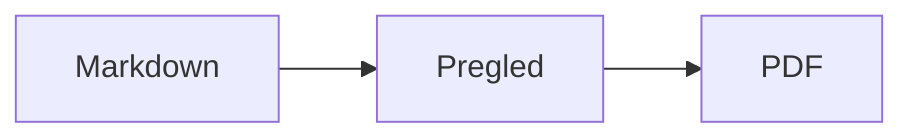

<p>&nbsp;&nbsp;&nbsp;</p>

# Splat

**Markdown uređivač za macOS u kojem pišete u izvornom kodu ili izravno u pregledu.**

Splat prikazuje vaš izvorni Markdown kod s bojanjem sintakse lijevo, a desno živi pregled koji u potpunosti možete uređivati. Tipkajte u jednom ili u drugom: sve što napišete u pregledu postaje minimalna promjena izvornog koda, pa retci koje niste dirali ostaju bajt po bajt isti, a vaši Git diffovi ostaju čisti. Splat čita Markdown koji već koristite: CommonMark i GitHub Flavored Markdown, GitHub upozorenja, Obsidianove wiki linkove, ugrađene bilješke i okvire s napomenom, Pandocova i Typorina proširenja, ugrađeni HTML, LaTeX formule te Mermaid, Graphviz i PlantUML dijagrame, sve prikazano izvan mreže. Izvezite u PDF, HTML ili Word jednim klikom. Napisan je u Rustu na pravim AppKit kontrolama, govori 35 jezika i ništa ne šalje mrežom ako to ne zatražite.
 


[](https://raw.githubusercontent.com/sventmueller/splat/main/dist/Splat-1.0.8.dmg)

**[Preuzmite Splat-1.0.8.dmg](https://raw.githubusercontent.com/sventmueller/splat/main/dist/Splat-1.0.8.dmg)**: potpisan i ovjeren (notariziran) od Applea, za macOS 14 ili noviji na Apple Siliconu i Intelu.
 
 

[](https://www.rust-lang.org)
[](https://www.apple.com/macos/)

[](https://github.com/madsmtm/objc2)
[](https://webkit.org)
[](https://github.com/kivikakk/comrak)
[](https://github.github.com/gfm/)
[](https://www.mathjax.org)
[](https://cortexjs.io/mathlive/)
[](https://mermaid.js.org)
[](https://graphviz.org)
[](https://plantuml.com)


[](#licenca)

[Bahasa Indonesia](../id/README.md) ·
[Bahasa Melayu](../ms/README.md) ·
[Català](../ca/README.md) ·
[Čeština](../cs/README.md) ·
[Dansk](../da/README.md) ·
[Deutsch](../de/README.md) ·
[English](../../../README.md) ·
[Español](../es/README.md) ·
[Français](../fr/README.md) ·
**Hrvatski** ·
[Italiano](../it/README.md) ·
[Magyar](../hu/README.md) ·
[Nederlands](../nl/README.md) ·
[Norsk](../no/README.md) ·
[Polski](../pl/README.md) ·
[Português (Brasil)](../pt_BR/README.md) ·
[Português (Portugal)](../pt_PT/README.md) ·
[Română](../ro/README.md) ·
[Slovenčina](../sk/README.md) ·
[Slovenščina](../sl/README.md) ·
[Suomi](../fi/README.md) ·
[Svenska](../sv/README.md) ·
[Tiếng Việt](../vi/README.md) ·
[Türkçe](../tr/README.md) ·
[Ελληνικά](../el/README.md) ·
[Русский](../ru/README.md) ·
[Українська](../uk/README.md) ·
[עברית](../he/README.md)‎ ·
[العربية](../ar/README.md)‎ ·
[हिन्दी](../hi/README.md) ·
[ไทย](../th/README.md) ·
[한국어](../ko/README.md) ·
[日本語](../ja/README.md) ·
[简体中文](../zh-Hans/README.md) ·
[繁體中文](../zh-Hant/README.md)

## Sadržaj

- [Značajke ukratko](#značajke-ukratko)
- [Zahtjevi](#zahtjevi)
- [Instalacija](#instalacija)
- [Početak rada](#početak-rada)
- [Pisanje](#pisanje)
  - [U izvornom kodu](#u-izvornom-kodu)
  - [U pregledu](#u-pregledu)
  - [Naredbe za formatiranje](#naredbe-za-formatiranje)
  - [Popisi i zadaci](#popisi-i-zadaci)
  - [Tablice](#tablice)
- [Podržani Markdown](#podržani-markdown)
  - [CommonMark i GitHub Flavored Markdown](#commonmark-i-github-flavored-markdown)
  - [Okviri s napomenom](#okviri-s-napomenom)
  - [Proširena sintaksa](#proširena-sintaksa)
  - [Obsidian](#obsidian)
  - [Citati i reference](#citati-i-reference)
  - [Ugrađeni HTML](#ugrađeni-html)
  - [Tipografska interpunkcija](#tipografska-interpunkcija)
  - [Pregled sintakse](#pregled-sintakse)
- [Formule](#formule)
- [Dijagrami](#dijagrami)
- [Slike](#slike)
- [Linkovi i navigacija](#linkovi-i-navigacija)
- [Izvoz, ispis i dijeljenje](#izvoz-ispis-i-dijeljenje)
- [Izgled i pristupačnost](#izgled-i-pristupačnost)
- [Jezici](#jezici)
- [Tipkovnički prečaci](#tipkovnički-prečaci)
- [Privatnost i sigurnost](#privatnost-i-sigurnost)
- [Veliki dokumenti](#veliki-dokumenti)
- [Poznata ograničenja](#poznata-ograničenja)
- [Rješavanje problema](#rješavanje-problema)
- [Za programere](#za-programere)
  - [Izgradnja](#izgradnja)
  - [Distribucija](#distribucija)
  - [Testiranje](#testiranje)
  - [Struktura projekta](#struktura-projekta)
  - [Tok podataka](#tok-podataka)
  - [Pravila u kontroleru](#pravila-u-kontroleru)
  - [Dodavanje naredbe](#dodavanje-naredbe)
  - [Prijevodi](#prijevodi)
  - [Komponente trećih strana](#komponente-trećih-strana)
- [Licenca](#licenca)

## Značajke ukratko

- **Dva načina pisanja, jedan tekst.** I izvorni kod i pregled mogu se uređivati. Markdown datoteka jedina je istina: za svaki dokument postoji jedna povijest poništavanja, a svaka izmjena u pregledu pretvara se u najmanju moguću promjenu izvornog koda.
- **Markdown koji već koristite.** CommonMark, GitHub Flavored Markdown, GitHub upozorenja, Obsidian, proširenja za Pandoc i Typoru, emoji kratice, spoileri, popisi definicija, sidra naslova i HTML kao u GitHubovim README datotekama.
- **Ugrađene formule i dijagrami.** LaTeX formule putem MathJaxa, s vizualnim uređivačem formula. Dijagrami u Mermaidu, Graphvizu i PlantUML-u, prikazani na vašem Macu bez Jave, poslužitelja ili mrežne veze.
- **Gumb za sve.** Svaki Markdown element ima gumb na alatnoj traci i stavku izbornika, a uobičajeni i tipkovnički prečac. Tablice imaju vlastiti izbornik za retke, stupce i poravnavanje.
- **Izvoz bez gubitaka.** PDF, jedna samostalna HTML datoteka ili Word dokument sa stvarnim naslovima, popisima, tablicama, fusnotama i slikama.
- **Izvorno do srži.** Pravi AppKit prozori, kartice, izbornici, skočni prozori, Verzije, automatsko spremanje, izbornik za dijeljenje, tamni način rada, provjera pravopisa, diktiranje i VoiceOver. Bez Electrona, bez web prikaza za sam tekst.
- **Brz s velikim datotekama.** Iscrtavanje pritiska tipke u dokumentu od 10 MB traje oko 10 ms, prije vlastitog rada prikaza.
- **Privatan i oprezan.** Slike s weba učitavaju se tek kad to dopustite, linkovi prema drugim aplikacijama najprije pitaju, a sve što dekodira nepouzdane slikovne podatke radi u pomoćnim procesima u sandboxu.
- **Na vašem jeziku.** Sučelje i ugrađeni kratki vodič za Markdown dostupni su na 35 jezika: arapskom, katalonskom, kineskom (pojednostavljenom), kineskom (tradicionalnom), hrvatskom, češkom, danskom, nizozemskom, engleskom, finskom, francuskom, njemačkom, grčkom, hebrejskom, hindskom, mađarskom, indonezijskom, talijanskom, japanskom, korejskom, malajskom, norveškom, poljskom, portugalskom (Brazil), portugalskom (Portugal), rumunjskom, ruskom, slovačkom, slovenskom, španjolskom, švedskom, tajlandskom, turskom, ukrajinskom i vijetnamskom.

## Zahtjevi

- macOS 14 Sonoma ili noviji. Splat se razvija i testira na macOSu 27, gdje automatski preuzima dizajn Liquid Glass.
- Mac s Apple Silicon ili Intelovim procesorom.
- Oko 45 MB prostora na disku.

## Instalacija

**Iz slike diska.** Preuzmite [`dist/Splat-1.0.8.dmg`](https://raw.githubusercontent.com/sventmueller/splat/main/dist/Splat-1.0.8.dmg), otvorite je i povucite Splat na mapu Aplikacije. Slika je potpisana certifikatom Developer ID i ovjerena (notarizirana) od Applea, pa se otvara bez upozorenja.

**S Homebrewom.** Cask se nalazi u vlastitom tapu:

```sh
brew install --cask sventmueller/tap/splat
```

`brew upgrade --cask splat` instalira nove verzije, a `brew uninstall --zap --cask splat` uklanja i Splatove postavke i predmemoriju.

**Ažuriranja.** Splat iz slike diska ili s Homebrewa sam se održava ažurnim putem [Sparkla](https://sparkle-project.org). Pri drugom pokretanju pita smije li jednom dnevno sam potražiti ažuriranja. **Splat › Potraži ažuriranja…** traži odmah; **Automatski traži ažuriranja** i **Automatski preuzmi i instaliraj ažuriranja** u istom izborniku kasnije mijenjaju vaš odabir. Splat instalira ažuriranje samo ako nosi potpis razvojnog programera. Vlastita izgradnja nema ažuriranje.

**Iz izvornog koda.** Preduvjete potražite u odjeljku [Izgradnja](#izgradnja), a zatim:

```sh
make build
ditto target/release/Splat.app /Applications/Splat.app
open /Applications/Splat.app
```

Da biste Markdown datoteke otvarali u Splatu dvoklikom, u Finderu označite bilo koju `.md` datoteku, odaberite **Datoteka › Učitaj informacije**, pod **Otvori koristeći** odaberite Splat i kliknite **Promijeni sve…**. Splat se sam registrira za datoteke `.md`, `.markdown`, `.mdown` i `.mkd`.

## Početak rada

### Prozor

Svaki dokument otvara se u vlastitom prozoru ili, ako više volite kartice, kao kartica:

- **Lijevo: izvorni kod.** Vaš Markdown u fontu SF Mono s bojanjem sintakse.
- **Desno: pregled.** Prikazani dokument, spreman za uređivanje.
- **Bočna traka sa strukturom (neobavezno).** Svi naslovi kao stablo; klik na naslov prikazuje ga u oba okna. Uključite je s **Prikaz › Prikaži strukturu** (⌃⌘S).
- **Alatna traka.** Gumbi grupirani prema onome što mijenjaju: znakovi, odlomci i umetnuti elementi, zatim uključivanje i isključivanje pregleda, dijeljenje i novi dokument. Prilagodite je s **Prikaz › Podesi alatnu traku…**.

Povucite razdjelnik da jednoj strani date više prostora. **Prikaz › Sakrij pregled** (⌥⌘P) ostavlja samo izvorni kod; Splat to pamti za svaki prozor. Oba okna pomiču se zajedno, a odabir u jednom oknu istaknut je u drugom.

### Dokumenti, kartice i verzije

Splat je uobičajena macOS aplikacija za dokumente:

- **Automatsko spremanje i Verzije.** Promjene se spremaju na mjestu. **Datoteka › Vrati na › Pregledaj sve verzije…** vraća vas u prošlost.
- **Promjene iz drugih programa.** Kad Git, skripta ili drugi uređivač promijeni otvoreni dokument, Splat ga ponovno učita i zadrži kursor i položaj pomicanja. Ako imate vlastite nespremljene promjene, Splat ih zadržava, a macOS pita prije nego što se druga verzija prepiše.
- **Uobičajene naredbe za datoteke.** Dupliciraj (⇧⌘S), Preimenuj…, Premjesti u… i **Datoteka › Otvori nedavne stavke**.
- **Kartice.** **Datoteka › Nova kartica** ili gumb **+** na alatnoj traci otvara novi dokument kao karticu; standardni izbornik Prozor spaja, premješta i izmjenjuje kartice.
- **Položaj prozora.** Veličina i položaj vašeg posljednjeg prozora pamte se, i nakon ponovnog pokretanja. Ako na tom mjestu već stoji prozor, novi se otvara malo pomaknut.
- **Ikona u Docku.** Klik na nju nakon što ste zatvorili posljednji prozor otvara novi dokument.
- **Otvaranje Markdown datoteka u Splatu.** **Splat › Postavi kao standardnu aplikaciju za Markdown** čini da dvoklik na datoteku `.md` ili `.markdown` otvara Splat; macOS jednom traži potvrdu. Stavka ima kvačicu dok je Splat standardna aplikacija.

Datoteke moraju biti UTF-8 tekst ili UTF-16 s oznakom redoslijeda bajtova. Splat odbija druga kodiranja umjesto da pogađa i kvari tekst. Oznaka redoslijeda bajtova ostaje, UTF-16 ostaje UTF-16, a u datoteci u kojoj svi retci završavaju s CRLF, i retci koje dodate dobivaju CRLF.

**Nakon rušenja** gube se najviše posljednjih nekoliko sekundi tipkanja: Splat svakih pet sekundi kopira nespremljeni tekst u `~/Library/Application Support/Splat/Unsaved`, a kopije uklanja čim se dokument spremi ili Splat normalno završi. Pri sljedećem pokretanju sve što je rušenje ostavilo premješta se u `~/Library/Application Support/Splat/Recovery`, što se jednom i javlja, uz gumb koji otvara mapu. Rušenje na koje Splat još može reagirati ondje zapisuje i tekst svakog otvorenog dokumenta.

### Kratki vodič

**Pomoć › Kratki vodič za Markdown** otvara varalicu na vašem jeziku kao novi, neimenovani dokument. To je običan dokument, pa sve isprobajte upravo ondje, u izvornom kodu ili u pregledu.

## Pisanje

### U izvornom kodu

Izvorni kod je uređivač običnog teksta podešen za Markdown:

- **Boje sintakse** kao u VS Codeu: naslovi, isticanje, linkovi, kod, tablice, HTML, front matter te LaTeX i Mermaid unutar formula i dijagrama. Postoje palete za svijetli i tamni prikaz te za postavku Povećaj kontrast.
- **Ograđeni blokovi koda** označeni su bojama za Bash, C, C++, C#, CSS (također SCSS i Less), Go, HTML, XML, Javu, JavaScript, JSON, Kotlin, PHP, Python, Ruby, Rust, SQL, Swift, TypeScript, YAML, TeX i Mermaid, uključujući uobičajene kratice poput `js`, `py` ili `sh`.
- **Bez neočekivanih zamjena.** Pametni navodnici, pametne crtice i zamjena teksta isključeni su prema zadanim postavkama jer kvare `--`, `---` i `"`. Uključite ih pod **Uredi › Zamjene**.
- **Sistemski alati za pisanje.** Provjera pravopisa i gramatike, diktiranje, Pronađi i zamijeni (⌥⌘F) te čitanje teksta.
- **Povuci i ispusti.** Ispustite slikovnu datoteku da biste umetnuli ``, bilo koju drugu datoteku da biste umetnuli link na nju, a URL da biste umetnuli `[url](url)`. Svako ispuštanje jedan je korak poništavanja.
- **Lijepljenje slika.** Slika u međuspremniku, primjerice snimka zaslona, sprema se kao PNG datoteka pokraj dokumenta (`Slika 2026-10-29 13.09.07.png`) i umeće kao slika. Za to dokument mora biti barem jednom spremljen.

### U pregledu

Pregled se ponaša kao program za obradu teksta, ali sve što u njemu učinite završava kao Markdown:

- **Tipkanje.** Znakovi koji u Markdownu nešto znače, poput `*` ili `#`, escapeaju se tako da se pojavljuju onako kako su utipkani.
- **Return** započinje novi odlomak ili novu stavku popisa. **⌥Return** ili **⌃Return** umeće prijelom retka.
- **Formatiranje na kursoru.** Kad je kursor na kraju riječi, Podebljano, Kurziv i ostali formati znakova vrijede za ono što zatim utipkate. Odaberite format ponovno da biste ga prekinuli. Unutar riječi formatira se cijela riječ.
- **Prazni retci.** Return u praznom retku dodaje još jedan prazan redak, a Backspace ga uklanja. U izvornom kodu svaki dodatni prazan redak znači dva prazna retka više; drugi Markdown programi prikazuju ih kao uobičajeni razmak između odlomaka.
- **Poništi** radi u oba okna. Stavke poništavanja nose nazive („Poništi Podebljano”), tipkanje je jedan korak po nizu, a nakon Poništi i Ponovi oba okna prelaze na promjenu.
- **Formule i dijagrami** prikazuju se kao gotova grafika. Kliknite jednu, postavite kursor na nju ili pritisnite Return na njoj da biste otvorili njezin uređivač (vidi [Formule](#formule) i [Dijagrami](#dijagrami)).
- **Ugrađeni HTML, ugrađene bilješke i front matter** prikazuju se, ali ih uređujete u izvornom kodu. Klik na njih postavlja kursor na odgovarajuće mjesto ondje.

Sve što Markdown ne može izraziti u pregledu je blokirano: ploče Font i Boja, ravnalo te lijepljenje ili ispuštanje obogaćenog teksta i slika. Zalijepljeni HTML i RTF stižu kao običan tekst.

### Naredbe za formatiranje

Svaka je naredba dostupna na alatnoj traci, u traci izbornika i u kontekstualnom izborniku oba okna. Stavke izbornika prikazuju kvačicu za formatiranje na kursoru.

| Izbornik | Naredbe |
|---|---|
| **Formatiraj › Font** | Podebljano, Kurziv, Podcrtano, Precrtano, Istakni, Kod, Eksponent, Indeks |
| **Formatiraj › Naslov** | Osnovni tekst, Naslov 1 do 6 |
| **Formatiraj › Popis** | Popis s predznacima, Numerirani popis, Popis zadataka |
| **Formatiraj** | Citat, Blok koda (Bez jezika ili jedan od 20 jezika; mijenja i jezik postojećeg bloka), Okvir s napomenom (Bilješka, Savjet, Važno, Upozorenje, Oprez; ponovni odabir istog tipa uklanja ga), Uredi formulu ili dijagram…, Ukloni formatiranje |
| **Umetni** | Link…, Slika…, Tablica…, Formula, Dijagram (Dijagram toka, Dijagram slijeda, Ganttov dijagram), Kazalo sadržaja, Fusnota, Linija razdjelnika |
| **Tablica** | Umetni redak iznad/ispod, Umetni stupac lijevo/desno, Obriši redak, Obriši stupac, Poravnavanje (Lijevo, Centriraj, Desno, Standardno), Poravnaj stupce tablice |
| **Prikaz** | Sakrij/Prikaži pregled, Prikaži/Sakrij strukturu, Tipografska interpunkcija, Uvećaj/Umanji, Stvarna veličina, alatna traka, traka s karticama, prikaz preko cijelog zaslona |

Podcrtano, istaknuto, eksponent i indeks zapisuju se kao `<ins>`, `<mark>`, `<sup>` i `<sub>`, što prikazuje i GitHub. Splat čita i `<u>`, koji GitHub uklanja, te kraće `==isticanje==`, `^eksp^` i `~ind~`. GitHub `==` i `^` prikazuje onako kako su napisani, a `~ind~` kao precrtano.

### Popisi i zadaci

- Return nastavlja popis; Return na praznoj stavci završava ga.
- **Tab** i **⇧Tab** uvlače i izvlače stavke popisa u pregledu.
- Klik na kućicu zadatka u pregledu mijenja `- [ ]` i `- [x]`.
- **Formatiraj › Popis** pretvara označene odlomke u popis ili mu mijenja vrstu.

### Tablice

- **Umetni › Tablica…** pita za broj redaka (uključujući zaglavlje) i stupaca.
- U pregledu **Tab** prelazi u sljedeću ćeliju, **⇧Tab** u prethodnu, a **Return** u ćeliju ispod. Tab u posljednjoj ćeliji dodaje redak.
- Izbornik **Tablica** umeće i briše retke i stupce te postavlja poravnavanje stupca (⌘{, ⌘|, ⌘}).
- **Tablica › Poravnaj stupce tablice** nadopunjuje izvorni kod razmacima tako da se stupci poravnaju.

## Podržani Markdown

Splat parsira pomoću [comraka](https://github.com/kivikakk/comrak), parsera kompatibilnog s CommonMarkom i GFM-om, i uključuje većinu njegovih proširenja. Sve navedeno u nastavku prikazuje se u pregledu i u svim izvozima.

### CommonMark i GitHub Flavored Markdown

- Naslovi (`#` i podcrtani), odlomci, prijelomi retka, isticanje, jako isticanje, kod u retku, blokovi citata, linije razdjelnika.
- Popisi s predznacima, numerirani i ugniježđeni popisi; popisi zadataka.
- Linkovi (u retku, referentni i automatski), slike, definicije referenci linkova.
- Ograđeni i uvučeni blokovi koda s bojama sintakse.
- Tablice s poravnavanjem stupaca.
- Precrtano s `~~dvije tilde~~`.
- Fusnote: `tekst[^1]` s `[^1]: Bilješka.` bilo gdje u dokumentu. Klik na oznaku skače na bilješku.
- YAML front matter između redaka `---` na vrhu. Pregled ga sažima u jedan redak, primjerice „Metapodaci: title, date, tags”.

### Okviri s napomenom

GitHub upozorenja prikazuju se kao obojeni okviri s ikonom i naslovom:

```markdown
> [!NOTE]
> Korisne informacije koje korisnici trebaju znati.

> [!WARNING]
> Ključan sadržaj koji traži hitnu pažnju.
```

Pet je tipova: Bilješka, Savjet, Važno, Upozorenje i Oprez. **Formatiraj › Okvir s napomenom** pretvara odlomak na kursoru u jedan od njih.

Rade i Obsidianovi okviri, s bilo kojim naslovom i stanjem sažetosti:

```markdown
> [!tip]- Kliknite ▸ za proširenje
> Skriveno dok se ne otvori.

> [!question]+ Otvoreno prema zadanim postavkama
> `+` počinje proširen, `-` sažet.
```

Obsidianovi ostali tipovi prikazuju se u najbližoj od pet boja: `success`, `check`, `done` i `hint` kao Savjet; `question`, `help` i `faq` kao Važno; `attention` kao Upozorenje; `failure`, `fail`, `missing`, `danger`, `error` i `bug` kao Oprez; sve ostalo kao Bilješka.

### Proširena sintaksa

| Značajka | Sintaksa | Podrijetlo |
|---|---|---|
| Isticanje | `==označeni tekst==` | Obsidian, Typora |
| Eksponent | `x^2^` | Pandoc, Typora |
| Indeks | `H~2~O` | Pandoc, Typora |
| Emoji kratica | `:rocket:` postaje 🚀 | GitHub |
| Spoiler | `\|\|skriveni tekst\|\|`, označite ga da biste ga pročitali | Discord |
| Fusnota u retku | `tekst^[sama bilješka]` | Pandoc, Obsidian |
| Popis definicija | `Pojam`, prazan redak, `: Objašnjenje` | PHP Markdown Extra, Pandoc |
| Sidro naslova | `## Instalacija {#postavljanje}`, link s `[vidi](#postavljanje)` | Pandoc, kramdown |

Popisi definicija u izvornom kodu izgledaju ovako:

```markdown
Pojam

: Objašnjenje pojma.
```

Bez vlastitog sidra svaki naslov dobiva sidro izvedeno iz svog teksta, kao na GitHubu: `## Početak rada` dostupan je kao `#početak-rada`.

### Obsidian

- **Wiki linkovi.** `[[Bilješka]]` povezuje na `Bilješka.md` u istoj mapi ili u mapi ispod nje. `[[Bilješka|Prikazani tekst]]` prikazuje vaš tekst, a `[[Bilješka#Naslov]]` otvara bilješku. ⌘-klik otvara je u Splatu.
- **Ugradnje.** `![[Bilješka]]` prikazuje drugu bilješku unutar ove; bilješke ugrađene u nju prikazuju se kao linkovi. `![[dijagram.png]]` prikazuje sliku. Kao u Obsidianu, ugradnje navode bilješke i slike u mapi dokumenta ili ispod nje, nikad apsolutnom putanjom, a kao bilješke prikazuju se samo Markdown datoteke.
- **Komentari.** `%%Samo u izvornom kodu%%` ostaje vidljiv u izvornom kodu, a izostavlja se iz pregleda i svakog izvoza, u retku kao i u zasebnim recima.
- **Oznake.** `#ideja` ili `#projekt/splat` je istaknuto. ⌘-klik traži oznaku u dokumentu.
- **Okviri koji se sažimaju.** Vidi [Okviri s napomenom](#okviri-s-napomenom).

### Citati i reference

- **Pandocovi citati.** `[@doe2020]` ili `[@doe2020; @roe2021]` čita se kao „(Doe 2020; Roe 2021)”. Unosi dolaze iz BibTeX datoteke koju front matter navodi kao `bibliography: refs.bib`. Bez toga Splat koristi `references.bib`, `literatur.bib` ili `bibliography.bib` pokraj dokumenta.
- **GitHub i GitLab reference.** Ako dokument leži u Git repozitoriju čiji je udaljeni `origin` na github.com ili na GitLab hostu, `@name`, `#12` (issue) i `!7` (merge request, samo GitLab) su istaknuti. ⌘-klik otvara ih u pregledniku.

### Ugrađeni HTML

HTML kakav nalazite u GitHubovim README datotekama prikazuje se vlastitim čitačem, a ne mehanizmom preglednika:

- centrirani odlomci i blokovi (`<p align="center">`, `<div align="center">`)
- slike s veličinom (``)
- linkovi, `<kbd>⌘</kbd>`, `<br>`, `<u>`, `<ins>`, `<mark>`, `<sup>`, `<sub>`
- popisi i tablice, uključujući ćelije koje se protežu na više stupaca (`colspan`)
- odjeljci koji se sažimaju: `<details><summary>Više</summary>…</details>`, otvaraju se klikom na ▸

Markdown između HTML oznaka prikazuje se kao Markdown. Skripte, stilovi, okviri i obrasci potpuno se izostavljaju, a linkovi i slike zadržavaju samo adrese `http`, `https`, `mailto` i relativne adrese.

### Tipografska interpunkcija

**Prikaz › Tipografska interpunkcija** prikazuje ravne navodnike kao navodnike jezika vašeg sučelja, `--` kao crticu, `---` kao dugu crticu, a `...` kao tri točke. Na njemačkom `"Ja"` postaje „Ja“, na francuskom «Oui», na japanskom 「はい」, i tamo gdje kineski i japanski stavljaju navodnike bez razmaka; hebrejske kratice poput `צה"ל` dobivaju gershayim, צה״ל. Izvorni kod zadržava obične znakove; pregled i svi izvozi prikazuju tipografske. Postavka je isključena dok je ne uključite.

### Pregled sintakse

| Element | Markdown |
|---|---|
| **Podebljano** | `**Podebljano**` |
| *Kurziv* | `*Kurziv*` |
| Podcrtano | `<ins>Podcrtano</ins>` ili `<u>Podcrtano</u>` |
| ~~Precrtano~~ | `~~Precrtano~~` |
| Istaknuto | `<mark>Istaknuto</mark>` ili `==Istaknuto==` |
| `Kod` | `` `Kod` `` |
| x² | `x<sup>2</sup>` ili `x^2^` |
| H₂O | `H<sub>2</sub>O` ili `H~2~O` |
| [Link](https://example.com) | `[Link](https://example.com)` |
| Naslov | `# Naslov` do `###### Naslov` |
| Citat | `> Citat` |
| Popis s predznacima | `- Stavka` |
| Numerirani popis | `1. Stavka` |
| Zadatak | `- [ ] Otvoreno` i `- [x] Gotovo` |
| Blok koda | ```` ```rust ```` … ```` ``` ```` |
| Tablica | `\| A \| B \|` s `\|---\|---\|` ispod zaglavlja |
| Fusnota | `Tekst[^1]` i `[^1]: Bilješka` |
| Linija razdjelnika | `---` |
| Slika | `` |
| Formula | `$E = mc^2$`, `$$ … $$` |
| Dijagram | ```` ```mermaid ````, ```` ```dot ````, ```` ```plantuml ```` |
| Okvir s napomenom | `> [!TIP]` |
| Wiki link | `[[Bilješka]]`, `[[Bilješka\|Tekst]]` |
| Ugradnja | `![[Bilješka]]`, `![[slika.png]]` |
| Komentar | `%%Komentar%%` |
| Oznaka | `#oznaka` |
| Citat iz literature | `[@ključ]` |
| Spoiler | `\|\|Spoiler\|\|` |
| Emoji | `:tada:` |

## Formule

Formule prikazuje [MathJax](https://www.mathjax.org) sa svojom TeX i AMS matematikom, kao oštru vektorsku grafiku. Tekst u `\text{…}` može biti u bilo kojem pismu: ono čega nema u MathJaxovim fontovima dolazi iz fontova vašeg Maca, pri čemu arapski i hebrejski teku zdesna nalijevo, a emoji su u boji.

| Vrsta | Sintaksa |
|---|---|
| U retku | `$E = mc^2$`, `` $`E = mc^2`$ `` (GitHub, GitLab), `\(E = mc^2\)` |
| Zasebna | `$$` … `$$`, `\[` … `\]` ili blok koda označen s `math` |

**Uređivanje formule.** Kliknite formulu u pregledu, dvaput je kliknite, pritisnite Return na njoj ili postavite kursor na nju da biste otvorili njezin uređivač u skočnom prozoru. **Umetni › Formula** umeće novu i odmah otvara uređivač.

- **Vizualno ili LaTeX.** Prekidač na vrhu prebacuje između vizualnog uređivača ([MathLive](https://cortexjs.io/mathlive/)) i LaTeX koda. Splat pamti vaš odabir.
- **Gradivni blokovi** za razlomak, kvadratni korijen, eksponent i indeks, zbroj i integral s granicama, limes, zagrade koje rastu sa sadržajem, matricu 2×2, grčka slova te relacije, operatore i strelice. Ostavljaju rezervirana mjesta □, a **Tab** skače na sljedeće.
- **Pregled uživo.** Promjene se pojavljuju u dokumentu dok tipkate. Pogreške iz MathJaxa prikazuju se u retku ispod koda.
- **Potvrda ili odbacivanje.** Klik izvan uređivača zadržava promjenu kao jedan korak poništavanja; **Esc** ili **Odustani** je odbacuje. Esc na novoj, praznoj formuli ponovno je uklanja.
- Kontekstualni izbornik nudi **Uredi formulu…** za formulu pod pokazivačem.

VoiceOver čita formulu kao njezin LaTeX kod. Splat prikazuje formule, a ne potpune LaTeX dokumente: nema paketa, nema TikZa i nema `\documentclass`.

## Dijagrami

Dijagrami se prikazuju unutar Splata, izvan mreže, u svijetloj i tamnoj varijanti.

| Mehanizam | Blok koda | Što crta |
|---|---|---|
| [Mermaid](https://mermaid.js.org) | ```` ```mermaid ```` | dijagrame toka, slijeda, klasa, stanja, odnosa entiteta, Ganttove, tortne, mentalne mape, vremenske crte i svaku drugu vrstu Mermaida |
| [Graphviz](https://graphviz.org) | ```` ```dot ```` ili ```` ```graphviz ```` | grafove u jeziku DOT |
| [PlantUML](https://plantuml.com) | ```` ```plantuml ```` ili ```` ```puml ```` | UML dijagrame; radi bez Jave |



**Uređivanje dijagrama** radi kao uređivanje formule: kliknite ga da biste otvorili kod u skočnom prozoru, s bojama sintakse i porukama o pogreškama u retku ispod koda. **Umetni › Dijagram** polazi od predloška za dijagram toka, dijagram slijeda ili Ganttov dijagram. Gradivni blokovi pomažu kod tri najčešće vrste Mermaida:

- **Dijagram toka:** Čvor ▾ (pravokutnik, zaobljeno, krug, romb, baza podataka), Veza, Veza s oznakom, Grupa, Smjer ▾
- **Dijagram slijeda:** Sudionik, Poruka, Odgovor, Bilješka, Petlja, Alternativni putovi
- **Ganttov dijagram:** Odjeljak, Zadatak, Prekretnica

Druge vrste dijagrama uređuju se kao kod. VoiceOver čita naslov dijagrama ili alternativni tekst.

Prvi dijagram nakon pokretanja traje otprilike sekundu jer se mehanizam za prikaz pokreće u pozadini. Dijagram koji traje dulje od 10 sekundi prikazuje pogrešku, a mehanizam za prikaz za sljedeći se dijagram pokreće iznova. PlantUML-ov mehanizam (3 MB) učitava se tek s prvim PlantUML dijagramom. PlantUML `!include` s weba je blokiran.

## Slike

- **Lokalne slike** koriste putanje relativne prema dokumentu: ``. Splat prikazuje PNG, JPEG, GIF, WebP, BMP, SVG, HEIC, TIFF, AVIF i PDF.
- **Slike s weba** ostaju blokirane dok ih ne dopustite: traka iznad pregleda objašnjava da učitavanje njihovim poslužiteljima otkriva da i kada otvarate dokument. **Učitaj slike** dopušta ih za ovaj dokument; Splat pamti odabir za svaku datoteku.
- **Veličina.** `` postavlja veličinu slike; inače se slike prilagođavaju širini pregleda.
- **Promjene na disku.** Slika koju zamijenite ili koja se pojavi nakon što ju je dokument naveo prikazuje se bez ponovnog otvaranja dokumenta. Slike s weba koje nisu uspjele zbog mreže pokušavaju se ponovno dok ih dokument prikazuje.
- **Memorija.** Slike se prikazuju do 2560 piksela po dužoj stranici, što ispunjava i stranicu formata A4. Dekodiraju se manje čim ispune osminu memorije Maca i dok macOS javlja pritisak na memoriju.
- **Tamni način rada.** Slike s bijelom pozadinom u tamnom pregledu blago su zatamnjene.
- **Lijepljenje i ispuštanje.** Vidi [U izvornom kodu](#u-izvornom-kodu).

## Linkovi i navigacija

U pregledu klik postavlja kursor kako biste mogli urediti tekst linka; **⌘-klik** slijedi link:

- `http`, `https` i `mailto` otvaraju se u vašem pregledniku ili aplikaciji za e-poštu.
- Markdown datoteke otvaraju se u Splatu; druge datoteke i mape prikazuju se u Finderu.
- `#sidro` skače na naslov u dokumentu.
- Adrese koje otvaraju drugu aplikaciju, poput `slack://` ili `vscode://`, najprije pitaju i prikazuju punu adresu i aplikaciju. **Odustani** je unaprijed odabrano.

**Umetni › Kazalo sadržaja** umeće povezani popis svih naslova. Kad je kursor unutar njega, ista naredba ga ažurira. Bočna traka sa strukturom (⌃⌘S) skače na bilo koji naslov u oba okna.

## Izvoz, ispis i dijeljenje

| Format | Kako | Što dobivate |
|---|---|---|
| **PDF** | **Datoteka › Eksportiraj kao PDF…** ili izbornik Dijeli | Stranice veličine papira, uvijek u svijetlom izgledu, formule i dijagrami kao vektorska grafika. **Datoteka › Podešavanje stranice…** postavlja papir. |
| **Ispis** | **Datoteka › Ispis…** (⌘P) | Isti raspored kao PDF. |
| **HTML** | **Datoteka › Eksportiraj kao HTML…** ili izbornik Dijeli | Jedna samostalna datoteka: lokalne slike ugrađene, formule i dijagrami kao oštre slike, sidra naslova da kazalo sadržaja radi. Bez skripti. |
| **Word** | **Datoteka › Eksportiraj kao Word dokument…** ili izbornik Dijeli | Datoteka `.docx` s Wordovim stilovima naslova, pravim popisima i tablicama (uključujući spojene ćelije), fusnotama kao Wordovim fusnotama, ugrađenim slikama, formulama i dijagramima. |
| **Markdown** | Gumb **Dijeli** na alatnoj traci | Dokument kao datoteka `.md` za Mail, Poruke, AirDrop i svaku drugu uslugu dijeljenja. |

Izbornik **Datoteka › Dijeli** nudi sve to na jednom mjestu. Izvozi koriste postavku tipografske interpunkcije i slike s weba koje ste dopustili; slike s weba u HTML-u ostaju linkovi.

## Izgled i pristupačnost

- **Tamni način rada** prati sustav. Formule i dijagrami prikazuju se za svaki izgled.
- **Povećaj kontrast** u Postavkama sustava prebacuje boje sintakse na palete visokog kontrasta.
- **Zumiranje.** ⌘+, ⌘− i ⌘0 mijenjaju veličinu oba okna.
- **Prikaz preko cijelog zaslona, kartice i alatna traka koja se može podesiti**, kao u svakoj aplikaciji za Mac.
- **VoiceOver.** Okna se zovu „Izvorni Markdown kod” i „Pregled”, formule se čitaju kao svoj kod, a dijagrami kao svoj naslov. Svaka je naredba dostupna s tipkovnice.

Splat nema prozor s postavkama: nekoliko opcija nalazi se ondje gdje se primjenjuju, u izborniku **Prikaz** i **Uredi › Zamjene**.

## Jezici

Sučelje, izbornici i kratki vodič za Markdown prevedeni su na 35 jezika:

arapski, katalonski, kineski (pojednostavljeni), kineski (tradicionalni), hrvatski, češki, danski, nizozemski, engleski, finski, francuski, njemački, grčki, hebrejski, hindski, mađarski, indonezijski, talijanski, japanski, korejski, malajski, norveški, poljski, portugalski (Brazil), portugalski (Portugal), rumunjski, ruski, slovački, slovenski, španjolski, švedski, tajlandski, turski, ukrajinski i vijetnamski.

Splat slijedi redoslijed jezika u **Postavke sustava › Općenito › Jezik i regija**; ondje pod **Aplikacije** možete odabrati i jezik samo za Splat. Ako nema prijevoda za vaš jezik, koristi engleski. Izrazi u izbornicima slijede Appleove vlastite prijevode, pa se Splat čita kao ostatak vašeg Maca.

Hebrejski i arapski tekst čita se zdesna nalijevo gdje god se pojavi, bez obzira na jezik sučelja: svaki odlomak, naslov i stavka popisa preuzima smjer svog prvog slova, citati i okviri s napomenom crtaju traku s desne strane, a tablica čiji tekst počinje zdesna nalijevo navodi stupce zdesna. Blokovi koda ostaju slijeva nadesno. Izvozi u PDF, HTML i Word zadržavaju te smjerove. Ako je hebrejski ili arapski jezik sustava, macOS zrcali i prozor, pa pregled stoji lijevo.

## Tipkovnički prečaci

| Radnja | Prečac |
|---|---|
| Podebljano, Kurziv, Podcrtano | ⌘B, ⌘I, ⌘U |
| Precrtano | ⇧⌘X |
| Link… | ⌘K |
| Osnovni tekst, Naslov 1 do 6 | ⌥⌘0, ⌥⌘1 do ⌥⌘6 |
| Poravnaj stupac tablice lijevo, centrirano, desno | ⌘{, ⌘\|, ⌘} |
| Sakrij ili prikaži pregled | ⌥⌘P |
| Prikaži ili sakrij strukturu | ⌃⌘S |
| Uvećaj, umanji, stvarna veličina | ⌘+, ⌘−, ⌘0 |
| Novi dokument, otvori, spremi, dupliciraj | ⌘N, ⌘O, ⌘S, ⇧⌘S |
| Podešavanje stranice, ispis | ⇧⌘P, ⌘P |
| Pronađi, pronađi i zamijeni | ⌘F, ⌥⌘F |
| Pronađi sljedeće, prethodno; upotrijebi odabir; idi na odabir | ⌘G, ⇧⌘G; ⌘E; ⌘J |
| Prikaži pravopis i gramatiku; provjeri dokument | ⌘:, ⌘; |
| Zalijepi i uskladi stil | ⌥⇧⌘V |
| Sakrij alatnu traku, prikaži sve kartice, prikaz preko cijelog zaslona | ⌥⌘T, ⇧⌘\\, ⌃⌘F |
| Prijelom retka (pregled) | ⌥Return ili ⌃Return |
| Sljedeća ćelija / prethodna ćelija u tablici (pregled) | Tab / ⇧Tab |
| Uvuci / izvuci stavku popisa (pregled) | Tab / ⇧Tab |
| Sljedeće rezervirano mjesto u uređivaču formula | Tab |
| Zatvori uređivač formule ili dijagrama bez promjena | Esc |
| Slijedi link, oznaku ili referencu (pregled) | ⌘-klik |

Splat ne dira Appleove standardne prečace.

## Privatnost i sigurnost

Markdown datoteka može doći od bilo koga, pa Splat svaki dokument smatra nepouzdanim.

- **Bez mreže prema zadanim postavkama.** Splat nema telemetriju. Ažuriranja traži tek kad pristanete ili odaberete **Potraži ažuriranja…**: tada s GitHuba učitava malu datoteku feeda, a zahtjev navodi samo aplikaciju i njezinu verziju. Formule i dijagrami prikazuju se lokalno; web prikazi koji to rade ne mogu doseći mrežu.
- **Slike s weba** učitavaju se tek nakon vašeg dopuštenja, samo preko `https`, nikad s hostova u vašoj lokalnoj mreži, najviše 10 MB po slici i u privatnoj sesiji bez kolačića.
- **Izolirano dekodiranje.** Slike te grafika formula i dijagrama dekodiraju se u pomoćnim procesima koji zatvaraju sve datoteke koje su naslijedili i zaključavaju se u sandbox prije čitanja prvog bajta: bez pristupa datotekama, bez mreže. Vraćaju samo piksele, čija se veličina provjerava, i zaustavljaju se nakon 10 sekundi. Appleovi vlastiti dekoderi slika vide samo HEIC, TIFF, AVIF i PDF, i to samo kad podaci doista jesu taj format; rade u vlastitom pomoćnom procesu, koji uz to smije čitati sistemske mape s fontovima i koristiti sistemski video dekoder. I SVG-ovi, formule i dijagrami prolaze kroz taj pomoćni proces, pa su u Splatu slike fiksne razlučivosti: četiri piksela po točki, do 2560 po duljoj stranici.
- **Lokalne datoteke** dolaze do dokumenta samo putanjom koju on navodi. Ugradnje prikazuju Markdown bilješke iz mape dokumenta i ispod nje, a slika koje nema traži se samo ondje. Putanja slike drugdje, apsolutna ili koja počinje s `~`, i dalje se učitava u pregledu; HTML i Word izvozi, ispis i PDF-ovi uzimaju samo ono što je u mapi dokumenta ili u njegovu Git repozitoriju, osim ako taj repozitorij sadrži i vašu početnu mapu, pa tuđi dokument ne može uvući vaše datoteke u izvoz koji prosljeđujete.
- **Kopije nespremljenog teksta** ostaju na ovom Macu, u vašoj mapi Library, za oporavak nakon rušenja. Nestaju sa spremanjem ili normalnim završetkom Splata; kopije koje je rušenje ostavilo ostaju u mapi za oporavak dok ih ne obrišete.
- **Linkovi** nikad klikom ne pokreću program. Web i mail linkovi otvaraju se kao i obično; linkovi prema drugim aplikacijama najprije pitaju.
- **HTML u dokumentima** čita Splatov vlastiti parser. Skripte, stilovi, okviri i obrasci nikad se ne izvršavaju.
- **Izvozi** ne sadrže skripte. HTML stranice zadržavaju samo fiksni popis bezopasnih oznaka i atributa, kao GitHub, uz politiku sigurnosti sadržaja. Word datoteke povezuju samo adrese `http`, `https` i `mailto`.
- **Potpisivanje koda** s Hardened Runtimeom. Splat radi bez App Sandboxa kako bi mogao prikazivati slike pokraj vaših dokumenata bez pitanja za svaku mapu; izolacija svog dekodiranja to nadoknađuje.

## Veliki dokumenti

Splat ostaje responzivan s dokumentima od nekoliko megabajta:

- Izvorni kod koristi TextKit 2, koji slaže samo vidljivi dio.
- Dok tipkate u pregledu, i u izvornom kodu dokumenata do 2 MB, ponovno se parsiraju, boje i slažu samo zahvaćeni odlomci. U dokumentu od 10 MB parsiranje i bojenje traju oko 3 ms, iscrtavanje oko 10 ms, a cijeli pritisak tipke u njegovu pregledu oko 30 ms, uključujući vlastiti rad prikaza.
- Veliki pregledi najprije prikazuju vidljivi dio, a ostatak dok je aplikacija u mirovanju. Blokovi koji se pomaknu u vidno polje prikazuju se prije crtanja.
- U izvornom kodu većih dokumenata parsiranje za pregled radi u pozadini dok tipkate.
- Dokument ostaje običan tekst čim bi trebao oko 4 GB memorije, što je oko 50 do 120 MB uobičajenog Markdowna, ali samo 10 do 20 MB ako su u njemu samo tablice ili naslovi: izvorni kod nema boja, a pregled kaže zašto ostaje prazan. Izvozi i dalje rade.
- Od otprilike 200 KB dokument otvara prozor prije nego što je parsiran; kod 5 MB boje i pregled slijede otprilike četvrt sekunde kasnije.
- Sve slike zajedno, uključujući formule i dijagrame, zauzimaju najviše četvrtinu memorije Maca, a polovicu toga dok memorije nedostaje. Iznad toga se daljnje slike prikazuju kao rezervirana mjesta dok opet ne bude mjesta.

Neke se promjene obrađuju u cijelosti, oko 300 ms po pritisku tipke kod 10 MB: promjene definicije ili referenci fusnote, uz fusnotu u retku, na samom kraju dokumenta uz fusnotu, front mattera ili definicija referenci linkova te svaka promjena u dokumentu s blokovima komentara `%%` ili s fusnotom definiranom dvaput ili unutar citata ili popisa. Memorija raste s datotekom, na otprilike 115–160 MB za 1 MB Markdowna i 340–510 MB za 10 MB.

## Poznata ograničenja

- **Jedna tilda znači indeks.** `~tekst~` je indeks kao u Pandocu; za precrtavanje treba `~~dvije~~`. GitHub precrtava i s jednom tildom.
- **Samo za čitanje u pregledu:** ugrađeni HTML, ugrađene bilješke i front matter uređuju se u izvornom kodu.
- **Vrlo duboko gniježđenje:** HTML ugniježđen dublje od 64 razine i HTML u retku dublji od 16 ustupa mjesto svom sadržaju.
- **Spojene ćelije tablice** postoje samo u HTML tablicama, i to samo preko stupaca (`colspan`, bez `rowspan`). MultiMarkdownova sintaksa tablica za spojene ćelije nije podržana.
- **Bibliografije** čitaju se samo iz BibTeXa, ne iz CSL JSON-a ni YAML-a.
- **Reference** trebaju repozitorij na github.com ili na GitLab hostu; `!7` postoji samo na GitLabu.
- **Tipografska interpunkcija:** njemački zatvarajući jednostruki navodnik ne može se razlikovati od apostrofa i postavlja se kao ’.
- **Formule, ne dokumenti:** bez LaTeX paketa, TikZa i potpunih dokumenata.
- **Vizualni uređivač formula** piše LaTeX u MathLiveovu zapisu: razmaci nestaju (`E = mc^2` postaje `E=mc^2`), prikaz ostaje isti.
- **Namjerno:** bez brojeva redaka, bez prozora s postavkama, bez Help Booka, nije u App Storeu.
- **Slabije testirano na Intelu.** Samoprovjere prozora rade samo na Apple Siliconu; na Intelu CI pokreće `cargo test`.

## Rješavanje problema

**Popis nedavnih dokumenata prazan je nakon što sam ponovno izgradio Splat.** macOS veže nedavne dokumente i dopuštenja za mape uz potpis koda aplikacije. Lokalne izgradnje potpisuju se certifikatom „Splat Local Signing” u vašem lančiću prijave, pa ponovne izgradnje zadržavaju oboje. Ako je certifikat obrisan, sljedeća izgradnja stvara novi i popisi počinju iznova, jednom.

**Aplikacija iz slike diska prikazuje druge nedavne dokumente od moje vlastite izgradnje.** Njih dvije nose različite potpise, pa macOS za svaku vodi zaseban popis i zasebna dopuštenja za mape.

**HTML ili druga sintaksa prikazuje se kao običan kod.** Dokument je možda otvorila zastarjela kopija Splata. Zatvorite je, u Finderu odaberite **Datoteka › Učitaj informacije** za dokument i provjerite navodi li **Otvori koristeći** Splat iz vaše mape Aplikacije.

**U izborniku Splat nema stavke Potraži ažuriranja….** Samo verzija iz slike diska ili s Homebrewa sama se ažurira; vlastita izgradnja nema ažuriranje.

**Slike s weba ne pojavljuju se.** Kliknite **Učitaj slike** na traci iznad pregleda. Učitavaju se samo `https` slike s javnih hostova.

**Lijepljenje snimke zaslona traži da prvo spremim.** Zalijepljene slike spremaju se kao datoteke pokraj dokumenta, za što treba mjesto na disku. Spremite ga, pa ponovno zalijepite.

**„Datoteka nije UTF-8 tekst.”** Datoteka je u drugom kodiranju i nema oznaku redoslijeda bajtova koja bi ga imenovala. Najprije je pretvorite, primjerice s `iconv -f ISO-8859-1 -t UTF-8 old.md > new.md`.

**Formula ili dijagram prikazuje pogrešku.** Kliknite ga: uređivač ispod koda prikazuje poruku MathJaxa, Mermaida, Graphviza ili PlantUML-a.

## Za programere

Splat je Rust aplikacija koja izravno razgovara s AppKitom i WebKitom preko [objc2](https://github.com/madsmtm/objc2). Nema Swifta, nema Objective-C-a, nema Xcode projekta i nema datoteka Interface Buildera.

### Izgradnja

Preduvjeti:

- macOS s Command Line Tools (`xcode-select --install`). Xcode nije potreban; Splat se gradi bez `actool`, `ibtool` i `metal`.
- Rust 1.99 (`brew install rust`). [rust-toolchain.toml](../../../rust-toolchain.toml) navodi točnu verziju koju koristi CI; rustup je sam instalira, a Homebrewov Rust zanemaruje datoteku. Podizanjem verzije tamo nova upozorenja prevoditelja i clippyja dolaze u projekt.
- rustup, za `make lint`, `make check` i `make universal`: `cargo xtask check-library` gradi biblioteku za Linux kako bi pokazao da joj ne treba macOS, a Homebrewov Rust nema druge ciljeve.

[Makefile](../../../Makefile) sadrži kratke ulazne točke; `make help` ih sve navodi:

```sh
make build                  # target/release/Splat.app, isto kao cargo xtask bundle --release
make universal              # target/splat-universal za Apple Silicon i Intel, kako ga nosi slika diska
make check                  # formatiranje, clippy bez upozorenja, svi testovi, uključene biblioteke; što pokreće CI
make test                   # make check, zatim samoprovjera bez prozora
make test-gui               # samoprovjere s prozorom; zauzimaju Mac oko četiri minute
make test-long              # dulje nasumično pretraživanje i provjera djelomičnog ažuriranja na 10 MB
make fuzz                   # nasumičan unos za djelomično parsiranje i sve izlaze
make coverage               # pokrivenost redaka svim testovima i samoprovjerama, s pragom po modulu
make coverage-library       # isti pragovi za module bez prozora, kao u CI-ju
make bench FILE=<file.md>   # mjerenja otvaranja, tipkanja i pomicanja velike datoteke
make release                # najprije make test, zatim ovjerena (notarizirana) slika diska
```

Sama logika izgradnje živi u Rust paketu [xtask](../../../xtask/src/main.rs):

```sh
cargo xtask bundle --release   # target/release/Splat.app, Hardened Runtime, potpisano s "Splat Local Signing"
cargo xtask bundle             # target/debug/Splat Debug.app, zasebna aplikacija koja nikad ne otvara Markdown datoteke
cargo xtask dmg                # dist/Splat-<version>.dmg za distribuciju, Developer ID, ovjereno (notarizirano)
cargo xtask icon               # ponovno izgradi assets/AppIcon.icns i README ikonu iz assets/icon-1024.png
cargo xtask vendor check       # provjeri priloženi JavaScript prema vendor.lock
cargo xtask vendor fetch       # preuzmi ga ponovno nakon promjene verzije u vendor.lock
```

`bundle` zapisuje `Info.plist`, kopira resurse i lokalizacije te potpisuje aplikaciju certifikatom „Splat Local Signing”. Prva izgradnja stvara taj certifikat u vašem lančiću prijave, s valjanošću od 20 godina. Dok postoji, Splat kroz ponovne izgradnje zadržava nedavne dokumente i dopuštenja za mape; s ad hoc potpisom svaka bi izgradnja za macOS bila nova aplikacija. Debug izgradnje i izgradnje za samoprovjeru nose vlastite ID-ove paketa (`local.splat.debug`, `local.splat.selftest`) i ne registriraju se za Markdown datoteke, pa Finder nikad ne otvara dokument u zastarjeloj izgradnji, a postavke normalne aplikacije ostaju netaknute.

Verzija živi u datoteci [VERSION](../../../VERSION) kao `major.minor.build` i to je ona koju dobiva sljedeća izgradnja. Svaka uspješna izgradnja izdanja (`make build`, `cargo xtask bundle --release`, `make release`) podiže broj izgradnje za jedan; debug izgradnje i izgradnje za samoprovjeru ne diraju ga. Major i minor podižu se ručno: postavite VERSION na, recimo, `1.1.0`, i sljedeća izgradnja dobiva upravo to.

### Distribucija

`cargo xtask dmg` (ili `make release`, koji najprije pokreće `make test`) gradi izdanje, potpisuje ga vašim Developer ID-om, ovjerava (notarizira) aplikaciju kod Applea i pričvršćuje potvrdu, pakira je u komprimiranu sliku diska samo za čitanje s linkom na Aplikacije, ovjerava i pričvršćuje potvrdu i na sliku te provjerava rezultat Gatekeeperom. Aplikacija nosi vlastitu potvrdu kako bi se kopija instalirana bez Findera, kao što radi Homebrew, pri prvom pokretanju otvorila i izvan mreže; dva kruga s uslugom ovjere traju po nekoliko minuta. Samo slika koja je prošla svaki korak postaje `dist/Splat-<version>.dmg`, kopija koja se commita: linkovi za preuzimanje u ovom README-u i njegovim prijevodima prate je, a broj izgradnje raste. Prethodna slika ostaje još jedno izdanje, jer GitHubov raw poslužitelj nekoliko minuta nakon pusha može isporučivati stari feed ažuriranja; starije se premještaju u smeće. Neuspjeli pokušaj ostavlja `dist/`, README-ove i VERSION kakvi su bili.
Svako izdanje u povijest repozitorija dodaje punu sliku, oko 16 MB. Pokreće se samo kad se pozove, nikad kao dio normalne izgradnje, a treba:

- certifikat „Developer ID Application” u lančiću
- spremljenu prijavu za Appleovu uslugu ovjere s lozinkom specifičnom za aplikaciju, stvorenu jednom s `xcrun notarytool store-credentials notary --apple-id <Apple ID> --team-id <team ID>`
- privatni ključ koji potpisuje ažuriranja, u lančiću prijave. Stvorio ga je Sparkleov `generate_keys`; njegova javna polovica je `UPDATE_KEY` u [xtask/src/main.rs](../../../xtask/src/main.rs) i unutar svake instalirane kopije, koja prihvaća samo ažuriranja potpisana njime. Čuvajte sigurnosnu kopiju u upravitelju lozinki: `target/sparkle-2.10.1/bin/generate_keys -x <file>` ga izvozi, `-f <file>` uvozi na drugom Macu. Bez njega se instalirane kopije više nikad ne mogu ažurirati.
- rustup (`brew install rustup`, koji ostavlja Homebrewov Rust na mjestu)

Ako išta od toga nedostaje, `dmg` staje prije izgradnje. Pri prvom pokretanju macOS pita smije li Terminal upravljati Finderom; bez tog dopuštenja slika diska ne prikazuje ni pozadinu ni raspored ikona.

Samo slika diska nosi program za ažuriranje, [Sparkle](https://sparkle-project.org), koji izgradnja jednom preuzima u `target/` iz njegova GitHub izdanja i provjerava prema kontrolnom zbroju u xtasku. Hardened runtime učitava framework samo kad nosi Team ID aplikacije, što Developer ID potpis ima, a lokalni certifikat nema; a ažuriranje ne smije zamijeniti vlastitu izgradnju. Izgradnja za samoprovjeru nosi i Sparkle, kako bi prema njemu provjerila izbornik ažuriranja: s feedom koji ne postoji, bez Sparkleova pitanja pri drugom pokretanju i s entitlementom koji lokalno potpisanoj aplikaciji dopušta učitati framework. `dmg` potpisuje novu sliku ključem za ažuriranja i zapisuje `dist/appcast.xml`, feed koji instalirane kopije čitaju s GitHuba. Commitajte i pushajte sliku, feed i README-ove zajedno: od tada instalirane kopije nude ažuriranje.

Slika diska je univerzalna binarna datoteka za Apple Silicon i Intel; ostale izgradnje namijenjene su samo procesoru računala na kojem se grade. Homebrewov Rust isporučuje standardnu biblioteku samo za procesor računala, pa `dmg` gradi preko rustupa, koji pri prvoj upotrebi instalira toolchain i ciljeve iz [rust-toolchain.toml](../../../rust-toolchain.toml), i staje ako programu ili Sparkleu nedostaje kod za bilo koji od dvaju procesora. `make universal` gradi samo program.
Aplikacija u njoj nosi drugačiji potpis od lokalne izgradnje, pa macOS za njih dvije vodi zasebne nedavne dokumente i dopuštenja za mape.

### Testiranje

| Naredba | Provjerava |
|---|---|
| `cargo test --release` | jedinične, nasumične i testove prijevoda |
| `SPLAT_FUZZ_ROUNDS=20000 cargo test --release` | dulje nasumično pretraživanje; `SPLAT_FUZZ_SEED` mijenja ulaze |
| `SPLAT_I18N_ONLY=fr cargo test --release i18n` | jedan jezik, dok su drugi nepotpuni |
| `cargo clippy --release --all-targets [--features selftest]` | upozorenja, uključujući obrazloženje svakog bloka `unsafe`, duljinu funkcija i, u biblioteci, pretvorbe brojeva |
| `cargo xtask check-library` | biblioteka se gradi za Linux, pa ništa u njoj ne treba macOS |
| `cargo xtask vendor check` | JavaScript biblioteke podudaraju se s `vendor.lock` bajt po bajt |
| `cargo xtask selftest probe` | bez prozora, svaka sa svojim očekivanim rezultatom: formule, dijagrami, web slike prema poslužitelju unutar procesa, blokirane adrese, tekst koji piše svaka naredba, svaki format slike kroz oba izvoza, stranica koja prestane odgovarati i obrane web prikaza prema stranici bez njih. Traje oko pola minute. Ono što treba aplikaciju pred sobom preskače se na zaključanom zaslonu |
| `cargo xtask selftest gui [--stop-after "<check>"] [--scenarios] [--only "<group>"] [--in-back]` | pokrenuta aplikacija, klik po klik. Otvara prozor i tipka u njemu; Mac je zauzet oko četiri minute. `--scenarios` pokreće samo drugi dio, za oko minutu i pol. `--only` pokreće jednu grupu tog dijela, u vlastitom dokumentu, i na zaključanom zaslonu. `--in-back` izostavlja ono što traži aplikaciju u prvom planu; bez toga takva provjera ne uspijeva |
| `cargo xtask selftest resize` | proširuje prozor nakon pomicanja razdjelnika: izvorni kod se ponovno prelama dok se prozoru mijenja veličina. Traje oko deset sekundi |
| `cargo xtask selftest typing [--by-hand]` | tipka kroz spremanja, tipkama kroz red događaja aplikacije ili, uz `--by-hand`, ručno: utipkano ostaje i vodi se kao nespremljeno. Traje oko minutu |
| `cargo xtask selftest bench <file.md> [--keystroke-ms <n>]` | mjerenja otvaranja, tipkanja i pomicanja velike datoteke; `--keystroke-ms` ne uspijeva kad najbrži pritisak traje dulje |
| `cargo test --release -- --ignored partial_updates` | pritisak tipke u 10 MB: djelomično prema potpunom ažuriranju, isti rezultat u najviše četvrtini vremena |
| `cargo test --release --test hostile` | dokumenti izrađeni da preplave stog ili traju kvadratno dugo, svaki u dvije veličine čija vremena moraju rasti kao tekst, kroz parsiranje, slaganje, oba izvoza, pritiske tipki i naredbe |
| `make mutants` | greške ugrađene u `crates/splat-markdown`, `crates/splat-preview` i `crates/splat-file-state` jedna po jedna, putem [cargo-mutants](https://mutants.rs) (`cargo install cargo-mutants`); kaže koje nijedan test ne primjećuje. Traje satima; `FILE=crates/splat-preview/src/bridge/mod.rs` sužava izbor |
| `make fuzz` | nasumičan unos kroz [cargo-fuzz](https://github.com/rust-fuzz/cargo-fuzz), kojem treba rustupov nightly: pritisci tipki koji se moraju čitati kao potpuno parsiranje, svi izlazi, uređivanja u pregledu, sve naredbe i datoteka koja se sprema onako kako se otvorila. `SECONDS=600` traži dulje |
| `cargo test --release --test fuzz_seeds` | sjemena u `fuzz/seeds/` kroz provjere tih fuzz ciljeva, bez fuzzera; dio svakog `cargo test` |
| `cargo test --profile checked --workspace` | testovi s onim što debug gradnja dodatno provjerava: nakon svakog djelomičnog parsiranja blokovi odgovaraju tekstu, a ono što nosi dalje je ono što tekst kaže. Dio `make test-long` |
| `cargo test --release --test entry_points --test structure` | iz izvora: sve što sustav poziva zaštićeno je od panica, a moduli ovise samo prema dolje |
| `cargo test --release --test decoder` | proces dekodera dekodira slike i ne doseže ni datoteke ni mrežu |
| `make coverage` | pokrivenost redaka pomoću `cargo test` i svih samoprovjera, putem [cargo-llvm-cov](https://github.com/taiki-e/cargo-llvm-cov) (`brew install cargo-llvm-cov llvm`); pada ispod pragova. Zauzima Mac oko pet minuta |
| `make coverage-library` | crateovi `splat-markdown`, `splat-preview`, `splat-file-state` i `splat-i18n` prema njihovim višim pragovima, koje mjeri samo `cargo test` |

Jedinični testovi stoje pokraj koda koji testiraju. `crates/splat-testkit/tests/` sadrži ono što izvana doseže model i pregled: nasumične testove u `robustness.rs`, koji s onima iz `sync.rs` dijele generator iz `splat-testkit`, dokumente izrađene da naštete u `hostile.rs` te sjemena fuzz ciljeva u `fuzz_seeds.rs`. `tests/` sadrži ono što gleda cijeli program: njegove izvore, njegove prijevode i test dekodera, koji pokreće izgrađeni program. Odluke u `src/editor/` kojima ne treba prozor žive u slobodnim funkcijama s vlastitim testovima: sve što kontroler zna i kako se to mijenja u `state.rs`, pravila prikaza u `render_queue.rs`, kopija teksta u `sync.rs`, stilovi odlomaka, fontovi i boje kao vrijednosti u `render.rs`, što znače identifikatori alatne trake u `toolbar.rs`, što znači klik na link u `navigation.rs`.

Korak samoprovjere prozora čeka imenovani uvjet, a ne vrijeme; samo ono što ne daje nikakav signal, poput izostanka nečega, zadržava stanku s razlogom. Uzaludno čekanje je neuspjela provjera koja imenuje što nikad nije stiglo, korak koji paničari također je neuspjela provjera, a pokretanje se u oba slučaja nastavlja. Provjera koja u ovom pokretanju ne može ništa reći javlja `SELFTEST SKIP`: xtask je navodi, a ona niti prolazi niti pada. xtask od svakog načina, a od `--scenarios` zasebno, traži oko devet desetina njegovih provjera. Samoprovjera prozora nakon glavnog klikanja pokreće drugi dio, u `src/editor/selftest/scenarios.rs`: svaku naredbu formatiranja i tablice, dijaloge, klikove na linkove, lijepljenje, ispuštanje, izvoze, datoteku koju je promijenio drugi program, veliku promjenu, slike koje se mijenjaju na disku, pritisak na memoriju, golem dokument i oporavak nakon rušenja. Svaka njegova grupa otvara vlastiti dokument, tako da neuspjeh u jednoj ne dopire do sljedeće, a svaka se može pokrenuti sama s `--only`. Samoprovjera bez prozora također namjerno kvari spremanje: mapa koja ništa ne prima, datoteka samo za čitanje, mapa koja je nestala, pun disk i panic u svakom callbacku spremanja, a ništa od toga ne smije stajati teksta.

Pokrivenost ima dva praga: svaki modul najmanje 84 % svojih redaka, svi moduli zajedno najmanje 96 %. `make coverage` mjeri `cargo test` zajedno sa samoprovjerama i pada ispod bilo kojeg; `make coverage-library` drži ono čemu ne treba prozor na 90 % i 97 %. Pragovi i nekoliko iznimaka, poput panic hooka u `main.rs` koji radi samo pri rušenju, nalaze se u [xtask](../../../xtask/src/coverage.rs) uz svoje razloge. Izmjerene izgradnje idu u `target/coverage/`, pa mjerni kod nikad ne dospije u `target/release/` ni u sliku diska. Pomoćni proces dekodera otvara svoju datoteku mjerenja prije nego što se zaključa, pa se i on mjeri.

CI ([.github/workflows/ci.yml](../../../.github/workflows/ci.yml)) pokreće `make check`, `make coverage-library` i univerzalnu izgradnju na Apple Siliconu te `cargo test` na Intelu za svaki push na `main` i svaki pull request. Svake noći [.github/workflows/nightly.yml](../../../.github/workflows/nightly.yml) pokreće `make test-long` s novim nasumičnim ulazima. Samoprovjere i slika diska ostaju na razvojnom Macu: trebaju zaslon i certifikate za potpisivanje u lančiću.

Izlaz samoprovjera ide u `target/selftest/`. Samoprovjera gradi zasebnu aplikaciju (`target/release/Splat Selftest.app`, ID paketa `local.splat.selftest`) i ostavlja netaknutima postavke, nedavne dokumente i povezivanja datoteka normalne aplikacije.

### Struktura projekta

Sve što ne treba prozor vlastiti je crate u `crates/`, koji se gradi bez macOS-a, pa prevoditelj provodi način na koji ovise jedni o drugima. Aplikacija u `src/` (paket `splat-app`, program `splat`) gradi se na njima.

- `crates/splat-markdown/`: stablo koje čita svaki potrošač, `Doc` u `doc/`, koje posjeduje svoj tekst, i jedina veza s parserom u `reader/`: comrak se ne spominje nigdje drugdje, a `reader/assumptions.rs` bilježi što kod o njemu pretpostavlja. Boje sintakse i sve naredbe kao čiste izmjene teksta (`Edit`) u `commands/`. Također ponovno parsiranje nakon izmjene (`incremental.rs`), čitač ugrađenog HTML-a (`markup.rs`), tipografija, oznake, reference i citati u tekstu (`typography.rs`), kako tekst izgleda i koji ga Markdown i HTML tako oblikuju (`style.rs`), što adresa smije biti (`url.rs`) te HTML i Word izvoz (`html.rs`, `docx.rs` s `docx/html.rs` i `docx/xml.rs`). Položaj ima svoj tip: `Byte` u izvornom tekstu, `U16` u prikazu izvora, `Shown` u prikazu pregleda (`text.rs`).
- `crates/splat-preview/`: raspored pregleda u `layout/`, s ugrađenim HTML-om u `layout/html.rs`, i preslikavanje između pregleda i izvornog koda (`Bridge`, `Index`). `Bridge` odbija raspored druge verzije dokumenta `Doc`.
- `crates/splat-file-state/`: koji tekst datoteka sadrži, u kojem formatu i što znači pogled na nju.
- `crates/splat-i18n/` s `resources/*.lproj`: 35 jezika; ključevi su njemački tekstovi, a aplikacija pri pokretanju instalira tablicu jezika sučelja.
- `crates/splat-testkit/`: generator nasumičnih testova i provjere fuzz ciljeva.
- `src/editor/`: prozor. Jedan objekt `EditorController` služi AppKitu kao delegat oba prikaza i prosljeđuje komponentama, malim structovima povrh kontrolera i stanja koje posjeduju, čijim poljima ostali moduli ne mogu pristupiti:

| Modul | Odgovornost |
|---|---|
| `controller.rs` | klasa, metode delegata koje prosljeđuju, `invalidate` te ono što ostatak programa govori uređivaču; samo on doseže komponente |
| `panes.rs` | `Panes`: tekstualni prikazi, struktura, prikazivanje i skrivanje okana i ono što daje pristup prikazima |
| `controller/layers.rs` | tko smije do koga: komponenta dobiva pristup kontroleru koji nudi ono što je ispod nje, a prevoditelj to provodi |
| `state.rs` | što kontroler zna o dokumentu i svaki način na koji se to mijenja; polja su privatna i ne dira nijedan prikaz |
| `model.rs` | posuđuje stanje i kopiju teksta closureima koji ne mogu doseći nijedan prikaz |
| `actions.rs` | registar naredbi: selektor, naslov, prečac, simbol, kada se naredba primjenjuje |
| `editing.rs` | `Editing`: izvršavanje i provjera naredbi, tipkanje u pregledu |
| `update.rs` | `Updater`: parsiranje, bojanje, ažuriranje pregleda; nakon izmjene samo zahvaćeni odlomci |
| `sync.rs` | kopija teksta i vođenje blokova, bez AppKita i s nasumičnim testovima |
| `progressive.rs` | `Progressive`: prikaz velikih pregleda korak po korak |
| `selection.rs`, `scroll.rs` | `Selection`, `ScrollSync`: odabir i položaj pomicanja oba okna usklađeni |
| `atom.rs`, `atom/edit.rs` | `AtomEditor`: uređivač formula i dijagrama |
| `navigation.rs`, `links.rs` | `Links`: linkovi, wiki linkovi, oznake, kućice zadataka, sažimanje, fusnote |
| `env.rs` | što pregled čita izvan teksta: tipografska interpunkcija, repozitorij za `@name` i `#12`, BibTeX datoteka, ugrađene bilješke |
| `render.rs`, `images.rs`, `picture.rs`, `remote.rs`, `safe_image.rs` | tekst pregleda, lokalne i udaljene slike; `Pictures` u `images.rs` |
| `attributes.rs` | atributi teksta; svaki ključ dobiva samo vrijednost tipa koji očekuje |
| `shadow.rs` | kopije nespremljenog teksta za oporavak nakon rušenja |
| `decoder.rs` | pomoćni procesi u sandboxu koji dekodiraju slike i grafiku |
| `export.rs`, `outline.rs` | `Sharing`: HTML i Word izvoz, datoteka za dijeljenje, ispis; bočna traka sa strukturom |
| `js.rs`, `mathfield.rs`, `render_queue.rs` | WebKit za MathJax, Mermaid, Graphviz, PlantUML i vizualni uređivač formula; pravila što se kada prikazuje, odvojeno od WebKita |
| `webkit.rs` | pozivi u WebKit; samo vijek trajanja navigacijskog delegata ostaje uz `js.rs` i `mathfield.rs` |
| `controller/window.rs`, `toolbar.rs`, `views.rs`, `dialogs.rs`, `style.rs` | izgradnja prozora, alatna traka, tekstualni prikazi, dijalozi, boje |

- `src/menu.rs`, `src/app.rs`, `src/document.rs`: traka izbornika, delegat aplikacije, dokument (`MDDocument`, podklasa od `NSDocument`).
- `src/util/`: radne niti (`lanes.rs`), volumeni koji mogu prestati odgovarati (`volumes.rs`), AppKit pomagala, datoteke i procesi. `src/diag.rs`: ono što pođe po zlu izvan korisnikova vida ide u sistemski dnevnik, bez ikakvog teksta dokumenta.
- `src/large_alloc.rs`: velike alokacije dolaze ravno od jezgre i vraćaju se njoj kad se oslobode, pa se memorija vraća nakon velikih izmjena.
- `resources/js/`: web stranice i biblioteke; verzije i kontrolni zbrojevi u [vendor.lock](../../../vendor.lock).
- `xtask/`: pakiranje, potpisivanje, slika diska, ikona, uključivanje biblioteka, pokretač samoprovjera i pragovi pokrivenosti.

### Tok podataka

Izvorni tekst u lijevom tekstnom prikazu jedini je izvor istine.

1. Svaka promjena znaka ondje na mjestu ažurira kopiju teksta (`Snapshot`), bez ponovnog čitanja teksta.
2. Ažuriranje parsira kopiju, ponovno boji izvorni kod samo ondje gdje su se boje promijenile, slaže pregled i zamjenjuje samo blokove čiji se sadržaj promijenio.
3. Nakon izmjene ponovno se parsiraju, boje i slažu samo zahvaćeni odlomci, sve dok susjedi ostaju isti; [docs/partial-parse.md](../../../docs/partial-parse.md) kaže zašto to daje isto što i potpuno parsiranje i što treba pogledati kad se comrak promijeni. Dokumenti s blokovima komentara `%%`, promjene front mattera i, u dokumentu s definicijama referenci linkova, promjene dijela koji sadrži zagradu obrađuju se u cijelosti. comrak prepoznaje referencu fusnote samo uz njezinu definiciju u istom parsiranju i premješta definicije iza teksta, pa se dio parsira s zamjenskom definicijom po oznaci i preuzima svoje brojeve iz starog stabla; promjena referenci ili definicija u dijelu, ili uz fusnotu u retku, obrađuje se u cijelosti.
4. HTML blokovi koji otvore `<details>` ili `<div align>` i zatvore ga kasnije utječu na Markdown blokove između njih; blok koji se ponovno koristi mora imati isto okruženje.
5. Dok tipkate u izvornom kodu dokumenta do 2 MB, djelomično ažuriranje radi odmah; kad se ne može primijeniti, ili u većem dokumentu, parsiranje i slaganje rade u pozadini. Dok tipkate u pregledu, rade odmah, jer kursor pregleda ovisi o rezultatu.
6. Unos u pregledu `Bridge` prevodi u izmjenu izvornog koda i odatle ide istim putem. Markdown ima previše načina da tekst pretvori u sintaksu da bi pravila sama bila dovoljna, pa `preview/verify.rs` ponovno parsira promijenjeni dio i uspoređuje što prikazuje s onim što je utipkano; izmjena koja ne drži dodatno se escapea ili odbija.
7. comrakove pozicije u retku na nekoliko su mjesta pogrešne, primjerice iza definicije reference linka. `reader/positions.rs` provjerava ih prema izvornom kodu pri čitanju bloka i ponovno ih čita iz izvornog koda tamo gdje se ne podudaraju.

### Pravila u kontroleru

1. Vlastite promjene kontrolera u prikazima izvršavaju se unutar `Panes::silently`; povratni pozivi delegata ih ignoriraju. Drugdje se prikazi mogu samo čitati, pa to provjerava prevoditelj. Ono što povratni pozivi trebaju čuti, ili ono što prikaz predaje AppKitu, to kaže prolazeći kroz `Panes::for_appkit`.
2. Stanje se posuđuje samo za čitanje i računanje, nikad preko poziva koji mijenja, slaže ili pomiče prikaz: `Model` ga posuđuje `Send` closureima, a nijedan prikaz nije `Send`, pa to provjerava prevoditelj. Mijenja se samo vlastitim metodama, čiji testovi ne trebaju prozor.
3. Poruke izvana (slika učitana, formula prikazana) stižu odgođeno preko `renders_arrived` i `image_arrived`, nikad usred ažuriranja.
4. Ponovno crtanje bez promjene teksta ide samo preko `invalidate(reason)`.
5. Kopija teksta ne drži se preko promjene izvornog koda, inače ta promjena kopira cijeli tekst: `with_text` je posuđuje samo na trajanje jednog `Send` closurea.
6. Nova naredba treba unos u `actions.rs`, metodu u `controller.rs` i granu u `Editing::perform`.
7. Svaki blok `unsafe` nosi svoje obrazloženje kao komentar `// SAFETY:`. Bajtovi do sistemskih dekodera slika stižu samo u pomoćnom procesu, preko `decoder::decode_native`; test pretražuje izvorni kod u potrazi za drugim pozivima.
8. Ništa na glavnoj niti ne čeka korisnikove mape, jer mrežni volumen može prestati odgovarati: datoteke se razgledavaju na niti `DISK`, a pregled čita odgovore preko `Env::known`. Samo radnja koju korisnik čeka, poput izvoza ili spremanja, smije izravno dirati disk.
9. Što mora završiti, završava i nakon panica, jer glavna nit preživljava panic: podignuta zastavica ide kroz `with_raised`, uređivanje spremišta teksta kroz `editing`, a ono za što poništavanje ne smije znati kroz `without_undo`. Test pronalazi ono što je od toga napisano ručno.
10. Adresa u dokumentu ima jedno čitanje, u `splat_markdown::url`; test pronalazi sheme koje se uspoređuju ručno.

### Dodavanje naredbe

Traka izbornika, alatna traka i kontekstualni izbornik grade svoje stavke iz registra u [src/editor/actions.rs](../../../src/editor/actions.rs), a provjera izbornika ondje čita kada se naredba primjenjuje i prikazuje li kvačicu. Nova naredba treba:

1. varijantu `Action` sa svojim `Spec`: selektor, naslov, oznaka na alatnoj traci, opis (počinje glagolom, najviše 75 znakova), prečac, SF Symbol i kada se primjenjuje
2. metodu u `src/editor/controller.rs`
3. granu u `Editing::perform`
4. svoje tekstove u svakom `Localizable.strings`

Test `every_command_has_a_method_and_every_method_a_command` provjerava da se registar i metode podudaraju. Appleovi standardni prečaci poput ⌘E, ⌘J, ⌘T, ⌘;, ⇧⌘C, ⌥⌘C, ⌥⌘V, ⇧⌘P, ⌥⌘T, ⌃⌘F i ⌘, ostaju netaknuti.

### Prijevodi

Kod koristi njemački tekst kao ključ: `t("Fett")` traži ga za vrijeme rada, `n("Fett")` označava konstantu za kasnije traženje. Svaki `resources/<language>.lproj/` sadrži:

- `Localizable.strings`: svaki tekst sučelja, izrazi izbornika prema Appleovim glosarima
- `InfoPlist.strings`: nazive koje macOS prikazuje za aplikaciju i njezinu vrstu dokumenta
- `QuickReference.md`: kratki vodič za Markdown

`cargo xtask bundle` navodi svaku mapu `.lproj` kao lokalizaciju, a `CFBundleDevelopmentRegion` je engleski, pa sistemski izbornici i dijalog za spremanje slijede isti jezik. Test i18n provjerava da svaki jezik ima svaki tekst i da svaki kratki vodič ima strukturu njemačkoga.

`assets/readme/<language>/` sadrži ovaj README na tom jeziku, njegovu snimku zaslona i demo dokument koji snimka zaslona prikazuje. Promjena ovog README-a pripada i u te kopije.

### Komponente trećih strana

| Komponenta | Verzija | Namjena | Licenca |
|---|---|---|---|
| [comrak](https://github.com/kivikakk/comrak) | 0.59 s [jednim promijenjenim retkom](../../../vendor/comrak/PATCH.md) | Markdown parser | BSD-2-Clause |
| [objc2](https://github.com/madsmtm/objc2), objc2-foundation, block2 | 0.6 / 0.3 | Objective-C runtime, Foundation, blokovi | MIT |
| objc2-app-kit, objc2-web-kit, dispatch2 | 0.3 | povezivanja za AppKit, WebKit i Grand Central Dispatch | Zlib, Apache-2.0 ili MIT |
| [svg2pdf](https://github.com/typst/svg2pdf) | 0.13 | formule i SVG slike kao vektorski PDF | MIT ili Apache-2.0 |
| [image](https://github.com/image-rs/image) | 0.25 | dekodiranje PNG, JPEG, GIF, WebP i BMP | MIT ili Apache-2.0 |
| [unicode-width](https://github.com/unicode-rs/unicode-width) | 0.2 | poravnavanje stupaca tablice | MIT ili Apache-2.0 |
| [entities](https://github.com/p-jackson/entities) | 1 | nazivi HTML znakovnih referenci | MIT |
| [MathJax](https://www.mathjax.org) | 4.1.3 | prikaz formula | Apache-2.0 |
| [MathLive](https://cortexjs.io/mathlive/) | 0.111.4 | vizualni uređivač formula, s KaTeX fontovima | MIT |
| [Mermaid](https://mermaid.js.org) | 12.3.0 | Mermaid dijagrami | MIT |
| [Viz.js](https://github.com/mdaines/viz-js) | 3.24.0 | Graphviz preveden u WebAssembly, sadrži Graphviz (EPL-1.0) i Expat (MIT) | MIT |
| [PlantUML](https://github.com/plantuml/plantuml) (`@plantuml/core`) | 1.2026.9 | PlantUML dijagrami, preveden u JavaScript | MIT |
| [Sparkle](https://sparkle-project.org) | 2.10.1 | ažuriranja verzije iz slike diska | MIT, s dijelovima pod licencama BSD i zlib |

JavaScript biblioteke pohranjene su u `resources/js/` točno onako kako su objavljene; [vendor.lock](../../../vendor.lock) bilježi njihove izvore i SHA-256 kontrolne zbrojeve. Njihovi licencni tekstovi, uključujući one za Graphviz i Expat unutar Viz.js-a, nalaze se pokraj njih kao `resources/js/LICENSE-*` i isporučuju se unutar aplikacije. Sparkle nije pohranjen u repozitoriju: `cargo xtask dmg` preuzima njegovo izdanje i provjerava ga prema kontrolnom zbroju u xtasku, a njegova licenca isporučuje se unutar aplikacije kao `LICENSE-sparkle`.

## Licenca

Splat je licenciran pod jednom od sljedećih licenci

- Licenca Apache, verzija 2.0 ([LICENSE-APACHE](../../../LICENSE-APACHE))
- Licenca MIT ([LICENSE-MIT](../../../LICENSE-MIT))

po vašem izboru.

Osim ako izričito ne navedete drukčije, svaki doprinos koji ste namjerno poslali za uključivanje u Splat, kako je definiran u licenci Apache-2.0, dvostruko je licenciran kako je gore navedeno, bez dodatnih uvjeta.
