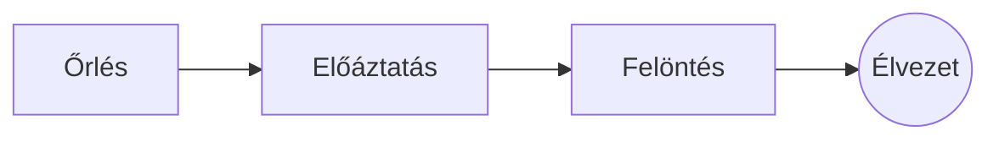

# A tökéletes pour-over

Egy lassú reggeli szertartás néhány lépésben. Írja a **forráskódban** balra, vagy közvetlenül az *előnézetben* jobbra: mindkettő szinkronban marad, és ==minden módosítás tiszta változtatás== a Markdownban.

> [!TIP]
> A forráspont alatti, nagyjából 94 °C-os víz édességet hoz ki, keserűség nélkül.

## Az arány

A legtöbb recept egy rész kávéra tizenhat rész vizet számít:

$$
m_{\text{víz}} = 16 \times m_{\text{kávé}}
$$

Tehát $20\,\text{g}$ kávéhoz $320\,\text{g}$ víz kell.

## Lépésről lépésre



## Főzési módok

| Módszer      | Őrlés           |  Idő |
|:-------------|:---------------:|-----:|
| Pour-over    | Közepesen finom | 3:30 |
| Francia prés | Durva           | 4:00 |
| Eszpresszó   | Finom           | 0:28 |

## Mielőtt elkezdi

- [x] Frissen pörkölt szemek :coffee:
- [x] Kúpkésű daráló
- [ ] Hattyúnyakú kanna

```python
def water_for(coffee_g: float, ratio: int = 16) -> float:
    return coffee_g * ratio
```

Előáztatás
: A víz első löttyintése, amitől a kávé kiengedi a gázait.[^1]

[^1]: A friss szemek emelkednek a legtöbbet; a régiek alig.
