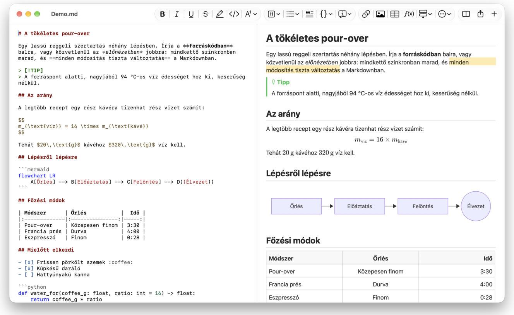
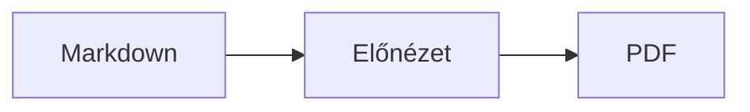

<p>&nbsp;&nbsp;&nbsp;</p>

# Splat

**A macOS-es Markdown-szerkesztő, amelyben a forráskódban és közvetlenül az előnézetben is írhat.**

A Splat balra szintaxiskiemeléssel mutatja a Markdown-forráskódot, jobbra élő, teljesen szerkeszthető előnézetet. Bármelyikben gépelhet: amit az előnézetben ír, az a forráskódban a lehető legkisebb módosításként jelenik meg, így az érintetlen sorok bájtra pontosan változatlanok maradnak, a Git-diffek pedig tiszták. A Splat érti a már megszokott Markdownt: a CommonMarkot és a GitHub Flavored Markdownt, a GitHub-figyelmeztetéseket, az Obsidian wikilinkjeit, beágyazásait és megjegyzésdobozait, a Pandoc és a Typora bővítéseit, a beágyazott HTML-t, a LaTeX-képleteket, valamint a Mermaid-, Graphviz- és PlantUML-diagramokat, mindezt offline megjelenítve. Böngészhet és kereshet egy teljes jegyzetmappában, megnézheti, mi változott a legutóbbi Git-commit óta, Markdownként illeszthet be Wordből vagy weboldalról, és egy kattintással exportálhat PDF-be, HTML-be vagy Wordbe. Rustban íródott, valódi AppKit-vezérlőkre épül, 35 nyelven szól, és semmit nem küld a hálózaton, hacsak Ön nem kéri.
 


[](https://github.com/sventmueller/splat/releases/latest/download/Splat.dmg)

**[Download Splat.dmg](https://github.com/sventmueller/splat/releases/latest/download/Splat.dmg)**: az Apple aláírta és hitelesítette, macOS 14 vagy újabb rendszerhez, Apple Silicon és Intel gépekre.

**Hibát talált?** A Splat bájtra pontosan változatlanul hagyja azokat a sorokat, amelyekhez nem nyúlt. Ha valamelyik mégis megváltozik, vagy egy fájl hibásan jelenik meg, [nyisson egy issue-t](https://github.com/sventmueller/splat/issues/new/choose), és csatolja a fájlt. Ha hasznosnak találja a Splatet, egy [csillag a GitHubon](https://github.com/sventmueller/splat) segít másoknak megtalálni.
 
 

[](https://www.rust-lang.org)
[](https://www.apple.com/macos/)

[](https://github.com/madsmtm/objc2)
[](https://webkit.org)
[](https://github.com/kivikakk/comrak)
[](https://github.github.com/gfm/)
[](https://www.mathjax.org)
[](https://cortexjs.io/mathlive/)
[](https://mermaid.js.org)
[](https://graphviz.org)
[](https://plantuml.com)


[](#licenc)

[Bahasa Indonesia](../id/README.md) ·
[Bahasa Melayu](../ms/README.md) ·
[Català](../ca/README.md) ·
[Čeština](../cs/README.md) ·
[Dansk](../da/README.md) ·
[Deutsch](../de/README.md) ·
[English](../../../README.md) ·
[Español](../es/README.md) ·
[Français](../fr/README.md) ·
[Hrvatski](../hr/README.md) ·
[Italiano](../it/README.md) ·
**Magyar** ·
[Nederlands](../nl/README.md) ·
[Norsk](../no/README.md) ·
[Polski](../pl/README.md) ·
[Português (Brasil)](../pt_BR/README.md) ·
[Português (Portugal)](../pt_PT/README.md) ·
[Română](../ro/README.md) ·
[Slovenčina](../sk/README.md) ·
[Slovenščina](../sl/README.md) ·
[Suomi](../fi/README.md) ·
[Svenska](../sv/README.md) ·
[Tiếng Việt](../vi/README.md) ·
[Türkçe](../tr/README.md) ·
[Ελληνικά](../el/README.md) ·
[Русский](../ru/README.md) ·
[Українська](../uk/README.md) ·
[עברית](../he/README.md)‎ ·
[العربية](../ar/README.md)‎ ·
[हिन्दी](../hi/README.md) ·
[ไทย](../th/README.md) ·
[한국어](../ko/README.md) ·
[日本語](../ja/README.md) ·
[简体中文](../zh-Hans/README.md) ·
[繁體中文](../zh-Hant/README.md)

## Tartalom

- [Az áttekintés](#az-áttekintés)
- [Rendszerkövetelmények](#rendszerkövetelmények)
- [Telepítés](#telepítés)
- [Első lépések](#első-lépések)
- [Írás](#írás)
  - [A forráskódban](#a-forráskódban)
  - [Az előnézetben](#az-előnézetben)
  - [Formázási parancsok](#formázási-parancsok)
  - [Listák és feladatok](#listák-és-feladatok)
  - [Táblázatok](#táblázatok)
  - [Formázott szöveg beillesztése](#formázott-szöveg-beillesztése)
  - [Metaadatok](#metaadatok)
- [Támogatott Markdown](#támogatott-markdown)
  - [CommonMark és GitHub Flavored Markdown](#commonmark-és-github-flavored-markdown)
  - [Megjegyzésdobozok](#megjegyzésdobozok)
  - [Bővített szintaxis](#bővített-szintaxis)
  - [Obsidian](#obsidian)
  - [Idézetek és hivatkozások](#idézetek-és-hivatkozások)
  - [Beágyazott HTML](#beágyazott-html)
  - [Tipográfiai írásjelek](#tipográfiai-írásjelek)
  - [Szintaxisáttekintés](#szintaxisáttekintés)
- [Képletek](#képletek)
- [Diagramok](#diagramok)
- [Képek](#képek)
- [Linkek és navigáció](#linkek-és-navigáció)
- [Jegyzetek egy mappában](#jegyzetek-egy-mappában)
- [Változások a legutóbbi commit óta](#változások-a-legutóbbi-commit-óta)
- [Exportálás, nyomtatás és megosztás](#exportálás-nyomtatás-és-megosztás)
- [Word-dokumentumok importálása](#word-dokumentumok-importálása)
- [Megjelenés és kisegítő lehetőségek](#megjelenés-és-kisegítő-lehetőségek)
- [Nyelvek](#nyelvek)
- [Billentyűparancsok](#billentyűparancsok)
- [Adatvédelem és biztonság](#adatvédelem-és-biztonság)
- [Nagy dokumentumok](#nagy-dokumentumok)
- [Ismert korlátozások](#ismert-korlátozások)
- [Hibaelhárítás](#hibaelhárítás)
- [Fejlesztőknek](#fejlesztőknek)
  - [Harmadik féltől származó összetevők](#harmadik-féltől-származó-összetevők)
- [Licenc](#licenc)

## Az áttekintés

- **Kétféle írásmód, egyetlen szöveg.** A forráskód és az előnézet is szerkeszthető. A Markdown-fájl az egyetlen igazság: dokumentumonként egyetlen visszavonási előzmény van, és minden előnézeti módosítás a forráskód lehető legkisebb módosításává alakul.
- **A már megszokott Markdown.** CommonMark, GitHub Flavored Markdown, GitHub-figyelmeztetések, Obsidian, a Pandoc és a Typora bővítései, emojikódok, spoilerek, definíciós listák, címsorhorgonyok és a GitHub README-fájlokban megszokott HTML.
- **Beépített képletek és diagramok.** LaTeX-képletek MathJaxszel, vizuális képletszerkesztővel. Mermaid-, Graphviz- és PlantUML-diagramok, amelyeket a Mac Java, szerver és hálózati kapcsolat nélkül jelenít meg.
- **Mindenre van gomb.** Minden Markdown-elemhez tartozik eszközsorgomb és menüpont, a gyakoriakhoz billentyűparancs is. A táblázatoknak saját menüjük van a sorokhoz, oszlopokhoz és az igazításhoz.
- **Mappa, nem csak fájl.** Az oldalsáv felsorolja a dokumentum melletti jegyzeteket, és mindegyikben keres. Egy jegyzet átnevezésekor a rá mutató linkek is módosulnak, körülöttük pedig minden bájt a helyén marad.
- **Változások egy pillantásra.** Git-tárolóban a szöveg melletti sávok mindkét panelen jelölik, mi tér el a legutóbbi committól.
- **Wordből és a webről Markdownba.** Illesszen be formázott szöveget Markdownként, táblázatkezelőből cellákat táblázatként, és importáljon teljes Word-dokumentumokat a képeikkel együtt.
- **Exportálás veszteség nélkül.** PDF, egyetlen önálló HTML-fájl vagy Word-dokumentum valódi címsorokkal, listákkal, táblázatokkal, lábjegyzetekkel és képekkel. Hozzáadhat oldalszámokat, fejléceket és címoldalt, vagy használhatja a cége Word-sablonját.
- **Tősgyökeresen natív.** Valódi AppKit-ablakok, lapok, menük, előugró panelek, Verziók, Automatikus mentés, a megosztási menü, sötét mód, helyesírás-ellenőrzés, diktálás és VoiceOver. Nincs Electron, és magához a szöveghez sem webnézet tartozik.
- **Gyors nagy fájloknál is.** Egy billentyűleütés megjelenítése egy 10 MB-os dokumentumban nagyjából 10 ms, a nézet saját munkája előtt.
- **Diszkrét és körültekintő.** Az internetes képek csak az Ön engedélye után töltődnek be, a más appokra mutató linkek előbb rákérdeznek, és minden, ami megbízhatatlan képadatot dekódol, elszigetelt segédfolyamatokban fut.
- **Az Ön nyelvén.** A felület és a beépített Markdown-gyorsreferencia 35 nyelven érhető el: angol, arab, katalán, kínai (egyszerűsített), kínai (hagyományos), horvát, cseh, dán, holland, finn, francia, német, görög, héber, hindi, magyar, indonéz, olasz, japán, koreai, maláj, norvég, lengyel, portugál (Brazília), portugál (Portugália), román, orosz, szlovák, szlovén, spanyol, svéd, thai, török, ukrán és vietnami.

## Rendszerkövetelmények

- macOS 14 Sonoma vagy újabb. A Splatot macOS 27 alatt fejlesztik és tesztelik, ahol automatikusan átveszi a Liquid Glass dizájnt.
- Apple Silicon vagy Intel processzoros Mac.
- Körülbelül 45 MB szabad tárhely.

## Telepítés

**Lemezképből.** Töltse le a [`Splat.dmg`](https://github.com/sventmueller/splat/releases/latest/download/Splat.dmg) fájlt, nyissa meg, és húzza a Splatot az Alkalmazások mappára. A lemezképet Developer ID-val írták alá, és az Apple hitelesítette, így figyelmeztetés nélkül megnyílik.

**Homebrew-val.** A cask saját tapben található:

```sh
brew install --cask sventmueller/tap/splat
```

A `brew upgrade --cask splat` telepíti az új verziókat, a `brew uninstall --zap --cask splat` pedig a Splat beállításait és gyorsítótárait is eltávolítja.

**Frissítések.** A lemezképből vagy Homebrew-val telepített Splat a [Sparkle](https://sparkle-project.org) segítségével naprakészen tartja magát. A második indításkor megkérdezi, hogy naponta egyszer magától kereshet-e frissítéseket. A **Splat › Frissítések keresése…** azonnal keres; a **Frissítések automatikus keresése** és a **Frissítések automatikus letöltése és telepítése** ugyanebben a menüben később módosítja a választást. A Splat csak olyan frissítést telepít, amely hordozza a fejlesztő aláírását. A saját fordítású változatnak nincs frissítője.

**Forráskódból.** Az előfeltételeket lásd a [Fordítás](../../../docs/development.md#building) szakaszban, majd:

```sh
make build
ditto target/release/Splat.app /Applications/Splat.app
open /Applications/Splat.app
```

Ha a Markdown-fájlokat dupla kattintásra a Splattal szeretné megnyitni, jelöljön ki egy `.md` fájlt a Finderben, válassza a **Fájl › Infó megjelenítése** parancsot, a **Megnyitás ezzel** alatt válassza a Splatot, és kattintson az **Összes módosítása…** gombra. A Splat a `.md`, `.markdown`, `.mdown` és `.mkd` fájlokhoz regisztrálja magát.

## Első lépések

### Az ablak

Minden dokumentum saját ablakban nyílik meg, vagy lapként, ha jobban szereti a lapokat:

- **Balra: a forráskód.** A Markdown SF Mono betűtípussal, szintaxiskiemeléssel.
- **Jobbra: az előnézet.** A megjelenített dokumentum, szerkesztésre készen.
- **Oldalsáv (nem kötelező).** Az összes címsor fastruktúrában, egy kattintás mindkét panelen megmutatja a kiválasztottat: **Nézet › Vázlat megjelenítése** (⌃⌘S). Két további lap a [mappában lévő jegyzeteket](#jegyzetek-egy-mappában) és a bennük való keresést tartalmazza. Az ablak címe melletti gomb megjeleníti és elrejti, az új ablakok pedig úgy nyitják meg, ahogy az utolsó ablak hagyta.
- **Eszközsor.** A gombok aszerint vannak csoportosítva, hogy mit módosítanak: karaktereket, bekezdéseket és beszúrt elemeket, majd az előnézet be- és kikapcsolását, a megosztást és az új dokumentumot. A **Nézet › Eszközsor testreszabása…** paranccsal alakíthatja át.

Az elválasztót húzva bármelyik oldalnak több helyet adhat. A **Nézet › Előnézet elrejtése** (⌥⌘P) csak a forráskódot hagyja meg; a Splat ezt ablakonként megjegyzi. A két panel együtt görget, és az egyikben kijelölt rész a másikban is ki van emelve.

Az ablak sarka mutatja a szöveg szavainak és karaktereinek számát és az olvasási időt, valamint ugyanezt a kijelölésre, amíg van kijelölés. A linkcímek, a HTML-címkék, a metaadatok, a megjegyzések, a képletek és a diagramok nem számítanak bele. A kijelző alapból rejtve van; a **Nézet › Szószám megjelenítése** jeleníti meg.

### Dokumentumok, lapok és verziók

A Splat egy hagyományos macOS-es dokumentumalkalmazás:

- **Automatikus mentés és Verziók.** A módosítások helyben mentődnek. A **Fájl › Visszaállítás erre › Összes verzió böngészése…** visszaviszi az időben.
- **Más programok módosításai.** Ha a Git, egy szkript vagy egy másik szerkesztő módosít egy megnyitott dokumentumot, a Splat újratölti, és megtartja a kurzor helyét és a görgetési pozíciót. Ha Önnek is vannak mentetlen módosításai, a Splat megtartja azokat, a macOS pedig rákérdez, mielőtt felülírná a másik verziót.
- **A megszokott fájlparancsok.** Megkettőzés (⇧⌘S), Átnevezés…, Áthelyezés ide…, valamint a **Fájl › Legutóbbi megnyitása**.
- **Lapok.** A **Fájl › Új lap** vagy az eszközsor **+** gombja új dokumentumot nyit lapként; a szabványos Ablak menü egyesíti, áthelyezi és váltogatja a lapokat.
- **Ablak elhelyezése.** Az utolsó ablak mérete és helye megmarad, újraindítás után is. Ha ott már áll egy ablak, az új kissé eltolva nyílik meg.
- **A Dock ikonja.** Ha az utolsó ablak bezárása után rákattint, új dokumentum nyílik.
- **Markdown-fájlok megnyitása a Splattal.** A **Splat › Beállítás alapértelmezett appként a Markdownhoz** hatására a `.md` vagy `.markdown` fájlokra duplán kattintva a Splat nyílik meg; a macOS egyszer megerősítést kér. A menüpont mellett pipa látszik, amíg a Splat az alapértelmezett.

A fájloknak UTF-8 szövegnek vagy bájtsorrendjellel ellátott UTF-16-nak kell lenniük. A Splat elutasítja a többi kódolást ahelyett, hogy találgatna és megrongálná a szöveget. A bájtsorrendjel megmarad, az UTF-16 UTF-16 marad, és ha egy fájl minden sora CRLF-fel végződik, az Ön által hozzáadott sorok is CRLF-et kapnak.

**Összeomlás után** legfeljebb az utolsó néhány másodpercnyi gépelés vész el: a Splat öt másodpercenként átmásolja a mentetlen szöveget a `~/Library/Application Support/Splat/Unsaved` mappába, és törli a másolatokat, amint a dokumentum mentve van, vagy a Splat normálisan kilép. A következő indításkor áthelyezi azt, amit egy összeomlás ott hagyott, a `~/Library/Application Support/Splat/Recovery` mappába, és ezt egyszer jelzi, egy gombbal, amely megnyitja a mappát. Ha a Splat az összeomlásra még tud reagálni, az összes megnyitott dokumentum szövegét is oda írja.

### Gyorsreferencia

A **Súgó › Markdown-gyorsreferencia** a saját nyelvén nyit meg egy puszta tájékoztatót új, névtelen dokumentumként. Hagyományos dokumentum, ezért mindent kipróbálhat rajta, akár a forráskódban, akár az előnézetben.

## Írás

### A forráskódban

A forráskód egy Markdownra hangolt egyszerű szövegszerkesztő:

- **Szintaxiskiemelés** a VS Code-hoz hasonlóan: címsorok, kiemelések, linkek, kód, táblázatok, HTML, front matter, valamint a képletekben és diagramokban a LaTeX és a Mermaid. Van paletta világos és sötét módhoz, valamint a Kontraszt növelése beállításhoz.
- **A kerített kódblokkok** kiemelést kapnak Bash, C, C++, C#, CSS (SCSS és Less is), Go, HTML, XML, Java, JavaScript, JSON, Kotlin, PHP, Python, Ruby, Rust, SQL, Swift, TypeScript, YAML, TeX és Mermaid esetén, a szokásos rövid neveikkel együtt, például `js`, `py` vagy `sh`.
- **Nincsenek meglepő cserék.** Az intelligens idézőjelek, az intelligens kötőjelek és a csereszöveg alapból ki vannak kapcsolva, mert elrontják a `--`, a `---` és a `"` jeleket. A **Szerkesztés › Helyettesítések** alatt kapcsolhatja be őket.
- **A rendszer írást segítő eszközei.** Helyesírás- és nyelvtani ellenőrzés, diktálás, Keresés és csere (⌥⌘F), valamint Beszéd.
- **Húzás és ejtés.** Ha képfájlt ejt a szerkesztőre, beszúrja a `` sort, bármely más fájl esetén a rá mutató linket, URL esetén pedig a `[url](url)` sort. Minden ejtés egyetlen visszavonási lépés.
- **Képek beillesztése.** A vágólapon lévő kép, például egy képernyőkép, PNG-fájlként a dokumentum mellé kerül (`Kép 2026-10-29 13.09.07.png`), és képként beszúrásra kerül. Ehhez a dokumentumot legalább egyszer menteni kell.

### Az előnézetben

Az előnézet úgy viselkedik, mint egy szövegszerkesztő, de minden, amit benne tesz, Markdownként végződik:

- **Gépelés.** A Markdownban jelentéssel bíró karaktereket, például a `*` vagy a `#` jelet, a Splat védőkarakterrel látja el, így úgy jelennek meg, ahogy begépelte őket.
- A **Return** új bekezdést vagy listaelemet kezd. A **⌥Return** vagy a **⌃Return** sortörést szúr be.
- **Formázás a kurzornál.** Ha a kurzor egy szó végén áll, a Félkövér, a Dőlt és a többi karakterformátum arra vonatkozik, amit ezután gépel. A formátum újbóli kiválasztása leállítja. Szón belül az egész szót formázza.
- **Üres sorok.** Az üres soron a Return újabb üres sort ad hozzá, a Backspace pedig eltávolítja. A forráskódban minden további üres sor két újabb üres sort jelent; más Markdown-programok ezeket normál bekezdésközként jelenítik meg.
- **Visszavonás** mindkét panelen működik. A visszavonási elemek nevet viselnek („Félkövér visszavonása”), a gépelés sorozatonként egy lépés, és a Visszavonás és az Ismétlés után mindkét panel a módosításhoz görget.
- **A képletek és a diagramok** kész grafikaként jelennek meg. Kattintson rájuk, vigye rájuk a kurzort, vagy nyomja meg rajtuk a Returnt a szerkesztőjük megnyitásához (lásd [Képletek](#képletek) és [Diagramok](#diagramok)).
- **A beágyazott HTML, a beágyazott jegyzetek és a front matter** látható, de a forráskódban szerkesztendő. Rájuk kattintva a kurzor a forráskód megfelelő helyére kerül.

Amit a Markdown nem tud kifejezni, azt az előnézet blokkolja: a Betűtípus- és Szín-panelt, a vonalzót, valamint a formázott szöveg és a képek beillesztését vagy ejtését. A beillesztett HTML és RTF egyszerű szövegként érkezik, hacsak nem a [Beillesztés Markdownként](#formázott-szöveg-beillesztése) parancsot választja.

### Formázási parancsok

Minden parancs elérhető az eszközsorról, a menüsorból és mindkét panel helyi menüjéből. A menüpontok pipával jelzik a kurzornál érvényes formázást.

| Menü | Parancsok |
|---|---|
| **Formátum › Betűtípus** | Félkövér, Dőlt, Aláhúzás, Áthúzás, Kiemelés, Kód, Felső index, Alsó index |
| **Formátum › Címsor** | Szövegtörzs, 1–6. címsor |
| **Formátum › Lista** | Felsorolásjeles lista, Számozott lista, Feladatlista |
| **Formátum** | Idézet, Kódblokk (Nyelv nélkül vagy a 20 nyelv egyike; egy meglévő blokk nyelvét is módosítja), Megjegyzésdoboz (Jegyzet, Tipp, Fontos, Figyelmeztetés, Vigyázat; ugyanaz a típus újra eltávolítja), Képlet vagy diagram szerkesztése…, Formázás törlése |
| **Beszúrás** | Link…, Kép…, Táblázat…, Képlet, Diagram (Folyamatábra, Szekvenciadiagram, Gantt-diagram), Tartalomjegyzék, Lábjegyzet, Elválasztóvonal |
| **Táblázat** | Sor beszúrása fölé/alá, Oszlop beszúrása balra/jobbra, Sor törlése, Oszlop törlése, Igazítás (Balra, Középre, Jobbra, Alapértelmezett), Táblázatoszlopok igazítása |
| **Nézet** | Előnézet elrejtése/megjelenítése, Vázlat megjelenítése/elrejtése, Tipográfiai írásjelek, Felnagyítás/Lekicsinyítés, Tényleges méret, eszközsor, lapsor, teljes képernyő |

Az aláhúzás, a kiemelés, a felső és az alsó index `<ins>`, `<mark>`, `<sup>` és `<sub>` formában íródik, amelyeket a GitHub is megjelenít. A Splat a `<u>` jelölést is érti, amelyet a GitHub eltávolít, valamint a rövidebb `==kiemelés==`, `^felső^` és `~alsó~` jelölést. A GitHub a `==` és a `^` jelet úgy mutatja, ahogy begépelték, a `~alsó~` pedig áthúzásként jelenik meg.

### Listák és feladatok

- A Return folytatja a listát; egy üres elemen a Return lezárja.
- A **Tab** és a **⇧Tab** az előnézetben behúzza, illetve kitolja a listaelemeket.
- A feladat jelölőnégyzetére kattintva az előnézetben a `- [ ]` és a `- [x]` között vált.
- A **Formátum › Lista** a kijelölt bekezdéseket listává alakítja, vagy módosítja a lista fajtáját.

### Táblázatok

- A **Beszúrás › Táblázat…** rákérdez a sorok (a fejléccel együtt) és az oszlopok számára.
- Az előnézetben a **Tab** a következő cellába, a **⇧Tab** az előzőbe, a **Return** pedig az alatta lévő cellába ugrik. Az utolsó cellában a Tab új sort ad hozzá.
- A **Táblázat** menü sorokat és oszlopokat szúr be és töröl, és beállítja egy oszlop igazítását (⌘{, ⌘|, ⌘}).
- A **Táblázat › Táblázatoszlopok igazítása** kitölti a forráskódot, hogy az oszlopok egymás alá kerüljenek.

### Formázott szöveg beillesztése

A **Szerkesztés › Beillesztés Markdownként** (⌃⌘V), amely mindkét panel helyi menüjében is megvan, a vágólap tartalmát Markdownná alakítja a kijelölés helyén, egyetlen visszavonási lépésként. A ⌘V továbbra is egyszerű szöveget szúr be.

- **Böngészőből, Wordből, Google Docsból, Confluence-ből, a Jegyzetekből vagy a Pagesből:** a címsorok, a félkövér, a dőlt, az aláhúzás, az áthúzás, a felső és az alsó index, a linkek, a listák a beágyazásukkal együtt, az idézetek, a kód és a táblázatok is átjönnek.
- **Táblázatkezelőből:** a cellákból fejlécsoros táblázat lesz, a számoszlopok jobbra igazítva. Ugyanez történik a tabulátorral, pontosvesszővel vagy vesszővel tagolt szöveggel, ha minden sorában ugyanannyi oszlop van.
- A webcímmel rendelkező **képek** linkek maradnak. A beillesztett HTML-ben lévő kép fájlként a dokumentum mellé kerül, amelyet ehhez egyszer menteni kell. A Word ideiglenes képfájljai nem jönnek át, az alternatív szövegük megmarad.
- A **linkek** csak a `http`, a `https`, a `mailto`, a relatív és a `#` címeket tartják meg; minden más linkből a szöveg marad meg.

### Metaadatok

A **Formátum › Metaadatok szerkesztése…** vagy egy kattintás az előnézet tetején lévő metaadatsorra megnyit egy űrlapot a YAML front matter mezőivel. A mezők módosíthatók, hozzáadhatók és eltávolíthatók. A listát tartalmazó mező lista marad: az értékei vesszővel elválasztva követik egymást, a vesszőt tartalmazó érték pedig idézőjelek között áll. A `tags`, `aliases`, `keywords`, `categories`, `authors` vagy `cssclasses` nevű új mező szintén lista lesz. A beágyazott mezők és a többsoros szöveg ott látható, szerkeszteni a forráskódban lehet őket.

Amit az űrlap módosít, az egyetlen visszavonási lépés, és csak az Ön által módosított mezők sorait érinti: az összes többi sor megjegyzései, sorrendje, szokatlan térközei, idézőjelei és sorvégei bájtra pontosan változatlanok maradnak. A metaadatok nélküli dokumentum az elején kap egy blokkot.

## Támogatott Markdown

A Splat a [comrak](https://github.com/kivikakk/comrak) elemzővel dolgozik, amely CommonMark- és GFM-kompatibilis, és bekapcsolja a legtöbb bővítményét. Az alábbi mind megjelenik az előnézetben és az összes exportban.

### CommonMark és GitHub Flavored Markdown

- Címsorok (`#` jellel és aláhúzással), bekezdések, sortörések, kiemelés, erős kiemelés, szövegközi kód, idézetblokkok, elválasztóvonalak.
- Felsorolásjeles, számozott és egymásba ágyazott listák; feladatlisták.
- Linkek (szövegközi, hivatkozásos és automatikus), képek, linkhivatkozás-definíciók.
- Kerített és behúzott kódblokkok szintaxiskiemeléssel.
- Táblázatok oszlopigazítással.
- Áthúzás `~~két hullámvonallal~~`.
- Lábjegyzetek: `szöveg[^1]` és a dokumentum bármely pontján a `[^1]: A jegyzet.` sor. A jelölőre kattintva a jegyzethez ugrik.
- YAML front matter a legfelső `---` sorok között. Az előnézet egyetlen sorban összegzi, például „Metaadatok: cím, dátum, címkék”.

### Megjegyzésdobozok

A GitHub-figyelmeztetések színes dobozként jelennek meg ikonnal és címmel:

```markdown
> [!NOTE]
> Hasznos információ, amelyet a felhasználóknak érdemes tudniuk.

> [!WARNING]
> Kritikus tartalom, amely azonnali figyelmet igényel.
```

Az öt típus: Jegyzet, Tipp, Fontos, Figyelmeztetés és Vigyázat. A **Formátum › Megjegyzésdoboz** a kurzornál lévő bekezdést alakítja ilyenné.

Az Obsidian megjegyzésdobozai is működnek, tetszőleges címmel és összecsukási állapottal:

```markdown
> [!tip]- Kattintson a ▸ jelre a kibontáshoz
> Megnyitásig rejtve.

> [!question]+ Alapból kibontva
> A `+` kibontva, a `-` összecsukva indul.
```

Az Obsidian további típusait az öt szín közül a legközelebbivel jeleníti meg: a `success`, `check`, `done` és `hint` Tippként; a `question`, `help` és `faq` Fontosként; az `attention` Figyelmeztetésként; a `failure`, `fail`, `missing`, `danger`, `error` és `bug` Vigyázatként; minden más Jegyzetként.

### Bővített szintaxis

| Funkció | Szintaxis | Eredet |
|---|---|---|
| Kiemelés | `==kiemelt szöveg==` | Obsidian, Typora |
| Felső index | `x^2^` | Pandoc, Typora |
| Alsó index | `H~2~O` | Pandoc, Typora |
| Emojikód | a `:rocket:` jelből 🚀 lesz | GitHub |
| Spoiler | `\|\|rejtett szöveg\|\|`, jelölje ki az olvasáshoz | Discord |
| Szövegközi lábjegyzet | `szöveg^[maga a jegyzet]` | Pandoc, Obsidian |
| Definíciós lista | `Fogalom`, üres sor, `: Magyarázat` | PHP Markdown Extra, Pandoc |
| Címsorhorgony | `## Telepítés {#setup}`, link: `[lásd](#setup)` | Pandoc, kramdown |

A definíciós listák a forráskódban így néznek ki:

```markdown
Fogalom

: A fogalom magyarázata.
```

Egyéni horgony nélkül minden címsor kap egyet a szövegéből képezve, mint a GitHubon: a `## Első lépések` az `#első-lépések` címen érhető el.

### Obsidian

- **Wikilinkek.** A `[[Jegyzet]]` a `Jegyzet.md` fájlra mutat ugyanabban a mappában vagy az alatta lévőben. A `[[Jegyzet|Megjelenített szöveg]]` az Ön szövegét mutatja, a `[[Jegyzet#Címsor]]` pedig megnyitja a jegyzetet. A ⌘-kattintás megnyitja a Splatban.
- **Beágyazások.** A `![[Jegyzet]]` a másik jegyzetet mutatja ebben; a benne beágyazott jegyzetek linkként jelennek meg. A `![[diagram.png]]` képet mutat. Az Obsidianhoz hasonlóan a beágyazások a dokumentum mappájában vagy az alatt lévő jegyzeteket és képeket nevezik meg, abszolút útvonallal soha, és csak a Markdown-fájlok jelennek meg jegyzetként.
- **Megjegyzések.** A `%%Csak a forrásban%%` látható marad a forráskódban, az előnézetből és minden exportból kimarad, szövegközben és önálló sorokban is.
- **Címkék.** Az `#ötlet` vagy a `#projekt/splat` ki van emelve. A ⌘-kattintás megkeresi a címkét a dokumentumban, az oldalsávon pedig a teljes mappában.
- **Összecsukható megjegyzésdobozok.** Lásd [Megjegyzésdobozok](#megjegyzésdobozok).

### Idézetek és hivatkozások

- **Pandoc-idézetek.** A `[@doe2020]` vagy a `[@doe2020; @roe2021]` úgy olvasható, mint „(Doe 2020; Roe 2021)”. A bejegyzések abból a BibTeX-fájlból származnak, amelyet a front matter a `bibliography: refs.bib` sorral megnevez. Enélkül a Splat a dokumentum melletti `references.bib`, `literatur.bib` vagy `bibliography.bib` fájlt használja.
- **GitHub- és GitLab-hivatkozások.** Ha a dokumentum olyan Git-tárolóban van, amelynek `origin` távoli tárolója a github.com vagy egy GitLab-gazdagép, a `@név`, a `#12` (hibajegy) és a `!7` (merge request, csak GitLab) ki van emelve. A ⌘-kattintás megnyitja őket a böngészőben.

### Beágyazott HTML

A GitHub README-fájljaiban megszokott HTML megjelenik, böngészőmotor helyett saját értelmezővel:

- középre igazított bekezdések és blokkok (`<p align="center">`, `<div align="center">`)
- méretezett képek (``)
- linkek, `<kbd>⌘</kbd>`, `<br>`, `<u>`, `<ins>`, `<mark>`, `<sup>`, `<sub>`
- listák és táblázatok, az oszlopokat átfogó cellákkal együtt (`colspan`)
- kibontható szakaszok: `<details><summary>Továbbiak</summary>…</details>`, a ▸ jelre kattintva nyílnak

A HTML-címkék közötti Markdown Markdownként jelenik meg. A szkriptek, stílusok, keretek és űrlapok teljesen kimaradnak, a linkek és a képek pedig csak a `http`, `https`, `mailto` és a relatív címeket tartják meg.

### Tipográfiai írásjelek

A **Nézet › Tipográfiai írásjelek** az egyenes idézőjeleket a felület nyelvének idézőjeleiként, a `--` jelet nagykötőjelként, a `---` jelet hosszú gondolatjelként, a `...` jelet pedig három pontként mutatja. Németben a `"Ja"` „Ja“ lesz, franciában «Oui», japánban 「はい」, a kínai és a japán szedésnél is, ahol az idézőjel elé és mögé nem kerül szóköz; a héber rövidítések, például a `צה"ל`, megkapják a gérsájimot, צה״ל. A forráskód megtartja az egyszerű karaktereket; az előnézet és az összes export a tipográfiaiakat mutatja. A beállítás addig ki van kapcsolva, amíg be nem kapcsolja.

### Szintaxisáttekintés

| Elem | Markdown |
|---|---|
| **Félkövér** | `**Félkövér**` |
| *Dőlt* | `*Dőlt*` |
| Aláhúzás | `<ins>Aláhúzás</ins>` vagy `<u>Aláhúzás</u>` |
| ~~Áthúzás~~ | `~~Áthúzás~~` |
| Kiemelés | `<mark>Kiemelés</mark>` vagy `==Kiemelés==` |
| `Kód` | `` `Kód` `` |
| x² | `x<sup>2</sup>` vagy `x^2^` |
| H₂O | `H<sub>2</sub>O` vagy `H~2~O` |
| [Link](https://example.com) | `[Link](https://example.com)` |
| Címsor | `# Címsor` – `###### Címsor` |
| Idézet | `> Idézet` |
| Felsorolásjeles lista | `- Elem` |
| Számozott lista | `1. Elem` |
| Feladat | `- [ ] Nyitott` és `- [x] Kész` |
| Kódblokk | ```` ```rust ```` … ```` ``` ```` |
| Táblázat | `\| A \| B \|` és a fejléc alatt `\|---\|---\|` |
| Lábjegyzet | `Szöveg[^1]` és `[^1]: Jegyzet` |
| Elválasztóvonal | `---` |
| Kép | `` |
| Képlet | `$E = mc^2$`, `$$ … $$` |
| Diagram | ```` ```mermaid ````, ```` ```dot ````, ```` ```plantuml ```` |
| Megjegyzésdoboz | `> [!TIP]` |
| Wikilink | `[[Jegyzet]]`, `[[Jegyzet\|Szöveg]]` |
| Beágyazás | `![[Jegyzet]]`, `![[image.png]]` |
| Megjegyzés | `%%Megjegyzés%%` |
| Címke | `#címke` |
| Idézet forrásra | `[@key]` |
| Spoiler | `\|\|Spoiler\|\|` |
| Emoji | `:tada:` |

## Képletek

A képleteket a [MathJax](https://www.mathjax.org) jeleníti meg a TeX- és AMS-matematikai csomagjával, éles vektorgrafikaként. A `\text{…}` jelölésben álló szöveg bármilyen írásrendszerű lehet: amit a MathJax betűtípusai nem tartalmaznak, azt a Mac betűtípusai adják, az arab és a héber jobbról balra haladva, az emoji pedig színesen.

| Fajta | Szintaxis |
|---|---|
| Szövegközi | `$E = mc^2$`, `` $`E = mc^2`$ `` (GitHub, GitLab), `\(E = mc^2\)` |
| Kiemelt | `$$` … `$$`, `\[` … `\]`, vagy `math` jelölésű kódblokk |

**Képlet szerkesztése.** Kattintson az előnézetben egy képletre, kattintson rá duplán, nyomja meg rajta a Returnt, vagy vigye rá a kurzort, és megnyílik a szerkesztője egy előugró panelen. A **Beszúrás › Képlet** újat szúr be, és rögtön megnyitja a szerkesztőt.

- **Vizuális vagy LaTeX.** A felül lévő kapcsoló vált a vizuális szerkesztő ([MathLive](https://cortexjs.io/mathlive/)) és a LaTeX-kód között. A Splat megjegyzi a választást.
- **Építőelemek** törthöz, négyzetgyökhöz, felső és alsó indexhez, összeghez és integrálhoz határokkal, határértékhez, a tartalommal együtt növekvő zárójelekhez, 2×2-es mátrixhoz, görög betűkhöz, valamint relációkhoz, műveleti jelekhez és nyilakhoz. Helyőrzőket hagynak maguk után: □, a **Tab** pedig a következőre ugrik.
- **Élő előnézet.** A módosítások gépelés közben megjelennek a dokumentumban. A MathJax hibái egy sorban láthatók a kód alatt.
- **Elfogadás vagy elvetés.** A kattintás a szerkesztőn kívül egyetlen visszavonási lépésként megtartja a módosítást; az **Esc** vagy a **Mégsem** eldobja. Egy új, üres képlet Esc-kel való elhagyása újra eltávolítja.
- A helyi menü a mutató alatti képlethez felkínálja a **Képlet szerkesztése…** parancsot.

A VoiceOver a képletet a LaTeX-kódjaként olvassa fel. A Splat képleteket jelenít meg, nem teljes LaTeX-dokumentumokat: nincsenek csomagok, nincs TikZ és nincs `\documentclass`.

## Diagramok

A diagramok a Splaton belül, offline és világos meg sötét változatban jelennek meg.

| Motor | Kódblokk | Mit rajzol |
|---|---|---|
| [Mermaid](https://mermaid.js.org) | ```` ```mermaid ```` | folyamatábrák, szekvencia-, osztály-, állapot-, egyed-kapcsolat-, Gantt- és kördiagramok, gondolattérképek, idővonalak és minden más Mermaid-típus |
| [Graphviz](https://graphviz.org) | ```` ```dot ```` vagy ```` ```graphviz ```` | gráfok a DOT nyelven |
| [PlantUML](https://plantuml.com) | ```` ```plantuml ```` vagy ```` ```puml ```` | UML-diagramok; Java nélkül fut |



A **diagram szerkesztése** a képlet szerkesztéséhez hasonlóan működik: kattintson rá, és a kód megnyílik egy előugró panelen, szintaxiskiemeléssel és a hibaüzenetekkel a kód alatti sorban. A **Beszúrás › Diagram** folyamatábra, szekvenciadiagram vagy Gantt-diagram sablonjából indul. Építőelemek segítenek a három leggyakoribb Mermaid-típusnál:

- **Folyamatábra:** Csomópont ▾ (téglalap, lekerekített, kör, rombusz, adatbázis), Kapcsolat, Feliratos kapcsolat, Csoport, Irány ▾
- **Szekvenciadiagram:** Résztvevő, Üzenet, Válasz, Jegyzet, Ciklus, Alternatív ágak
- **Gantt-diagram:** Szakasz, Feladat, Mérföldkő

A többi diagramtípust kódként kell szerkeszteni. A VoiceOver felolvassa a diagram címét vagy alternatív szövegét.

Az indítás utáni első diagram nagyjából egy másodpercig tart, mert a megjelenítő motor a háttérben indul. A 10 másodpercnél tovább tartó diagram hibát mutat, és a motor a következőhöz újraindul. A PlantUML motorja (3 MB) csak az első PlantUML-diagrammal töltődik be. A weben található PlantUML `!include` le van tiltva.

## Képek

- A **helyi képek** a dokumentumhoz viszonyított útvonalat használnak: ``. A Splat PNG, JPEG, GIF, WebP, BMP, SVG, HEIC, TIFF, AVIF és PDF formátumot jelenít meg.
- Az **internetes képek** blokkolva maradnak, amíg engedélyezi őket: az előnézet fölötti sáv elmagyarázza, hogy betöltésükkor a szervereik megtudják, hogy és mikor nyitja meg a dokumentumot. A **Képek betöltése** engedélyezi őket ehhez a dokumentumhoz; a Splat fájlonként megjegyzi a választást.
- **Méret.** Az `` méretezi a képet; egyébként a képek az előnézet szélességéhez igazodnak.
- **Módosítások a lemezen.** A lecserélt kép, vagy az, amelyik azután jelenik meg, hogy a dokumentum megnevezte, a dokumentum újranyitása nélkül látszik. A hálózat miatt sikertelen internetes képeket a Splat újra megpróbálja, amíg egy dokumentum mutatja őket.
- **Memória.** A képek a leghosszabb oldalukon legfeljebb 2560 képpontig jelennek meg, ami egy A4-es oldalt is kitölt. Kisebbre dekódolódnak, ha a Mac memóriájának egynyolcadát kitöltik, és amíg a macOS memóriaterhelést jelez.
- **Sötét mód.** A fehér hátterű képek a sötét előnézetben kissé elhalványulnak.
- **Beillesztés és ejtés.** Lásd [A forráskódban](#a-forráskódban).

## Linkek és navigáció

Az előnézetben a kattintás elhelyezi a kurzort, hogy szerkeszthesse a link szövegét; a **⌘-kattintás** követi a linket:

- A `http`, `https` és `mailto` a böngészőben vagy a levelezőappban nyílik meg.
- A Markdown-fájlok a Splatban nyílnak meg; a többi fájlt és mappát a Finderben jeleníti meg.
- Az `#anchor` a dokumentum címsorához ugrik.
- A más appot megnyitó címek, például a `slack://` vagy a `vscode://`, előbb rákérdeznek, és megmutatják a teljes címet és az appot. A **Mégsem** van előre kijelölve.

A **Beszúrás › Tartalomjegyzék** az összes címsor linkelt listáját szúrja be. Ha a kurzor benne áll, ugyanez a parancs frissíti. A vázlat az oldalsávon (⌃⌘S) mindkét panelen bármelyik címsorra ugrik.

## Jegyzetek egy mappában

Az oldalsáv tetején lévő gombok a vázlat, a fájlok és a keresés között váltanak.

- **Fájlok** (**Nézet › Fájlok megjelenítése**, ⌃⌘E). Az összes Markdown-fájl a dokumentum mappájában, vagy ha a mappa Git-tárolóban van, az egész tárolóban. Egy kattintás vagy a Return az ablak lapjaként nyit meg egy jegyzetet; ha már nyitva van, előtérbe kerül. A mappa neve melletti gomb másik mappát jelenít meg ebben az ablakban. A rejtett fájlok, a `node_modules`, a `target`, a `Pods`, a `DerivedData`, a `__pycache__` és a jegyzetek nélküli mappák kimaradnak. A közvetlenül a Saját mappájában lévő dokumentum csak a mellette lévő jegyzeteket mutatja, hogy a Splat ne járja be az összes mappáját, és ne kérdezzen rá mindegyikre.
- **Keresés** (**Szerkesztés › Keresés › Keresés az összes jegyzetben…**, ⇧⌘F). Szöveget keres az összes jegyzetben, a kis- és nagybetűktől és az ékezetek kódolásától függetlenül. A `#tag` címkét talál, a `#project` a `#project/splat` címkét is, kódon belül pedig semmit. Egy találatra kattintva a jegyzet azon a helyen nyílik meg.
- **Egy jegyzetre mutató linkek.** A jegyzet helyi menüje felsorolja a rá hivatkozó jegyzeteket, akár wikilinkkel, beágyazással, relatív linkkel vagy linkhivatkozás-definícióval.
- **Jegyzet átnevezése.** Ugyanez a menü átnevezi a jegyzetet, és módosítja ezeket a linkeket. A Splat előbb megmondja, hogy ez hány fájlban hány linket jelent. Minden linkben csak a név változik, a fájl minden más bájtja a helyén marad. A megnyitott dokumentumokban a módosítás visszavonási lépés; más fájlokban csak a Git vagy a Verziók tudja visszavonni. Ha egy fájlt közben egy másik program módosított, az az összes link átnevezését leállítja, és a Splat megnevezi a fájlt.

A lista követi a mappát, amikor az ablak előtérbe kerül. A keresés a fájlokat úgy nézi, ahogy a lemezen vannak, a még nem mentett szöveg pedig a következő automatikus mentéstől számít.

## Változások a legutóbbi commit óta

Git-tárolóban lévő dokumentumnál a szöveg melletti sávok jelölik, mi tér el a legutóbbi committól, a forráskódban és az előnézetben is: zöld a hozzáadott sorokat, kék a módosított sorokat, egy rövid piros jel pedig azt a helyet, ahonnan valami eltűnt. Gépelés közben és az ág elmozdulásakor frissülnek. A **Nézet › Változások a legutóbbi commit óta** kikapcsolja őket, az összes ablakban.

A csak a sorvégükben eltérő sorok nem számítanak, így egy CRLF-es fájl LF-es committal szemben nem mutat változást. Egy új fájlon az első commitjáig nincs jelölés, ahogy a 32 MB-nál nagyobb dokumentumokon sem.

## Exportálás, nyomtatás és megosztás

| Formátum | Hogyan | Mit kap |
|---|---|---|
| **PDF** | **Fájl › Exportálás PDF-ként…** vagy a Megosztás menü | Papírméretű oldalak, mindig világos megjelenéssel, a képletek és a diagramok vektorgrafikaként. A **Fájl › Oldalbeállítás…** állítja be a papírt. |
| **Nyomtatás** | **Fájl › Nyomtatás…** (⌘P) | Ugyanaz az elrendezés, mint a PDF-é. |
| **HTML** | **Fájl › Exportálás HTML-ként…** vagy a Megosztás menü | Egyetlen önálló fájl: a helyi képek beágyazva, a képletek és a diagramok éles képként, címsorhorgonyokkal, hogy a tartalomjegyzék működjön. Szkriptek nélkül. |
| **Word** | **Fájl › Exportálás Word-dokumentumként…** vagy a Megosztás menü | Egy `.docx` a Word címsorstílusaival, valódi listákkal és táblázatokkal (az egyesített cellákat is beleértve), a lábjegyzetek Word-lábjegyzetként, beágyazott képekkel, képletekkel és diagramokkal. |
| **Markdown** | Az eszközsor **Megosztás** gombja | A dokumentum `.md` fájlként a Mailhez, az Üzenetekhez, az AirDrophoz és minden más megosztási szolgáltatáshoz. |

A **Fájl › Megosztás** menü ezeket mind egy helyen kínálja. Az exportok a tipográfiai írásjelek beállítását és az Ön által engedélyezett internetes képeket használják; az internetes képek HTML-ben linkek maradnak.

A **Fájl › Exportálási beállítások…** az összes dokumentumra beállítja, mit ad a szöveghez a PDF, a nyomtatás és a Word:

- **Oldalszámok** a PDF és a nyomtatás láblécében, `2 / 9` formában.
- **Fejléc és lábléc** a PDF-hez és a nyomtatáshoz. A `{title}`, az `{author}`, a `{date}`, a `{page}` és a `{pages}` az értéküket jelöli, az első három a dokumentum metaadataiból.
- **Címoldal** a PDF-hez, a nyomtatáshoz és a Wordhöz, a metaadatok `title`, `subtitle`, `author` és `date` mezőivel, vagy címként a dokumentum nevével. Nincs rajta sem fejléc, sem lábléc.
- **Word-sablon**, egy `.docx` vagy `.dotx` fájl, amelynek a kinézetét az export átveszi: a stílusait, a lokalizált nevűeket is, a témáját, az oldalméretét, a margóit, a fejléceit és a lábléceit. Az olvashatatlan sablon leállítja az exportot, és ezt közli is, ahelyett hogy sablon nélküli dokumentumot adna.

## Word-dokumentumok importálása

A **Fájl › Word-dokumentum importálása…** bekér egy `.docx` vagy `.dotx` fájlt és azt, hová kerüljön a Markdownja, majd megnyitja az eredményt. A képek egy mellette lévő mappába kerülnek, amelynek neve a dokumentum neve `-images` végződéssel.

A címsorok és a listák úgy jönnek át, ahogy a Word stílusai és számozása meghatározzák őket, olyan dokumentumokban is, amelyek stílusainak lokalizált a neve. A félkövér, a dőlt, az aláhúzás, az áthúzás, a kiemelés, a felső és az alsó index, a linkek, az idézetek, a kód, a lábjegyzetek, a végjegyzetek és a táblázatok is átjönnek, az oszlopokat átfogó cellák HTML-táblázatként. A képletekből LaTeX lesz. A követett módosítások elfogadottnak számítanak, a tartalomjegyzék pedig kimarad, mert a **Beszúrás › Tartalomjegyzék** újat készít. A régi `.doc` fájlokat és a jelszóval védett dokumentumokat a Splat elutasítja.

## Megjelenés és kisegítő lehetőségek

- A **sötét mód** a rendszert követi. A képletek és a diagramok minden megjelenéshez külön készülnek.
- A Rendszerbeállítások **Kontraszt növelése** beállítása nagy kontrasztú palettákra váltja a szintaxiskiemelést.
- **Nagyítás.** A ⌘+, a ⌘− és a ⌘0 mindkét panelt átméretezi.
- **Teljes képernyő, lapok és testreszabható eszközsor**, mint minden Mac-appban.
- **VoiceOver.** A panelek felirata „Markdown-forráskód” és „Előnézet”, a képleteket a kódjukként, a diagramokat a címükként olvassa fel. Minden parancs elérhető a billentyűzetről.

A Splatnak nincs beállítási ablaka: a néhány opció ott van, ahol hatnak, a **Nézet**, a **Szerkesztés › Helyettesítések** és a **Fájl › Exportálási beállítások…** alatt.

## Nyelvek

A felület, a menük és a Markdown-gyorsreferencia 35 nyelvre van lefordítva:

angol, arab, katalán, kínai (egyszerűsített), kínai (hagyományos), horvát, cseh, dán, holland, finn, francia, német, görög, héber, hindi, magyar, indonéz, olasz, japán, koreai, maláj, norvég, lengyel, portugál (Brazília), portugál (Portugália), román, orosz, szlovák, szlovén, spanyol, svéd, thai, török, ukrán és vietnami.

A Splat a **Rendszerbeállítások › Általános › Nyelv és régió** nyelvi sorrendjét követi; ugyanott az **Alkalmazások** alatt a Splatnak külön nyelvet is választhat. Ha az Ön nyelvére nincs fordítás, angolt használ. A menük kifejezései az Apple saját fordításait követik, így a Splat úgy szól, mint a Mac többi része.

A héber és az arab szöveg mindenhol jobbról balra olvasódik, bármi is a felület nyelve: minden bekezdés, címsor és listaelem az első betűje irányát veszi fel, az idézetek és a megjegyzésdobozok a sávjukat jobb oldalra rajzolják, a jobbról balra kezdődő szövegű táblázat pedig az oszlopait jobbról sorolja fel. A kódblokkok balról jobbra maradnak. A PDF-, HTML- és Word-exportok megtartják ezeket az irányokat. Ha a rendszer nyelve héber vagy arab, a macOS az ablakot is tükrözi, így az előnézet balra kerül.

## Billentyűparancsok

| Művelet | Billentyűparancs |
|---|---|
| Félkövér, Dőlt, Aláhúzás | ⌘B, ⌘I, ⌘U |
| Áthúzás | ⇧⌘X |
| Kód | ⌥⇧⌘C |
| Link… | ⌘K |
| Szövegtörzs, 1–6. címsor | ⌥⌘0, ⌥⌘1–⌥⌘6 |
| Táblázatoszlop balra, középre, jobbra igazítása | ⌘{, ⌘\|, ⌘} |
| Az előnézet elrejtése vagy megjelenítése | ⌥⌘P |
| A vázlat megjelenítése vagy elrejtése | ⌃⌘S |
| A fájlok megjelenítése vagy elrejtése | ⌃⌘E |
| Keresés az összes jegyzetben | ⇧⌘F |
| Beillesztés Markdownként | ⌃⌘V |
| Felnagyítás, lekicsinyítés, tényleges méret | ⌘+, ⌘−, ⌘0 |
| Új dokumentum, megnyitás, mentés, megkettőzés | ⌘N, ⌘O, ⌘S, ⇧⌘S |
| Oldalbeállítás, nyomtatás | ⇧⌘P, ⌘P |
| Keresés, keresés és csere | ⌘F, ⌥⌘F |
| Következő, előző keresése; kijelölés használata; ugrás a kijelölésre | ⌘G, ⇧⌘G; ⌘E; ⌘J |
| Helyesírás és nyelvtan megjelenítése; dokumentum ellenőrzése | ⌘:, ⌘; |
| Beillesztés és stílus egyeztetése | ⌥⇧⌘V |
| Eszközsor elrejtése, összes lap megjelenítése, teljes képernyő | ⌥⌘T, ⇧⌘\\, ⌃⌘F |
| Sortörés (előnézet) | ⌥Return vagy ⌃Return |
| Következő / előző cella egy táblázatban (előnézet) | Tab / ⇧Tab |
| Listaelem behúzása / kitolása (előnézet) | Tab / ⇧Tab |
| Következő helyőrző a képletszerkesztőben | Tab |
| A képlet- vagy diagramszerkesztő bezárása módosítások nélkül | Esc |
| Link, címke vagy hivatkozás követése (előnézet) | ⌘-kattintás |

A Splat az Apple szabványos billentyűparancsait érintetlenül hagyja.

## Adatvédelem és biztonság

Egy Markdown-fájl bárkitől származhat, ezért a Splat minden dokumentumot megbízhatatlannak tekint.

- **Alapból nincs hálózat.** A Splat nem küld telemetriát. Csak akkor keres frissítéseket, ha beleegyezik, vagy a **Frissítések keresése…** parancsot választja: ilyenkor egy kis hírcsatorna-fájlt tölt be a GitHubról, és a kérés csak az appot és a verzióját nevezi meg. A képletek és a diagramok helyben jelennek meg; az ezt végző webnézetek nem érik el a hálózatot. A **Súgó › Probléma jelentése…** megnyit egy űrlapot a GitHubon a böngészőben; a címe tartalmazza a Splat és a macOS verzióját és a Mac típusát, de semmit az Ön dokumentumaiból.
- Az **internetes képek** csak az Ön engedélye után töltődnek be, csak `https` felett, soha nem a helyi hálózat gépeiről, egyenként legfeljebb 10 MB méretig, és sütik nélküli privát munkamenetben.
- **Elszigetelt dekódolás.** A képeket, valamint a képletek és a diagramok grafikáit segédfolyamatok dekódolják, amelyek az első bájt beolvasása előtt bezárnak minden örökölt fájlt, és homokozóba zárják magukat: nincs fájlhozzáférés, nincs hálózat. Csak képpontokat adnak vissza, amelyek méretét ellenőrzik, és 10 másodperc után leállítják őket. Az Apple saját képdekódolói csak a HEIC, TIFF, AVIF és PDF adatokat látják, és csak ha az adat valóban ilyen formátumú; ezek külön segédfolyamatban futnak, amely emellett olvashatja a rendszer betűtípus-mappáit, és használhatja a rendszer videódekódolóját. Az SVG-k, a képletek és a diagramok is ezen a segédfolyamaton haladnak át, ezért a Splatban rögzített felbontású képek: pontonként négy képpont, a hosszabb oldalon legfeljebb 2560.
- A **helyi fájlok** csak a dokumentum által megnevezett útvonalon jutnak el hozzá. A beágyazások a dokumentum mappájából és az alatta lévőkből mutatnak Markdown-jegyzeteket, és a hiányzó képet is csak ott keresik. Máshol lévő, abszolút vagy `~` jellel kezdődő képútvonal az előnézetben továbbra is betöltődik; a HTML- és Word-exportok, a nyomtatás és a PDF-ek csak azt viszik magukkal, ami a dokumentum mappájában vagy Git-tárolójában van, hacsak ez a tároló nem tartalmazza a Saját mappádat is, így egy idegen dokumentum nem húzhatja bele a fájljaidat egy továbbadott exportba.
- A **jegyzetmappákat** a Splat csak addig olvassa, amíg az oldalsáv mutatja őket, és egy jegyzet átnevezése csak azután módosít más fájlokat, hogy Ön megerősítette, hányat.
- A **Git-tárolókat** maga a Splat olvassa. Soha nem futtatja a `git` programot, amelynek a konfigurációja egy idegen tárolóban más programokat indíthat el, és nem olvas többet a megnyitott dokumentum legutóbbi commitban lévő változatánál. Oda semmit nem ír, és hálózatra sem megy ki.
- A **Word-dokumentumokat és a beillesztett szöveget** a Splat saját elemzői olvassák, korlátozva a méretet, a beágyazást és azt, hogy egy fájl mekkorára csomagolódhat ki. A bennük lévő linkek csak azokat a címeket tartják meg, amelyeket a Splat máshol is enged, a Word-fájlokban lévő képek neve pedig soha nem dönti el, hová íródnak.
- A **mentetlen szöveg másolatai** ezen a Macen maradnak, az Ön Könyvtár mappájában, hogy egy összeomlás után helyre lehessen állítani a szöveget. A mentéssel vagy a Splat szabályos bezárásával eltűnnek; az összeomlás után visszamaradt másolatok a helyreállítási mappában maradnak, amíg Ön nem törli őket.
- A **linkek** egy kattintásra soha nem indítanak el programot. A webes és e-mail-linkek a szokásos módon nyílnak meg; a más alkalmazásokba vezető linkek előbb rákérdeznek.
- A **dokumentumokban lévő HTML-t** a Splat saját elemzője olvassa. Szkriptek, stílusok, keretek és űrlapok soha nem futnak.
- Az **exportok** nem tartalmaznak szkripteket. A HTML-oldalak a GitHubhoz hasonlóan csak az ártalmatlan címkék és attribútumok rögzített listáját tartják meg, és tartalombiztonsági szabályzatot (Content Security Policy) kapnak. A Word-fájlok csak `http`-, `https`- és `mailto`-címekre mutató linkeket tartalmaznak, kivéve azokat a linkeket, amelyeket az Ön által választott Word-sablon hoz magával.
- **Kódaláírás** Hardened Runtime-mal. A Splat az App Sandbox nélkül fut, hogy a dokumentumok melletti képeket minden mappa külön engedélyezése nélkül mutathassa; ezt az összes dekódolás elszigetelése ellensúlyozza.

## Nagy dokumentumok

A Splat több megabájtos dokumentumoknál is reszponzív marad:

- A forráskód a TextKit 2-t használja, amely csak a látható részt tördeli.
- Amíg az előnézetben gépel, valamint a legfeljebb 2 MB-os dokumentumok forráskódjában csak az érintett bekezdéseket elemzi, színezi és tördeli újra. Egy 10 MB-os dokumentumban az elemzés és a színezés nagyjából 3 ms, a megjelenítés nagyjából 10 ms, egy teljes billentyűleütés pedig az előnézetében nagyjából 30 ms, a nézet saját munkájával együtt.
- A nagy előnézetek előbb a látható részt jelenítik meg, a többit akkor, amikor az app tétlen. A látótérbe görgetett blokkok a kirajzolás előtt megjelenítésre kerülnek.
- Nagyobb dokumentumok forráskódjában az előnézet elemzése a háttérben fut, miközben gépel.
- A dokumentum egyszerű szöveg marad, ha körülbelül 4 GB memóriát igényelne, ami nagyjából 50–120 MB szokásos Markdown, de csak 10–20 MB, ha kizárólag táblázatokból vagy címsorokból áll: a forráskódnak nincsenek színei, az előnézet pedig megmondja, miért marad üres. Az exportok továbbra is működnek.
- Nagyjából 200 KB-tól a dokumentum az elemzés előtt megnyitja az ablakát; 5 MB-nál a színek és az előnézet nagyjából negyed másodperccel később követik.
- Az összes kép együtt, a képleteket és a diagramokat is beleértve, legfeljebb a Mac memóriájának negyedét foglalja el, és ennek a felét, amíg kevés a memória. Ezen felül a további képek helyőrzőként jelennek meg, amíg újra nem lesz hely.

Néhány módosítást teljes egészében feldolgoz, 10 MB-nál nagyjából 300 ms-ot igényelve billentyűleütésenként. Ilyen, ha a módosítás egy lábjegyzet definícióját vagy hivatkozásait, egy szövegközi lábjegyzet környékét, egy lábjegyzet melletti dokumentumvéget, a front mattert vagy a linkhivatkozás-definíciókat érinti, továbbá minden módosítás egy olyan dokumentumban, amelyben `%%` megjegyzésblokkok vannak, egy lábjegyzet kétszer, illetve idézeten vagy listán belül van definiálva, vagy több mint 1000 szövegközi lábjegyzet vagy lezáratlan képletjel van. A memória a fájllal együtt nő: 1 MB Markdownnál nagyjából 115–160 MB-ra, 10 MB-nál 340–510 MB-ra.

## Ismert korlátozások

- **Az egyszeres hullámvonal alsó indexet jelent.** A `~szöveg~` alsó index, mint a Pandocban; az áthúzáshoz `~~két~~` hullámvonal kell. A GitHub egy hullámvonallal is áthúz.
- **Csak olvasható az előnézetben:** a beágyazott HTML-t és a beágyazott jegyzeteket a forráskódban kell szerkeszteni, a front mattert az űrlapján vagy a forráskódban.
- **Nagyon mély beágyazás:** a 64 szintnél mélyebben beágyazott HTML és a 16 szintnél mélyebb szövegközi HTML átadja a helyét a tartalmának.
- Az **egyesített táblázatcellák** csak HTML-táblázatokban léteznek, és csak oszlopokon át (`colspan`, `rowspan` nincs). A MultiMarkdown egyesített cellákra szolgáló táblázatszintaxisa nem támogatott.
- A **szakirodalmi jegyzékek** csak BibTeX-ből olvashatók, CSL JSON-ból vagy YAML-ból nem.
- A **hivatkozásokhoz** github.com-on vagy GitLab-gazdagépen lévő tároló kell; a `!7` csak GitLabon létezik.
- **Tipográfiai írásjelek:** a német záró szimpla idézőjel nem különböztethető meg az aposztróftól, ezért ’ jelként kerül kiírásra.
- **Képletek, nem dokumentumok:** nincsenek LaTeX-csomagok, TikZ vagy teljes dokumentumok.
- A **vizuális képletszerkesztő** a MathLive jelölésével írja a LaTeX-et: a szóközök eltűnnek (az `E = mc^2` `E=mc^2` lesz), a megjelenés ugyanaz marad.
- **Szószám:** a thai, a lao, a khmer és a burmai szóközök nélkül íródik, és szövegszakaszonként számolódik, nem szavanként. A `3.14` és a `snake_case` két-két szó.
- Egy **jegyzet átnevezése** nem módosítja a beágyazott HTML-ben lévő linkeket, és a wikilink változatlan marad, ha az új név tartalmazza a `#`, `|`, `^`, `[`, `]` vagy `\` jelet.
- A **változásjelölések** SHA-1 objektumokat és egyszerű vagy csomagolt refeket használó tárolókat olvasnak; az SHA-256-ot vagy reftable-t használó tároló nem mutat jelölést. Egy Git-szűrő, például az LFS alatt álló fájlt azzal veti össze a Splat, amit a szűrő eltárolt.
- A **Word-importálás** kihagyja a fejlécek, a láblécek és a megjegyzések szövegét, a képekből pedig `.emz` vagy SVG formátum esetén csak az alternatív szöveg marad meg.
- A **Beillesztés Markdownként** az RTF-et nyugati szövegként olvassa, és ott a címsorokat csak a betűméretekből állapítja meg. A legtöbb program HTML-t is kínál, és a parancs azt részesíti előnyben.
- **Szándékosan:** nincsenek sorszámok, nincs beállítási ablak, nincs Súgókönyv, és nincs az App Store-ban.
- **Intelen kevésbé tesztelt.** Az ablakos önellenőrzések csak Apple Silicone futnak; Intelen a CI a `cargo test` parancsot futtatja.

## Hibaelhárítás

**A legutóbbi dokumentumok listája üres a Splat újrafordítása után.** A macOS a legutóbbi dokumentumokat és a mappaengedélyeket az app kódaláírásához köti. A helyi fordításokat a bejelentkezési kulcsláncban lévő „Splat Local Signing” tanúsítvány írja alá, így az újrafordítások mindkettőt megtartják. Ha a tanúsítványt törölték, a következő fordítás újat hoz létre, és a listák egyszer újrakezdődnek.

**A lemezképből telepített app más legutóbbi dokumentumokat mutat, mint a saját fordításom.** A kettő eltérő aláírást hordoz, ezért a macOS mindegyikhez külön listát és külön mappaengedélyeket vezet.

**A HTML vagy más szintaxis egyszerű kódként látszik.** Lehet, hogy a dokumentumot a Splat egy elavult példánya nyitotta meg. Lépjen ki belőle, válassza a Finderben a dokumentumon a **Fájl › Infó megjelenítése** parancsot, és ellenőrizze, hogy a **Megnyitás ezzel** az Alkalmazások mappában lévő Splatot nevezi-e meg.

**Nincs Frissítések keresése… a Splat menüben.** Csak a lemezképből vagy Homebrew-val telepített változat frissíti magát; a saját fordításnak nincs frissítője.

**Az internetes képek nem jelennek meg.** Kattintson az előnézet fölötti sávban a **Képek betöltése** gombra. Csak a nyilvános gépekről származó `https` képek töltődnek be.

**Egy képernyőkép beillesztésekor előbb mentést kér.** A beillesztett képek fájlként a dokumentum mellé kerülnek, ehhez hely kell a lemezen. Mentse a dokumentumot, majd illessze be újra.

**„A fájl nem UTF-8 kódolású szöveg, ezért nem nyitható meg Markdownként.”** A fájl más kódolású, és nincs bájtsorrendjele, amely megnevezné. Előbb alakítsa át, például így: `iconv -f ISO-8859-1 -t UTF-8 old.md > new.md`.

**Egy képlet vagy diagram hibát mutat.** Kattintson rá: a szerkesztő a MathJax, a Mermaid, a Graphviz vagy a PlantUML üzenetét mutatja a kód alatt.

## Fejlesztőknek

A fordítás, a tesztelés, a kód felépítése és az általa követett szabályok leírása a [docs/development.md](../../../docs/development.md) fájlban található (angolul).

### Harmadik féltől származó összetevők

| Összetevő | Verzió | Mire szolgál | Licenc |
|---|---|---|---|
| [comrak](https://github.com/kivikakk/comrak) | 0.59 [egy módosított sorral](../../../vendor/comrak/PATCH.md) | Markdown-elemző | BSD-2-Clause |
| [objc2](https://github.com/madsmtm/objc2), objc2-foundation, block2 | 0.6 / 0.3 | Objective-C futtatókörnyezet, Foundation, blokkok | MIT |
| objc2-app-kit, objc2-web-kit, dispatch2 | 0.3 | AppKit-, WebKit- és Grand Central Dispatch-kötések | Zlib, Apache-2.0 vagy MIT |
| [krilla](https://github.com/LaurenzV/krilla), krilla-svg, [usvg](https://github.com/linebender/resvg) | 0.8 / 0.47 | képletek és SVG-képek vektoros PDF-ként | MIT vagy Apache-2.0 |
| [image](https://github.com/image-rs/image) | 0.25 | PNG, JPEG, GIF, WebP és BMP dekódolása | MIT vagy Apache-2.0 |
| [unicode-width](https://github.com/unicode-rs/unicode-width) | 0.2 | táblázatoszlopok igazítása | MIT vagy Apache-2.0 |
| [entities](https://github.com/p-jackson/entities) | 1 | a HTML-karakterhivatkozások nevei | MIT |
| [miniz_oxide](https://github.com/Frommi/miniz_oxide) | 0.9 | Word-fájlok és Git-objektumok kicsomagolása | MIT, Zlib vagy Apache-2.0 |
| [roxmltree](https://github.com/RazrFalcon/roxmltree) | 0.21 | a Word-fájlok XML-jének olvasása | MIT vagy Apache-2.0 |
| [encoding_rs](https://github.com/hsivonen/encoding_rs) | 0.8 | régebbi kódlapokkal írt RTF-szöveg olvasása | MIT vagy Apache-2.0, BSD-3-Clause |
| [unicode-normalization](https://github.com/unicode-rs/unicode-normalization) | 0.1 | nevek és keresés összetett és felbontott betűkön át | MIT vagy Apache-2.0, Unicode-3.0 |
| [emojis](https://github.com/rossmacarthur/emojis) | 0.9 | a `:shortcode:`-szerű szöveg szó szerinti megtartása az importált szövegben | MIT vagy Apache-2.0, Unicode-3.0 |
| [MathJax](https://www.mathjax.org) | 4.1.3 | képletek megjelenítése | Apache-2.0 |
| [MathLive](https://cortexjs.io/mathlive/) | 0.111.4 | vizuális képletszerkesztő, KaTeX-betűtípusokkal | MIT |
| [Mermaid](https://mermaid.js.org) | 12.3.0 | Mermaid-diagramok | MIT |
| [Viz.js](https://github.com/mdaines/viz-js) | 3.24.0 | WebAssemblyre fordított Graphviz, tartalmazza a Graphvizt (EPL-1.0) és az Expat-ot (MIT) | MIT |
| [PlantUML](https://github.com/plantuml/plantuml) (`@plantuml/core`) | 1.2026.9 | PlantUML-diagramok, JavaScriptre fordítva | MIT |
| [Sparkle](https://sparkle-project.org) | 2.10.1 | a lemezképes változat frissítései | MIT, részben BSD- és zlib-licenc alatt |

A JavaScript-könyvtárak pontosan úgy vannak a `resources/js/` mappában, ahogy megjelentek; a [vendor.lock](../../../vendor.lock) rögzíti a forrásaikat és az SHA-256 ellenőrzőösszegeiket. A licencszövegeik, köztük a Viz.js-ben lévő Graphvizé és Expaté, mellettük állnak `resources/js/LICENSE-*` néven, és az appban is benne vannak. A Sparkle nincs a tárolóban: a `cargo xtask dmg` letölti a kiadását, és ellenőrzi az xtaskban lévő ellenőrzőösszeggel, a licence pedig `LICENSE-sparkle` néven benne van az appban.

## Licenc

A Splat licence az alábbiak bármelyike

- Apache-licenc, 2.0-s verzió ([LICENSE-APACHE](../../../LICENSE-APACHE))
- MIT-licenc ([LICENSE-MIT](../../../LICENSE-MIT))

az Ön választása szerint.

Hacsak Ön kifejezetten másként nem nyilatkozik, a Splatba való felvételre szándékosan benyújtott minden hozzájárulás, az Apache-2.0 licenc meghatározása szerint, a fentiek szerint kettős licenc alatt áll, további feltételek nélkül.
