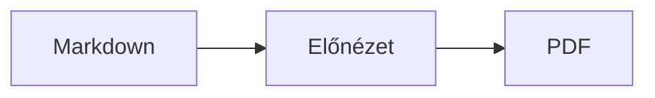

<p>&nbsp;&nbsp;&nbsp;</p>

# Splat

**A macOS-es Markdown-szerkesztő, amelyben a forráskódban és közvetlenül az előnézetben is írhat.**

A Splat balra szintaxiskiemeléssel mutatja a Markdown-forráskódot, jobbra élő, teljesen szerkeszthető előnézetet. Bármelyikben gépelhet: amit az előnézetben ír, az a forráskódban a lehető legkisebb módosításként jelenik meg, így az érintetlen sorok bájtra pontosan változatlanok maradnak, a Git-diffek pedig tiszták. A Splat érti a már megszokott Markdownt: a CommonMarkot és a GitHub Flavored Markdownt, a GitHub-figyelmeztetéseket, az Obsidian wikilinkjeit, beágyazásait és megjegyzésdobozait, a Pandoc és a Typora bővítéseit, a beágyazott HTML-t, a LaTeX-képleteket, valamint a Mermaid-, Graphviz- és PlantUML-diagramokat, mindezt offline megjelenítve. Egy kattintással exportálhat PDF-be, HTML-be vagy Wordbe. Rustban íródott, valódi AppKit-vezérlőkre épül, 35 nyelven szól, és semmit nem küld a hálózaton, hacsak Ön nem kéri.
 


[](https://raw.githubusercontent.com/sventmueller/splat/main/dist/Splat-1.0.5.dmg)

**[Download Splat-1.0.5.dmg](https://raw.githubusercontent.com/sventmueller/splat/main/dist/Splat-1.0.5.dmg)**: az Apple aláírta és hitelesítette, macOS 14 vagy újabb rendszerhez, Apple Silicon és Intel gépekre.
 
 

[](https://www.rust-lang.org)
[](https://www.apple.com/macos/)

[](https://github.com/madsmtm/objc2)
[](https://webkit.org)
[](https://github.com/kivikakk/comrak)
[](https://github.github.com/gfm/)
[](https://www.mathjax.org)
[](https://cortexjs.io/mathlive/)
[](https://mermaid.js.org)
[](https://graphviz.org)
[](https://plantuml.com)


[](#licenc)

[Bahasa Indonesia](../id/README.md) ·
[Bahasa Melayu](../ms/README.md) ·
[Català](../ca/README.md) ·
[Čeština](../cs/README.md) ·
[Dansk](../da/README.md) ·
[Deutsch](../de/README.md) ·
[English](../../../README.md) ·
[Español](../es/README.md) ·
[Français](../fr/README.md) ·
[Hrvatski](../hr/README.md) ·
[Italiano](../it/README.md) ·
**Magyar** ·
[Nederlands](../nl/README.md) ·
[Norsk](../no/README.md) ·
[Polski](../pl/README.md) ·
[Português (Brasil)](../pt_BR/README.md) ·
[Português (Portugal)](../pt_PT/README.md) ·
[Română](../ro/README.md) ·
[Slovenčina](../sk/README.md) ·
[Slovenščina](../sl/README.md) ·
[Suomi](../fi/README.md) ·
[Svenska](../sv/README.md) ·
[Tiếng Việt](../vi/README.md) ·
[Türkçe](../tr/README.md) ·
[Ελληνικά](../el/README.md) ·
[Русский](../ru/README.md) ·
[Українська](../uk/README.md) ·
[עברית](../he/README.md)‎ ·
[العربية](../ar/README.md)‎ ·
[हिन्दी](../hi/README.md) ·
[ไทย](../th/README.md) ·
[한국어](../ko/README.md) ·
[日本語](../ja/README.md) ·
[简体中文](../zh-Hans/README.md) ·
[繁體中文](../zh-Hant/README.md)

## Tartalom

- [Az áttekintés](#az-áttekintés)
- [Rendszerkövetelmények](#rendszerkövetelmények)
- [Telepítés](#telepítés)
- [Első lépések](#első-lépések)
- [Írás](#írás)
  - [A forráskódban](#a-forráskódban)
  - [Az előnézetben](#az-előnézetben)
  - [Formázási parancsok](#formázási-parancsok)
  - [Listák és feladatok](#listák-és-feladatok)
  - [Táblázatok](#táblázatok)
- [Támogatott Markdown](#támogatott-markdown)
  - [CommonMark és GitHub Flavored Markdown](#commonmark-és-github-flavored-markdown)
  - [Megjegyzésdobozok](#megjegyzésdobozok)
  - [Bővített szintaxis](#bővített-szintaxis)
  - [Obsidian](#obsidian)
  - [Idézetek és hivatkozások](#idézetek-és-hivatkozások)
  - [Beágyazott HTML](#beágyazott-html)
  - [Tipográfiai írásjelek](#tipográfiai-írásjelek)
  - [Szintaxisáttekintés](#szintaxisáttekintés)
- [Képletek](#képletek)
- [Diagramok](#diagramok)
- [Képek](#képek)
- [Linkek és navigáció](#linkek-és-navigáció)
- [Exportálás, nyomtatás és megosztás](#exportálás-nyomtatás-és-megosztás)
- [Megjelenés és kisegítő lehetőségek](#megjelenés-és-kisegítő-lehetőségek)
- [Nyelvek](#nyelvek)
- [Billentyűparancsok](#billentyűparancsok)
- [Adatvédelem és biztonság](#adatvédelem-és-biztonság)
- [Nagy dokumentumok](#nagy-dokumentumok)
- [Ismert korlátozások](#ismert-korlátozások)
- [Hibaelhárítás](#hibaelhárítás)
- [Fejlesztőknek](#fejlesztőknek)
  - [Fordítás](#fordítás)
  - [Terjesztés](#terjesztés)
  - [Tesztelés](#tesztelés)
  - [A projekt felépítése](#a-projekt-felépítése)
  - [Adatfolyam](#adatfolyam)
  - [Szabályok a vezérlőben](#szabályok-a-vezérlőben)
  - [Parancs hozzáadása](#parancs-hozzáadása)
  - [Fordítások](#fordítások)
  - [Harmadik féltől származó összetevők](#harmadik-féltől-származó-összetevők)
- [Licenc](#licenc)

## Az áttekintés

- **Kétféle írásmód, egyetlen szöveg.** A forráskód és az előnézet is szerkeszthető. A Markdown-fájl az egyetlen igazság: dokumentumonként egyetlen visszavonási előzmény van, és minden előnézeti módosítás a forráskód lehető legkisebb módosításává alakul.
- **A már megszokott Markdown.** CommonMark, GitHub Flavored Markdown, GitHub-figyelmeztetések, Obsidian, a Pandoc és a Typora bővítései, emojikódok, spoilerek, definíciós listák, címsorhorgonyok és a GitHub README-fájlokban megszokott HTML.
- **Beépített képletek és diagramok.** LaTeX-képletek MathJaxszel, vizuális képletszerkesztővel. Mermaid-, Graphviz- és PlantUML-diagramok, amelyeket a Mac Java, szerver és hálózati kapcsolat nélkül jelenít meg.
- **Mindenre van gomb.** Minden Markdown-elemhez tartozik eszközsorgomb és menüpont, a gyakoriakhoz billentyűparancs is. A táblázatoknak saját menüjük van a sorokhoz, oszlopokhoz és az igazításhoz.
- **Exportálás veszteség nélkül.** PDF, egyetlen önálló HTML-fájl vagy Word-dokumentum valódi címsorokkal, listákkal, táblázatokkal, lábjegyzetekkel és képekkel.
- **Tősgyökeresen natív.** Valódi AppKit-ablakok, lapok, menük, előugró panelek, Verziók, Automatikus mentés, a megosztási menü, sötét mód, helyesírás-ellenőrzés, diktálás és VoiceOver. Nincs Electron, és magához a szöveghez sem webnézet tartozik.
- **Gyors nagy fájloknál is.** Egy billentyűleütés egy 10 MB-os dokumentumban nagyjából 25 ms.
- **Diszkrét és körültekintő.** Az internetes képek csak az Ön engedélye után töltődnek be, a más appokra mutató linkek előbb rákérdeznek, és minden, ami megbízhatatlan képadatot dekódol, elszigetelt segédfolyamatokban fut.
- **Az Ön nyelvén.** A felület és a beépített Markdown-gyorsreferencia 35 nyelven érhető el: angol, arab, katalán, kínai (egyszerűsített), kínai (hagyományos), horvát, cseh, dán, holland, finn, francia, német, görög, héber, hindi, magyar, indonéz, olasz, japán, koreai, maláj, norvég, lengyel, portugál (Brazília), portugál (Portugália), román, orosz, szlovák, szlovén, spanyol, svéd, thai, török, ukrán és vietnami.

## Rendszerkövetelmények

- macOS 14 Sonoma vagy újabb. A Splatot macOS 27 alatt fejlesztik és tesztelik, ahol automatikusan átveszi a Liquid Glass dizájnt.
- Apple Silicon vagy Intel processzoros Mac.
- Körülbelül 45 MB szabad tárhely.

## Telepítés

**Lemezképből.** Töltse le a [`dist/Splat-1.0.5.dmg`](https://raw.githubusercontent.com/sventmueller/splat/main/dist/Splat-1.0.5.dmg) fájlt, nyissa meg, és húzza a Splatot az Alkalmazások mappára. A lemezképet Developer ID-val írták alá, és az Apple hitelesítette, így figyelmeztetés nélkül megnyílik.

**Homebrew-val.** A cask saját tapben található:

```sh
brew install --cask sventmueller/tap/splat
```

A `brew upgrade --cask splat` telepíti az új verziókat, a `brew uninstall --zap --cask splat` pedig a Splat beállításait és gyorsítótárait is eltávolítja.

**Frissítések.** A lemezképből vagy Homebrew-val telepített Splat a [Sparkle](https://sparkle-project.org) segítségével naprakészen tartja magát. A második indításkor megkérdezi, hogy naponta egyszer magától kereshet-e frissítéseket. A **Splat › Frissítések keresése…** azonnal keres; a **Frissítések automatikus keresése** és a **Frissítések automatikus letöltése és telepítése** ugyanebben a menüben később módosítja a választást. A Splat csak olyan frissítést telepít, amely hordozza a fejlesztő aláírását. A saját fordítású változatnak nincs frissítője.

**Forráskódból.** Az előfeltételeket lásd a [Fordítás](#fordítás) szakaszban, majd:

```sh
make build
ditto target/release/Splat.app /Applications/Splat.app
open /Applications/Splat.app
```

Ha a Markdown-fájlokat dupla kattintásra a Splattal szeretné megnyitni, jelöljön ki egy `.md` fájlt a Finderben, válassza a **Fájl › Infó megjelenítése** parancsot, a **Megnyitás ezzel** alatt válassza a Splatot, és kattintson az **Összes módosítása…** gombra. A Splat a `.md`, `.markdown`, `.mdown` és `.mkd` fájlokhoz regisztrálja magát.

## Első lépések

### Az ablak

Minden dokumentum saját ablakban nyílik meg, vagy lapként, ha jobban szereti a lapokat:

- **Balra: a forráskód.** A Markdown SF Mono betűtípussal, szintaxiskiemeléssel.
- **Jobbra: az előnézet.** A megjelenített dokumentum, szerkesztésre készen.
- **Vázlat az oldalsávon (nem kötelező).** Az összes címsor fastruktúrában; egy kattintás mindkét panelen megmutatja a kiválasztottat. A **Nézet › Vázlat megjelenítése** (⌃⌘S) kapcsolja be és ki.
- **Eszközsor.** A gombok aszerint vannak csoportosítva, hogy mit módosítanak: karaktereket, bekezdéseket és beszúrt elemeket, majd az előnézet be- és kikapcsolását, a megosztást és az új dokumentumot. A **Nézet › Eszközsor testreszabása…** paranccsal alakíthatja át.

Az elválasztót húzva bármelyik oldalnak több helyet adhat. A **Nézet › Előnézet elrejtése** (⌥⌘P) csak a forráskódot hagyja meg; a Splat ezt ablakonként megjegyzi. A két panel együtt görget, és az egyikben kijelölt rész a másikban is ki van emelve.

### Dokumentumok, lapok és verziók

A Splat egy hagyományos macOS-es dokumentumalkalmazás:

- **Automatikus mentés és Verziók.** A módosítások helyben mentődnek. A **Fájl › Visszaállítás erre › Összes verzió böngészése…** visszaviszi az időben.
- **Más programok módosításai.** Ha a Git, egy szkript vagy egy másik szerkesztő módosít egy megnyitott dokumentumot, a Splat újratölti, és megtartja a kurzor helyét és a görgetési pozíciót. Ha Önnek is vannak mentetlen módosításai, a Splat megtartja azokat, a macOS pedig rákérdez, mielőtt felülírná a másik verziót.
- **A megszokott fájlparancsok.** Megkettőzés (⇧⌘S), Átnevezés…, Áthelyezés ide…, valamint a **Fájl › Legutóbbi megnyitása**.
- **Lapok.** A **Fájl › Új lap** vagy az eszközsor **+** gombja új dokumentumot nyit lapként; a szabványos Ablak menü egyesíti, áthelyezi és váltogatja a lapokat.
- **Ablak elhelyezése.** Az utolsó ablak mérete és helye megmarad, újraindítás után is. Ha ott már áll egy ablak, az új kissé eltolva nyílik meg.
- **A Dock ikonja.** Ha az utolsó ablak bezárása után rákattint, új dokumentum nyílik.
- **Markdown-fájlok megnyitása a Splattal.** A **Splat › Beállítás alapértelmezett appként a Markdownhoz** hatására a `.md` vagy `.markdown` fájlokra duplán kattintva a Splat nyílik meg; a macOS egyszer megerősítést kér. A menüpont mellett pipa látszik, amíg a Splat az alapértelmezett.

A fájloknak UTF-8 szövegnek vagy bájtsorrendjellel ellátott UTF-16-nak kell lenniük. A Splat elutasítja a többi kódolást ahelyett, hogy találgatna és megrongálná a szöveget. A bájtsorrendjel megmarad, az UTF-16 UTF-16 marad, és ha egy fájl minden sora CRLF-fel végződik, az Ön által hozzáadott sorok is CRLF-et kapnak.

**Összeomlás után** legfeljebb az utolsó néhány másodpercnyi gépelés vész el: a Splat öt másodpercenként átmásolja a mentetlen szöveget a `~/Library/Application Support/Splat/Unsaved` mappába, és törli a másolatokat, amint a dokumentum mentve van, vagy a Splat normálisan kilép. A következő indításkor áthelyezi azt, amit egy összeomlás ott hagyott, a `~/Library/Application Support/Splat/Recovery` mappába, és ezt egyszer jelzi, egy gombbal, amely megnyitja a mappát. Ha a Splat az összeomlásra még tud reagálni, az összes megnyitott dokumentum szövegét is oda írja.

### Gyorsreferencia

A **Súgó › Markdown-gyorsreferencia** a saját nyelvén nyit meg egy puszta tájékoztatót új, névtelen dokumentumként. Hagyományos dokumentum, ezért mindent kipróbálhat rajta, akár a forráskódban, akár az előnézetben.

## Írás

### A forráskódban

A forráskód egy Markdownra hangolt egyszerű szövegszerkesztő:

- **Szintaxiskiemelés** a VS Code-hoz hasonlóan: címsorok, kiemelések, linkek, kód, táblázatok, HTML, front matter, valamint a képletekben és diagramokban a LaTeX és a Mermaid. Van paletta világos és sötét módhoz, valamint a Kontraszt növelése beállításhoz.
- **A kerített kódblokkok** kiemelést kapnak Bash, C, C++, C#, CSS (SCSS és Less is), Go, HTML, XML, Java, JavaScript, JSON, Kotlin, PHP, Python, Ruby, Rust, SQL, Swift, TypeScript, YAML, TeX és Mermaid esetén, a szokásos rövid neveikkel együtt, például `js`, `py` vagy `sh`.
- **Nincsenek meglepő cserék.** Az intelligens idézőjelek, az intelligens kötőjelek és a csereszöveg alapból ki vannak kapcsolva, mert elrontják a `--`, a `---` és a `"` jeleket. A **Szerkesztés › Helyettesítések** alatt kapcsolhatja be őket.
- **A rendszer írást segítő eszközei.** Helyesírás- és nyelvtani ellenőrzés, diktálás, Keresés és csere (⌥⌘F), valamint Beszéd.
- **Húzás és ejtés.** Ha képfájlt ejt a szerkesztőre, beszúrja a `` sort, bármely más fájl esetén a rá mutató linket, URL esetén pedig a `[url](url)` sort. Minden ejtés egyetlen visszavonási lépés.
- **Képek beillesztése.** A vágólapon lévő kép, például egy képernyőkép, PNG-fájlként a dokumentum mellé kerül (`Kép 2026-10-29 13.09.07.png`), és képként beszúrásra kerül. Ehhez a dokumentumot legalább egyszer menteni kell.

### Az előnézetben

Az előnézet úgy viselkedik, mint egy szövegszerkesztő, de minden, amit benne tesz, Markdownként végződik:

- **Gépelés.** A Markdownban jelentéssel bíró karaktereket, például a `*` vagy a `#` jelet, a Splat védőkarakterrel látja el, így úgy jelennek meg, ahogy begépelte őket.
- A **Return** új bekezdést vagy listaelemet kezd. A **⌥Return** vagy a **⌃Return** sortörést szúr be.
- **Formázás a kurzornál.** Ha a kurzor egy szó végén áll, a Félkövér, a Dőlt és a többi karakterformátum arra vonatkozik, amit ezután gépel. A formátum újbóli kiválasztása leállítja. Szón belül az egész szót formázza.
- **Üres sorok.** Az üres soron a Return újabb üres sort ad hozzá, a Backspace pedig eltávolítja. A forráskódban minden további üres sor két újabb üres sort jelent; más Markdown-programok ezeket normál bekezdésközként jelenítik meg.
- **Visszavonás** mindkét panelen működik. A visszavonási elemek nevet viselnek („Félkövér visszavonása”), a gépelés sorozatonként egy lépés, és a Visszavonás és az Ismétlés után mindkét panel a módosításhoz görget.
- **A képletek és a diagramok** kész grafikaként jelennek meg. Kattintson rájuk, vigye rájuk a kurzort, vagy nyomja meg rajtuk a Returnt a szerkesztőjük megnyitásához (lásd [Képletek](#képletek) és [Diagramok](#diagramok)).
- **A beágyazott HTML, a beágyazott jegyzetek és a front matter** látható, de a forráskódban szerkesztendő. Rájuk kattintva a kurzor a forráskód megfelelő helyére kerül.

Amit a Markdown nem tud kifejezni, azt az előnézet blokkolja: a Betűtípus- és Szín-panelt, a vonalzót, valamint a formázott szöveg és a képek beillesztését vagy ejtését. A beillesztett HTML és RTF egyszerű szövegként érkezik.

### Formázási parancsok

Minden parancs elérhető az eszközsorról, a menüsorból és mindkét panel helyi menüjéből. A menüpontok pipával jelzik a kurzornál érvényes formázást.

| Menü | Parancsok |
|---|---|
| **Formátum › Betűtípus** | Félkövér, Dőlt, Aláhúzás, Áthúzás, Kiemelés, Kód, Felső index, Alsó index |
| **Formátum › Címsor** | Szövegtörzs, 1–6. címsor |
| **Formátum › Lista** | Felsorolásjeles lista, Számozott lista, Feladatlista |
| **Formátum** | Idézet, Kódblokk (Nyelv nélkül vagy a 20 nyelv egyike; egy meglévő blokk nyelvét is módosítja), Megjegyzésdoboz (Jegyzet, Tipp, Fontos, Figyelmeztetés, Vigyázat; ugyanaz a típus újra eltávolítja), Képlet vagy diagram szerkesztése…, Formázás törlése |
| **Beszúrás** | Link…, Kép…, Táblázat…, Képlet, Diagram (Folyamatábra, Szekvenciadiagram, Gantt-diagram), Tartalomjegyzék, Lábjegyzet, Elválasztóvonal |
| **Táblázat** | Sor beszúrása fölé/alá, Oszlop beszúrása balra/jobbra, Sor törlése, Oszlop törlése, Igazítás (Balra, Középre, Jobbra, Alapértelmezett), Táblázatoszlopok igazítása |
| **Nézet** | Előnézet elrejtése/megjelenítése, Vázlat megjelenítése/elrejtése, Tipográfiai írásjelek, Felnagyítás/Lekicsinyítés, Tényleges méret, eszközsor, lapsor, teljes képernyő |

Az aláhúzás, a kiemelés, a felső és az alsó index `<ins>`, `<mark>`, `<sup>` és `<sub>` formában íródik, amelyeket a GitHub is megjelenít. A Splat a `<u>` jelölést is érti, amelyet a GitHub eltávolít, valamint a rövidebb `==kiemelés==`, `^felső^` és `~alsó~` jelölést. A GitHub a `==` és a `^` jelet úgy mutatja, ahogy begépelték, a `~alsó~` pedig áthúzásként jelenik meg.

### Listák és feladatok

- A Return folytatja a listát; egy üres elemen a Return lezárja.
- A **Tab** és a **⇧Tab** az előnézetben behúzza, illetve kitolja a listaelemeket.
- A feladat jelölőnégyzetére kattintva az előnézetben a `- [ ]` és a `- [x]` között vált.
- A **Formátum › Lista** a kijelölt bekezdéseket listává alakítja, vagy módosítja a lista fajtáját.

### Táblázatok

- A **Beszúrás › Táblázat…** rákérdez a sorok (a fejléccel együtt) és az oszlopok számára.
- Az előnézetben a **Tab** a következő cellába, a **⇧Tab** az előzőbe, a **Return** pedig az alatta lévő cellába ugrik. Az utolsó cellában a Tab új sort ad hozzá.
- A **Táblázat** menü sorokat és oszlopokat szúr be és töröl, és beállítja egy oszlop igazítását (⌘{, ⌘|, ⌘}).
- A **Táblázat › Táblázatoszlopok igazítása** kitölti a forráskódot, hogy az oszlopok egymás alá kerüljenek.

## Támogatott Markdown

A Splat a [comrak](https://github.com/kivikakk/comrak) elemzővel dolgozik, amely CommonMark- és GFM-kompatibilis, és bekapcsolja a legtöbb bővítményét. Az alábbi mind megjelenik az előnézetben és az összes exportban.

### CommonMark és GitHub Flavored Markdown

- Címsorok (`#` jellel és aláhúzással), bekezdések, sortörések, kiemelés, erős kiemelés, szövegközi kód, idézetblokkok, elválasztóvonalak.
- Felsorolásjeles, számozott és egymásba ágyazott listák; feladatlisták.
- Linkek (szövegközi, hivatkozásos és automatikus), képek, linkhivatkozás-definíciók.
- Kerített és behúzott kódblokkok szintaxiskiemeléssel.
- Táblázatok oszlopigazítással.
- Áthúzás `~~két hullámvonallal~~`.
- Lábjegyzetek: `szöveg[^1]` és a dokumentum bármely pontján a `[^1]: A jegyzet.` sor. A jelölőre kattintva a jegyzethez ugrik.
- YAML front matter a legfelső `---` sorok között. Az előnézet egyetlen sorban összegzi, például „Metaadatok: cím, dátum, címkék”.

### Megjegyzésdobozok

A GitHub-figyelmeztetések színes dobozként jelennek meg ikonnal és címmel:

```markdown
> [!NOTE]
> Hasznos információ, amelyet a felhasználóknak érdemes tudniuk.

> [!WARNING]
> Kritikus tartalom, amely azonnali figyelmet igényel.
```

Az öt típus: Jegyzet, Tipp, Fontos, Figyelmeztetés és Vigyázat. A **Formátum › Megjegyzésdoboz** a kurzornál lévő bekezdést alakítja ilyenné.

Az Obsidian megjegyzésdobozai is működnek, tetszőleges címmel és összecsukási állapottal:

```markdown
> [!tip]- Kattintson a ▸ jelre a kibontáshoz
> Megnyitásig rejtve.

> [!question]+ Alapból kibontva
> A `+` kibontva, a `-` összecsukva indul.
```

Az Obsidian további típusait az öt szín közül a legközelebbivel jeleníti meg: a `success`, `check`, `done` és `hint` Tippként; a `question`, `help` és `faq` Fontosként; az `attention` Figyelmeztetésként; a `failure`, `fail`, `missing`, `danger`, `error` és `bug` Vigyázatként; minden más Jegyzetként.

### Bővített szintaxis

| Funkció | Szintaxis | Eredet |
|---|---|---|
| Kiemelés | `==kiemelt szöveg==` | Obsidian, Typora |
| Felső index | `x^2^` | Pandoc, Typora |
| Alsó index | `H~2~O` | Pandoc, Typora |
| Emojikód | a `:rocket:` jelből 🚀 lesz | GitHub |
| Spoiler | `\|\|rejtett szöveg\|\|`, jelölje ki az olvasáshoz | Discord |
| Szövegközi lábjegyzet | `szöveg^[maga a jegyzet]` | Pandoc, Obsidian |
| Definíciós lista | `Fogalom`, üres sor, `: Magyarázat` | PHP Markdown Extra, Pandoc |
| Címsorhorgony | `## Telepítés {#setup}`, link: `[lásd](#setup)` | Pandoc, kramdown |

A definíciós listák a forráskódban így néznek ki:

```markdown
Fogalom

: A fogalom magyarázata.
```

Egyéni horgony nélkül minden címsor kap egyet a szövegéből képezve, mint a GitHubon: a `## Első lépések` az `#első-lépések` címen érhető el.

### Obsidian

- **Wikilinkek.** A `[[Jegyzet]]` a `Jegyzet.md` fájlra mutat ugyanabban a mappában vagy az alatta lévőben. A `[[Jegyzet|Megjelenített szöveg]]` az Ön szövegét mutatja, a `[[Jegyzet#Címsor]]` pedig megnyitja a jegyzetet. A ⌘-kattintás megnyitja a Splatban.
- **Beágyazások.** A `![[Jegyzet]]` a másik jegyzetet mutatja ebben; a benne beágyazott jegyzetek linkként jelennek meg. A `![[diagram.png]]` képet mutat. Az Obsidianhoz hasonlóan a beágyazások a dokumentum mappájában vagy az alatt lévő jegyzeteket és képeket nevezik meg, abszolút útvonallal soha, és csak a Markdown-fájlok jelennek meg jegyzetként.
- **Megjegyzések.** A `%%Csak a forrásban%%` látható marad a forráskódban, az előnézetből és minden exportból kimarad, szövegközben és önálló sorokban is.
- **Címkék.** Az `#ötlet` vagy a `#projekt/splat` ki van emelve. A ⌘-kattintás megkeresi a címkét a dokumentumban.
- **Összecsukható megjegyzésdobozok.** Lásd [Megjegyzésdobozok](#megjegyzésdobozok).

### Idézetek és hivatkozások

- **Pandoc-idézetek.** A `[@doe2020]` vagy a `[@doe2020; @roe2021]` úgy olvasható, mint „(Doe 2020; Roe 2021)”. A bejegyzések abból a BibTeX-fájlból származnak, amelyet a front matter a `bibliography: refs.bib` sorral megnevez. Enélkül a Splat a dokumentum melletti `references.bib`, `literatur.bib` vagy `bibliography.bib` fájlt használja.
- **GitHub- és GitLab-hivatkozások.** Ha a dokumentum olyan Git-tárolóban van, amelynek `origin` távoli tárolója a github.com vagy egy GitLab-gazdagép, a `@név`, a `#12` (hibajegy) és a `!7` (merge request, csak GitLab) ki van emelve. A ⌘-kattintás megnyitja őket a böngészőben.

### Beágyazott HTML

A GitHub README-fájljaiban megszokott HTML megjelenik, böngészőmotor helyett saját értelmezővel:

- középre igazított bekezdések és blokkok (`<p align="center">`, `<div align="center">`)
- méretezett képek (``)
- linkek, `<kbd>⌘</kbd>`, `<br>`, `<u>`, `<ins>`, `<mark>`, `<sup>`, `<sub>`
- listák és táblázatok, az oszlopokat átfogó cellákkal együtt (`colspan`)
- kibontható szakaszok: `<details><summary>Továbbiak</summary>…</details>`, a ▸ jelre kattintva nyílnak

A HTML-címkék közötti Markdown Markdownként jelenik meg. A szkriptek, stílusok, keretek és űrlapok teljesen kimaradnak, a linkek és a képek pedig csak a `http`, `https`, `mailto` és a relatív címeket tartják meg.

### Tipográfiai írásjelek

A **Nézet › Tipográfiai írásjelek** az egyenes idézőjeleket a felület nyelvének idézőjeleiként, a `--` jelet nagykötőjelként, a `---` jelet hosszú gondolatjelként, a `...` jelet pedig három pontként mutatja. Németben a `"Ja"` „Ja“ lesz, franciában «Oui», japánban 「はい」, a kínai és a japán szedésnél is, ahol az idézőjel elé és mögé nem kerül szóköz; a héber rövidítések, például a `צה"ל`, megkapják a gérsájimot, צה״ל. A forráskód megtartja az egyszerű karaktereket; az előnézet és az összes export a tipográfiaiakat mutatja. A beállítás addig ki van kapcsolva, amíg be nem kapcsolja.

### Szintaxisáttekintés

| Elem | Markdown |
|---|---|
| **Félkövér** | `**Félkövér**` |
| *Dőlt* | `*Dőlt*` |
| Aláhúzás | `<ins>Aláhúzás</ins>` vagy `<u>Aláhúzás</u>` |
| ~~Áthúzás~~ | `~~Áthúzás~~` |
| Kiemelés | `<mark>Kiemelés</mark>` vagy `==Kiemelés==` |
| `Kód` | `` `Kód` `` |
| x² | `x<sup>2</sup>` vagy `x^2^` |
| H₂O | `H<sub>2</sub>O` vagy `H~2~O` |
| [Link](https://example.com) | `[Link](https://example.com)` |
| Címsor | `# Címsor` – `###### Címsor` |
| Idézet | `> Idézet` |
| Felsorolásjeles lista | `- Elem` |
| Számozott lista | `1. Elem` |
| Feladat | `- [ ] Nyitott` és `- [x] Kész` |
| Kódblokk | ```` ```rust ```` … ```` ``` ```` |
| Táblázat | `\| A \| B \|` és a fejléc alatt `\|---\|---\|` |
| Lábjegyzet | `Szöveg[^1]` és `[^1]: Jegyzet` |
| Elválasztóvonal | `---` |
| Kép | `` |
| Képlet | `$E = mc^2$`, `$$ … $$` |
| Diagram | ```` ```mermaid ````, ```` ```dot ````, ```` ```plantuml ```` |
| Megjegyzésdoboz | `> [!TIP]` |
| Wikilink | `[[Jegyzet]]`, `[[Jegyzet\|Szöveg]]` |
| Beágyazás | `![[Jegyzet]]`, `![[image.png]]` |
| Megjegyzés | `%%Megjegyzés%%` |
| Címke | `#címke` |
| Idézet forrásra | `[@key]` |
| Spoiler | `\|\|Spoiler\|\|` |
| Emoji | `:tada:` |

## Képletek

A képleteket a [MathJax](https://www.mathjax.org) jeleníti meg a TeX- és AMS-matematikai csomagjával, éles vektorgrafikaként. A `\text{…}` jelölésben álló szöveg bármilyen írásrendszerű lehet: amit a MathJax betűtípusai nem tartalmaznak, azt a Mac betűtípusai adják, az arab és a héber jobbról balra haladva, az emoji pedig színesen.

| Fajta | Szintaxis |
|---|---|
| Szövegközi | `$E = mc^2$`, `` $`E = mc^2`$ `` (GitHub, GitLab), `\(E = mc^2\)` |
| Kiemelt | `$$` … `$$`, `\[` … `\]`, vagy `math` jelölésű kódblokk |

**Képlet szerkesztése.** Kattintson az előnézetben egy képletre, kattintson rá duplán, nyomja meg rajta a Returnt, vagy vigye rá a kurzort, és megnyílik a szerkesztője egy előugró panelen. A **Beszúrás › Képlet** újat szúr be, és rögtön megnyitja a szerkesztőt.

- **Vizuális vagy LaTeX.** A felül lévő kapcsoló vált a vizuális szerkesztő ([MathLive](https://cortexjs.io/mathlive/)) és a LaTeX-kód között. A Splat megjegyzi a választást.
- **Építőelemek** törthöz, négyzetgyökhöz, felső és alsó indexhez, összeghez és integrálhoz határokkal, határértékhez, a tartalommal együtt növekvő zárójelekhez, 2×2-es mátrixhoz, görög betűkhöz, valamint relációkhoz, műveleti jelekhez és nyilakhoz. Helyőrzőket hagynak maguk után: □, a **Tab** pedig a következőre ugrik.
- **Élő előnézet.** A módosítások gépelés közben megjelennek a dokumentumban. A MathJax hibái egy sorban láthatók a kód alatt.
- **Elfogadás vagy elvetés.** A kattintás a szerkesztőn kívül egyetlen visszavonási lépésként megtartja a módosítást; az **Esc** vagy a **Mégsem** eldobja. Egy új, üres képlet Esc-kel való elhagyása újra eltávolítja.
- A helyi menü a mutató alatti képlethez felkínálja a **Képlet szerkesztése…** parancsot.

A VoiceOver a képletet a LaTeX-kódjaként olvassa fel. A Splat képleteket jelenít meg, nem teljes LaTeX-dokumentumokat: nincsenek csomagok, nincs TikZ és nincs `\documentclass`.

## Diagramok

A diagramok a Splaton belül, offline és világos meg sötét változatban jelennek meg.

| Motor | Kódblokk | Mit rajzol |
|---|---|---|
| [Mermaid](https://mermaid.js.org) | ```` ```mermaid ```` | folyamatábrák, szekvencia-, osztály-, állapot-, egyed-kapcsolat-, Gantt- és kördiagramok, gondolattérképek, idővonalak és minden más Mermaid-típus |
| [Graphviz](https://graphviz.org) | ```` ```dot ```` vagy ```` ```graphviz ```` | gráfok a DOT nyelven |
| [PlantUML](https://plantuml.com) | ```` ```plantuml ```` vagy ```` ```puml ```` | UML-diagramok; Java nélkül fut |



A **diagram szerkesztése** a képlet szerkesztéséhez hasonlóan működik: kattintson rá, és a kód megnyílik egy előugró panelen, szintaxiskiemeléssel és a hibaüzenetekkel a kód alatti sorban. A **Beszúrás › Diagram** folyamatábra, szekvenciadiagram vagy Gantt-diagram sablonjából indul. Építőelemek segítenek a három leggyakoribb Mermaid-típusnál:

- **Folyamatábra:** Csomópont ▾ (téglalap, lekerekített, kör, rombusz, adatbázis), Kapcsolat, Feliratos kapcsolat, Csoport, Irány ▾
- **Szekvenciadiagram:** Résztvevő, Üzenet, Válasz, Jegyzet, Ciklus, Alternatív ágak
- **Gantt-diagram:** Szakasz, Feladat, Mérföldkő

A többi diagramtípust kódként kell szerkeszteni. A VoiceOver felolvassa a diagram címét vagy alternatív szövegét.

Az indítás utáni első diagram nagyjából egy másodpercig tart, mert a megjelenítő motor a háttérben indul. A 10 másodpercnél tovább tartó diagram hibát mutat, és a motor a következőhöz újraindul. A PlantUML motorja (7 MB) csak az első PlantUML-diagrammal töltődik be. A weben található PlantUML `!include` le van tiltva.

## Képek

- A **helyi képek** a dokumentumhoz viszonyított útvonalat használnak: ``. A Splat PNG, JPEG, GIF, WebP, BMP, SVG, HEIC, TIFF, AVIF és PDF formátumot jelenít meg.
- Az **internetes képek** blokkolva maradnak, amíg engedélyezi őket: az előnézet fölötti sáv elmagyarázza, hogy betöltésükkor a szervereik megtudják, hogy és mikor nyitja meg a dokumentumot. A **Képek betöltése** engedélyezi őket ehhez a dokumentumhoz; a Splat fájlonként megjegyzi a választást.
- **Méret.** Az `` méretezi a képet; egyébként a képek az előnézet szélességéhez igazodnak.
- **Módosítások a lemezen.** A lecserélt kép, vagy az, amelyik azután jelenik meg, hogy a dokumentum megnevezte, a dokumentum újranyitása nélkül látszik. A hálózat miatt sikertelen internetes képeket a Splat újra megpróbálja, amíg egy dokumentum mutatja őket.
- **Memória.** A képek a leghosszabb oldalukon legfeljebb 2560 képpontig jelennek meg, ami egy A4-es oldalt is kitölt. Kisebbre dekódolódnak, ha a Mac memóriájának egynyolcadát kitöltik, és amíg a macOS memóriaterhelést jelez.
- **Sötét mód.** A fehér hátterű képek a sötét előnézetben kissé elhalványulnak.
- **Beillesztés és ejtés.** Lásd [A forráskódban](#a-forráskódban).

## Linkek és navigáció

Az előnézetben a kattintás elhelyezi a kurzort, hogy szerkeszthesse a link szövegét; a **⌘-kattintás** követi a linket:

- A `http`, `https` és `mailto` a böngészőben vagy a levelezőappban nyílik meg.
- A Markdown-fájlok a Splatban nyílnak meg; a többi fájlt és mappát a Finderben jeleníti meg.
- Az `#anchor` a dokumentum címsorához ugrik.
- A más appot megnyitó címek, például a `slack://` vagy a `vscode://`, előbb rákérdeznek, és megmutatják a teljes címet és az appot. A **Mégsem** van előre kijelölve.

A **Beszúrás › Tartalomjegyzék** az összes címsor linkelt listáját szúrja be. Ha a kurzor benne áll, ugyanez a parancs frissíti. A vázlat az oldalsávon (⌃⌘S) mindkét panelen bármelyik címsorra ugrik.

## Exportálás, nyomtatás és megosztás

| Formátum | Hogyan | Mit kap |
|---|---|---|
| **PDF** | **Fájl › Exportálás PDF-ként…** vagy a Megosztás menü | Papírméretű oldalak, mindig világos megjelenéssel, a képletek és a diagramok vektorgrafikaként. A **Fájl › Oldalbeállítás…** állítja be a papírt. |
| **Nyomtatás** | **Fájl › Nyomtatás…** (⌘P) | Ugyanaz az elrendezés, mint a PDF-é. |
| **HTML** | **Fájl › Exportálás HTML-ként…** vagy a Megosztás menü | Egyetlen önálló fájl: a helyi képek beágyazva, a képletek és a diagramok éles képként, címsorhorgonyokkal, hogy a tartalomjegyzék működjön. Szkriptek nélkül. |
| **Word** | **Fájl › Exportálás Word-dokumentumként…** vagy a Megosztás menü | Egy `.docx` a Word címsorstílusaival, valódi listákkal és táblázatokkal (az egyesített cellákat is beleértve), a lábjegyzetek Word-lábjegyzetként, beágyazott képekkel, képletekkel és diagramokkal. |
| **Markdown** | Az eszközsor **Megosztás** gombja | A dokumentum `.md` fájlként a Mailhez, az Üzenetekhez, az AirDrophoz és minden más megosztási szolgáltatáshoz. |

A **Fájl › Megosztás** menü ezeket mind egy helyen kínálja. Az exportok a tipográfiai írásjelek beállítását és az Ön által engedélyezett internetes képeket használják; az internetes képek HTML-ben linkek maradnak.

## Megjelenés és kisegítő lehetőségek

- A **sötét mód** a rendszert követi. A képletek és a diagramok minden megjelenéshez külön készülnek.
- A Rendszerbeállítások **Kontraszt növelése** beállítása nagy kontrasztú palettákra váltja a szintaxiskiemelést.
- **Nagyítás.** A ⌘+, a ⌘− és a ⌘0 mindkét panelt átméretezi.
- **Teljes képernyő, lapok és testreszabható eszközsor**, mint minden Mac-appban.
- **VoiceOver.** A panelek felirata „Markdown-forráskód” és „Előnézet”, a képleteket a kódjukként, a diagramokat a címükként olvassa fel. Minden parancs elérhető a billentyűzetről.

A Splatnak nincs beállítási ablaka: a néhány opció ott van, ahol hatnak, a **Nézet** és a **Szerkesztés › Helyettesítések** alatt.

## Nyelvek

A felület, a menük és a Markdown-gyorsreferencia 35 nyelvre van lefordítva:

angol, arab, katalán, kínai (egyszerűsített), kínai (hagyományos), horvát, cseh, dán, holland, finn, francia, német, görög, héber, hindi, magyar, indonéz, olasz, japán, koreai, maláj, norvég, lengyel, portugál (Brazília), portugál (Portugália), román, orosz, szlovák, szlovén, spanyol, svéd, thai, török, ukrán és vietnami.

A Splat a **Rendszerbeállítások › Általános › Nyelv és régió** nyelvi sorrendjét követi; ugyanott az **Alkalmazások** alatt a Splatnak külön nyelvet is választhat. Ha az Ön nyelvére nincs fordítás, angolt használ. A menük kifejezései az Apple saját fordításait követik, így a Splat úgy szól, mint a Mac többi része.

A héber és az arab szöveg mindenhol jobbról balra olvasódik, bármi is a felület nyelve: minden bekezdés, címsor és listaelem az első betűje irányát veszi fel, az idézetek és a megjegyzésdobozok a sávjukat jobb oldalra rajzolják, a jobbról balra kezdődő szövegű táblázat pedig az oszlopait jobbról sorolja fel. A kódblokkok balról jobbra maradnak. A PDF-, HTML- és Word-exportok megtartják ezeket az irányokat. Ha a rendszer nyelve héber vagy arab, a macOS az ablakot is tükrözi, így az előnézet balra kerül.

## Billentyűparancsok

| Művelet | Billentyűparancs |
|---|---|
| Félkövér, Dőlt, Aláhúzás | ⌘B, ⌘I, ⌘U |
| Áthúzás | ⇧⌘X |
| Link… | ⌘K |
| Szövegtörzs, 1–6. címsor | ⌥⌘0, ⌥⌘1–⌥⌘6 |
| Táblázatoszlop balra, középre, jobbra igazítása | ⌘{, ⌘\|, ⌘} |
| Az előnézet elrejtése vagy megjelenítése | ⌥⌘P |
| A vázlat megjelenítése vagy elrejtése | ⌃⌘S |
| Felnagyítás, lekicsinyítés, tényleges méret | ⌘+, ⌘−, ⌘0 |
| Új dokumentum, megnyitás, mentés, megkettőzés | ⌘N, ⌘O, ⌘S, ⇧⌘S |
| Oldalbeállítás, nyomtatás | ⇧⌘P, ⌘P |
| Keresés, keresés és csere | ⌘F, ⌥⌘F |
| Következő, előző keresése; kijelölés használata; ugrás a kijelölésre | ⌘G, ⇧⌘G; ⌘E; ⌘J |
| Helyesírás és nyelvtan megjelenítése; dokumentum ellenőrzése | ⌘:, ⌘; |
| Beillesztés és stílus egyeztetése | ⌥⇧⌘V |
| Eszközsor elrejtése, összes lap megjelenítése, teljes képernyő | ⌥⌘T, ⇧⌘\\, ⌃⌘F |
| Sortörés (előnézet) | ⌥Return vagy ⌃Return |
| Következő / előző cella egy táblázatban (előnézet) | Tab / ⇧Tab |
| Listaelem behúzása / kitolása (előnézet) | Tab / ⇧Tab |
| Következő helyőrző a képletszerkesztőben | Tab |
| A képlet- vagy diagramszerkesztő bezárása módosítások nélkül | Esc |
| Link, címke vagy hivatkozás követése (előnézet) | ⌘-kattintás |

A Splat az Apple szabványos billentyűparancsait érintetlenül hagyja.

## Adatvédelem és biztonság

Egy Markdown-fájl bárkitől származhat, ezért a Splat minden dokumentumot megbízhatatlannak tekint.

- **Alapból nincs hálózat.** A Splat nem küld telemetriát. Csak akkor keres frissítéseket, ha beleegyezik, vagy a **Frissítések keresése…** parancsot választja: ilyenkor egy kis hírcsatorna-fájlt tölt be a GitHubról, és a kérés csak az appot és a verzióját nevezi meg. A képletek és a diagramok helyben jelennek meg; az ezt végző webnézetek nem érik el a hálózatot.
- Az **internetes képek** csak az Ön engedélye után töltődnek be, csak `https` felett, soha nem a helyi hálózat gépeiről, egyenként legfeljebb 10 MB méretig, és sütik nélküli privát munkamenetben.
- **Elszigetelt dekódolás.** A képeket, valamint a képletek és a diagramok grafikáit segédfolyamatok dekódolják, amelyek az első bájt beolvasása előtt bezárnak minden örökölt fájlt, és homokozóba zárják magukat: nincs fájlhozzáférés, nincs hálózat. Csak képpontokat adnak vissza, amelyek méretét ellenőrzik, és 10 másodperc után leállítják őket. Az Apple saját képdekódolói csak a HEIC, TIFF, AVIF és PDF adatokat látják, és csak ha az adat valóban ilyen formátumú; ezek külön segédfolyamatban futnak, amely emellett olvashatja a rendszer betűtípus-mappáit, és használhatja a rendszer videódekódolóját. Az SVG-k, a képletek és a diagramok is ezen a segédfolyamaton haladnak át, ezért a Splatban rögzített felbontású képek: pontonként négy képpont, a hosszabb oldalon legfeljebb 2560.
- A **helyi fájlok** csak a dokumentum által megnevezett útvonalon jutnak el hozzá. A beágyazások a dokumentum mappájából és az alatta lévőkből mutatnak Markdown-jegyzeteket, és a hiányzó képet is csak ott keresik. Máshol lévő, abszolút vagy `~` jellel kezdődő képútvonal továbbra is betöltődik, és a HTML- és Word-exportok beágyazzák: egy nem Ön által írt dokumentum exportját nézze át, mielőtt továbbadja.
- A **mentetlen szöveg másolatai** ezen a Macen maradnak, a Könyvtár mappájában, az összeomlás utáni helyreállításhoz. A mentéssel vagy a Splat normális kilépésével törlődnek; az összeomlás után maradt másolatok a helyreállítási mappában maradnak, amíg Ön nem törli őket.
- A **linkek** kattintásra soha nem indítanak programot. A web- és levelezőlinkek a megszokott módon nyílnak; a más appokra mutató linkek előbb rákérdeznek.
- A **dokumentumokban lévő HTML-t** a Splat saját értelmezője olvassa. A szkriptek, stílusok, keretek és űrlapok soha nem futnak.
- Az **exportok** nem tartalmaznak szkripteket. A HTML-oldalak csak ártalmatlan címkék és attribútumok rögzített listáját tartják meg, mint a GitHub, valamint egy tartalombiztonsági szabályzatot. A Word-fájlok csak `http`, `https` és `mailto` címeket linkelnek.
- **Kódaláírás** Hardened Runtime-mal. A Splat az App Sandbox nélkül fut, hogy a dokumentumok melletti képeket minden mappa külön engedélyezése nélkül mutathassa; ezt az összes dekódolás elszigetelése ellensúlyozza.

## Nagy dokumentumok

A Splat több megabájtos dokumentumoknál is reszponzív marad:

- A forráskód a TextKit 2-t használja, amely csak a látható részt tördeli.
- Amíg az előnézetben gépel, valamint a legfeljebb 2 MB-os dokumentumok forráskódjában csak az érintett bekezdéseket elemzi, színezi és tördeli újra: egy 10 MB-os dokumentumban nagyjából 25 ms, az előnézetében pedig nagyjából 50 ms egy billentyűleütés, a nézet saját munkájával együtt.
- A nagy előnézetek előbb a látható részt jelenítik meg, a többit akkor, amikor az app tétlen. A látótérbe görgetett blokkok a kirajzolás előtt megjelenítésre kerülnek.
- Nagyobb dokumentumok forráskódjában az előnézet elemzése a háttérben fut, miközben gépel.
- A dokumentum egyszerű szöveg marad, ha körülbelül 4 GB memóriát igényelne, ami nagyjából 50–120 MB szokásos Markdown, de csak 10–20 MB, ha kizárólag táblázatokból vagy címsorokból áll: a forráskódnak nincsenek színei, az előnézet pedig megmondja, miért marad üres. Az exportok továbbra is működnek.
- Nagyjából 200 KB-tól a dokumentum az elemzés előtt megnyitja az ablakát; 5 MB-nál a színek és az előnézet nagyjából negyed másodperccel később követik.

Néhány módosítást teljes egészében feldolgoz, 10 MB-nál nagyjából 300 ms-ot igényelve billentyűleütésenként. Ilyen, ha a módosítás egy lábjegyzet definícióját vagy hivatkozásait, egy szövegközi lábjegyzet környékét, egy lábjegyzet melletti dokumentumvéget, a front mattert vagy a linkhivatkozás-definíciók közelét érinti, továbbá minden módosítás egy olyan dokumentumban, amelyben `%%` megjegyzésblokkok vannak, vagy egy lábjegyzet kétszer, illetve idézeten vagy listán belül van definiálva. A memória a fájllal együtt nő: 1 MB Markdownnál nagyjából 115–160 MB-ra, 10 MB-nál 340–510 MB-ra.

## Ismert korlátozások

- **Az egyszeres hullámvonal alsó indexet jelent.** A `~szöveg~` alsó index, mint a Pandocban; az áthúzáshoz `~~két~~` hullámvonal kell. A GitHub egy hullámvonallal is áthúz.
- **Csak olvasható az előnézetben:** a beágyazott HTML-t, a beágyazott jegyzeteket és a front mattert a forráskódban kell szerkeszteni.
- **Nagyon mély beágyazás:** a 64 szintnél mélyebben beágyazott HTML és a 16 szintnél mélyebb szövegközi HTML átadja a helyét a tartalmának.
- Az **egyesített táblázatcellák** csak HTML-táblázatokban léteznek, és csak oszlopokon át (`colspan`, `rowspan` nincs). A MultiMarkdown egyesített cellákra szolgáló táblázatszintaxisa nem támogatott.
- A **szakirodalmi jegyzékek** csak BibTeX-ből olvashatók, CSL JSON-ból vagy YAML-ból nem.
- A **hivatkozásokhoz** github.com-on vagy GitLab-gazdagépen lévő tároló kell; a `!7` csak GitLabon létezik.
- **Tipográfiai írásjelek:** a német záró szimpla idézőjel nem különböztethető meg az aposztróftól, ezért ’ jelként kerül kiírásra.
- **Képletek, nem dokumentumok:** nincsenek LaTeX-csomagok, TikZ vagy teljes dokumentumok.
- A **vizuális képletszerkesztő** a MathLive jelölésével írja a LaTeX-et: a szóközök eltűnnek (az `E = mc^2` `E=mc^2` lesz), a megjelenés ugyanaz marad.
- **Szándékosan:** nincsenek sorszámok, nincs beállítási ablak, nincs Súgókönyv, és nincs az App Store-ban.
- **Intelen kevésbé tesztelt.** Az ablakos önellenőrzések csak Apple Silicone futnak; Intelen a CI a `cargo test` parancsot futtatja.

## Hibaelhárítás

**A legutóbbi dokumentumok listája üres a Splat újrafordítása után.** A macOS a legutóbbi dokumentumokat és a mappaengedélyeket az app kódaláírásához köti. A helyi fordításokat a bejelentkezési kulcsláncban lévő „Splat Local Signing” tanúsítvány írja alá, így az újrafordítások mindkettőt megtartják. Ha a tanúsítványt törölték, a következő fordítás újat hoz létre, és a listák egyszer újrakezdődnek.

**A lemezképből telepített app más legutóbbi dokumentumokat mutat, mint a saját fordításom.** A kettő eltérő aláírást hordoz, ezért a macOS mindegyikhez külön listát és külön mappaengedélyeket vezet.

**A HTML vagy más szintaxis egyszerű kódként látszik.** Lehet, hogy a dokumentumot a Splat egy elavult példánya nyitotta meg. Lépjen ki belőle, válassza a Finderben a dokumentumon a **Fájl › Infó megjelenítése** parancsot, és ellenőrizze, hogy a **Megnyitás ezzel** az Alkalmazások mappában lévő Splatot nevezi-e meg.

**Nincs Frissítések keresése… a Splat menüben.** Csak a lemezképből vagy Homebrew-val telepített változat frissíti magát; a saját fordításnak nincs frissítője.

**Az internetes képek nem jelennek meg.** Kattintson az előnézet fölötti sávban a **Képek betöltése** gombra. Csak a nyilvános gépekről származó `https` képek töltődnek be.

**Egy képernyőkép beillesztésekor előbb mentést kér.** A beillesztett képek fájlként a dokumentum mellé kerülnek, ehhez hely kell a lemezen. Mentse a dokumentumot, majd illessze be újra.

**„A fájl nem UTF-8 kódolású szöveg, ezért nem nyitható meg Markdownként.”** A fájl más kódolású, és nincs bájtsorrendjele, amely megnevezné. Előbb alakítsa át, például így: `iconv -f ISO-8859-1 -t UTF-8 old.md > new.md`.

**Egy képlet vagy diagram hibát mutat.** Kattintson rá: a szerkesztő a MathJax, a Mermaid, a Graphviz vagy a PlantUML üzenetét mutatja a kód alatt.

## Fejlesztőknek

A Splat egy Rust-alkalmazás, amely az [objc2](https://github.com/madsmtm/objc2) segítségével közvetlenül az AppKittel és a WebKittel kommunikál. Nincs benne Swift, Objective-C, Xcode-projekt és Interface Builder-fájl.

### Fordítás

Előfeltételek:

- macOS a Command Line Tools csomaggal (`xcode-select --install`). Az Xcode nem kell; a Splat az `actool`, az `ibtool` és a `metal` nélkül épül.
- Rust 1.99 (`brew install rust`). A [rust-toolchain.toml](../../../rust-toolchain.toml) megnevezi a CI által használt pontos verziót; a rustup magától telepíti, a Homebrew Rustja figyelmen kívül hagyja a fájlt. Az ottani verzió emelésével jutnak el az új fordítói és clippy-figyelmeztetések a projektbe.
- rustup a `make lint`, `make check` és `make universal` parancshoz: a `cargo xtask check-library` Linuxra fordítja le a könyvtárat annak bizonyítására, hogy nincs szüksége macOS-re, a Homebrew Rustja pedig más célplatformot nem szállít.

A [Makefile](../../../Makefile) rövid belépési pontokat tartalmaz; a `make help` mindet felsorolja:

```sh
make build                  # target/release/Splat.app, ugyanaz, mint a cargo xtask bundle --release
make universal              # target/splat-universal Apple Siliconra és Intelre, ahogy a lemezkép hordozza
make check                  # formázás, clippy figyelmeztetések nélkül, minden teszt, csomagolt könyvtárak; amit a CI futtat
make test                   # make check, majd az ablak nélküli önellenőrzés
make test-gui               # ablakos önellenőrzések; nagyjából négy percig lefoglalják a Macet
make test-long              # hosszabb véletlenszerű keresés és a 10 MB-os részleges frissítés ellenőrzése
make coverage               # az összes teszt és önellenőrzés sorlefedettsége, moduloként küszöbbel
make coverage-library       # ugyanezek a küszöbök az ablak nélküli modulokra, mint a CI-ban
make bench FILE=<file.md>   # idők egy nagy fájl megnyitásához, gépeléséhez és görgetéséhez
make release                # előbb make test, majd a hitelesített lemezkép
```

A fordítási logika maga az [xtask](../../../xtask/src/main.rs) Rust-crate-ben van:

```sh
cargo xtask bundle --release   # target/release/Splat.app, Hardened Runtime, „Splat Local Signing” aláírással
cargo xtask bundle             # target/debug/Splat Debug.app, külön app, amely soha nem nyit meg Markdown-fájlokat
cargo xtask dmg                # dist/Splat-<version>.dmg terjesztéshez, Developer ID, hitelesítve
cargo xtask icon               # az assets/AppIcon.icns és a README ikonjának újraépítése az assets/icon-1024.png fájlból
cargo xtask vendor check       # a csomagolt JavaScript ellenőrzése a vendor.lock alapján
cargo xtask vendor fetch       # újbóli letöltés, ha megváltoztatott egy verziót a vendor.lock fájlban
```

A `bundle` megírja az `Info.plist` fájlt, átmásolja az erőforrásokat és a lokalizációkat, és aláírja az appot a „Splat Local Signing” tanúsítvánnyal. Az első fordítás létrehozza ezt a tanúsítványt a bejelentkezési kulcsláncban, 20 évig érvényesen. Amíg megvan, a Splat megtartja a legutóbbi dokumentumait és a mappaengedélyeit az újrafordítások során; ad hoc aláírással minden fordítás új app lenne a macOS-nek. A debug- és önellenőrző fordítások saját bundle-azonosítót hordoznak (`local.splat.debug`, `local.splat.selftest`), és nem regisztrálnak Markdown-fájlokra, így a Finder soha nem nyit meg dokumentumot elavult fordításban, és nem érintik a normál app beállításait.

A verzió a [VERSION](../../../VERSION) fájlban él `major.minor.build` formában, és ezt kapja a következő fordítás. Minden sikeres release-fordítás (`make build`, `cargo xtask bundle --release`, `make release`) eggyel emeli a build számát; a debug- és önellenőrző fordítások békén hagyják. A major és a minor számot kézzel kell emelni: állítsa a VERSION fájlt mondjuk `1.1.0`-ra, és a következő fordítás pontosan ezt kapja.

### Terjesztés

A `cargo xtask dmg` (vagy a `make release`, amely előbb a `make test` parancsot futtatja) release-t fordít, aláírja a Developer ID-jával, hitelesíti az appot az Apple-lel, és ráragasztja a jegyet, majd tömörített, csak olvasható lemezképbe csomagolja az Alkalmazásokra mutató linkkel, a lemezképet is hitelesíti és ellátja a jeggyel, és a Gatekeeperrel ellenőrzi az eredményt. Az app saját jegyet hordoz, hogy a Finder nélkül, például Homebrew-val telepített példány is offline nyíljon meg az első indításkor; a hitelesítő szolgáltatással folytatott két kör fejenként néhány percig tart. Csak az a lemezkép lesz `dist/Splat-<version>.dmg`, amely minden lépésen átment, ez a commitolt példány: a README-ben és a fordításaiban lévő letöltési linkek ezt követik, a build szám pedig emelkedik. Az előző lemezkép még egy kiadásig megmarad, mert a GitHub raw szervere egy push után néhány percig a régi frissítési hírcsatornát adhatja ki; a régebbieket a Kukába helyezi. A sikertelen futás úgy hagyja a `dist/` mappát, a README-ket és a VERSION fájlt, ahogy voltak.
Minden kiadás hozzáadja a teljes lemezképet, nagyjából 16 MB-ot, a tároló előzményeihez. Csak híváskor fut, normál fordítás részeként soha, és ezekre van szüksége:

- egy „Developer ID Application” tanúsítvány a kulcsláncban
- az Apple hitelesítő szolgáltatásához mentett bejelentkezés alkalmazásspecifikus jelszóval, egyszer létrehozva az `xcrun notarytool store-credentials notary --apple-id <Apple ID> --team-id <team ID>` paranccsal
- a frissítéseket aláíró privát kulcs a bejelentkezési kulcsláncban. A Sparkle `generate_keys` parancsa hozta létre; nyilvános fele az `UPDATE_KEY` az [xtask/src/main.rs](../../../xtask/src/main.rs) fájlban és minden telepített példányban, amely csak az azzal aláírt frissítéseket fogadja el. Őrizzen róla másolatot egy jelszókezelőben: a `target/sparkle-2.10.1/bin/generate_keys -x <file>` exportálja, a `-f <file>` egy másik Macen importálja. Nélküle a telepített példányok soha többé nem frissíthetők.
- rustup (`brew install rustup`, amely a Homebrew Rustját érintetlenül hagyja)

Ha ezek bármelyike hiányzik, a `dmg` a fordítás előtt leáll. Az első futáskor a macOS megkérdezi, hogy a Terminál vezérelheti-e a Findert; ennek az engedélynek a hiányában a lemezkép sem a hátterét, sem az ikonok elrendezését nem mutatja.

Csak a lemezkép hordozza a frissítőt, a [Sparkle](https://sparkle-project.org)-ot, amelyet a fordítás egyszer letölt a `target/` mappába a GitHub-kiadásából, és ellenőriz az xtaskban lévő ellenőrzőösszeggel. A megerősített futtatókörnyezet a keretrendszert csak akkor tölti be, ha az hordozza az app Team ID-ját, amelyet a Developer ID aláírás tartalmaz, a helyi tanúsítvány pedig nem; és a frissítés nem írhatja felül a saját fordítást. Az önellenőrző fordítás is hordozza a Sparkle-t, hogy a frissítési menüt ellene ellenőrizze: nem létező hírcsatornával, a Sparkle második indításkori kérdése nélkül, és olyan jogosultsággal, amely lehetővé teszi a helyben aláírt appnak a keretrendszer betöltését. A `dmg` aláírja az új lemezképet a frissítési kulccsal, és megírja a `dist/appcast.xml` fájlt, a hírcsatornát, amelyből a telepített példányok a GitHubról olvasnak. A lemezképet, a hírcsatornát és a README-ket együtt commitolja és pusholja: onnantól a telepített példányok felkínálják a frissítést.

A lemezkép univerzális bináris Apple Siliconra és Intelre; a többi fordítás csak a gazdagép processzorára készül. A Homebrew Rustja a szabványos könyvtárat csak a gazdagép processzorára szállítja, ezért a `dmg` a rustupon keresztül fordít, amely az első használatkor telepíti a [rust-toolchain.toml](../../../rust-toolchain.toml) eszközláncát és célplatformjait, és leáll, ha a programból vagy a Sparkle-ből hiányzik valamelyik processzor kódja. A `make universal` csak a programot építi.
Az abban lévő app aláírása eltér a helyi fordításétól, ezért a macOS a kettőhöz külön legutóbbi dokumentumokat és mappaengedélyeket vezet.

### Tesztelés

| Parancs | Mit ellenőriz |
|---|---|
| `cargo test --release` | egység-, véletlenszerű és fordítási tesztek |
| `SPLAT_FUZZ_ROUNDS=20000 cargo test --release` | hosszabb véletlenszerű keresés; a `SPLAT_FUZZ_SEED` változtatja a bemeneteket |
| `SPLAT_I18N_ONLY=fr cargo test --release i18n` | egyetlen nyelv, amíg a többi hiányos |
| `cargo clippy --release --all-targets [--features selftest]` | lint-ellenőrzések, köztük minden `unsafe` blokk indoklása, a függvények hossza és a könyvtárban a számkonverziók |
| `cargo xtask check-library` | a könyvtár Linuxra is lefordul, vagyis semmi nem igényel benne macOS-t |
| `cargo xtask vendor check` | a JavaScript-könyvtárak bájtra pontosan egyeznek a `vendor.lock` fájllal |
| `cargo xtask selftest probe` | ablak nélkül, mindegyik a várt eredménnyel: képletek, diagramok, internetes képek a folyamaton belüli szerverrel szemben, blokkolt címek, a szöveg, amelyet minden parancs ír, minden képformátum mindkét exporton át, egy oldal, amely nem válaszol többé, és a webnézetek védelmei egy védelem nélküli oldallal szemben. Nagyjából fél percig tart. Amihez az app a képernyő előtt kell, azt zárolt képernyőn kihagyja |
| `cargo xtask selftest gui [--stop-after "<check>"] [--scenarios]` | a futó app, kattintásról kattintásra. Ablakot nyit és gépel bele; a Mac nagyjából négy percig foglalt. A `--scenarios` csak a második részt futtatja, nagyjából másfél perc alatt |
| `cargo xtask selftest resize` | kiszélesíti az ablakot az elválasztó mozgatása után: a forráskód újratörik, miközben az ablak átméretezés alatt áll. Nagyjából tíz másodpercig tart |
| `cargo xtask selftest bench <file.md>` | idők egy nagy fájl megnyitásához, gépeléséhez és görgetéséhez |
| `cargo test --release -- --ignored partial_updates` | egy billentyűleütés 10 MB-ban: részleges a teljes frissítéssel szemben, ugyanaz az eredmény legfeljebb negyed idő alatt |
| `cargo test --release --test hostile` | a vermet túlcsordítani vagy négyzetes időt igénybe venni szánt dokumentumok, mindegyik két méretben, amelyeknek az idejének a szöveggel arányosan kell nőnie, az elemzésen, a tördelésen, mindkét exporton, a billentyűleütéseken és a parancsokon át |
| `make mutants` | a `src/markdown/` és a `src/preview/` könyvtárba egyenként épített hibák a [cargo-mutants](https://mutants.rs) segítségével (`cargo install cargo-mutants`); megmondja, melyiket nem veszi észre egyik teszt sem. Órákig tart; a `FILE=src/preview/bridge.rs` szűkíti |
| `cargo test --release --test decoder` | a dekódolófolyamat dekódolja a képeket, és sem fájlokat, sem a hálózatot nem éri el |
| `make coverage` | a `cargo test` és az összes önellenőrzés sorlefedettsége a [cargo-llvm-cov](https://github.com/taiki-e/cargo-llvm-cov) segítségével (`brew install cargo-llvm-cov llvm`); a küszöbök alatt hibával leáll. Nagyjából öt percig foglalja a Macet |
| `make coverage-library` | a `src/markdown/`, a `src/preview/` és az `i18n.rs` magasabb küszöbei, egyedül a `cargo test` által mérve |

Az egységtesztek a tesztelt kód mellett állnak. A `tests/` azt tartalmazza, ami kívülről éri el a könyvtárat: a `robustness.rs` véletlenszerű tesztjeit, amelyek a `src/fuzz.rs` generátoron osztoznak a `sync.rs` teszteivel, a `hostile.rs` ártásra szánt dokumentumait, valamint a dekódolótesztet, amely elindítja a lefordított programot. A `src/editor/` ablak nélküli döntései önálló tesztekkel rendelkező szabad függvényekben élnek: mindaz, amit a vezérlő tud, és ahogy ez változik, a `state.rs` fájlban, a megjelenítés szabályai a `render_queue.rs` fájlban, a szövegmásolat a `sync.rs` fájlban, a bekezdésstílusok, betűtípusok és színek értékekként a `render.rs` fájlban, az, hogy mit jelentenek az eszközsor azonosítói, a `toolbar.rs` fájlban, az, hogy mit jelent egy linkkattintás, a `navigation.rs` fájlban.

Az ablakos önellenőrzés egy lépése megnevezett feltételre vár, nem időre; csak az, ami nem ad jelet, például valaminek a hiánya, tart meg egy szünetet az indoklásával együtt. A hiába várás olyan hibás ellenőrzés, amely megnevezi, mi nem jött el, a pánikoló lépés szintén hibás ellenőrzés, és a futás mindkét esetben folytatódik. Az az ellenőrzés, amely ebben a futásban semmit nem tud mondani, `SELFTEST SKIP` jelzést ad: az xtask felsorolja, és sem nem sikerül, sem nem bukik meg. Az xtask minden módot, és külön a `--scenarios` részt is, az ellenőrzései nagyjából kilenctizedéhez köti. Az ablakos önellenőrzés a fő végigkattintás után egy második részt futtat, a `src/editor/selftest/scenarios.rs` fájlban: minden formázási és táblázatparancsot, a párbeszédablakokat, a linkkattintásokat, a beillesztést, az ejtést, az exportokat, egy nagy módosítást, a lemezen változó képeket, a memóriaterhelést, egy hatalmas dokumentumot és az összeomlás utáni helyreállítást.

A lefedettségnek két küszöbe van: minden modul soronként legalább 84 %, az összes modul együtt legalább 96 %. A `make coverage` a `cargo test` és az önellenőrzések együttes lefedettségét méri, és bármelyik küszöb alatt hibával leáll; a `make coverage-library` azt, ami nem igényel ablakot, 90 és 97 %-hoz köti. A küszöbök és a kevés kivétel, például a `main.rs` pánikkezelője, amely csak összeomláskor fut, az [xtask](../../../xtask/src/coverage.rs) fájlban állnak az indokaik mellett. A mért fordítások a `target/coverage/` mappába kerülnek, így a mérőkód soha nem jut el a `target/release/` mappába vagy egy lemezképbe. A dekódoló segédfolyamat a bezárkózás előtt megnyitja a mérési fájlját, így ez is mérhető.

A CI ([.github/workflows/ci.yml](../../../.github/workflows/ci.yml)) a `main` minden pushára és minden pull requestre futtatja a `make check`, a `make coverage-library` parancsot és az univerzális fordítást Apple Silicone, valamint a `cargo test` parancsot Intelen. Minden éjjel a [.github/workflows/nightly.yml](../../../.github/workflows/nightly.yml) új véletlenszerű bemenetekkel futtatja a `make test-long` parancsot. Az önellenőrzések és a lemezkép a fejlesztő Macjén maradnak: képernyő és a kulcsláncban lévő aláíró tanúsítványok kellenek hozzájuk.

Az önellenőrzés kimenete a `target/selftest/` mappába kerül. Az önellenőrzés külön appot épít (`target/release/Splat Selftest.app`, bundle-azonosító: `local.splat.selftest`), és érintetlenül hagyja a normál app beállításait, legutóbbi dokumentumait és fájltársításait.

### A projekt felépítése

A `src/lib.rs` mindent, ami nem igényel ablakot, önálló könyvtárrá, a `splat` crate-té tesz: `markdown/`, `preview/`, `i18n.rs` és a `fuzz.rs` tesztgenerátor. macOS nélkül is lefordul. A `src/main.rs` appja erre épül.

- `src/markdown/`: a fa, amelyet minden fogyasztó olvas, a `Doc` a `doc/` mappában, amely a saját szövegét birtokolja, és az elemző egyetlen kötése a `reader/` mappában: a comrak sehol máshol nincs megnevezve, a `reader/assumptions.rs` pedig azt tartalmazza, amit a kód feltételez róla. A szintaxiskiemelés és az összes parancs tiszta szövegmódosításként (`Edit`) a `commands/` mappában. Továbbá a módosítás utáni újraelemzés (`incremental.rs`), a beágyazott HTML olvasója (`markup.rs`), a tipográfia, a címkék, a hivatkozások és az idézetek a folyó szövegben (`typography.rs`), hogy hogyan néz ki a szöveg, és mely Markdown és HTML teszi ilyenné (`style.rs`), mi lehet egy cím (`url.rs`), valamint a HTML- és Word-export (`html.rs`, `docx.rs` a `docx/html.rs` és `docx/xml.rs` fájllal). A pozíciónak saját típusa van: `Byte` a forrásszövegben, `U16` a forrásnézetben, `Shown` az előnézeti nézetben (`text.rs`). Nincs AppKit.
- `src/preview/`: az előnézet tördelése a `layout/` mappában, a beágyazott HTML-lel a `layout/html.rs` fájlban, valamint az előnézet és a forráskód közti leképezés (`Bridge`, `Index`). A `Bridge` visszautasítja a `Doc` más verziójához tartozó tördelést. Nincs AppKit.
- `src/editor/`: az ablak. Egyetlen `EditorController` objektum szolgálja ki az AppKitet mindkét nézet delegáltjaként, és továbbad az összetevőknek, a vezérlő feletti kis structoknak és az általuk birtokolt állapotnak, amelynek mezőit a többi modul nem éri el:

| Modul | Felelősség |
|---|---|
| `mod.rs` | osztály, továbbító delegált metódusok, `invalidate` |
| `panes.rs` | `Panes`: a szövegnézetek, a vázlat, a panelek megjelenítése és elrejtése, valamint ami hozzáférést ad a nézetekhez |
| `state.rs` | amit a vezérlő a dokumentumról tud, és minden módja, ahogy ez változik; a mezői privátak, és nem érint nézetet |
| `model.rs` | kölcsönadja az állapotot és a szövegmásolatot olyan lezárásoknak, amelyek nem érnek el nézetet |
| `actions.rs` | parancsnyilvántartás: szelektor, cím, billentyűparancs, szimbólum, mikor alkalmazható a parancs |
| `editing.rs` | `Editing`: parancsok futtatása és érvényesítése, gépelés az előnézetben |
| `update.rs` | `Updater`: elemzés, színezés, az előnézet frissítése; módosítás után csak az érintett bekezdések |
| `sync.rs` | szövegmásolat és blokknyilvántartás, AppKit nélkül és véletlenszerű tesztekkel |
| `progressive.rs` | `Progressive`: nagy előnézetek megjelenítése lépésenként |
| `selection.rs`, `scroll.rs` | `Selection`, `ScrollSync`: mindkét panel kijelölésének és görgetési pozíciójának összehangolása |
| `atom.rs`, `atom/edit.rs` | `AtomEditor`: a képlet- és diagramszerkesztő |
| `navigation.rs`, `links.rs` | `Links`: linkek, wikilinkek, címkék, feladat-jelölőnégyzetek, összecsukás, lábjegyzetek |
| `env.rs` | amit az előnézet a szövegen kívülről olvas: tipográfiai írásjelek, a `@name` és `#12` tárolója, a BibTeX-fájl, beágyazott jegyzetek |
| `render.rs`, `images.rs`, `remote.rs`, `safe_image.rs` | előnézeti szöveg, helyi és távoli képek; `Pictures` a `images.rs` fájlban |
| `attributes.rs` | szövegattribútumok; minden kulcs csak a várt típusú értéket kapja |
| `shadow.rs` | a mentetlen szöveg másolatai az összeomlás utáni helyreállításhoz |
| `decoder.rs` | homokozóba zárt segédfolyamatok, amelyek képeket és grafikákat dekódolnak |
| `export.rs`, `outline.rs` | `Sharing`: HTML- és Word-export, a megosztási fájl, nyomtatás; a vázlat az oldalsávon |
| `js.rs`, `mathfield.rs`, `render_queue.rs` | WebKit a MathJaxhoz, a Mermaidhez, a Graphvizhez, a PlantUML-hez és a vizuális képletszerkesztőhöz; a szabályok arról, mi mikor jelenik meg, a WebKittől függetlenül |
| `webkit.rs` | hívások a WebKitbe; csak a navigációs delegált élettartama marad a `js.rs` és a `mathfield.rs` fájlnál |
| `window.rs`, `toolbar.rs`, `views.rs`, `dialogs.rs`, `style.rs` | az ablak felépítése, eszközsor, szövegnézetek, párbeszédablakok, színek |

- `src/menu.rs`, `src/app.rs`, `src/document.rs`: menüsor, appdelegált, dokumentum (`MDDocument`, egy `NSDocument` alosztály).
- `src/i18n.rs` a `resources/*.lproj` mappákkal: 35 nyelv; a kulcsok a német szövegek, és az app indításkor telepíti a felületi nyelv táblázatát.
- `src/util/`: munkaszálak (`lanes.rs`), kötetek, amelyek leállhatnak a válaszadással (`volumes.rs`), AppKit-segédek, fájlok és folyamatok. `src/diag.rs`: ami a felhasználó szeme előtt rejtve megy félre, a rendszernaplóba kerül, a dokumentum szövegének bármilyen részlete nélkül.
- `src/large_alloc.rs`: a nagy foglalások közvetlenül a kernelből jönnek, és felszabadításkor oda térnek vissza, így a memória a nagy módosítások után visszakerül.
- `resources/js/`: weboldalak és könyvtárak; a verziók és az ellenőrzőösszegek a [vendor.lock](../../../vendor.lock) fájlban.
- `xtask/`: csomagolás, aláírás, a lemezkép, az ikon, a külső kódok kezelése, az önellenőrző futtató és a lefedettségi küszöbök.

### Adatfolyam

A bal oldali szövegnézet forráskódja az egyetlen igazságforrás.

1. Minden ottani karaktermódosítás helyben frissíti a szövegmásolatot (`Snapshot`), a szöveg újraolvasása nélkül.
2. A frissítés elemzi a másolatot, a forráskódot csak ott színezi újra, ahol a színek változtak, tördeli az előnézetet, és csak azokat a blokkokat cseréli, amelyek tartalma megváltozott.
3. Módosítás után csak az érintett bekezdéseket elemzi, színezi és tördeli újra, amennyiben a szomszédaik változatlanok maradnak; a `reparse_part_and_color` megmondja, mikor nem. A `%%` megjegyzésblokkot tartalmazó dokumentumokat, a front matter módosításait és egy linkhivatkozás-definíciókat tartalmazó dokumentumban a szögletes zárójelet tartalmazó rész módosításait teljes egészében feldolgozza. A comrak egy lábjegyzet-hivatkozást csak az ugyanabban az elemzésben szereplő definícióval ismer fel, és a definíciókat a szöveg mögé helyezi, ezért a részt címkénként egy helyettesítő definícióval elemzi, és a számait a régi fából veszi; a részben lévő hivatkozások vagy definíciók, illetve egy szövegközi lábjegyzet melletti módosítás teljes feldolgozást jelent.
4. A `<details>` vagy `<div align>` elemet megnyitó, majd később lezáró HTML-blokkok hatnak a közöttük lévő Markdown-blokkokra; az újrahasznosított blokknak ugyanazzal a környezettel kell rendelkeznie.
5. Amíg legfeljebb 2 MB-os dokumentum forráskódjában gépel, a részleges frissítés azonnal fut; ha nem alkalmazható, vagy nagyobb dokumentumnál, az elemzés és a tördelés a háttérben fut. Amíg az előnézetben gépel, azonnal futnak, mert az előnézet kurzora az eredménytől függ.
6. Az előnézeti bevitelt a `Bridge` a forráskód módosításává alakítja, és onnantól ugyanazt az utat járja. A Markdownnak túl sok módja van a szöveg szintaxissá alakítására ahhoz, hogy csak szabályok elégségesek legyenek, ezért a `preview/verify.rs` újraelemzi a módosított részt, és összeveti, amit mutat, azzal, amit begépeltek; a módosítást, amely nem áll meg, tovább védőkarakterezi vagy elutasítja.
7. A comrak szövegközi pozíciói néhány helyen hibásak, például egy linkhivatkozás-definíció mögött. A `markdown/reader/positions.rs` egy blokk olvasásakor összeveti őket a forráskóddal, és ahol nem illeszkednek, újra beolvassa őket a forráskódból.

### Szabályok a vezérlőben

1. A vezérlő saját módosításai a nézeteken a `Panes::silently` belül futnak; a delegált visszahívások figyelmen kívül hagyják őket. Máshol a nézetek csak olvashatók, így ezt a fordító ellenőrzi. Ami a visszahívásoknak szól, vagy ami nézetet ad át az AppKitnek, ezt a `Panes::for_appkit` útján jelzi.
2. Az állapot csak olvasásra és számításra van kölcsönvéve, soha nem egy olyan hívás idejére, amely nézetet módosít, tördel vagy görget: a `Model` `Send` lezárásoknak adja kölcsön, és egy nézet sem `Send`, így ezt a fordító ellenőrzi. Csak a saját metódusain keresztül változik, amelyek tesztjeihez nem kell ablak.
3. A kívülről érkező üzenetek (egy kép betöltődött, egy képlet megjelent) késleltetve, a `renders_arrived` és az `image_arrived` útján érkeznek, soha nem egy frissítés közepén.
4. Szövegmódosítás nélküli újrarajzolás csak az `invalidate(reason)` útján történik.
5. A szövegmásolat nincs megtartva a forráskód módosításán át, különben a módosítás az egész szöveget lemásolja: a `with_text` csak egy `Send` lezárás idejére adja kölcsön.
6. Egy új parancshoz bejegyzés kell az `actions.rs` fájlban, metódus a `mod.rs` fájlban és ág az `Editing::perform` függvényben.
7. Minden `unsafe` blokk `// SAFETY:` megjegyzésként hordozza az indoklását. A bájtok a rendszer képdekódolóihoz csak a segédfolyamatban jutnak el, a `decoder::decode_native` útján; egy teszt átvizsgálja a forrásokat más hívásokért.
8. A főszálon semmi nem vár a felhasználó mappáira, mert egy hálózati kötet leállhat a válaszadással: a fájlokat a `DISK` szál vizsgálja, az előnézet pedig az `Env::known` útján olvassa a válaszokat. Csak olyan művelet érintheti közvetlenül a lemezt, amelyre a felhasználó vár, például egy export vagy a mentés.

### Parancs hozzáadása

A menüsor, az eszközsor és a helyi menü is az [src/editor/actions.rs](../../../src/editor/actions.rs) nyilvántartásából építi az elemeit, és a menüérvényesítés ott olvassa, mikor alkalmazható egy parancs, és mutat-e pipát. Egy új parancshoz kell:

1. az `Action` egy változata a hozzá tartozó `Spec` típussal: szelektor, cím, eszközsorfelirat, buboréksúgó (igével kezdve, legfeljebb 75 karakter), billentyűparancs, SF Symbol és hogy mikor alkalmazható
2. a metódus az `src/editor/mod.rs` fájlban
3. egy ág az `Editing::perform` függvényben
4. a szövegei minden `Localizable.strings` fájlban

Az `every_command_has_a_method_and_every_method_a_command` teszt ellenőrzi, hogy a nyilvántartás és a metódusok egyeznek. Az Apple szabványos billentyűparancsai, például a ⌘E, ⌘J, ⌘T, ⌘;, ⇧⌘C, ⌥⌘C, ⌥⌘V, ⇧⌘P, ⌥⌘T, ⌃⌘F és ⌘, érintetlenek maradnak.

### Fordítások

A kód a német szöveget használja kulcsként: a `t("Fett")` futásidőben keresi ki, az `n("Fett")` egy konstanst jelöl meg a későbbi kereséshez. Minden `resources/<language>.lproj/` tartalmazza:

- `Localizable.strings`: minden felületi szöveg, a menükifejezések az Apple saját szójegyzékei szerint
- `InfoPlist.strings`: a nevek, amelyeket a macOS az apphoz és a dokumentumtípusához mutat
- `QuickReference.md`: a Markdown-gyorsreferencia

A `cargo xtask bundle` minden `.lproj` mappát lokalizációként sorol fel, a `CFBundleDevelopmentRegion` pedig angol, így a rendszermenük és a mentési párbeszédablak ugyanazt a nyelvet követi. Az i18n-teszt ellenőrzi, hogy minden nyelvnek megvan minden szövege, és hogy minden gyorsreferencia ugyanazt a vázlatot követi, mint a német.

Az `assets/readme/<language>/` ezt a README-t tartalmazza az adott nyelven, a képernyőképét és a demódokumentumot, amelyet a képernyőkép mutat. A README módosítása ezekbe a másolatokba is tartozik.

### Harmadik féltől származó összetevők

| Összetevő | Verzió | Mire szolgál | Licenc |
|---|---|---|---|
| [comrak](https://github.com/kivikakk/comrak) | 0.59 | Markdown-elemző | BSD-2-Clause |
| [objc2](https://github.com/madsmtm/objc2), objc2-foundation, block2 | 0.6 / 0.3 | Objective-C futtatókörnyezet, Foundation, blokkok | MIT |
| objc2-app-kit, objc2-web-kit, dispatch2 | 0.3 | AppKit-, WebKit- és Grand Central Dispatch-kötések | Zlib, Apache-2.0 vagy MIT |
| [svg2pdf](https://github.com/typst/svg2pdf) | 0.13 | képletek és SVG-képek vektoros PDF-ként | MIT vagy Apache-2.0 |
| [image](https://github.com/image-rs/image) | 0.25 | PNG, JPEG, GIF, WebP és BMP dekódolása | MIT vagy Apache-2.0 |
| [unicode-width](https://github.com/unicode-rs/unicode-width) | 0.2 | táblázatoszlopok igazítása | MIT vagy Apache-2.0 |
| [entities](https://github.com/p-jackson/entities) | 1 | a HTML-karakterhivatkozások nevei | MIT |
| [MathJax](https://www.mathjax.org) | 3.2.2 | képletek megjelenítése | Apache-2.0 |
| [MathLive](https://cortexjs.io/mathlive/) | 0.111.1 | vizuális képletszerkesztő, KaTeX-betűtípusokkal | MIT |
| [Mermaid](https://mermaid.js.org) | 12.2.0 | Mermaid-diagramok | MIT |
| [Viz.js](https://github.com/mdaines/viz-js) | 3.24.0 | WebAssemblyre fordított Graphviz, tartalmazza a Graphvizt (EPL-1.0) és az Expat-ot (MIT) | MIT |
| [PlantUML](https://github.com/plantuml/plantuml) (`@plantuml/core`) | 1.2026.6 | PlantUML-diagramok, JavaScriptre fordítva | MIT |
| [Sparkle](https://sparkle-project.org) | 2.10.1 | a lemezképes változat frissítései | MIT, részben BSD- és zlib-licenc alatt |

A JavaScript-könyvtárak pontosan úgy vannak a `resources/js/` mappában, ahogy megjelentek; a [vendor.lock](../../../vendor.lock) rögzíti a forrásaikat és az SHA-256 ellenőrzőösszegeiket. A licencszövegeik, köztük a Viz.js-ben lévő Graphvizé és Expaté, mellettük állnak `resources/js/LICENSE-*` néven, és az appban is benne vannak. A Sparkle nincs a tárolóban: a `cargo xtask dmg` letölti a kiadását, és ellenőrzi az xtaskban lévő ellenőrzőösszeggel, a licence pedig `LICENSE-sparkle` néven benne van az appban.

## Licenc

A Splat licence az alábbiak bármelyike

- Apache-licenc, 2.0-s verzió ([LICENSE-APACHE](../../../LICENSE-APACHE))
- MIT-licenc ([LICENSE-MIT](../../../LICENSE-MIT))

az Ön választása szerint.

Hacsak Ön kifejezetten másként nem nyilatkozik, a Splatba való felvételre szándékosan benyújtott minden hozzájárulás, az Apache-2.0 licenc meghatározása szerint, a fentiek szerint kettős licenc alatt áll, további feltételek nélkül.
