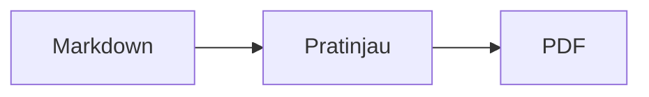

<p>&nbsp;&nbsp;&nbsp;</p>

# Splat

**Editor Markdown untuk macOS yang memungkinkan Anda menulis langsung di sumber atau di pratinjau.**

Splat menampilkan sumber Markdown Anda dengan pewarnaan sintaks di sebelah kiri dan pratinjau langsung yang sepenuhnya dapat diedit di sebelah kanan. Ketik di salah satunya: apa pun yang Anda tulis di pratinjau menjadi perubahan sekecil mungkin pada sumber, sehingga baris yang tidak Anda sentuh tetap identik byte demi byte dan diff Git Anda tetap bersih. Splat membaca Markdown yang sudah biasa Anda pakai: CommonMark dan GitHub Flavored Markdown, GitHub alerts, wiki link, embed, dan callout Obsidian, ekstensi Pandoc dan Typora, HTML tersemat, rumus LaTeX, serta diagram Mermaid, Graphviz, dan PlantUML, semuanya ditampilkan secara offline. Ekspor ke PDF, HTML, atau Word dengan satu klik. Splat ditulis dalam Rust dengan kontrol AppKit asli, tersedia dalam 35 bahasa, dan tidak mengirim apa pun melalui jaringan kecuali Anda memintanya.
 


[](https://raw.githubusercontent.com/sventmueller/splat/main/dist/Splat-1.0.5.dmg)

**[Unduh Splat-1.0.5.dmg](https://raw.githubusercontent.com/sventmueller/splat/main/dist/Splat-1.0.5.dmg)**: ditandatangani dan dinotarisasi oleh Apple, untuk macOS 14 atau yang lebih baru di Apple Silicon dan Intel.
 
 

[](https://www.rust-lang.org)
[](https://www.apple.com/macos/)

[](https://github.com/madsmtm/objc2)
[](https://webkit.org)
[](https://github.com/kivikakk/comrak)
[](https://github.github.com/gfm/)
[](https://www.mathjax.org)
[](https://cortexjs.io/mathlive/)
[](https://mermaid.js.org)
[](https://graphviz.org)
[](https://plantuml.com)


[](#license)

**Bahasa Indonesia** ·
[Bahasa Melayu](../ms/README.md) ·
[Català](../ca/README.md) ·
[Čeština](../cs/README.md) ·
[Dansk](../da/README.md) ·
[Deutsch](../de/README.md) ·
[English](../../../README.md) ·
[Español](../es/README.md) ·
[Français](../fr/README.md) ·
[Hrvatski](../hr/README.md) ·
[Italiano](../it/README.md) ·
[Magyar](../hu/README.md) ·
[Nederlands](../nl/README.md) ·
[Norsk](../no/README.md) ·
[Polski](../pl/README.md) ·
[Português (Brasil)](../pt_BR/README.md) ·
[Português (Portugal)](../pt_PT/README.md) ·
[Română](../ro/README.md) ·
[Slovenčina](../sk/README.md) ·
[Slovenščina](../sl/README.md) ·
[Suomi](../fi/README.md) ·
[Svenska](../sv/README.md) ·
[Tiếng Việt](../vi/README.md) ·
[Türkçe](../tr/README.md) ·
[Ελληνικά](../el/README.md) ·
[Русский](../ru/README.md) ·
[Українська](../uk/README.md) ·
[עברית](../he/README.md)‎ ·
[العربية](../ar/README.md)‎ ·
[हिन्दी](../hi/README.md) ·
[ไทย](../th/README.md) ·
[한국어](../ko/README.md) ·
[日本語](../ja/README.md) ·
[简体中文](../zh-Hans/README.md) ·
[繁體中文](../zh-Hant/README.md)

## Daftar isi

- [Sekilas fitur](#sekilas-fitur)
- [Persyaratan](#persyaratan)
- [Instalasi](#instalasi)
- [Memulai](#memulai)
- [Menulis](#menulis)
  - [Di sumber](#di-sumber)
  - [Di pratinjau](#di-pratinjau)
  - [Perintah pemformatan](#perintah-pemformatan)
  - [Daftar dan tugas](#daftar-dan-tugas)
  - [Tabel](#tabel)
- [Markdown yang didukung](#markdown-yang-didukung)
  - [CommonMark dan GitHub Flavored Markdown](#commonmark-dan-github-flavored-markdown)
  - [Kotak info](#kotak-info)
  - [Sintaks yang diperluas](#sintaks-yang-diperluas)
  - [Obsidian](#obsidian)
  - [Kutipan dan referensi](#kutipan-dan-referensi)
  - [HTML tersemat](#html-tersemat)
  - [Tanda baca tipografis](#tanda-baca-tipografis)
  - [Ikhtisar sintaks](#ikhtisar-sintaks)
- [Rumus](#rumus)
- [Diagram](#diagram)
- [Gambar](#gambar)
- [Tautan dan navigasi](#tautan-dan-navigasi)
- [Ekspor, cetak, dan bagikan](#ekspor-cetak-dan-bagikan)
- [Tampilan dan aksesibilitas](#tampilan-dan-aksesibilitas)
- [Bahasa](#bahasa)
- [Pintasan keyboard](#pintasan-keyboard)
- [Privasi dan keamanan](#privasi-dan-keamanan)
- [Dokumen besar](#dokumen-besar)
- [Keterbatasan yang diketahui](#keterbatasan-yang-diketahui)
- [Pemecahan masalah](#pemecahan-masalah)
- [Untuk pengembang](#untuk-pengembang)
  - [Building](#building)
  - [Distribusi](#distribusi)
  - [Pengujian](#pengujian)
  - [Struktur proyek](#struktur-proyek)
  - [Alur data](#alur-data)
  - [Aturan di controller](#aturan-di-controller)
  - [Menambah perintah](#menambah-perintah)
  - [Terjemahan](#terjemahan)
  - [Komponen pihak ketiga](#komponen-pihak-ketiga)
- [License](#license)

## Sekilas fitur

- **Dua cara menulis, satu teks.** Sumber dan pratinjau sama-sama dapat diedit. File Markdown adalah satu-satunya kebenaran: ada satu riwayat urung per dokumen, dan setiap pengeditan di pratinjau diterjemahkan menjadi perubahan sekecil mungkin pada sumber.
- **Markdown yang sudah biasa Anda pakai.** CommonMark, GitHub Flavored Markdown, GitHub alerts, ekstensi Obsidian, Pandoc, dan Typora, shortcode emoji, spoiler, daftar definisi, jangkar heading, dan HTML seperti di README GitHub.
- **Rumus dan diagram bawaan.** Rumus LaTeX melalui MathJax, dengan editor rumus visual. Diagram Mermaid, Graphviz, dan PlantUML ditampilkan di Mac Anda tanpa Java, server, atau koneksi jaringan.
- **Tombol untuk semuanya.** Setiap elemen Markdown punya tombol bar alat dan item menu, dan yang umum dipakai juga punya pintasan keyboard. Tabel punya menu tersendiri untuk baris, kolom, dan perataan.
- **Ekspor tanpa kehilangan apa pun.** PDF, satu file HTML mandiri, atau dokumen Word dengan heading, daftar, tabel, catatan kaki, dan gambar yang sungguhan.
- **Asli sepenuhnya.** Jendela, tab, menu, popover, Versi, Simpan Otomatis, menu bagikan, mode gelap, pemeriksaan ejaan, dikte, dan VoiceOver yang sungguhan dari AppKit. Tanpa Electron, tanpa web view untuk teksnya sendiri.
- **Cepat dengan file besar.** Merender satu ketukan tombol di dokumen 10 MB memerlukan sekitar 25 ms, sebelum pekerjaan view itu sendiri.
- **Privat dan hati-hati.** Gambar dari web dimuat hanya setelah Anda mengizinkannya, tautan ke app lain meminta konfirmasi lebih dahulu, dan semua yang mendekode data gambar yang tidak tepercaya berjalan di proses bantu dalam sandbox.
- **Dalam bahasa Anda.** Antarmuka dan referensi singkat Markdown bawaan tersedia dalam 35 bahasa: Arab, Katalan, Tionghoa (Sederhana), Tionghoa (Tradisional), Kroasia, Ceko, Denmark, Belanda, Inggris, Finlandia, Prancis, Jerman, Yunani, Ibrani, Hindi, Hungaria, Indonesia, Italia, Jepang, Korea, Melayu, Norwegia, Polandia, Portugis (Brasil), Portugis (Portugal), Rumania, Rusia, Slovakia, Slovenia, Spanyol, Swedia, Thai, Turki, Ukraina, dan Vietnam.

## Persyaratan

- macOS 14 Sonoma atau yang lebih baru. Splat dikembangkan dan diuji di macOS 27, tempat desain Liquid Glass diterapkan secara otomatis.
- Mac dengan Apple Silicon atau prosesor Intel.
- Sekitar 45 MB ruang disk.

## Instalasi

**Dari image disk.** Unduh [`dist/Splat-1.0.5.dmg`](https://raw.githubusercontent.com/sventmueller/splat/main/dist/Splat-1.0.5.dmg), buka, lalu seret Splat ke folder Aplikasi. Image ini ditandatangani dengan Developer ID dan dinotarisasi oleh Apple, sehingga terbuka tanpa peringatan.

**Dengan Homebrew.** Cask-nya ada di tap tersendiri:

```sh
brew install --cask sventmueller/tap/splat
```

`brew upgrade --cask splat` memasang versi baru, dan `brew uninstall --zap --cask splat` juga menghapus pengaturan dan cache Splat.

**Pembaruan.** Splat dari image disk atau Homebrew memperbarui dirinya sendiri melalui [Sparkle](https://sparkle-project.org). Pada peluncuran kedua, Splat bertanya apakah boleh mencari pembaruan sendiri, sekali sehari. **Splat › Periksa Pembaruan…** langsung memeriksa; **Periksa Pembaruan Secara Otomatis** dan **Unduh dan Instal Pembaruan Secara Otomatis** di menu yang sama mengubah pilihan Anda nanti. Splat hanya memasang pembaruan yang membawa tanda tangan pengembang. Build buatan sendiri tidak punya pemutakhir.

**Dari sumber.** Lihat [Membangun](#building) untuk prasyaratnya, lalu:

```sh
make build
ditto target/release/Splat.app /Applications/Splat.app
open /Applications/Splat.app
```

Agar file Markdown terbuka dengan Splat lewat klik ganda, pilih file `.md` apa pun di Finder, pilih **File › Dapatkan Info**, pilih Splat di bawah **Buka dengan**, lalu klik **Ubah Semua…**. Splat mendaftarkan dirinya untuk file `.md`, `.markdown`, `.mdown`, dan `.mkd`.

## Memulai

### Jendela

Setiap dokumen terbuka di jendelanya sendiri, atau sebagai tab jika Anda lebih suka tab:

- **Kiri: sumber.** Markdown Anda dalam SF Mono dengan pewarnaan sintaks.
- **Kanan: pratinjau.** Dokumen yang sudah ditampilkan, siap diedit.
- **Bilah samping kerangka (opsional).** Semua heading sebagai pohon; klik salah satunya untuk menampilkannya di kedua panel. Alihkan dengan **Lihat › Tampilkan Kerangka** (⌃⌘S).
- **Bar alat.** Tombol dikelompokkan menurut apa yang diubahnya: karakter, paragraf, dan elemen yang disisipkan, lalu pratinjau hidup/mati, Bagikan, dan Dokumen Baru. Sesuaikan dengan **Lihat › Sesuaikan Bar Alat…**.

Seret pembagi untuk memberi salah satu sisi lebih banyak ruang. **Lihat › Sembunyikan Pratinjau** (⌥⌘P) menyisakan sumber saja; Splat mengingatnya per jendela. Kedua panel bergulir bersama, dan pilihan di satu panel disorot di panel lainnya.

### Dokumen, tab, dan versi

Splat adalah app dokumen macOS biasa:

- **Simpan Otomatis dan Versi.** Perubahan disimpan di tempat. **File › Kembalikan Ke › Telusuri Semua Versi…** membawa Anda kembali ke masa lalu.
- **Perubahan dari program lain.** Saat Git, skrip, atau editor lain mengubah dokumen yang terbuka, Splat memuatnya ulang dan mempertahankan posisi kursor dan posisi gulir. Jika Anda punya perubahan sendiri yang belum disimpan, Splat mempertahankannya, dan macOS bertanya sebelum menimpa versi yang lain.
- **Perintah file yang biasa.** Duplikatkan (⇧⌘S), Ubah Nama…, Pindahkan Ke…, dan **File › Buka Terbaru**.
- **Tab.** **File › Tab Baru** atau tombol **+** di bar alat membuka dokumen baru sebagai tab; menu Jendela standar menggabungkan, memindahkan, dan berpindah antar tab.
- **Penempatan jendela.** Ukuran dan posisi jendela terakhir Anda diingat, juga setelah dimulai ulang. Jika sudah ada jendela di posisi itu, jendela baru terbuka sedikit bergeser.
- **Ikon Dock.** Mengkliknya setelah Anda menutup jendela terakhir akan membuka dokumen baru.
- **Buka file Markdown di Splat.** **Splat › Atur sebagai App Default untuk Markdown** membuat klik ganda pada file `.md` atau `.markdown` membuka Splat; macOS meminta konfirmasi satu kali. Item ini diberi tanda centang selama Splat menjadi app default.

File harus berupa teks UTF-8, atau UTF-16 dengan byte order mark. Splat menolak pengodean lain daripada menebak dan merusak teksnya. Byte order mark dipertahankan, UTF-16 tetap UTF-16, dan di file yang semua barisnya berakhir dengan CRLF, baris yang Anda tambahkan juga memakai CRLF.

**Setelah crash**, paling banyak beberapa detik terakhir pengetikan yang hilang: setiap lima detik, Splat menyalin teks yang belum disimpan ke `~/Library/Application Support/Splat/Unsaved`, dan menghapus salinannya begitu dokumen disimpan atau Splat berhenti secara normal. Pada awal berikutnya, apa yang ditinggalkan crash di sana dipindahkan ke `~/Library/Application Support/Splat/Recovery` dan hal itu diberitahukan satu kali, dengan tombol yang membuka foldernya. Crash yang masih bisa ditanggapi Splat juga menulis teks setiap dokumen yang terbuka ke sana.

### Referensi singkat

**Bantuan › Referensi Singkat Markdown** membuka lembar contekan dalam bahasa Anda sebagai dokumen baru tanpa judul. Ini dokumen biasa, jadi coba semuanya langsung di sana, di sumber atau di pratinjau.

## Menulis

### Di sumber

Sumber adalah editor teks biasa yang disetel untuk Markdown:

- **Pewarnaan sintaks** seperti di VS Code: heading, penekanan, tautan, kode, tabel, HTML, front matter, serta LaTeX dan Mermaid di dalam rumus dan diagram. Ada palet untuk mode terang, gelap, dan Tingkatkan Kontras.
- **Blok kode berpagar** disorot untuk Bash, C, C++, C#, CSS (juga SCSS dan Less), Go, HTML, XML, Java, JavaScript, JSON, Kotlin, PHP, Python, Ruby, Rust, SQL, Swift, TypeScript, YAML, TeX, dan Mermaid, termasuk nama singkatnya yang lazim seperti `js`, `py`, atau `sh`.
- **Tanpa substitusi yang mengejutkan.** Kutipan cerdas, tanda hubung cerdas, dan penggantian teks nonaktif secara default, karena merusak `--`, `---`, dan `"`. Aktifkan di **Edit › Substitusi**.
- **Alat menulis dari sistem.** Pemeriksaan ejaan dan tata bahasa, dikte, Temukan dan Ganti (⌥⌘F), dan Ucapan.
- **Seret dan lepas.** Lepaskan file gambar untuk menyisipkan ``, file lain untuk menyisipkan tautan ke file itu, dan URL untuk menyisipkan `[url](url)`. Setiap pelepasan adalah satu langkah urung.
- **Tempel gambar.** Gambar di clipboard, misalnya tangkapan layar, disimpan sebagai file PNG di samping dokumen (`Gambar 2026-10-29 13.09.07.png`) dan disisipkan sebagai gambar. Untuk itu dokumen harus sudah disimpan sekali.

### Di pratinjau

Pratinjau berperilaku seperti pengolah kata, tetapi semua yang Anda lakukan di sana berakhir sebagai Markdown:

- **Mengetik.** Karakter yang berarti sesuatu di Markdown, seperti `*` atau `#`, di-escape agar tampil seperti yang diketik.
- **Return** memulai paragraf atau butir daftar baru. **⌥Return** atau **⌃Return** menyisipkan pergantian baris.
- **Format di kursor.** Dengan kursor di akhir kata, Tebal, Cetak Miring, dan format karakter lainnya berlaku untuk apa yang Anda ketik berikutnya. Pilih format itu lagi untuk menghentikannya. Di dalam kata, seluruh kata diformat.
- **Baris kosong.** Return pada baris kosong menambah satu baris kosong lagi, dan Backspace menghapusnya. Di sumber, setiap baris kosong tambahan berupa dua baris kosong lagi; program Markdown lain menampilkannya sebagai jarak paragraf biasa.
- **Urung** bekerja di kedua panel. Item urung membawa nama ("Urung Tebal"), pengetikan adalah satu langkah per rentetan, dan setelah Urung dan Ulang kedua panel bergulir ke perubahannya.
- **Rumus dan diagram** tampil sebagai grafik jadi. Klik salah satunya, pindahkan kursor ke atasnya, atau tekan Return di atasnya untuk membuka editornya (lihat [Rumus](#rumus) dan [Diagram](#diagram)).
- **HTML tersemat, catatan tersemat, dan front matter** ditampilkan, tetapi Anda mengeditnya di sumber. Klik pada elemen itu menempatkan kursor di tempat yang sesuai di sana.

Segala sesuatu yang tidak dapat diungkapkan Markdown diblokir di pratinjau: panel Font dan Warna, penggaris, serta menempel atau melepas teks kaya dan gambar. HTML dan RTF yang ditempel masuk sebagai teks biasa.

### Perintah pemformatan

Setiap perintah tersedia dari bar alat, bilah menu, dan menu konteks kedua panel. Item menu menampilkan tanda centang untuk pemformatan di kursor.

| Menu | Perintah |
|---|---|
| **Format › Font** | Tebal, Cetak Miring, Garis Bawahi, Coret, Sorot, Kode, Superskrip, Subskrip |
| **Format › Heading** | Teks Isi, Heading 1 sampai 6 |
| **Format › Daftar** | Daftar Berpoin, Daftar Bernomor, Daftar Tugas |
| **Format** | Kutipan, Blok Kode (Tanpa Bahasa atau salah satu dari 20 bahasa; juga mengubah bahasa blok yang sudah ada), Kotak Info (Catatan, Tips, Penting, Peringatan, Hati-hati; jenis yang sama sekali lagi menghapusnya), Edit Rumus atau Diagram…, Hapus Format |
| **Sisipkan** | Tautan…, Gambar…, Tabel…, Rumus, Diagram (Diagram Alir, Diagram Urutan, Diagram Gantt), Daftar Isi, Catatan Kaki, Garis Pembatas |
| **Tabel** | Sisipkan Baris di Atas/Bawah, Sisipkan Kolom di Kiri/Kanan, Hapus Baris, Hapus Kolom, Perataan (Kiri, Tengah, Kanan, Default), Ratakan Kolom Tabel |
| **Lihat** | Sembunyikan/Tampilkan Pratinjau, Tampilkan/Sembunyikan Kerangka, Tanda baca tipografis, Perbesar/Perkecil, Ukuran Asli, bar alat, bar tab, layar penuh |

Garis bawah, sorotan, superskrip, dan subskrip ditulis sebagai `<ins>`, `<mark>`, `<sup>`, dan `<sub>`, yang juga ditampilkan GitHub. Splat juga membaca `<u>`, yang dihapus GitHub, serta bentuk yang lebih singkat `==highlight==`, `^sup^`, dan `~sub~`. GitHub menampilkan `==` dan `^` apa adanya dan `~sub~` sebagai coretan.

### Daftar dan tugas

- Return melanjutkan daftar; Return pada butir kosong mengakhirinya.
- **Tab** dan **⇧Tab** mengindentasi dan meng-outdentasi butir daftar di pratinjau.
- Klik pada kotak centang tugas di pratinjau mengalihkan `- [ ]` dan `- [x]`.
- **Format › Daftar** mengubah paragraf yang dipilih menjadi daftar atau mengganti jenisnya.

### Tabel

- **Sisipkan › Tabel…** menanyakan jumlah baris (termasuk baris judul) dan kolom.
- Di pratinjau, **Tab** pindah ke sel berikutnya, **⇧Tab** ke sel sebelumnya, dan **Return** ke sel di bawahnya. Tab di sel terakhir menambah satu baris.
- Menu **Tabel** menyisipkan dan menghapus baris dan kolom serta mengatur perataan kolom (⌘{, ⌘|, ⌘}).
- **Tabel › Ratakan Kolom Tabel** menambahkan spasi di sumber agar kolomnya sejajar.

## Markdown yang didukung

Splat mengurai dengan [comrak](https://github.com/kivikakk/comrak), parser yang kompatibel dengan CommonMark dan GFM, dan mengaktifkan sebagian besar ekstensinya. Semua yang tercantum di bawah ditampilkan di pratinjau dan di semua ekspor.

### CommonMark dan GitHub Flavored Markdown

- Heading (`#` dan bergaris bawah), paragraf, pergantian baris, penekanan, penekanan kuat, kode sebaris, kutipan blok, garis pembatas.
- Daftar berpoin, bernomor, dan bersarang; daftar tugas.
- Tautan (sebaris, referensi, dan otomatis), gambar, definisi referensi tautan.
- Blok kode berpagar dan berindentasi dengan pewarnaan sintaks.
- Tabel dengan perataan kolom.
- Coretan dengan `~~dua tilde~~`.
- Catatan kaki: `teks[^1]` dengan `[^1]: Catatannya.` di mana saja dalam dokumen. Klik pada penandanya melompat ke catatan.
- YAML front matter di antara baris `---` di bagian atas. Pratinjau merangkumnya dalam satu baris, seperti "Metadata: title, date, tags".

### Kotak info

GitHub alerts ditampilkan sebagai kotak berwarna dengan ikon dan judul:

```markdown
> [!NOTE]
> Informasi berguna yang perlu diketahui pengguna.

> [!WARNING]
> Konten penting yang memerlukan perhatian segera.
```

Kelima jenisnya adalah Catatan, Tips, Penting, Peringatan, dan Hati-hati. **Format › Kotak Info** mengubah paragraf di kursor menjadi salah satunya.

Callout Obsidian juga berfungsi, dengan judul apa pun dan status lipat:

```markdown
> [!tip]- Klik ▸ untuk membentangkan
> Tersembunyi sampai dibuka.

> [!question]+ Terbuka secara default
> Tanda `+` memulai dalam keadaan terbentang, tanda `-` dalam keadaan terciut.
```

Jenis Obsidian lainnya ditampilkan dalam warna terdekat dari kelima jenis itu: `success`, `check`, `done`, dan `hint` sebagai Tips; `question`, `help`, dan `faq` sebagai Penting; `attention` sebagai Peringatan; `failure`, `fail`, `missing`, `danger`, `error`, dan `bug` sebagai Hati-hati; selebihnya sebagai Catatan.

### Sintaks yang diperluas

| Fitur | Sintaks | Asal |
|---|---|---|
| Sorotan | `==teks bertanda==` | Obsidian, Typora |
| Superskrip | `x^2^` | Pandoc, Typora |
| Subskrip | `H~2~O` | Pandoc, Typora |
| Shortcode emoji | `:rocket:` menjadi 🚀 | GitHub |
| Spoiler | `\|\|teks tersembunyi\|\|`, pilih untuk membaca | Discord |
| Catatan kaki sebaris | `teks^[catatan itu sendiri]` | Pandoc, Obsidian |
| Daftar definisi | `Istilah`, baris kosong, `: Penjelasan` | PHP Markdown Extra, Pandoc |
| Jangkar heading | `## Pasang {#setup}`, tautkan dengan `[lihat](#setup)` | Pandoc, kramdown |

Daftar definisi terlihat seperti ini di sumber:

```markdown
Istilah

: Penjelasan istilah.
```

Tanpa jangkar khusus, setiap heading mendapat jangkar yang diturunkan dari teksnya, seperti di GitHub: `## Memulai` dapat dijangkau sebagai `#memulai`.

### Obsidian

- **Wiki link.** `[[Note]]` menautkan ke `Note.md` di folder yang sama atau folder di bawahnya. `[[Note|Teks tampilan]]` menampilkan teks Anda sendiri, dan `[[Note#Heading]]` membuka catatan. ⌘-klik membukanya di Splat.
- **Embed.** `![[Note]]` menampilkan catatan lain di dalam catatan ini; catatan yang tersemat di dalamnya muncul sebagai tautan. `![[diagram.png]]` menampilkan gambar. Seperti di Obsidian, embed menyebut catatan dan gambar di folder dokumen atau di bawahnya, tidak pernah dengan path absolut, dan hanya file Markdown yang tampil sebagai catatan.
- **Komentar.** `%%Hanya di sumber%%` tetap terlihat di sumber dan tidak disertakan di pratinjau dan semua ekspor, baik sebaris maupun di baris tersendiri.
- **Tag.** `#idea` atau `#project/splat` disorot. ⌘-klik mencari tag di dokumen.
- **Callout yang dapat dilipat.** Lihat [Kotak info](#kotak-info).

### Kutipan dan referensi

- **Kutipan Pandoc.** `[@doe2020]` atau `[@doe2020; @roe2021]` terbaca seperti "(Doe 2020; Roe 2021)". Entri diambil dari file BibTeX yang disebut front matter sebagai `bibliography: refs.bib`. Tanpa itu, Splat memakai `references.bib`, `literatur.bib`, atau `bibliography.bib` di samping dokumen.
- **Referensi GitHub dan GitLab.** Jika dokumen berada di repositori Git yang remote `origin`-nya ada di github.com atau host GitLab, `@name`, `#12` (isu), dan `!7` (merge request, hanya GitLab) disorot. ⌘-klik membukanya di browser.

### HTML tersemat

HTML seperti yang Anda temukan di README GitHub ditampilkan, dengan pembacanya sendiri dan bukan mesin browser:

- paragraf dan blok rata tengah (`<p align="center">`, `<div align="center">`)
- gambar dengan ukuran (``)
- tautan, `<kbd>⌘</kbd>`, `<br>`, `<u>`, `<ins>`, `<mark>`, `<sup>`, `<sub>`
- daftar dan tabel, termasuk sel yang membentang melintasi kolom (`colspan`)
- bagian yang dapat diciutkan: `<details><summary>Selengkapnya</summary>…</details>`, dibuka dengan klik pada ▸

Markdown di antara tag HTML ditampilkan sebagai Markdown. Skrip, gaya, bingkai, dan formulir dibuang sepenuhnya, dan tautan serta gambar hanya mempertahankan alamat `http`, `https`, `mailto`, dan relatif.

### Tanda baca tipografis

**Lihat › Tanda baca tipografis** menampilkan tanda kutip lurus sebagai tanda kutip bahasa antarmuka Anda, `--` sebagai tanda pisah en, `---` sebagai tanda pisah em, dan `...` sebagai elipsis. Dalam bahasa Jerman, `"Ja"` menjadi „Ja“, dalam bahasa Prancis «Oui», dalam bahasa Jepang 「はい」, juga di tempat bahasa Tionghoa dan Jepang menulis tanda kutip tanpa spasi; singkatan Ibrani seperti `צה"ל` mendapat gershayim-nya, צה״ל. Sumber mempertahankan karakter biasa; pratinjau dan semua ekspor menampilkan yang tipografis. Pengaturan ini nonaktif sampai Anda mengaktifkannya.

### Ikhtisar sintaks

| Elemen | Markdown |
|---|---|
| **Tebal** | `**Tebal**` |
| *Cetak miring* | `*Cetak miring*` |
| Garis bawah | `<ins>Garis bawah</ins>` atau `<u>Garis bawah</u>` |
| ~~Coret~~ | `~~Coret~~` |
| Sorotan | `<mark>Sorotan</mark>` atau `==Sorotan==` |
| `Kode` | `` `Kode` `` |
| x² | `x<sup>2</sup>` atau `x^2^` |
| H₂O | `H<sub>2</sub>O` atau `H~2~O` |
| [Tautan](https://example.com) | `[Tautan](https://example.com)` |
| Heading | `# Heading` sampai `###### Heading` |
| Kutipan | `> Kutipan` |
| Daftar berpoin | `- Butir` |
| Daftar bernomor | `1. Butir` |
| Tugas | `- [ ] Terbuka` dan `- [x] Selesai` |
| Blok kode | ```` ```rust ```` … ```` ``` ```` |
| Tabel | `\| A \| B \|` dengan `\|---\|---\|` di bawah baris judul |
| Catatan kaki | `Teks[^1]` dan `[^1]: Catatan` |
| Garis pembatas | `---` |
| Gambar | `` |
| Rumus | `$E = mc^2$`, `$$ … $$` |
| Diagram | ```` ```mermaid ````, ```` ```dot ````, ```` ```plantuml ```` |
| Kotak info | `> [!TIP]` |
| Wiki link | `[[Note]]`, `[[Note\|Teks]]` |
| Embed | `![[Note]]`, `![[image.png]]` |
| Komentar | `%%Komentar%%` |
| Tag | `#tag` |
| Kutipan pustaka | `[@key]` |
| Spoiler | `\|\|Spoiler\|\|` |
| Emoji | `:tada:` |

## Rumus

Rumus ditampilkan oleh [MathJax](https://www.mathjax.org) dengan matematika TeX dan AMS-nya, sebagai grafik vektor yang tajam. Teks dalam `\text{…}` boleh dalam aksara apa pun: apa yang tidak ada di font MathJax diambil dari font Mac Anda, dengan bahasa Arab dan Ibrani dibaca dari kanan ke kiri, dan emoji berwarna.

| Jenis | Sintaks |
|---|---|
| Sebaris | `$E = mc^2$`, `` $`E = mc^2`$ `` (GitHub, GitLab), `\(E = mc^2\)` |
| Blok | `$$` … `$$`, `\[` … `\]`, atau blok kode bertanda `math` |

**Mengedit rumus.** Klik rumus di pratinjau, klik ganda, tekan Return di atasnya, atau pindahkan kursor ke atasnya untuk membuka editornya di popover. **Sisipkan › Rumus** menyisipkan rumus baru dan langsung membuka editornya.

- **Visual atau LaTeX.** Sakelar di bagian atas beralih antara editor visual ([MathLive](https://cortexjs.io/mathlive/)) dan kode LaTeX. Splat mengingat pilihan Anda.
- **Blok penyusun** untuk pecahan, akar kuadrat, superskrip dan subskrip, jumlah dan integral dengan batas, limit, tanda kurung yang menyesuaikan dengan isinya, matriks 2×2, huruf Yunani, serta relasi, operator, dan panah. Blok ini meninggalkan penanda tempat □, dan **Tab** melompat ke yang berikutnya.
- **Pratinjau langsung.** Perubahan muncul di dokumen saat Anda mengetik. Kesalahan dari MathJax tampil dalam satu baris di bawah kode.
- **Terapkan atau buang.** Mengklik di luar mempertahankan perubahan sebagai satu langkah urung; **Esc** atau **Batalkan** membuangnya. Menekan Esc pada rumus baru yang kosong menghapusnya lagi.
- Menu konteks menawarkan **Edit Rumus…** untuk rumus di bawah penunjuk.

VoiceOver membacakan rumus sebagai kode LaTeX-nya. Splat menampilkan rumus, bukan dokumen LaTeX lengkap: tidak ada paket, tidak ada TikZ, dan tidak ada `\documentclass`.

## Diagram

Diagram ditampilkan di dalam Splat, secara offline dan dalam varian terang dan gelap.

| Mesin | Blok kode | Yang digambar |
|---|---|---|
| [Mermaid](https://mermaid.js.org) | ```` ```mermaid ```` | diagram alir, urutan, kelas, status, hubungan entitas, Gantt, lingkaran, peta pikiran, lini masa, dan semua jenis Mermaid lainnya |
| [Graphviz](https://graphviz.org) | ```` ```dot ```` atau ```` ```graphviz ```` | graf dalam bahasa DOT |
| [PlantUML](https://plantuml.com) | ```` ```plantuml ```` atau ```` ```puml ```` | diagram UML; berjalan tanpa Java |



**Mengedit diagram** bekerja seperti mengedit rumus: klik untuk membuka kodenya di popover, dengan pewarnaan sintaks dan pesan kesalahan dalam satu baris di bawah kode. **Sisipkan › Diagram** dimulai dari templat untuk diagram alir, diagram urutan, atau diagram Gantt. Blok penyusun membantu pada tiga jenis Mermaid yang paling umum:

- **Diagram Alir:** Simpul ▾ (persegi panjang, sudut membulat, lingkaran, belah ketupat, basis data), Koneksi, Koneksi berlabel, Grup, Arah ▾
- **Diagram Urutan:** Peserta, Pesan, Balasan, Catatan, Perulangan, Jalur alternatif
- **Diagram Gantt:** Bagian, Tugas, Tonggak

Jenis diagram lain diedit sebagai kode. VoiceOver membacakan judul atau teks alternatif diagram.

Diagram pertama setelah peluncuran memerlukan sekitar satu detik, karena mesin penampil dimulai di latar belakang. Diagram yang memerlukan lebih dari 10 detik menampilkan kesalahan, dan mesin penampil dimulai dari awal untuk diagram berikutnya. Mesin PlantUML (7 MB) dimuat hanya bersama diagram PlantUML pertama. `!include` PlantUML dari web diblokir.

## Gambar

- **Gambar lokal** memakai path relatif terhadap dokumen: ``. Splat menampilkan PNG, JPEG, GIF, WebP, BMP, SVG, HEIC, TIFF, AVIF, dan PDF.
- **Gambar dari web** tetap diblokir sampai Anda mengizinkannya: bar di atas pratinjau menjelaskan bahwa memuatnya memberi tahu server mereka bahwa dan kapan Anda membuka dokumen. **Muat Gambar** mengizinkannya untuk dokumen ini; Splat mengingat pilihan itu per file.
- **Ukuran.** `` mengatur ukuran gambar; jika tidak, gambar menyesuaikan lebar pratinjau.
- **Perubahan di disk.** Gambar yang Anda ganti, atau yang muncul setelah dokumen menyebutnya, tampil tanpa membuka dokumen lagi. Gambar dari web yang gagal karena jaringan dicoba lagi selama dokumen menampilkannya.
- **Memori.** Gambar ditampilkan hingga 2560 piksel pada sisi terpanjangnya, yang juga memenuhi halaman A4. Gambar didekode lebih kecil begitu memenuhi seperdelapan memori Mac, dan selama macOS melaporkan tekanan memori.
- **Mode gelap.** Gambar berlatar putih sedikit diredupkan di pratinjau gelap.
- **Menempel dan melepas.** Lihat [Di sumber](#di-sumber).

## Tautan dan navigasi

Di pratinjau, klik menempatkan kursor agar Anda dapat mengedit teks tautan; **⌘-klik** mengikuti tautan:

- `http`, `https`, dan `mailto` terbuka di browser atau app email Anda.
- File Markdown terbuka di Splat; file dan folder lain ditampilkan di Finder.
- `#anchor` melompat ke heading di dalam dokumen.
- Alamat yang membuka app lain, seperti `slack://` atau `vscode://`, meminta konfirmasi lebih dahulu dan menampilkan alamat lengkap serta app-nya. **Batalkan** sudah dipilih sebelumnya.

**Sisipkan › Daftar Isi** menyisipkan daftar bertaut dari semua heading. Dengan kursor di dalamnya, perintah yang sama memperbaruinya. Bilah samping kerangka (⌃⌘S) melompat ke heading mana pun di kedua panel.

## Ekspor, cetak, dan bagikan

| Format | Cara | Hasilnya |
|---|---|---|
| **PDF** | **File › Ekspor sebagai PDF…** atau menu Bagikan | Halaman seukuran kertas, selalu dalam tampilan terang, rumus dan diagram sebagai grafik vektor. **File › Pengaturan Halaman…** mengatur kertasnya. |
| **Cetak** | **File › Cetak…** (⌘P) | Tata letak yang sama seperti PDF. |
| **HTML** | **File › Ekspor sebagai HTML…** atau menu Bagikan | Satu file mandiri: gambar lokal disematkan, rumus dan diagram sebagai gambar tajam, jangkar heading agar daftar isi berfungsi. Tanpa skrip. |
| **Word** | **File › Ekspor sebagai Dokumen Word…** atau menu Bagikan | File `.docx` dengan gaya heading Word, daftar dan tabel sungguhan (termasuk sel yang digabung), catatan kaki sebagai catatan kaki Word, gambar tersemat, rumus, dan diagram. |
| **Markdown** | Tombol **Bagikan** di bar alat | Dokumen sebagai file `.md` untuk Mail, Pesan, AirDrop, dan semua layanan berbagi lainnya. |

Menu **File › Bagikan** menawarkan semuanya di satu tempat. Ekspor memakai pengaturan tanda baca tipografis dan gambar dari web yang Anda izinkan; di HTML, gambar dari web tetap berupa tautan.

## Tampilan dan aksesibilitas

- **Mode gelap** mengikuti sistem. Rumus dan diagram ditampilkan untuk setiap tampilan.
- **Tambah kontras** di Pengaturan Sistem mengalihkan warna sintaks ke palet berkontras tinggi.
- **Zoom.** ⌘+, ⌘− dan ⌘0 menskalakan kedua panel.
- **Layar penuh, tab, dan bar alat yang dapat disesuaikan**, seperti di setiap app Mac.
- **VoiceOver.** Panel diberi label "Sumber Markdown" dan "Pratinjau", rumus dibacakan sebagai kodenya dan diagram sebagai judulnya. Setiap perintah dapat dijangkau dari keyboard.

Splat tidak punya jendela pengaturan: beberapa opsinya berada di tempat opsi itu berlaku, di **Lihat** dan **Edit › Substitusi**.

## Bahasa

Antarmuka, menu, dan referensi singkat Markdown diterjemahkan ke 35 bahasa:

Arab, Katalan, Tionghoa (Sederhana), Tionghoa (Tradisional), Kroasia, Ceko, Denmark, Belanda, Inggris, Finlandia, Prancis, Jerman, Yunani, Ibrani, Hindi, Hungaria, Indonesia, Italia, Jepang, Korea, Melayu, Norwegia, Polandia, Portugis (Brasil), Portugis (Portugal), Rumania, Rusia, Slovakia, Slovenia, Spanyol, Swedia, Thai, Turki, Ukraina, dan Vietnam.

Splat mengikuti urutan bahasa di **Pengaturan Sistem › Umum › Bahasa & Wilayah**; di sana Anda juga dapat memilih bahasa khusus untuk Splat di bawah **Aplikasi**. Jika bahasa Anda belum diterjemahkan, Splat memakai bahasa Inggris. Istilah menu mengikuti terjemahan resmi Apple, sehingga Splat terbaca seperti bagian lain di Mac Anda.

Teks Ibrani dan Arab dibaca dari kanan ke kiri di mana pun muncul, apa pun bahasa antarmukanya: setiap paragraf, heading, dan butir daftar mengikuti arah huruf pertamanya, kutipan dan kotak info menggambar garisnya di kanan, dan tabel yang teksnya dimulai dari kanan ke kiri menyusun kolomnya dari kanan. Blok kode tetap dari kiri ke kanan. Ekspor PDF, HTML, dan Word mempertahankan arah ini. Dengan bahasa Ibrani atau Arab sebagai bahasa sistem, macOS juga mencerminkan jendela, sehingga pratinjau berada di kiri.

## Pintasan keyboard

| Tindakan | Pintasan |
|---|---|
| Tebal, Cetak Miring, Garis Bawahi | ⌘B, ⌘I, ⌘U |
| Coret | ⇧⌘X |
| Tautan… | ⌘K |
| Teks isi, Heading 1 sampai 6 | ⌥⌘0, ⌥⌘1 sampai ⌥⌘6 |
| Ratakan kolom tabel ke kiri, tengah, kanan | ⌘{, ⌘\|, ⌘} |
| Sembunyikan atau tampilkan pratinjau | ⌥⌘P |
| Tampilkan atau sembunyikan kerangka | ⌃⌘S |
| Perbesar, perkecil, ukuran asli | ⌘+, ⌘−, ⌘0 |
| Dokumen baru, buka, simpan, duplikatkan | ⌘N, ⌘O, ⌘S, ⇧⌘S |
| Pengaturan halaman, cetak | ⇧⌘P, ⌘P |
| Temukan, temukan dan ganti | ⌘F, ⌥⌘F |
| Temukan berikutnya, sebelumnya; gunakan pilihan; lompat ke pilihan | ⌘G, ⇧⌘G; ⌘E; ⌘J |
| Tampilkan ejaan dan tata bahasa; periksa dokumen | ⌘:, ⌘; |
| Tempel dan cocokkan gaya | ⌥⇧⌘V |
| Sembunyikan bar alat, tampilkan semua tab, layar penuh | ⌥⌘T, ⇧⌘\\, ⌃⌘F |
| Pergantian baris (pratinjau) | ⌥Return atau ⌃Return |
| Sel berikutnya / sebelumnya di tabel (pratinjau) | Tab / ⇧Tab |
| Indentasi / outdentasi butir daftar (pratinjau) | Tab / ⇧Tab |
| Penanda tempat berikutnya di editor rumus | Tab |
| Tutup editor rumus atau diagram tanpa perubahan | Esc |
| Ikuti tautan, tag, atau referensi (pratinjau) | ⌘-klik |

Splat membiarkan pintasan standar Apple di tempatnya.

## Privasi dan keamanan

File Markdown bisa datang dari siapa saja, jadi Splat memperlakukan setiap dokumen sebagai tidak tepercaya.

- **Tanpa jaringan secara default.** Splat tidak punya telemetri. Splat mencari pembaruan hanya setelah Anda setuju atau memilih **Periksa Pembaruan…**: saat itu Splat memuat file feed kecil dari GitHub, dan permintaannya hanya menyebut app dan versinya. Rumus dan diagram ditampilkan secara lokal; web view yang melakukannya tidak dapat menjangkau jaringan.
- **Gambar dari web** dimuat hanya setelah izin Anda, hanya melalui `https`, tidak pernah dari host di jaringan lokal Anda, paling banyak 10 MB per gambar, dan dalam sesi privat tanpa cookie.
- **Dekode terisolasi.** Gambar serta grafik rumus dan diagram didekode di proses bantu yang menutup setiap file yang diwarisinya dan mengunci dirinya dalam sandbox sebelum membaca byte pertama: tanpa akses file, tanpa jaringan. Proses itu hanya mengembalikan piksel, yang ukurannya diperiksa, dan dihentikan setelah 10 detik. Dekoder gambar bawaan Apple hanya melihat HEIC, TIFF, AVIF, dan PDF, dan hanya jika datanya memang berformat itu; dekoder itu berjalan di proses bantu tersendiri, yang di samping itu boleh membaca folder font sistem dan memakai dekoder video sistem. SVG, rumus, dan diagram juga melewati proses bantu itu, sehingga di Splat semuanya berupa gambar dengan resolusi tetap: empat piksel per poin, hingga 2560 pada sisi yang lebih panjang.
- **File lokal** sampai ke dokumen hanya melalui path yang disebutnya. Embed menampilkan catatan Markdown dari folder dokumen dan di bawahnya, dan gambar yang hilang dicari hanya di sana. Path gambar di tempat lain, absolut atau diawali `~`, tetap dimuat, dan ekspor HTML dan Word menyematkannya: periksa hasil ekspor dokumen yang tidak Anda tulis sendiri sebelum meneruskannya.
- **Salinan teks yang belum disimpan** tetap berada di Mac ini, di folder Library Anda, untuk pemulihan setelah crash. Salinan itu hilang bersama penyimpanan atau berakhirnya Splat secara normal; salinan yang ditinggalkan crash tetap di folder pemulihan sampai Anda menghapusnya.
- **Tautan** tidak pernah menjalankan program lewat klik. Tautan web dan email terbuka seperti biasa; tautan ke app lain meminta konfirmasi lebih dahulu.
- **HTML di dokumen** dibaca oleh parser Splat sendiri. Skrip, gaya, bingkai, dan formulir tidak pernah berjalan.
- **Ekspor** tidak membawa skrip. Halaman HTML hanya mempertahankan daftar tetap berisi tag dan atribut yang tidak berbahaya, seperti GitHub, ditambah content security policy. File Word hanya menautkan alamat `http`, `https`, dan `mailto`.
- **Penandatanganan kode** dengan Hardened Runtime. Splat berjalan tanpa App Sandbox agar dapat menampilkan gambar di samping dokumen Anda tanpa meminta izin untuk setiap folder; isolasi seluruh proses dekode mengimbanginya.

## Dokumen besar

Splat tetap responsif dengan dokumen berukuran beberapa megabyte:

- Sumber memakai TextKit 2, yang hanya menata bagian yang terlihat.
- Saat Anda mengetik di pratinjau, dan di sumber dokumen hingga 2 MB, hanya paragraf yang terpengaruh yang diurai, diwarnai, dan ditata ulang. Di dokumen 10 MB, penguraian dan pewarnaan memerlukan sekitar 20 ms, perenderan sekitar 25 ms, dan satu ketukan tombol utuh di pratinjaunya sekitar 60 ms termasuk pekerjaan view itu sendiri.
- Pratinjau besar menampilkan bagian yang terlihat lebih dahulu dan sisanya saat app menganggur. Blok yang digulir ke tampilan ditampilkan sebelum digambar.
- Di sumber dokumen yang lebih besar, penguraian untuk pratinjau berjalan di latar belakang saat Anda mengetik.
- Dokumen tetap berupa teks biasa jika akan memerlukan sekitar 4 GB memori, yaitu sekitar 50 hingga 120 MB Markdown biasa, tetapi hanya 10 hingga 20 MB jika isinya hanya tabel atau judul: sumber tanpa warna dan pratinjau menyatakan mengapa tetap kosong. Ekspor tetap berfungsi.
- Mulai sekitar 200 KB, dokumen membuka jendelanya sebelum diurai; pada 5 MB, warna dan pratinjau menyusul sekitar seperempat detik kemudian.

Beberapa perubahan diproses penuh, sekitar 300 ms per ketukan tombol pada 10 MB: perubahan pada definisi atau referensi catatan kaki, di dekat catatan kaki sebaris, di ujung akhir dokumen di dekat catatan kaki, pada front matter atau di dekat definisi referensi tautan, dan setiap perubahan di dokumen dengan blok komentar `%%` atau dengan catatan kaki yang didefinisikan dua kali atau di dalam kutipan atau daftar. Memori bertambah mengikuti ukuran file, hingga sekitar 115–160 MB untuk 1 MB Markdown dan 340–510 MB untuk 10 MB.

## Keterbatasan yang diketahui

- **Satu tilde berarti subskrip.** `~teks~` adalah subskrip seperti di Pandoc; coretan memerlukan `~~dua~~`. GitHub juga mencoret dengan satu tilde.
- **Hanya-baca di pratinjau:** HTML tersemat, catatan tersemat, dan front matter diedit di sumber.
- **Penyarangan yang sangat dalam:** HTML yang bersarang lebih dalam dari 64 tingkat, dan HTML sebaris lebih dalam dari 16, diganti dengan isinya.
- **Sel tabel yang digabung** hanya ada di tabel HTML, dan hanya melintasi kolom (`colspan`, tanpa `rowspan`). Sintaks tabel MultiMarkdown untuk sel gabungan tidak didukung.
- **Bibliografi** dibaca hanya dari BibTeX, tidak dari CSL JSON atau YAML.
- **Referensi** memerlukan repositori di github.com atau host GitLab; `!7` hanya ada di GitLab.
- **Tanda baca tipografis:** tanda kutip tunggal penutup dalam bahasa Jerman tidak dapat dibedakan dari apostrof dan ditulis sebagai ’.
- **Rumus, bukan dokumen:** tanpa paket LaTeX, TikZ, atau dokumen lengkap.
- **Editor rumus visual** menulis LaTeX dalam notasi MathLive: spasi hilang (`E = mc^2` menjadi `E=mc^2`), tampilannya tetap sama.
- **Menurut rancangan:** tanpa nomor baris, tanpa jendela pengaturan, tanpa Help Book, tidak ada di App Store.
- **Kurang diuji di Intel.** Uji mandiri jendela hanya berjalan di Apple Silicon; di Intel, CI menjalankan `cargo test`.

## Pemecahan masalah

**Daftar dokumen terbaru kosong setelah saya membangun ulang Splat.** macOS mengaitkan dokumen terbaru dan izin folder dengan tanda tangan kode app. Build lokal ditandatangani dengan sertifikat "Splat Local Signing" di keychain login Anda, sehingga build ulang mempertahankan keduanya. Jika sertifikat itu terhapus, build berikutnya membuat yang baru dan daftarnya dimulai dari awal satu kali.

**App dari image disk menampilkan dokumen terbaru yang berbeda dari build saya sendiri.** Keduanya membawa tanda tangan yang berbeda, sehingga macOS menyimpan daftar dan izin folder yang terpisah untuk masing-masing.

**HTML atau sintaks lain tampil sebagai kode biasa.** Salinan Splat yang usang mungkin telah membuka dokumen itu. Tutup Splat, pilih **File › Dapatkan Info** pada dokumen di Finder, dan pastikan **Buka dengan** menyebut Splat di folder Aplikasi Anda.

**Tidak ada Periksa Pembaruan… di menu Splat.** Hanya versi dari image disk atau Homebrew yang memperbarui dirinya sendiri; build buatan sendiri tidak punya pemutakhir.

**Gambar dari web tidak muncul.** Klik **Muat Gambar** di bar di atas pratinjau. Hanya gambar `https` dari host publik yang dimuat.

**Menempel tangkapan layar meminta saya menyimpan dahulu.** Gambar yang ditempel disimpan sebagai file di samping dokumen, yang memerlukan tempat di disk. Simpan dokumen, lalu tempel lagi.

**"File ini bukan teks UTF-8 dan tidak dapat dibuka sebagai Markdown."** File itu memakai pengodean lain dan tidak punya byte order mark yang menyebutkannya. Konversikan dahulu, misalnya dengan `iconv -f ISO-8859-1 -t UTF-8 old.md > new.md`.

**Rumus atau diagram menampilkan kesalahan.** Klik: editor menampilkan pesan dari MathJax, Mermaid, Graphviz, atau PlantUML di bawah kode.

## Untuk pengembang

Splat adalah aplikasi Rust yang berbicara langsung dengan AppKit dan WebKit melalui [objc2](https://github.com/madsmtm/objc2). Tidak ada Swift, tidak ada Objective-C, tidak ada proyek Xcode, dan tidak ada file Interface Builder.

### Building

Prasyarat:

- macOS dengan Command Line Tools (`xcode-select --install`). Xcode tidak diperlukan; Splat dibangun tanpa `actool`, `ibtool`, dan `metal`.
- Rust 1.99 (`brew install rust`). [rust-toolchain.toml](../../../rust-toolchain.toml) menyebut versi persis yang dipakai CI; rustup memasangnya sendiri, sedangkan Rust dari Homebrew mengabaikan file itu. Menaikkannya di sana adalah cara peringatan compiler dan clippy yang baru sampai ke proyek.
- rustup, untuk `make lint`, `make check`, dan `make universal`: `cargo xtask check-library` membangun pustaka untuk Linux guna membuktikan bahwa pustaka itu tidak memerlukan macOS, dan Rust dari Homebrew tidak punya target lain.

[Makefile](../../../Makefile) berisi titik masuk singkat; `make help` mendaftarkan semuanya:

```sh
make build                  # target/release/Splat.app, same as cargo xtask bundle --release
make universal              # target/splat-universal for Apple Silicon and Intel, as the disk image carries it
make check                  # formatting, clippy without warnings, all tests, vendored libraries; what CI runs
make test                   # make check, then the self-test without a window
make test-gui               # self-tests with a window; they occupy the Mac for about four minutes
make test-long              # longer randomised search and the 10 MB partial-update check
make coverage               # line coverage of all tests and self-tests, with a floor per module
make coverage-library       # the same floors for the modules without a window, as in CI
make bench FILE=<file.md>   # timings for opening, typing and scrolling a large file
make release                # make test first, then the notarized disk image
```

Logika build itu sendiri berada di crate Rust [xtask](../../../xtask/src/main.rs):

```sh
cargo xtask bundle --release   # target/release/Splat.app, Hardened Runtime, signed with "Splat Local Signing"
cargo xtask bundle             # target/debug/Splat Debug.app, a separate app that never opens Markdown files
cargo xtask dmg                # dist/Splat-<version>.dmg for distribution, Developer ID, notarized
cargo xtask icon               # rebuild assets/AppIcon.icns and the README icon from assets/icon-1024.png
cargo xtask vendor check       # verify the bundled JavaScript against vendor.lock
cargo xtask vendor fetch       # download it again after changing a version in vendor.lock
```

`bundle` menulis `Info.plist`, menyalin resource dan lokalisasi, serta menandatangani app dengan sertifikat "Splat Local Signing". Build pertama membuat sertifikat itu di keychain login Anda, berlaku 20 tahun. Selama sertifikat itu ada, Splat mempertahankan dokumen terbaru dan izin foldernya di antara build ulang; dengan tanda tangan ad hoc, setiap build akan menjadi app baru bagi macOS. Build debug dan uji mandiri membawa bundle ID tersendiri (`local.splat.debug`, `local.splat.selftest`) dan tidak mendaftar untuk file Markdown, sehingga Finder tidak pernah membuka dokumen di build yang usang dan keduanya tidak mengganggu pengaturan app yang normal.

Versi berada di [VERSION](../../../VERSION) sebagai `major.minor.build` dan merupakan versi yang diterima build berikutnya. Setiap build rilis yang berhasil (`make build`, `cargo xtask bundle --release`, `make release`) menaikkan nomor build satu angka; build debug dan uji mandiri tidak mengubahnya. Major dan minor dinaikkan secara manual: isi VERSION dengan, misalnya, `1.1.0`, dan build berikutnya mendapat persis itu.

### Distribusi

`cargo xtask dmg` (atau `make release`, yang menjalankan `make test` lebih dahulu) membangun rilis, menandatanganinya dengan Developer ID Anda, menotarisasi app pada Apple dan menyematkan tiketnya, mengemasnya ke image disk terkompresi yang hanya-baca dengan tautan ke Aplikasi, menotarisasi dan menyematkan tiket image itu juga, lalu memeriksa hasilnya dengan Gatekeeper. App membawa tiketnya sendiri agar salinan yang dipasang tanpa Finder, seperti yang dilakukan Homebrew, terbuka secara offline juga pada peluncuran pertama; dua putaran dengan layanan notarisasi memerlukan beberapa menit masing-masing. Hanya image yang lolos setiap langkah menjadi `dist/Splat-<version>.dmg`, salinan yang di-commit: tautan unduhan di README ini dan terjemahannya mengikutinya, dan nomor build naik. Image sebelumnya tetap ada untuk satu rilis lagi, karena server raw GitHub dapat memberikan feed pembaruan lama selama beberapa menit setelah push; yang lebih lama dipindahkan ke tempat sampah. Proses yang gagal membiarkan `dist/`, README, dan VERSION seperti semula.
Setiap rilis menambahkan image penuh, sekitar 16 MB, ke riwayat repositori. Proses ini hanya berjalan saat dipanggil, tidak pernah sebagai bagian dari build normal, dan memerlukan:

- sertifikat "Developer ID Application" di keychain
- login tersimpan untuk layanan notarisasi Apple dengan kata sandi khusus app, dibuat sekali dengan `xcrun notarytool store-credentials notary --apple-id <Apple ID> --team-id <team ID>`
- kunci privat yang menandatangani pembaruan, di keychain login. `generate_keys` dari Sparkle membuatnya; separuh publiknya adalah `UPDATE_KEY` di [xtask/src/main.rs](../../../xtask/src/main.rs) dan di dalam setiap salinan yang terpasang, yang hanya menerima pembaruan yang ditandatangani dengannya. Simpan cadangannya di pengelola kata sandi: `target/sparkle-2.10.1/bin/generate_keys -x <file>` mengekspornya, `-f <file>` mengimpornya di Mac lain. Tanpanya, salinan yang terpasang tidak akan pernah bisa diperbarui lagi.
- rustup (`brew install rustup`, yang membiarkan Rust dari Homebrew tetap ada)

Jika salah satunya tidak ada, `dmg` berhenti sebelum membangun. Pada proses pertama, macOS bertanya apakah Terminal boleh mengendalikan Finder; tanpa izin itu, image disk tidak menampilkan latar belakang maupun susunan ikonnya.

Hanya image disk yang membawa pemutakhir, [Sparkle](https://sparkle-project.org), yang diunduh build sekali ke `target/` dari rilis GitHub-nya dan diperiksa terhadap checksum di xtask. Hardened runtime memuat framework itu hanya jika membawa Team ID app, yang dimiliki tanda tangan Developer ID dan tidak dimiliki sertifikat lokal; dan pembaruan tidak boleh menggantikan build buatan sendiri. Build uji mandiri juga membawa Sparkle, untuk memeriksa menu pembaruan terhadapnya: dengan feed yang tidak ada, tanpa pertanyaan Sparkle pada peluncuran kedua, dan dengan entitlement yang memungkinkan app bertanda tangan lokal memuat framework itu. `dmg` menandatangani image baru dengan kunci pembaruan dan menulis `dist/appcast.xml`, feed yang dibaca salinan terpasang dari GitHub. Commit dan push image, feed, dan README bersama-sama: sejak saat itu, salinan yang terpasang menawarkan pembaruan.

Image disk adalah binary universal untuk Apple Silicon dan Intel; build lain hanya untuk prosesor host. Rust dari Homebrew hanya menyertakan pustaka standar untuk prosesor host, jadi `dmg` membangun melalui rustup, yang memasang toolchain dan target dari [rust-toolchain.toml](../../../rust-toolchain.toml) pada pemakaian pertama, dan berhenti jika program atau Sparkle tidak memiliki kode untuk salah satu prosesor. `make universal` hanya membangun programnya.
App di dalamnya membawa tanda tangan yang berbeda dari build lokal, sehingga macOS menyimpan dokumen terbaru dan izin folder yang terpisah untuk keduanya.

### Pengujian

| Perintah | Memeriksa |
|---|---|
| `cargo test --release` | uji unit, acak, dan terjemahan |
| `SPLAT_FUZZ_ROUNDS=20000 cargo test --release` | pencarian acak yang lebih panjang; `SPLAT_FUZZ_SEED` memvariasikan inputnya |
| `SPLAT_I18N_ONLY=fr cargo test --release i18n` | satu bahasa, selagi yang lain belum lengkap |
| `cargo clippy --release --all-targets [--features selftest]` | lint, termasuk pembenaran setiap blok `unsafe`, panjang fungsi dan, di pustaka, konversi angka |
| `cargo xtask check-library` | pustaka bisa dibangun untuk Linux, jadi tidak ada di dalamnya yang memerlukan macOS |
| `cargo xtask vendor check` | pustaka JavaScript cocok dengan `vendor.lock` byte demi byte |
| `cargo xtask selftest probe` | tanpa jendela, masing-masing dengan hasil yang diharapkan: rumus, diagram, gambar web terhadap server di dalam proses, alamat yang diblokir, teks yang ditulis setiap perintah, setiap format gambar melalui kedua ekspor, halaman yang berhenti menjawab, dan pertahanan web view terhadap halaman tanpa pertahanan itu. Memakan waktu sekitar setengah menit. Yang memerlukan app di depan layar dilewati pada layar terkunci |
| `cargo xtask selftest gui [--stop-after "<check>"] [--scenarios]` | app yang berjalan, klik demi klik. Membuka jendela dan mengetik di dalamnya; Mac sibuk sekitar empat menit. `--scenarios` hanya menjalankan bagian kedua, dalam sekitar satu setengah menit |
| `cargo xtask selftest resize` | melebarkan jendela setelah menggeser pembagi: sumber membungkus ulang selagi jendela diubah ukurannya. Memerlukan sekitar sepuluh detik |
| `cargo xtask selftest bench <file.md>` | waktu untuk membuka, mengetik, dan menggulir file besar |
| `cargo test --release -- --ignored partial_updates` | satu ketukan tombol di 10 MB: pembaruan parsial dibandingkan penuh, hasil yang sama dalam paling lama seperempat waktunya |
| `cargo test --release --test hostile` | dokumen yang dibuat untuk meluapkan stack atau memakan waktu kuadratik, masing-masing dalam dua ukuran yang waktunya harus tumbuh sebanding teks, melalui penguraian, tata letak, kedua ekspor, ketukan tombol, dan perintah |
| `make mutants` | kesalahan yang ditanamkan di `src/markdown/` dan `src/preview/` satu per satu, melalui [cargo-mutants](https://mutants.rs) (`cargo install cargo-mutants`); menyebutkan mana yang tidak terdeteksi uji mana pun. Memakan waktu berjam-jam; `FILE=src/preview/bridge.rs` mempersempitnya |
| `cargo test --release --test decoder` | proses dekoder mendekode gambar dan tidak menjangkau file maupun jaringan |
| `make coverage` | cakupan baris `cargo test` dan semua uji mandiri, melalui [cargo-llvm-cov](https://github.com/taiki-e/cargo-llvm-cov) (`brew install cargo-llvm-cov llvm`); gagal di bawah batas minimum. Menyibukkan Mac sekitar lima menit |
| `make coverage-library` | `src/markdown/`, `src/preview/`, dan `i18n.rs` terhadap batas minimum yang lebih tinggi, diukur oleh `cargo test` saja |

Uji unit berada di samping kode yang diujinya. `tests/` berisi apa yang menjangkau pustaka dari luar: uji acak di `robustness.rs`, yang berbagi generator di `src/fuzz.rs` dengan uji di `sync.rs`, dokumen yang dibuat untuk menyakiti di `hostile.rs`, dan uji dekoder, yang menjalankan program yang sudah dibangun. Keputusan di `src/editor/` yang tidak memerlukan jendela berada di fungsi bebas dengan ujinya sendiri: semua yang diketahui controller dan bagaimana itu berubah di `state.rs`, aturan penampilan di `render_queue.rs`, salinan teks di `sync.rs`, gaya paragraf, font, dan warna sebagai nilai di `render.rs`, arti pengenal toolbar di `toolbar.rs`, arti klik pada tautan di `navigation.rs`.

Langkah uji mandiri jendela menunggu kondisi bernama, bukan waktu; hanya yang tidak memberi sinyal, seperti ketiadaan sesuatu, tetap memakai jeda beserta alasannya. Menunggu dengan sia-sia adalah pemeriksaan gagal yang menyebut apa yang tidak pernah datang, langkah yang panik juga pemeriksaan gagal, dan proses berjalan terus dalam kedua kasus. Pemeriksaan yang tidak bisa menyatakan apa pun pada proses ini melaporkan `SELFTEST SKIP`: xtask mendaftarkannya, dan ia tidak lulus maupun gagal. xtask menahan setiap mode, dan `--scenarios` tersendiri, pada sekitar sembilan persepuluh pemeriksaannya. Uji mandiri jendela menjalankan bagian kedua setelah click-through utamanya, di `src/editor/selftest/scenarios.rs`: setiap perintah pemformatan dan tabel, dialog, klik tautan, menempel, melepas, ekspor, perubahan besar, gambar yang berubah di disk, tekanan memori, dokumen sangat besar, dan pemulihan setelah crash.

Cakupan punya dua batas minimum: setiap modul sedikitnya 84 % barisnya, semua modul bersama sedikitnya 96 %. `make coverage` mengukur `cargo test` bersama uji mandiri dan gagal di bawah salah satunya; `make coverage-library` menahan yang tidak memerlukan jendela pada 90 % dan 97 %. Batas minimum dan beberapa pengecualian, seperti panic hook di `main.rs` yang hanya berjalan saat crash, ada di [xtask](../../../xtask/src/coverage.rs) bersama alasannya. Build terukur masuk ke `target/coverage/`, sehingga kode pengukur tidak pernah sampai ke `target/release/` atau image disk. Proses bantu dekoder membuka file pengukurannya sebelum mengunci dirinya, sehingga ikut terukur.

CI ([.github/workflows/ci.yml](../../../.github/workflows/ci.yml)) menjalankan `make check`, `make coverage-library`, dan build universal di Apple Silicon serta `cargo test` di Intel untuk setiap push ke `main` dan setiap pull request. Setiap malam, [.github/workflows/nightly.yml](../../../.github/workflows/nightly.yml) menjalankan `make test-long` dengan input acak yang baru. Uji mandiri dan image disk tetap di Mac pengembang: keduanya memerlukan layar dan sertifikat penandatanganan di keychain.

Keluaran uji mandiri masuk ke `target/selftest/`. Uji mandiri membangun app terpisah (`target/release/Splat Selftest.app`, bundle ID `local.splat.selftest`) dan membiarkan pengaturan, dokumen terbaru, dan asosiasi file app yang normal tidak tersentuh.

### Struktur proyek

`src/lib.rs` menjadikan semua yang tidak memerlukan jendela sebuah pustaka tersendiri, `splat`: `markdown/`, `preview/`, `i18n.rs`, dan generator uji `fuzz.rs`. Ia dibangun tanpa macOS. App di `src/main.rs` dibangun di atasnya.

- `src/markdown/`: pohon yang dibaca setiap konsumen, `Doc` di `doc/`, yang memiliki teksnya sendiri, dan satu-satunya binding ke parser di `reader/`: comrak tidak disebut di tempat lain, dan `reader/assumptions.rs` memuat apa yang diasumsikan kode tentangnya. Warna sintaks, dan semua perintah sebagai pengeditan teks murni (`Edit`) di `commands/`. Juga penguraian ulang setelah pengeditan (`incremental.rs`), pembaca untuk HTML tersemat (`markup.rs`), tipografi, tag, referensi, dan kutipan pustaka dalam teks mengalir (`typography.rs`), bagaimana teks terlihat dan Markdown serta HTML mana yang membuatnya begitu (`style.rs`), alamat apa yang diperbolehkan (`url.rs`), serta ekspor HTML dan Word (`html.rs`, `docx.rs` dengan `docx/html.rs` dan `docx/xml.rs`). Sebuah posisi punya tipenya sendiri: `Byte` di teks sumber, `U16` di tampilan sumber, `Shown` di tampilan pratinjau (`text.rs`). Tanpa AppKit.
- `src/preview/`: tata letak pratinjau di `layout/`, dengan HTML tersemat di `layout/html.rs`, dan pemetaan antara pratinjau dan sumber (`Bridge`, `Index`). `Bridge` menolak tata letak dari versi `Doc` yang lain. Tanpa AppKit.
- `src/editor/`: jendela. Satu objek `EditorController` melayani AppKit sebagai delegate kedua view dan meneruskan ke komponen, struct kecil di atas controller dan state yang dimilikinya, yang field-nya tidak dapat dijangkau modul lain:

| Modul | Tanggung jawab |
|---|---|
| `mod.rs` | kelas, metode delegate yang meneruskan, `invalidate` |
| `panes.rs` | `Panes`: text view, kerangka, menampilkan dan menyembunyikan panel, dan apa yang memberi akses ke view |
| `state.rs` | apa yang diketahui controller tentang dokumen dan setiap cara itu berubah; field-nya privat, dan tidak menyentuh view |
| `model.rs` | meminjamkan state dan salinan teks ke closure yang tidak dapat menjangkau view |
| `actions.rs` | registri perintah: selector, judul, pintasan, simbol, kapan perintah berlaku |
| `editing.rs` | `Editing`: menjalankan dan memvalidasi perintah, mengetik di pratinjau |
| `update.rs` | `Updater`: menguraikan, mewarnai, memperbarui pratinjau; setelah pengeditan hanya paragraf yang terpengaruh |
| `sync.rs` | salinan teks dan pembukuan blok, tanpa AppKit dan dengan uji acak |
| `progressive.rs` | `Progressive`: menampilkan pratinjau besar selangkah demi selangkah |
| `selection.rs`, `scroll.rs` | `Selection`, `ScrollSync`: pilihan dan posisi gulir kedua panel agar selaras |
| `atom.rs`, `atom/edit.rs` | `AtomEditor`: editor rumus dan diagram |
| `navigation.rs`, `links.rs` | `Links`: tautan, wiki link, tag, kotak centang tugas, pelipatan, catatan kaki |
| `env.rs` | apa yang dibaca pratinjau dari luar teks: tanda baca tipografis, repositori untuk `@name` dan `#12`, file BibTeX, catatan tersemat |
| `render.rs`, `images.rs`, `remote.rs`, `safe_image.rs` | teks pratinjau, gambar lokal dan jarak jauh; `Pictures` di `images.rs` |
| `attributes.rs` | atribut teks; setiap kunci hanya mendapat nilai bertipe yang diharapkannya |
| `shadow.rs` | salinan teks yang belum disimpan untuk pemulihan setelah crash |
| `decoder.rs` | proses bantu dalam sandbox yang mendekode gambar dan grafik |
| `export.rs`, `outline.rs` | `Sharing`: ekspor HTML dan Word, file bagikan, pencetakan; bilah samping kerangka |
| `js.rs`, `mathfield.rs`, `render_queue.rs` | WebKit untuk MathJax, Mermaid, Graphviz, PlantUML, dan editor rumus visual; aturan tentang apa yang ditampilkan kapan, terlepas dari WebKit |
| `webkit.rs` | pemanggilan ke WebKit; hanya masa hidup delegate navigasi yang tetap pada `js.rs` dan `mathfield.rs` |
| `window.rs`, `toolbar.rs`, `views.rs`, `dialogs.rs`, `style.rs` | membangun jendela, bar alat, text view, dialog, warna |

- `src/menu.rs`, `src/app.rs`, `src/document.rs`: bilah menu, delegate app, dokumen (`MDDocument`, subkelas `NSDocument`).
- `src/i18n.rs` dengan `resources/*.lproj`: 35 bahasa; kuncinya adalah teks Jerman, dan app memasang tabel bahasa antarmuka saat dimulai.
- `src/util/`: worker thread (`lanes.rs`), volume yang bisa berhenti menjawab (`volumes.rs`), helper AppKit, file, dan proses. `src/diag.rs`: apa yang salah di luar pandangan pengguna masuk ke log sistem, tanpa teks dokumen apa pun.
- `src/large_alloc.rs`: alokasi besar datang langsung dari kernel dan kembali ke sana saat dibebaskan, sehingga memori kembali setelah pengeditan besar.
- `resources/js/`: halaman web dan pustaka; versi dan checksum di [vendor.lock](../../../vendor.lock).
- `xtask/`: bundling, penandatanganan, image disk, ikon, vendoring, runner uji mandiri, dan batas minimum cakupan.

### Alur data

Teks sumber di text view kiri adalah satu-satunya sumber kebenaran.

1. Setiap perubahan karakter di sana memperbarui salinan teks (`Snapshot`) di tempat, tanpa membaca teksnya lagi.
2. Pembaruan mengurai salinan, mewarnai ulang sumber hanya di tempat warna berubah, menata pratinjau, dan mengganti hanya blok yang isinya berubah.
3. Setelah pengeditan, hanya paragraf yang terpengaruh yang diurai, diwarnai, dan ditata ulang, selama tetangganya tetap sama; `reparse_part_and_color` menyatakan kapan tidak. Dokumen dengan blok komentar `%%`, perubahan pada front matter, dan, pada dokumen dengan definisi referensi tautan, perubahan pada bagian yang memuat tanda kurung siku diproses penuh. comrak mengenali referensi catatan kaki hanya dengan definisinya dalam penguraian yang sama dan memindahkan definisi ke belakang teks, jadi bagian itu diurai dengan definisi pengganti per label dan mengambil nomornya dari pohon lama; perubahan pada referensi atau definisi di bagian itu, atau di dekat catatan kaki sebaris, diproses penuh.
4. Blok HTML yang membuka `<details>` atau `<div align>` dan menutupnya kemudian memengaruhi blok Markdown di antaranya; blok yang dipakai ulang harus memiliki lingkungan yang sama.
5. Saat Anda mengetik di sumber dokumen hingga 2 MB, pembaruan parsial berjalan seketika; bila tidak berlaku, atau di dokumen yang lebih besar, penguraian dan tata letak berjalan di latar belakang. Saat Anda mengetik di pratinjau, keduanya berjalan seketika, karena kursor pratinjau bergantung pada hasilnya.
6. Input di pratinjau diterjemahkan oleh `Bridge` menjadi pengeditan sumber dan menempuh jalur yang sama sejak saat itu. Markdown punya terlalu banyak cara mengubah teks menjadi sintaks untuk aturan saja, jadi `preview/verify.rs` menguraikan lagi bagian yang berubah dan membandingkan apa yang ditampilkannya dengan apa yang diketik; pengeditan yang tidak bertahan di-escape lebih jauh atau ditolak.
7. Posisi sebaris comrak salah di beberapa tempat, misalnya di belakang definisi referensi tautan. `markdown/reader/positions.rs` memeriksanya terhadap sumber saat membaca blok dan membacanya lagi dari sumber bila tidak cocok.

### Aturan di controller

1. Perubahan controller sendiri pada view berjalan di dalam `Panes::silently`; callback delegate mengabaikannya. Di tempat lain view hanya bisa dibaca, jadi compiler yang memeriksanya. Apa yang memang harus didengar callback, atau apa yang menyerahkan view ke AppKit, menyatakannya dengan melewati `Panes::for_appkit`.
2. State dipinjam hanya untuk membaca dan menghitung, tidak pernah melintasi pemanggilan yang mengubah, menata, atau menggulir view: `Model` meminjamkannya ke closure `Send`, dan tidak ada view yang `Send`, jadi compiler yang memeriksanya. Ia berubah hanya melalui metodenya sendiri, yang ujinya tidak memerlukan jendela.
3. Pesan dari luar (gambar dimuat, rumus ditampilkan) tiba tertunda melalui `renders_arrived` dan `image_arrived`, tidak pernah di tengah pembaruan.
4. Menggambar ulang tanpa perubahan teks hanya melalui `invalidate(reason)`.
5. Salinan teks tidak ditahan melintasi perubahan sumber, atau perubahan itu menyalin seluruh teks: `with_text` meminjamkannya hanya selama satu closure `Send`.
6. Perintah baru memerlukan entri di `actions.rs`, metode di `mod.rs`, dan cabang di `Editing::perform`.
7. Setiap blok `unsafe` membawa pembenarannya sebagai komentar `// SAFETY:`. Byte sampai ke dekoder gambar sistem hanya di proses pembantu, melalui `decoder::decode_native`; sebuah tes memindai sumber untuk pemanggilan lain.
8. Tidak ada di thread utama yang menunggu folder pengguna, karena volume jaringan dapat berhenti menjawab: file dilihat di thread `DISK`, dan pratinjau membaca jawabannya melalui `Env::known`. Hanya tindakan yang ditunggu pengguna, seperti ekspor atau menyimpan, yang boleh menyentuh disk secara langsung.

### Menambah perintah

Bilah menu, bar alat, dan menu konteks semuanya membangun itemnya dari registri di [src/editor/actions.rs](../../../src/editor/actions.rs), dan validasi menu membaca di sana kapan perintah berlaku dan apakah menampilkan tanda centang. Perintah baru memerlukan:

1. varian `Action` dengan `Spec`-nya: selector, judul, label bar alat, tooltip (diawali kata kerja, paling banyak 75 karakter), pintasan, SF Symbol, dan kapan berlaku
2. metode di `src/editor/mod.rs`
3. cabang di `Editing::perform`
4. teksnya di setiap `Localizable.strings`

Uji `every_command_has_a_method_and_every_method_a_command` memeriksa bahwa registri dan metode cocok. Pintasan standar Apple seperti ⌘E, ⌘J, ⌘T, ⌘;, ⇧⌘C, ⌥⌘C, ⌥⌘V, ⇧⌘P, ⌥⌘T, ⌃⌘F, dan ⌘, tidak disentuh.

### Terjemahan

Kode memakai teks Jerman sebagai kunci: `t("Fett")` mencarinya saat runtime, `n("Fett")` menandai konstanta untuk pencarian nanti. Setiap `resources/<language>.lproj/` berisi:

- `Localizable.strings`: setiap teks antarmuka, istilah menu mengikuti glosarium resmi Apple
- `InfoPlist.strings`: nama yang ditampilkan macOS untuk app dan jenis dokumennya
- `QuickReference.md`: referensi singkat Markdown

`cargo xtask bundle` mendaftarkan setiap folder `.lproj` sebagai lokalisasi, dan `CFBundleDevelopmentRegion` adalah bahasa Inggris, sehingga menu sistem dan dialog simpan mengikuti bahasa yang sama. Uji i18n memeriksa bahwa setiap bahasa memiliki setiap teks dan bahwa setiap referensi singkat memiliki kerangka yang sama dengan yang berbahasa Jerman.

`assets/readme/<language>/` berisi README ini dalam bahasa tersebut, tangkapan layarnya, dan dokumen demo yang ditampilkan tangkapan layar itu. Perubahan pada README ini juga perlu dilakukan di salinan-salinan itu.

### Komponen pihak ketiga

| Komponen | Versi | Dipakai untuk | Lisensi |
|---|---|---|---|
| [comrak](https://github.com/kivikakk/comrak) | 0.59 | parser Markdown | BSD-2-Clause |
| [objc2](https://github.com/madsmtm/objc2), objc2-foundation, block2 | 0.6 / 0.3 | runtime Objective-C, Foundation, blok | MIT |
| objc2-app-kit, objc2-web-kit, dispatch2 | 0.3 | binding AppKit, WebKit, dan Grand Central Dispatch | Zlib, Apache-2.0 atau MIT |
| [svg2pdf](https://github.com/typst/svg2pdf) | 0.13 | rumus dan gambar SVG sebagai PDF vektor | MIT atau Apache-2.0 |
| [image](https://github.com/image-rs/image) | 0.25 | mendekode PNG, JPEG, GIF, WebP, dan BMP | MIT atau Apache-2.0 |
| [unicode-width](https://github.com/unicode-rs/unicode-width) | 0.2 | meratakan kolom tabel | MIT atau Apache-2.0 |
| [entities](https://github.com/p-jackson/entities) | 1 | nama referensi karakter HTML | MIT |
| [MathJax](https://www.mathjax.org) | 3.2.2 | menampilkan rumus | Apache-2.0 |
| [MathLive](https://cortexjs.io/mathlive/) | 0.111.1 | editor rumus visual, dengan font KaTeX | MIT |
| [Mermaid](https://mermaid.js.org) | 12.2.0 | diagram Mermaid | MIT |
| [Viz.js](https://github.com/mdaines/viz-js) | 3.24.0 | Graphviz yang dikompilasi ke WebAssembly, berisi Graphviz (EPL-1.0) dan Expat (MIT) | MIT |
| [PlantUML](https://github.com/plantuml/plantuml) (`@plantuml/core`) | 1.2026.6 | diagram PlantUML, dikompilasi ke JavaScript | MIT |
| [Sparkle](https://sparkle-project.org) | 2.10.1 | pembaruan versi image disk | MIT, dengan bagian di bawah lisensi BSD dan zlib |

Pustaka JavaScript disimpan di `resources/js/` persis seperti yang diterbitkan; [vendor.lock](../../../vendor.lock) mencatat sumber dan checksum SHA-256-nya. Teks lisensinya, termasuk milik Graphviz dan Expat di dalam Viz.js, berada di sampingnya sebagai `resources/js/LICENSE-*` dan dikirim di dalam app. Sparkle tidak disimpan di repositori: `cargo xtask dmg` mengunduh rilisnya dan memeriksanya terhadap checksum di xtask, dan lisensinya dikirim di dalam app sebagai `LICENSE-sparkle`.

## License

Splat dilisensikan di bawah salah satu dari

- Lisensi Apache, Versi 2.0 ([LICENSE-APACHE](../../../LICENSE-APACHE))
- Lisensi MIT ([LICENSE-MIT](../../../LICENSE-MIT))

sesuai pilihan Anda.

Kecuali Anda menyatakan lain secara eksplisit, setiap kontribusi yang dengan sengaja diajukan untuk dimasukkan ke dalam Splat oleh Anda, sebagaimana didefinisikan dalam lisensi Apache-2.0, dilisensikan ganda seperti di atas, tanpa syarat atau ketentuan tambahan apa pun.
