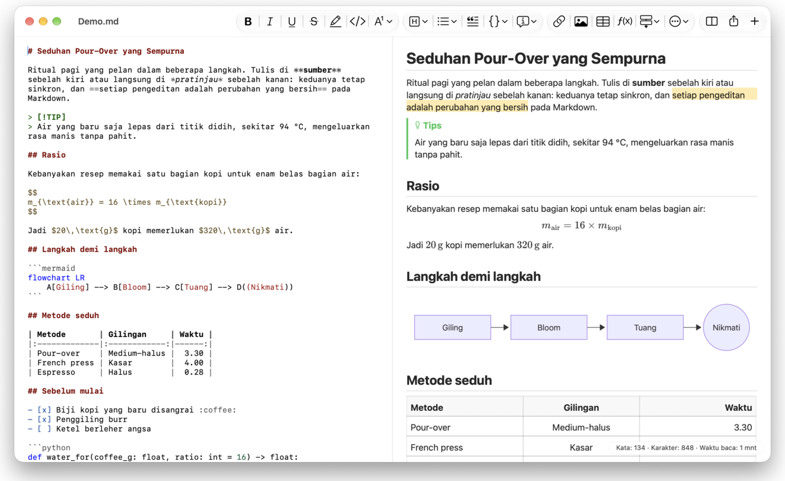
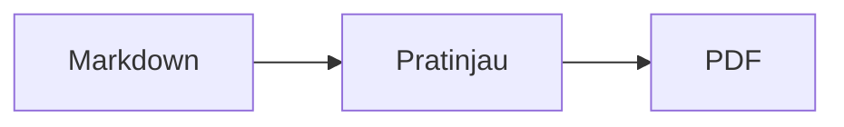

<p>&nbsp;&nbsp;&nbsp;</p>

# Splat

**Editor Markdown untuk macOS yang memungkinkan Anda menulis langsung di sumber atau di pratinjau.**

Splat menampilkan sumber Markdown Anda dengan pewarnaan sintaks di sebelah kiri dan pratinjau langsung yang sepenuhnya dapat diedit di sebelah kanan. Ketik di salah satunya: apa pun yang Anda tulis di pratinjau menjadi perubahan sekecil mungkin pada sumber, sehingga baris yang tidak Anda sentuh tetap identik byte demi byte dan diff Git Anda tetap bersih. Splat membaca Markdown yang sudah biasa Anda pakai: CommonMark dan GitHub Flavored Markdown, GitHub alerts, wiki link, embed, dan callout Obsidian, ekstensi Pandoc dan Typora, HTML tersemat, rumus LaTeX, serta diagram Mermaid, Graphviz, dan PlantUML, semuanya ditampilkan secara offline. Telusuri dan cari di seluruh folder catatan, lihat apa yang berubah sejak commit Git terakhir, tempel dari Word atau halaman web sebagai Markdown, dan ekspor ke PDF, HTML, atau Word dengan satu klik. Splat ditulis dalam Rust dengan kontrol AppKit asli, tersedia dalam 35 bahasa, dan tidak punya telemetri.
 


[](https://github.com/sventmueller/splat/releases/latest/download/Splat.dmg)

**[Unduh Splat.dmg](https://github.com/sventmueller/splat/releases/latest/download/Splat.dmg)**: ditandatangani dan dinotarisasi oleh Apple, untuk macOS 14 atau yang lebih baru di Apple Silicon dan Intel.

**Menemukan bug?** Splat menjaga baris yang tidak Anda sentuh tetap identik byte demi byte. Jika salah satunya tetap berubah, atau sebuah file ditampilkan dengan salah, [buka issue](https://github.com/sventmueller/splat/issues/new/choose) dan lampirkan filenya. Jika Splat berguna bagi Anda, [bintang di GitHub](https://github.com/sventmueller/splat) membantu orang lain menemukannya.
 
 

[](https://www.rust-lang.org)
[](https://www.apple.com/macos/)

[](https://github.com/madsmtm/objc2)
[](https://webkit.org)
[](https://github.com/kivikakk/comrak)
[](https://github.github.com/gfm/)
[](https://www.mathjax.org)
[](https://cortexjs.io/mathlive/)
[](https://mermaid.js.org)
[](https://graphviz.org)
[](https://plantuml.com)


[](#license)

**Bahasa Indonesia** ·
[Bahasa Melayu](../ms/README.md) ·
[Català](../ca/README.md) ·
[Čeština](../cs/README.md) ·
[Dansk](../da/README.md) ·
[Deutsch](../de/README.md) ·
[English](../../../README.md) ·
[Español](../es/README.md) ·
[Français](../fr/README.md) ·
[Hrvatski](../hr/README.md) ·
[Italiano](../it/README.md) ·
[Magyar](../hu/README.md) ·
[Nederlands](../nl/README.md) ·
[Norsk](../no/README.md) ·
[Polski](../pl/README.md) ·
[Português (Brasil)](../pt_BR/README.md) ·
[Português (Portugal)](../pt_PT/README.md) ·
[Română](../ro/README.md) ·
[Slovenčina](../sk/README.md) ·
[Slovenščina](../sl/README.md) ·
[Suomi](../fi/README.md) ·
[Svenska](../sv/README.md) ·
[Tiếng Việt](../vi/README.md) ·
[Türkçe](../tr/README.md) ·
[Ελληνικά](../el/README.md) ·
[Русский](../ru/README.md) ·
[Українська](../uk/README.md) ·
[עברית](../he/README.md)‎ ·
[العربية](../ar/README.md)‎ ·
[हिन्दी](../hi/README.md) ·
[ไทย](../th/README.md) ·
[한국어](../ko/README.md) ·
[日本語](../ja/README.md) ·
[简体中文](../zh-Hans/README.md) ·
[繁體中文](../zh-Hant/README.md)

## Daftar isi

- [Sekilas fitur](#sekilas-fitur)
- [Persyaratan](#persyaratan)
- [Instalasi](#instalasi)
- [Memulai](#memulai)
- [Menulis](#menulis)
  - [Di sumber](#di-sumber)
  - [Di pratinjau](#di-pratinjau)
  - [Perintah pemformatan](#perintah-pemformatan)
  - [Daftar dan tugas](#daftar-dan-tugas)
  - [Tabel](#tabel)
  - [Menempel teks berformat](#menempel-teks-berformat)
  - [Metadata](#metadata)
- [Markdown yang didukung](#markdown-yang-didukung)
  - [CommonMark dan GitHub Flavored Markdown](#commonmark-dan-github-flavored-markdown)
  - [Kotak info](#kotak-info)
  - [Sintaks yang diperluas](#sintaks-yang-diperluas)
  - [Obsidian](#obsidian)
  - [Kutipan dan referensi](#kutipan-dan-referensi)
  - [HTML tersemat](#html-tersemat)
  - [Tanda baca tipografis](#tanda-baca-tipografis)
  - [Ikhtisar sintaks](#ikhtisar-sintaks)
- [Rumus](#rumus)
- [Diagram](#diagram)
- [Gambar](#gambar)
- [Tautan dan navigasi](#tautan-dan-navigasi)
- [Catatan dalam folder](#catatan-dalam-folder)
- [Perubahan sejak commit terakhir](#perubahan-sejak-commit-terakhir)
- [Ekspor, cetak, dan bagikan](#ekspor-cetak-dan-bagikan)
- [Mengimpor dokumen Word](#mengimpor-dokumen-word)
- [Tampilan dan aksesibilitas](#tampilan-dan-aksesibilitas)
- [Bahasa](#bahasa)
- [Pintasan keyboard](#pintasan-keyboard)
- [Privasi dan keamanan](#privasi-dan-keamanan)
- [Dokumen besar](#dokumen-besar)
- [Keterbatasan yang diketahui](#keterbatasan-yang-diketahui)
- [Pemecahan masalah](#pemecahan-masalah)
- [Untuk pengembang](#untuk-pengembang)
  - [Komponen pihak ketiga](#komponen-pihak-ketiga)
- [License](#license)

## Sekilas fitur

- **Dua cara menulis, satu teks.** Sumber dan pratinjau sama-sama dapat diedit. File Markdown adalah satu-satunya kebenaran: ada satu riwayat urung per dokumen, dan setiap pengeditan di pratinjau diterjemahkan menjadi perubahan sekecil mungkin pada sumber.
- **Markdown yang sudah biasa Anda pakai.** CommonMark, GitHub Flavored Markdown, GitHub alerts, ekstensi Obsidian, Pandoc, dan Typora, shortcode emoji, spoiler, daftar definisi, jangkar heading, dan HTML seperti di README GitHub.
- **Rumus dan diagram bawaan.** Rumus LaTeX melalui MathJax, dengan editor rumus visual. Diagram Mermaid, Graphviz, dan PlantUML ditampilkan di Mac Anda tanpa Java, server, atau koneksi jaringan.
- **Tombol untuk semuanya.** Setiap elemen Markdown punya tombol bar alat dan item menu, dan yang umum dipakai juga punya pintasan keyboard. Tabel punya menu tersendiri untuk baris, kolom, dan perataan.
- **Folder, bukan sekadar file.** Bilah samping mencantumkan catatan di samping dokumen dan mencari di semuanya. Mengubah nama catatan mengubah tautan ke catatan itu, dan setiap byte di sekitarnya tetap sama.
- **Perubahan sekilas.** Di repositori Git, bilah di samping teks menandai apa yang berbeda dari commit terakhir, di kedua panel.
- **Dari Word dan web ke Markdown.** Tempel teks berformat sebagai Markdown, sel dari spreadsheet sebagai tabel, dan impor dokumen Word secara utuh beserta gambarnya.
- **Ekspor tanpa kehilangan apa pun.** PDF, satu file HTML mandiri, atau dokumen Word dengan heading, daftar, tabel, catatan kaki, dan gambar yang sungguhan. Tambahkan nomor halaman, header, dan halaman judul, atau gunakan template Word perusahaan Anda.
- **Asli sepenuhnya.** Jendela, tab, menu, popover, Versi, Simpan Otomatis, menu bagikan, mode gelap, pemeriksaan ejaan, dikte, dan VoiceOver yang sungguhan dari AppKit. Tanpa Electron, tanpa web view untuk teksnya sendiri.
- **Cepat dengan file besar.** Merender satu ketukan tombol di dokumen 10 MB memerlukan sekitar 10 ms, sebelum pekerjaan view itu sendiri.
- **Privat dan hati-hati.** Splat berjalan dalam App Sandbox, tautan ke app lain meminta konfirmasi lebih dahulu, dan semua yang mendekode data gambar yang tidak tepercaya berjalan di layanan tersendiri dalam sandbox.
- **Dalam bahasa Anda.** Antarmuka dan referensi singkat Markdown bawaan tersedia dalam 35 bahasa: Arab, Katalan, Tionghoa (Sederhana), Tionghoa (Tradisional), Kroasia, Ceko, Denmark, Belanda, Inggris, Finlandia, Prancis, Jerman, Yunani, Ibrani, Hindi, Hungaria, Indonesia, Italia, Jepang, Korea, Melayu, Norwegia, Polandia, Portugis (Brasil), Portugis (Portugal), Rumania, Rusia, Slovakia, Slovenia, Spanyol, Swedia, Thai, Turki, Ukraina, dan Vietnam.

## Persyaratan

- macOS 14 Sonoma atau yang lebih baru. Splat dikembangkan dan diuji di macOS 27, tempat desain Liquid Glass diterapkan secara otomatis.
- Mac dengan Apple Silicon atau prosesor Intel.
- Sekitar 45 MB ruang disk.

## Instalasi

**Dari image disk.** Unduh [`Splat.dmg`](https://github.com/sventmueller/splat/releases/latest/download/Splat.dmg), buka, lalu seret Splat ke folder Aplikasi. Image ini ditandatangani dengan Developer ID dan dinotarisasi oleh Apple, sehingga terbuka tanpa peringatan.

**Dengan Homebrew.** Cask-nya ada di tap tersendiri:

```sh
brew install --cask sventmueller/tap/splat
```

`brew upgrade --cask splat` memasang versi baru, dan `brew uninstall --zap --cask splat` juga menghapus pengaturan dan cache Splat.

**Pembaruan.** Splat dari image disk atau Homebrew memperbarui dirinya sendiri melalui [Sparkle](https://sparkle-project.org). Pada peluncuran kedua, Splat bertanya apakah boleh mencari pembaruan sendiri, sekali sehari. **Splat › Periksa Pembaruan…** langsung memeriksa; **Periksa Pembaruan Secara Otomatis** dan **Unduh dan Instal Pembaruan Secara Otomatis** di menu yang sama mengubah pilihan Anda nanti. Splat hanya memasang pembaruan yang membawa tanda tangan pengembang. Build buatan sendiri tidak punya pemutakhir.

**Dari sumber.** Lihat [Membangun](../../../docs/development.md#building) untuk prasyaratnya, lalu:

```sh
make build
ditto target/release/Splat.app /Applications/Splat.app
open /Applications/Splat.app
```

Agar file Markdown terbuka dengan Splat lewat klik ganda, pilih file `.md` apa pun di Finder, pilih **File › Dapatkan Info**, pilih Splat di bawah **Buka dengan**, lalu klik **Ubah Semua…**. Splat mendaftarkan dirinya untuk file `.md`, `.markdown`, `.mdown`, dan `.mkd`.

## Memulai

### Jendela

Setiap dokumen terbuka di jendelanya sendiri, atau sebagai tab jika Anda lebih suka tab:

- **Kiri: sumber.** Markdown Anda dalam SF Mono dengan pewarnaan sintaks.
- **Kanan: pratinjau.** Dokumen yang sudah ditampilkan, siap diedit.
- **Bilah samping (opsional).** Semua heading sebagai pohon, klik salah satunya untuk menampilkannya di kedua panel: **Lihat › Tampilkan Kerangka** (⌃⌘S). Dua tab lainnya memuat [catatan di folder](#catatan-dalam-folder) dan pencarian di dalamnya. Tombol di samping judul jendela menampilkan dan menyembunyikannya, dan jendela baru membukanya seperti yang ditinggalkan jendela terakhir.
- **Bar alat.** Tombol dikelompokkan menurut apa yang diubahnya: karakter, paragraf, dan elemen yang disisipkan, lalu pratinjau hidup/mati, Bagikan, dan Dokumen Baru. Sesuaikan dengan **Lihat › Sesuaikan Bar Alat…**.

Seret pembagi untuk memberi salah satu sisi lebih banyak ruang. **Lihat › Sembunyikan Pratinjau** (⌥⌘P) menyisakan sumber saja; Splat mengingatnya per jendela. Kedua panel bergulir bersama, dan pilihan di satu panel disorot di panel lainnya.

Sudut jendela menampilkan jumlah kata dan karakter teks serta lama waktu membacanya, dan selama ada pilihan, juga jumlah untuk pilihan itu. Alamat tautan, tag HTML, metadata, komentar, rumus, dan diagram tidak dihitung. Awalnya disembunyikan; **Lihat › Tampilkan Jumlah Kata** menampilkannya.

### Dokumen, tab, dan versi

Splat adalah app dokumen macOS biasa:

- **Simpan Otomatis dan Versi.** Perubahan disimpan di tempat. **File › Kembalikan Ke › Telusuri Semua Versi…** membawa Anda kembali ke masa lalu.
- **Perubahan dari program lain.** Saat Git, skrip, atau editor lain mengubah dokumen yang terbuka, Splat memuatnya ulang dan mempertahankan posisi kursor dan posisi gulir. Jika Anda punya perubahan sendiri yang belum disimpan, Splat mempertahankannya, dan macOS bertanya sebelum menimpa versi yang lain.
- **Perintah file yang biasa.** Duplikatkan (⇧⌘S), Ubah Nama…, Pindahkan Ke…, dan **File › Buka Terbaru**.
- **Tab.** **File › Tab Baru** atau tombol **+** di bar alat membuka dokumen baru sebagai tab; menu Jendela standar menggabungkan, memindahkan, dan berpindah antar tab.
- **Penempatan jendela.** Ukuran dan posisi jendela terakhir Anda diingat, juga setelah dimulai ulang. Jika sudah ada jendela di posisi itu, jendela baru terbuka sedikit bergeser.
- **Ikon Dock.** Mengkliknya setelah Anda menutup jendela terakhir akan membuka dokumen baru.
- **Buka file Markdown di Splat.** **Splat › Atur sebagai App Default untuk Markdown** membuat klik ganda pada file `.md` atau `.markdown` membuka Splat; macOS meminta konfirmasi satu kali. Item ini diberi tanda centang selama Splat menjadi app default.

File harus berupa teks UTF-8, atau UTF-16 dengan byte order mark. Splat menolak pengodean lain daripada menebak dan merusak teksnya. Byte order mark dipertahankan, UTF-16 tetap UTF-16, dan di file yang semua barisnya berakhir dengan CRLF, baris yang Anda tambahkan juga memakai CRLF.

**Setelah crash**, paling banyak beberapa detik terakhir pengetikan yang hilang: setiap lima detik, Splat menyalin teks yang belum disimpan ke `~/Library/Application Support/Splat/Unsaved`, dan menghapus salinannya begitu dokumen disimpan atau Splat berhenti secara normal. Pada awal berikutnya, apa yang ditinggalkan crash di sana dipindahkan ke `~/Library/Application Support/Splat/Recovery` dan hal itu diberitahukan satu kali, dengan tombol yang membuka foldernya. Crash yang masih bisa ditanggapi Splat juga menulis teks setiap dokumen yang terbuka ke sana.

### Referensi singkat

**Bantuan › Referensi Singkat Markdown** membuka lembar contekan dalam bahasa Anda sebagai dokumen baru tanpa judul. Ini dokumen biasa, jadi coba semuanya langsung di sana, di sumber atau di pratinjau.

## Menulis

### Di sumber

Sumber adalah editor teks biasa yang disetel untuk Markdown:

- **Pewarnaan sintaks** seperti di VS Code: heading, penekanan, tautan, kode, tabel, HTML, front matter, serta LaTeX dan Mermaid di dalam rumus dan diagram. Ada palet untuk mode terang, gelap, dan Tingkatkan Kontras.
- **Blok kode berpagar** disorot untuk Bash, C, C++, C#, CSS (juga SCSS dan Less), Go, HTML, XML, Java, JavaScript, JSON, Kotlin, PHP, Python, Ruby, Rust, SQL, Swift, TypeScript, YAML, TeX, dan Mermaid, termasuk nama singkatnya yang lazim seperti `js`, `py`, atau `sh`.
- **Tanpa substitusi yang mengejutkan.** Kutipan cerdas, tanda hubung cerdas, dan penggantian teks nonaktif secara default, karena merusak `--`, `---`, dan `"`. Aktifkan di **Edit › Substitusi**.
- **Alat menulis dari sistem.** Pemeriksaan ejaan dan tata bahasa, dikte, Temukan dan Ganti (⌥⌘F), dan Ucapan.
- **Seret dan lepas.** Lepaskan file gambar untuk menyisipkan ``, file lain untuk menyisipkan tautan ke file itu, dan URL untuk menyisipkan `[url](url)`. Setiap pelepasan adalah satu langkah urung.
- **Tempel gambar.** Gambar di clipboard, misalnya tangkapan layar, disimpan sebagai file PNG di samping dokumen (`Gambar 2026-10-29 13.09.07.png`) dan disisipkan sebagai gambar. Untuk itu dokumen harus sudah disimpan sekali.

### Di pratinjau

Pratinjau berperilaku seperti pengolah kata, tetapi semua yang Anda lakukan di sana berakhir sebagai Markdown:

- **Mengetik.** Karakter yang berarti sesuatu di Markdown, seperti `*` atau `#`, di-escape agar tampil seperti yang diketik.
- **Return** memulai paragraf atau butir daftar baru. **⌥Return** atau **⌃Return** menyisipkan pergantian baris.
- **Format di kursor.** Dengan kursor di akhir kata, Tebal, Cetak Miring, dan format karakter lainnya berlaku untuk apa yang Anda ketik berikutnya. Pilih format itu lagi untuk menghentikannya. Di dalam kata, seluruh kata diformat.
- **Baris kosong.** Return pada baris kosong menambah satu baris kosong lagi, dan Backspace menghapusnya. Di sumber, setiap baris kosong tambahan berupa dua baris kosong lagi; program Markdown lain menampilkannya sebagai jarak paragraf biasa.
- **Urung** bekerja di kedua panel. Item urung membawa nama ("Urung Tebal"), pengetikan adalah satu langkah per rentetan, dan setelah Urung dan Ulang kedua panel bergulir ke perubahannya.
- **Rumus dan diagram** tampil sebagai grafik jadi. Klik salah satunya, pindahkan kursor ke atasnya, atau tekan Return di atasnya untuk membuka editornya (lihat [Rumus](#rumus) dan [Diagram](#diagram)).
- **HTML tersemat, catatan tersemat, dan front matter** ditampilkan, tetapi Anda mengeditnya di sumber. Klik pada elemen itu menempatkan kursor di tempat yang sesuai di sana.

Segala sesuatu yang tidak dapat diungkapkan Markdown diblokir di pratinjau: panel Font dan Warna, penggaris, serta menempel atau melepas teks kaya dan gambar. HTML dan RTF yang ditempel masuk sebagai teks biasa, kecuali Anda memilih [Tempel sebagai Markdown](#menempel-teks-berformat).

### Perintah pemformatan

Setiap perintah tersedia dari bar alat, bilah menu, dan menu konteks kedua panel. Item menu menampilkan tanda centang untuk pemformatan di kursor.

| Menu | Perintah |
|---|---|
| **Format › Font** | Tebal, Cetak Miring, Garis Bawahi, Coret, Sorot, Kode, Superskrip, Subskrip |
| **Format › Heading** | Teks Isi, Heading 1 sampai 6 |
| **Format › Daftar** | Daftar Berpoin, Daftar Bernomor, Daftar Tugas |
| **Format** | Kutipan, Blok Kode (Tanpa Bahasa atau salah satu dari 20 bahasa; juga mengubah bahasa blok yang sudah ada), Kotak Info (Catatan, Tips, Penting, Peringatan, Hati-hati; jenis yang sama sekali lagi menghapusnya), Edit Rumus atau Diagram…, Hapus Format |
| **Sisipkan** | Tautan…, Gambar…, Tabel…, Rumus, Diagram (Diagram Alir, Diagram Urutan, Diagram Gantt), Daftar Isi, Catatan Kaki, Garis Pembatas |
| **Tabel** | Sisipkan Baris di Atas/Bawah, Sisipkan Kolom di Kiri/Kanan, Hapus Baris, Hapus Kolom, Perataan (Kiri, Tengah, Kanan, Default), Ratakan Kolom Tabel |
| **Lihat** | Sembunyikan/Tampilkan Pratinjau, Tampilkan/Sembunyikan Kerangka, Tanda baca tipografis, Perbesar/Perkecil, Ukuran Asli, bar alat, bar tab, layar penuh |

Garis bawah, sorotan, superskrip, dan subskrip ditulis sebagai `<ins>`, `<mark>`, `<sup>`, dan `<sub>`, yang juga ditampilkan GitHub. Splat juga membaca `<u>`, yang dihapus GitHub, serta bentuk yang lebih singkat `==highlight==`, `^sup^`, dan `~sub~`. GitHub menampilkan `==` dan `^` apa adanya dan `~sub~` sebagai coretan.

### Daftar dan tugas

- Return melanjutkan daftar; Return pada butir kosong mengakhirinya.
- **Tab** dan **⇧Tab** mengindentasi dan meng-outdentasi butir daftar di pratinjau.
- Klik pada kotak centang tugas di pratinjau mengalihkan `- [ ]` dan `- [x]`.
- **Format › Daftar** mengubah paragraf yang dipilih menjadi daftar atau mengganti jenisnya.

### Tabel

- **Sisipkan › Tabel…** menanyakan jumlah baris (termasuk baris judul) dan kolom.
- Di pratinjau, **Tab** pindah ke sel berikutnya, **⇧Tab** ke sel sebelumnya, dan **Return** ke sel di bawahnya. Tab di sel terakhir menambah satu baris.
- Menu **Tabel** menyisipkan dan menghapus baris dan kolom serta mengatur perataan kolom (⌘{, ⌘|, ⌘}).
- **Tabel › Ratakan Kolom Tabel** menambahkan spasi di sumber agar kolomnya sejajar.

### Menempel teks berformat

**Edit › Tempel sebagai Markdown** (⌃⌘V), juga di menu konteks kedua panel, mengubah isi clipboard menjadi Markdown di tempat pilihan, sebagai satu langkah urung. ⌘V tetap menyisipkan teks biasa.

- **Dari browser, Word, Google Docs, Confluence, Catatan, atau Pages:** heading, tebal, cetak miring, garis bawah, coretan, superskrip dan subskrip, tautan, daftar beserta penyarangannya, kutipan, kode, dan tabel ikut terbawa.
- **Dari spreadsheet:** sel menjadi tabel dengan baris header dan kolom angka rata kanan. Begitu juga teks yang dipisahkan tab, titik koma, atau koma, jika setiap baris memiliki jumlah kolom yang sama.
- **Gambar** dengan alamat web tetap berupa tautan. Gambar di dalam HTML yang ditempel menjadi file di samping dokumen, yang untuk itu harus sudah disimpan sekali. File gambar sementara milik Word tertinggal, dan teks alternatifnya tetap ada.
- **Tautan** hanya mempertahankan alamat `http`, `https`, `mailto`, relatif, dan `#`; dari tautan lain hanya teksnya yang tersisa.

### Metadata

**Format › Edit Metadata…**, atau klik pada baris metadata di bagian atas pratinjau, membuka formulir berisi bidang-bidang YAML front matter. Bidang dapat diubah, ditambahkan, dan dihapus. Bidang berisi daftar tetap berupa daftar: nilainya berderet dengan koma, dan nilai yang memuat koma ditulis dalam tanda kutip. Bidang baru bernama `tags`, `aliases`, `keywords`, `categories`, `authors`, atau `cssclasses` juga menjadi daftar. Bidang bersarang dan teks beberapa baris dapat dilihat di sana dan diedit di sumber.

Yang diubah formulir adalah satu langkah urung dan hanya menyentuh baris bidang yang Anda ubah: komentar, urutan, spasi yang tidak lazim, tanda kutip, dan akhir baris semua baris lainnya tetap identik byte demi byte. Dokumen tanpa metadata mendapat blok di awalnya.

## Markdown yang didukung

Splat mengurai dengan [comrak](https://github.com/kivikakk/comrak), parser yang kompatibel dengan CommonMark dan GFM, dan mengaktifkan sebagian besar ekstensinya. Semua yang tercantum di bawah ditampilkan di pratinjau dan di semua ekspor.

### CommonMark dan GitHub Flavored Markdown

- Heading (`#` dan bergaris bawah), paragraf, pergantian baris, penekanan, penekanan kuat, kode sebaris, kutipan blok, garis pembatas.
- Daftar berpoin, bernomor, dan bersarang; daftar tugas.
- Tautan (sebaris, referensi, dan otomatis), gambar, definisi referensi tautan.
- Blok kode berpagar dan berindentasi dengan pewarnaan sintaks.
- Tabel dengan perataan kolom.
- Coretan dengan `~~dua tilde~~`.
- Catatan kaki: `teks[^1]` dengan `[^1]: Catatannya.` di mana saja dalam dokumen. Klik pada penandanya melompat ke catatan.
- YAML front matter di antara baris `---` di bagian atas. Pratinjau merangkumnya dalam satu baris, seperti "Metadata: title, date, tags".

### Kotak info

GitHub alerts ditampilkan sebagai kotak berwarna dengan ikon dan judul:

```markdown
> [!NOTE]
> Informasi berguna yang perlu diketahui pengguna.

> [!WARNING]
> Konten penting yang memerlukan perhatian segera.
```

Kelima jenisnya adalah Catatan, Tips, Penting, Peringatan, dan Hati-hati. **Format › Kotak Info** mengubah paragraf di kursor menjadi salah satunya.

Callout Obsidian juga berfungsi, dengan judul apa pun dan status lipat:

```markdown
> [!tip]- Klik ▸ untuk membentangkan
> Tersembunyi sampai dibuka.

> [!question]+ Terbuka secara default
> Tanda `+` memulai dalam keadaan terbentang, tanda `-` dalam keadaan terciut.
```

Jenis Obsidian lainnya ditampilkan dalam warna terdekat dari kelima jenis itu: `success`, `check`, `done`, dan `hint` sebagai Tips; `question`, `help`, dan `faq` sebagai Penting; `attention` sebagai Peringatan; `failure`, `fail`, `missing`, `danger`, `error`, dan `bug` sebagai Hati-hati; selebihnya sebagai Catatan.

### Sintaks yang diperluas

| Fitur | Sintaks | Asal |
|---|---|---|
| Sorotan | `==teks bertanda==` | Obsidian, Typora |
| Superskrip | `x^2^` | Pandoc, Typora |
| Subskrip | `H~2~O` | Pandoc, Typora |
| Shortcode emoji | `:rocket:` menjadi 🚀 | GitHub |
| Spoiler | `\|\|teks tersembunyi\|\|`, pilih untuk membaca | Discord |
| Catatan kaki sebaris | `teks^[catatan itu sendiri]` | Pandoc, Obsidian |
| Daftar definisi | `Istilah`, baris kosong, `: Penjelasan` | PHP Markdown Extra, Pandoc |
| Jangkar heading | `## Pasang {#setup}`, tautkan dengan `[lihat](#setup)` | Pandoc, kramdown |

Daftar definisi terlihat seperti ini di sumber:

```markdown
Istilah

: Penjelasan istilah.
```

Tanpa jangkar khusus, setiap heading mendapat jangkar yang diturunkan dari teksnya, seperti di GitHub: `## Memulai` dapat dijangkau sebagai `#memulai`.

### Obsidian

- **Wiki link.** `[[Note]]` menautkan ke `Note.md` di folder yang sama atau folder di bawahnya. `[[Note|Teks tampilan]]` menampilkan teks Anda sendiri, dan `[[Note#Heading]]` membuka catatan. ⌘-klik membukanya di Splat.
- **Embed.** `![[Note]]` menampilkan catatan lain di dalam catatan ini; catatan yang tersemat di dalamnya muncul sebagai tautan. `![[diagram.png]]` menampilkan gambar. Seperti di Obsidian, embed menyebut catatan dan gambar di folder dokumen atau di bawahnya, tidak pernah dengan path absolut, dan hanya file Markdown yang tampil sebagai catatan.
- **Komentar.** `%%Hanya di sumber%%` tetap terlihat di sumber dan tidak disertakan di pratinjau dan semua ekspor, baik sebaris maupun di baris tersendiri.
- **Tag.** `#idea` atau `#project/splat` disorot. ⌘-klik mencari tag di dokumen dan, di bilah samping, di seluruh folder.
- **Callout yang dapat dilipat.** Lihat [Kotak info](#kotak-info).

### Kutipan dan referensi

- **Kutipan Pandoc.** `[@doe2020]` atau `[@doe2020; @roe2021]` terbaca seperti "(Doe 2020; Roe 2021)". Entri diambil dari file BibTeX yang disebut front matter sebagai `bibliography: refs.bib`. Tanpa itu, Splat memakai `references.bib`, `literatur.bib`, atau `bibliography.bib` di samping dokumen.
- **Referensi GitHub dan GitLab.** Jika dokumen berada di repositori Git yang remote `origin`-nya ada di github.com atau host GitLab, `@name`, `#12` (isu), dan `!7` (merge request, hanya GitLab) disorot. ⌘-klik membukanya di browser.

### HTML tersemat

HTML seperti yang Anda temukan di README GitHub ditampilkan, dengan pembacanya sendiri dan bukan mesin browser:

- paragraf dan blok rata tengah (`<p align="center">`, `<div align="center">`)
- gambar dengan ukuran (``)
- tautan, `<kbd>⌘</kbd>`, `<br>`, `<u>`, `<ins>`, `<mark>`, `<sup>`, `<sub>`
- daftar dan tabel, termasuk sel yang membentang melintasi kolom (`colspan`)
- bagian yang dapat diciutkan: `<details><summary>Selengkapnya</summary>…</details>`, dibuka dengan klik pada ▸

Markdown di antara tag HTML ditampilkan sebagai Markdown. Skrip, gaya, bingkai, dan formulir dibuang sepenuhnya, dan tautan serta gambar hanya mempertahankan alamat `http`, `https`, `mailto`, dan relatif.

### Tanda baca tipografis

**Lihat › Tanda baca tipografis** menampilkan tanda kutip lurus sebagai tanda kutip bahasa antarmuka Anda, `--` sebagai tanda pisah en, `---` sebagai tanda pisah em, dan `...` sebagai elipsis. Dalam bahasa Jerman, `"Ja"` menjadi „Ja“, dalam bahasa Prancis «Oui», dalam bahasa Jepang 「はい」, juga di tempat bahasa Tionghoa dan Jepang menulis tanda kutip tanpa spasi; singkatan Ibrani seperti `צה"ל` mendapat gershayim-nya, צה״ל. Sumber mempertahankan karakter biasa; pratinjau dan semua ekspor menampilkan yang tipografis. Pengaturan ini nonaktif sampai Anda mengaktifkannya.

### Ikhtisar sintaks

| Elemen | Markdown |
|---|---|
| **Tebal** | `**Tebal**` |
| *Cetak miring* | `*Cetak miring*` |
| Garis bawah | `<ins>Garis bawah</ins>` atau `<u>Garis bawah</u>` |
| ~~Coret~~ | `~~Coret~~` |
| Sorotan | `<mark>Sorotan</mark>` atau `==Sorotan==` |
| `Kode` | `` `Kode` `` |
| x² | `x<sup>2</sup>` atau `x^2^` |
| H₂O | `H<sub>2</sub>O` atau `H~2~O` |
| [Tautan](https://example.com) | `[Tautan](https://example.com)` |
| Heading | `# Heading` sampai `###### Heading` |
| Kutipan | `> Kutipan` |
| Daftar berpoin | `- Butir` |
| Daftar bernomor | `1. Butir` |
| Tugas | `- [ ] Terbuka` dan `- [x] Selesai` |
| Blok kode | ```` ```rust ```` … ```` ``` ```` |
| Tabel | `\| A \| B \|` dengan `\|---\|---\|` di bawah baris judul |
| Catatan kaki | `Teks[^1]` dan `[^1]: Catatan` |
| Garis pembatas | `---` |
| Gambar | `` |
| Rumus | `$E = mc^2$`, `$$ … $$` |
| Diagram | ```` ```mermaid ````, ```` ```dot ````, ```` ```plantuml ```` |
| Kotak info | `> [!TIP]` |
| Wiki link | `[[Note]]`, `[[Note\|Teks]]` |
| Embed | `![[Note]]`, `![[image.png]]` |
| Komentar | `%%Komentar%%` |
| Tag | `#tag` |
| Kutipan pustaka | `[@key]` |
| Spoiler | `\|\|Spoiler\|\|` |
| Emoji | `:tada:` |

## Rumus

Rumus ditampilkan oleh [MathJax](https://www.mathjax.org) dengan matematika TeX dan AMS-nya, sebagai grafik vektor yang tajam. Teks dalam `\text{…}` boleh dalam aksara apa pun: apa yang tidak ada di font MathJax diambil dari font Mac Anda, dengan bahasa Arab dan Ibrani dibaca dari kanan ke kiri, dan emoji berwarna.

| Jenis | Sintaks |
|---|---|
| Sebaris | `$E = mc^2$`, `` $`E = mc^2`$ `` (GitHub, GitLab), `\(E = mc^2\)` |
| Blok | `$$` … `$$`, `\[` … `\]`, atau blok kode bertanda `math` |

**Mengedit rumus.** Klik rumus di pratinjau, klik ganda, tekan Return di atasnya, atau pindahkan kursor ke atasnya untuk membuka editornya di popover. **Sisipkan › Rumus** menyisipkan rumus baru dan langsung membuka editornya.

- **Visual atau LaTeX.** Sakelar di bagian atas beralih antara editor visual ([MathLive](https://cortexjs.io/mathlive/)) dan kode LaTeX. Splat mengingat pilihan Anda.
- **Blok penyusun** untuk pecahan, akar kuadrat, superskrip dan subskrip, jumlah dan integral dengan batas, limit, tanda kurung yang menyesuaikan dengan isinya, matriks 2×2, huruf Yunani, serta relasi, operator, dan panah. Blok ini meninggalkan penanda tempat □, dan **Tab** melompat ke yang berikutnya.
- **Pratinjau langsung.** Perubahan muncul di dokumen saat Anda mengetik. Kesalahan dari MathJax tampil dalam satu baris di bawah kode.
- **Terapkan atau buang.** Mengklik di luar mempertahankan perubahan sebagai satu langkah urung; **Esc** atau **Batalkan** membuangnya. Menekan Esc pada rumus baru yang kosong menghapusnya lagi.
- Menu konteks menawarkan **Edit Rumus…** untuk rumus di bawah penunjuk.

VoiceOver membacakan rumus sebagai kode LaTeX-nya. Splat menampilkan rumus, bukan dokumen LaTeX lengkap: tidak ada paket, tidak ada TikZ, dan tidak ada `\documentclass`.

## Diagram

Diagram ditampilkan di dalam Splat, secara offline dan dalam varian terang dan gelap.

| Mesin | Blok kode | Yang digambar |
|---|---|---|
| [Mermaid](https://mermaid.js.org) | ```` ```mermaid ```` | diagram alir, urutan, kelas, status, hubungan entitas, Gantt, lingkaran, peta pikiran, lini masa, dan semua jenis Mermaid lainnya |
| [Graphviz](https://graphviz.org) | ```` ```dot ```` atau ```` ```graphviz ```` | graf dalam bahasa DOT |
| [PlantUML](https://plantuml.com) | ```` ```plantuml ```` atau ```` ```puml ```` | diagram UML; berjalan tanpa Java |



**Mengedit diagram** bekerja seperti mengedit rumus: klik untuk membuka kodenya di popover, dengan pewarnaan sintaks dan pesan kesalahan dalam satu baris di bawah kode. **Sisipkan › Diagram** dimulai dari templat untuk diagram alir, diagram urutan, atau diagram Gantt. Blok penyusun membantu pada tiga jenis Mermaid yang paling umum:

- **Diagram Alir:** Simpul ▾ (persegi panjang, sudut membulat, lingkaran, belah ketupat, basis data), Koneksi, Koneksi berlabel, Grup, Arah ▾
- **Diagram Urutan:** Peserta, Pesan, Balasan, Catatan, Perulangan, Jalur alternatif
- **Diagram Gantt:** Bagian, Tugas, Tonggak

Jenis diagram lain diedit sebagai kode. VoiceOver membacakan judul atau teks alternatif diagram.

Diagram pertama setelah peluncuran memerlukan sekitar satu detik, karena mesin penampil dimulai di latar belakang. Diagram yang memerlukan lebih dari 10 detik menampilkan kesalahan, dan mesin penampil dimulai dari awal untuk diagram berikutnya. Mesin PlantUML (3 MB) dimuat hanya bersama diagram PlantUML pertama. `!include` PlantUML dari web diblokir.

## Gambar

- **Gambar lokal** memakai path relatif terhadap dokumen: ``. Splat menampilkan PNG, JPEG, GIF, WebP, BMP, SVG, HEIC, TIFF, AVIF, dan PDF.
- **Gambar dari web** dimuat begitu dokumen menampilkannya, melalui `https` dan paling banyak 10 MB per gambar. Seperti gambar dalam email, gambar ini memberi tahu servernya bahwa dan kapan dokumen dibuka.
- **Ukuran.** `` mengatur ukuran gambar; jika tidak, gambar menyesuaikan lebar pratinjau.
- **Perubahan di disk.** Gambar yang Anda ganti, atau yang muncul setelah dokumen menyebutnya, tampil tanpa membuka dokumen lagi. Gambar dari web yang gagal karena jaringan dicoba lagi selama dokumen menampilkannya.
- **Memori.** Gambar ditampilkan hingga 2560 piksel pada sisi terpanjangnya, yang juga memenuhi halaman A4. Gambar didekode lebih kecil begitu memenuhi seperdelapan memori Mac, dan selama macOS melaporkan tekanan memori.
- **Mode gelap.** Gambar berlatar putih sedikit diredupkan di pratinjau gelap.
- **Menempel dan melepas.** Lihat [Di sumber](#di-sumber).

## Tautan dan navigasi

Di pratinjau, klik menempatkan kursor agar Anda dapat mengedit teks tautan; **⌘-klik** mengikuti tautan:

- `http`, `https`, dan `mailto` terbuka di browser atau app email Anda.
- File Markdown terbuka di Splat; file dan folder lain ditampilkan di Finder.
- `#anchor` melompat ke heading di dalam dokumen.
- Alamat yang membuka app lain, seperti `slack://` atau `vscode://`, meminta konfirmasi lebih dahulu dan menampilkan alamat lengkap serta app-nya. **Batalkan** sudah dipilih sebelumnya.

**Sisipkan › Daftar Isi** menyisipkan daftar bertaut dari semua heading. Dengan kursor di dalamnya, perintah yang sama memperbaruinya. Bilah samping kerangka (⌃⌘S) melompat ke heading mana pun di kedua panel.

## Catatan dalam folder

Tombol di bagian atas bilah samping beralih antara kerangka, file, dan pencarian.

- **File** (**Lihat › Tampilkan File**, ⌃⌘E). Semua file Markdown di folder dokumen atau, jika folder itu berada di repositori Git, di seluruh repositori itu. Klik atau Return membuka catatan sebagai tab jendela ini; jika sudah terbuka, catatan itu dibawa ke depan. Tombol di samping nama folder menampilkan folder lain di jendela ini. File tersembunyi, `node_modules`, `target`, `Pods`, `DerivedData`, `__pycache__`, dan folder tanpa catatan tidak disertakan. Dokumen yang berada langsung di folder Utama Anda hanya menampilkan catatan di sampingnya, agar Splat tidak menelusuri semua folder Anda dan meminta izin untuk masing-masing.
- **Pencarian** (**Edit › Temukan › Cari di Semua Catatan…**, ⇧⌘F). Menemukan teks di semua catatan, apa pun huruf besar-kecilnya dan bagaimanapun aksennya dikodekan. `#tag` menemukan tag, `#project` juga `#project/splat`, dan tidak menemukan apa pun di dalam kode. Klik pada hasil membuka catatan di tempat itu.
- **Tautan ke catatan.** Menu konteks catatan mencantumkan catatan yang menautkan ke catatan itu, lewat wiki link, embed, tautan relatif, atau definisi referensi tautan.
- **Mengubah nama catatan.** Menu yang sama mengubah namanya dan mengubah tautan-tautan itu. Splat lebih dulu menyebutkan berapa tautan di berapa file yang terkena. Di setiap tautan hanya namanya yang berubah, dan setiap byte lain dalam file tetap sama. Dokumen yang terbuka menerima perubahan sebagai langkah urung; di file lain hanya Git atau Versi yang dapat mengurungkannya. File yang sementara itu diubah program lain menghentikan penggantian nama semua tautan, dan Splat menyebutkan file itu.

Daftar mengikuti folder saat jendela dibawa ke depan. Pencarian melihat file sebagaimana adanya di disk, dan teks yang belum Anda simpan dihitung mulai Simpan Otomatis berikutnya.

## Perubahan sejak commit terakhir

Pada dokumen di repositori Git, bilah di samping teks menandai apa yang berbeda dari commit terakhir, di sumber dan di pratinjau: hijau untuk baris yang ditambahkan, biru untuk baris yang diubah, dan tanda merah pendek di tempat sesuatu dihapus. Bilah ini diperbarui saat Anda mengetik dan saat branch berpindah. **Lihat › Perubahan Sejak Commit Terakhir** mematikannya, untuk semua jendela.

Baris yang hanya berbeda pada akhir barisnya tidak dihitung, sehingga file dengan CRLF terhadap commit dengan LF tidak menunjukkan perubahan. File baru tidak memiliki tanda sampai commit pertamanya, begitu pula dokumen di atas 32 MB.

## Ekspor, cetak, dan bagikan

| Format | Cara | Hasilnya |
|---|---|---|
| **PDF** | **File › Ekspor sebagai PDF…** atau menu Bagikan | Halaman seukuran kertas, selalu dalam tampilan terang, rumus dan diagram sebagai grafik vektor. **File › Pengaturan Halaman…** mengatur kertasnya. |
| **Cetak** | **File › Cetak…** (⌘P) | Tata letak yang sama seperti PDF. |
| **HTML** | **File › Ekspor sebagai HTML…** atau menu Bagikan | Satu file mandiri: gambar lokal disematkan, rumus dan diagram sebagai gambar tajam, jangkar heading agar daftar isi berfungsi. Tanpa skrip. |
| **Word** | **File › Ekspor sebagai Dokumen Word…** atau menu Bagikan | File `.docx` dengan gaya heading Word, daftar dan tabel sungguhan (termasuk sel yang digabung), catatan kaki sebagai catatan kaki Word, gambar tersemat, rumus, dan diagram. |
| **Markdown** | Tombol **Bagikan** di bar alat | Dokumen sebagai file `.md` untuk Mail, Pesan, AirDrop, dan semua layanan berbagi lainnya. |

Menu **File › Bagikan** menawarkan semuanya di satu tempat. Ekspor memakai pengaturan tanda baca tipografis dan gambar dari web yang sudah dimuat pratinjau; di HTML, gambar dari web tetap berupa tautan.

**File › Pilihan Ekspor…** mengatur apa yang ditambahkan PDF, pencetakan, dan Word ke teks, untuk semua dokumen:

- **Nomor halaman** di footer PDF dan cetakan, dalam bentuk `2 / 9`.
- **Header dan footer** untuk PDF dan cetakan. `{title}`, `{author}`, `{date}`, `{page}`, dan `{pages}` mewakili nilainya, tiga yang pertama dari metadata dokumen.
- **Halaman judul** untuk PDF, cetakan, dan Word, dengan `title`, `subtitle`, `author`, dan `date` dari metadata, atau nama dokumen sebagai judulnya. Halaman ini tidak memiliki header maupun footer.
- **Template Word**, file `.docx` atau `.dotx` yang tampilannya diambil oleh ekspor: gayanya, termasuk nama yang dilokalkan, temanya, ukuran halaman, margin, header, dan footer. Template yang tidak dapat dibaca menghentikan ekspor dan memberitahukannya, alih-alih memberi Anda dokumen tanpa template itu.

## Mengimpor dokumen Word

**File › Impor Dokumen Word…** meminta file `.docx` atau `.dotx` dan ke mana Markdown-nya disimpan, lalu membuka hasilnya. Gambar masuk ke folder di sampingnya, yang dinamai seperti dokumen dengan tambahan `-images`.

Heading dan daftar masuk sebagaimana ditentukan oleh gaya dan penomoran Word, juga di dokumen yang gayanya memiliki nama yang dilokalkan. Tebal, cetak miring, garis bawah, coretan, sorotan, superskrip dan subskrip, tautan, kutipan, kode, catatan kaki, catatan akhir, dan tabel ikut terbawa, sel yang melintasi beberapa kolom sebagai tabel HTML. Rumus menjadi LaTeX. Perubahan terlacak dianggap diterima, dan daftar isi tidak disertakan, karena **Sisipkan › Daftar Isi** membuat yang baru. File `.doc` lama dan dokumen yang dilindungi kata sandi ditolak.

## Tampilan dan aksesibilitas

- **Mode gelap** mengikuti sistem. Rumus dan diagram ditampilkan untuk setiap tampilan.
- **Tambah kontras** di Pengaturan Sistem mengalihkan warna sintaks ke palet berkontras tinggi.
- **Zoom.** ⌘+, ⌘− dan ⌘0 menskalakan kedua panel.
- **Layar penuh, tab, dan bar alat yang dapat disesuaikan**, seperti di setiap app Mac.
- **VoiceOver.** Panel diberi label "Sumber Markdown" dan "Pratinjau", rumus dibacakan sebagai kodenya dan diagram sebagai judulnya. Setiap perintah dapat dijangkau dari keyboard.

Splat tidak punya jendela pengaturan: beberapa opsinya berada di tempat opsi itu berlaku, di **Lihat**, **Edit › Substitusi**, dan **File › Pilihan Ekspor…**.

## Bahasa

Antarmuka, menu, dan referensi singkat Markdown diterjemahkan ke 35 bahasa:

Arab, Katalan, Tionghoa (Sederhana), Tionghoa (Tradisional), Kroasia, Ceko, Denmark, Belanda, Inggris, Finlandia, Prancis, Jerman, Yunani, Ibrani, Hindi, Hungaria, Indonesia, Italia, Jepang, Korea, Melayu, Norwegia, Polandia, Portugis (Brasil), Portugis (Portugal), Rumania, Rusia, Slovakia, Slovenia, Spanyol, Swedia, Thai, Turki, Ukraina, dan Vietnam.

Splat mengikuti urutan bahasa di **Pengaturan Sistem › Umum › Bahasa & Wilayah**; di sana Anda juga dapat memilih bahasa khusus untuk Splat di bawah **Aplikasi**. Jika bahasa Anda belum diterjemahkan, Splat memakai bahasa Inggris. Istilah menu mengikuti terjemahan resmi Apple, sehingga Splat terbaca seperti bagian lain di Mac Anda.

Teks Ibrani dan Arab dibaca dari kanan ke kiri di mana pun muncul, apa pun bahasa antarmukanya: setiap paragraf, heading, dan butir daftar mengikuti arah huruf pertamanya, kutipan dan kotak info menggambar garisnya di kanan, dan tabel yang teksnya dimulai dari kanan ke kiri menyusun kolomnya dari kanan. Blok kode tetap dari kiri ke kanan. Ekspor PDF, HTML, dan Word mempertahankan arah ini. Dengan bahasa Ibrani atau Arab sebagai bahasa sistem, macOS juga mencerminkan jendela, sehingga pratinjau berada di kiri.

## Pintasan keyboard

| Tindakan | Pintasan |
|---|---|
| Tebal, Cetak Miring, Garis Bawahi | ⌘B, ⌘I, ⌘U |
| Coret | ⇧⌘X |
| Kode | ⌥⇧⌘C |
| Tautan… | ⌘K |
| Teks isi, Heading 1 sampai 6 | ⌥⌘0, ⌥⌘1 sampai ⌥⌘6 |
| Ratakan kolom tabel ke kiri, tengah, kanan | ⌘{, ⌘\|, ⌘} |
| Sembunyikan atau tampilkan pratinjau | ⌥⌘P |
| Tampilkan atau sembunyikan kerangka | ⌃⌘S |
| Tampilkan atau sembunyikan file | ⌃⌘E |
| Cari di semua catatan | ⇧⌘F |
| Tempel sebagai Markdown | ⌃⌘V |
| Perbesar, perkecil, ukuran asli | ⌘+, ⌘−, ⌘0 |
| Dokumen baru, buka, simpan, duplikatkan | ⌘N, ⌘O, ⌘S, ⇧⌘S |
| Pengaturan halaman, cetak | ⇧⌘P, ⌘P |
| Temukan, temukan dan ganti | ⌘F, ⌥⌘F |
| Temukan berikutnya, sebelumnya; gunakan pilihan; lompat ke pilihan | ⌘G, ⇧⌘G; ⌘E; ⌘J |
| Tampilkan ejaan dan tata bahasa; periksa dokumen | ⌘:, ⌘; |
| Tempel dan cocokkan gaya | ⌥⇧⌘V |
| Sembunyikan bar alat, tampilkan semua tab, layar penuh | ⌥⌘T, ⇧⌘\\, ⌃⌘F |
| Pergantian baris (pratinjau) | ⌥Return atau ⌃Return |
| Sel berikutnya / sebelumnya di tabel (pratinjau) | Tab / ⇧Tab |
| Indentasi / outdentasi butir daftar (pratinjau) | Tab / ⇧Tab |
| Penanda tempat berikutnya di editor rumus | Tab |
| Tutup editor rumus atau diagram tanpa perubahan | Esc |
| Ikuti tautan, tag, atau referensi (pratinjau) | ⌘-klik |

Splat membiarkan pintasan standar Apple di tempatnya.

## Privasi dan keamanan

File Markdown bisa datang dari siapa saja, jadi Splat memperlakukan setiap dokumen sebagai tidak tepercaya.

- **Tanpa telemetri.** Splat tidak melaporkan apa pun tentang cara Anda menggunakannya. Splat mencari pembaruan hanya setelah Anda setuju atau memilih **Periksa Pembaruan…**: saat itu Splat memuat file feed kecil dari GitHub, dan permintaannya hanya menyebut app dan versinya. Rumus dan diagram ditampilkan secara lokal; web view yang melakukannya tidak dapat menjangkau jaringan. **Bantuan › Laporkan Masalah…** membuka formulir di GitHub pada browser Anda; alamatnya memuat versi Splat, versi macOS, dan jenis Mac, tanpa apa pun dari dokumen Anda.
- **Gambar dari web** dimuat begitu dokumen menampilkannya, dari host mana pun, hanya melalui `https`, paling banyak 10 MB per gambar, dan dalam sesi privat tanpa cookie. Servernya mengetahui bahwa dan kapan dokumen dibuka.
- **Dekode terisolasi.** Gambar serta grafik rumus dan diagram didekode di layanan tersendiri, yang dijalankan macOS dalam sandbox tersendiri: tanpa satu pun file Anda, tanpa jaringan. Layanan itu hanya mengembalikan piksel, yang ukurannya diperiksa, dan menghentikan dirinya sendiri jika suatu dekode memakan waktu lebih dari 10 detik atau terlalu banyak memori. Dekoder gambar bawaan Apple hanya melihat HEIC, TIFF, AVIF, dan PDF, dan hanya jika datanya memang berformat itu. SVG, rumus, dan diagram juga melewati layanan itu, sehingga di Splat semuanya berupa gambar dengan resolusi tetap: empat piksel per poin, hingga 2560 pada sisi yang lebih panjang.
- **File lokal** sampai ke dokumen hanya melalui path yang disebutnya, dan hanya dari folder yang telah Anda beri akses: Splat boleh membaca dokumen yang Anda buka, tetapi gambar, catatan, bibliografi, dan repositori di sekitarnya baru setelah Anda memberikan akses ke foldernya dengan **Beri Akses ke Folder…** di bar di atas pratinjau. Akses berlaku untuk semua subfolder dan diingat. Embed menampilkan catatan Markdown dari folder dokumen dan di bawahnya, dan gambar yang hilang dicari hanya di sana. Path gambar di tempat lain, absolut atau diawali `~`, dimuat di pratinjau dari folder yang telah diberi akses; ekspor HTML dan Word, pencetakan, dan PDF hanya membawa yang ada di folder dokumen atau repositori Git-nya, kecuali repositori itu juga memuat folder Utama Anda, sehingga dokumen dari orang lain tidak bisa menarik file Anda ke dalam ekspor yang Anda teruskan.
- **Folder catatan** dibaca hanya selama bilah samping menampilkannya, dan mengubah nama catatan mengubah file lain hanya setelah Anda mengonfirmasi berapa banyak.
- **Repositori Git** dibaca oleh Splat sendiri. Splat tidak pernah menjalankan program `git`, yang konfigurasinya di repositori dari orang lain dapat memulai program lain, dan tidak membaca lebih dari versi dokumen yang terbuka di commit terakhir. Splat tidak menulis apa pun di sana dan tidak mengakses jaringan.
- **Dokumen Word dan teks yang ditempel** dibaca oleh parser Splat sendiri, dengan batas ukuran, penyarangan, dan seberapa jauh file boleh diekstrak. Tautan di dalamnya hanya mempertahankan alamat yang diizinkan Splat di tempat lain, dan nama gambar di file Word tidak pernah menentukan di mana gambar itu ditulis.
- **Salinan teks yang belum disimpan** tetap berada di Mac ini, di folder Library Anda, untuk pemulihan setelah crash. Salinan itu hilang bersama penyimpanan atau berakhirnya Splat secara normal; salinan yang ditinggalkan crash tetap di folder pemulihan sampai Anda menghapusnya.
- **Tautan** tidak pernah menjalankan program lewat klik. Tautan web dan email terbuka seperti biasa; tautan ke app lain meminta konfirmasi lebih dahulu.
- **HTML di dokumen** dibaca oleh parser Splat sendiri. Skrip, gaya, bingkai, dan formulir tidak pernah berjalan.
- **Ekspor** tidak membawa skrip. Halaman HTML hanya mempertahankan daftar tetap berisi tag dan atribut yang tidak berbahaya, seperti GitHub, ditambah content security policy. File Word hanya menautkan alamat `http`, `https`, dan `mailto`, kecuali tautan yang dibawa oleh template Word yang Anda pilih.
- **Penandatanganan kode** dengan Hardened Runtime dan App Sandbox. Splat boleh membaca dan menulis dokumen yang Anda buka dan folder yang Anda beri akses, mengakses jaringan untuk gambar dari web dan untuk pembaruan, serta mencetak; tidak lebih.

## Dokumen besar

Splat tetap responsif dengan dokumen berukuran beberapa megabyte:

- Sumber memakai TextKit 2, yang hanya menata bagian yang terlihat.
- Saat Anda mengetik di pratinjau, dan di sumber dokumen hingga 2 MB, hanya paragraf yang terpengaruh yang diurai, diwarnai, dan ditata ulang. Di dokumen 10 MB, penguraian dan pewarnaan memerlukan sekitar 3 ms, perenderan sekitar 10 ms, dan satu ketukan tombol utuh di pratinjaunya sekitar 30 ms termasuk pekerjaan view itu sendiri.
- Pratinjau besar menampilkan bagian yang terlihat lebih dahulu dan sisanya saat app menganggur. Blok yang digulir ke tampilan ditampilkan sebelum digambar.
- Di sumber dokumen yang lebih besar, penguraian untuk pratinjau berjalan di latar belakang saat Anda mengetik.
- Dokumen tetap berupa teks biasa jika akan memerlukan sekitar 4 GB memori, yaitu sekitar 50 hingga 120 MB Markdown biasa, tetapi hanya 10 hingga 20 MB jika isinya hanya tabel atau judul: sumber tanpa warna dan pratinjau menyatakan mengapa tetap kosong. Ekspor tetap berfungsi.
- Mulai sekitar 200 KB, dokumen membuka jendelanya sebelum diurai; pada 5 MB, warna dan pratinjau menyusul sekitar seperempat detik kemudian.
- Semua gambar bersama-sama, termasuk rumus dan diagram, memakai paling banyak seperempat memori Mac, dan setengahnya saat memori sedang sedikit. Di luar itu, gambar berikutnya ditampilkan sebagai placeholder sampai ada ruang lagi.

Beberapa perubahan diproses penuh, sekitar 300 ms per ketukan tombol pada 10 MB: perubahan pada definisi atau referensi catatan kaki, di dekat catatan kaki sebaris, di ujung akhir dokumen di dekat catatan kaki, pada front matter atau pada definisi referensi tautan, dan setiap perubahan di dokumen dengan blok komentar `%%`, dengan catatan kaki yang didefinisikan dua kali atau di dalam kutipan atau daftar, atau dengan lebih dari 1000 catatan kaki sebaris atau tanda rumus yang tidak ditutup. Memori bertambah mengikuti ukuran file, hingga sekitar 115–160 MB untuk 1 MB Markdown dan 340–510 MB untuk 10 MB.

## Keterbatasan yang diketahui

- **Satu tilde berarti subskrip.** `~teks~` adalah subskrip seperti di Pandoc; coretan memerlukan `~~dua~~`. GitHub juga mencoret dengan satu tilde.
- **Hanya-baca di pratinjau:** HTML tersemat dan catatan tersemat diedit di sumber, front matter di formulirnya atau di sumber.
- **Penyarangan yang sangat dalam:** HTML yang bersarang lebih dalam dari 64 tingkat, dan HTML sebaris lebih dalam dari 16, diganti dengan isinya.
- **Sel tabel yang digabung** hanya ada di tabel HTML, dan hanya melintasi kolom (`colspan`, tanpa `rowspan`). Sintaks tabel MultiMarkdown untuk sel gabungan tidak didukung.
- **Bibliografi** dibaca hanya dari BibTeX, tidak dari CSL JSON atau YAML.
- **Referensi** memerlukan repositori di github.com atau host GitLab; `!7` hanya ada di GitLab.
- **Tanda baca tipografis:** tanda kutip tunggal penutup dalam bahasa Jerman tidak dapat dibedakan dari apostrof dan ditulis sebagai ’.
- **Rumus, bukan dokumen:** tanpa paket LaTeX, TikZ, atau dokumen lengkap.
- **Editor rumus visual** menulis LaTeX dalam notasi MathLive: spasi hilang (`E = mc^2` menjadi `E=mc^2`), tampilannya tetap sama.
- **Jumlah kata:** Thai, Lao, Khmer, dan Myanmar ditulis tanpa spasi dan dihitung per rentetan teks, bukan per kata. `3.14` dan `snake_case` masing-masing dua kata.
- **Mengubah nama catatan** tidak mengubah tautan di HTML tersemat, dan wiki link tetap seperti semula jika nama baru memuat `#`, `|`, `^`, `[`, `]`, atau `\`.
- **Tanda perubahan** membaca repositori dengan objek SHA-1 dan ref biasa atau ref terkemas; repositori dengan SHA-256 atau reftable tidak menunjukkan tanda apa pun. File di bawah filter Git seperti LFS dibandingkan dengan apa yang disimpan filter itu.
- **Impor Word** meninggalkan teks di header, footer, dan komentar, dan gambar berupa `.emz` atau SVG hanya mempertahankan teks alternatifnya.
- **Tempel sebagai Markdown** membaca RTF sebagai teks Barat, dan di sana mengambil heading hanya dari ukuran font. Sebagian besar program juga menawarkan HTML, yang lebih diutamakannya.
- **Menurut rancangan:** tanpa nomor baris, tanpa jendela pengaturan, tanpa Help Book, tidak ada di App Store.
- **Kurang diuji di Intel.** Uji mandiri jendela hanya berjalan di Apple Silicon; di Intel, CI menjalankan `cargo test`.

## Pemecahan masalah

**Daftar dokumen terbaru kosong setelah saya membangun ulang Splat.** macOS mengaitkan dokumen terbaru dan izin folder dengan tanda tangan kode app. Build lokal ditandatangani dengan sertifikat "Splat Local Signing" di keychain login Anda, sehingga build ulang mempertahankan keduanya. Jika sertifikat itu terhapus, build berikutnya membuat yang baru dan daftarnya dimulai dari awal satu kali.

**App dari image disk menampilkan dokumen terbaru yang berbeda dari build saya sendiri.** Keduanya membawa tanda tangan yang berbeda, sehingga macOS menyimpan daftar dan izin folder yang terpisah untuk masing-masing.

**HTML atau sintaks lain tampil sebagai kode biasa.** Salinan Splat yang usang mungkin telah membuka dokumen itu. Tutup Splat, pilih **File › Dapatkan Info** pada dokumen di Finder, dan pastikan **Buka dengan** menyebut Splat di folder Aplikasi Anda.

**Tidak ada Periksa Pembaruan… di menu Splat.** Hanya versi dari image disk atau Homebrew yang memperbarui dirinya sendiri; build buatan sendiri tidak punya pemutakhir.

**Gambar dari web tidak muncul.** Hanya gambar `https` yang dimuat, paling banyak 10 MB per gambar. Gambar yang gagal karena jaringan dicoba lagi selama dokumen menampilkannya.

**Menempel tangkapan layar meminta saya menyimpan dahulu.** Gambar yang ditempel disimpan sebagai file di samping dokumen, yang memerlukan tempat di disk. Simpan dokumen, lalu tempel lagi.

**"File ini bukan teks UTF-8 dan tidak dapat dibuka sebagai Markdown."** File itu memakai pengodean lain dan tidak punya byte order mark yang menyebutkannya. Konversikan dahulu, misalnya dengan `iconv -f ISO-8859-1 -t UTF-8 old.md > new.md`.

**Rumus atau diagram menampilkan kesalahan.** Klik: editor menampilkan pesan dari MathJax, Mermaid, Graphviz, atau PlantUML di bawah kode.

## Untuk pengembang

Cara membangun, menguji, struktur kode, dan aturan yang diikutinya dijelaskan di [docs/development.md](../../../docs/development.md) (dalam bahasa Inggris).

### Komponen pihak ketiga

| Komponen | Versi | Dipakai untuk | Lisensi |
|---|---|---|---|
| [comrak](https://github.com/kivikakk/comrak) | 0.59 dengan [satu baris diubah](../../../vendor/comrak/PATCH.md) | parser Markdown | BSD-2-Clause |
| [objc2](https://github.com/madsmtm/objc2), objc2-foundation, block2 | 0.6 / 0.3 | runtime Objective-C, Foundation, blok | MIT |
| objc2-app-kit, objc2-web-kit, dispatch2 | 0.3 | binding AppKit, WebKit, dan Grand Central Dispatch | Zlib, Apache-2.0 atau MIT |
| [krilla](https://github.com/LaurenzV/krilla), krilla-svg, [usvg](https://github.com/linebender/resvg) | 0.8 / 0.47 | rumus dan gambar SVG sebagai PDF vektor | MIT atau Apache-2.0 |
| [image](https://github.com/image-rs/image) | 0.25 | mendekode PNG, JPEG, GIF, WebP, dan BMP | MIT atau Apache-2.0 |
| [unicode-width](https://github.com/unicode-rs/unicode-width) | 0.2 | meratakan kolom tabel | MIT atau Apache-2.0 |
| [entities](https://github.com/p-jackson/entities) | 1 | nama referensi karakter HTML | MIT |
| [miniz_oxide](https://github.com/Frommi/miniz_oxide) | 0.9 | membongkar file Word dan objek Git | MIT, Zlib atau Apache-2.0 |
| [roxmltree](https://github.com/RazrFalcon/roxmltree) | 0.21 | membaca XML file Word | MIT atau Apache-2.0 |
| [encoding_rs](https://github.com/hsivonen/encoding_rs) | 0.8 | membaca teks RTF dalam halaman kode lama | MIT atau Apache-2.0, BSD-3-Clause |
| [unicode-normalization](https://github.com/unicode-rs/unicode-normalization) | 0.1 | nama dan pencarian lintas huruf tersusun dan terurai | MIT atau Apache-2.0, Unicode-3.0 |
| [emojis](https://github.com/rossmacarthur/emojis) | 0.9 | menjaga teks mirip `:shortcode:` apa adanya dalam teks yang diimpor | MIT atau Apache-2.0, Unicode-3.0 |
| [MathJax](https://www.mathjax.org) | 4.1.3 | menampilkan rumus | Apache-2.0 |
| [MathLive](https://cortexjs.io/mathlive/) | 0.111.4 | editor rumus visual, dengan font KaTeX | MIT |
| [Mermaid](https://mermaid.js.org) | 12.3.0 | diagram Mermaid | MIT |
| [Viz.js](https://github.com/mdaines/viz-js) | 3.24.0 | Graphviz yang dikompilasi ke WebAssembly, berisi Graphviz (EPL-1.0) dan Expat (MIT) | MIT |
| [PlantUML](https://github.com/plantuml/plantuml) (`@plantuml/core`) | 1.2026.9 | diagram PlantUML, dikompilasi ke JavaScript | MIT |
| [Sparkle](https://sparkle-project.org) | 2.10.1 | pembaruan versi image disk | MIT, dengan bagian di bawah lisensi BSD dan zlib |

Pustaka JavaScript disimpan di `resources/js/` persis seperti yang diterbitkan; [vendor.lock](../../../vendor.lock) mencatat sumber dan checksum SHA-256-nya. Teks lisensinya, termasuk milik Graphviz dan Expat di dalam Viz.js, berada di sampingnya sebagai `resources/js/LICENSE-*` dan dikirim di dalam app. Sparkle tidak disimpan di repositori: `cargo xtask dmg` mengunduh rilisnya dan memeriksanya terhadap checksum di xtask, dan lisensinya dikirim di dalam app sebagai `LICENSE-sparkle`.

## License

Splat dilisensikan di bawah salah satu dari

- Lisensi Apache, Versi 2.0 ([LICENSE-APACHE](../../../LICENSE-APACHE))
- Lisensi MIT ([LICENSE-MIT](../../../LICENSE-MIT))

sesuai pilihan Anda.

Kecuali Anda menyatakan lain secara eksplisit, setiap kontribusi yang dengan sengaja diajukan untuk dimasukkan ke dalam Splat oleh Anda, sebagaimana didefinisikan dalam lisensi Apache-2.0, dilisensikan ganda seperti di atas, tanpa syarat atau ketentuan tambahan apa pun.
