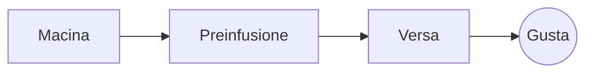

# Il pour-over perfetto

Un lento rito del mattino in pochi passaggi. Scrivilo nel **codice sorgente** a sinistra o direttamente nell’*anteprima* a destra: restano sincronizzati e ==ogni modifica è un cambiamento pulito== del Markdown.

> [!TIP]
> L’acqua appena tolta dal bollore, intorno ai 94 °C, esalta la dolcezza senza amaro.

## Il rapporto

La maggior parte delle ricette si accorda su una parte di caffè ogni sedici parti di acqua:

$$
m_{\text{acqua}} = 16 \times m_{\text{caffè}}
$$

Quindi $20\,\text{g}$ di caffè richiedono $320\,\text{g}$ di acqua.

## Passo dopo passo



## Metodi di estrazione

| Metodo          | Macinatura | Tempo |
|:----------------|:----------:|------:|
| Pour-over       | Medio-fine |  3:30 |
| Pressa francese | Grossa     |  4:00 |
| Espresso        | Fine       |  0:28 |

## Prima di cominciare

- [x] Chicchi tostati di fresco :coffee:
- [x] Un macinacaffè a macine
- [ ] Un bollitore con il becco a collo di cigno

```python
def water_for(coffee_g: float, ratio: int = 16) -> float:
    return coffee_g * ratio
```

Preinfusione
: Il primo getto d’acqua che lascia sprigionare ai fondi il loro gas.[^1]

[^1]: I chicchi freschi sono quelli che fanno più bloom; quelli vecchi si gonfiano appena.
