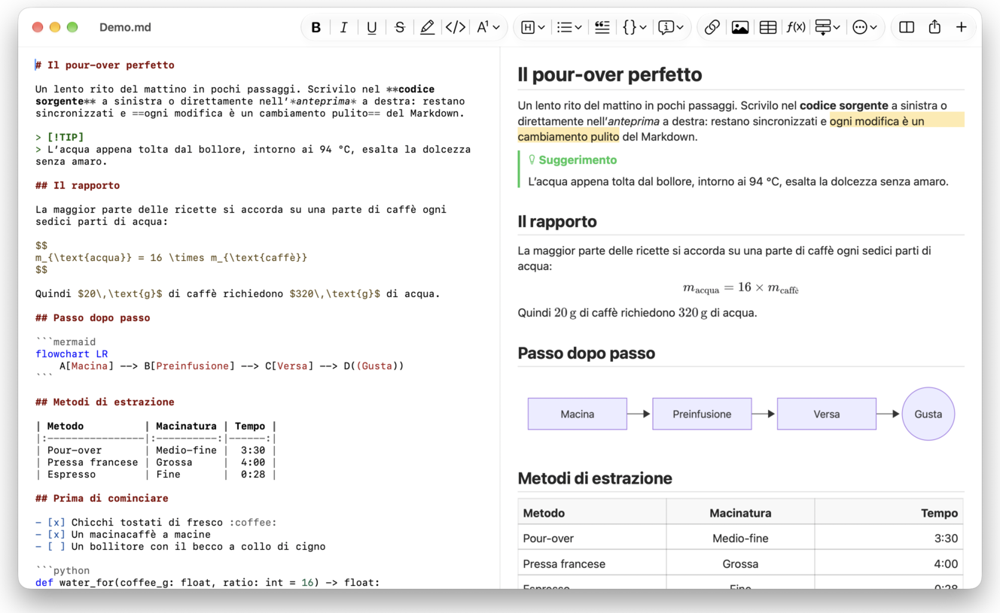
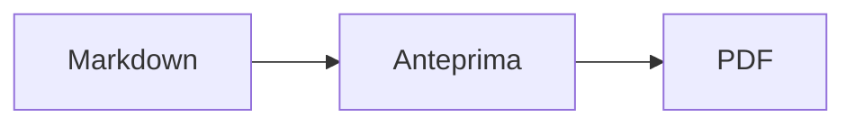

<p>&nbsp;&nbsp;&nbsp;</p>

# Splat

**L’editor Markdown per macOS che ti lascia scrivere nel codice sorgente o direttamente nell’anteprima.**

Splat mostra a sinistra il tuo codice sorgente Markdown con i colori della sintassi e a destra un’anteprima dal vivo, completamente modificabile. Scrivi dove preferisci: ciò che digiti nell’anteprima diventa una modifica minima del codice sorgente, così le righe che non hai toccato restano identiche byte per byte e i tuoi diff di Git restano puliti. Splat legge il Markdown che usi già: CommonMark e GitHub Flavored Markdown, avvisi di GitHub, wiki link, incorporamenti e riquadri di Obsidian, estensioni di Pandoc e Typora, HTML incorporato, formule LaTeX e diagrammi Mermaid, Graphviz e PlantUML, tutto elaborato offline. Esporta in PDF, HTML o Word con un clic. È scritto in Rust su veri controlli AppKit, parla 35 lingue e non invia nulla in rete, a meno che non lo chieda tu.
 


[](https://raw.githubusercontent.com/sventmueller/splat/main/dist/Splat-1.0.4.dmg)

**[Scarica Splat-1.0.4.dmg](https://raw.githubusercontent.com/sventmueller/splat/main/dist/Splat-1.0.4.dmg)**: firmato e notarizzato da Apple, per macOS 14 o successivo su Apple Silicon e Intel.
 
 

[](https://www.rust-lang.org)
[](https://www.apple.com/macos/)

[](https://github.com/madsmtm/objc2)
[](https://webkit.org)
[](https://github.com/kivikakk/comrak)
[](https://github.github.com/gfm/)
[](https://www.mathjax.org)
[](https://cortexjs.io/mathlive/)
[](https://mermaid.js.org)
[](https://graphviz.org)
[](https://plantuml.com)


[](#licenza)

[Bahasa Indonesia](../id/README.md) ·
[Bahasa Melayu](../ms/README.md) ·
[Català](../ca/README.md) ·
[Čeština](../cs/README.md) ·
[Dansk](../da/README.md) ·
[Deutsch](../de/README.md) ·
[English](../../../README.md) ·
[Español](../es/README.md) ·
[Français](../fr/README.md) ·
[Hrvatski](../hr/README.md) ·
**Italiano** ·
[Magyar](../hu/README.md) ·
[Nederlands](../nl/README.md) ·
[Norsk](../no/README.md) ·
[Polski](../pl/README.md) ·
[Português (Brasil)](../pt_BR/README.md) ·
[Português (Portugal)](../pt_PT/README.md) ·
[Română](../ro/README.md) ·
[Slovenčina](../sk/README.md) ·
[Slovenščina](../sl/README.md) ·
[Suomi](../fi/README.md) ·
[Svenska](../sv/README.md) ·
[Tiếng Việt](../vi/README.md) ·
[Türkçe](../tr/README.md) ·
[Ελληνικά](../el/README.md) ·
[Русский](../ru/README.md) ·
[Українська](../uk/README.md) ·
[עברית](../he/README.md)‎ ·
[العربية](../ar/README.md)‎ ·
[हिन्दी](../hi/README.md) ·
[ไทย](../th/README.md) ·
[한국어](../ko/README.md) ·
[日本語](../ja/README.md) ·
[简体中文](../zh-Hans/README.md) ·
[繁體中文](../zh-Hant/README.md)

## Indice

- [Funzioni in breve](#funzioni-in-breve)
- [Requisiti](#requisiti)
- [Installazione](#installazione)
- [Per iniziare](#per-iniziare)
- [Scrivere](#scrivere)
  - [Nel codice sorgente](#nel-codice-sorgente)
  - [Nell’anteprima](#nellanteprima)
  - [Comandi di formattazione](#comandi-di-formattazione)
  - [Elenchi e attività](#elenchi-e-attività)
  - [Tabelle](#tabelle)
- [Markdown supportato](#markdown-supportato)
  - [CommonMark e GitHub Flavored Markdown](#commonmark-e-github-flavored-markdown)
  - [Riquadri](#riquadri)
  - [Sintassi estesa](#sintassi-estesa)
  - [Obsidian](#obsidian)
  - [Citazioni e riferimenti](#citazioni-e-riferimenti)
  - [HTML incorporato](#html-incorporato)
  - [Punteggiatura tipografica](#punteggiatura-tipografica)
  - [Panoramica della sintassi](#panoramica-della-sintassi)
- [Formule](#formule)
- [Diagrammi](#diagrammi)
- [Immagini](#immagini)
- [Link e navigazione](#link-e-navigazione)
- [Esportare, stampare e condividere](#esportare-stampare-e-condividere)
- [Aspetto e accessibilità](#aspetto-e-accessibilità)
- [Lingue](#lingue)
- [Scorciatoie da tastiera](#scorciatoie-da-tastiera)
- [Privacy e sicurezza](#privacy-e-sicurezza)
- [Documenti grandi](#documenti-grandi)
- [Limiti noti](#limiti-noti)
- [Risoluzione dei problemi](#risoluzione-dei-problemi)
- [Per sviluppatori](#per-sviluppatori)
  - [Compilazione](#compilazione)
  - [Distribuzione](#distribuzione)
  - [Test](#test)
  - [Struttura del progetto](#struttura-del-progetto)
  - [Flusso dei dati](#flusso-dei-dati)
  - [Regole nel controller](#regole-nel-controller)
  - [Aggiungere un comando](#aggiungere-un-comando)
  - [Traduzioni](#traduzioni)
  - [Componenti di terze parti](#componenti-di-terze-parti)
- [Licenza](#licenza)

## Funzioni in breve

- **Due modi di scrivere, un solo testo.** Codice sorgente e anteprima sono entrambi modificabili. Il file Markdown è l’unica verità: c’è una sola cronologia di annullamento per documento e ogni modifica nell’anteprima viene tradotta nella più piccola modifica possibile del codice sorgente.
- **Il Markdown che usi già.** CommonMark, GitHub Flavored Markdown, avvisi di GitHub, estensioni di Obsidian, Pandoc e Typora, shortcode per emoji, spoiler, elenchi di definizioni, ancore delle intestazioni e HTML come nei README di GitHub.
- **Formule e diagrammi integrati.** Formule LaTeX tramite MathJax, con un editor visuale di formule. Diagrammi in Mermaid, Graphviz e PlantUML, elaborati sul tuo Mac senza Java, senza server e senza connessione di rete.
- **Un pulsante per tutto.** Ogni elemento Markdown ha un pulsante nella barra strumenti e una voce di menu, quelli più comuni anche una scorciatoia da tastiera. Le tabelle hanno un menu tutto loro per righe, colonne e allineamento.
- **Esporta senza perdere nulla.** PDF, un unico file HTML autonomo o un documento Word con intestazioni, elenchi, tabelle, note a piè di pagina e immagini autentici.
- **Nativo fino in fondo.** Vere finestre, pannelli, menu e popover di AppKit, Versioni, Salvataggio automatico, il menu Condividi, modalità scura, controllo ortografico, dettatura e VoiceOver. Niente Electron, niente web view per il testo stesso.
- **Veloce anche con file grandi.** Una battuta di tasto in un documento da 10 MB richiede circa 25 ms.
- **Riservato e prudente.** Le immagini dal web si caricano solo dopo il tuo consenso, i link verso altre app chiedono prima conferma e tutto ciò che decodifica dati di immagini non attendibili gira in processi ausiliari isolati.
- **Nella tua lingua.** L’interfaccia e la guida rapida a Markdown integrata sono disponibili in 35 lingue: arabo, catalano, cinese (semplificato), cinese (tradizionale), croato, ceco, danese, olandese, inglese, finlandese, francese, tedesco, greco, ebraico, hindi, ungherese, indonesiano, italiano, giapponese, coreano, malese, norvegese, polacco, portoghese (Brasile), portoghese (Portogallo), rumeno, russo, slovacco, sloveno, spagnolo, svedese, tailandese, turco, ucraino e vietnamita.

## Requisiti

- macOS 14 Sonoma o successivo. Splat è sviluppato e testato su macOS 27, dove adotta automaticamente il design Liquid Glass.
- Un Mac con Apple Silicon o con processore Intel.
- Circa 45 MB di spazio su disco.

## Installazione

**Dall’immagine disco.** Scarica [`dist/Splat-1.0.4.dmg`](https://raw.githubusercontent.com/sventmueller/splat/main/dist/Splat-1.0.4.dmg), aprila e trascina Splat nella cartella Applicazioni. L’immagine è firmata con un Developer ID e notarizzata da Apple, quindi si apre senza avvisi.

**Con Homebrew.** Il cask si trova in un tap a parte:

```sh
brew install --cask sventmueller/tap/splat
```

`brew upgrade --cask splat` installa le nuove versioni e `brew uninstall --zap --cask splat` rimuove anche le impostazioni e le cache di Splat.

**Aggiornamenti.** Splat, installato dall’immagine disco o con Homebrew, si mantiene aggiornato da solo con [Sparkle](https://sparkle-project.org). Al secondo avvio chiede se può cercare aggiornamenti per conto suo, una volta al giorno. **Splat › Verifica aggiornamenti…** li cerca subito; **Verifica automaticamente gli aggiornamenti** e **Scarica e installa automaticamente gli aggiornamenti**, nello stesso menu, cambiano la tua scelta in seguito. Splat installa un aggiornamento solo se porta la firma dello sviluppatore. Una build compilata da te non ha l’aggiornamento automatico.

**Dal codice sorgente.** Per i prerequisiti vedi [Compilazione](#compilazione), poi:

```sh
make build
ditto target/release/Splat.app /Applications/Splat.app
open /Applications/Splat.app
```

Per aprire i file Markdown con Splat facendo doppio clic, seleziona un qualsiasi file `.md` nel Finder, scegli **File › Ottieni informazioni**, seleziona Splat sotto **Apri con** e fai clic su **Modifica tutti…**. Splat si registra per i file `.md`, `.markdown`, `.mdown` e `.mkd`.

## Per iniziare

### La finestra

Ogni documento si apre in una finestra propria, oppure in un pannello se preferisci i pannelli:

- **A sinistra: il codice sorgente.** Il tuo Markdown in SF Mono con i colori della sintassi.
- **A destra: l’anteprima.** Il documento elaborato, pronto per essere modificato.
- **Barra laterale della struttura (facoltativa).** Tutte le intestazioni ad albero; un clic su una la mostra in entrambi i riquadri. Si attiva con **Vista › Mostra struttura** (⌃⌘S).
- **Barra strumenti.** Pulsanti raggruppati in base a ciò che modificano: caratteri, paragrafi ed elementi inseriti, poi anteprima sì/no, Condividi e Nuovo documento. Si personalizza con **Vista › Personalizza la barra strumenti…**.

Trascina il divisore per dare più spazio a uno dei due lati. **Vista › Nascondi anteprima** (⌥⌘P) lascia solo il codice sorgente; Splat lo ricorda per ogni finestra. I due riquadri scorrono insieme e una selezione in uno viene evidenziata nell’altro.

### Documenti, pannelli e versioni

Splat è una normale app a documenti di macOS:

- **Salvataggio automatico e Versioni.** Le modifiche vengono salvate sul posto. **File › Ripristina a › Sfoglia tutte le versioni…** ti riporta indietro nel tempo.
- **Modifiche da altri programmi.** Quando Git, uno script o un altro editor modifica un documento aperto, Splat lo ricarica e mantiene il cursore e la posizione di scorrimento. Se hai modifiche non salvate, Splat le conserva e macOS chiede conferma prima di sovrascrivere l’altra versione.
- **I soliti comandi per i file.** Duplica (⇧⌘S), Rinomina…, Sposta in… e **File › Apri recenti**.
- **Pannelli.** **File › Nuovo pannello** o il pulsante **+** nella barra strumenti apre un nuovo documento in un pannello; il menu Finestra standard unisce, sposta e scorre i pannelli.
- **Posizione delle finestre.** Le dimensioni e la posizione dell’ultima finestra vengono ricordate, anche dopo un riavvio. Se in quel punto c’è già una finestra, la nuova si apre leggermente spostata.
- **L’icona nel Dock.** Un clic su di essa, dopo aver chiuso l’ultima finestra, apre un nuovo documento.
- **Apri i file Markdown con Splat.** **Splat › Imposta come app di default per Markdown** fa sì che un doppio clic su un file `.md` o `.markdown` apra Splat; macOS chiede conferma una sola volta. La voce mostra un segno di spunta finché Splat è l’app di default.

I file devono essere testo UTF-8 oppure UTF-16 con un byte order mark. Splat rifiuta le altre codifiche invece di tirare a indovinare e rovinare il testo. Un byte order mark resta, UTF-16 resta UTF-16 e, in un file in cui tutte le righe terminano con CRLF, anche le righe che aggiungi ricevono CRLF.

**Dopo un arresto anomalo** si perdono al massimo gli ultimi secondi di scrittura: ogni cinque secondi Splat copia il testo non salvato in `~/Library/Application Support/Splat/Unsaved` e rimuove le copie quando un documento viene salvato o Splat termina normalmente. Al successivo avvio sposta ciò che un arresto anomalo ha lasciato lì in `~/Library/Application Support/Splat/Recovery` e lo segnala una sola volta, con un pulsante che apre la cartella. Un arresto anomalo a cui Splat riesce ancora a reagire scrive lì anche il testo di ogni documento aperto.

### Guida rapida

**Aiuto › Guida rapida a Markdown** apre una scheda riassuntiva nella tua lingua come nuovo documento senza titolo. È un documento normale, quindi puoi provare tutto direttamente lì, nel codice sorgente o nell’anteprima.

## Scrivere

### Nel codice sorgente

Il codice sorgente è un editor di testo semplice ottimizzato per Markdown:

- **Colori della sintassi** come in VS Code: intestazioni, enfasi, link, codice, tabelle, HTML, front matter, e LaTeX e Mermaid dentro formule e diagrammi. Ci sono palette per i temi chiaro e scuro e per Aumenta contrasto.
- **I blocchi di codice delimitati** vengono evidenziati per Bash, C, C++, C#, CSS (anche SCSS e Less), Go, HTML, XML, Java, JavaScript, JSON, Kotlin, PHP, Python, Ruby, Rust, SQL, Swift, TypeScript, YAML, TeX e Mermaid, compresi i loro nomi abbreviati più comuni come `js`, `py` o `sh`.
- **Nessuna sostituzione a sorpresa.** Virgolette smart, trattini smart e sostituzione del testo sono disattivati di default, perché rovinano `--`, `---` e `"`. Si attivano in **Modifica › Sostituzioni**.
- **Gli strumenti di scrittura del sistema.** Controllo di ortografia e grammatica, dettatura, Trova e sostituisci (⌥⌘F) e Voce.
- **Trascinamento.** Trascina un file immagine per inserire ``, qualsiasi altro file per inserire un link ad esso e un URL per inserire `[url](url)`. Ogni trascinamento è un unico passo di annullamento.
- **Incolla immagini.** Un’immagine negli appunti, come uno screenshot, viene salvata come file PNG accanto al documento (`Immagine 2026-10-29 13.09.07.png`) e inserita come immagine. Per questo il documento deve essere stato salvato almeno una volta.

### Nell’anteprima

L’anteprima si comporta come un programma di videoscrittura, ma tutto ciò che fai al suo interno finisce come Markdown:

- **Scrittura.** I caratteri che in Markdown hanno un significato, come `*` o `#`, vengono preceduti da un carattere di escape, così compaiono come li hai digitati.
- **Invio** inizia un nuovo paragrafo o una nuova voce di elenco. **⌥Invio** o **⌃Invio** inserisce un’interruzione di riga.
- **Formattazione al cursore.** Con il cursore alla fine di una parola, Grassetto, Corsivo e gli altri formati di carattere si applicano a ciò che scrivi dopo. Scegli di nuovo il formato per interromperlo. All’interno di una parola, viene formattata l’intera parola.
- **Righe vuote.** Invio su una riga vuota ne aggiunge un’altra e Elimina (⌫) la rimuove. Nel codice sorgente ogni riga vuota in più corrisponde a due righe vuote; gli altri programmi Markdown le mostrano come una normale spaziatura tra paragrafi.
- **Annulla** funziona in entrambi i riquadri. Le voci di annullamento hanno un nome («Annulla Grassetto»), la scrittura è un passo per ogni raffica di battute e dopo Annulla e Ripristina entrambi i riquadri scorrono fino alla modifica.
- **Formule e diagrammi** appaiono come grafica finita. Fai clic su uno, portaci sopra il cursore o premi Invio per aprire il suo editor (vedi [Formule](#formule) e [Diagrammi](#diagrammi)).
- **HTML incorporato, note incorporate e front matter** vengono mostrati, ma si modificano nel codice sorgente. Un clic su di essi porta il cursore nel punto corrispondente.

Tutto ciò che Markdown non sa esprimere è bloccato nell’anteprima: i pannelli Font e Colori, il righello e l’incolla o il trascinamento di testo formattato e immagini. L’HTML e l’RTF incollati arrivano come testo semplice.

### Comandi di formattazione

Ogni comando è disponibile dalla barra strumenti, dalla barra dei menu e dal menu contestuale di entrambi i riquadri. Le voci di menu mostrano un segno di spunta per la formattazione al cursore.

| Menu | Comandi |
|---|---|
| **Formato › Font** | Grassetto, Corsivo, Sottolineato, Barrato, Evidenziato, Codice, Apice, Pedice |
| **Formato › Intestazione** | Corpo del testo, Intestazione da 1 a 6 |
| **Formato › Elenco** | Elenco puntato, Elenco numerato, Elenco di attività |
| **Formato** | Citazione, Blocco di codice (Nessun linguaggio o uno di 20 linguaggi; cambia anche il linguaggio di un blocco esistente), Riquadro (Nota, Suggerimento, Importante, Attenzione, Cautela; lo stesso tipo di nuovo lo rimuove), Modifica formula o diagramma…, Rimuovi formattazione |
| **Inserisci** | Link…, Immagine…, Tabella…, Formula, Diagramma (Diagramma di flusso, Diagramma di sequenza, Diagramma di Gantt), Indice, Nota a piè di pagina, Separatore |
| **Tabella** | Inserisci riga sopra/sotto, Inserisci colonna a sinistra/destra, Elimina riga, Elimina colonna, Allineamento (A sinistra, Al centro, A destra, Default), Allinea colonne della tabella |
| **Vista** | Nascondi/Mostra anteprima, Mostra/Nascondi struttura, Punteggiatura tipografica, Ingrandisci/Riduci, Dimensioni reali, barra strumenti, barra dei pannelli, modalità a tutto schermo |

Sottolineato, evidenziato, apice e pedice vengono scritti come `<ins>`, `<mark>`, `<sup>` e `<sub>`, che anche GitHub mostra. Splat legge anche `<u>`, che GitHub rimuove, e le forme più brevi `==evidenziato==`, `^apice^` e `~pedice~`. GitHub mostra `==` e `^` così come sono e `~pedice~` come barrato.

### Elenchi e attività

- Invio continua un elenco; Invio su una voce vuota lo termina.
- **Tab** e **⇧Tab** aumentano e riducono il rientro delle voci di elenco nell’anteprima.
- Un clic sulla casella di un’attività nell’anteprima alterna `- [ ]` e `- [x]`.
- **Formato › Elenco** trasforma i paragrafi selezionati in un elenco o ne cambia il tipo.

### Tabelle

- **Inserisci › Tabella…** chiede il numero di righe (inclusa l’intestazione) e di colonne.
- Nell’anteprima, **Tab** passa alla cella successiva, **⇧Tab** a quella precedente e **Invio** alla cella sottostante. Tab nell’ultima cella aggiunge una riga.
- Il menu **Tabella** inserisce ed elimina righe e colonne e imposta l’allineamento di una colonna (⌘{, ⌘|, ⌘}).
- **Tabella › Allinea colonne della tabella** riempie il codice sorgente con spazi in modo che le colonne risultino allineate.

## Markdown supportato

Splat esegue l’analisi con [comrak](https://github.com/kivikakk/comrak), un parser compatibile con CommonMark e GFM, e attiva la maggior parte delle sue estensioni. Tutto ciò che segue viene elaborato nell’anteprima e in tutte le esportazioni.

### CommonMark e GitHub Flavored Markdown

- Intestazioni (`#` e sottolineate), paragrafi, interruzioni di riga, enfasi, enfasi forte, codice in linea, citazioni a blocco, separatori orizzontali.
- Elenchi puntati, numerati e annidati; elenchi di attività.
- Link (in linea, di riferimento e automatici), immagini, definizioni di riferimenti dei link.
- Blocchi di codice delimitati e rientrati con i colori della sintassi.
- Tabelle con allineamento delle colonne.
- Barrato con `~~due tilde~~`.
- Note a piè di pagina: `testo[^1]` con `[^1]: La nota.` in qualsiasi punto del documento. Un clic sul segnaposto porta alla nota.
- Front matter YAML tra righe `---` all’inizio. L’anteprima lo riassume in una riga, ad esempio «Metadati: title, date, tags».

### Riquadri

Gli avvisi di GitHub vengono elaborati come riquadri colorati con icona e titolo:

```markdown
> [!NOTE]
> Informazioni utili che gli utenti dovrebbero conoscere.

> [!WARNING]
> Contenuto critico che richiede attenzione immediata.
```

I cinque tipi sono Nota, Suggerimento, Importante, Attenzione e Cautela. **Formato › Riquadro** trasforma in uno di essi il paragrafo al cursore.

Funzionano anche i riquadri di Obsidian, con un titolo qualsiasi e uno stato di compressione:

```markdown
> [!tip]- Fai clic su ▸ per espandere
> Nascosto finché non lo apri.

> [!question]+ Aperto di default
> Un `+` parte espanso, un `-` compresso.
```

Gli altri tipi di Obsidian vengono mostrati nel colore più vicino tra i cinque: `success`, `check`, `done` e `hint` come Suggerimento; `question`, `help` e `faq` come Importante; `attention` come Attenzione; `failure`, `fail`, `missing`, `danger`, `error` e `bug` come Cautela; tutto il resto come Nota.

### Sintassi estesa

| Funzione | Sintassi | Da |
|---|---|---|
| Evidenziato | `==testo evidenziato==` | Obsidian, Typora |
| Apice | `x^2^` | Pandoc, Typora |
| Pedice | `H~2~O` | Pandoc, Typora |
| Shortcode per emoji | `:rocket:` diventa 🚀 | GitHub |
| Spoiler | `\|\|testo nascosto\|\|`, selezionalo per leggerlo | Discord |
| Nota in linea | `testo^[la nota stessa]` | Pandoc, Obsidian |
| Elenco di definizioni | `Termine`, riga vuota, `: Spiegazione` | PHP Markdown Extra, Pandoc |
| Ancora di intestazione | `## Installazione {#setup}`, link con `[vedi](#setup)` | Pandoc, kramdown |

Nel codice sorgente gli elenchi di definizioni si presentano così:

```markdown
Termine

: Spiegazione del termine.
```

Senza un’ancora personalizzata, ogni intestazione ne riceve una ricavata dal suo testo, come su GitHub: `## Primi passi` si raggiunge come `#primi-passi`.

### Obsidian

- **Wiki link.** `[[Nota]]` rimanda a `Nota.md` nella stessa cartella o in una sottostante. `[[Nota|Testo mostrato]]` mostra un testo a tua scelta e `[[Nota#Intestazione]]` apre la nota. ⌘-clic la apre in Splat.
- **Incorporamenti.** `![[Nota]]` mostra l’altra nota all’interno di questa; le note incorporate al suo interno appaiono come link. `![[diagramma.png]]` mostra un’immagine. Come in Obsidian, gli incorporamenti indicano note e immagini nella cartella del documento o in una sottostante, mai con un percorso assoluto, e solo i file Markdown vengono mostrati come note.
- **Commenti.** `%%Solo nel sorgente%%` resta visibile nel codice sorgente e viene omesso dall’anteprima e da ogni esportazione, sia in linea sia su righe a sé.
- **Tag.** `#idea` o `#progetto/splat` viene evidenziato. ⌘-clic cerca il tag nel documento.
- **Riquadri comprimibili.** Vedi [Riquadri](#riquadri).

### Citazioni e riferimenti

- **Citazioni di Pandoc.** `[@doe2020]` o `[@doe2020; @roe2021]` si legge come «(Doe 2020; Roe 2021)». Le voci provengono dal file BibTeX indicato nel front matter come `bibliography: refs.bib`. In sua assenza, Splat usa `references.bib`, `literatur.bib` o `bibliography.bib` accanto al documento.
- **Riferimenti di GitHub e GitLab.** Se il documento si trova in un repository Git il cui remote `origin` è su github.com o su un host GitLab, vengono evidenziati `@nome`, `#12` (issue) e `!7` (merge request, solo GitLab). ⌘-clic li apre nel browser.

### HTML incorporato

L’HTML che si trova nei README di GitHub viene elaborato con un lettore proprio, senza un motore da browser:

- paragrafi e blocchi centrati (`<p align="center">`, `<div align="center">`)
- immagini con dimensioni (``)
- link, `<kbd>⌘</kbd>`, `<br>`, `<u>`, `<ins>`, `<mark>`, `<sup>`, `<sub>`
- elenchi e tabelle, comprese le celle che si estendono su più colonne (`colspan`)
- sezioni comprimibili: `<details><summary>Altro</summary>…</details>`, che si aprono con un clic su ▸

Il Markdown tra i tag HTML viene elaborato come Markdown. Script, stili, frame e moduli vengono omessi del tutto, e link e immagini mantengono solo indirizzi `http`, `https`, `mailto` e relativi.

### Punteggiatura tipografica

**Vista › Punteggiatura tipografica** mostra le virgolette dritte come le virgolette della lingua dell’interfaccia, `--` come trattino en, `---` come trattino em e `...` come puntini di sospensione. In tedesco `"Ja"` diventa „Ja“, in francese «Oui», in giapponese 「はい」, anche dove il cinese e il giapponese compongono le virgolette senza spazio; le abbreviazioni ebraiche come `צה"ל` ricevono i loro gershayim, צה״ל. Il codice sorgente conserva i caratteri semplici; l’anteprima e tutte le esportazioni mostrano quelli tipografici. L’impostazione è disattivata finché non la attivi.

### Panoramica della sintassi

| Elemento | Markdown |
|---|---|
| **Grassetto** | `**Grassetto**` |
| *Corsivo* | `*Corsivo*` |
| Sottolineato | `<ins>Sottolineato</ins>` o `<u>Sottolineato</u>` |
| ~~Barrato~~ | `~~Barrato~~` |
| Evidenziato | `<mark>Evidenziato</mark>` o `==Evidenziato==` |
| `Codice` | `` `Codice` `` |
| x² | `x<sup>2</sup>` o `x^2^` |
| H₂O | `H<sub>2</sub>O` o `H~2~O` |
| [Link](https://example.com) | `[Link](https://example.com)` |
| Intestazione | `# Intestazione` fino a `###### Intestazione` |
| Citazione | `> Citazione` |
| Elenco puntato | `- Voce` |
| Elenco numerato | `1. Voce` |
| Attività | `- [ ] Da fare` e `- [x] Fatto` |
| Blocco di codice | ```` ```rust ```` … ```` ``` ```` |
| Tabella | `\| A \| B \|` con `\|---\|---\|` sotto l’intestazione |
| Nota a piè di pagina | `Testo[^1]` e `[^1]: Nota` |
| Separatore | `---` |
| Immagine | `` |
| Formula | `$E = mc^2$`, `$$ … $$` |
| Diagramma | ```` ```mermaid ````, ```` ```dot ````, ```` ```plantuml ```` |
| Riquadro | `> [!TIP]` |
| Wiki link | `[[Nota]]`, `[[Nota\|Testo]]` |
| Incorporamento | `![[Nota]]`, `![[immagine.png]]` |
| Commento | `%%Commento%%` |
| Tag | `#tag` |
| Citazione bibliografica | `[@chiave]` |
| Spoiler | `\|\|Spoiler\|\|` |
| Emoji | `:tada:` |

## Formule

Le formule vengono elaborate da [MathJax](https://www.mathjax.org) con il suo TeX e la matematica AMS, come nitida grafica vettoriale. Il testo in `\text{…}` può essere in qualsiasi sistema di scrittura: ciò che manca ai font di MathJax viene preso dai font del tuo Mac, con l’arabo e l’ebraico da destra a sinistra e le emoji a colori.

| Tipo | Sintassi |
|---|---|
| In linea | `$E = mc^2$`, `` $`E = mc^2`$ `` (GitHub, GitLab), `\(E = mc^2\)` |
| A blocco | `$$` … `$$`, `\[` … `\]`, o un blocco di codice contrassegnato `math` |

**Modifica di una formula.** Fai clic su una formula nell’anteprima, fai doppio clic, premi Invio o porta il cursore su di essa per aprire il suo editor in un popover. **Inserisci › Formula** ne inserisce una nuova e apre subito l’editor.

- **Visuale o LaTeX.** L’interruttore in alto passa da un editor visuale ([MathLive](https://cortexjs.io/mathlive/)) al codice LaTeX e viceversa. Splat ricorda la tua scelta.
- **Blocchi predefiniti** per frazione, radice quadrata, apice e pedice, sommatoria e integrale con estremi, limite, parentesi che crescono con il contenuto, matrice 2×2, lettere greche, e relazioni, operatori e frecce. Lasciano segnaposto □, e **Tab** passa al successivo.
- **Anteprima dal vivo.** Le modifiche compaiono nel documento mentre scrivi. Gli errori di MathJax vengono mostrati in una riga sotto il codice.
- **Conferma o scarta.** Un clic all’esterno mantiene la modifica come un unico passo di annullamento; **Esc** o **Annulla** la scarta. Premere Esc su una formula nuova e vuota la rimuove di nuovo.
- Il menu contestuale offre **Modifica formula…** per la formula sotto il puntatore.

VoiceOver legge una formula come il suo codice LaTeX. Splat elabora formule, non documenti LaTeX completi: non ci sono pacchetti, né TikZ né `\documentclass`.

## Diagrammi

I diagrammi vengono elaborati all’interno di Splat, offline e in una variante chiara e una scura.

| Motore | Blocco di codice | Cosa disegna |
|---|---|---|
| [Mermaid](https://mermaid.js.org) | ```` ```mermaid ```` | diagrammi di flusso, di sequenza, delle classi, di stato, entità-relazione, di Gantt, a torta, mappe mentali, linee del tempo e ogni altro tipo di Mermaid |
| [Graphviz](https://graphviz.org) | ```` ```dot ```` o ```` ```graphviz ```` | grafi nel linguaggio DOT |
| [PlantUML](https://plantuml.com) | ```` ```plantuml ```` o ```` ```puml ```` | diagrammi UML; funziona senza Java |



**Modificare un diagramma** funziona come modificare una formula: un clic lo apre in un popover con il codice, i colori della sintassi e i messaggi di errore in una riga sotto il codice. **Inserisci › Diagramma** parte da un modello per un diagramma di flusso, un diagramma di sequenza o un diagramma di Gantt. I blocchi predefiniti aiutano con i tre tipi più comuni di Mermaid:

- **Diagramma di flusso:** Nodo ▾ (rettangolo, arrotondato, cerchio, rombo, database), Collegamento, Collegamento con etichetta, Gruppo, Direzione ▾
- **Diagramma di sequenza:** Partecipante, Messaggio, Risposta, Nota, Ciclo, Percorsi alternativi
- **Diagramma di Gantt:** Sezione, Attività, Milestone

Gli altri tipi di diagramma si modificano come codice. VoiceOver legge il titolo o il testo alternativo di un diagramma.

Il primo diagramma dopo l’avvio richiede circa un secondo, perché il motore di rendering parte in background. Un diagramma che impiega più di 10 secondi mostra un errore e il motore di rendering riparte da zero per il successivo. Il motore di PlantUML (7 MB) viene caricato solo con il primo diagramma PlantUML. Un `!include` di PlantUML dal web viene bloccato.

## Immagini

- **Le immagini locali** usano percorsi relativi al documento: ``. Splat mostra PNG, JPEG, GIF, WebP, BMP, SVG, HEIC, TIFF, AVIF e PDF.
- **Le immagini dal web** restano bloccate finché non le consenti: una barra sopra l’anteprima spiega che caricarle fa sapere ai loro server che apri il documento e quando. **Carica immagini** le consente per questo documento; Splat ricorda la scelta per ogni file.
- **Dimensioni.** `` ridimensiona un’immagine; altrimenti le immagini si adattano alla larghezza dell’anteprima.
- **Modifiche su disco.** Un’immagine che sostituisci, o una che compare dopo che il documento l’ha nominata, viene mostrata senza riaprire il documento. Le immagini dal web che hanno fallito a causa della rete vengono ritentate finché un documento le mostra.
- **Memoria.** Le immagini vengono mostrate fino a 2560 pixel sul lato più lungo, quanto basta anche per riempire una pagina A4. Vengono decodificate più piccole quando occupano un ottavo della memoria del Mac e mentre macOS segnala una pressione sulla memoria.
- **Modalità scura.** Le immagini con sfondo bianco vengono leggermente attenuate nell’anteprima scura.
- **Incolla e trascinamento.** Vedi [Nel codice sorgente](#nel-codice-sorgente).

## Link e navigazione

Nell’anteprima un clic posiziona il cursore, così puoi modificare il testo del link; **⌘-clic** segue il link:

- `http`, `https` e `mailto` si aprono nel browser o nell’app di posta.
- I file Markdown si aprono in Splat; altri file e cartelle vengono mostrati nel Finder.
- `#ancora` porta all’intestazione nel documento.
- Gli indirizzi che aprono un’altra app, come `slack://` o `vscode://`, chiedono prima conferma e mostrano l’indirizzo completo e l’app. **Annulla** è preselezionato.

**Inserisci › Indice** inserisce un elenco con link a tutte le intestazioni. Con il cursore al suo interno, lo stesso comando lo aggiorna. La barra laterale della struttura (⌃⌘S) porta a qualsiasi intestazione in entrambi i riquadri.

## Esportare, stampare e condividere

| Formato | Come | Cosa ottieni |
|---|---|---|
| **PDF** | **File › Esporta come PDF…** o il menu Condividi | Pagine in formato carta, sempre con l’aspetto chiaro, formule e diagrammi come grafica vettoriale. **File › Formato di stampa…** imposta la carta. |
| **Stampa** | **File › Stampa…** (⌘P) | Lo stesso layout del PDF. |
| **HTML** | **File › Esporta come HTML…** o il menu Condividi | Un unico file autonomo: immagini locali incorporate, formule e diagrammi come immagini nitide, ancore delle intestazioni perché l’indice funzioni. Senza script. |
| **Word** | **File › Esporta come documento Word…** o il menu Condividi | Un `.docx` con gli stili di intestazione di Word, elenchi e tabelle autentici (comprese le celle unite), note a piè di pagina come note di Word, immagini incorporate, formule e diagrammi. |
| **Markdown** | Il pulsante **Condividi** nella barra strumenti | Il documento come file `.md` per Mail, Messaggi, AirDrop e ogni altro servizio di condivisione. |

Il menu **File › Condividi** li offre tutti in un unico posto. Le esportazioni usano l’impostazione della punteggiatura tipografica e le immagini dal web che hai consentito; nell’HTML le immagini dal web restano link.

## Aspetto e accessibilità

- **La modalità scura** segue il sistema. Formule e diagrammi vengono elaborati per ogni aspetto.
- **Aumenta contrasto** in Impostazioni di Sistema passa i colori della sintassi a palette ad alto contrasto.
- **Zoom.** ⌘+, ⌘− e ⌘0 ridimensionano entrambi i riquadri.
- **Modalità a tutto schermo, pannelli e una barra strumenti personalizzabile**, come in ogni app per Mac.
- **VoiceOver.** I riquadri sono etichettati «Codice sorgente Markdown» e «Anteprima», le formule vengono lette come il loro codice e i diagrammi come il loro titolo. Ogni comando è raggiungibile dalla tastiera.

Splat non ha una finestra delle impostazioni: le poche opzioni stanno dove servono, in **Vista** e **Modifica › Sostituzioni**.

## Lingue

L’interfaccia, i menu e la guida rapida a Markdown sono tradotti in 35 lingue:

arabo, catalano, cinese (semplificato), cinese (tradizionale), croato, ceco, danese, olandese, inglese, finlandese, francese, tedesco, greco, ebraico, hindi, ungherese, indonesiano, italiano, giapponese, coreano, malese, norvegese, polacco, portoghese (Brasile), portoghese (Portogallo), rumeno, russo, slovacco, sloveno, spagnolo, svedese, tailandese, turco, ucraino e vietnamita.

Splat segue l’ordine delle lingue in **Impostazioni di Sistema › Generali › Lingua e zona**; lì, sotto **Applicazioni**, puoi anche scegliere una lingua solo per Splat. Se manca una traduzione nella tua lingua, usa l’inglese. I termini dei menu seguono le traduzioni di Apple, così Splat si legge come il resto del tuo Mac.

Il testo ebraico e arabo si legge da destra a sinistra ovunque compaia, qualunque sia la lingua dell’interfaccia: ogni paragrafo, intestazione e voce di elenco prende la direzione della sua prima lettera, le citazioni e i riquadri disegnano la loro barra a destra e una tabella il cui testo inizia da destra elenca le colonne da destra. I blocchi di codice restano da sinistra a destra. Le esportazioni in PDF, HTML e Word mantengono queste direzioni. Con l’ebraico o l’arabo come lingua di sistema, macOS specchia anche la finestra, quindi l’anteprima si trova a sinistra.

## Scorciatoie da tastiera

| Azione | Scorciatoia |
|---|---|
| Grassetto, Corsivo, Sottolineato | ⌘B, ⌘I, ⌘U |
| Barrato | ⇧⌘X |
| Link… | ⌘K |
| Corpo del testo, Intestazione da 1 a 6 | ⌥⌘0, ⌥⌘1 fino a ⌥⌘6 |
| Allinea la colonna della tabella a sinistra, al centro, a destra | ⌘{, ⌘\|, ⌘} |
| Nascondi o mostra l’anteprima | ⌥⌘P |
| Mostra o nascondi la struttura | ⌃⌘S |
| Ingrandisci, riduci, dimensioni reali | ⌘+, ⌘−, ⌘0 |
| Nuovo documento, apri, salva, duplica | ⌘N, ⌘O, ⌘S, ⇧⌘S |
| Formato di stampa, stampa | ⇧⌘P, ⌘P |
| Trova, trova e sostituisci | ⌘F, ⌥⌘F |
| Trova successivo, precedente; usa selezione; vai alla selezione | ⌘G, ⇧⌘G; ⌘E; ⌘J |
| Mostra ortografia e grammatica; controlla il documento | ⌘:, ⌘; |
| Incolla e adegua lo stile | ⌥⇧⌘V |
| Nascondi la barra strumenti, mostra tutti i pannelli, modalità a tutto schermo | ⌥⌘T, ⇧⌘\\, ⌃⌘F |
| Interruzione di riga (anteprima) | ⌥Invio o ⌃Invio |
| Cella successiva / precedente in una tabella (anteprima) | Tab / ⇧Tab |
| Aumenta / riduci il rientro di una voce di elenco (anteprima) | Tab / ⇧Tab |
| Segnaposto successivo nell’editor di formule | Tab |
| Chiudi l’editor di formule o diagrammi senza modifiche | Esc |
| Segui un link, un tag o un riferimento (anteprima) | ⌘-clic |

Splat lascia dove sono le scorciatoie standard di Apple.

## Privacy e sicurezza

Un file Markdown può arrivare da chiunque, quindi Splat tratta ogni documento come non attendibile.

- **Nessuna rete di default.** Splat non ha telemetria. Cerca aggiornamenti solo dopo il tuo consenso o se scegli **Verifica aggiornamenti…**: in quel caso carica da GitHub un piccolo file di feed e la richiesta indica solo l’app e la sua versione. Formule e diagrammi vengono elaborati in locale; le web view che lo fanno non possono raggiungere la rete.
- **Le immagini dal web** si caricano solo con il tuo permesso, solo tramite `https`, mai da host della tua rete locale, per un massimo di 10 MB ciascuna e in una sessione privata senza cookie.
- **Decodifica isolata.** Le immagini e la grafica di formule e diagrammi vengono decodificate in processi ausiliari che chiudono ogni file ereditato e si chiudono in una sandbox prima di leggere il primo byte: niente accesso ai file, niente rete. Restituiscono solo pixel, di cui viene controllata la dimensione, e vengono arrestati dopo 10 secondi. I decodificatori di immagini di Apple vedono solo HEIC, TIFF, AVIF e PDF, e solo quando i dati sono davvero in quel formato; girano in un processo ausiliario a parte, che può inoltre leggere le cartelle dei font di sistema e usare il decodificatore video del sistema. Anche SVG, formule e diagrammi passano da quel processo, quindi in Splat sono immagini con una risoluzione fissa: quattro pixel per punto, fino a 2560 sul lato più lungo.
- **I file locali** raggiungono un documento solo tramite il percorso che indica. Gli incorporamenti mostrano note Markdown dalla cartella del documento e da quelle sottostanti, e un’immagine mancante viene cercata solo lì. Il percorso di un’immagine altrove, assoluto o che inizia con `~`, viene comunque caricato, e le esportazioni HTML e Word lo incorporano: guarda l’esportazione di un documento che non hai scritto tu prima di passarlo ad altri.
- **Le copie del testo non salvato** restano su questo Mac, nella tua cartella Libreria, per il ripristino dopo un arresto anomalo. Spariscono con il salvataggio o con la normale chiusura di Splat; le copie lasciate da un arresto anomalo restano nella cartella di ripristino finché non le elimini.
- **I link** non avviano mai un programma con un clic. I link web e di posta si aprono come al solito; i link verso altre app chiedono prima conferma.
- **L’HTML nei documenti** viene letto dal parser di Splat. Script, stili, frame e moduli non vengono mai eseguiti.
- **Le esportazioni** non contengono script. Le pagine HTML mantengono solo un elenco fisso di tag e attributi innocui, come fa GitHub, più una content security policy. I file Word collegano solo indirizzi `http`, `https` e `mailto`.
- **Firma del codice** con Hardened Runtime. Splat funziona senza App Sandbox per poter mostrare le immagini accanto ai tuoi documenti senza chiedere per ogni cartella; l’isolamento di tutta la decodifica compensa questa scelta.

## Documenti grandi

Splat resta reattivo con documenti di diversi megabyte:

- Il codice sorgente usa TextKit 2, che impagina solo la parte visibile.
- Mentre scrivi nell’anteprima, e nel codice sorgente di documenti fino a 2 MB, solo i paragrafi interessati vengono analizzati, colorati e impaginati di nuovo: circa 25 ms in un documento da 10 MB e circa 50 ms per una battuta di tasto nella sua anteprima, compreso il lavoro della vista stessa.
- Le anteprime grandi elaborano prima la parte visibile e il resto quando l’app è inattiva. I blocchi fatti scorrere in vista vengono elaborati prima di essere disegnati.
- Nel codice sorgente dei documenti più grandi, l’analisi per l’anteprima gira in background mentre scrivi.
- A partire da 64 MB, un documento resta testo semplice: il codice sorgente non ha colori e l’anteprima spiega perché resta vuota. Le esportazioni funzionano comunque.
- A partire da circa 200 KB, un documento apre la sua finestra prima di essere analizzato; a 5 MB, i colori e l’anteprima seguono circa un quarto di secondo dopo.

Alcune modifiche vengono elaborate per intero, con circa 300 ms per battuta di tasto a 10 MB: quelle alla definizione o ai riferimenti di una nota a piè di pagina, accanto a una nota in linea, alla fine del documento accanto a una nota a piè di pagina, al front matter o vicino alle definizioni di riferimenti dei link, e ogni modifica in un documento con blocchi di commento `%%` o con una nota a piè di pagina definita due volte o all’interno di una citazione o di un elenco. La memoria cresce con il file, fino a circa 115–160 MB per 1 MB di Markdown e 340–510 MB per 10 MB.

## Limiti noti

- **La tilde singola indica il pedice.** `~testo~` è un pedice come in Pandoc; per il barrato servono `~~due~~`. GitHub barra anche con una sola tilde.
- **Sola lettura nell’anteprima:** HTML incorporato, note incorporate e front matter si modificano nel codice sorgente.
- **Annidamento molto profondo:** l’HTML annidato oltre 64 livelli, e l’HTML in linea oltre 16, cede il posto al suo contenuto.
- **Le celle unite delle tabelle** esistono solo nelle tabelle HTML e solo tra colonne (`colspan`, nessun `rowspan`). La sintassi di MultiMarkdown per le celle unite non è supportata.
- **Le bibliografie** vengono lette solo da BibTeX, non da CSL JSON né da YAML.
- **I riferimenti** richiedono un repository su github.com o su un host GitLab; `!7` esiste solo su GitLab.
- **Punteggiatura tipografica:** in tedesco una virgoletta singola di chiusura non si distingue da un apostrofo e viene composta come ’.
- **Formule, non documenti:** niente pacchetti LaTeX, TikZ o documenti completi.
- **L’editor visuale di formule** scrive LaTeX nella notazione di MathLive: gli spazi scompaiono (`E = mc^2` diventa `E=mc^2`), il risultato visibile resta lo stesso.
- **Per scelta:** niente numeri di riga, niente finestra delle impostazioni, niente Help Book, non è nell’App Store.
- **Meno testato su Intel.** I test automatici con finestra girano solo su Apple Silicon; su Intel la CI esegue `cargo test`.

## Risoluzione dei problemi

**L’elenco dei documenti recenti è vuoto dopo aver ricompilato Splat.** macOS lega i documenti recenti e i permessi per le cartelle alla firma del codice dell’app. Le build locali sono firmate con il certificato «Splat Local Signing» nel tuo portachiavi di login, quindi le ricompilazioni conservano entrambi. Se il certificato è stato eliminato, la build successiva ne crea uno nuovo e gli elenchi ripartono da zero una volta.

**L’app dall’immagine disco mostra documenti recenti diversi dalla mia build.** Le due hanno firme diverse, quindi macOS tiene un elenco separato e permessi per le cartelle separati per ciascuna.

**HTML o altra sintassi appare come semplice codice.** Potrebbe aver aperto il documento una copia obsoleta di Splat. Chiudila, scegli **File › Ottieni informazioni** sul documento nel Finder e controlla che **Apri con** indichi lo Splat nella tua cartella Applicazioni.

**Nel menu Splat manca Verifica aggiornamenti….** Solo la versione dall’immagine disco o da Homebrew si aggiorna da sola; una build compilata da te non ha l’aggiornamento automatico.

**Le immagini dal web non compaiono.** Fai clic su **Carica immagini** nella barra sopra l’anteprima. Si caricano solo le immagini `https` da host pubblici.

**Incollando uno screenshot mi viene chiesto di salvare prima.** Le immagini incollate vengono salvate come file accanto al documento, il che richiede una posizione su disco. Salva il documento, poi incolla di nuovo.

**«Il file non è testo UTF-8 e non può essere aperto come Markdown.»** Il file ha un’altra codifica e non ha un byte order mark che la indichi. Convertilo prima, ad esempio con `iconv -f ISO-8859-1 -t UTF-8 old.md > new.md`.

**Una formula o un diagramma mostra un errore.** Fai clic su di essa: l’editor mostra sotto il codice il messaggio di MathJax, Mermaid, Graphviz o PlantUML.

## Per sviluppatori

Splat è un’applicazione Rust che dialoga direttamente con AppKit e WebKit tramite [objc2](https://github.com/madsmtm/objc2). Non ci sono Swift, Objective-C, progetti Xcode né file di Interface Builder.

### Compilazione

Prerequisiti:

- macOS con i Command Line Tools (`xcode-select --install`). Xcode non serve; Splat si compila senza `actool`, `ibtool` e `metal`.
- Rust 1.99 (`brew install rust`). [rust-toolchain.toml](../../../rust-toolchain.toml) indica la versione esatta usata dalla CI; rustup la installa da solo, il Rust di Homebrew ignora il file. Alzarla lì è il modo in cui i nuovi avvisi del compilatore e di clippy arrivano nel progetto.

Il [Makefile](../../../Makefile) contiene brevi punti di ingresso; `make help` li elenca tutti:

```sh
make build                  # target/release/Splat.app, come cargo xtask bundle --release
make universal              # target/splat-universal per Apple Silicon e Intel, come lo contiene l'immagine disco
make check                  # formattazione, clippy senza avvisi, tutti i test, librerie incluse; ciò che esegue la CI
make test                   # make check, poi il self-test senza finestra
make test-gui               # self-test con finestra; occupano il Mac per circa quattro minuti
make test-long              # ricerca casuale più lunga e controllo dell'aggiornamento parziale da 10 MB
make coverage               # copertura delle righe di tutti i test e self-test, con una soglia per modulo
make coverage-library       # le stesse soglie per i moduli senza finestra, come nella CI
make bench FILE=<file.md>   # tempi di apertura, scrittura e scorrimento di un file grande
make release                # prima make test, poi l'immagine disco notarizzata
```

La logica di compilazione stessa si trova nel crate Rust [xtask](../../../xtask/src/main.rs):

```sh
cargo xtask bundle --release   # target/release/Splat.app, Hardened Runtime, firmato con "Splat Local Signing"
cargo xtask bundle             # target/debug/Splat Debug.app, un'app separata che non apre mai file Markdown
cargo xtask dmg                # dist/Splat-<version>.dmg per la distribuzione, Developer ID, notarizzato
cargo xtask icon               # ricrea assets/AppIcon.icns e l'icona del README da assets/icon-1024.png
cargo xtask vendor check       # verifica il JavaScript incluso rispetto a vendor.lock
cargo xtask vendor fetch       # lo scarica di nuovo dopo aver cambiato una versione in vendor.lock
```

`bundle` scrive l’`Info.plist`, copia le risorse e le localizzazioni e firma l’app con il certificato «Splat Local Signing». La prima build crea quel certificato nel tuo portachiavi di login, con validità di 20 anni. Finché resta lì, Splat conserva i documenti recenti e i permessi per le cartelle tra una ricompilazione e l’altra; con una firma ad hoc, ogni build sarebbe una nuova app per macOS. Le build di debug e di self-test hanno bundle ID propri (`local.splat.debug`, `local.splat.selftest`) e non si registrano per i file Markdown, così il Finder non apre mai un documento in una build obsoleta e le impostazioni dell’app normale restano intatte.

La versione si trova in [VERSION](../../../VERSION) come `major.minor.build` ed è quella che riceve la build successiva. Ogni build di release riuscita (`make build`, `cargo xtask bundle --release`, `make release`) aumenta di uno il numero di build; le build di debug e di self-test non lo toccano. Major e minor si aumentano a mano: imposta VERSION su, ad esempio, `1.1.0` e la build successiva riceve esattamente quella.

### Distribuzione

`cargo xtask dmg` (o `make release`, che esegue prima `make test`) compila una release, la firma con il tuo Developer ID, notarizza l’app con Apple e applica il ticket, la comprime in un’immagine disco compressa e di sola lettura con un link ad Applicazioni, notarizza e applica il ticket anche all’immagine e controlla il risultato con Gatekeeper. L’app porta con sé il proprio ticket, così una copia installata senza il Finder, come fa Homebrew, si apre offline anche al primo avvio; i due passaggi con il servizio di notarizzazione richiedono alcuni minuti ciascuno. Solo un’immagine che ha superato ogni passaggio diventa `dist/Splat-<version>.dmg`, la copia di cui si fa il commit: i link di download in questo README e nelle sue traduzioni la seguono e il numero di build aumenta. L’immagine precedente resta per un’altra release, perché il server raw di GitHub può servire il vecchio feed degli aggiornamenti per qualche minuto dopo un push; quelle più vecchie vengono spostate nel cestino. Un’esecuzione fallita lascia `dist/`, i README e VERSION come erano.
Ogni release aggiunge alla cronologia del repository l’immagine completa, circa 16 MB. Viene eseguito solo su richiesta, mai come parte di una normale build, e richiede:

- un certificato «Developer ID Application» nel portachiavi
- un login salvato per il servizio di notarizzazione di Apple con una password specifica per app, creato una sola volta con `xcrun notarytool store-credentials notary --apple-id <Apple ID> --team-id <team ID>`
- la chiave privata che firma gli aggiornamenti, nel portachiavi di login. L’ha creata `generate_keys` di Sparkle; la sua metà pubblica è `UPDATE_KEY` in [xtask/src/main.rs](../../../xtask/src/main.rs) e all’interno di ogni copia installata, che accetta solo aggiornamenti firmati con essa. Conserva un backup in un gestore di password: `target/sparkle-2.10.1/bin/generate_keys -x <file>` la esporta, `-f <file>` la importa su un altro Mac. Senza di essa, le copie installate non possono più essere aggiornate.
- rustup (`brew install rustup`, che lascia al suo posto il Rust di Homebrew)

Se ne manca anche uno solo, `dmg` si ferma prima di compilare. Al primo avvio macOS chiede se Terminale può controllare il Finder; senza questo permesso, l’immagine disco non mostra né lo sfondo né la disposizione delle icone.

Solo l’immagine disco contiene il sistema di aggiornamento, [Sparkle](https://sparkle-project.org), che la build scarica una volta in `target/` dalla sua release su GitHub e verifica con il checksum in xtask. L’hardened runtime carica il framework solo se porta il Team ID dell’app, cosa che la firma Developer ID ha e il certificato locale non ha; e un aggiornamento non deve sostituire una build compilata da te. Anche la build di self-test contiene Sparkle, per verificare il menu degli aggiornamenti: con un feed inesistente, senza la domanda di Sparkle al secondo avvio e con un entitlement che consente all’app firmata localmente di caricare il framework. `dmg` firma la nuova immagine con la chiave degli aggiornamenti e scrive `dist/appcast.xml`, il feed che le copie installate leggono da GitHub. Fai commit e push insieme dell’immagine, del feed e dei README: da quel momento le copie installate offrono l’aggiornamento.

L’immagine disco è un binario universale per Apple Silicon e Intel; le altre build sono solo per il processore dell’host. Il Rust di Homebrew include la libreria standard solo per il processore dell’host, quindi `dmg` compila tramite rustup, che al primo utilizzo installa la toolchain e i target di [rust-toolchain.toml](../../../rust-toolchain.toml), e si ferma se il programma o Sparkle non hanno il codice per uno dei due processori. `make universal` compila solo il programma.
L’app al suo interno ha una firma diversa da una build locale, quindi macOS tiene documenti recenti e permessi per le cartelle separati per le due.

### Test

| Comando | Verifica |
|---|---|
| `cargo test --release` | test unitari, casuali e delle traduzioni |
| `SPLAT_FUZZ_ROUNDS=20000 cargo test --release` | una ricerca casuale più lunga; `SPLAT_FUZZ_SEED` varia gli input |
| `SPLAT_I18N_ONLY=fr cargo test --release i18n` | una sola lingua, mentre le altre sono incomplete |
| `cargo clippy --release --all-targets [--features selftest]` | lint, compresa la giustificazione di ogni blocco `unsafe`, la lunghezza delle funzioni e, nella libreria, le conversioni numeriche |
| `cargo xtask vendor check` | le librerie JavaScript corrispondono a `vendor.lock` byte per byte |
| `cargo xtask selftest probe` | senza finestra, ciascuno con il suo risultato atteso: formule, diagrammi, immagini dal web contro un server interno al processo, indirizzi bloccati, le difese delle web view |
| `cargo xtask selftest gui [--stop-after "<check>"] [--scenarios]` | l’app in esecuzione, clic per clic. Apre una finestra e vi scrive; il Mac resta occupato per circa quattro minuti. `--scenarios` esegue solo la seconda parte, in circa un minuto e mezzo |
| `cargo xtask selftest resize` | allarga la finestra dopo aver spostato il divisore: il codice sorgente va a capo di nuovo mentre la finestra viene ridimensionata. Richiede circa dieci secondi |
| `cargo xtask selftest bench <file.md>` | tempi di apertura, scrittura e scorrimento di un file grande |
| `cargo test --release -- --ignored partial_updates` | una battuta di tasto in 10 MB: aggiornamento parziale a confronto con quello completo, risultato e limite di tempo |
| `cargo test --release --test hostile` | documenti costruiti per far traboccare lo stack o richiedere tempo quadratico, attraverso analisi, impaginazione, entrambe le esportazioni, battute di tasto e comandi |
| `make mutants` | guasti inseriti uno per uno in `src/markdown/` e `src/preview/` tramite [cargo-mutants](https://mutants.rs) (`cargo install cargo-mutants`); dice quali nessun test nota. Richiede ore; `FILE=src/preview/bridge.rs` restringe il campo |
| `cargo test --release --test decoder` | il processo decoder decodifica le immagini e non raggiunge né file né rete |
| `make coverage` | copertura delle righe di `cargo test` e di tutti i self-test, tramite [cargo-llvm-cov](https://github.com/taiki-e/cargo-llvm-cov) (`brew install cargo-llvm-cov llvm`); fallisce sotto le soglie. Occupa il Mac per circa cinque minuti |
| `make coverage-library` | le soglie per `src/markdown/`, `src/preview/` e `i18n.rs`, misurate solo da `cargo test` |

I test unitari stanno accanto al codice che verificano. `tests/` contiene ciò che raggiunge la libreria dall’esterno: i test casuali in `robustness.rs`, che condividono il generatore in `src/fuzz.rs` con quelli di `sync.rs`, i documenti costruiti per mettere in difficoltà in `hostile.rs` e il test del decoder, che avvia il programma compilato. Le decisioni in `src/editor/` che non richiedono una finestra stanno in funzioni libere con test propri: tutto ciò che il controller sa e come cambia in `state.rs`, le regole di rendering in `render_queue.rs`, la copia del testo in `sync.rs`. Un passo del self-test con finestra che aspetta invano fa fallire l’esecuzione. Il self-test con finestra esegue una seconda parte dopo il suo percorso principale di clic, in `src/editor/selftest/scenarios.rs`: ogni comando di formattazione e di tabella, le finestre di dialogo, i clic sui link, l’incolla, il trascinamento, le esportazioni, una grande modifica, immagini che cambiano su disco, pressione sulla memoria, un documento enorme e il ripristino dopo un arresto anomalo.

La copertura ha due soglie: ogni modulo almeno l’80 % delle sue righe, tutti i moduli insieme almeno l’85 %. `make coverage` misura `cargo test` insieme ai self-test e fallisce sotto una delle due; le soglie e le poche eccezioni, come il panic hook in `main.rs` che gira solo in un arresto anomalo, si trovano in [xtask](../../../xtask/src/coverage.rs) accanto ai loro motivi. Le build misurate vanno in `target/coverage/`, così il codice di misurazione non raggiunge mai `target/release/` né un’immagine disco. Il processo ausiliario del decoder apre il suo file di misurazione prima di chiudersi in sandbox, quindi viene misurato anch’esso.

La CI ([.github/workflows/ci.yml](../../../.github/workflows/ci.yml)) esegue `make check`, `make coverage-library` e la build universale su Apple Silicon e `cargo test` su Intel a ogni push su `main` e a ogni pull request. Ogni notte [.github/workflows/nightly.yml](../../../.github/workflows/nightly.yml) esegue `make test-long` con nuovi input casuali. I self-test e l’immagine disco restano sul Mac dello sviluppatore: richiedono uno schermo e i certificati di firma nel portachiavi.

L’output dei self-test va in `target/selftest/`. Il self-test compila un’app separata (`target/release/Splat Selftest.app`, bundle ID `local.splat.selftest`) e lascia intatti le impostazioni, i documenti recenti e le associazioni dei file dell’app normale.

### Struttura del progetto

`src/lib.rs` rende tutto ciò che non richiede una finestra una libreria a sé, `splat`: `markdown/`, `preview/`, `i18n.rs` e il generatore di test `fuzz.rs`. L’app in `src/main.rs` si basa su di essa.

- `src/markdown/`: l’integrazione del parser (comrak), i colori della sintassi e tutti i comandi come pure modifiche di testo (`Edit`). Inoltre la nuova analisi dopo una modifica (`incremental.rs`), il lettore per l’HTML incorporato (`markup.rs`), tipografia, tag, riferimenti e citazioni nel testo corrente (`typography.rs`), l’aspetto del testo e quali Markdown e HTML lo producono (`style.rs`), che cosa può essere un indirizzo (`url.rs`) e l’esportazione in HTML e Word (`html.rs`, `docx.rs` con `docx/html.rs` e `docx/xml.rs`). L’anteprima ed entrambe le esportazioni leggono tutte lo stesso albero, `Doc`. Senza AppKit.
- `src/preview/`: l’impaginazione dell’anteprima, l’HTML incorporato al suo interno (`layout/html.rs`) e la corrispondenza tra anteprima e codice sorgente (`Bridge`, `Index`). Senza AppKit.
- `src/editor/`: la finestra. Un solo oggetto `EditorController` serve AppKit come delegate di entrambe le viste; il suo lavoro è suddiviso per responsabilità:

| Modulo | Responsabilità |
|---|---|
| `mod.rs` | classe, metodi del delegate, `invalidate` |
| `state.rs` | ciò che il controller sa del documento e ogni modo in cui cambia; i suoi campi sono privati e non tocca alcuna vista |
| `actions.rs` | registro dei comandi: selettore, titolo, scorciatoia, simbolo, quando il comando si applica |
| `editing.rs` | esecuzione e convalida dei comandi, scrittura nell’anteprima |
| `update.rs` | analisi, colorazione, aggiornamento dell’anteprima; dopo una modifica solo i paragrafi interessati |
| `sync.rs` | copia del testo e contabilità dei blocchi, senza AppKit e con test casuali |
| `progressive.rs` | rendering a passi delle anteprime grandi |
| `selection.rs`, `scroll.rs` | selezione e posizione di scorrimento dei due riquadri in sincronia |
| `atom.rs`, `atom_edit.rs` | l’editor di formule e diagrammi |
| `navigation.rs`, `links.rs` | link, wiki link, tag, caselle delle attività, compressione, note a piè di pagina |
| `env.rs` | ciò che l’anteprima legge da fuori del testo: punteggiatura tipografica, il repository per `@name` e `#12`, il file BibTeX, le note incorporate |
| `render.rs`, `images.rs`, `remote.rs`, `safe_image.rs` | testo dell’anteprima, immagini locali e remote |
| `attributes.rs` | attributi del testo; ogni chiave riceve solo un valore del tipo che si aspetta |
| `shadow.rs` | copie del testo non salvato per il ripristino dopo un arresto anomalo |
| `decoder.rs` | processi ausiliari in sandbox che decodificano immagini e grafica |
| `export.rs`, `outline.rs` | esportazione in HTML e Word; la barra laterale della struttura |
| `js.rs`, `mathfield.rs`, `render_queue.rs` | WebKit per MathJax, Mermaid, Graphviz, PlantUML e l’editor visuale di formule; le regole su che cosa viene elaborato quando, a prescindere da WebKit |
| `webkit.rs` | chiamate a WebKit; solo la durata del navigation delegate resta con `js.rs` e `mathfield.rs` |
| `window.rs`, `toolbar.rs`, `views.rs`, `dialogs.rs`, `style.rs` | finestra, barra strumenti, viste di testo, finestre di dialogo, colori |

- `src/menu.rs`, `src/app.rs`, `src/document.rs`: barra dei menu, app delegate, documento (`MDDocument`, una sottoclasse di `NSDocument`).
- `src/i18n.rs` con `resources/*.lproj`: 35 lingue; le chiavi sono i testi tedeschi.
- `src/large_alloc.rs`: le allocazioni grandi arrivano direttamente dal kernel e vi tornano quando vengono liberate, così la memoria viene restituita dopo grandi modifiche.
- `resources/js/`: pagine web e librerie; versioni e checksum in [vendor.lock](../../../vendor.lock).
- `xtask/`: bundling, firma, immagine disco, icona, vendoring, il runner dei self-test e le soglie di copertura.

### Flusso dei dati

Il testo sorgente nella vista di testo a sinistra è l’unica fonte di verità.

1. Ogni modifica di un carattere lì aggiorna sul posto la copia del testo (`Snapshot`), senza rileggere il testo.
2. Un aggiornamento analizza la copia, ricolora il codice sorgente solo dove i colori sono cambiati, impagina l’anteprima e sostituisce solo i blocchi il cui contenuto è cambiato.
3. Dopo una modifica, solo i paragrafi interessati vengono analizzati, colorati e impaginati di nuovo, finché i loro vicini restano uguali; `reparse_part_and_color` dice quando non è così. I documenti con blocchi di commento `%%`, le modifiche al front matter e quelle vicino alle definizioni di riferimenti dei link vengono elaborati per intero. comrak riconosce il riferimento a una nota a piè di pagina solo con la sua definizione nella stessa analisi e sposta le definizioni dopo il testo, quindi la parte viene analizzata con una definizione sostitutiva per ogni etichetta e prende i suoi numeri dal vecchio albero; una modifica ai riferimenti o alle definizioni nella parte, o accanto a una nota in linea, viene elaborata per intero.
4. I blocchi HTML che aprono `<details>` o `<div align>` e lo chiudono più avanti influenzano i blocchi Markdown nel mezzo; un blocco riutilizzato deve avere lo stesso contesto.
5. Mentre scrivi nel codice sorgente di un documento fino a 2 MB, l’aggiornamento parziale parte subito; quando non è applicabile, o in un documento più grande, analisi e impaginazione girano in background. Mentre scrivi nell’anteprima girano subito, perché il cursore dell’anteprima dipende dal risultato.
6. L’input nell’anteprima viene tradotto da `Bridge` in una modifica del codice sorgente e da lì segue lo stesso percorso. Markdown ha troppi modi di trasformare il testo in sintassi perché bastino le sole regole, quindi `preview/verify.rs` analizza di nuovo la parte modificata e confronta ciò che mostra con ciò che è stato digitato; una modifica che non regge viene preceduta da ulteriori escape o rifiutata.
7. Le posizioni in linea di comrak sbagliano in alcuni punti, ad esempio dopo una definizione di riferimento di un link. `markdown/positions.rs` le verifica sul codice sorgente quando legge un blocco e le rilegge dal codice sorgente dove non coincidono.

### Regole nel controller

1. Le modifiche del controller alle viste girano dentro `silently()`; i callback del delegate le ignorano.
2. `state` viene preso in prestito solo per leggere e calcolare, mai attraverso una chiamata che modifica, impagina o scorre una vista. Cambia solo tramite i suoi metodi, i cui test non richiedono una finestra.
3. I messaggi dall’esterno (un’immagine caricata, una formula elaborata) arrivano in ritardo tramite `renders_arrived` e `image_arrived`, mai nel mezzo di un aggiornamento.
4. Il ridisegno senza modifica del testo passa solo da `invalidate(reason)`.
5. Un `Rc<Snapshot>` non viene tenuto attraverso una modifica del codice sorgente, altrimenti quella modifica copia l’intero testo.
6. Un nuovo comando richiede una voce in `actions.rs`, un metodo in `mod.rs` e un ramo in `editing::perform`.
7. Ogni blocco `unsafe` porta la sua giustificazione in un commento `// SAFETY:`. I byte raggiungono i decodificatori di immagini del sistema nell’app solo tramite `decoder::system_image`.
8. Nulla sul main thread aspetta le cartelle dell’utente, poiché un volume di rete può smettere di rispondere: i file vengono esaminati sul thread `DISK` e l’anteprima legge le risposte tramite `Env::known`. Solo un’azione che l’utente aspetta, come un’esportazione o il salvataggio, può toccare direttamente il disco.

### Aggiungere un comando

La barra dei menu, la barra strumenti e il menu contestuale costruiscono tutti le loro voci dal registro in [src/editor/actions.rs](../../../src/editor/actions.rs), e la convalida dei menu legge lì quando un comando si applica e se mostra un segno di spunta. Un nuovo comando richiede:

1. una variante di `Action` con il suo `Spec`: selettore, titolo, etichetta della barra strumenti, tooltip (che inizia con un verbo, al massimo 75 caratteri), scorciatoia, SF Symbol e quando si applica
2. il metodo in `src/editor/mod.rs`
3. un ramo in `editing::perform`
4. i suoi testi in ogni `Localizable.strings`

Il test `every_command_has_a_method_and_every_method_a_command` verifica che registro e metodi corrispondano. Le scorciatoie standard di Apple come ⌘E, ⌘J, ⌘T, ⌘;, ⇧⌘C, ⌥⌘C, ⌥⌘V, ⇧⌘P, ⌥⌘T, ⌃⌘F e ⌘, restano intatte.

### Traduzioni

Il codice usa il testo tedesco come chiave: `t("Fett")` lo cerca a runtime, `n("Fett")` contrassegna una costante per una ricerca successiva. Ogni `resources/<language>.lproj/` contiene:

- `Localizable.strings`: ogni testo dell’interfaccia, termini dei menu secondo i glossari di Apple
- `InfoPlist.strings`: i nomi che macOS mostra per l’app e il suo tipo di documento
- `QuickReference.md`: la guida rapida a Markdown

`cargo xtask bundle` elenca ogni cartella `.lproj` come localizzazione, e `CFBundleDevelopmentRegion` è l’inglese, quindi i menu di sistema e la finestra di salvataggio seguono la stessa lingua. Il test i18n verifica che ogni lingua abbia ogni testo e che ogni guida rapida abbia la struttura di quella tedesca.

`assets/readme/<language>/` contiene questo README in quella lingua, il suo screenshot e il documento dimostrativo che lo screenshot mostra. Una modifica a questo README va fatta anche in quelle copie.

### Componenti di terze parti

| Componente | Versione | Usato per | Licenza |
|---|---|---|---|
| [comrak](https://github.com/kivikakk/comrak) | 0.59 | parser Markdown | BSD-2-Clause |
| [objc2](https://github.com/madsmtm/objc2), objc2-foundation, block2 | 0.6 / 0.3 | runtime Objective-C, Foundation, blocchi | MIT |
| objc2-app-kit, objc2-web-kit, dispatch2 | 0.3 | binding di AppKit, WebKit e Grand Central Dispatch | Zlib, Apache-2.0 o MIT |
| [svg2pdf](https://github.com/typst/svg2pdf) | 0.13 | formule e immagini SVG come PDF vettoriale | MIT o Apache-2.0 |
| [image](https://github.com/image-rs/image) | 0.25 | decodifica di PNG, JPEG, GIF, WebP e BMP | MIT o Apache-2.0 |
| [unicode-width](https://github.com/unicode-rs/unicode-width) | 0.2 | allineamento delle colonne delle tabelle | MIT o Apache-2.0 |
| [entities](https://github.com/p-jackson/entities) | 1 | i nomi dei riferimenti a caratteri HTML | MIT |
| [MathJax](https://www.mathjax.org) | 3.2.2 | rendering delle formule | Apache-2.0 |
| [MathLive](https://cortexjs.io/mathlive/) | 0.111.1 | editor visuale di formule, con font KaTeX | MIT |
| [Mermaid](https://mermaid.js.org) | 12.2.0 | diagrammi Mermaid | MIT |
| [Viz.js](https://github.com/mdaines/viz-js) | 3.24.0 | Graphviz compilato in WebAssembly, contiene Graphviz (EPL-1.0) ed Expat (MIT) | MIT |
| [PlantUML](https://github.com/plantuml/plantuml) (`@plantuml/core`) | 1.2026.6 | diagrammi PlantUML, compilati in JavaScript | MIT |
| [Sparkle](https://sparkle-project.org) | 2.10.1 | aggiornamenti della versione dall’immagine disco | MIT, con parti sotto licenze BSD e zlib |

Le librerie JavaScript sono conservate in `resources/js/` esattamente come pubblicate; [vendor.lock](../../../vendor.lock) registra le loro fonti e i checksum SHA-256. I testi delle loro licenze, compresi quelli di Graphviz ed Expat dentro Viz.js, si trovano accanto a esse come `resources/js/LICENSE-*` e sono inclusi nell’app. Sparkle non è conservato nel repository: `cargo xtask dmg` ne scarica la release e la verifica con il checksum in xtask, e la sua licenza è inclusa nell’app come `LICENSE-sparkle`.

## Licenza

Splat è distribuito con una delle seguenti licenze

- Licenza Apache, versione 2.0 ([LICENSE-APACHE](../../../LICENSE-APACHE))
- Licenza MIT ([LICENSE-MIT](../../../LICENSE-MIT))

a tua scelta.

Salvo diversa indicazione esplicita, qualsiasi contributo inviato intenzionalmente da te per l’inclusione in Splat, come definito nella licenza Apache-2.0, sarà distribuito con la doppia licenza di cui sopra, senza termini o condizioni aggiuntivi.
