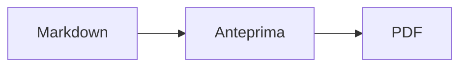

<p>&nbsp;&nbsp;&nbsp;</p>

# Splat

**L’editor Markdown per macOS che ti lascia scrivere nel codice sorgente o direttamente nell’anteprima.**

Splat mostra a sinistra il tuo codice sorgente Markdown con i colori della sintassi e a destra un’anteprima dal vivo, completamente modificabile. Scrivi dove preferisci: ciò che digiti nell’anteprima diventa una modifica minima del codice sorgente, così le righe che non hai toccato restano identiche byte per byte e i tuoi diff di Git restano puliti. Splat legge il Markdown che usi già: CommonMark e GitHub Flavored Markdown, avvisi di GitHub, wiki link, incorporamenti e riquadri di Obsidian, estensioni di Pandoc e Typora, HTML incorporato, formule LaTeX e diagrammi Mermaid, Graphviz e PlantUML, tutto elaborato offline. Sfoglia un’intera cartella di note e cerca al suo interno, guarda che cosa è cambiato dall’ultimo commit di Git, incolla da Word o da una pagina web come Markdown ed esporta in PDF, HTML o Word con un clic. È scritto in Rust su veri controlli AppKit, parla 35 lingue e non invia nulla in rete, a meno che non lo chieda tu.
 


[](https://github.com/sventmueller/splat/releases/latest/download/Splat.dmg)

**[Scarica Splat.dmg](https://github.com/sventmueller/splat/releases/latest/download/Splat.dmg)**: firmato e notarizzato da Apple, per macOS 14 o successivo su Apple Silicon e Intel.

**Hai trovato un bug?** Splat mantiene identiche byte per byte le righe che non hai toccato. Se una cambia comunque, o un file viene mostrato in modo errato, [apri una issue](https://github.com/sventmueller/splat/issues/new/choose) e allega il file. Se Splat ti è utile, una [stella su GitHub](https://github.com/sventmueller/splat) aiuta altri a trovarlo.
 
 

[](https://www.rust-lang.org)
[](https://www.apple.com/macos/)

[](https://github.com/madsmtm/objc2)
[](https://webkit.org)
[](https://github.com/kivikakk/comrak)
[](https://github.github.com/gfm/)
[](https://www.mathjax.org)
[](https://cortexjs.io/mathlive/)
[](https://mermaid.js.org)
[](https://graphviz.org)
[](https://plantuml.com)


[](#licenza)

[Bahasa Indonesia](../id/README.md) ·
[Bahasa Melayu](../ms/README.md) ·
[Català](../ca/README.md) ·
[Čeština](../cs/README.md) ·
[Dansk](../da/README.md) ·
[Deutsch](../de/README.md) ·
[English](../../../README.md) ·
[Español](../es/README.md) ·
[Français](../fr/README.md) ·
[Hrvatski](../hr/README.md) ·
**Italiano** ·
[Magyar](../hu/README.md) ·
[Nederlands](../nl/README.md) ·
[Norsk](../no/README.md) ·
[Polski](../pl/README.md) ·
[Português (Brasil)](../pt_BR/README.md) ·
[Português (Portugal)](../pt_PT/README.md) ·
[Română](../ro/README.md) ·
[Slovenčina](../sk/README.md) ·
[Slovenščina](../sl/README.md) ·
[Suomi](../fi/README.md) ·
[Svenska](../sv/README.md) ·
[Tiếng Việt](../vi/README.md) ·
[Türkçe](../tr/README.md) ·
[Ελληνικά](../el/README.md) ·
[Русский](../ru/README.md) ·
[Українська](../uk/README.md) ·
[עברית](../he/README.md)‎ ·
[العربية](../ar/README.md)‎ ·
[हिन्दी](../hi/README.md) ·
[ไทย](../th/README.md) ·
[한국어](../ko/README.md) ·
[日本語](../ja/README.md) ·
[简体中文](../zh-Hans/README.md) ·
[繁體中文](../zh-Hant/README.md)

## Indice

- [Funzioni in breve](#funzioni-in-breve)
- [Requisiti](#requisiti)
- [Installazione](#installazione)
- [Per iniziare](#per-iniziare)
- [Scrivere](#scrivere)
  - [Nel codice sorgente](#nel-codice-sorgente)
  - [Nell’anteprima](#nellanteprima)
  - [Comandi di formattazione](#comandi-di-formattazione)
  - [Elenchi e attività](#elenchi-e-attività)
  - [Tabelle](#tabelle)
  - [Incollare testo formattato](#incollare-testo-formattato)
  - [Metadati](#metadati)
- [Markdown supportato](#markdown-supportato)
  - [CommonMark e GitHub Flavored Markdown](#commonmark-e-github-flavored-markdown)
  - [Riquadri](#riquadri)
  - [Sintassi estesa](#sintassi-estesa)
  - [Obsidian](#obsidian)
  - [Citazioni e riferimenti](#citazioni-e-riferimenti)
  - [HTML incorporato](#html-incorporato)
  - [Punteggiatura tipografica](#punteggiatura-tipografica)
  - [Panoramica della sintassi](#panoramica-della-sintassi)
- [Formule](#formule)
- [Diagrammi](#diagrammi)
- [Immagini](#immagini)
- [Link e navigazione](#link-e-navigazione)
- [Note in una cartella](#note-in-una-cartella)
- [Modifiche dall’ultimo commit](#modifiche-dallultimo-commit)
- [Esportare, stampare e condividere](#esportare-stampare-e-condividere)
- [Importare documenti Word](#importare-documenti-word)
- [Aspetto e accessibilità](#aspetto-e-accessibilità)
- [Lingue](#lingue)
- [Scorciatoie da tastiera](#scorciatoie-da-tastiera)
- [Privacy e sicurezza](#privacy-e-sicurezza)
- [Documenti grandi](#documenti-grandi)
- [Limiti noti](#limiti-noti)
- [Risoluzione dei problemi](#risoluzione-dei-problemi)
- [Per sviluppatori](#per-sviluppatori)
  - [Componenti di terze parti](#componenti-di-terze-parti)
- [Licenza](#licenza)

## Funzioni in breve

- **Due modi di scrivere, un solo testo.** Codice sorgente e anteprima sono entrambi modificabili. Il file Markdown è l’unica verità: c’è una sola cronologia di annullamento per documento e ogni modifica nell’anteprima viene tradotta nella più piccola modifica possibile del codice sorgente.
- **Il Markdown che usi già.** CommonMark, GitHub Flavored Markdown, avvisi di GitHub, estensioni di Obsidian, Pandoc e Typora, shortcode per emoji, spoiler, elenchi di definizioni, ancore delle intestazioni e HTML come nei README di GitHub.
- **Formule e diagrammi integrati.** Formule LaTeX tramite MathJax, con un editor visuale di formule. Diagrammi in Mermaid, Graphviz e PlantUML, elaborati sul tuo Mac senza Java, senza server e senza connessione di rete.
- **Un pulsante per tutto.** Ogni elemento Markdown ha un pulsante nella barra strumenti e una voce di menu, quelli più comuni anche una scorciatoia da tastiera. Le tabelle hanno un menu tutto loro per righe, colonne e allineamento.
- **Una cartella, non solo un file.** La barra laterale elenca le note attorno a un documento e cerca in tutte. Rinominare una nota cambia i link che puntano a essa, e ogni byte attorno a loro resta com’è.
- **Modifiche a colpo d’occhio.** In un repository Git, delle barre accanto al testo segnano ciò che differisce dall’ultimo commit, in entrambi i riquadri.
- **Da Word e dal web a Markdown.** Incolla testo formattato come Markdown, celle di un foglio di calcolo come tabella, e importa interi documenti Word con le loro immagini.
- **Esporta senza perdere nulla.** PDF, un unico file HTML autonomo o un documento Word con intestazioni, elenchi, tabelle, note a piè di pagina e immagini autentici. Aggiungi numeri di pagina, intestazioni e un frontespizio, oppure usa il modello Word della tua azienda.
- **Nativo fino in fondo.** Vere finestre, pannelli, menu e popover di AppKit, Versioni, Salvataggio automatico, il menu Condividi, modalità scura, controllo ortografico, dettatura e VoiceOver. Niente Electron, niente web view per il testo stesso.
- **Veloce anche con file grandi.** Il rendering di una battuta di tasto in un documento da 10 MB richiede circa 10 ms, prima del lavoro della vista stessa.
- **Riservato e prudente.** Le immagini dal web si caricano solo dopo il tuo consenso, i link verso altre app chiedono prima conferma e tutto ciò che decodifica dati di immagini non attendibili gira in processi ausiliari isolati.
- **Nella tua lingua.** L’interfaccia e la guida rapida a Markdown integrata sono disponibili in 35 lingue: arabo, catalano, cinese (semplificato), cinese (tradizionale), croato, ceco, danese, olandese, inglese, finlandese, francese, tedesco, greco, ebraico, hindi, ungherese, indonesiano, italiano, giapponese, coreano, malese, norvegese, polacco, portoghese (Brasile), portoghese (Portogallo), rumeno, russo, slovacco, sloveno, spagnolo, svedese, tailandese, turco, ucraino e vietnamita.

## Requisiti

- macOS 14 Sonoma o successivo. Splat è sviluppato e testato su macOS 27, dove adotta automaticamente il design Liquid Glass.
- Un Mac con Apple Silicon o con processore Intel.
- Circa 45 MB di spazio su disco.

## Installazione

**Dall’immagine disco.** Scarica [`Splat.dmg`](https://github.com/sventmueller/splat/releases/latest/download/Splat.dmg), aprila e trascina Splat nella cartella Applicazioni. L’immagine è firmata con un Developer ID e notarizzata da Apple, quindi si apre senza avvisi.

**Con Homebrew.** Il cask si trova in un tap a parte:

```sh
brew install --cask sventmueller/tap/splat
```

`brew upgrade --cask splat` installa le nuove versioni e `brew uninstall --zap --cask splat` rimuove anche le impostazioni e le cache di Splat.

**Aggiornamenti.** Splat, installato dall’immagine disco o con Homebrew, si mantiene aggiornato da solo con [Sparkle](https://sparkle-project.org). Al secondo avvio chiede se può cercare aggiornamenti per conto suo, una volta al giorno. **Splat › Verifica aggiornamenti…** li cerca subito; **Verifica automaticamente gli aggiornamenti** e **Scarica e installa automaticamente gli aggiornamenti**, nello stesso menu, cambiano la tua scelta in seguito. Splat installa un aggiornamento solo se porta la firma dello sviluppatore. Una build compilata da te non ha l’aggiornamento automatico.

**Dal codice sorgente.** Per i prerequisiti vedi [Compilazione](../../../docs/development.md#building), poi:

```sh
make build
ditto target/release/Splat.app /Applications/Splat.app
open /Applications/Splat.app
```

Per aprire i file Markdown con Splat facendo doppio clic, seleziona un qualsiasi file `.md` nel Finder, scegli **File › Ottieni informazioni**, seleziona Splat sotto **Apri con** e fai clic su **Modifica tutti…**. Splat si registra per i file `.md`, `.markdown`, `.mdown` e `.mkd`.

## Per iniziare

### La finestra

Ogni documento si apre in una finestra propria, oppure in un pannello se preferisci i pannelli:

- **A sinistra: il codice sorgente.** Il tuo Markdown in SF Mono con i colori della sintassi.
- **A destra: l’anteprima.** Il documento elaborato, pronto per essere modificato.
- **Barra laterale (facoltativa).** Tutte le intestazioni ad albero, un clic su una la mostra in entrambi i riquadri: **Vista › Mostra struttura** (⌃⌘S). Altri due pannelli contengono le [note della cartella](#note-in-una-cartella) e una ricerca al loro interno. Il pulsante accanto al titolo della finestra la mostra e la nasconde, e le nuove finestre la aprono come l’ha lasciata l’ultima.
- **Barra strumenti.** Pulsanti raggruppati in base a ciò che modificano: caratteri, paragrafi ed elementi inseriti, poi anteprima sì/no, Condividi e Nuovo documento. Si personalizza con **Vista › Personalizza la barra strumenti…**.

Trascina il divisore per dare più spazio a uno dei due lati. **Vista › Nascondi anteprima** (⌥⌘P) lascia solo il codice sorgente; Splat lo ricorda per ogni finestra. I due riquadri scorrono insieme e una selezione in uno viene evidenziata nell’altro.

L’angolo della finestra mostra le parole e i caratteri del testo e quanto tempo serve per leggerlo, e quelli della selezione finché ce n’è una. Indirizzi dei link, tag HTML, metadati, commenti, formule e diagrammi non contano. Resta nascosto finché **Vista › Mostra conteggio parole** non lo attiva.

### Documenti, pannelli e versioni

Splat è una normale app a documenti di macOS:

- **Salvataggio automatico e Versioni.** Le modifiche vengono salvate sul posto. **File › Ripristina a › Sfoglia tutte le versioni…** ti riporta indietro nel tempo.
- **Modifiche da altri programmi.** Quando Git, uno script o un altro editor modifica un documento aperto, Splat lo ricarica e mantiene il cursore e la posizione di scorrimento. Se hai modifiche non salvate, Splat le conserva e macOS chiede conferma prima di sovrascrivere l’altra versione.
- **I soliti comandi per i file.** Duplica (⇧⌘S), Rinomina…, Sposta in… e **File › Apri recenti**.
- **Pannelli.** **File › Nuovo pannello** o il pulsante **+** nella barra strumenti apre un nuovo documento in un pannello; il menu Finestra standard unisce, sposta e scorre i pannelli.
- **Posizione delle finestre.** Le dimensioni e la posizione dell’ultima finestra vengono ricordate, anche dopo un riavvio. Se in quel punto c’è già una finestra, la nuova si apre leggermente spostata.
- **L’icona nel Dock.** Un clic su di essa, dopo aver chiuso l’ultima finestra, apre un nuovo documento.
- **Apri i file Markdown con Splat.** **Splat › Imposta come app di default per Markdown** fa sì che un doppio clic su un file `.md` o `.markdown` apra Splat; macOS chiede conferma una sola volta. La voce mostra un segno di spunta finché Splat è l’app di default.

I file devono essere testo UTF-8 oppure UTF-16 con un byte order mark. Splat rifiuta le altre codifiche invece di tirare a indovinare e rovinare il testo. Un byte order mark resta, UTF-16 resta UTF-16 e, in un file in cui tutte le righe terminano con CRLF, anche le righe che aggiungi ricevono CRLF.

**Dopo un arresto anomalo** si perdono al massimo gli ultimi secondi di scrittura: ogni cinque secondi Splat copia il testo non salvato in `~/Library/Application Support/Splat/Unsaved` e rimuove le copie quando un documento viene salvato o Splat termina normalmente. Al successivo avvio sposta ciò che un arresto anomalo ha lasciato lì in `~/Library/Application Support/Splat/Recovery` e lo segnala una sola volta, con un pulsante che apre la cartella. Un arresto anomalo a cui Splat riesce ancora a reagire scrive lì anche il testo di ogni documento aperto.

### Guida rapida

**Aiuto › Guida rapida a Markdown** apre una scheda riassuntiva nella tua lingua come nuovo documento senza titolo. È un documento normale, quindi puoi provare tutto direttamente lì, nel codice sorgente o nell’anteprima.

## Scrivere

### Nel codice sorgente

Il codice sorgente è un editor di testo semplice ottimizzato per Markdown:

- **Colori della sintassi** come in VS Code: intestazioni, enfasi, link, codice, tabelle, HTML, front matter, e LaTeX e Mermaid dentro formule e diagrammi. Ci sono palette per i temi chiaro e scuro e per Aumenta contrasto.
- **I blocchi di codice delimitati** vengono evidenziati per Bash, C, C++, C#, CSS (anche SCSS e Less), Go, HTML, XML, Java, JavaScript, JSON, Kotlin, PHP, Python, Ruby, Rust, SQL, Swift, TypeScript, YAML, TeX e Mermaid, compresi i loro nomi abbreviati più comuni come `js`, `py` o `sh`.
- **Nessuna sostituzione a sorpresa.** Virgolette smart, trattini smart e sostituzione del testo sono disattivati di default, perché rovinano `--`, `---` e `"`. Si attivano in **Modifica › Sostituzioni**.
- **Gli strumenti di scrittura del sistema.** Controllo di ortografia e grammatica, dettatura, Trova e sostituisci (⌥⌘F) e Voce.
- **Trascinamento.** Trascina un file immagine per inserire ``, qualsiasi altro file per inserire un link ad esso e un URL per inserire `[url](url)`. Ogni trascinamento è un unico passo di annullamento.
- **Incolla immagini.** Un’immagine negli appunti, come uno screenshot, viene salvata come file PNG accanto al documento (`Immagine 2026-10-29 13.09.07.png`) e inserita come immagine. Per questo il documento deve essere stato salvato almeno una volta.

### Nell’anteprima

L’anteprima si comporta come un programma di videoscrittura, ma tutto ciò che fai al suo interno finisce come Markdown:

- **Scrittura.** I caratteri che in Markdown hanno un significato, come `*` o `#`, vengono preceduti da un carattere di escape, così compaiono come li hai digitati.
- **Invio** inizia un nuovo paragrafo o una nuova voce di elenco. **⌥Invio** o **⌃Invio** inserisce un’interruzione di riga.
- **Formattazione al cursore.** Con il cursore alla fine di una parola, Grassetto, Corsivo e gli altri formati di carattere si applicano a ciò che scrivi dopo. Scegli di nuovo il formato per interromperlo. All’interno di una parola, viene formattata l’intera parola.
- **Righe vuote.** Invio su una riga vuota ne aggiunge un’altra e Elimina (⌫) la rimuove. Nel codice sorgente ogni riga vuota in più corrisponde a due righe vuote; gli altri programmi Markdown le mostrano come una normale spaziatura tra paragrafi.
- **Annulla** funziona in entrambi i riquadri. Le voci di annullamento hanno un nome («Annulla Grassetto»), la scrittura è un passo per ogni raffica di battute e dopo Annulla e Ripristina entrambi i riquadri scorrono fino alla modifica.
- **Formule e diagrammi** appaiono come grafica finita. Fai clic su uno, portaci sopra il cursore o premi Invio per aprire il suo editor (vedi [Formule](#formule) e [Diagrammi](#diagrammi)).
- **HTML incorporato, note incorporate e front matter** vengono mostrati, ma si modificano nel codice sorgente. Un clic su di essi porta il cursore nel punto corrispondente.

Tutto ciò che Markdown non sa esprimere è bloccato nell’anteprima: i pannelli Font e Colori, il righello e l’incolla o il trascinamento di testo formattato e immagini. L’HTML e l’RTF incollati arrivano come testo semplice, a meno che tu non scelga [Incolla come Markdown](#incollare-testo-formattato).

### Comandi di formattazione

Ogni comando è disponibile dalla barra strumenti, dalla barra dei menu e dal menu contestuale di entrambi i riquadri. Le voci di menu mostrano un segno di spunta per la formattazione al cursore.

| Menu | Comandi |
|---|---|
| **Formato › Font** | Grassetto, Corsivo, Sottolineato, Barrato, Evidenziato, Codice, Apice, Pedice |
| **Formato › Intestazione** | Corpo del testo, Intestazione da 1 a 6 |
| **Formato › Elenco** | Elenco puntato, Elenco numerato, Elenco di attività |
| **Formato** | Citazione, Blocco di codice (Nessun linguaggio o uno di 20 linguaggi; cambia anche il linguaggio di un blocco esistente), Riquadro (Nota, Suggerimento, Importante, Attenzione, Cautela; lo stesso tipo di nuovo lo rimuove), Modifica formula o diagramma…, Rimuovi formattazione |
| **Inserisci** | Link…, Immagine…, Tabella…, Formula, Diagramma (Diagramma di flusso, Diagramma di sequenza, Diagramma di Gantt), Indice, Nota a piè di pagina, Separatore |
| **Tabella** | Inserisci riga sopra/sotto, Inserisci colonna a sinistra/destra, Elimina riga, Elimina colonna, Allineamento (A sinistra, Al centro, A destra, Default), Allinea colonne della tabella |
| **Vista** | Nascondi/Mostra anteprima, Mostra/Nascondi struttura, Punteggiatura tipografica, Ingrandisci/Riduci, Dimensioni reali, barra strumenti, barra dei pannelli, modalità a tutto schermo |

Sottolineato, evidenziato, apice e pedice vengono scritti come `<ins>`, `<mark>`, `<sup>` e `<sub>`, che anche GitHub mostra. Splat legge anche `<u>`, che GitHub rimuove, e le forme più brevi `==evidenziato==`, `^apice^` e `~pedice~`. GitHub mostra `==` e `^` così come sono e `~pedice~` come barrato.

### Elenchi e attività

- Invio continua un elenco; Invio su una voce vuota lo termina.
- **Tab** e **⇧Tab** aumentano e riducono il rientro delle voci di elenco nell’anteprima.
- Un clic sulla casella di un’attività nell’anteprima alterna `- [ ]` e `- [x]`.
- **Formato › Elenco** trasforma i paragrafi selezionati in un elenco o ne cambia il tipo.

### Tabelle

- **Inserisci › Tabella…** chiede il numero di righe (inclusa l’intestazione) e di colonne.
- Nell’anteprima, **Tab** passa alla cella successiva, **⇧Tab** a quella precedente e **Invio** alla cella sottostante. Tab nell’ultima cella aggiunge una riga.
- Il menu **Tabella** inserisce ed elimina righe e colonne e imposta l’allineamento di una colonna (⌘{, ⌘|, ⌘}).
- **Tabella › Allinea colonne della tabella** riempie il codice sorgente con spazi in modo che le colonne risultino allineate.

### Incollare testo formattato

**Modifica › Incolla come Markdown** (⌃⌘V), anche nel menu contestuale di entrambi i riquadri, trasforma il contenuto degli appunti in Markdown in corrispondenza della selezione, come un unico passo di annullamento. ⌘V continua a inserire testo semplice.

- **Da un browser, Word, Google Docs, Confluence, Note o Pages:** intestazioni, grassetto, corsivo, sottolineato, barrato, apice e pedice, link, elenchi con il loro annidamento, citazioni, codice e tabelle vengono mantenuti.
- **Da un foglio di calcolo:** le celle diventano una tabella con una riga di intestazione e colonne di numeri allineate a destra. Lo stesso vale per il testo separato da tabulazioni, punti e virgola o virgole, se ogni riga ha lo stesso numero di colonne.
- **Le immagini** con un indirizzo web restano link. Un’immagine all’interno dell’HTML incollato diventa un file accanto al documento, che per questo deve essere stato salvato almeno una volta. I file di immagine temporanei di Word non vengono ripresi, e il loro testo alternativo resta.
- **I link** mantengono solo indirizzi `http`, `https`, `mailto`, relativi e `#`; di ogni altro link resta il testo.

### Metadati

**Formato › Modifica metadati…**, o un clic sulla riga dei metadati in cima all’anteprima, apre un modulo con i campi del front matter YAML. I campi si possono modificare, aggiungere e rimuovere. Un campo con un elenco lo mantiene come elenco: i suoi valori si susseguono separati da virgole, e un valore che contiene una virgola sta tra virgolette. Anche un nuovo campo chiamato `tags`, `aliases`, `keywords`, `categories`, `authors` o `cssclasses` diventa un elenco. I campi annidati e il testo su più righe si vedono lì e si modificano nel codice sorgente.

Ciò che il modulo cambia è un unico passo di annullamento e riguarda solo le righe dei campi che hai modificato: commenti, ordine, spaziature insolite, virgolette e fine riga di tutti gli altri restano identici byte per byte. Un documento senza metadati riceve un blocco all’inizio.

## Markdown supportato

Splat esegue l’analisi con [comrak](https://github.com/kivikakk/comrak), un parser compatibile con CommonMark e GFM, e attiva la maggior parte delle sue estensioni. Tutto ciò che segue viene elaborato nell’anteprima e in tutte le esportazioni.

### CommonMark e GitHub Flavored Markdown

- Intestazioni (`#` e sottolineate), paragrafi, interruzioni di riga, enfasi, enfasi forte, codice in linea, citazioni a blocco, separatori orizzontali.
- Elenchi puntati, numerati e annidati; elenchi di attività.
- Link (in linea, di riferimento e automatici), immagini, definizioni di riferimenti dei link.
- Blocchi di codice delimitati e rientrati con i colori della sintassi.
- Tabelle con allineamento delle colonne.
- Barrato con `~~due tilde~~`.
- Note a piè di pagina: `testo[^1]` con `[^1]: La nota.` in qualsiasi punto del documento. Un clic sul segnaposto porta alla nota.
- Front matter YAML tra righe `---` all’inizio. L’anteprima lo riassume in una riga, ad esempio «Metadati: title, date, tags».

### Riquadri

Gli avvisi di GitHub vengono elaborati come riquadri colorati con icona e titolo:

```markdown
> [!NOTE]
> Informazioni utili che gli utenti dovrebbero conoscere.

> [!WARNING]
> Contenuto critico che richiede attenzione immediata.
```

I cinque tipi sono Nota, Suggerimento, Importante, Attenzione e Cautela. **Formato › Riquadro** trasforma in uno di essi il paragrafo al cursore.

Funzionano anche i riquadri di Obsidian, con un titolo qualsiasi e uno stato di compressione:

```markdown
> [!tip]- Fai clic su ▸ per espandere
> Nascosto finché non lo apri.

> [!question]+ Aperto di default
> Un `+` parte espanso, un `-` compresso.
```

Gli altri tipi di Obsidian vengono mostrati nel colore più vicino tra i cinque: `success`, `check`, `done` e `hint` come Suggerimento; `question`, `help` e `faq` come Importante; `attention` come Attenzione; `failure`, `fail`, `missing`, `danger`, `error` e `bug` come Cautela; tutto il resto come Nota.

### Sintassi estesa

| Funzione | Sintassi | Da |
|---|---|---|
| Evidenziato | `==testo evidenziato==` | Obsidian, Typora |
| Apice | `x^2^` | Pandoc, Typora |
| Pedice | `H~2~O` | Pandoc, Typora |
| Shortcode per emoji | `:rocket:` diventa 🚀 | GitHub |
| Spoiler | `\|\|testo nascosto\|\|`, selezionalo per leggerlo | Discord |
| Nota in linea | `testo^[la nota stessa]` | Pandoc, Obsidian |
| Elenco di definizioni | `Termine`, riga vuota, `: Spiegazione` | PHP Markdown Extra, Pandoc |
| Ancora di intestazione | `## Installazione {#setup}`, link con `[vedi](#setup)` | Pandoc, kramdown |

Nel codice sorgente gli elenchi di definizioni si presentano così:

```markdown
Termine

: Spiegazione del termine.
```

Senza un’ancora personalizzata, ogni intestazione ne riceve una ricavata dal suo testo, come su GitHub: `## Primi passi` si raggiunge come `#primi-passi`.

### Obsidian

- **Wiki link.** `[[Nota]]` rimanda a `Nota.md` nella stessa cartella o in una sottostante. `[[Nota|Testo mostrato]]` mostra un testo a tua scelta e `[[Nota#Intestazione]]` apre la nota. ⌘-clic la apre in Splat.
- **Incorporamenti.** `![[Nota]]` mostra l’altra nota all’interno di questa; le note incorporate al suo interno appaiono come link. `![[diagramma.png]]` mostra un’immagine. Come in Obsidian, gli incorporamenti indicano note e immagini nella cartella del documento o in una sottostante, mai con un percorso assoluto, e solo i file Markdown vengono mostrati come note.
- **Commenti.** `%%Solo nel sorgente%%` resta visibile nel codice sorgente e viene omesso dall’anteprima e da ogni esportazione, sia in linea sia su righe a sé.
- **Tag.** `#idea` o `#progetto/splat` viene evidenziato. ⌘-clic cerca il tag nel documento e, nella barra laterale, in tutta la cartella.
- **Riquadri comprimibili.** Vedi [Riquadri](#riquadri).

### Citazioni e riferimenti

- **Citazioni di Pandoc.** `[@doe2020]` o `[@doe2020; @roe2021]` si legge come «(Doe 2020; Roe 2021)». Le voci provengono dal file BibTeX indicato nel front matter come `bibliography: refs.bib`. In sua assenza, Splat usa `references.bib`, `literatur.bib` o `bibliography.bib` accanto al documento.
- **Riferimenti di GitHub e GitLab.** Se il documento si trova in un repository Git il cui remote `origin` è su github.com o su un host GitLab, vengono evidenziati `@nome`, `#12` (issue) e `!7` (merge request, solo GitLab). ⌘-clic li apre nel browser.

### HTML incorporato

L’HTML che si trova nei README di GitHub viene elaborato con un lettore proprio, senza un motore da browser:

- paragrafi e blocchi centrati (`<p align="center">`, `<div align="center">`)
- immagini con dimensioni (``)
- link, `<kbd>⌘</kbd>`, `<br>`, `<u>`, `<ins>`, `<mark>`, `<sup>`, `<sub>`
- elenchi e tabelle, comprese le celle che si estendono su più colonne (`colspan`)
- sezioni comprimibili: `<details><summary>Altro</summary>…</details>`, che si aprono con un clic su ▸

Il Markdown tra i tag HTML viene elaborato come Markdown. Script, stili, frame e moduli vengono omessi del tutto, e link e immagini mantengono solo indirizzi `http`, `https`, `mailto` e relativi.

### Punteggiatura tipografica

**Vista › Punteggiatura tipografica** mostra le virgolette dritte come le virgolette della lingua dell’interfaccia, `--` come trattino en, `---` come trattino em e `...` come puntini di sospensione. In tedesco `"Ja"` diventa „Ja“, in francese «Oui», in giapponese 「はい」, anche dove il cinese e il giapponese compongono le virgolette senza spazio; le abbreviazioni ebraiche come `צה"ל` ricevono i loro gershayim, צה״ל. Il codice sorgente conserva i caratteri semplici; l’anteprima e tutte le esportazioni mostrano quelli tipografici. L’impostazione è disattivata finché non la attivi.

### Panoramica della sintassi

| Elemento | Markdown |
|---|---|
| **Grassetto** | `**Grassetto**` |
| *Corsivo* | `*Corsivo*` |
| Sottolineato | `<ins>Sottolineato</ins>` o `<u>Sottolineato</u>` |
| ~~Barrato~~ | `~~Barrato~~` |
| Evidenziato | `<mark>Evidenziato</mark>` o `==Evidenziato==` |
| `Codice` | `` `Codice` `` |
| x² | `x<sup>2</sup>` o `x^2^` |
| H₂O | `H<sub>2</sub>O` o `H~2~O` |
| [Link](https://example.com) | `[Link](https://example.com)` |
| Intestazione | `# Intestazione` fino a `###### Intestazione` |
| Citazione | `> Citazione` |
| Elenco puntato | `- Voce` |
| Elenco numerato | `1. Voce` |
| Attività | `- [ ] Da fare` e `- [x] Fatto` |
| Blocco di codice | ```` ```rust ```` … ```` ``` ```` |
| Tabella | `\| A \| B \|` con `\|---\|---\|` sotto l’intestazione |
| Nota a piè di pagina | `Testo[^1]` e `[^1]: Nota` |
| Separatore | `---` |
| Immagine | `` |
| Formula | `$E = mc^2$`, `$$ … $$` |
| Diagramma | ```` ```mermaid ````, ```` ```dot ````, ```` ```plantuml ```` |
| Riquadro | `> [!TIP]` |
| Wiki link | `[[Nota]]`, `[[Nota\|Testo]]` |
| Incorporamento | `![[Nota]]`, `![[immagine.png]]` |
| Commento | `%%Commento%%` |
| Tag | `#tag` |
| Citazione bibliografica | `[@chiave]` |
| Spoiler | `\|\|Spoiler\|\|` |
| Emoji | `:tada:` |

## Formule

Le formule vengono elaborate da [MathJax](https://www.mathjax.org) con il suo TeX e la matematica AMS, come nitida grafica vettoriale. Il testo in `\text{…}` può essere in qualsiasi sistema di scrittura: ciò che manca ai font di MathJax viene preso dai font del tuo Mac, con l’arabo e l’ebraico da destra a sinistra e le emoji a colori.

| Tipo | Sintassi |
|---|---|
| In linea | `$E = mc^2$`, `` $`E = mc^2`$ `` (GitHub, GitLab), `\(E = mc^2\)` |
| A blocco | `$$` … `$$`, `\[` … `\]`, o un blocco di codice contrassegnato `math` |

**Modifica di una formula.** Fai clic su una formula nell’anteprima, fai doppio clic, premi Invio o porta il cursore su di essa per aprire il suo editor in un popover. **Inserisci › Formula** ne inserisce una nuova e apre subito l’editor.

- **Visuale o LaTeX.** L’interruttore in alto passa da un editor visuale ([MathLive](https://cortexjs.io/mathlive/)) al codice LaTeX e viceversa. Splat ricorda la tua scelta.
- **Blocchi predefiniti** per frazione, radice quadrata, apice e pedice, sommatoria e integrale con estremi, limite, parentesi che crescono con il contenuto, matrice 2×2, lettere greche, e relazioni, operatori e frecce. Lasciano segnaposto □, e **Tab** passa al successivo.
- **Anteprima dal vivo.** Le modifiche compaiono nel documento mentre scrivi. Gli errori di MathJax vengono mostrati in una riga sotto il codice.
- **Conferma o scarta.** Un clic all’esterno mantiene la modifica come un unico passo di annullamento; **Esc** o **Annulla** la scarta. Premere Esc su una formula nuova e vuota la rimuove di nuovo.
- Il menu contestuale offre **Modifica formula…** per la formula sotto il puntatore.

VoiceOver legge una formula come il suo codice LaTeX. Splat elabora formule, non documenti LaTeX completi: non ci sono pacchetti, né TikZ né `\documentclass`.

## Diagrammi

I diagrammi vengono elaborati all’interno di Splat, offline e in una variante chiara e una scura.

| Motore | Blocco di codice | Cosa disegna |
|---|---|---|
| [Mermaid](https://mermaid.js.org) | ```` ```mermaid ```` | diagrammi di flusso, di sequenza, delle classi, di stato, entità-relazione, di Gantt, a torta, mappe mentali, linee del tempo e ogni altro tipo di Mermaid |
| [Graphviz](https://graphviz.org) | ```` ```dot ```` o ```` ```graphviz ```` | grafi nel linguaggio DOT |
| [PlantUML](https://plantuml.com) | ```` ```plantuml ```` o ```` ```puml ```` | diagrammi UML; funziona senza Java |



**Modificare un diagramma** funziona come modificare una formula: un clic lo apre in un popover con il codice, i colori della sintassi e i messaggi di errore in una riga sotto il codice. **Inserisci › Diagramma** parte da un modello per un diagramma di flusso, un diagramma di sequenza o un diagramma di Gantt. I blocchi predefiniti aiutano con i tre tipi più comuni di Mermaid:

- **Diagramma di flusso:** Nodo ▾ (rettangolo, arrotondato, cerchio, rombo, database), Collegamento, Collegamento con etichetta, Gruppo, Direzione ▾
- **Diagramma di sequenza:** Partecipante, Messaggio, Risposta, Nota, Ciclo, Percorsi alternativi
- **Diagramma di Gantt:** Sezione, Attività, Milestone

Gli altri tipi di diagramma si modificano come codice. VoiceOver legge il titolo o il testo alternativo di un diagramma.

Il primo diagramma dopo l’avvio richiede circa un secondo, perché il motore di rendering parte in background. Un diagramma che impiega più di 10 secondi mostra un errore e il motore di rendering riparte da zero per il successivo. Il motore di PlantUML (3 MB) viene caricato solo con il primo diagramma PlantUML. Un `!include` di PlantUML dal web viene bloccato.

## Immagini

- **Le immagini locali** usano percorsi relativi al documento: ``. Splat mostra PNG, JPEG, GIF, WebP, BMP, SVG, HEIC, TIFF, AVIF e PDF.
- **Le immagini dal web** restano bloccate finché non le consenti: una barra sopra l’anteprima spiega che caricarle fa sapere ai loro server che apri il documento e quando. **Carica immagini** le consente per questo documento; Splat ricorda la scelta per ogni file.
- **Dimensioni.** `` ridimensiona un’immagine; altrimenti le immagini si adattano alla larghezza dell’anteprima.
- **Modifiche su disco.** Un’immagine che sostituisci, o una che compare dopo che il documento l’ha nominata, viene mostrata senza riaprire il documento. Le immagini dal web che hanno fallito a causa della rete vengono ritentate finché un documento le mostra.
- **Memoria.** Le immagini vengono mostrate fino a 2560 pixel sul lato più lungo, quanto basta anche per riempire una pagina A4. Vengono decodificate più piccole quando occupano un ottavo della memoria del Mac e mentre macOS segnala una pressione sulla memoria.
- **Modalità scura.** Le immagini con sfondo bianco vengono leggermente attenuate nell’anteprima scura.
- **Incolla e trascinamento.** Vedi [Nel codice sorgente](#nel-codice-sorgente).

## Link e navigazione

Nell’anteprima un clic posiziona il cursore, così puoi modificare il testo del link; **⌘-clic** segue il link:

- `http`, `https` e `mailto` si aprono nel browser o nell’app di posta.
- I file Markdown si aprono in Splat; altri file e cartelle vengono mostrati nel Finder.
- `#ancora` porta all’intestazione nel documento.
- Gli indirizzi che aprono un’altra app, come `slack://` o `vscode://`, chiedono prima conferma e mostrano l’indirizzo completo e l’app. **Annulla** è preselezionato.

**Inserisci › Indice** inserisce un elenco con link a tutte le intestazioni. Con il cursore al suo interno, lo stesso comando lo aggiorna. La barra laterale della struttura (⌃⌘S) porta a qualsiasi intestazione in entrambi i riquadri.

## Note in una cartella

I pulsanti in cima alla barra laterale permettono di passare tra la struttura, i file e una ricerca.

- **File** (**Vista › Mostra file**, ⌃⌘E). Tutti i file Markdown nella cartella del documento o, se si trova in un repository Git, in tutto il repository. Un clic o Invio apre una nota come pannello di questa finestra; se è già aperta, viene in primo piano. Il pulsante accanto al nome della cartella mostra un’altra cartella in questa finestra. I file nascosti, `node_modules`, `target`, `Pods`, `DerivedData`, `__pycache__` e le cartelle senza note restano fuori. Un documento direttamente nella tua cartella Inizio mostra solo le note accanto a esso, così che Splat non percorra tutte le tue cartelle chiedendo il permesso per ciascuna.
- **Ricerca** (**Modifica › Trova › Cerca in tutte le note…**, ⇧⌘F). Trova il testo in tutte le note, a prescindere da maiuscole e minuscole e da come sono codificati gli accenti. `#tag` trova un tag, `#project` anche `#project/splat`, e niente all’interno del codice. Un clic su un risultato apre la nota in quel punto.
- **Link a una nota.** Il menu contestuale di una nota elenca le note che puntano a essa, tramite wiki link, incorporamento, link relativo o definizione di riferimento del link.
- **Rinominare una nota.** Lo stesso menu la rinomina e cambia quei link. Splat dice prima di quanti link in quanti file si tratta. In ogni link cambia solo il nome, e ogni altro byte del file resta com’è. I documenti aperti ricevono la modifica come un passo di annullamento; negli altri file solo Git o Versioni possono annullarla. Un file che un altro programma ha modificato nel frattempo ferma la ridenominazione di tutti i link, e Splat lo indica.

L’elenco segue la cartella quando la finestra viene in primo piano. La ricerca guarda i file così come sono su disco, e il testo che non hai ancora salvato conta dal successivo Salvataggio automatico.

## Modifiche dall’ultimo commit

In un documento in un repository Git, delle barre accanto al testo segnano ciò che differisce dall’ultimo commit, nel codice sorgente e nell’anteprima: verde per le righe aggiunte, blu per le righe modificate e un breve segno rosso dove qualcosa è stato rimosso. Seguono mentre scrivi e quando il branch si sposta. **Vista › Modifiche dall’ultimo commit** le disattiva, per tutte le finestre.

Le righe che differiscono solo per il fine riga non contano, quindi un file con CRLF rispetto a un commit con LF non mostra modifiche. Un file nuovo non ha segni fino al suo primo commit, e nemmeno un documento oltre i 32 MB.

## Esportare, stampare e condividere

| Formato | Come | Cosa ottieni |
|---|---|---|
| **PDF** | **File › Esporta come PDF…** o il menu Condividi | Pagine in formato carta, sempre con l’aspetto chiaro, formule e diagrammi come grafica vettoriale. **File › Formato di stampa…** imposta la carta. |
| **Stampa** | **File › Stampa…** (⌘P) | Lo stesso layout del PDF. |
| **HTML** | **File › Esporta come HTML…** o il menu Condividi | Un unico file autonomo: immagini locali incorporate, formule e diagrammi come immagini nitide, ancore delle intestazioni perché l’indice funzioni. Senza script. |
| **Word** | **File › Esporta come documento Word…** o il menu Condividi | Un `.docx` con gli stili di intestazione di Word, elenchi e tabelle autentici (comprese le celle unite), note a piè di pagina come note di Word, immagini incorporate, formule e diagrammi. |
| **Markdown** | Il pulsante **Condividi** nella barra strumenti | Il documento come file `.md` per Mail, Messaggi, AirDrop e ogni altro servizio di condivisione. |

Il menu **File › Condividi** li offre tutti in un unico posto. Le esportazioni usano l’impostazione della punteggiatura tipografica e le immagini dal web che hai consentito; nell’HTML le immagini dal web restano link.

**File › Opzioni di esportazione…** imposta ciò che PDF, stampa e Word aggiungono al testo, per tutti i documenti:

- **Numeri di pagina** nel piè di pagina di PDF e stampa, nella forma `2 / 9`.
- **Intestazione e piè di pagina** per PDF e stampa. `{title}`, `{author}`, `{date}`, `{page}` e `{pages}` stanno per i loro valori, i primi tre dai metadati del documento.
- **Un frontespizio** per PDF, stampa e Word, con `title`, `subtitle`, `author` e `date` dai metadati, o il nome del documento come titolo. Non ha né intestazione né piè di pagina.
- **Un modello Word**, un `.docx` o `.dotx` di cui l’esportazione adotta l’aspetto: gli stili, anche con nomi localizzati, il tema, le dimensioni della pagina, i margini, le intestazioni e i piè di pagina. Un modello che non si può leggere ferma l’esportazione e lo segnala, invece di darti un documento senza di esso.

## Importare documenti Word

**File › Importa documento Word…** chiede un file `.docx` o `.dotx` e dove mettere il suo Markdown, poi apre il risultato. Le immagini finiscono in una cartella accanto, con il nome del documento seguito da `-images`.

Intestazioni ed elenchi arrivano come li definiscono gli stili e la numerazione di Word, anche nei documenti i cui stili hanno nomi localizzati. Grassetto, corsivo, sottolineato, barrato, evidenziato, apice e pedice, link, citazioni, codice, note a piè di pagina, note di chiusura e tabelle vengono mantenuti, le celle su più colonne come tabella HTML. Le formule diventano LaTeX. Le revisioni contano come accettate, e un indice resta fuori, perché **Inserisci › Indice** ne crea uno nuovo. I vecchi file `.doc` e i documenti protetti da password vengono rifiutati.

## Aspetto e accessibilità

- **La modalità scura** segue il sistema. Formule e diagrammi vengono elaborati per ogni aspetto.
- **Aumenta contrasto** in Impostazioni di Sistema passa i colori della sintassi a palette ad alto contrasto.
- **Zoom.** ⌘+, ⌘− e ⌘0 ridimensionano entrambi i riquadri.
- **Modalità a tutto schermo, pannelli e una barra strumenti personalizzabile**, come in ogni app per Mac.
- **VoiceOver.** I riquadri sono etichettati «Codice sorgente Markdown» e «Anteprima», le formule vengono lette come il loro codice e i diagrammi come il loro titolo. Ogni comando è raggiungibile dalla tastiera.

Splat non ha una finestra delle impostazioni: le poche opzioni stanno dove servono, in **Vista**, **Modifica › Sostituzioni** e **File › Opzioni di esportazione…**.

## Lingue

L’interfaccia, i menu e la guida rapida a Markdown sono tradotti in 35 lingue:

arabo, catalano, cinese (semplificato), cinese (tradizionale), croato, ceco, danese, olandese, inglese, finlandese, francese, tedesco, greco, ebraico, hindi, ungherese, indonesiano, italiano, giapponese, coreano, malese, norvegese, polacco, portoghese (Brasile), portoghese (Portogallo), rumeno, russo, slovacco, sloveno, spagnolo, svedese, tailandese, turco, ucraino e vietnamita.

Splat segue l’ordine delle lingue in **Impostazioni di Sistema › Generali › Lingua e zona**; lì, sotto **Applicazioni**, puoi anche scegliere una lingua solo per Splat. Se manca una traduzione nella tua lingua, usa l’inglese. I termini dei menu seguono le traduzioni di Apple, così Splat si legge come il resto del tuo Mac.

Il testo ebraico e arabo si legge da destra a sinistra ovunque compaia, qualunque sia la lingua dell’interfaccia: ogni paragrafo, intestazione e voce di elenco prende la direzione della sua prima lettera, le citazioni e i riquadri disegnano la loro barra a destra e una tabella il cui testo inizia da destra elenca le colonne da destra. I blocchi di codice restano da sinistra a destra. Le esportazioni in PDF, HTML e Word mantengono queste direzioni. Con l’ebraico o l’arabo come lingua di sistema, macOS specchia anche la finestra, quindi l’anteprima si trova a sinistra.

## Scorciatoie da tastiera

| Azione | Scorciatoia |
|---|---|
| Grassetto, Corsivo, Sottolineato | ⌘B, ⌘I, ⌘U |
| Barrato | ⇧⌘X |
| Link… | ⌘K |
| Corpo del testo, Intestazione da 1 a 6 | ⌥⌘0, ⌥⌘1 fino a ⌥⌘6 |
| Allinea la colonna della tabella a sinistra, al centro, a destra | ⌘{, ⌘\|, ⌘} |
| Nascondi o mostra l’anteprima | ⌥⌘P |
| Mostra o nascondi la struttura | ⌃⌘S |
| Mostra o nascondi i file | ⌃⌘E |
| Cerca in tutte le note | ⇧⌘F |
| Incolla come Markdown | ⌃⌘V |
| Ingrandisci, riduci, dimensioni reali | ⌘+, ⌘−, ⌘0 |
| Nuovo documento, apri, salva, duplica | ⌘N, ⌘O, ⌘S, ⇧⌘S |
| Formato di stampa, stampa | ⇧⌘P, ⌘P |
| Trova, trova e sostituisci | ⌘F, ⌥⌘F |
| Trova successivo, precedente; usa selezione; vai alla selezione | ⌘G, ⇧⌘G; ⌘E; ⌘J |
| Mostra ortografia e grammatica; controlla il documento | ⌘:, ⌘; |
| Incolla e adegua lo stile | ⌥⇧⌘V |
| Nascondi la barra strumenti, mostra tutti i pannelli, modalità a tutto schermo | ⌥⌘T, ⇧⌘\\, ⌃⌘F |
| Interruzione di riga (anteprima) | ⌥Invio o ⌃Invio |
| Cella successiva / precedente in una tabella (anteprima) | Tab / ⇧Tab |
| Aumenta / riduci il rientro di una voce di elenco (anteprima) | Tab / ⇧Tab |
| Segnaposto successivo nell’editor di formule | Tab |
| Chiudi l’editor di formule o diagrammi senza modifiche | Esc |
| Segui un link, un tag o un riferimento (anteprima) | ⌘-clic |

Splat lascia dove sono le scorciatoie standard di Apple.

## Privacy e sicurezza

Un file Markdown può arrivare da chiunque, quindi Splat tratta ogni documento come non attendibile.

- **Nessuna rete di default.** Splat non ha telemetria. Cerca aggiornamenti solo dopo il tuo consenso o se scegli **Verifica aggiornamenti…**: in quel caso carica da GitHub un piccolo file di feed e la richiesta indica solo l’app e la sua versione. Formule e diagrammi vengono elaborati in locale; le web view che lo fanno non possono raggiungere la rete. **Aiuto › Segnala un problema…** apre un modulo su GitHub nel browser; il suo indirizzo contiene la versione di Splat, quella di macOS e il tipo di Mac, nulla dei tuoi documenti.
- **Le immagini dal web** si caricano solo con il tuo permesso, solo tramite `https`, mai da host della tua rete locale, per un massimo di 10 MB ciascuna e in una sessione privata senza cookie.
- **Decodifica isolata.** Le immagini e la grafica di formule e diagrammi vengono decodificate in processi ausiliari che chiudono ogni file ereditato e si chiudono in una sandbox prima di leggere il primo byte: niente accesso ai file, niente rete. Restituiscono solo pixel, di cui viene controllata la dimensione, e vengono arrestati dopo 10 secondi. I decodificatori di immagini di Apple vedono solo HEIC, TIFF, AVIF e PDF, e solo quando i dati sono davvero in quel formato; girano in un processo ausiliario a parte, che può inoltre leggere le cartelle dei font di sistema e usare il decodificatore video del sistema. Anche SVG, formule e diagrammi passano da quel processo, quindi in Splat sono immagini con una risoluzione fissa: quattro pixel per punto, fino a 2560 sul lato più lungo.
- **I file locali** raggiungono un documento solo tramite il percorso che indica. Gli incorporamenti mostrano note Markdown dalla cartella del documento e da quelle sottostanti, e un’immagine mancante viene cercata solo lì. Il percorso di un’immagine altrove, assoluto o che inizia con `~`, viene comunque caricato nell’anteprima; le esportazioni HTML e Word, la stampa e i PDF portano con sé solo ciò che si trova nella cartella del documento o nel suo repository Git, a meno che quel repository non contenga anche la tua cartella Inizio, così un documento altrui non può trascinare i tuoi file in un’esportazione che inoltri.
- **Le cartelle di note** vengono lette solo mentre la barra laterale le mostra, e rinominare una nota cambia altri file solo dopo che hai confermato quanti.
- **I repository Git** li legge Splat stesso. Non esegue mai il programma `git`, la cui configurazione in un repository altrui può avviare altri programmi, e non legge più della versione del documento aperto nell’ultimo commit. Non vi scrive nulla e non usa alcuna rete.
- **I documenti Word e il testo incollato** vengono letti dai parser propri di Splat, con limiti su dimensioni, annidamento e quanto un file può espandersi. I loro link mantengono solo gli indirizzi che Splat consente altrove, e i nomi delle immagini in un file Word non decidono mai dove vengono scritte.
- **Le copie del testo non salvato** restano su questo Mac, nella tua cartella Libreria, per il ripristino dopo un arresto anomalo. Spariscono con il salvataggio o con la normale chiusura di Splat; le copie lasciate da un arresto anomalo restano nella cartella di ripristino finché non le elimini.
- **I link** non avviano mai un programma con un clic. I link web e di posta si aprono come al solito; i link verso altre app chiedono prima conferma.
- **L’HTML nei documenti** viene letto dal parser di Splat. Script, stili, frame e moduli non vengono mai eseguiti.
- **Le esportazioni** non contengono script. Le pagine HTML mantengono solo un elenco fisso di tag e attributi innocui, come fa GitHub, più una content security policy. I file Word collegano solo indirizzi `http`, `https` e `mailto`.
- **Firma del codice** con Hardened Runtime. Splat funziona senza App Sandbox per poter mostrare le immagini accanto ai tuoi documenti senza chiedere per ogni cartella; l’isolamento di tutta la decodifica compensa questa scelta.

## Documenti grandi

Splat resta reattivo con documenti di diversi megabyte:

- Il codice sorgente usa TextKit 2, che impagina solo la parte visibile.
- Mentre scrivi nell’anteprima, e nel codice sorgente di documenti fino a 2 MB, solo i paragrafi interessati vengono analizzati, colorati e impaginati di nuovo. In un documento da 10 MB, analisi e colorazione richiedono circa 3 ms, il rendering circa 10 ms e una battuta di tasto completa nella sua anteprima circa 30 ms, compreso il lavoro della vista stessa.
- Le anteprime grandi elaborano prima la parte visibile e il resto quando l’app è inattiva. I blocchi fatti scorrere in vista vengono elaborati prima di essere disegnati.
- Nel codice sorgente dei documenti più grandi, l’analisi per l’anteprima gira in background mentre scrivi.
- Un documento resta testo semplice quando richiederebbe circa 4 GB di memoria, cioè circa 50-120 MB di Markdown comune, ma solo da 10 a 20 MB se contiene soltanto tabelle o titoli: il codice sorgente non ha colori e l’anteprima spiega perché resta vuota. Le esportazioni funzionano comunque.
- A partire da circa 200 KB, un documento apre la sua finestra prima di essere analizzato; a 5 MB, i colori e l’anteprima seguono circa un quarto di secondo dopo.
- Tutte le immagini insieme, comprese formule e diagrammi, occupano al massimo un quarto della memoria del Mac, e la metà di questo quando la memoria scarseggia. Oltre questo limite, le altre immagini appaiono come segnaposto finché non c’è di nuovo spazio.

Alcune modifiche vengono elaborate per intero, con circa 300 ms per battuta di tasto a 10 MB: quelle alla definizione o ai riferimenti di una nota a piè di pagina, accanto a una nota in linea, alla fine del documento accanto a una nota a piè di pagina, al front matter o alle definizioni di riferimenti dei link, e ogni modifica in un documento con blocchi di commento `%%` o con una nota a piè di pagina definita due volte o all’interno di una citazione o di un elenco. La memoria cresce con il file, fino a circa 115–160 MB per 1 MB di Markdown e 340–510 MB per 10 MB.

## Limiti noti

- **La tilde singola indica il pedice.** `~testo~` è un pedice come in Pandoc; per il barrato servono `~~due~~`. GitHub barra anche con una sola tilde.
- **Sola lettura nell’anteprima:** HTML incorporato e note incorporate si modificano nel codice sorgente, il front matter nel suo modulo o nel codice sorgente.
- **Annidamento molto profondo:** l’HTML annidato oltre 64 livelli, e l’HTML in linea oltre 16, cede il posto al suo contenuto.
- **Le celle unite delle tabelle** esistono solo nelle tabelle HTML e solo tra colonne (`colspan`, nessun `rowspan`). La sintassi di MultiMarkdown per le celle unite non è supportata.
- **Le bibliografie** vengono lette solo da BibTeX, non da CSL JSON né da YAML.
- **I riferimenti** richiedono un repository su github.com o su un host GitLab; `!7` esiste solo su GitLab.
- **Punteggiatura tipografica:** in tedesco una virgoletta singola di chiusura non si distingue da un apostrofo e viene composta come ’.
- **Formule, non documenti:** niente pacchetti LaTeX, TikZ o documenti completi.
- **L’editor visuale di formule** scrive LaTeX nella notazione di MathLive: gli spazi scompaiono (`E = mc^2` diventa `E=mc^2`), il risultato visibile resta lo stesso.
- **Conteggio parole:** thai, lao, khmer e birmano si scrivono senza spazi e si contano per sequenza di testo, non per parola. `3.14` e `snake_case` sono due parole ciascuno.
- **Rinominare una nota** non cambia i link nell’HTML incorporato, e un wiki link resta com’è se il nuovo nome contiene `#`, `|`, `^`, `[`, `]` o `\`.
- **I segni delle modifiche** leggono repository con oggetti SHA-1 e ref semplici o compattati; uno con SHA-256 o reftable non ne mostra nessuno. Un file sotto un filtro Git come LFS viene confrontato con ciò che il filtro ha memorizzato.
- **L’importazione da Word** non riprende il testo in intestazioni, piè di pagina e commenti, e le immagini in `.emz` o SVG mantengono solo il loro testo alternativo.
- **Incolla come Markdown** legge l’RTF come testo occidentale, e lì ricava le intestazioni solo dalle dimensioni dei caratteri. La maggior parte dei programmi offre anche l’HTML, che ha la precedenza.
- **Per scelta:** niente numeri di riga, niente finestra delle impostazioni, niente Help Book, non è nell’App Store.
- **Meno testato su Intel.** I test automatici con finestra girano solo su Apple Silicon; su Intel la CI esegue `cargo test`.

## Risoluzione dei problemi

**L’elenco dei documenti recenti è vuoto dopo aver ricompilato Splat.** macOS lega i documenti recenti e i permessi per le cartelle alla firma del codice dell’app. Le build locali sono firmate con il certificato «Splat Local Signing» nel tuo portachiavi di login, quindi le ricompilazioni conservano entrambi. Se il certificato è stato eliminato, la build successiva ne crea uno nuovo e gli elenchi ripartono da zero una volta.

**L’app dall’immagine disco mostra documenti recenti diversi dalla mia build.** Le due hanno firme diverse, quindi macOS tiene un elenco separato e permessi per le cartelle separati per ciascuna.

**HTML o altra sintassi appare come semplice codice.** Potrebbe aver aperto il documento una copia obsoleta di Splat. Chiudila, scegli **File › Ottieni informazioni** sul documento nel Finder e controlla che **Apri con** indichi lo Splat nella tua cartella Applicazioni.

**Nel menu Splat manca Verifica aggiornamenti….** Solo la versione dall’immagine disco o da Homebrew si aggiorna da sola; una build compilata da te non ha l’aggiornamento automatico.

**Le immagini dal web non compaiono.** Fai clic su **Carica immagini** nella barra sopra l’anteprima. Si caricano solo le immagini `https` da host pubblici.

**Incollando uno screenshot mi viene chiesto di salvare prima.** Le immagini incollate vengono salvate come file accanto al documento, il che richiede una posizione su disco. Salva il documento, poi incolla di nuovo.

**«Il file non è testo UTF-8 e non può essere aperto come Markdown.»** Il file ha un’altra codifica e non ha un byte order mark che la indichi. Convertilo prima, ad esempio con `iconv -f ISO-8859-1 -t UTF-8 old.md > new.md`.

**Una formula o un diagramma mostra un errore.** Fai clic su di essa: l’editor mostra sotto il codice il messaggio di MathJax, Mermaid, Graphviz o PlantUML.

## Per sviluppatori

La compilazione, i test, la struttura del codice e le regole che segue sono descritti in [docs/development.md](../../../docs/development.md) (in inglese).

### Componenti di terze parti

| Componente | Versione | Usato per | Licenza |
|---|---|---|---|
| [comrak](https://github.com/kivikakk/comrak) | 0.59 con [una riga modificata](../../../vendor/comrak/PATCH.md) | parser Markdown | BSD-2-Clause |
| [objc2](https://github.com/madsmtm/objc2), objc2-foundation, block2 | 0.6 / 0.3 | runtime Objective-C, Foundation, blocchi | MIT |
| objc2-app-kit, objc2-web-kit, dispatch2 | 0.3 | binding di AppKit, WebKit e Grand Central Dispatch | Zlib, Apache-2.0 o MIT |
| [krilla](https://github.com/LaurenzV/krilla), krilla-svg, [usvg](https://github.com/linebender/resvg) | 0.8 / 0.47 | formule e immagini SVG come PDF vettoriale | MIT o Apache-2.0 |
| [image](https://github.com/image-rs/image) | 0.25 | decodifica di PNG, JPEG, GIF, WebP e BMP | MIT o Apache-2.0 |
| [unicode-width](https://github.com/unicode-rs/unicode-width) | 0.2 | allineamento delle colonne delle tabelle | MIT o Apache-2.0 |
| [entities](https://github.com/p-jackson/entities) | 1 | i nomi dei riferimenti a caratteri HTML | MIT |
| [miniz_oxide](https://github.com/Frommi/miniz_oxide) | 0.9 | decomprimere file Word e oggetti Git | MIT, Zlib o Apache-2.0 |
| [roxmltree](https://github.com/RazrFalcon/roxmltree) | 0.21 | leggere l’XML dei file Word | MIT o Apache-2.0 |
| [unicode-normalization](https://github.com/unicode-rs/unicode-normalization) | 0.1 | nomi e ricerca tra lettere composte e scomposte | MIT o Apache-2.0, Unicode-3.0 |
| [emojis](https://github.com/rossmacarthur/emojis) | 0.9 | mantenere letterale il testo simile a `:shortcode:` nel testo importato | MIT o Apache-2.0, Unicode-3.0 |
| [MathJax](https://www.mathjax.org) | 4.1.3 | rendering delle formule | Apache-2.0 |
| [MathLive](https://cortexjs.io/mathlive/) | 0.111.4 | editor visuale di formule, con font KaTeX | MIT |
| [Mermaid](https://mermaid.js.org) | 12.3.0 | diagrammi Mermaid | MIT |
| [Viz.js](https://github.com/mdaines/viz-js) | 3.24.0 | Graphviz compilato in WebAssembly, contiene Graphviz (EPL-1.0) ed Expat (MIT) | MIT |
| [PlantUML](https://github.com/plantuml/plantuml) (`@plantuml/core`) | 1.2026.9 | diagrammi PlantUML, compilati in JavaScript | MIT |
| [Sparkle](https://sparkle-project.org) | 2.10.1 | aggiornamenti della versione dall’immagine disco | MIT, con parti sotto licenze BSD e zlib |

Le librerie JavaScript sono conservate in `resources/js/` esattamente come pubblicate; [vendor.lock](../../../vendor.lock) registra le loro fonti e i checksum SHA-256. I testi delle loro licenze, compresi quelli di Graphviz ed Expat dentro Viz.js, si trovano accanto a esse come `resources/js/LICENSE-*` e sono inclusi nell’app. Sparkle non è conservato nel repository: `cargo xtask dmg` ne scarica la release e la verifica con il checksum in xtask, e la sua licenza è inclusa nell’app come `LICENSE-sparkle`.

## Licenza

Splat è distribuito con una delle seguenti licenze

- Licenza Apache, versione 2.0 ([LICENSE-APACHE](../../../LICENSE-APACHE))
- Licenza MIT ([LICENSE-MIT](../../../LICENSE-MIT))

a tua scelta.

Salvo diversa indicazione esplicita, qualsiasi contributo inviato intenzionalmente da te per l’inclusione in Splat, come definito nella licenza Apache-2.0, sarà distribuito con la doppia licenza di cui sopra, senza termini o condizioni aggiuntivi.
