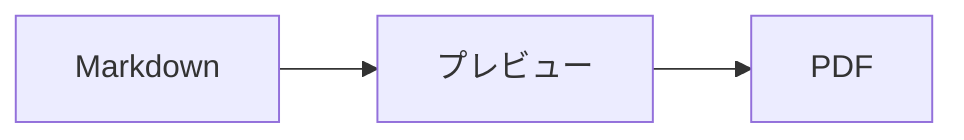

<p>&nbsp;&nbsp;&nbsp;</p>

# Splat

**ソースでも、プレビューの中でも直接書ける、macOS用のMarkdownエディタ。**

Splatは、左にシンタックスカラー付きのMarkdownソース、右にリアルタイムで完全に編集できるプレビューを並べて表示します。どちらに入力してもかまいません。プレビューに書いた内容はソースへの最小限の変更として反映されるので、触れていない行は1バイトも変わらず、Gitのdiffもすっきりしたままです。Splatは普段お使いのMarkdownをそのまま読み込みます。CommonMarkとGitHub Flavored Markdown、GitHubのアラート、Obsidianのウィキリンク・埋め込み・コールアウト、PandocやTyporaの拡張、埋め込みHTML、LaTeX数式、Mermaid・Graphviz・PlantUMLの図まで、すべてオフラインでレンダリングします。フォルダ全体のノートを閲覧・検索し、前回のGitコミット以降の変更を確認し、WordやWebページからMarkdownとしてペーストできます。PDF、HTML、Wordへの書き出しもワンクリックです。RustでmacOS標準のAppKitコントロール上に作られ、35の言語に対応し、ユーザが求めない限りネットワークには何も送信しません。
 


[](https://github.com/sventmueller/splat/releases/latest/download/Splat.dmg)

**[Download Splat.dmg](https://github.com/sventmueller/splat/releases/latest/download/Splat.dmg)**：Appleによる署名と公証済み。Apple SiliconとIntelのmacOS 14以降に対応しています。

**バグを見つけましたか？** Splatは、触れていない行を1バイトも変えません。それでも行が変わった場合や、ファイルが正しく表示されない場合は、[Issueを作成](https://github.com/sventmueller/splat/issues/new/choose)してファイルを添付してください。Splatがお役に立ったら、[GitHubのスター](https://github.com/sventmueller/splat)が、ほかの人がSplatを見つける助けになります。
 
 

[](https://www.rust-lang.org)
[](https://www.apple.com/macos/)

[](https://github.com/madsmtm/objc2)
[](https://webkit.org)
[](https://github.com/kivikakk/comrak)
[](https://github.github.com/gfm/)
[](https://www.mathjax.org)
[](https://cortexjs.io/mathlive/)
[](https://mermaid.js.org)
[](https://graphviz.org)
[](https://plantuml.com)


[](#ライセンス)

[Bahasa Indonesia](../id/README.md) ·
[Bahasa Melayu](../ms/README.md) ·
[Català](../ca/README.md) ·
[Čeština](../cs/README.md) ·
[Dansk](../da/README.md) ·
[Deutsch](../de/README.md) ·
[English](../../../README.md) ·
[Español](../es/README.md) ·
[Français](../fr/README.md) ·
[Hrvatski](../hr/README.md) ·
[Italiano](../it/README.md) ·
[Magyar](../hu/README.md) ·
[Nederlands](../nl/README.md) ·
[Norsk](../no/README.md) ·
[Polski](../pl/README.md) ·
[Português (Brasil)](../pt_BR/README.md) ·
[Português (Portugal)](../pt_PT/README.md) ·
[Română](../ro/README.md) ·
[Slovenčina](../sk/README.md) ·
[Slovenščina](../sl/README.md) ·
[Suomi](../fi/README.md) ·
[Svenska](../sv/README.md) ·
[Tiếng Việt](../vi/README.md) ·
[Türkçe](../tr/README.md) ·
[Ελληνικά](../el/README.md) ·
[Русский](../ru/README.md) ·
[Українська](../uk/README.md) ·
[עברית](../he/README.md)‎ ·
[العربية](../ar/README.md)‎ ·
[हिन्दी](../hi/README.md) ·
[ไทย](../th/README.md) ·
[한국어](../ko/README.md) ·
**日本語** ·
[简体中文](../zh-Hans/README.md) ·
[繁體中文](../zh-Hant/README.md)

## 目次

- [主な機能](#主な機能)
- [動作環境](#動作環境)
- [インストール](#インストール)
- [はじめに](#はじめに)
- [書く](#書く)
  - [ソースで](#ソースで)
  - [プレビューで](#プレビューで)
  - [フォーマットコマンド](#フォーマットコマンド)
  - [リストとタスク](#リストとタスク)
  - [表](#表)
  - [書式付きテキストのペースト](#書式付きテキストのペースト)
  - [メタデータ](#メタデータ)
- [対応するMarkdown](#対応するmarkdown)
  - [CommonMarkとGitHub Flavored Markdown](#commonmarkとgithub-flavored-markdown)
  - [コールアウト](#コールアウト)
  - [拡張構文](#拡張構文)
  - [Obsidian](#obsidian)
  - [引用と参照](#引用と参照)
  - [埋め込みHTML](#埋め込みhtml)
  - [タイポグラフィ記号](#タイポグラフィ記号)
  - [構文の一覧](#構文の一覧)
- [数式](#数式)
- [図](#図)
- [画像](#画像)
- [リンクとナビゲーション](#リンクとナビゲーション)
- [フォルダ内のノート](#フォルダ内のノート)
- [前回のコミット以降の変更](#前回のコミット以降の変更)
- [書き出し、プリント、共有](#書き出しプリント共有)
- [Word書類の読み込み](#word書類の読み込み)
- [外観とアクセシビリティ](#外観とアクセシビリティ)
- [言語](#言語)
- [キーボードショートカット](#キーボードショートカット)
- [プライバシーとセキュリティ](#プライバシーとセキュリティ)
- [大きな書類](#大きな書類)
- [既知の制限](#既知の制限)
- [トラブルシューティング](#トラブルシューティング)
- [開発者向け](#開発者向け)
  - [サードパーティのコンポーネント](#サードパーティのコンポーネント)
- [ライセンス](#ライセンス)

## 主な機能

- **2通りの書き方、テキストは1つ。** ソースもプレビューも編集できます。真実のよりどころはMarkdownファイルだけです。取り消しの履歴は書類ごとに1つで、プレビューでの編集はそれぞれソースへの最小限の変更に変換されます。
- **普段お使いのMarkdownをそのまま。** CommonMark、GitHub Flavored Markdown、GitHubのアラート、Obsidian、PandocとTyporaの拡張、絵文字のショートコード、スポイラー、定義リスト、見出しのアンカー、GitHubのREADMEで使われているHTMLに対応しています。
- **数式も図も内蔵。** MathJaxによるLaTeX数式と、ビジュアルな数式エディタ。Mermaid、Graphviz、PlantUMLの図も、Java、サーバ、ネットワーク接続なしでMac上でレンダリングされます。
- **何にでもボタンがあります。** Markdownのどの記法にもツールバーのボタンとメニュー項目があり、よく使うものにはキーボードショートカットもあります。表には、行・列・配置のための専用メニューがあります。
- **ファイルだけでなく、フォルダごと。** サイドバーには書類の周辺にあるノートが一覧され、そのすべてを検索できます。ノートの名称を変更すると、そのノートへのリンクも変わり、リンク以外は1バイトも変わりません。
- **変更がひと目で。** Gitリポジトリでは、前回のコミットと異なる部分をテキストの横のバーが両方のペインで示します。
- **WordとWebからMarkdownへ。** 書式付きテキストはMarkdownとして、スプレッドシートのセルは表としてペーストでき、Word書類は画像ごとまるごと読み込めます。
- **何も失わずに書き出し。** PDF、1つで完結するHTMLファイル、そして本物の見出し・リスト・表・脚注・画像を備えたWord書類に書き出せます。ページ番号、ヘッダ、タイトルページを追加することも、会社のWordテンプレートを使うこともできます。
- **骨の髄までネイティブ。** 本物のAppKitのウインドウ、タブ、メニュー、ポップオーバ、バージョン、自動保存、共有メニュー、ダークモード、スペルチェック、音声入力、VoiceOver。Electronではなく、テキスト自体にWebビューも使っていません。
- **大きなファイルでも高速。** 10 MBの書類での1回のキー入力のレンダリングは、ビュー自体の処理の前で約10 msです。
- **プライベートで慎重。** Webの画像は許可した後にだけ読み込まれ、ほかのAppへのリンクは先に確認され、信頼できない画像データのデコードはすべてサンドボックス化されたヘルパープロセスで実行されます。
- **あなたの言語で。** インターフェイスと内蔵のMarkdownクイックリファレンスは、アラビア語、カタロニア語、中国語（簡体字）、中国語（繁体字）、クロアチア語、チェコ語、デンマーク語、オランダ語、英語、フィンランド語、フランス語、ドイツ語、ギリシャ語、ヘブライ語、ヒンディー語、ハンガリー語、インドネシア語、イタリア語、日本語、韓国語、マレー語、ノルウェー語、ポーランド語、ポルトガル語（ブラジル）、ポルトガル語（ポルトガル）、ルーマニア語、ロシア語、スロバキア語、スロベニア語、スペイン語、スウェーデン語、タイ語、トルコ語、ウクライナ語、ベトナム語の35言語で用意されています。

## 動作環境

- macOS 14 Sonoma以降。Splatの開発とテストはmacOS 27で行っており、macOS 27ではLiquid Glassのデザインが自動的に適用されます。
- Apple SiliconまたはIntelプロセッサ搭載のMac。
- 約45 MBのディスク空き容量。

## インストール

**ディスクイメージから。** [`Splat.dmg`](https://github.com/sventmueller/splat/releases/latest/download/Splat.dmg)をダウンロードして開き、Splatをアプリケーションフォルダにドラッグしてください。イメージはDeveloper IDで署名され、Appleによって公証されているため、警告なしで開きます。

**Homebrewで。** Caskは専用のtapにあります。

```sh
brew install --cask sventmueller/tap/splat
```

`brew upgrade --cask splat`で新しいバージョンをインストールでき、`brew uninstall --zap --cask splat`ではSplatの設定とキャッシュも削除されます。

**アップデート。** ディスクイメージまたはHomebrewで入れたSplatは、[Sparkle](https://sparkle-project.org)によって自動的に最新の状態に保たれます。2回目の起動時に、1日1回、自動でアップデートを確認してよいかをたずねます。**Splat › アップデートを確認…** はすぐに確認します。あとから選択を変えるには、同じメニューの**アップデートを自動的に確認**と**アップデートを自動的にダウンロードしてインストール**を使います。Splatは、開発者の署名があるアップデートだけをインストールします。自分でビルドしたものにはアップデータはありません。

**ソースから。** 前提条件は[Building](../../../docs/development.md#building)を参照してください。そのあとは次のとおりです。

```sh
make build
ditto target/release/Splat.app /Applications/Splat.app
open /Applications/Splat.app
```

ダブルクリックでMarkdownファイルをSplatで開くには、Finderで任意の`.md`ファイルを選択し、**ファイル › 情報を見る**を選んで、**このアプリケーションで開く**でSplatを選び、**すべてを変更…** をクリックします。Splatは`.md`、`.markdown`、`.mdown`、`.mkd`ファイルに自分自身を登録します。

## はじめに

### ウインドウ

書類はそれぞれ専用のウインドウで開きます。タブをお好みならタブでも開けます。

- **左：ソース。** SF Monoで表示された、シンタックスカラー付きのMarkdown。
- **右：プレビュー。** レンダリングされた書類で、そのまま編集できます。
- **サイドバー（オプション）。** すべての見出しをツリーで表示します。見出しをクリックすると、両方のペインでその見出しが表示されます。**表示 › アウトラインを表示**（⌃⌘S）で開きます。ほかの2つのタブには、[フォルダ内のノート](#フォルダ内のノート)とその検索があります。ウインドウのタイトルの横にあるボタンで表示／非表示を切り替えます。新しいウインドウは、最後のウインドウと同じ状態で開きます。
- **ツールバー。** 変更の対象ごとにまとめられたボタン：文字、段落と挿入する要素、続いてプレビューの表示/非表示、共有、新規書類。**表示 › ツールバーをカスタマイズ…** でカスタマイズできます。

境界線をドラッグすると、どちらかの側を広げられます。**表示 › プレビューを非表示**（⌥⌘P）にするとソースだけが残ります。Splatはこの設定をウインドウごとに記憶します。両方のペインは一緒にスクロールし、一方のペインで選択した部分はもう一方でもハイライトされます。

ウインドウの隅には、テキストの単語数と文字数、読むのにかかる時間が表示され、選択範囲があるときはその分も表示されます。リンクのアドレス、HTMLタグ、メタデータ、コメント、数式、図は数えません。最初は非表示で、**表示 › 単語数を表示**で表示できます。

### 書類、タブ、バージョン

Splatは、一般的なmacOSの書類Appです。

- **自動保存とバージョン。** 変更はその場で保存されます。**ファイル › バージョンを戻す › すべてのバージョンをブラウズ…** で過去の状態に戻れます。
- **ほかのプログラムによる変更。** Git、スクリプト、別のエディタが開いている書類を変更すると、Splatは挿入ポイントとスクロール位置を保ったまま再読み込みします。ご自身の未保存の変更がある場合はそれを保持し、もう一方のバージョンを上書き保存する前にmacOSが確認します。
- **おなじみのファイルコマンド。** 複製（⇧⌘S）、名称変更…、移動…、**ファイル › 最近使った項目を開く**。
- **タブ。** **ファイル › 新規タブ**またはツールバーの **+** ボタンで、新しい書類をタブで開きます。標準のウインドウメニューで、タブの結合、移動、切り替えができます。
- **ウインドウの位置。** 最後のウインドウのサイズと位置は、再起動後も記憶されます。すでにそこにウインドウがある場合、新しいウインドウは少しずらして開きます。
- **Dockのアイコン。** 最後のウインドウを閉じた後でクリックすると、新規書類が開きます。
- **MarkdownファイルをSplatで開く。** **Splat › Markdownのデフォルトアプリに設定**を選ぶと、`.md`または`.markdown`ファイルをダブルクリックしたときにSplatが開くようになります。macOSが一度だけ確認します。Splatがデフォルトである間は、この項目にチェックマークが付きます。

ファイルはUTF-8テキスト、またはバイトオーダーマーク付きのUTF-16である必要があります。ほかのエンコーディングは、推測してテキストを壊すことのないよう、Splatは開きません。バイトオーダーマークはそのまま残り、UTF-16はUTF-16のままで、すべての行がCRLFで終わるファイルでは、追加した行にもCRLFが付きます。

**クラッシュしたとき**に失われるのは、せいぜい直近数秒分の入力だけです。Splatは5秒ごとに、未保存のテキストを`~/Library/Application Support/Splat/Unsaved`にコピーし、書類が保存されるか、Splatが正常に終了すると、そのコピーを削除します。次回の起動時に、クラッシュで残ったものを`~/Library/Application Support/Splat/Recovery`に移し、一度だけそのことをお知らせします。フォルダを開くボタンも表示されます。Splatがまだ反応できるクラッシュの場合は、開いているすべての書類のテキストもそこに書き込まれます。

### クイックリファレンス

**ヘルプ › Markdownクイックリファレンス**を選ぶと、お使いの言語のチートシートが、新規の無題の書類として開きます。これは普通の書類なので、その場でソースでもプレビューでも、あらゆることを試せます。

## 書く

### ソースで

ソースは、Markdown向けに調整されたプレーンテキストのエディタです。

- **VS Codeのようなシンタックスカラー。** 見出し、強調、リンク、コード、表、HTML、フロントマター、そして数式や図の中のLaTeXとMermaid。ライト、ダーク、コントラストを上げる設定用のパレットがあります。
- **フェンス付きコードブロック**は、Bash、C、C++、C#、CSS（SCSSとLessも）、Go、HTML、XML、Java、JavaScript、JSON、Kotlin、PHP、Python、Ruby、Rust、SQL、Swift、TypeScript、YAML、TeX、Mermaidでハイライトされます。`js`、`py`、`sh`のような通常の短い名前にも対応しています。
- **不意の置換はありません。** スマート引用符、スマートダッシュ、テキストの置換は、`--`、`---`、`"`を壊してしまうため、デフォルトではオフです。オンにするには**編集 › 自動置換**を使います。
- **システムの文章作成ツール。** スペルと文法のチェック、音声入力、検索と置換（⌥⌘F）、スピーチ。
- **ドラッグ&ドロップ。** 画像ファイルをドロップすると``が挿入され、それ以外のファイルをドロップするとそのファイルへのリンクが、URLをドロップすると`[url](url)`が挿入されます。ドロップ1回が、取り消しの1ステップです。
- **画像のペースト。** スクリーンショットなど、クリップボードにある画像は、書類と同じ場所にPNGファイル（`画像 2026-10-29 13.09.07.png`）として保存され、画像として挿入されます。そのためには、書類を一度保存しておく必要があります。

### プレビューで

プレビューはワープロのように動作しますが、そこで行うことはすべて最終的にMarkdownになります。

- **入力。** `*`や`#`のように、Markdownで意味を持つ文字は、入力したとおりに表示されるようエスケープされます。
- **Return**で新しい段落またはリスト項目を開始します。**⌥Return**または **⌃Return**で改行を挿入します。
- **カーソル位置でのフォーマット。** カーソルが単語の末尾にあるときは、ボールド、イタリックなどの文字フォーマットが、その後に入力するテキストに適用されます。もう一度同じフォーマットを選ぶと解除されます。単語の途中では、単語全体がフォーマットされます。
- **空行。** 空行でReturnを押すとさらに空行が追加され、Backspaceで削除されます。ソースでは、空行1つごとに空白行が2行増えます。ほかのMarkdownプログラムでは、通常の段落の間隔として表示されます。
- **取り消す**は両方のペインにまたがって働きます。取り消しの項目には「ボールドを取り消す」のような名前が付き、入力はひとまとまりごとに1ステップになり、取り消しややり直しの後は両方のペインが変更箇所までスクロールします。
- **数式と図**は完成したグラフィックとして表示されます。クリックするか、カーソルをその上に移動するか、その上でReturnを押すと、エディタが開きます（[Formulas](#数式)と[Diagrams](#図)を参照）。
- **埋め込みHTML、埋め込みノート、フロントマター**は表示されますが、編集はソースで行います。クリックすると、ソースの対応する位置にカーソルが移動します。

Markdownで表現できないものは、プレビューではブロックされます。フォントとカラーのパネル、ルーラ、リッチテキストや画像のペーストとドロップがそうです。ペーストしたHTMLとRTFは、[Markdownとしてペースト](#書式付きテキストのペースト)を選ばない限り、プレーンテキストとして入ります。

### フォーマットコマンド

すべてのコマンドは、ツールバー、メニューバー、両方のペインのコンテキストメニューから使えます。カーソル位置のフォーマットには、メニュー項目にチェックマークが付きます。

| メニュー | コマンド |
|---|---|
| **フォーマット › フォント** | ボールド、イタリック、アンダーライン、取り消し線、ハイライト、コード、上付き、下付き |
| **フォーマット › 見出し** | 本文、見出し1〜6 |
| **フォーマット › リスト** | 箇条書き、番号付きリスト、タスクリスト |
| **フォーマット** | 引用、コードブロック（言語なし、または20言語のいずれか。既存のブロックの言語も変更できます）、コールアウト（注記、ヒント、重要、警告、注意。同じ種類をもう一度選ぶと解除されます）、数式または図を編集…、フォーマットを消去 |
| **挿入** | リンク…、画像…、表…、数式、図（フローチャート、シーケンス図、ガントチャート）、目次、脚注、区切り線 |
| **表** | 上に行を挿入/下に行を挿入、左に列を挿入/右に列を挿入、行を削除、列を削除、配置（左揃え、中央揃え、右揃え、デフォルト）、表の列を揃える |
| **表示** | プレビューを非表示/表示、アウトラインを表示/非表示、タイポグラフィ記号、拡大/縮小、実際のサイズ、ツールバー、タブバー、フルスクリーン |

アンダーライン、ハイライト、上付き、下付きは`<ins>`、`<mark>`、`<sup>`、`<sub>`として書かれ、GitHubでも表示されます。Splatは、GitHubが取り除く`<u>`と、より短い`==highlight==`、`^sup^`、`~sub~`も読み込みます。GitHubでは、`==`と`^`は入力したとおりに表示され、`~sub~`は取り消し線になります。

### リストとタスク

- Returnでリストが続き、空の項目でReturnを押すとリストが終わります。
- プレビューでは、**Tab**と **⇧Tab**でリスト項目のインデントを増減します。
- プレビューでタスクのチェックボックスをクリックすると、`- [ ]`と`- [x]`が切り替わります。
- **フォーマット › リスト**は、選択した段落をリストにするか、リストの種類を変更します。

### 表

- **挿入 › 表…** では、行数（見出し行を含む）と列数をたずねます。
- プレビューでは、**Tab**で次のセル、**⇧Tab**で前のセル、**Return**で下のセルに移動します。最後のセルでTabを押すと行が追加されます。
- **表**メニューでは、行と列の挿入と削除、列の配置（⌘{、⌘|、⌘}）を設定できます。
- **表 › 表の列を揃える**は、ソースの列が縦に揃うよう空白を埋めます。

### 書式付きテキストのペースト

**編集 › Markdownとしてペースト**（⌃⌘V）は、両方のペインのコンテキストメニューにもあり、クリップボードの内容をMarkdownにして選択範囲の位置に入れます。これが取り消しの1ステップになります。⌘Vはこれまでどおりプレーンテキストを挿入します。

- **ブラウザ、Word、Google Docs、Confluence、「メモ」、Pagesから：** 見出し、ボールド、イタリック、アンダーライン、取り消し線、上付きと下付き、リンク、入れ子を保ったリスト、引用、コード、表が引き継がれます。
- **スプレッドシートから：** セルは、見出し行があり、数値の列が右揃えの表になります。タブ、セミコロン、コンマで区切られたテキストも、すべての行の列数が同じなら同様です。
- **画像**は、Webアドレスのものはリンクのままです。ペーストしたHTMLの中にある画像は書類の隣のファイルになり、そのためには書類を一度保存しておく必要があります。Wordの一時的な画像ファイルは取り込まれず、代替テキストが残ります。
- **リンク**で残るのは、`http`、`https`、`mailto`、相対アドレス、`#`アドレスだけです。それ以外のリンクは、テキストだけが残ります。

### メタデータ

**フォーマット › メタデータを編集…**、またはプレビューの上部にあるメタデータの行をクリックすると、YAMLフロントマターのフィールドを並べたフォームが開きます。フィールドは変更、追加、削除できます。リストを持つフィールドはリストのまま保たれ、値はコンマで区切って並び、コンマを含む値は引用符で囲まれます。`tags`、`aliases`、`keywords`、`categories`、`authors`、`cssclasses`という名前の新しいフィールドもリストになります。入れ子のフィールドと複数行のテキストは、フォームで見ることができ、編集はソースで行います。

フォームでの変更は取り消しの1ステップで、変更したフィールドの行にしか及びません。ほかのすべてのフィールドのコメント、順序、不揃いな空白、引用符、行末は1バイトも変わりません。メタデータのない書類には、先頭にブロックが追加されます。

## 対応するMarkdown

Splatは、CommonMarkとGFMに互換性のあるパーサ[comrak](https://github.com/kivikakk/comrak)で解析し、その拡張のほとんどをオンにしています。以下はすべて、プレビューとすべての書き出しでレンダリングされます。

### CommonMarkとGitHub Flavored Markdown

- 見出し（`#`と下線付き）、段落、改行、強調、強い強調、インラインコード、ブロック引用、区切り線。
- 箇条書き、番号付き、入れ子のリスト、タスクリスト。
- リンク（インライン、参照、自動）、画像、リンク参照定義。
- シンタックスカラー付きのフェンス付きコードブロックとインデントによるコードブロック。
- 列の配置付きの表。
- `~~チルダ2つ~~`による取り消し線。
- 脚注：`text[^1]`と、書類のどこにでも置ける`[^1]: The note.`。マーカーをクリックすると脚注にジャンプします。
- 先頭の`---`の行で囲まれたYAMLフロントマター。プレビューでは「メタデータ：title, date, tags」のように1行にまとめて表示します。

### コールアウト

GitHubのアラートは、アイコンとタイトル付きの色付きボックスとしてレンダリングされます。

```markdown
> [!NOTE]
> 利用者が知っておくべき有用な情報。

> [!WARNING]
> すぐに対処が必要な重要な内容。
```

種類は、注記、ヒント、重要、警告、注意の5つです。**フォーマット › コールアウト**は、カーソル位置の段落をコールアウトにします。

Obsidianのコールアウトも使えます。タイトルは自由で、折りたたみの状態も指定できます。

```markdown
> [!tip]- クリックして▸展開
> 開くまでは隠れています。

> [!question]+ 最初から開く
> `+`は展開、`-`は折りたたみで始まります。
```

Obsidianのそのほかの種類は、5つのうち最も近い色で表示されます。`success`、`check`、`done`、`hint`はヒント、`question`、`help`、`faq`は重要、`attention`は警告、`failure`、`fail`、`missing`、`danger`、`error`、`bug`は注意、それ以外はすべて注記です。

### 拡張構文

| 機能 | 構文 | 由来 |
|---|---|---|
| ハイライト | `==マークしたテキスト==` | Obsidian、Typora |
| 上付き | `x^2^` | Pandoc、Typora |
| 下付き | `H~2~O` | Pandoc、Typora |
| 絵文字のショートコード | `:rocket:`が🚀になる | GitHub |
| スポイラー | `\|\|隠しテキスト\|\|`、選択すると読める | Discord |
| インライン脚注 | `text^[注の内容そのもの]` | Pandoc、Obsidian |
| 定義リスト | `用語`、空行、`: 説明` | PHP Markdown Extra、Pandoc |
| 見出しのアンカー | `## インストール {#setup}`、`[see](#setup)`でリンク | Pandoc、kramdown |

定義リストは、ソースでは次のようになります。

```markdown
用語

: 用語の説明。
```

独自のアンカーがなければ、GitHubと同じように、どの見出しにもその文字から導かれたアンカーが付きます。`## はじめに`は`#はじめに`で参照できます。

### Obsidian

- **ウィキリンク。** `[[Note]]`は、同じフォルダまたはその下のフォルダにある`Note.md`にリンクします。`[[Note|表示テキスト]]`は任意のテキストを表示し、`[[Note#Heading]]`はそのノートを開きます。⌘+クリックでSplatで開きます。
- **埋め込み。** `![[Note]]`は、ほかのノートをこのノートの中に表示します。そこに埋め込まれたノートはリンクとして表示されます。`![[diagram.png]]`は画像を表示します。Obsidianと同じく、埋め込みでは書類のフォルダまたはその下にあるノートと画像を名前で指定し、絶対パスは使いません。ノートとして表示されるのはMarkdownファイルだけです。
- **コメント。** `%%ソースだけに表示%%`はソースには表示されたままで、プレビューとすべての書き出しからは除かれます。行の途中でも、単独の行でも同じです。
- **タグ。** `#idea`や`#project/splat`はハイライトされます。⌘+クリックで、書類内と、サイドバーではフォルダ全体からそのタグを検索します。
- **折りたためるコールアウト。** [Callouts](#コールアウト)を参照してください。

### 引用と参照

- **Pandocの引用。** `[@doe2020]`や`[@doe2020; @roe2021]`は「(Doe 2020; Roe 2021)」のように表示されます。項目は、フロントマターで`bibliography: refs.bib`として指定したBibTeXファイルから取得されます。指定がなければ、Splatは書類と同じ場所にある`references.bib`、`literatur.bib`、`bibliography.bib`を使います。
- **GitHubとGitLabの参照。** 書類が、`origin`リモートがgithub.comまたはGitLabホストにあるGitリポジトリの中にある場合、`@name`、`#12`（イシュー）、`!7`（マージリクエスト、GitLabのみ）がハイライトされます。⌘+クリックでブラウザで開きます。

### 埋め込みHTML

GitHubのREADMEにあるようなHTMLは、ブラウザエンジンではなく独自のリーダーでレンダリングされます。

- 中央揃えの段落とブロック（`<p align="center">`、`<div align="center">`）
- サイズ指定付きの画像（``）
- リンク、`<kbd>⌘</kbd>`、`<br>`、`<u>`、`<ins>`、`<mark>`、`<sup>`、`<sub>`
- リストと表。列をまたぐセル（`colspan`）も含みます
- 折りたたみ可能なセクション：`<details><summary>詳細</summary>…</details>`。▸をクリックして開きます

HTMLタグの間にあるMarkdownは、Markdownとしてレンダリングされます。スクリプト、スタイル、フレーム、フォームは完全に除かれ、リンクと画像で残るのは`http`、`https`、`mailto`、相対アドレスだけです。

### タイポグラフィ記号

**表示 › タイポグラフィ記号**は、まっすぐな引用符をインターフェイス言語の引用符に、`--`をenダッシュに、`---`をemダッシュに、`...`を省略記号にして表示します。ドイツ語では`"Ja"`が„Ja“に、フランス語では«Oui»に、日本語では「はい」になり、中国語や日本語で引用符の前後に空白を入れない場合にも対応します。ヘブライ語の`צה"ל`のような略語にはgershayimが付き、צה״ל になります。ソースはそのままの文字を保ち、プレビューとすべての書き出しでは、タイポグラフィ上の文字が表示されます。この設定は、オンにするまではオフです。

### 構文の一覧

| 要素 | Markdown |
|---|---|
| **ボールド** | `**ボールド**` |
| *イタリック* | `*イタリック*` |
| アンダーライン | `<ins>アンダーライン</ins>`または`<u>アンダーライン</u>` |
| ~~取り消し線~~ | `~~取り消し線~~` |
| ハイライト | `<mark>ハイライト</mark>`または`==ハイライト==` |
| `コード` | `` `コード` `` |
| x² | `x<sup>2</sup>`または`x^2^` |
| H₂O | `H<sub>2</sub>O`または`H~2~O` |
| [リンク](https://example.com) | `[リンク](https://example.com)` |
| 見出し | `# 見出し`〜`###### 見出し` |
| 引用 | `> 引用` |
| 箇条書き | `- 項目` |
| 番号付きリスト | `1. 項目` |
| タスク | `- [ ] 未完了`と`- [x] 完了` |
| コードブロック | ```` ```rust ```` … ```` ``` ```` |
| 表 | `\| A \| B \|`と、見出し行の下に`\|---\|---\|` |
| 脚注 | `本文[^1]`と`[^1]: 注` |
| 区切り線 | `---` |
| 画像 | `` |
| 数式 | `$E = mc^2$`、`$$ … $$` |
| 図 | ```` ```mermaid ````、```` ```dot ````、```` ```plantuml ```` |
| コールアウト | `> [!TIP]` |
| ウィキリンク | `[[Note]]`、`[[Note\|テキスト]]` |
| 埋め込み | `![[Note]]`、`![[image.png]]` |
| コメント | `%%コメント%%` |
| タグ | `#tag` |
| 引用文献 | `[@key]` |
| スポイラー | `\|\|スポイラー\|\|` |
| 絵文字 | `:tada:` |

## 数式

数式は、TeXとAMS mathに対応した[MathJax](https://www.mathjax.org)によって、くっきりしたベクターグラフィックとしてレンダリングされます。`\text{…}`の中のテキストには、どの文字体系も使えます。MathJaxのフォントにない文字はMacのフォントで補われ、アラビア語とヘブライ語は右から左へ表示され、絵文字はカラーで表示されます。

| 種類 | 構文 |
|---|---|
| インライン | `$E = mc^2$`、`` $`E = mc^2`$ ``（GitHub、GitLab）、`\(E = mc^2\)` |
| ディスプレイ | `$$` … `$$`、`\[` … `\]`、または`math`と指定したコードブロック |

**数式の編集。** プレビューで数式をクリックするか、ダブルクリックするか、その上でReturnを押すか、カーソルをその上に移動すると、ポップオーバでエディタが開きます。**挿入 › 数式**は新しい数式を挿入し、すぐにエディタを開きます。

- **ビジュアルかLaTeXか。** 上部のスイッチで、ビジュアルエディタ（[MathLive](https://cortexjs.io/mathlive/)）とLaTeXコードを切り替えます。Splatは選択を記憶します。
- **パーツ**として、分数、平方根、上付きと下付き、上下限付きの総和と積分、極限、内容に合わせて伸びる括弧、2×2行列、ギリシャ文字、関係記号・演算子・矢印があります。これらはプレースホルダ□を残し、**Tab**で次のプレースホルダにジャンプします。
- **ライブプレビュー。** 入力中の変更が書類にそのまま表示されます。MathJaxのエラーは、コードの下の1行に表示されます。
- **確定か破棄か。** 外側をクリックすると変更が確定し、取り消しの1ステップになります。**Esc**または**キャンセル**で破棄されます。新しい空の数式でEscを押すと、その数式も削除されます。
- コンテキストメニューには、ポインタの下にある数式に対する**数式を編集…** があります。

VoiceOverは、数式をLaTeXコードとして読み上げます。Splatがレンダリングするのは数式であり、完全なLaTeX書類ではありません。パッケージ、TikZ、`\documentclass`はありません。

## 図

図はSplatの中で、オフラインで、ライトとダークの2種類でレンダリングされます。

| エンジン | コードブロック | 描けるもの |
|---|---|---|
| [Mermaid](https://mermaid.js.org) | ```` ```mermaid ```` | フローチャート、シーケンス図、クラス図、状態遷移図、ER図、ガントチャート、円グラフ、マインドマップ、タイムライン、そのほかすべてのMermaidの種類 |
| [Graphviz](https://graphviz.org) | ```` ```dot ````または```` ```graphviz ```` | DOT言語によるグラフ |
| [PlantUML](https://plantuml.com) | ```` ```plantuml ````または```` ```puml ```` | UML図。Javaなしで動作します |



**図の編集**は数式の編集と同じです。クリックするとポップオーバでコードが開き、シンタックスカラーが付き、エラーメッセージはコードの下の1行に表示されます。**挿入 › 図**は、フローチャート、シーケンス図、ガントチャートのテンプレートから始めます。パーツは、最もよく使う3種類のMermaid図で役立ちます。

- **フローチャート：** ノード ▾（長方形、角丸長方形、円、ひし形、データベース）、接続、ラベル付き接続、グループ、方向 ▾
- **シーケンス図：** 参加者、メッセージ、応答、メモ、ループ、条件による分岐
- **ガントチャート：** セクション、タスク、マイルストーン

そのほかの図の種類は、コードで編集します。VoiceOverは、図のタイトルまたは代替テキストを読み上げます。

起動後の最初の図には約1秒かかります。レンダリングエンジンがバックグラウンドで起動するためです。10秒を超える図はエラーになり、次の図のためにレンダリングエンジンが再起動されます。PlantUMLのエンジン（3 MB）は、最初のPlantUML図で初めて読み込まれます。WebからのPlantUML `!include`はブロックされます。

## 画像

- **ローカルの画像**は、書類からの相対パスを使います：``。SplatはPNG、JPEG、GIF、WebP、BMP、SVG、HEIC、TIFF、AVIF、PDFを表示します。
- **Webの画像**は、許可するまでブロックされたままです。プレビューの上に表示されるバーに、読み込むと書類を開いたことと開いた日時がそのサーバに伝わると説明されます。**画像を読み込む**を選ぶと、この書類に対して許可されます。Splatはその選択をファイルごとに記憶します。
- **サイズ。** ``で画像のサイズを指定します。指定がなければ、画像はプレビューの幅に収まります。
- **ディスク上の変更。** 差し替えた画像や、書類が名前を挙げた後に現れた画像は、書類を開き直さなくても表示されます。ネットワークの問題で失敗したWebの画像は、書類がそれを表示している間、再試行されます。
- **メモリ。** 画像は長辺が最大2560ピクセルで表示され、これはA4の用紙いっぱいにもなる大きさです。画像がMacのメモリの8分の1を占めるようになると、またmacOSがメモリ負荷を報告している間は、より小さくデコードされます。
- **ダークモード。** 白い背景の画像は、ダークのプレビューでは少し暗くなります。
- **ペーストとドロップ。** [In the source](#ソースで)を参照してください。

## リンクとナビゲーション

プレビューでは、クリックするとカーソルが置かれてリンクのテキストを編集でき、**⌘+クリック**でリンクを開きます。

- `http`、`https`、`mailto`は、ブラウザまたはメールAppで開きます。
- Markdownファイルは、Splatで開きます。ほかのファイルとフォルダは、Finderに表示されます。
- `#anchor`は、書類内のその見出しにジャンプします。
- `slack://`や`vscode://`のように、ほかのAppを開くアドレスは、先に確認が入り、完全なアドレスとAppが表示されます。**キャンセル**があらかじめ選択されています。

**挿入 › 目次**は、すべての見出しへのリンク付きリストを挿入します。カーソルが目次の中にあるときは、同じコマンドで更新されます。アウトラインサイドバー（⌃⌘S）では、両方のペインの任意の見出しにジャンプできます。

## フォルダ内のノート

サイドバーの上部にあるボタンで、アウトライン、ファイル、検索を切り替えます。

- **ファイル**（**表示 › ファイルを表示**、⌃⌘E）。書類のフォルダにあるすべてのMarkdownファイルを表示します。書類がGitリポジトリの中にある場合は、リポジトリ全体が対象です。クリックまたはReturnで、ノートをこのウインドウのタブとして開きます。すでに開いている場合は、そのノートが手前に来ます。フォルダ名の横のボタンで、このウインドウに別のフォルダを表示します。隠しファイル、`node_modules`、`target`、`Pods`、`DerivedData`、`__pycache__`、ノートのないフォルダは表示されません。ホームフォルダの直下にある書類では、その隣のノートだけが表示されます。Splatがすべてのフォルダを順に調べ、フォルダごとに確認を求めることがないようにするためです。
- **検索**（**編集 › 検索 › すべてのノートを検索…**、⇧⌘F）。大文字と小文字の違いや、アクセント記号のエンコード方法にかかわらず、すべてのノートからテキストを検索します。`#tag`はタグを見つけ、`#project`は`#project/splat`も見つけ、コードの中のものは見つけません。検索結果をクリックすると、その位置でノートが開きます。
- **ノートへのリンク。** ノートのコンテキストメニューには、ウィキリンク、埋め込み、相対リンク、リンク参照定義によってそのノートにリンクしているノートが一覧されます。
- **ノートの名称変更。** 同じメニューでノートの名称を変更し、それらのリンクも変更します。Splatは先に、いくつのファイルのいくつのリンクが対象になるかを伝えます。各リンクで変わるのは名前だけで、ファイルのほかのバイトはそのままです。開いている書類では、変更は取り消しの1ステップになります。それ以外のファイルで元に戻せるのはGitまたはバージョンだけです。その間にほかのプログラムが変更したファイルがあると、すべてのリンクの名称変更が止まり、Splatはそのファイルの名前を示します。

一覧は、ウインドウが手前に来たときにフォルダの状態に合わせて更新されます。検索はディスク上のファイルを対象にするので、まだ保存していないテキストは次の自動保存から対象になります。

## 前回のコミット以降の変更

Gitリポジトリの中にある書類では、前回のコミットと異なる部分をテキストの横のバーがソースとプレビューの両方で示します。追加された行は緑、変更された行は青で示され、何かが削除された場所には短い赤の印が付きます。バーは入力やブランチの移動に合わせて更新されます。**表示 › 前回のコミット以降の変更**で、すべてのウインドウでオフにできます。

行末だけが異なる行は数えないので、コミットがLFでファイルがCRLFでも変更は表示されません。新しいファイルには最初のコミットまで印が付かず、32 MBを超える書類にも付きません。

## 書き出し、プリント、共有

| 形式 | 方法 | 得られるもの |
|---|---|---|
| **PDF** | **ファイル › PDFとして書き出す…** または共有メニュー | 用紙サイズのページ。常にライトの外観で、数式と図はベクターグラフィックになります。**ファイル › ページ設定…** で用紙を設定します。 |
| **プリント** | **ファイル › プリント…**（⌘P） | PDFと同じレイアウト。 |
| **HTML** | **ファイル › HTMLとして書き出す…** または共有メニュー | 1つで完結するファイル。ローカルの画像は埋め込まれ、数式と図は鮮明な画像になり、目次が機能するよう見出しにアンカーが付きます。スクリプトはありません。 |
| **Word** | **ファイル › Word書類として書き出す…** または共有メニュー | Wordの見出しスタイル、本物のリストと表（セルの結合を含む）、Wordの脚注になった脚注、埋め込まれた画像、数式、図を備えた`.docx`。 |
| **Markdown** | ツールバーの**共有**ボタン | 「メール」、「メッセージ」、AirDrop、そのほかすべての共有サービスに渡せる`.md`ファイルとしての書類。 |

**ファイル › 共有**メニューには、これらがすべて1か所にまとまっています。書き出しでは、タイポグラフィ記号の設定と、Webから読み込みを許可した画像が反映されます。HTMLでは、Webの画像はリンクのままです。

**ファイル › 書き出しオプション…** では、PDF、プリント、Wordでテキストに追加するものを、すべての書類に共通で設定します。

- **ページ番号**は、PDFとプリントのフッタに`2 / 9`のように入ります。
- **ヘッダとフッタ**は、PDFとプリントに適用されます。`{title}`、`{author}`、`{date}`、`{page}`、`{pages}`はそれぞれの値を表し、最初の3つは書類のメタデータから取得します。
- **タイトルページ**は、PDF、プリント、Wordに適用されます。メタデータの`title`、`subtitle`、`author`、`date`が入り、タイトルがなければ書類の名前がタイトルになります。ヘッダもフッタも付きません。
- **Wordテンプレート**は、書き出しがその見た目を引き継ぐ`.docx`または`.dotx`です。引き継ぐのは、ローカライズされた名前のものを含むスタイル、テーマ、用紙サイズ、余白、ヘッダ、フッタです。読み込めないテンプレートは、テンプレートなしの書類を作らず、書き出しを止めてその旨を伝えます。

## Word書類の読み込み

**ファイル › Word書類を読み込む…** は、`.docx`または`.dotx`ファイルとMarkdownの保存先をたずね、結果を開きます。画像はその隣のフォルダに入ります。フォルダ名は書類の名前に`-images`を付けたものです。

見出しとリストは、Wordのスタイルと番号付けの定義どおりに取り込まれます。スタイルの名前がローカライズされた書類でも同じです。ボールド、イタリック、アンダーライン、取り消し線、ハイライト、上付きと下付き、リンク、引用、コード、脚注、文末脚注、表が引き継がれ、列をまたぐセルはHTMLの表になります。数式はLaTeXになります。変更履歴は承諾済みとして扱い、目次は取り込みません。**挿入 › 目次**で新しく作れるからです。古い`.doc`ファイルとパスワードで保護された書類は受け付けません。

## 外観とアクセシビリティ

- **ダークモード**はシステムに従います。数式と図は、外観ごとにレンダリングされます。
- システム設定の**コントラストを上げる**をオンにすると、シンタックスカラーがハイコントラストのパレットに切り替わります。
- **拡大/縮小。** ⌘+、⌘−、⌘0で、両方のペインの大きさが変わります。
- **フルスクリーン、タブ、カスタマイズできるツールバー**は、Macのどのアプリとも同じです。
- **VoiceOver。** ペインには「Markdownソース」と「プレビュー」というラベルが付き、数式はそのコード、図はそのタイトルとして読み上げられます。すべてのコマンドをキーボードで操作できます。

Splatには設定ウインドウがありません。数少ないオプションは、それが働く場所にあります。**表示**、**編集 › 自動置換**、**ファイル › 書き出しオプション…** です。

## 言語

インターフェイス、メニュー、Markdownクイックリファレンスは、次の35言語に翻訳されています。

アラビア語、カタロニア語、中国語（簡体字）、中国語（繁体字）、クロアチア語、チェコ語、デンマーク語、オランダ語、英語、フィンランド語、フランス語、ドイツ語、ギリシャ語、ヘブライ語、ヒンディー語、ハンガリー語、インドネシア語、イタリア語、日本語、韓国語、マレー語、ノルウェー語、ポーランド語、ポルトガル語（ブラジル）、ポルトガル語（ポルトガル）、ルーマニア語、ロシア語、スロバキア語、スロベニア語、スペイン語、スウェーデン語、タイ語、トルコ語、ウクライナ語、ベトナム語。

Splatは、**システム設定 › 一般 › 言語と地域**の言語の順序に従います。同じ場所の**アプリケーション**で、Splatだけの言語を選ぶこともできます。お使いの言語の翻訳がない場合は、英語を使います。メニューの用語はAppleの公式の翻訳に従っているので、SplatはMacのほかの部分と同じように読めます。

ヘブライ語とアラビア語のテキストは、インターフェイスの言語にかかわらず、どこに現れても右から左へ表示されます。段落、見出し、リスト項目はそれぞれ最初の文字の方向になり、引用とコールアウトは右側にバーを描き、右から左に始まるテキストの表では、列が右から順に並びます。コードブロックは左から右のままです。PDF、HTML、Wordの書き出しでもこの方向が保たれます。システムの言語がヘブライ語またはアラビア語のときは、macOSがウインドウも左右反転するため、プレビューは左側になります。

## キーボードショートカット

| 操作 | ショートカット |
|---|---|
| ボールド、イタリック、アンダーライン | ⌘B、⌘I、⌘U |
| 取り消し線 | ⇧⌘X |
| コード | ⌥⇧⌘C |
| リンク… | ⌘K |
| 本文、見出し1〜6 | ⌥⌘0、⌥⌘1〜⌥⌘6 |
| 表の列を左揃え、中央揃え、右揃えにする | ⌘{、⌘\|、⌘} |
| プレビューを非表示または表示 | ⌥⌘P |
| アウトラインを表示または非表示 | ⌃⌘S |
| ファイルを表示または非表示 | ⌃⌘E |
| すべてのノートを検索 | ⇧⌘F |
| Markdownとしてペースト | ⌃⌘V |
| 拡大、縮小、実際のサイズ | ⌘+、⌘−、⌘0 |
| 新規書類、開く、保存、複製 | ⌘N、⌘O、⌘S、⇧⌘S |
| ページ設定、プリント | ⇧⌘P、⌘P |
| 検索、検索と置換 | ⌘F、⌥⌘F |
| 次を検索、前を検索、選択部分を検索に使用、選択部分へジャンプ | ⌘G、⇧⌘G、⌘E、⌘J |
| スペルと文法を表示、書類をチェック | ⌘:、⌘; |
| ペーストしてスタイルを合わせる | ⌥⇧⌘V |
| ツールバーを非表示、すべてのタブを表示、フルスクリーン | ⌥⌘T、⇧⌘\\、⌃⌘F |
| 改行（プレビュー） | ⌥Returnまたは⌃Return |
| 表の次のセル/前のセル（プレビュー） | Tab / ⇧Tab |
| リスト項目のインデントを増やす/減らす（プレビュー） | Tab / ⇧Tab |
| 数式エディタの次のプレースホルダ | Tab |
| 数式または図のエディタを変更せずに閉じる | Esc |
| リンク、タグ、参照を開く（プレビュー） | ⌘+クリック |

Splatは、Appleの標準のショートカットをそのままにしています。

## プライバシーとセキュリティ

Markdownファイルは誰からでも届き得るため、Splatはすべての書類を信頼できないものとして扱います。

- **デフォルトではネットワークを使いません。** Splatにテレメトリはありません。アップデートの確認は、ユーザが同意するか**アップデートを確認…** を選んだときだけ行われ、そのときGitHubから小さなフィードファイルを読み込みます。リクエストにはアプリ名とそのバージョンしか含まれません。数式と図はローカルでレンダリングされ、それを行うWebビューはネットワークに接続できません。**ヘルプ › 問題を報告…** を選ぶと、ブラウザでGitHubのフォームが開きます。そのアドレスに含まれるのはSplatのバージョン、macOSのバージョン、Macの種類だけで、書類の内容は含まれません。
- **Webの画像**は、許可を得てからでなければ読み込まれず、読み込むのは`https`だけで、ローカルネットワーク内のホストからは読み込まず、1枚につき最大10 MBで、Cookieのないプライベートセッションで行われます。
- **隔離されたデコード。** 画像、および数式と図のグラフィックは、ヘルパープロセスでデコードされます。ヘルパーは、継承したファイルをすべて閉じ、最初の1バイトを読む前に自らをサンドボックスに閉じ込めます。ファイルへのアクセスもネットワークもありません。返すのはピクセルだけで、そのサイズは検査され、10秒後に停止されます。Appleのシステム標準の画像デコーダが見るのは、HEIC、TIFF、AVIF、PDFだけで、しかもデータが本当にその形式であるときだけです。このデコーダは専用のヘルパーで動作し、そのヘルパーには追加でシステムのフォントフォルダを読むことと、システムのビデオデコーダを使うことが許されています。SVG、数式、図もこのヘルパーを通るため、Splatの中では解像度が固定された画像になります。1ポイントあたり4ピクセルで、長辺は最大2560ピクセルです。
- **ローカルのファイル**が書類に届くのは、書類が指定したパスによってだけです。埋め込みでは、書類のフォルダとその下にあるMarkdownのノートが表示され、見つからない画像もそこでだけ探されます。ほかの場所にある画像のパス（絶対パスや`~`で始まるもの）は、プレビューではそれでも読み込まれます。HTMLとWordの書き出し、印刷、PDFに含まれるのは、書類のフォルダまたはそのGitリポジトリにあるものだけです（そのリポジトリにホームフォルダも含まれている場合を除きます）。そのため、他人の書類があなたのファイルを、人に渡す書き出しに取り込むことはできません。
- **ノートのフォルダ**は、サイドバーに表示している間だけ読み込まれます。ノートの名称変更でほかのファイルが変わるのは、その数を確認した後だけです。
- **Gitリポジトリ**は、Splat自身が読み込みます。`git`プログラムは決して実行しません。他人のリポジトリにあるその設定は、ほかのプログラムを起動できるからです。読むのは開いている書類の前回のコミットのバージョンだけです。リポジトリには何も書き込まず、ネットワークにも接続しません。
- **Word書類とペーストしたテキスト**は、Splat独自のパーサで読み込まれます。サイズ、入れ子の深さ、ファイルを展開できる大きさには上限があります。その中のリンクは、Splatがほかの場所でも許可しているアドレスだけが残り、Wordファイル内の画像の名前が書き込み先を決めることはありません。
- **未保存のテキストのコピー**は、クラッシュ後の復旧のために、このMac上のライブラリフォルダに残ります。保存するか、Splatが正常に終了すると削除されます。クラッシュで残ったコピーは、削除するまで復旧フォルダに残ります。
- **リンク**は、クリックしただけではプログラムを起動しません。Webとメールのリンクは通常どおり開き、ほかのAppへのリンクは先に確認されます。
- **書類内のHTML**は、Splat独自のパーサで読み込まれます。スクリプト、スタイル、フレーム、フォームは実行されません。
- **書き出し**にスクリプトは含まれません。HTMLページは、GitHubと同様、無害なタグと属性の固定リストと、コンテンツセキュリティポリシーだけを保ちます。Wordファイルがリンクするのは、選択したWordテンプレートに含まれるリンクを除けば、`http`、`https`、`mailto`のアドレスだけです。
- **コード署名**にはHardened Runtimeを使っています。Splatは、フォルダごとに確認を求めなくても書類の隣の画像を表示できるよう、App Sandboxなしで動作します。その分は、すべてのデコードの隔離で補っています。

## 大きな書類

Splatは、数メガバイトの書類でも軽快に動作します。

- ソースにはTextKit 2を使っており、見えている部分だけをレイアウトします。
- プレビューで入力している間、および2 MBまでの書類のソースでは、影響を受ける段落だけが再び解析、色付け、レイアウトされます。10 MBの書類では、解析と色付けに約3 ms、レンダリングに約10 ms、そのプレビューでのキー入力全体にビュー自体の処理を含めて約30 msかかります。
- 大きなプレビューは、見えている部分を先にレンダリングし、残りはアプリがアイドル状態のときにレンダリングします。スクロールして表示されるブロックは、描画される前にレンダリングされます。
- 大きな書類のソースでは、入力している間、プレビュー用の解析がバックグラウンドで実行されます。
- 書類は、約 4 GB のメモリが必要になるとプレーンテキストのままになります。通常の Markdown なら約 50〜120 MB、表や見出しだけなら 10〜20 MB ほどです。ソースに色はなく、プレビューには空のままである理由が表示されます。書き出しは引き続き使えます。
- 約200 KBからは、解析する前にウインドウが開きます。5 MBでは、色とプレビューが約4分の1秒遅れて表示されます。
- 数式や図を含むすべての画像を合わせても、使用量はMacのメモリの4分の1までで、メモリが不足している間はその半分までです。それを超える画像は、空きができるまでプレースホルダとして表示されます。

一部の変更は全体が処理され、10 MBでは1回のキー入力あたり約300 msかかります。脚注の定義や参照への変更、インライン脚注の隣、書類の末尾の脚注の隣、フロントマターやリンク参照定義への変更、そして`%%`のコメントブロックがある書類や、脚注が2回定義されている書類、引用やリスト内に脚注が定義されている書類、インライン脚注か閉じていない数式の区切り記号が1000個を超える書類でのすべての変更がそうです。メモリはファイルとともに増え、1 MBのMarkdownでおよそ115〜160 MB、10 MBでは340〜510 MBになります。

## 既知の制限

- **チルダ1つは下付きの意味になります。** `~text~`はPandocと同じく下付きです。取り消し線には`~~two~~`が必要です。GitHubでは、チルダ1つでも取り消し線になります。
- **プレビューでは読み取り専用：** 埋め込みHTMLと埋め込みノートの編集はソースで行い、フロントマターの編集はフォームまたはソースで行います。
- **非常に深い入れ子：** 64階層より深いHTML、16階層より深いインラインHTMLは、その内容に置き換えられます。
- **結合された表のセル**はHTMLの表にしかなく、しかも列方向（`colspan`）のみで、`rowspan`はありません。セルを結合するMultiMarkdownの表の構文には対応していません。
- **文献目録**はBibTeXからしか読み込まれず、CSL JSONやYAMLからは読み込まれません。
- **参照**にはgithub.comまたはGitLabホストにあるリポジトリが必要です。`!7`はGitLabにしかありません。
- **タイポグラフィ記号：** ドイツ語の閉じ一重引用符はアポストロフィと区別できないため、’として設定されます。
- **書類ではなく数式：** LaTeXのパッケージ、TikZ、完全な書類には対応していません。
- **ビジュアルな数式エディタ**は、MathLive式の表記でLaTeXを書き出します。空白は消えます（`E = mc^2`は`E=mc^2`になります）が、レンダリング結果は変わりません。
- **単語数：** タイ語、ラオ語、クメール語、ミャンマー語は空白なしで書かれるため、単語ごとではなくひと続きのテキストごとに数えます。`3.14`と`snake_case`は、それぞれ2語です。
- **ノートの名称変更**では、埋め込みHTML内のリンクは変わりません。新しい名前に`#`、`|`、`^`、`[`、`]`、`\`が含まれる場合、ウィキリンクはそのままです。
- **変更の印**は、SHA-1のオブジェクトと、通常またはパックされたrefを使うリポジトリを読み取ります。SHA-256またはreftableのリポジトリでは何も表示されません。LFSなどのGitフィルタの対象のファイルは、フィルタが保存した内容と比較されます。
- **Wordの読み込み**では、ヘッダ、フッタ、コメントのテキストは取り込まれず、`.emz`またはSVGの画像は代替テキストだけが残ります。
- **Markdownとしてペースト**は、RTFを西欧言語のテキストとして読み、RTFの見出しはフォントサイズからしか判断しません。ほとんどのプログラムはHTMLも提供し、その場合はHTMLを優先します。
- **仕様として：** 行番号なし、設定ウインドウなし、ヘルプブックなし、App Storeでは提供しません。
- **Intelでのテストは少なめです。** ウインドウのセルフテストはApple Siliconでしか実行されません。IntelではCIが`cargo test`を実行します。

## トラブルシューティング

**Splatをビルドし直したら、最近使った書類のリストが空になりました。** macOSは、最近使った書類とフォルダへのアクセス許可を、アプリのコード署名に結び付けています。ローカルのビルドは、ログインキーチェーンにある証明書「Splat Local Signing」で署名されるため、ビルドし直しても両方が保たれます。証明書が削除されていた場合は、次のビルドで新しい証明書が作られ、リストは一度だけ最初からになります。

**ディスクイメージのアプリには、自分でビルドしたものとは別の最近使った書類が表示されます。** 両者の署名が異なるため、macOSはそれぞれに別のリストと別のフォルダへのアクセス許可を保持します。

**HTMLなどの構文がプレーンなコードとして表示されます。** 古いSplatが書類を開いた可能性があります。Splatを終了し、Finderでその書類の**ファイル › 情報を見る**を選んで、**このアプリケーションで開く**に、アプリケーションフォルダにあるSplatが指定されているか確認してください。

**Splatメニューに「アップデートを確認…」がありません。** 自動でアップデートされるのは、ディスクイメージまたはHomebrewで入れたバージョンだけです。自分でビルドしたものにはアップデータはありません。

**Webの画像が表示されません。** プレビューの上のバーで**画像を読み込む**をクリックしてください。読み込まれるのは、公開ホストの`https`画像だけです。

**スクリーンショットをペーストすると、先に保存するよう求められます。** ペーストした画像は書類と同じ場所にファイルとして保存されるため、ディスク上の保存先が必要です。書類を保存してから、もう一度ペーストしてください。

**「このファイルはUTF-8テキストではありません」。** ファイルが別のエンコーディングで、それを示すバイトオーダーマークもありません。先に変換してください。たとえば`iconv -f ISO-8859-1 -t UTF-8 old.md > new.md`を使います。

**数式や図にエラーが表示されます。** クリックしてください。エディタのコードの下に、MathJax、Mermaid、Graphviz、PlantUMLのメッセージが表示されます。

## 開発者向け

ビルド、テスト、コードの構成と、コードが従う規則は[docs/development.md](../../../docs/development.md)（英語）に記載されています。

### サードパーティのコンポーネント

| コンポーネント | バージョン | 用途 | ライセンス |
|---|---|---|---|
| [comrak](https://github.com/kivikakk/comrak) | 0.59（[1行を変更](../../../vendor/comrak/PATCH.md)） | Markdownパーサ | BSD-2-Clause |
| [objc2](https://github.com/madsmtm/objc2), objc2-foundation, block2 | 0.6 / 0.3 | Objective-Cランタイム、Foundation、ブロック | MIT |
| objc2-app-kit, objc2-web-kit, dispatch2 | 0.3 | AppKit、WebKit、Grand Central Dispatchのバインディング | Zlib, Apache-2.0 or MIT |
| [krilla](https://github.com/LaurenzV/krilla), krilla-svg, [usvg](https://github.com/linebender/resvg) | 0.8 / 0.47 | 数式とSVG画像をベクターPDFに | MIT or Apache-2.0 |
| [image](https://github.com/image-rs/image) | 0.25 | PNG、JPEG、GIF、WebP、BMPのデコード | MIT or Apache-2.0 |
| [unicode-width](https://github.com/unicode-rs/unicode-width) | 0.2 | 表の列の位置揃え | MIT or Apache-2.0 |
| [entities](https://github.com/p-jackson/entities) | 1 | HTML文字参照の名前 | MIT |
| [miniz_oxide](https://github.com/Frommi/miniz_oxide) | 0.9 | WordファイルとGitオブジェクトの展開 | MIT, Zlib or Apache-2.0 |
| [roxmltree](https://github.com/RazrFalcon/roxmltree) | 0.21 | WordファイルのXMLの読み取り | MIT or Apache-2.0 |
| [encoding_rs](https://github.com/hsivonen/encoding_rs) | 0.8 | 古いコードページで書かれたRTFテキストの読み込み | MIT or Apache-2.0, BSD-3-Clause |
| [unicode-normalization](https://github.com/unicode-rs/unicode-normalization) | 0.1 | 合成された文字と分解された文字にまたがる名前と検索 | MIT or Apache-2.0, Unicode-3.0 |
| [emojis](https://github.com/rossmacarthur/emojis) | 0.9 | 読み込んだテキスト内の`:shortcode:`のようなテキストをそのまま保つ | MIT or Apache-2.0, Unicode-3.0 |
| [MathJax](https://www.mathjax.org) | 4.1.3 | 数式のレンダリング | Apache-2.0 |
| [MathLive](https://cortexjs.io/mathlive/) | 0.111.4 | ビジュアルな数式エディタ（KaTeXフォント付き） | MIT |
| [Mermaid](https://mermaid.js.org) | 12.3.0 | Mermaidの図 | MIT |
| [Viz.js](https://github.com/mdaines/viz-js) | 3.24.0 | WebAssemblyにコンパイルされたGraphviz。Graphviz（EPL-1.0）とExpat（MIT）を含みます | MIT |
| [PlantUML](https://github.com/plantuml/plantuml) (`@plantuml/core`) | 1.2026.9 | JavaScriptにコンパイルされたPlantUMLの図 | MIT |
| [Sparkle](https://sparkle-project.org) | 2.10.1 | ディスクイメージ版のアップデート | MIT（一部はBSDとzlibライセンス） |

JavaScriptライブラリは、公開されたとおりの状態で`resources/js/`に保存されています。その出典とSHA-256チェックサムは[vendor.lock](../../../vendor.lock)に記録されています。Viz.js内のGraphvizとExpatのものを含むライセンス文書は、すぐ隣に`resources/js/LICENSE-*`としてあり、アプリの中にも同梱されます。Sparkleはリポジトリには保存されていません。`cargo xtask dmg`がそのリリースをダウンロードし、xtask内のチェックサムと照合します。そのライセンスは`LICENSE-sparkle`としてアプリの中に同梱されます。

## ライセンス

Splatは、次のいずれかのライセンスで提供されます。

- Apache License, Version 2.0（[LICENSE-APACHE](../../../LICENSE-APACHE)）
- MIT License（[LICENSE-MIT](../../../LICENSE-MIT)）

どちらを適用するかは、ユーザが選べます。

明示的に別段の定めをしない限り、Apache-2.0ライセンスで定義されるとおり、あなたがSplatへの組み込みを意図して提出した貢献は、追加の条項や条件なしに、上記のとおりデュアルライセンスとなります。
