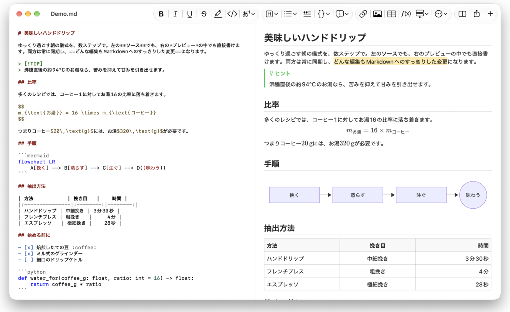
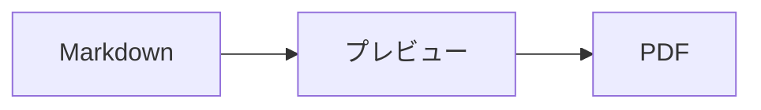

<p>&nbsp;&nbsp;&nbsp;</p>

# Splat

**ソースでも、プレビューの中でも直接書ける、macOS用のMarkdownエディタ。**

Splatは、左にシンタックスカラー付きのMarkdownソース、右にリアルタイムで完全に編集できるプレビューを並べて表示します。どちらに入力してもかまいません。プレビューに書いた内容はソースへの最小限の変更として反映されるので、触れていない行は1バイトも変わらず、Gitのdiffもすっきりしたままです。Splatは普段お使いのMarkdownをそのまま読み込みます。CommonMarkとGitHub Flavored Markdown、GitHubのアラート、Obsidianのウィキリンク・埋め込み・コールアウト、PandocやTyporaの拡張、埋め込みHTML、LaTeX数式、Mermaid・Graphviz・PlantUMLの図まで、すべてオフラインでレンダリングします。PDF、HTML、Wordへの書き出しもワンクリックです。RustでmacOS標準のAppKitコントロール上に作られ、35の言語に対応し、ユーザが求めない限りネットワークには何も送信しません。
 


[](https://raw.githubusercontent.com/sventmueller/splat/main/dist/Splat-1.0.6.dmg)

**[Download Splat-1.0.6.dmg](https://raw.githubusercontent.com/sventmueller/splat/main/dist/Splat-1.0.6.dmg)**：Appleによる署名と公証済み。Apple SiliconとIntelのmacOS 14以降に対応しています。
 
 

[](https://www.rust-lang.org)
[](https://www.apple.com/macos/)

[](https://github.com/madsmtm/objc2)
[](https://webkit.org)
[](https://github.com/kivikakk/comrak)
[](https://github.github.com/gfm/)
[](https://www.mathjax.org)
[](https://cortexjs.io/mathlive/)
[](https://mermaid.js.org)
[](https://graphviz.org)
[](https://plantuml.com)


[](#ライセンス)

[Bahasa Indonesia](../id/README.md) ·
[Bahasa Melayu](../ms/README.md) ·
[Català](../ca/README.md) ·
[Čeština](../cs/README.md) ·
[Dansk](../da/README.md) ·
[Deutsch](../de/README.md) ·
[English](../../../README.md) ·
[Español](../es/README.md) ·
[Français](../fr/README.md) ·
[Hrvatski](../hr/README.md) ·
[Italiano](../it/README.md) ·
[Magyar](../hu/README.md) ·
[Nederlands](../nl/README.md) ·
[Norsk](../no/README.md) ·
[Polski](../pl/README.md) ·
[Português (Brasil)](../pt_BR/README.md) ·
[Português (Portugal)](../pt_PT/README.md) ·
[Română](../ro/README.md) ·
[Slovenčina](../sk/README.md) ·
[Slovenščina](../sl/README.md) ·
[Suomi](../fi/README.md) ·
[Svenska](../sv/README.md) ·
[Tiếng Việt](../vi/README.md) ·
[Türkçe](../tr/README.md) ·
[Ελληνικά](../el/README.md) ·
[Русский](../ru/README.md) ·
[Українська](../uk/README.md) ·
[עברית](../he/README.md)‎ ·
[العربية](../ar/README.md)‎ ·
[हिन्दी](../hi/README.md) ·
[ไทย](../th/README.md) ·
[한국어](../ko/README.md) ·
**日本語** ·
[简体中文](../zh-Hans/README.md) ·
[繁體中文](../zh-Hant/README.md)

## 目次

- [主な機能](#主な機能)
- [動作環境](#動作環境)
- [インストール](#インストール)
- [はじめに](#はじめに)
- [書く](#書く)
  - [ソースで](#ソースで)
  - [プレビューで](#プレビューで)
  - [フォーマットコマンド](#フォーマットコマンド)
  - [リストとタスク](#リストとタスク)
  - [表](#表)
- [対応するMarkdown](#対応するmarkdown)
  - [CommonMarkとGitHub Flavored Markdown](#commonmarkとgithub-flavored-markdown)
  - [コールアウト](#コールアウト)
  - [拡張構文](#拡張構文)
  - [Obsidian](#obsidian)
  - [引用と参照](#引用と参照)
  - [埋め込みHTML](#埋め込みhtml)
  - [タイポグラフィ記号](#タイポグラフィ記号)
  - [構文の一覧](#構文の一覧)
- [数式](#数式)
- [図](#図)
- [画像](#画像)
- [リンクとナビゲーション](#リンクとナビゲーション)
- [書き出し、プリント、共有](#書き出しプリント共有)
- [外観とアクセシビリティ](#外観とアクセシビリティ)
- [言語](#言語)
- [キーボードショートカット](#キーボードショートカット)
- [プライバシーとセキュリティ](#プライバシーとセキュリティ)
- [大きな書類](#大きな書類)
- [既知の制限](#既知の制限)
- [トラブルシューティング](#トラブルシューティング)
- [開発者向け](#開発者向け)
  - [ビルド](#ビルド)
  - [配布](#配布)
  - [テスト](#テスト)
  - [プロジェクトの構成](#プロジェクトの構成)
  - [データの流れ](#データの流れ)
  - [コントローラの規則](#コントローラの規則)
  - [コマンドの追加](#コマンドの追加)
  - [翻訳](#翻訳)
  - [サードパーティのコンポーネント](#サードパーティのコンポーネント)
- [ライセンス](#ライセンス)

## 主な機能

- **2通りの書き方、テキストは1つ。** ソースもプレビューも編集できます。真実のよりどころはMarkdownファイルだけです。取り消しの履歴は書類ごとに1つで、プレビューでの編集はそれぞれソースへの最小限の変更に変換されます。
- **普段お使いのMarkdownをそのまま。** CommonMark、GitHub Flavored Markdown、GitHubのアラート、Obsidian、PandocとTyporaの拡張、絵文字のショートコード、スポイラー、定義リスト、見出しのアンカー、GitHubのREADMEで使われているHTMLに対応しています。
- **数式も図も内蔵。** MathJaxによるLaTeX数式と、ビジュアルな数式エディタ。Mermaid、Graphviz、PlantUMLの図も、Java、サーバ、ネットワーク接続なしでMac上でレンダリングされます。
- **何にでもボタンがあります。** Markdownのどの記法にもツールバーのボタンとメニュー項目があり、よく使うものにはキーボードショートカットもあります。表には、行・列・配置のための専用メニューがあります。
- **何も失わずに書き出し。** PDF、1つで完結するHTMLファイル、そして本物の見出し・リスト・表・脚注・画像を備えたWord書類に書き出せます。
- **骨の髄までネイティブ。** 本物のAppKitのウインドウ、タブ、メニュー、ポップオーバ、バージョン、自動保存、共有メニュー、ダークモード、スペルチェック、音声入力、VoiceOver。Electronではなく、テキスト自体にWebビューも使っていません。
- **大きなファイルでも高速。** 10 MBの書類での1回のキー入力のレンダリングは、ビュー自体の処理の前で約10 msです。
- **プライベートで慎重。** Webの画像は許可した後にだけ読み込まれ、ほかのAppへのリンクは先に確認され、信頼できない画像データのデコードはすべてサンドボックス化されたヘルパープロセスで実行されます。
- **あなたの言語で。** インターフェイスと内蔵のMarkdownクイックリファレンスは、アラビア語、カタロニア語、中国語（簡体字）、中国語（繁体字）、クロアチア語、チェコ語、デンマーク語、オランダ語、英語、フィンランド語、フランス語、ドイツ語、ギリシャ語、ヘブライ語、ヒンディー語、ハンガリー語、インドネシア語、イタリア語、日本語、韓国語、マレー語、ノルウェー語、ポーランド語、ポルトガル語（ブラジル）、ポルトガル語（ポルトガル）、ルーマニア語、ロシア語、スロバキア語、スロベニア語、スペイン語、スウェーデン語、タイ語、トルコ語、ウクライナ語、ベトナム語の35言語で用意されています。

## 動作環境

- macOS 14 Sonoma以降。Splatの開発とテストはmacOS 27で行っており、macOS 27ではLiquid Glassのデザインが自動的に適用されます。
- Apple SiliconまたはIntelプロセッサ搭載のMac。
- 約45 MBのディスク空き容量。

## インストール

**ディスクイメージから。** [`dist/Splat-1.0.6.dmg`](https://raw.githubusercontent.com/sventmueller/splat/main/dist/Splat-1.0.6.dmg)をダウンロードして開き、Splatをアプリケーションフォルダにドラッグしてください。イメージはDeveloper IDで署名され、Appleによって公証されているため、警告なしで開きます。

**Homebrewで。** Caskは専用のtapにあります。

```sh
brew install --cask sventmueller/tap/splat
```

`brew upgrade --cask splat`で新しいバージョンをインストールでき、`brew uninstall --zap --cask splat`ではSplatの設定とキャッシュも削除されます。

**アップデート。** ディスクイメージまたはHomebrewで入れたSplatは、[Sparkle](https://sparkle-project.org)によって自動的に最新の状態に保たれます。2回目の起動時に、1日1回、自動でアップデートを確認してよいかをたずねます。**Splat › アップデートを確認…**はすぐに確認します。あとから選択を変えるには、同じメニューの**アップデートを自動的に確認**と**アップデートを自動的にダウンロードしてインストール**を使います。Splatは、開発者の署名があるアップデートだけをインストールします。自分でビルドしたものにはアップデータはありません。

**ソースから。** 前提条件は[Building](#ビルド)を参照してください。そのあとは次のとおりです。

```sh
make build
ditto target/release/Splat.app /Applications/Splat.app
open /Applications/Splat.app
```

ダブルクリックでMarkdownファイルをSplatで開くには、Finderで任意の`.md`ファイルを選択し、**ファイル › 情報を見る**を選んで、**このアプリケーションで開く**でSplatを選び、**すべてを変更…**をクリックします。Splatは`.md`、`.markdown`、`.mdown`、`.mkd`ファイルに自分自身を登録します。

## はじめに

### ウインドウ

書類はそれぞれ専用のウインドウで開きます。タブをお好みならタブでも開けます。

- **左：ソース。** SF Monoで表示された、シンタックスカラー付きのMarkdown。
- **右：プレビュー。** レンダリングされた書類で、そのまま編集できます。
- **アウトラインサイドバー（オプション）。** すべての見出しをツリーで表示します。見出しをクリックすると、両方のペインでその見出しが表示されます。**表示 › アウトラインを表示**（⌃⌘S）で切り替えます。
- **ツールバー。** 変更の対象ごとにまとめられたボタン：文字、段落と挿入する要素、続いてプレビューの表示/非表示、共有、新規書類。**表示 › ツールバーをカスタマイズ…**でカスタマイズできます。

境界線をドラッグすると、どちらかの側を広げられます。**表示 › プレビューを非表示**（⌥⌘P）にするとソースだけが残ります。Splatはこの設定をウインドウごとに記憶します。両方のペインは一緒にスクロールし、一方のペインで選択した部分はもう一方でもハイライトされます。

### 書類、タブ、バージョン

Splatは、一般的なmacOSの書類Appです。

- **自動保存とバージョン。** 変更はその場で保存されます。**ファイル › バージョンを戻す › すべてのバージョンをブラウズ…**で過去の状態に戻れます。
- **ほかのプログラムによる変更。** Git、スクリプト、別のエディタが開いている書類を変更すると、Splatは挿入ポイントとスクロール位置を保ったまま再読み込みします。ご自身の未保存の変更がある場合はそれを保持し、もう一方のバージョンを上書き保存する前にmacOSが確認します。
- **おなじみのファイルコマンド。** 複製（⇧⌘S）、名称変更…、移動…、**ファイル › 最近使った項目を開く**。
- **タブ。** **ファイル › 新規タブ**またはツールバーの**+**ボタンで、新しい書類をタブで開きます。標準のウインドウメニューで、タブの結合、移動、切り替えができます。
- **ウインドウの位置。** 最後のウインドウのサイズと位置は、再起動後も記憶されます。すでにそこにウインドウがある場合、新しいウインドウは少しずらして開きます。
- **Dockのアイコン。** 最後のウインドウを閉じた後でクリックすると、新規書類が開きます。
- **MarkdownファイルをSplatで開く。** **Splat › Markdownのデフォルトアプリに設定**を選ぶと、`.md`または`.markdown`ファイルをダブルクリックしたときにSplatが開くようになります。macOSが一度だけ確認します。Splatがデフォルトである間は、この項目にチェックマークが付きます。

ファイルはUTF-8テキスト、またはバイトオーダーマーク付きのUTF-16である必要があります。ほかのエンコーディングは、推測してテキストを壊すことのないよう、Splatは開きません。バイトオーダーマークはそのまま残り、UTF-16はUTF-16のままで、すべての行がCRLFで終わるファイルでは、追加した行にもCRLFが付きます。

**クラッシュしたとき**に失われるのは、せいぜい直近数秒分の入力だけです。Splatは5秒ごとに、未保存のテキストを`~/Library/Application Support/Splat/Unsaved`にコピーし、書類が保存されるか、Splatが正常に終了すると、そのコピーを削除します。次回の起動時に、クラッシュで残ったものを`~/Library/Application Support/Splat/Recovery`に移し、一度だけそのことをお知らせします。フォルダを開くボタンも表示されます。Splatがまだ反応できるクラッシュの場合は、開いているすべての書類のテキストもそこに書き込まれます。

### クイックリファレンス

**ヘルプ › Markdownクイックリファレンス**を選ぶと、お使いの言語のチートシートが、新規の無題の書類として開きます。これは普通の書類なので、その場でソースでもプレビューでも、あらゆることを試せます。

## 書く

### ソースで

ソースは、Markdown向けに調整されたプレーンテキストのエディタです。

- **VS Codeのようなシンタックスカラー。** 見出し、強調、リンク、コード、表、HTML、フロントマター、そして数式や図の中のLaTeXとMermaid。ライト、ダーク、コントラストを上げる設定用のパレットがあります。
- **フェンス付きコードブロック**は、Bash、C、C++、C#、CSS（SCSSとLessも）、Go、HTML、XML、Java、JavaScript、JSON、Kotlin、PHP、Python、Ruby、Rust、SQL、Swift、TypeScript、YAML、TeX、Mermaidでハイライトされます。`js`、`py`、`sh`のような通常の短い名前にも対応しています。
- **不意の置換はありません。** スマート引用符、スマートダッシュ、テキストの置換は、`--`、`---`、`"`を壊してしまうため、デフォルトではオフです。オンにするには**編集 › 自動置換**を使います。
- **システムの文章作成ツール。** スペルと文法のチェック、音声入力、検索と置換（⌥⌘F）、スピーチ。
- **ドラッグ&ドロップ。** 画像ファイルをドロップすると``が挿入され、それ以外のファイルをドロップするとそのファイルへのリンクが、URLをドロップすると`[url](url)`が挿入されます。ドロップ1回が、取り消しの1ステップです。
- **画像のペースト。** スクリーンショットなど、クリップボードにある画像は、書類と同じ場所にPNGファイル（`画像 2026-10-29 13.09.07.png`）として保存され、画像として挿入されます。そのためには、書類を一度保存しておく必要があります。

### プレビューで

プレビューはワープロのように動作しますが、そこで行うことはすべて最終的にMarkdownになります。

- **入力。** `*`や`#`のように、Markdownで意味を持つ文字は、入力したとおりに表示されるようエスケープされます。
- **Return**で新しい段落またはリスト項目を開始します。**⌥Return**または**⌃Return**で改行を挿入します。
- **カーソル位置でのフォーマット。** カーソルが単語の末尾にあるときは、ボールド、イタリックなどの文字フォーマットが、その後に入力するテキストに適用されます。もう一度同じフォーマットを選ぶと解除されます。単語の途中では、単語全体がフォーマットされます。
- **空行。** 空行でReturnを押すとさらに空行が追加され、Backspaceで削除されます。ソースでは、空行1つごとに空白行が2行増えます。ほかのMarkdownプログラムでは、通常の段落の間隔として表示されます。
- **取り消す**は両方のペインにまたがって働きます。取り消しの項目には「ボールドを取り消す」のような名前が付き、入力はひとまとまりごとに1ステップになり、取り消しややり直しの後は両方のペインが変更箇所までスクロールします。
- **数式と図**は完成したグラフィックとして表示されます。クリックするか、カーソルをその上に移動するか、その上でReturnを押すと、エディタが開きます（[Formulas](#数式)と[Diagrams](#図)を参照）。
- **埋め込みHTML、埋め込みノート、フロントマター**は表示されますが、編集はソースで行います。クリックすると、ソースの対応する位置にカーソルが移動します。

Markdownで表現できないものは、プレビューではブロックされます。フォントとカラーのパネル、ルーラ、リッチテキストや画像のペーストとドロップがそうです。ペーストしたHTMLとRTFは、プレーンテキストとして入ります。

### フォーマットコマンド

すべてのコマンドは、ツールバー、メニューバー、両方のペインのコンテキストメニューから使えます。カーソル位置のフォーマットには、メニュー項目にチェックマークが付きます。

| メニュー | コマンド |
|---|---|
| **フォーマット › フォント** | ボールド、イタリック、アンダーライン、取り消し線、ハイライト、コード、上付き、下付き |
| **フォーマット › 見出し** | 本文、見出し1〜6 |
| **フォーマット › リスト** | 箇条書き、番号付きリスト、タスクリスト |
| **フォーマット** | 引用、コードブロック（言語なし、または20言語のいずれか。既存のブロックの言語も変更できます）、コールアウト（注記、ヒント、重要、警告、注意。同じ種類をもう一度選ぶと解除されます）、数式または図を編集…、フォーマットを消去 |
| **挿入** | リンク…、画像…、表…、数式、図（フローチャート、シーケンス図、ガントチャート）、目次、脚注、区切り線 |
| **表** | 上に行を挿入/下に行を挿入、左に列を挿入/右に列を挿入、行を削除、列を削除、配置（左揃え、中央揃え、右揃え、デフォルト）、表の列を揃える |
| **表示** | プレビューを非表示/表示、アウトラインを表示/非表示、タイポグラフィ記号、拡大/縮小、実際のサイズ、ツールバー、タブバー、フルスクリーン |

アンダーライン、ハイライト、上付き、下付きは`<ins>`、`<mark>`、`<sup>`、`<sub>`として書かれ、GitHubでも表示されます。Splatは、GitHubが取り除く`<u>`と、より短い`==highlight==`、`^sup^`、`~sub~`も読み込みます。GitHubでは、`==`と`^`は入力したとおりに表示され、`~sub~`は取り消し線になります。

### リストとタスク

- Returnでリストが続き、空の項目でReturnを押すとリストが終わります。
- プレビューでは、**Tab**と**⇧Tab**でリスト項目のインデントを増減します。
- プレビューでタスクのチェックボックスをクリックすると、`- [ ]`と`- [x]`が切り替わります。
- **フォーマット › リスト**は、選択した段落をリストにするか、リストの種類を変更します。

### 表

- **挿入 › 表…**では、行数（見出し行を含む）と列数をたずねます。
- プレビューでは、**Tab**で次のセル、**⇧Tab**で前のセル、**Return**で下のセルに移動します。最後のセルでTabを押すと行が追加されます。
- **表**メニューでは、行と列の挿入と削除、列の配置（⌘{、⌘|、⌘}）を設定できます。
- **表 › 表の列を揃える**は、ソースの列が縦に揃うよう空白を埋めます。

## 対応するMarkdown

Splatは、CommonMarkとGFMに互換性のあるパーサ[comrak](https://github.com/kivikakk/comrak)で解析し、その拡張のほとんどをオンにしています。以下はすべて、プレビューとすべての書き出しでレンダリングされます。

### CommonMarkとGitHub Flavored Markdown

- 見出し（`#`と下線付き）、段落、改行、強調、強い強調、インラインコード、ブロック引用、区切り線。
- 箇条書き、番号付き、入れ子のリスト、タスクリスト。
- リンク（インライン、参照、自動）、画像、リンク参照定義。
- シンタックスカラー付きのフェンス付きコードブロックとインデントによるコードブロック。
- 列の配置付きの表。
- `~~チルダ2つ~~`による取り消し線。
- 脚注：`text[^1]`と、書類のどこにでも置ける`[^1]: The note.`。マーカーをクリックすると脚注にジャンプします。
- 先頭の`---`の行で囲まれたYAMLフロントマター。プレビューでは「メタデータ：title, date, tags」のように1行にまとめて表示します。

### コールアウト

GitHubのアラートは、アイコンとタイトル付きの色付きボックスとしてレンダリングされます。

```markdown
> [!NOTE]
> 利用者が知っておくべき有用な情報。

> [!WARNING]
> すぐに対処が必要な重要な内容。
```

種類は、注記、ヒント、重要、警告、注意の5つです。**フォーマット › コールアウト**は、カーソル位置の段落をコールアウトにします。

Obsidianのコールアウトも使えます。タイトルは自由で、折りたたみの状態も指定できます。

```markdown
> [!tip]- クリックして▸展開
> 開くまでは隠れています。

> [!question]+ 最初から開く
> `+`は展開、`-`は折りたたみで始まります。
```

Obsidianのそのほかの種類は、5つのうち最も近い色で表示されます。`success`、`check`、`done`、`hint`はヒント、`question`、`help`、`faq`は重要、`attention`は警告、`failure`、`fail`、`missing`、`danger`、`error`、`bug`は注意、それ以外はすべて注記です。

### 拡張構文

| 機能 | 構文 | 由来 |
|---|---|---|
| ハイライト | `==マークしたテキスト==` | Obsidian、Typora |
| 上付き | `x^2^` | Pandoc、Typora |
| 下付き | `H~2~O` | Pandoc、Typora |
| 絵文字のショートコード | `:rocket:`が🚀になる | GitHub |
| スポイラー | `\|\|隠しテキスト\|\|`、選択すると読める | Discord |
| インライン脚注 | `text^[注の内容そのもの]` | Pandoc、Obsidian |
| 定義リスト | `用語`、空行、`: 説明` | PHP Markdown Extra、Pandoc |
| 見出しのアンカー | `## インストール {#setup}`、`[see](#setup)`でリンク | Pandoc、kramdown |

定義リストは、ソースでは次のようになります。

```markdown
用語

: 用語の説明。
```

独自のアンカーがなければ、GitHubと同じように、どの見出しにもその文字から導かれたアンカーが付きます。`## はじめに`は`#はじめに`で参照できます。

### Obsidian

- **ウィキリンク。** `[[Note]]`は、同じフォルダまたはその下のフォルダにある`Note.md`にリンクします。`[[Note|表示テキスト]]`は任意のテキストを表示し、`[[Note#Heading]]`はそのノートを開きます。⌘+クリックでSplatで開きます。
- **埋め込み。** `![[Note]]`は、ほかのノートをこのノートの中に表示します。そこに埋め込まれたノートはリンクとして表示されます。`![[diagram.png]]`は画像を表示します。Obsidianと同じく、埋め込みでは書類のフォルダまたはその下にあるノートと画像を名前で指定し、絶対パスは使いません。ノートとして表示されるのはMarkdownファイルだけです。
- **コメント。** `%%ソースだけに表示%%`はソースには表示されたままで、プレビューとすべての書き出しからは除かれます。行の途中でも、単独の行でも同じです。
- **タグ。** `#idea`や`#project/splat`はハイライトされます。⌘+クリックで書類内のそのタグを検索します。
- **折りたためるコールアウト。** [Callouts](#コールアウト)を参照してください。

### 引用と参照

- **Pandocの引用。** `[@doe2020]`や`[@doe2020; @roe2021]`は「(Doe 2020; Roe 2021)」のように表示されます。項目は、フロントマターで`bibliography: refs.bib`として指定したBibTeXファイルから取得されます。指定がなければ、Splatは書類と同じ場所にある`references.bib`、`literatur.bib`、`bibliography.bib`を使います。
- **GitHubとGitLabの参照。** 書類が、`origin`リモートがgithub.comまたはGitLabホストにあるGitリポジトリの中にある場合、`@name`、`#12`（イシュー）、`!7`（マージリクエスト、GitLabのみ）がハイライトされます。⌘+クリックでブラウザで開きます。

### 埋め込みHTML

GitHubのREADMEにあるようなHTMLは、ブラウザエンジンではなく独自のリーダーでレンダリングされます。

- 中央揃えの段落とブロック（`<p align="center">`、`<div align="center">`）
- サイズ指定付きの画像（``）
- リンク、`<kbd>⌘</kbd>`、`<br>`、`<u>`、`<ins>`、`<mark>`、`<sup>`、`<sub>`
- リストと表。列をまたぐセル（`colspan`）も含みます
- 折りたたみ可能なセクション：`<details><summary>詳細</summary>…</details>`。▸をクリックして開きます

HTMLタグの間にあるMarkdownは、Markdownとしてレンダリングされます。スクリプト、スタイル、フレーム、フォームは完全に除かれ、リンクと画像で残るのは`http`、`https`、`mailto`、相対アドレスだけです。

### タイポグラフィ記号

**表示 › タイポグラフィ記号**は、まっすぐな引用符をインターフェイス言語の引用符に、`--`をenダッシュに、`---`をemダッシュに、`...`を省略記号にして表示します。ドイツ語では`"Ja"`が„Ja“に、フランス語では«Oui»に、日本語では「はい」になり、中国語や日本語で引用符の前後に空白を入れない場合にも対応します。ヘブライ語の`צה"ל`のような略語にはgershayimが付き、צה״ל になります。ソースはそのままの文字を保ち、プレビューとすべての書き出しでは、タイポグラフィ上の文字が表示されます。この設定は、オンにするまではオフです。

### 構文の一覧

| 要素 | Markdown |
|---|---|
| **ボールド** | `**ボールド**` |
| *イタリック* | `*イタリック*` |
| アンダーライン | `<ins>アンダーライン</ins>`または`<u>アンダーライン</u>` |
| ~~取り消し線~~ | `~~取り消し線~~` |
| ハイライト | `<mark>ハイライト</mark>`または`==ハイライト==` |
| `コード` | `` `コード` `` |
| x² | `x<sup>2</sup>`または`x^2^` |
| H₂O | `H<sub>2</sub>O`または`H~2~O` |
| [リンク](https://example.com) | `[リンク](https://example.com)` |
| 見出し | `# 見出し`〜`###### 見出し` |
| 引用 | `> 引用` |
| 箇条書き | `- 項目` |
| 番号付きリスト | `1. 項目` |
| タスク | `- [ ] 未完了`と`- [x] 完了` |
| コードブロック | ```` ```rust ```` … ```` ``` ```` |
| 表 | `\| A \| B \|`と、見出し行の下に`\|---\|---\|` |
| 脚注 | `本文[^1]`と`[^1]: 注` |
| 区切り線 | `---` |
| 画像 | `` |
| 数式 | `$E = mc^2$`、`$$ … $$` |
| 図 | ```` ```mermaid ````、```` ```dot ````、```` ```plantuml ```` |
| コールアウト | `> [!TIP]` |
| ウィキリンク | `[[Note]]`、`[[Note\|テキスト]]` |
| 埋め込み | `![[Note]]`、`![[image.png]]` |
| コメント | `%%コメント%%` |
| タグ | `#tag` |
| 引用文献 | `[@key]` |
| スポイラー | `\|\|スポイラー\|\|` |
| 絵文字 | `:tada:` |

## 数式

数式は、TeXとAMS mathに対応した[MathJax](https://www.mathjax.org)によって、くっきりしたベクターグラフィックとしてレンダリングされます。`\text{…}`の中のテキストには、どの文字体系も使えます。MathJaxのフォントにない文字はMacのフォントで補われ、アラビア語とヘブライ語は右から左へ表示され、絵文字はカラーで表示されます。

| 種類 | 構文 |
|---|---|
| インライン | `$E = mc^2$`、`` $`E = mc^2`$ ``（GitHub、GitLab）、`\(E = mc^2\)` |
| ディスプレイ | `$$` … `$$`、`\[` … `\]`、または`math`と指定したコードブロック |

**数式の編集。** プレビューで数式をクリックするか、ダブルクリックするか、その上でReturnを押すか、カーソルをその上に移動すると、ポップオーバでエディタが開きます。**挿入 › 数式**は新しい数式を挿入し、すぐにエディタを開きます。

- **ビジュアルかLaTeXか。** 上部のスイッチで、ビジュアルエディタ（[MathLive](https://cortexjs.io/mathlive/)）とLaTeXコードを切り替えます。Splatは選択を記憶します。
- **パーツ**として、分数、平方根、上付きと下付き、上下限付きの総和と積分、極限、内容に合わせて伸びる括弧、2×2行列、ギリシャ文字、関係記号・演算子・矢印があります。これらはプレースホルダ□を残し、**Tab**で次のプレースホルダにジャンプします。
- **ライブプレビュー。** 入力中の変更が書類にそのまま表示されます。MathJaxのエラーは、コードの下の1行に表示されます。
- **確定か破棄か。** 外側をクリックすると変更が確定し、取り消しの1ステップになります。**Esc**または**キャンセル**で破棄されます。新しい空の数式でEscを押すと、その数式も削除されます。
- コンテキストメニューには、ポインタの下にある数式に対する**数式を編集…**があります。

VoiceOverは、数式をLaTeXコードとして読み上げます。Splatがレンダリングするのは数式であり、完全なLaTeX書類ではありません。パッケージ、TikZ、`\documentclass`はありません。

## 図

図はSplatの中で、オフラインで、ライトとダークの2種類でレンダリングされます。

| エンジン | コードブロック | 描けるもの |
|---|---|---|
| [Mermaid](https://mermaid.js.org) | ```` ```mermaid ```` | フローチャート、シーケンス図、クラス図、状態遷移図、ER図、ガントチャート、円グラフ、マインドマップ、タイムライン、そのほかすべてのMermaidの種類 |
| [Graphviz](https://graphviz.org) | ```` ```dot ````または```` ```graphviz ```` | DOT言語によるグラフ |
| [PlantUML](https://plantuml.com) | ```` ```plantuml ````または```` ```puml ```` | UML図。Javaなしで動作します |



**図の編集**は数式の編集と同じです。クリックするとポップオーバでコードが開き、シンタックスカラーが付き、エラーメッセージはコードの下の1行に表示されます。**挿入 › 図**は、フローチャート、シーケンス図、ガントチャートのテンプレートから始めます。パーツは、最もよく使う3種類のMermaid図で役立ちます。

- **フローチャート：**ノード ▾（長方形、角丸長方形、円、ひし形、データベース）、接続、ラベル付き接続、グループ、方向 ▾
- **シーケンス図：**参加者、メッセージ、応答、メモ、ループ、条件による分岐
- **ガントチャート：**セクション、タスク、マイルストーン

そのほかの図の種類は、コードで編集します。VoiceOverは、図のタイトルまたは代替テキストを読み上げます。

起動後の最初の図には約1秒かかります。レンダリングエンジンがバックグラウンドで起動するためです。10秒を超える図はエラーになり、次の図のためにレンダリングエンジンが再起動されます。PlantUMLのエンジン（3 MB）は、最初のPlantUML図で初めて読み込まれます。WebからのPlantUML `!include`はブロックされます。

## 画像

- **ローカルの画像**は、書類からの相対パスを使います：``。SplatはPNG、JPEG、GIF、WebP、BMP、SVG、HEIC、TIFF、AVIF、PDFを表示します。
- **Webの画像**は、許可するまでブロックされたままです。プレビューの上に表示されるバーに、読み込むと書類を開いたことと開いた日時がそのサーバに伝わると説明されます。**画像を読み込む**を選ぶと、この書類に対して許可されます。Splatはその選択をファイルごとに記憶します。
- **サイズ。** ``で画像のサイズを指定します。指定がなければ、画像はプレビューの幅に収まります。
- **ディスク上の変更。** 差し替えた画像や、書類が名前を挙げた後に現れた画像は、書類を開き直さなくても表示されます。ネットワークの問題で失敗したWebの画像は、書類がそれを表示している間、再試行されます。
- **メモリ。** 画像は長辺が最大2560ピクセルで表示され、これはA4の用紙いっぱいにもなる大きさです。画像がMacのメモリの8分の1を占めるようになると、またmacOSがメモリ負荷を報告している間は、より小さくデコードされます。
- **ダークモード。** 白い背景の画像は、ダークのプレビューでは少し暗くなります。
- **ペーストとドロップ。** [In the source](#ソースで)を参照してください。

## リンクとナビゲーション

プレビューでは、クリックするとカーソルが置かれてリンクのテキストを編集でき、**⌘+クリック**でリンクを開きます。

- `http`、`https`、`mailto`は、ブラウザまたはメールAppで開きます。
- Markdownファイルは、Splatで開きます。ほかのファイルとフォルダは、Finderに表示されます。
- `#anchor`は、書類内のその見出しにジャンプします。
- `slack://`や`vscode://`のように、ほかのAppを開くアドレスは、先に確認が入り、完全なアドレスとAppが表示されます。**キャンセル**があらかじめ選択されています。

**挿入 › 目次**は、すべての見出しへのリンク付きリストを挿入します。カーソルが目次の中にあるときは、同じコマンドで更新されます。アウトラインサイドバー（⌃⌘S）では、両方のペインの任意の見出しにジャンプできます。

## 書き出し、プリント、共有

| 形式 | 方法 | 得られるもの |
|---|---|---|
| **PDF** | **ファイル › PDFとして書き出す…**または共有メニュー | 用紙サイズのページ。常にライトの外観で、数式と図はベクターグラフィックになります。**ファイル › ページ設定…**で用紙を設定します。 |
| **プリント** | **ファイル › プリント…**（⌘P） | PDFと同じレイアウト。 |
| **HTML** | **ファイル › HTMLとして書き出す…**または共有メニュー | 1つで完結するファイル。ローカルの画像は埋め込まれ、数式と図は鮮明な画像になり、目次が機能するよう見出しにアンカーが付きます。スクリプトはありません。 |
| **Word** | **ファイル › Word書類として書き出す…**または共有メニュー | Wordの見出しスタイル、本物のリストと表（セルの結合を含む）、Wordの脚注になった脚注、埋め込まれた画像、数式、図を備えた`.docx`。 |
| **Markdown** | ツールバーの**共有**ボタン | 「メール」、「メッセージ」、AirDrop、そのほかすべての共有サービスに渡せる`.md`ファイルとしての書類。 |

**ファイル › 共有**メニューには、これらがすべて1か所にまとまっています。書き出しでは、タイポグラフィ記号の設定と、Webから読み込みを許可した画像が反映されます。HTMLでは、Webの画像はリンクのままです。

## 外観とアクセシビリティ

- **ダークモード**はシステムに従います。数式と図は、外観ごとにレンダリングされます。
- システム設定の**コントラストを上げる**をオンにすると、シンタックスカラーがハイコントラストのパレットに切り替わります。
- **拡大/縮小。** ⌘+、⌘−、⌘0で、両方のペインの大きさが変わります。
- **フルスクリーン、タブ、カスタマイズできるツールバー**は、Macのどのアプリとも同じです。
- **VoiceOver。** ペインには「Markdownソース」と「プレビュー」というラベルが付き、数式はそのコード、図はそのタイトルとして読み上げられます。すべてのコマンドをキーボードで操作できます。

Splatには設定ウインドウがありません。数少ないオプションは、それが働く場所にあります。**表示**と**編集 › 自動置換**です。

## 言語

インターフェイス、メニュー、Markdownクイックリファレンスは、次の35言語に翻訳されています。

アラビア語、カタロニア語、中国語（簡体字）、中国語（繁体字）、クロアチア語、チェコ語、デンマーク語、オランダ語、英語、フィンランド語、フランス語、ドイツ語、ギリシャ語、ヘブライ語、ヒンディー語、ハンガリー語、インドネシア語、イタリア語、日本語、韓国語、マレー語、ノルウェー語、ポーランド語、ポルトガル語（ブラジル）、ポルトガル語（ポルトガル）、ルーマニア語、ロシア語、スロバキア語、スロベニア語、スペイン語、スウェーデン語、タイ語、トルコ語、ウクライナ語、ベトナム語。

Splatは、**システム設定 › 一般 › 言語と地域**の言語の順序に従います。同じ場所の**アプリケーション**で、Splatだけの言語を選ぶこともできます。お使いの言語の翻訳がない場合は、英語を使います。メニューの用語はAppleの公式の翻訳に従っているので、SplatはMacのほかの部分と同じように読めます。

ヘブライ語とアラビア語のテキストは、インターフェイスの言語にかかわらず、どこに現れても右から左へ表示されます。段落、見出し、リスト項目はそれぞれ最初の文字の方向になり、引用とコールアウトは右側にバーを描き、右から左に始まるテキストの表では、列が右から順に並びます。コードブロックは左から右のままです。PDF、HTML、Wordの書き出しでもこの方向が保たれます。システムの言語がヘブライ語またはアラビア語のときは、macOSがウインドウも左右反転するため、プレビューは左側になります。

## キーボードショートカット

| 操作 | ショートカット |
|---|---|
| ボールド、イタリック、アンダーライン | ⌘B、⌘I、⌘U |
| 取り消し線 | ⇧⌘X |
| リンク… | ⌘K |
| 本文、見出し1〜6 | ⌥⌘0、⌥⌘1〜⌥⌘6 |
| 表の列を左揃え、中央揃え、右揃えにする | ⌘{、⌘\|、⌘} |
| プレビューを非表示または表示 | ⌥⌘P |
| アウトラインを表示または非表示 | ⌃⌘S |
| 拡大、縮小、実際のサイズ | ⌘+、⌘−、⌘0 |
| 新規書類、開く、保存、複製 | ⌘N、⌘O、⌘S、⇧⌘S |
| ページ設定、プリント | ⇧⌘P、⌘P |
| 検索、検索と置換 | ⌘F、⌥⌘F |
| 次を検索、前を検索、選択部分を検索に使用、選択部分へジャンプ | ⌘G、⇧⌘G、⌘E、⌘J |
| スペルと文法を表示、書類をチェック | ⌘:、⌘; |
| ペーストしてスタイルを合わせる | ⌥⇧⌘V |
| ツールバーを非表示、すべてのタブを表示、フルスクリーン | ⌥⌘T、⇧⌘\\、⌃⌘F |
| 改行（プレビュー） | ⌥Returnまたは⌃Return |
| 表の次のセル/前のセル（プレビュー） | Tab / ⇧Tab |
| リスト項目のインデントを増やす/減らす（プレビュー） | Tab / ⇧Tab |
| 数式エディタの次のプレースホルダ | Tab |
| 数式または図のエディタを変更せずに閉じる | Esc |
| リンク、タグ、参照を開く（プレビュー） | ⌘+クリック |

Splatは、Appleの標準のショートカットをそのままにしています。

## プライバシーとセキュリティ

Markdownファイルは誰からでも届き得るため、Splatはすべての書類を信頼できないものとして扱います。

- **デフォルトではネットワークを使いません。** Splatにテレメトリはありません。アップデートの確認は、ユーザが同意するか**アップデートを確認…**を選んだときだけ行われ、そのときGitHubから小さなフィードファイルを読み込みます。リクエストにはアプリ名とそのバージョンしか含まれません。数式と図はローカルでレンダリングされ、それを行うWebビューはネットワークに接続できません。
- **Webの画像**は、許可を得てからでなければ読み込まれず、読み込むのは`https`だけで、ローカルネットワーク内のホストからは読み込まず、1枚につき最大10 MBで、Cookieのないプライベートセッションで行われます。
- **隔離されたデコード。** 画像、および数式と図のグラフィックは、ヘルパープロセスでデコードされます。ヘルパーは、継承したファイルをすべて閉じ、最初の1バイトを読む前に自らをサンドボックスに閉じ込めます。ファイルへのアクセスもネットワークもありません。返すのはピクセルだけで、そのサイズは検査され、10秒後に停止されます。Appleのシステム標準の画像デコーダが見るのは、HEIC、TIFF、AVIF、PDFだけで、しかもデータが本当にその形式であるときだけです。このデコーダは専用のヘルパーで動作し、そのヘルパーには追加でシステムのフォントフォルダを読むことと、システムのビデオデコーダを使うことが許されています。SVG、数式、図もこのヘルパーを通るため、Splatの中では解像度が固定された画像になります。1ポイントあたり4ピクセルで、長辺は最大2560ピクセルです。
- **ローカルのファイル**が書類に届くのは、書類が指定したパスによってだけです。埋め込みでは、書類のフォルダとその下にあるMarkdownのノートが表示され、見つからない画像もそこでだけ探されます。ほかの場所にある画像のパス（絶対パスや`~`で始まるもの）は、プレビューではそれでも読み込まれます。HTMLとWordの書き出し、印刷、PDFに含まれるのは、書類のフォルダまたはそのGitリポジトリにあるものだけです（そのリポジトリにホームフォルダも含まれている場合を除きます）。そのため、他人の書類があなたのファイルを、人に渡す書き出しに取り込むことはできません。
- **未保存のテキストのコピー**は、クラッシュ後の復旧のために、このMac上のライブラリフォルダに残ります。保存するか、Splatが正常に終了すると削除されます。クラッシュで残ったコピーは、削除するまで復旧フォルダに残ります。
- **リンク**は、クリックしただけではプログラムを起動しません。Webとメールのリンクは通常どおり開き、ほかのAppへのリンクは先に確認されます。
- **書類内のHTML**は、Splat独自のパーサで読み込まれます。スクリプト、スタイル、フレーム、フォームは実行されません。
- **書き出し**にスクリプトは含まれません。HTMLページは、GitHubと同様、無害なタグと属性の固定リストと、コンテンツセキュリティポリシーだけを保ちます。Wordファイルがリンクするのは、`http`、`https`、`mailto`のアドレスだけです。
- **コード署名**にはHardened Runtimeを使っています。Splatは、フォルダごとに確認を求めなくても書類の隣の画像を表示できるよう、App Sandboxなしで動作します。その分は、すべてのデコードの隔離で補っています。

## 大きな書類

Splatは、数メガバイトの書類でも軽快に動作します。

- ソースにはTextKit 2を使っており、見えている部分だけをレイアウトします。
- プレビューで入力している間、および2 MBまでの書類のソースでは、影響を受ける段落だけが再び解析、色付け、レイアウトされます。10 MBの書類では、解析と色付けに約3 ms、レンダリングに約10 ms、そのプレビューでのキー入力全体にビュー自体の処理を含めて約30 msかかります。
- 大きなプレビューは、見えている部分を先にレンダリングし、残りはアプリがアイドル状態のときにレンダリングします。スクロールして表示されるブロックは、描画される前にレンダリングされます。
- 大きな書類のソースでは、入力している間、プレビュー用の解析がバックグラウンドで実行されます。
- 書類は、約 4 GB のメモリが必要になるとプレーンテキストのままになります。通常の Markdown なら約 50〜120 MB、表や見出しだけなら 10〜20 MB ほどです。ソースに色はなく、プレビューには空のままである理由が表示されます。書き出しは引き続き使えます。
- 約200 KBからは、解析する前にウインドウが開きます。5 MBでは、色とプレビューが約4分の1秒遅れて表示されます。
- 数式や図を含むすべての画像を合わせても、使用量はMacのメモリの4分の1までで、メモリが不足している間はその半分までです。それを超える画像は、空きができるまでプレースホルダとして表示されます。

一部の変更は全体が処理され、10 MBでは1回のキー入力あたり約300 msかかります。脚注の定義や参照への変更、インライン脚注の隣、書類の末尾の脚注の隣、フロントマターやリンク参照定義への変更、そして`%%`のコメントブロックがある書類や、脚注が2回定義されている書類、引用やリスト内に脚注が定義されている書類でのすべての変更がそうです。メモリはファイルとともに増え、1 MBのMarkdownでおよそ115〜160 MB、10 MBでは340〜510 MBになります。

## 既知の制限

- **チルダ1つは下付きの意味になります。** `~text~`はPandocと同じく下付きです。取り消し線には`~~two~~`が必要です。GitHubでは、チルダ1つでも取り消し線になります。
- **プレビューでは読み取り専用：**埋め込みHTML、埋め込みノート、フロントマターの編集はソースで行います。
- **非常に深い入れ子：**64階層より深いHTML、16階層より深いインラインHTMLは、その内容に置き換えられます。
- **結合された表のセル**はHTMLの表にしかなく、しかも列方向（`colspan`）のみで、`rowspan`はありません。セルを結合するMultiMarkdownの表の構文には対応していません。
- **文献目録**はBibTeXからしか読み込まれず、CSL JSONやYAMLからは読み込まれません。
- **参照**にはgithub.comまたはGitLabホストにあるリポジトリが必要です。`!7`はGitLabにしかありません。
- **タイポグラフィ記号：**ドイツ語の閉じ一重引用符はアポストロフィと区別できないため、’として設定されます。
- **書類ではなく数式：**LaTeXのパッケージ、TikZ、完全な書類には対応していません。
- **ビジュアルな数式エディタ**は、MathLive式の表記でLaTeXを書き出します。空白は消えます（`E = mc^2`は`E=mc^2`になります）が、レンダリング結果は変わりません。
- **仕様として：**行番号なし、設定ウインドウなし、ヘルプブックなし、App Storeでは提供しません。
- **Intelでのテストは少なめです。** ウインドウのセルフテストはApple Siliconでしか実行されません。IntelではCIが`cargo test`を実行します。

## トラブルシューティング

**Splatをビルドし直したら、最近使った書類のリストが空になりました。** macOSは、最近使った書類とフォルダへのアクセス許可を、アプリのコード署名に結び付けています。ローカルのビルドは、ログインキーチェーンにある証明書「Splat Local Signing」で署名されるため、ビルドし直しても両方が保たれます。証明書が削除されていた場合は、次のビルドで新しい証明書が作られ、リストは一度だけ最初からになります。

**ディスクイメージのアプリには、自分でビルドしたものとは別の最近使った書類が表示されます。** 両者の署名が異なるため、macOSはそれぞれに別のリストと別のフォルダへのアクセス許可を保持します。

**HTMLなどの構文がプレーンなコードとして表示されます。** 古いSplatが書類を開いた可能性があります。Splatを終了し、Finderでその書類の**ファイル › 情報を見る**を選んで、**このアプリケーションで開く**に、アプリケーションフォルダにあるSplatが指定されているか確認してください。

**Splatメニューに「アップデートを確認…」がありません。** 自動でアップデートされるのは、ディスクイメージまたはHomebrewで入れたバージョンだけです。自分でビルドしたものにはアップデータはありません。

**Webの画像が表示されません。** プレビューの上のバーで**画像を読み込む**をクリックしてください。読み込まれるのは、公開ホストの`https`画像だけです。

**スクリーンショットをペーストすると、先に保存するよう求められます。** ペーストした画像は書類と同じ場所にファイルとして保存されるため、ディスク上の保存先が必要です。書類を保存してから、もう一度ペーストしてください。

**「このファイルはUTF-8テキストではありません」。** ファイルが別のエンコーディングで、それを示すバイトオーダーマークもありません。先に変換してください。たとえば`iconv -f ISO-8859-1 -t UTF-8 old.md > new.md`を使います。

**数式や図にエラーが表示されます。** クリックしてください。エディタのコードの下に、MathJax、Mermaid、Graphviz、PlantUMLのメッセージが表示されます。

## 開発者向け

SplatはRustで書かれたアプリケーションで、[objc2](https://github.com/madsmtm/objc2)を通してAppKitとWebKitを直接呼び出します。Swift、Objective-C、Xcodeプロジェクト、Interface Builderファイルはありません。

### ビルド

前提条件：

- Command Line Toolsを入れたmacOS（`xcode-select --install`）。Xcodeは不要です。Splatは`actool`、`ibtool`、`metal`なしでビルドされます。
- Rust 1.99（`brew install rust`）。[rust-toolchain.toml](../../../rust-toolchain.toml)にはCIが使う正確なバージョンが書かれています。rustupは自動でそれをインストールしますが、HomebrewのRustはこのファイルを無視します。新しいコンパイラとclippyの警告がプロジェクトに届くのは、このファイルでバージョンを上げたときです。
- rustup。`make lint`、`make check`、`make universal`に必要です。`cargo xtask check-library`がLinux向けにライブラリをビルドして、macOSが不要であることを示し、HomebrewのRustにはほかのターゲットがないためです。

[Makefile](../../../Makefile)には短いエントリポイントがまとまっていて、`make help`ですべて一覧できます。

```sh
make build                  # target/release/Splat.app、cargo xtask bundle --releaseと同じ
make universal              # Apple SiliconとIntel用のtarget/splat-universal、ディスクイメージに入るもの
make check                  # フォーマット、警告なしのclippy、すべてのテスト、同梱ライブラリ。CIが実行するもの
make test                   # make checkのあと、ウインドウなしのセルフテスト
make test-gui               # ウインドウを使うセルフテスト。Macを約4分間占有します
make test-long              # より長いランダム探索と、10 MBの部分更新のチェック
make fuzz                   # 部分解析とすべての出力に対するランダム入力
make coverage               # すべてのテストとセルフテストの行カバレッジ。モジュールごとに下限あり
make coverage-library       # ウインドウのないモジュールに対する同じ下限。CIと同じ
make bench FILE=<file.md>   # 大きなファイルを開く、入力する、スクロールするタイミングの計測
make release                # 最初にmake test、続いて公証済みのディスクイメージ
```

ビルドのロジック自体は、Rustのクレート[xtask](../../../xtask/src/main.rs)にあります。

```sh
cargo xtask bundle --release   # target/release/Splat.app、Hardened Runtime、"Splat Local Signing"で署名
cargo xtask bundle             # target/debug/Splat Debug.app、Markdownファイルを開くことのない別のアプリ
cargo xtask dmg                # 配布用のdist/Splat-<version>.dmg、Developer ID、公証済み
cargo xtask icon               # assets/icon-1024.pngからassets/AppIcon.icnsとREADMEのアイコンを作り直す
cargo xtask vendor check       # 同梱のJavaScriptをvendor.lockと照合する
cargo xtask vendor fetch       # vendor.lockのバージョンを変えた後に、もう一度ダウンロードする
```

`bundle`は`Info.plist`を書き出し、リソースとローカライズをコピーし、証明書「Splat Local Signing」でアプリに署名します。最初のビルドでは、その証明書をログインキーチェーンに作成します。有効期間は20年です。証明書がある限り、Splatはビルドし直しても最近使った書類とフォルダへのアクセス許可を保ちます。アドホック署名では、ビルドのたびにmacOSから見て新しいアプリになってしまいます。デバッグ用とセルフテスト用のビルドには専用のバンドルID（`local.splat.debug`、`local.splat.selftest`）が付き、Markdownファイルには登録されません。そのためFinderが古いビルドで書類を開くことはなく、通常のアプリの設定にも影響しません。

バージョンは[VERSION](../../../VERSION)に`major.minor.build`として書かれていて、次のビルドが受け取るバージョンです。成功したリリースビルド（`make build`、`cargo xtask bundle --release`、`make release`）のたびに、ビルド番号が1つ上がります。デバッグ用とセルフテスト用のビルドでは変わりません。メジャーとマイナーは手で上げます。VERSIONを`1.1.0`などにすれば、次のビルドはまさにそのバージョンになります。

### 配布

`cargo xtask dmg`（または、先に`make test`を実行する`make release`）は、リリースをビルドし、Developer IDで署名し、Appleによるアプリの公証を受けてチケットをステープルし、圧縮された読み取り専用のディスクイメージにアプリケーションへのリンクとともにまとめ、イメージも同様に公証してステープルし、結果をGatekeeperで確認します。アプリ自体がチケットを持つので、Homebrewのように、Finderを使わずにインストールされたコピーも、初回起動時にオフラインで開きます。公証サービスとのやり取りは2回あり、それぞれ数分かかります。すべての手順を通ったイメージだけが`dist/Splat-<version>.dmg`になり、それがコミットされるコピーです。このREADMEとその翻訳のダウンロードリンクはそれに従い、ビルド番号が上がります。直前のイメージはもう1リリース分残されます。GitHubのrawサーバが、プッシュの後も数分間は古いアップデートフィードを返すことがあるからです。それより古いものはゴミ箱に移されます。実行に失敗した場合、`dist/`、README、VERSIONは元のままです。
リリースのたびに、約16 MBの完全なイメージがリポジトリの履歴に加わります。呼び出されたときにだけ実行され、通常のビルドの一部として実行されることはなく、次のものが必要です。

- キーチェーンにある「Developer ID Application」証明書
- アプリ用パスワードで保存した、Appleの公証サービスへのログイン。`xcrun notarytool store-credentials notary --apple-id <Apple ID> --team-id <team ID>`で一度だけ作成します
- アップデートに署名する秘密鍵。ログインキーチェーンにあります。Sparkleの`generate_keys`が作成したもので、その公開鍵が[xtask/src/main.rs](../../../xtask/src/main.rs)の`UPDATE_KEY`であり、インストールされたすべてのコピーの中にもあります。コピーは、この鍵で署名されたアップデートだけを受け入れます。パスワードマネージャにバックアップを保管してください。`target/sparkle-2.10.1/bin/generate_keys -x <file>`でエクスポートでき、`-f <file>`で別のMacにインポートできます。これがないと、インストール済みのコピーは二度とアップデートできなくなります。
- rustup（`brew install rustup`。HomebrewのRustはそのまま残ります）

どれか1つでも欠けていると、`dmg`はビルドの前に停止します。初回の実行では、ターミナルがFinderを制御してよいかをmacOSがたずねます。許可しないと、ディスクイメージに背景もアイコンの配置も表示されません。

アップデータ[Sparkle](https://sparkle-project.org)を搭載するのはディスクイメージだけです。ビルドはSparkleをGitHubのリリースから一度`target/`にダウンロードし、xtask内のチェックサムと照合します。Hardened Runtimeがフレームワークを読み込むのは、それがアプリのTeam IDを持つときだけです。Developer ID署名にはそれがあり、ローカルの証明書にはありません。また、アップデートで自分でビルドしたものを置き換えてはなりません。セルフテスト用のビルドにもSparkleが入っていて、アップデートメニューを確認します。存在しないフィードを使い、2回目の起動時のSparkleの質問は出さず、ローカルで署名したアプリがフレームワークを読み込めるようにするentitlementを付けています。`dmg`は新しいイメージにアップデート用の鍵で署名し、`dist/appcast.xml`を書き出します。これは、インストール済みのコピーがGitHubから読むフィードです。イメージ、フィード、READMEをまとめてコミットしてプッシュしてください。それ以降、インストール済みのコピーにアップデートが提示されます。

ディスクイメージはApple SiliconとIntel用のユニバーサルバイナリで、それ以外のビルドはホストのプロセッサ専用です。HomebrewのRustが同梱する標準ライブラリはホストのプロセッサ向けだけなので、`dmg`はrustup経由でビルドします。rustupは初回の使用時に[rust-toolchain.toml](../../../rust-toolchain.toml)のツールチェーンとターゲットをインストールし、プログラムまたはSparkleにどちらかのプロセッサ向けのコードがなければ停止します。`make universal`がビルドするのはプログラムだけです。
その中のアプリはローカルのビルドとは署名が異なるため、macOSは2つに別々の最近使った書類とフォルダへのアクセス許可を保持します。

### テスト

| コマンド | チェック内容 |
|---|---|
| `cargo test --release` | ユニットテスト、ランダムテスト、翻訳テスト |
| `SPLAT_FUZZ_ROUNDS=20000 cargo test --release` | より長いランダム探索。`SPLAT_FUZZ_SEED`で入力を変えられます |
| `SPLAT_I18N_ONLY=fr cargo test --release i18n` | ほかの言語が未完成の間、1つの言語だけ |
| `cargo clippy --release --all-targets [--features selftest]` | リント。すべての`unsafe`ブロックの根拠、関数の長さ、ライブラリでは数値変換を含みます |
| `cargo xtask check-library` | ライブラリがLinux向けにビルドできる。つまり、その中にmacOSを必要とするものはない |
| `cargo xtask vendor check` | JavaScriptライブラリが`vendor.lock`とバイト単位で一致すること |
| `cargo xtask selftest probe` | ウインドウなしで、それぞれ期待される結果とともに：数式、図、プロセス内のサーバに対するWebの画像、ブロックされるアドレス、各コマンドが書き出すテキスト、各画像形式の両方の書き出しでの扱い、応答しなくなるページ、そして防御のないページに対するWebビューの防御。約30秒かかります。アプリを前面に必要とするものは、ロックされた画面ではスキップされます |
| `cargo xtask selftest gui [--stop-after "<check>"] [--scenarios] [--only "<group>"] [--in-back]` | 実行中のアプリを、クリックを1つずつ。ウインドウを開いて入力するため、Macは約4分間ふさがります。`--scenarios`は後半だけを約1分半で実行します. `--only`は、その部分の1つのグループを専用の書類で実行します。ロックされた画面でも実行できます。`--in-back`は、アプリが手前にある必要があるものを省きます。これがないと、そのチェックは失敗します |
| `cargo xtask selftest resize` | 境界線を動かした後にウインドウを広げます：ウインドウのサイズ変更中にソースが折り返し直されます。約10秒かかります |
| `cargo xtask selftest typing [--by-hand]` | 保存をまたいで入力します。アプリのイベントキューを通るキー、または `--by-hand` では手入力を使います。入力した内容は残り、未保存として示されます。約1分かかります |
| `cargo xtask selftest bench <file.md> [--keystroke-ms <n>]` | 大きなファイルを開く、入力する、スクロールするタイミングの計測。`--keystroke-ms`は、最速のキー入力がそれより長くかかると失敗します |
| `cargo test --release -- --ignored partial_updates` | 10 MBでの1回のキー入力：部分更新と全体更新の比較、同じ結果を最大でも4分の1の時間で |
| `cargo test --release --test hostile` | スタックをあふれさせたり二乗時間がかかったりするよう作られた書類を、それぞれ2つの大きさで（時間はテキストと同じ比率で伸びなければなりません）、解析、レイアウト、両方の書き出し、キー入力、コマンドに通します |
| `make mutants` | `crates/splat-markdown`、`crates/splat-preview`、`crates/splat-file-state`に欠陥を1つずつ仕込み、[cargo-mutants](https://mutants.rs)（`cargo install cargo-mutants`）で実行します。どのテストも気づかないものを示します。数時間かかります。`FILE=crates/splat-preview/src/bridge/mod.rs`で絞り込めます |
| `make fuzz` | [cargo-fuzz](https://github.com/rust-fuzz/cargo-fuzz)によるランダム入力です。rustupのnightlyが必要です。完全な解析と同じに読めなければならないキー入力、すべての出力、プレビューでの編集、すべてのコマンド、開いたときのまま保存されるファイルを試します。`SECONDS=600`でより長く探します |
| `cargo test --release --test fuzz_seeds` | `fuzz/seeds/`のシードを、それらのfuzzターゲットのチェックにfuzzerなしで通します。すべての`cargo test`に含まれます |
| `cargo test --profile checked --workspace` | デバッグビルドが追加で確認する内容を含むテストです。部分解析のたびに、ブロックがテキストに収まり、引き継がれる内容がテキストの内容と一致することを確認します。`make test-long`の一部です |
| `cargo test --release --test entry_points --test structure` | ソースから確認します。システムが呼ぶものはすべてパニックから保護され、モジュールは下方向にのみ依存します |
| `cargo test --release --test decoder` | デコーダプロセスが画像をデコードし、ファイルにもネットワークにも到達しないこと |
| `make coverage` | `cargo test`とすべてのセルフテストの行カバレッジ。[cargo-llvm-cov](https://github.com/taiki-e/cargo-llvm-cov)（`brew install cargo-llvm-cov llvm`）を使い、下限を下回ると失敗します。Macを約5分間占有します |
| `make coverage-library` | クレート`splat-markdown`、`splat-preview`、`splat-file-state`、`splat-i18n`に対するより高い下限。`cargo test`だけで計測します |

ユニットテストは、テスト対象のコードの隣にあります。`crates/splat-testkit/tests/`には、外部からモデルとプレビューに届くものが入っています。`robustness.rs`のランダムテストは、`sync.rs`のものと`splat-testkit`のジェネレータを共有しています。ほかに、害をなすよう作られた書類の`hostile.rs`と、fuzzターゲットのシードの`fuzz_seeds.rs`があります。`tests/`には、プログラム全体を見るものが入っています。そのソース、その翻訳、そしてビルドしたプログラムを起動するデコーダのテストです。`src/editor/`にあるウインドウを必要としない判断は、それぞれテストを持つ独立した関数にあります。コントローラが知っていることとその変わり方は`state.rs`に、レンダリングの規則は`render_queue.rs`に、テキストのコピーは`sync.rs`に、段落スタイル、フォント、色は値として`render.rs`に、ツールバーの識別子が何を表すかは`toolbar.rs`に、リンクのクリックが何を意味するかは`navigation.rs`にあります。

ウインドウのセルフテストの手順は、時間ではなく名前のついた条件を待ちます。何かがないことのように合図のないものだけが、理由を添えた待ち時間を残します。待っても無駄に終わるのは、来なかったものを名指しする失敗したチェックで、パニックした手順も失敗したチェックであり、どちらの場合も実行は続きます。この実行では何も言えないチェックは`SELFTEST SKIP`を報告します。xtaskはそれを一覧にし、成功にも失敗にも数えません。xtaskは各モードに、また`--scenarios`には独自に、そのチェックのおよそ9割を求めます。ウインドウのセルフテストは、メインのクリックスルーの後に後半を実行します。それは`src/editor/selftest/scenarios.rs`にあり、すべてのフォーマットコマンドと表のコマンド、ダイアログ、リンクのクリック、ペースト、ドロップ、書き出し、別のプログラムが変更したファイル、大きな変更、ディスク上で変わる画像、メモリ負荷、巨大な書類、クラッシュ後の復旧を扱います。その各グループは専用の書類を開くので、1つの失敗が次に及ぶことはなく、それぞれ`--only`で単独で実行できます。ウインドウなしのセルフテストは、保存をわざと失敗させることもします。何も受け付けないフォルダ、読み出し専用のファイル、なくなったフォルダ、いっぱいのディスク、そして保存の各コールバックでのパニックです。どれもテキストを失わせてはなりません。

カバレッジには2つの下限があります。どのモジュールも行の84 %以上、すべてのモジュールを合わせて96 %以上です。`make coverage`は`cargo test`とセルフテストを合わせて計測し、どちらかを下回ると失敗します。`make coverage-library`は、ウインドウを必要としないものを90 %と97 %に保ちます。下限と、クラッシュ時にしか実行されない`main.rs`のパニックフックのような少数の例外は、その理由とともに[xtask](../../../xtask/src/coverage.rs)に書かれています。計測用のビルドは`target/coverage/`に出力されるので、計測用のコードが`target/release/`やディスクイメージに混じることはありません。デコーダのヘルパーは、自らを閉じ込める前に計測ファイルを開くので、これも計測されます。

CI（[.github/workflows/ci.yml](../../../.github/workflows/ci.yml)）は、`main`へのプッシュとプルリクエストのたびに、Apple Siliconで`make check`、`make coverage-library`、ユニバーサルビルドを、Intelで`cargo test`を実行します。毎晩、[.github/workflows/nightly.yml](../../../.github/workflows/nightly.yml)が新しいランダムな入力で`make test-long`を実行します。セルフテストとディスクイメージは開発者のMacに残ります。画面と、キーチェーンにある署名用の証明書が必要だからです。

セルフテストの出力は`target/selftest/`に出力されます。セルフテストは別のアプリ（`target/release/Splat Selftest.app`、バンドルID `local.splat.selftest`）をビルドし、通常のアプリの設定、最近使った書類、ファイルの関連付けには触れません。

### プロジェクトの構成

ウインドウを必要としないものはすべて、`crates/`の下の独立したクレートです。macOSなしでビルドでき、互いの依存関係はコンパイラが守らせます。`src/`のアプリ（パッケージ`splat-app`、プログラム`splat`）はその上に作られています。

- `crates/splat-markdown/`：すべての利用側が読むツリー、つまり自分のテキストを所有する`doc/`の`Doc`と、パーサへの唯一のバインディングである`reader/`（comrakはほかのどこにも名前が出ず、`reader/assumptions.rs`にはコードがcomrakについて前提としていることがあります）。シンタックスカラー、そして純粋なテキスト編集（`Edit`）としてのすべてのコマンドは`commands/`に。さらに、編集後の再解析（`incremental.rs`）、埋め込みHTMLのリーダー（`markup.rs`）、タイポグラフィ、タグ、本文中の参照と引用（`typography.rs`）、テキストの見た目とそれを決めるMarkdownとHTML（`style.rs`）、アドレスとして許されるもの（`url.rs`）、HTMLとWordの書き出し（`html.rs`、`docx.rs`と`docx/html.rs`、`docx/xml.rs`）。位置には専用の型があります：ソーステキストでは`Byte`、ソースビューでは`U16`、プレビューのビューでは`Shown`（`text.rs`）。
- `crates/splat-preview/`：プレビューのレイアウト（`layout/`）と、その中の埋め込みHTML（`layout/html.rs`）、プレビューとソースの対応付け（`Bridge`、`Index`）。`Bridge`は、別のバージョンの`Doc`のレイアウトを拒否します。
- `crates/splat-file-state/`：ファイルがどのテキストをどの形式で持っているか、そしてファイルを確認した結果が何を意味するか。
- `crates/splat-i18n/`と`resources/*.lproj`：35言語。キーはドイツ語のテキストで、アプリは起動時にインターフェース言語の表を組み込みます。
- `crates/splat-testkit/`：ランダムテストのジェネレータと、fuzzターゲットのチェック。
- `src/editor/`：ウインドウ。1つの`EditorController`オブジェクトが、両方のビューのデリゲートとしてAppKitに応え、コンポーネントに転送します。コンポーネントは、コントローラの上に載る小さな構造体と、それが所有する状態で、そのフィールドにはほかのモジュールから触れません。

| モジュール | 責務 |
|---|---|
| `controller.rs` | クラス、転送するデリゲートメソッド、`invalidate`、プログラムのほかの部分がエディタに伝えること。コンポーネントに届くのはここだけです |
| `panes.rs` | `Panes`：テキストビュー、アウトライン、ペインの表示と非表示、そしてビューへのアクセスを与えるもの |
| `controller/layers.rs` | どこに届いてよいか：各コンポーネントは、その下にあるものだけを提供するコントローラのハンドルを受け取り、コンパイラがそれを守らせます |
| `state.rs` | コントローラが書類について知っていることと、それを変えるすべての方法。フィールドは非公開で、ビューには触れません |
| `model.rs` | 状態とテキストのコピーを、ビューに触れないクロージャに貸し出す |
| `actions.rs` | コマンドのレジストリ：セレクタ、タイトル、ショートカット、シンボル、コマンドが有効になる条件 |
| `editing.rs` | `Editing`: コマンドの実行と検証、プレビューでの入力 |
| `update.rs` | `Updater`: 解析、色付け、プレビューの更新。編集後は、影響を受ける段落だけ |
| `sync.rs` | テキストのコピーとブロックの管理。AppKitなしで、ランダムテストあり |
| `progressive.rs` | `Progressive`: 大きなプレビューを段階的にレンダリング |
| `selection.rs`, `scroll.rs` | `Selection`, `ScrollSync`: 両方のペインの選択範囲とスクロール位置を揃える |
| `atom.rs`, `atom/edit.rs` | `AtomEditor`: 数式と図のエディタ |
| `navigation.rs`, `links.rs` | `Links`: リンク、ウィキリンク、タグ、タスクのチェックボックス、折りたたみ、脚注 |
| `env.rs` | プレビューがテキストの外から読むもの：タイポグラフィ記号、`@name`と`#12`用のリポジトリ、BibTeXファイル、埋め込みノート |
| `render.rs`, `images.rs`, `picture.rs`, `remote.rs`, `safe_image.rs` | プレビューのテキスト、ローカルとリモートの画像、`images.rs`の`Pictures` |
| `attributes.rs` | テキスト属性。各キーには、期待される型の値しか入りません |
| `shadow.rs` | クラッシュ後の復旧のための、未保存テキストのコピー |
| `decoder.rs` | 画像とグラフィックをデコードする、サンドボックス化されたヘルパープロセス |
| `export.rs`, `outline.rs` | `Sharing`：HTMLとWordの書き出し、共有ファイル、印刷、アウトラインサイドバー |
| `js.rs`, `mathfield.rs`, `render_queue.rs` | MathJax、Mermaid、Graphviz、PlantUML、ビジュアルな数式エディタのためのWebKit。WebKitとは別に、何をいつレンダリングするかの規則 |
| `webkit.rs` | WebKitへの呼び出し。ナビゲーションデリゲートの寿命だけは`js.rs`と`mathfield.rs`に残ります |
| `controller/window.rs`, `toolbar.rs`, `views.rs`, `dialogs.rs`, `style.rs` | ウインドウの構築、ツールバー、テキストビュー、ダイアログ、色 |

- `src/menu.rs`、`src/app.rs`、`src/document.rs`：メニューバー、アプリデリゲート、書類（`NSDocument`のサブクラスである`MDDocument`）。
- `src/util/`：ワーカースレッド（`lanes.rs`）、応答しなくなることのあるボリューム（`volumes.rs`）、AppKitのヘルパー、ファイルとプロセス。`src/diag.rs`：ユーザーの目に触れないところで起きた不具合はシステムログに送られ、書類のテキストは一切含まれません。
- `src/large_alloc.rs`：大きなメモリ割り当てはカーネルから直接取得し、解放時にカーネルへ返すので、大きな編集の後にメモリが戻ります。
- `resources/js/`：Webページとライブラリ。バージョンとチェックサムは[vendor.lock](../../../vendor.lock)にあります。
- `xtask/`：バンドル、署名、ディスクイメージ、アイコン、ベンダリング、セルフテストのランナー、カバレッジの下限。

### データの流れ

左のテキストビューにあるソーステキストが、唯一の真実のよりどころです。

1. そこでの文字の変更はすべて、テキストを読み直すことなく、テキストのコピー（`Snapshot`）をその場で更新します。
2. 更新では、コピーを解析し、色が変わった部分だけソースの色を付け直し、プレビューをレイアウトして、内容が変わったブロックだけを置き換えます。
3. 編集後は、隣の部分が変わらない限り、影響を受ける段落だけが再び解析、色付け、レイアウトされます。それが完全な解析と同じ結果になる理由と、comrakが変わったときに確認すべきことは、[docs/partial-parse.md](../../../docs/partial-parse.md)に書かれています。`%%`のコメントブロックがある書類、フロントマターへの変更、そしてリンク参照定義のある書類では、角括弧を含む部分への変更は、全体が処理されます。comrakは脚注の参照を、同じ解析の中に定義があるときにしか認識せず、定義をテキストの後ろへ移すので、その部分はラベルごとに代わりの定義を付けて解析し、番号は古いツリーから取ります。その部分の参照や定義への変更、またはインライン脚注の隣への変更は、全体が処理されます。
4. `<details>`や`<div align>`を開き、後で閉じるHTMLブロックは、その間にあるMarkdownのブロックに影響します。再利用するブロックは、周囲が同じでなければなりません。
5. 2 MBまでの書類のソースで入力している間は、部分更新がすぐに実行されます。適用できないとき、またはより大きな書類では、解析とレイアウトはバックグラウンドで実行されます。プレビューで入力している間は、プレビューのカーソルが結果に依存するため、すぐに実行されます。
6. プレビューでの入力は、`Bridge`によってソースの編集に変換され、そこから先は同じ経路をたどります。Markdownにはテキストを構文に変える方法が多すぎて規則だけでは扱えないため、`preview/verify.rs`が変更された部分をもう一度解析し、表示される内容を入力された内容と比べます。成立しない編集は、さらにエスケープされるか、拒否されます。
7. comrakのインライン位置は、リンク参照定義の後ろなど、いくつかの場所で狂います。`reader/positions.rs`は、ブロックを読むときにそれをソースと照合し、合わない場所ではソースから読み直します。

### コントローラの規則

1. コントローラ自身によるビューへの変更は`Panes::silently`の中で実行され、デリゲートのコールバックはそれを無視します。それ以外の場所ではビューは読むことしかできないので、コンパイラが検査します。コールバックに聞かせたいもの、またはビューをAppKitに渡すものは、`Panes::for_appkit`を通すことでそう示します。
2. 状態を借用するのは、読み取りと計算のためだけで、ビューを変更、レイアウト、スクロールする呼び出しをまたいで借用することはありません。`Model`はそれを`Send`なクロージャに貸し出し、`Send`なビューは存在しないので、コンパイラが検査します。変更はそれ自身のメソッドだけで行われ、そのテストにウインドウは不要です。
3. 外部からのメッセージ（画像の読み込み完了、数式のレンダリング完了）は、`renders_arrived`と`image_arrived`を通して遅れて届き、更新の途中に届くことはありません。
4. テキストの変更を伴わない再描画は、`invalidate(reason)`だけを通して行います。
5. テキストのコピーをソースの変更をまたいで保持しません。保持すると、その変更でテキスト全体がコピーされます。`with_text`は`Send`なクロージャの間だけそれを貸し出します。
6. 新しいコマンドには、`actions.rs`のエントリ、`controller.rs`のメソッド、`Editing::perform`の分岐が必要です。
7. すべての`unsafe`ブロックには、`// SAFETY:`コメントとして根拠を付けます。バイト列がシステムの画像デコーダに届くのは、ヘルパープロセスの中の`decoder::decode_native`だけです。ほかの呼び出しがないか、テストがソースを走査します。
8. メインスレッドは、ユーザのフォルダを待ちません。ネットワークボリュームは応答しなくなることがあるからです。ファイルは`DISK`スレッドで調べ、プレビューは`Env::known`を通して答えを読みます。書き出しや保存のように、ユーザが待っている操作だけが、ディスクに直接触れてかまいません。
9. 終わるべきものは、パニックの後でも終わります。メインスレッドはパニックを生き延びるからです。立てたフラグは`with_raised`を、テキストストレージの編集は`editing`を、取り消しに知らせないものは`without_undo`を通します。手書きのものはテストが見つけます。
10. 書類内のアドレスの読み方は1つだけで、`splat_markdown::url`にあります。手書きのスキーム比較はテストが見つけます。

### コマンドの追加

メニューバー、ツールバー、コンテキストメニューはいずれも、[src/editor/actions.rs](../../../src/editor/actions.rs)のレジストリから項目を作ります。メニューの検証は、コマンドがいつ適用できるか、チェックマークを表示するかどうかを、そこで読み取ります。新しいコマンドには次のものが必要です。

1. `Action`のバリアントと、その`Spec`：セレクタ、タイトル、ツールバーのラベル、ツールチップ（動詞で始め、75文字まで）、ショートカット、SFシンボル、適用される条件
2. `src/editor/controller.rs`のメソッド
3. `Editing::perform`の分岐
4. すべての`Localizable.strings`にあるそのテキスト

テスト`every_command_has_a_method_and_every_method_a_command`は、レジストリとメソッドが一致していることを確認します。⌘E、⌘J、⌘T、⌘;、⇧⌘C、⌥⌘C、⌥⌘V、⇧⌘P、⌥⌘T、⌃⌘F、⌘,のようなAppleの標準ショートカットには手を付けません。

### 翻訳

コードはドイツ語のテキストをキーとして使います。`t("Fett")`は実行時にそれを調べ、`n("Fett")`は定数に後で調べるための印を付けます。`resources/<language>.lproj/`にはそれぞれ次のものがあります。

- `Localizable.strings`：すべてのインターフェイスのテキスト。メニューの用語はAppleの公式の用語集に従います
- `InfoPlist.strings`：macOSがアプリとその書類タイプに対して表示する名前
- `QuickReference.md`：Markdownクイックリファレンス

`cargo xtask bundle`はすべての`.lproj`フォルダをローカライズとして登録し、`CFBundleDevelopmentRegion`は英語なので、システムメニューと保存ダイアログも同じ言語になります。i18nテストは、すべての言語にすべてのテキストがあること、およびすべてのクイックリファレンスがドイツ語版と同じ構成であることを確認します。

`assets/readme/<language>/`には、その言語のこのREADME、そのスクリーンショット、スクリーンショットに写っているデモ書類があります。このREADMEを変更したときは、それらのコピーにも反映してください。

### サードパーティのコンポーネント

| コンポーネント | バージョン | 用途 | ライセンス |
|---|---|---|---|
| [comrak](https://github.com/kivikakk/comrak) | 0.59（[1行を変更](../../../vendor/comrak/PATCH.md)） | Markdownパーサ | BSD-2-Clause |
| [objc2](https://github.com/madsmtm/objc2), objc2-foundation, block2 | 0.6 / 0.3 | Objective-Cランタイム、Foundation、ブロック | MIT |
| objc2-app-kit, objc2-web-kit, dispatch2 | 0.3 | AppKit、WebKit、Grand Central Dispatchのバインディング | Zlib, Apache-2.0 or MIT |
| [svg2pdf](https://github.com/typst/svg2pdf) | 0.13 | 数式とSVG画像をベクターPDFに | MIT or Apache-2.0 |
| [image](https://github.com/image-rs/image) | 0.25 | PNG、JPEG、GIF、WebP、BMPのデコード | MIT or Apache-2.0 |
| [unicode-width](https://github.com/unicode-rs/unicode-width) | 0.2 | 表の列の位置揃え | MIT or Apache-2.0 |
| [entities](https://github.com/p-jackson/entities) | 1 | HTML文字参照の名前 | MIT |
| [MathJax](https://www.mathjax.org) | 4.1.3 | 数式のレンダリング | Apache-2.0 |
| [MathLive](https://cortexjs.io/mathlive/) | 0.111.4 | ビジュアルな数式エディタ（KaTeXフォント付き） | MIT |
| [Mermaid](https://mermaid.js.org) | 12.3.0 | Mermaidの図 | MIT |
| [Viz.js](https://github.com/mdaines/viz-js) | 3.24.0 | WebAssemblyにコンパイルされたGraphviz。Graphviz（EPL-1.0）とExpat（MIT）を含みます | MIT |
| [PlantUML](https://github.com/plantuml/plantuml) (`@plantuml/core`) | 1.2026.9 | JavaScriptにコンパイルされたPlantUMLの図 | MIT |
| [Sparkle](https://sparkle-project.org) | 2.10.1 | ディスクイメージ版のアップデート | MIT（一部はBSDとzlibライセンス） |

JavaScriptライブラリは、公開されたとおりの状態で`resources/js/`に保存されています。その出典とSHA-256チェックサムは[vendor.lock](../../../vendor.lock)に記録されています。Viz.js内のGraphvizとExpatのものを含むライセンス文書は、すぐ隣に`resources/js/LICENSE-*`としてあり、アプリの中にも同梱されます。Sparkleはリポジトリには保存されていません。`cargo xtask dmg`がそのリリースをダウンロードし、xtask内のチェックサムと照合します。そのライセンスは`LICENSE-sparkle`としてアプリの中に同梱されます。

## ライセンス

Splatは、次のいずれかのライセンスで提供されます。

- Apache License, Version 2.0（[LICENSE-APACHE](../../../LICENSE-APACHE)）
- MIT License（[LICENSE-MIT](../../../LICENSE-MIT)）

どちらを適用するかは、ユーザが選べます。

明示的に別段の定めをしない限り、Apache-2.0ライセンスで定義されるとおり、あなたがSplatへの組み込みを意図して提出した貢献は、追加の条項や条件なしに、上記のとおりデュアルライセンスとなります。
