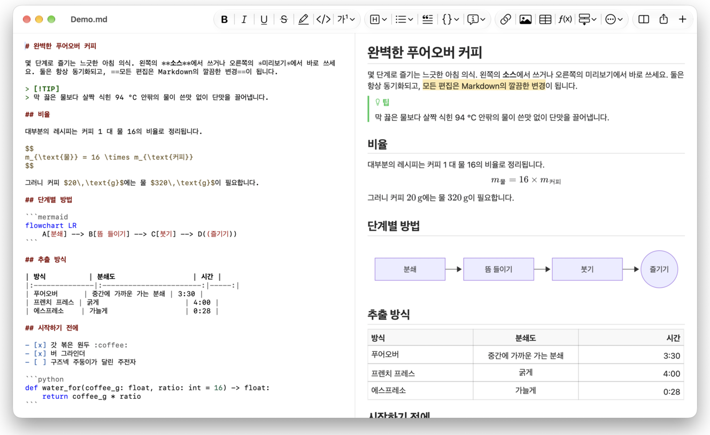
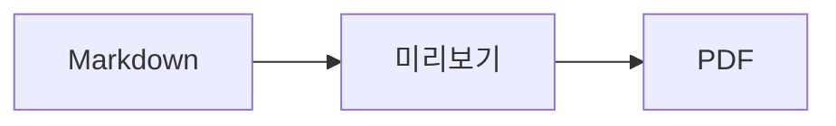

<p>&nbsp;&nbsp;&nbsp;</p>

# Splat

**소스에서도, 미리보기에서도 바로 쓸 수 있는 macOS용 Markdown 편집기.**

Splat은 구문이 색상으로 표시된 Markdown 소스를 왼쪽에, 실시간으로 갱신되며 완전히 편집할 수 있는 미리보기를 오른쪽에 보여 줍니다. 어느 쪽에서 입력해도 됩니다. 미리보기에서 쓴 내용은 소스의 최소한의 변경으로 반영되므로, 건드리지 않은 줄은 바이트 단위로 그대로 남고 Git diff도 깔끔하게 유지됩니다. Splat은 이미 쓰고 있는 Markdown을 그대로 읽습니다. CommonMark와 GitHub Flavored Markdown, GitHub 알림, Obsidian 위키 링크·임베드·콜아웃, Pandoc 및 Typora 확장, 삽입된 HTML, LaTeX 수식, Mermaid·Graphviz·PlantUML 다이어그램을 모두 오프라인에서 렌더링합니다. 폴더 전체의 메모를 둘러보고 검색하고, 마지막 Git 커밋 이후 바뀐 내용을 확인하고, Word나 웹 페이지에서 Markdown으로 붙여넣고, PDF, HTML, Word로 한 번에 내보낼 수 있습니다. 진짜 AppKit 컨트롤 위에서 Rust로 작성되었고, 35개 언어를 지원하며, 사용자가 요청하지 않는 한 네트워크로 아무것도 보내지 않습니다.
 


[](https://github.com/sventmueller/splat/releases/latest/download/Splat.dmg)

**[Download Splat.dmg](https://github.com/sventmueller/splat/releases/latest/download/Splat.dmg)**: Apple의 서명과 공증을 거쳤으며, Apple Silicon과 Intel을 탑재한 macOS 14 이상에서 사용할 수 있습니다.

**버그를 발견하셨나요?** Splat은 건드리지 않은 줄을 바이트 단위로 그대로 유지합니다. 그런데도 줄이 바뀌거나 파일이 잘못 표시되면 [이슈를 열고](https://github.com/sventmueller/splat/issues/new/choose) 파일을 첨부해 주세요. Splat이 유용하다면 [GitHub 스타](https://github.com/sventmueller/splat)가 다른 사람들이 Splat을 찾는 데 도움이 됩니다.
 
 

[](https://www.rust-lang.org)
[](https://www.apple.com/macos/)

[](https://github.com/madsmtm/objc2)
[](https://webkit.org)
[](https://github.com/kivikakk/comrak)
[](https://github.github.com/gfm/)
[](https://www.mathjax.org)
[](https://cortexjs.io/mathlive/)
[](https://mermaid.js.org)
[](https://graphviz.org)
[](https://plantuml.com)


[](#라이선스)

[Bahasa Indonesia](../id/README.md) ·
[Bahasa Melayu](../ms/README.md) ·
[Català](../ca/README.md) ·
[Čeština](../cs/README.md) ·
[Dansk](../da/README.md) ·
[Deutsch](../de/README.md) ·
[English](../../../README.md) ·
[Español](../es/README.md) ·
[Français](../fr/README.md) ·
[Hrvatski](../hr/README.md) ·
[Italiano](../it/README.md) ·
[Magyar](../hu/README.md) ·
[Nederlands](../nl/README.md) ·
[Norsk](../no/README.md) ·
[Polski](../pl/README.md) ·
[Português (Brasil)](../pt_BR/README.md) ·
[Português (Portugal)](../pt_PT/README.md) ·
[Română](../ro/README.md) ·
[Slovenčina](../sk/README.md) ·
[Slovenščina](../sl/README.md) ·
[Suomi](../fi/README.md) ·
[Svenska](../sv/README.md) ·
[Tiếng Việt](../vi/README.md) ·
[Türkçe](../tr/README.md) ·
[Ελληνικά](../el/README.md) ·
[Русский](../ru/README.md) ·
[Українська](../uk/README.md) ·
[עברית](../he/README.md)‎ ·
[العربية](../ar/README.md)‎ ·
[हिन्दी](../hi/README.md) ·
[ไทย](../th/README.md) ·
**한국어** ·
[日本語](../ja/README.md) ·
[简体中文](../zh-Hans/README.md) ·
[繁體中文](../zh-Hant/README.md)

## 목차

- [주요 기능](#주요-기능)
- [요구 사항](#요구-사항)
- [설치](#설치)
- [시작하기](#시작하기)
- [쓰기](#쓰기)
  - [소스에서](#소스에서)
  - [미리보기에서](#미리보기에서)
  - [포맷 명령](#포맷-명령)
  - [목록과 작업](#목록과-작업)
  - [표](#표)
  - [서식 있는 텍스트 붙여넣기](#서식-있는-텍스트-붙여넣기)
  - [메타데이터](#메타데이터)
- [지원하는 Markdown](#지원하는-markdown)
  - [CommonMark와 GitHub Flavored Markdown](#commonmark와-github-flavored-markdown)
  - [콜아웃](#콜아웃)
  - [확장 구문](#확장-구문)
  - [Obsidian](#obsidian)
  - [인용과 참조](#인용과-참조)
  - [삽입된 HTML](#삽입된-html)
  - [타이포그래피 문장 부호](#타이포그래피-문장-부호)
  - [구문 개요](#구문-개요)
- [수식](#수식)
- [다이어그램](#다이어그램)
- [이미지](#이미지)
- [링크와 탐색](#링크와-탐색)
- [폴더의 메모](#폴더의-메모)
- [마지막 커밋 이후 변경 사항](#마지막-커밋-이후-변경-사항)
- [내보내기, 프린트, 공유](#내보내기-프린트-공유)
- [Word 문서 가져오기](#word-문서-가져오기)
- [화면 모양과 손쉬운 사용](#화면-모양과-손쉬운-사용)
- [언어](#언어)
- [키보드 단축키](#키보드-단축키)
- [개인 정보 보호와 보안](#개인-정보-보호와-보안)
- [큰 문서](#큰-문서)
- [알려진 제한 사항](#알려진-제한-사항)
- [문제 해결](#문제-해결)
- [개발자용](#개발자용)
  - [서드파티 구성 요소](#서드파티-구성-요소)
- [라이선스](#라이선스)

## 주요 기능

- **두 가지 방식으로 쓰고, 텍스트는 하나.** 소스와 미리보기 모두 편집할 수 있습니다. 진실의 원천은 Markdown 파일 하나뿐입니다. 문서마다 실행 취소 기록은 하나이며, 미리보기에서의 편집은 소스의 가장 작은 변경으로 변환됩니다.
- **이미 쓰고 있는 Markdown.** CommonMark, GitHub Flavored Markdown, GitHub 알림, Obsidian, Pandoc 및 Typora 확장, 이모지 단축 코드, 스포일러, 정의 목록, 머리말 앵커, 그리고 GitHub README에서 쓰는 HTML을 지원합니다.
- **수식과 다이어그램 내장.** MathJax로 렌더링하는 LaTeX 수식과 비주얼 수식 편집기. Mermaid, Graphviz, PlantUML 다이어그램은 Java, 서버, 네트워크 연결 없이 Mac에서 바로 렌더링됩니다.
- **모든 것에 버튼 하나씩.** 모든 Markdown 구문에 도구 막대 버튼과 메뉴 항목이 있고, 자주 쓰는 구문에는 단축키도 있습니다. 표에는 행, 열, 정렬을 위한 전용 메뉴가 있습니다.
- **파일 하나가 아니라 폴더 전체.** 사이드바는 문서 주변의 메모를 나열하고 그 모두를 검색합니다. 메모 이름을 바꾸면 그 메모로 연결되는 링크도 바뀌며, 그 밖의 바이트는 모두 그대로 남습니다.
- **변경 사항을 한눈에.** Git 저장소에서는 텍스트 옆의 막대가 마지막 커밋과 달라진 부분을 두 패널 모두에 표시합니다.
- **Word와 웹에서 Markdown으로.** 서식 있는 텍스트는 Markdown으로, 스프레드시트의 셀은 표로 붙여넣고, Word 문서는 이미지까지 통째로 가져올 수 있습니다.
- **잃는 것 없는 내보내기.** PDF, 모든 것이 담긴 HTML 파일 하나, 또는 실제 머리말, 목록, 표, 각주, 이미지를 갖춘 Word 문서로 내보냅니다. 페이지 번호, 페이지 머리글, 제목 페이지를 추가하거나 회사의 Word 템플릿을 사용할 수 있습니다.
- **뼛속까지 네이티브.** 진짜 AppKit 윈도우, 탭, 메뉴, 팝오버, 버전, 자동 저장, 공유 메뉴, 다크 모드, 맞춤법 검사, 받아쓰기, VoiceOver를 지원합니다. Electron도, 텍스트 자체를 위한 웹 뷰도 없습니다.
- **큰 파일에서도 빠르게.** 10MB 문서에서 키 입력 한 번을 렌더링하는 데 뷰 자체의 작업 전까지 약 10ms가 걸립니다.
- **개인 정보를 신중하게.** 웹의 이미지는 허용한 뒤에만 로드되고, 다른 앱으로 연결되는 링크는 먼저 확인을 요청하며, 신뢰할 수 없는 이미지 데이터를 디코딩하는 모든 작업은 샌드박스 보조 프로세스에서 실행됩니다.
- **사용자의 언어로.** 인터페이스와 내장 Markdown 빠른 참조를 35개 언어로 제공합니다. 아랍어, 카탈루냐어, 중국어(간체), 중국어(번체), 크로아티아어, 체코어, 덴마크어, 네덜란드어, 영어, 핀란드어, 프랑스어, 독일어, 그리스어, 히브리어, 힌디어, 헝가리어, 인도네시아어, 이탈리아어, 일본어, 한국어, 말레이어, 노르웨이어, 폴란드어, 포르투갈어(브라질), 포르투갈어(포르투갈), 루마니아어, 러시아어, 슬로바키아어, 슬로베니아어, 스페인어, 스웨덴어, 태국어, 튀르키예어, 우크라이나어, 베트남어.

## 요구 사항

- macOS 14 Sonoma 이상. Splat은 macOS 27에서 개발 및 테스트되며, 여기서는 Liquid Glass 디자인이 자동으로 적용됩니다.
- Apple Silicon 또는 Intel 프로세서를 탑재한 Mac.
- 약 45MB의 디스크 공간.

## 설치

**디스크 이미지로 설치.** [`Splat.dmg`](https://github.com/sventmueller/splat/releases/latest/download/Splat.dmg)를 내려받아 열고, Splat을 응용 프로그램 폴더로 드래그하십시오. 이 이미지는 Developer ID로 서명되고 Apple의 공증을 거쳤으므로 경고 없이 열립니다.

**Homebrew로 설치.** 이 cask는 전용 tap에 있습니다.

```sh
brew install --cask sventmueller/tap/splat
```

`brew upgrade --cask splat`으로 새 버전을 설치하며, `brew uninstall --zap --cask splat`은 Splat의 설정과 캐시까지 함께 삭제합니다.

**업데이트.** 디스크 이미지나 Homebrew로 설치한 Splat은 [Sparkle](https://sparkle-project.org)로 스스로 최신 상태를 유지합니다. 두 번째로 실행하면 하루에 한 번 직접 업데이트를 확인해도 되는지 묻습니다. **Splat › 업데이트 확인…** 항목은 바로 확인하며, 같은 메뉴의 **자동으로 업데이트 확인**과 **자동으로 업데이트 다운로드 및 설치**로 나중에 선택을 바꿀 수 있습니다. Splat은 개발자의 서명이 있는 업데이트만 설치합니다. 직접 빌드한 버전에는 업데이트 기능이 없습니다.

**소스에서 빌드.** 필요한 사항은 [Building](../../../docs/development.md#building)을 참고한 다음 아래를 실행하십시오.

```sh
make build
ditto target/release/Splat.app /Applications/Splat.app
open /Applications/Splat.app
```

더블클릭으로 Markdown 파일을 Splat에서 열려면 Finder에서 `.md` 파일을 선택하고 **파일 › 정보 가져오기**를 선택한 다음, **다음으로 열기**에서 Splat을 고르고 **모두 변경…** 버튼을 클릭하십시오. Splat은 `.md`, `.markdown`, `.mdown`, `.mkd` 파일에 스스로를 등록합니다.

## 시작하기

### 윈도우

문서는 각각 자신의 윈도우에서 열리며, 탭을 선호하면 탭으로 열 수도 있습니다.

- **왼쪽: 소스.** SF Mono로 표시되고 구문이 색상으로 구분된 Markdown.
- **오른쪽: 미리보기.** 렌더링된 문서이며 바로 편집할 수 있습니다.
- **사이드바(선택 사항).** 모든 머리말을 트리로 보여 주며, 항목을 클릭하면 두 패널 모두에서 해당 위치를 보여 줍니다. **보기 › 개요 보기**(⌃⌘S)로 엽니다. 나머지 두 탭에는 [폴더의 메모](#폴더의-메모)와 그 메모를 찾는 검색이 있습니다. 윈도우 제목 옆의 버튼으로 보이거나 가리며, 새 윈도우는 마지막 윈도우에서 둔 상태 그대로 엽니다.
- **도구 막대.** 바꾸는 대상별로 묶인 버튼이 문자, 단락, 삽입하는 요소 순으로 놓이고, 이어서 미리보기 켜기/끄기, 공유, 새로운 문서가 있습니다. **보기 › 도구 막대 사용자화…** 항목으로 구성을 바꿀 수 있습니다.

구분선을 드래그하면 한쪽에 더 넓은 공간을 줄 수 있습니다. **보기 › 미리보기 가리기**(⌥⌘P)를 선택하면 소스만 남으며, Splat은 이 설정을 윈도우별로 기억합니다. 두 패널은 함께 스크롤되고, 한쪽에서 선택한 부분은 다른 쪽에서도 하이라이트됩니다.

윈도우 모서리에는 텍스트의 단어 수와 문자 수, 읽는 데 걸리는 시간이 표시되고, 선택 부분이 있는 동안에는 선택 부분의 값도 표시됩니다. 링크 주소, HTML 태그, 메타데이터, 주석, 수식, 다이어그램은 세지 않습니다. 처음에는 가려져 있으며, **보기 › 단어 수 보기**로 표시할 수 있습니다.

### 문서, 탭, 버전

Splat은 일반적인 macOS 문서 앱입니다.

- **자동 저장과 버전.** 변경 사항은 제자리에 저장됩니다. **파일 › 다음으로 복귀 › 모든 버전 탐색…** 항목으로 과거 시점으로 돌아갈 수 있습니다.
- **다른 프로그램에서의 변경.** Git, 스크립트, 다른 편집기가 열려 있는 문서를 바꾸면 Splat은 문서를 다시 읽어 오고 캐럿과 스크롤 위치를 유지합니다. 저장하지 않은 변경 사항이 있으면 Splat이 그대로 보존하며, 다른 버전 위에 저장하기 전에 macOS가 먼저 확인을 요청합니다.
- **일반적인 파일 명령.** 복제(⇧⌘S), 이름 변경…, 다음으로 이동…, **파일 › 최근 사용 열기**.
- **탭.** **파일 › 새로운 탭** 또는 도구 막대의 **+** 버튼으로 새로운 문서를 탭으로 엽니다. 표준 윈도우 메뉴에서 탭을 통합하거나, 이동하거나, 전환할 수 있습니다.
- **윈도우 위치.** 마지막 윈도우의 크기와 위치는 재시작 후에도 기억됩니다. 이미 그 자리에 윈도우가 있으면 새 윈도우는 약간 어긋나게 열립니다.
- **Dock 아이콘.** 마지막 윈도우를 닫은 뒤 클릭하면 새로운 문서가 열립니다.
- **Splat에서 Markdown 파일 열기.** **Splat › Markdown 기본 앱으로 설정**을 선택하면 `.md` 또는 `.markdown` 파일을 더블클릭할 때 Splat이 열립니다. macOS가 한 번 확인을 요청합니다. Splat이 기본 앱인 동안에는 이 항목에 체크 표시가 나타납니다.

파일은 UTF-8 텍스트이거나 바이트 순서 표시가 있는 UTF-16이어야 합니다. Splat은 다른 인코딩을 추측해서 텍스트를 손상시키는 대신 열지 않습니다. 바이트 순서 표시는 그대로 유지되고, UTF-16은 UTF-16으로 유지되며, 모든 줄이 CRLF로 끝나는 파일에서는 새로 추가한 줄도 CRLF를 사용합니다.

**충돌이 발생해도** 잃는 것은 길어야 마지막 몇 초 동안 입력한 내용입니다. Splat은 5초마다 저장하지 않은 텍스트를 `~/Library/Application Support/Splat/Unsaved`에 복사하고, 문서를 저장하거나 Splat이 정상적으로 종료되면 그 복사본을 삭제합니다. 다음에 시작할 때 충돌 때문에 남은 복사본을 `~/Library/Application Support/Splat/Recovery`로 옮기고 한 번 알려 주며, 그 폴더를 여는 버튼도 표시됩니다. Splat이 대응할 수 있는 충돌이라면 열려 있던 모든 문서의 텍스트도 그곳에 기록됩니다.

### 빠른 참조

**도움말 › Markdown 빠른 참조**는 사용자의 언어로 된 치트 시트를 제목 없는 새로운 문서로 엽니다. 일반 문서이므로 소스에서든 미리보기에서든 그 자리에서 무엇이든 시험해 볼 수 있습니다.

## 쓰기

### 소스에서

소스는 Markdown에 맞게 다듬어진 일반 텍스트 편집기입니다.

- **구문 색상**은 VS Code와 비슷합니다. 머리말, 강조, 링크, 코드, 표, HTML, 프런트 매터, 그리고 수식과 다이어그램 안의 LaTeX와 Mermaid에 적용됩니다. 밝은 모드, 어두운 모드, 대비 증가에 맞는 팔레트가 있습니다.
- **펜스 코드 블록**은 Bash, C, C++, C#, CSS(SCSS와 Less 포함), Go, HTML, XML, Java, JavaScript, JSON, Kotlin, PHP, Python, Ruby, Rust, SQL, Swift, TypeScript, YAML, TeX, Mermaid에 대해 하이라이트되며, `js`, `py`, `sh` 같은 일반적인 줄임 이름도 인식합니다.
- **예상치 못한 치환 없음.** 스마트 인용 부호, 스마트 대시, 텍스트 대치는 `--`, `---`, `"`를 망가뜨리므로 기본적으로 꺼져 있습니다. **편집 › 대체**에서 켤 수 있습니다.
- **시스템의 글쓰기 도구.** 맞춤법 및 문법 검사, 받아쓰기, 찾기 및 대치(⌥⌘F), 말하기.
- **드래그 앤 드롭.** 이미지 파일을 놓으면 ``가 삽입되고, 다른 파일을 놓으면 그 파일로의 링크가, URL을 놓으면 `[url](url)`이 삽입됩니다. 한 번 놓을 때마다 실행 취소 한 단계입니다.
- **이미지 붙여넣기.** 스크린샷 같은 클립보드의 그림은 문서 옆에 PNG 파일(`이미지 2026-10-29 13.09.07.png`)로 저장되고 이미지로 삽입됩니다. 이렇게 하려면 문서를 먼저 한 번 저장해야 합니다.

### 미리보기에서

미리보기는 워드 프로세서처럼 동작하지만, 그 안에서 하는 모든 작업은 결국 Markdown이 됩니다.

- **입력.** `*`나 `#`처럼 Markdown에서 의미가 있는 문자는 입력한 그대로 보이도록 이스케이프됩니다.
- **Return**은 새로운 단락이나 목록 항목을 시작합니다. **⌥Return** 또는 **⌃Return**은 줄바꿈을 삽입합니다.
- **커서 위치의 포맷.** 커서가 단어 끝에 있으면 볼드체, 이탤릭체 등 문자 포맷이 이후에 입력하는 내용에 적용됩니다. 그 포맷을 다시 선택하면 해제됩니다. 단어 안에서는 단어 전체에 포맷이 적용됩니다.
- **빈 줄.** 빈 줄에서 Return 키를 누르면 빈 줄이 하나 더 추가되고, Backspace 키를 누르면 제거됩니다. 소스에서는 빈 줄 하나가 늘 때마다 빈 줄이 두 개 더 생기며, 다른 Markdown 프로그램에서는 일반적인 단락 간격으로 표시됩니다.
- **실행 취소**는 두 패널에 걸쳐 작동합니다. 실행 취소 항목에는 이름이 붙고(“볼드체 실행 취소”), 입력은 연속해서 친 단위마다 한 단계이며, 실행 취소와 실행 복귀 후에는 두 패널이 모두 변경된 위치로 스크롤됩니다.
- **수식과 다이어그램**은 완성된 그래픽으로 표시됩니다. 클릭하거나, 커서를 그 위로 옮기거나, 그 위에서 Return 키를 누르면 편집기가 열립니다([Formulas](#수식)와 [Diagrams](#다이어그램) 참고).
- **삽입된 HTML, 삽입된 메모, 프런트 매터**는 표시되지만 편집은 소스에서 합니다. 이를 클릭하면 소스에서 해당하는 위치에 커서가 놓입니다.

Markdown으로 표현할 수 없는 것은 미리보기에서 차단됩니다. 서체 및 색상 패널, 눈금자, 서식 있는 텍스트와 이미지의 붙여넣기 및 드롭이 여기에 해당합니다. 붙여넣은 HTML과 RTF는 [Markdown으로 붙여넣기](#서식-있는-텍스트-붙여넣기)를 선택하지 않는 한 일반 텍스트로 들어옵니다.

### 포맷 명령

모든 명령은 도구 막대, 메뉴 막대, 두 패널의 컨텍스트 메뉴에서 사용할 수 있습니다. 커서 위치에 적용된 포맷은 메뉴 항목에 체크 표시로 나타납니다.

| 메뉴 | 명령 |
|---|---|
| **포맷 › 서체** | 볼드체, 이탤릭체, 밑줄체, 취소선, 하이라이트, 코드, 위 첨자, 아래 첨자 |
| **포맷 › 머리말** | 본문, 머리말 1~6 |
| **포맷 › 목록** | 구분점 목록, 번호 목록, 작업 목록 |
| **포맷** | 인용, 코드 블록(언어 없음 또는 20개 언어 중 하나이며, 기존 블록의 언어도 변경), 콜아웃(참고, 팁, 중요, 경고, 주의이며 같은 유형을 다시 선택하면 해제), 수식 또는 다이어그램 편집…, 포맷 지우기 |
| **삽입** | 링크…, 이미지…, 표…, 수식, 다이어그램(순서도, 시퀀스 다이어그램, 간트 차트), 목차, 각주, 구분선 |
| **표** | 위에 행 삽입/아래에 행 삽입, 왼쪽에 열 삽입/오른쪽에 열 삽입, 행 삭제, 열 삭제, 정렬(왼쪽 정렬, 중앙 정렬, 오른쪽 정렬, 기본값), 표의 열 정렬 |
| **보기** | 미리보기 가리기/보기, 개요 보기/가리기, 타이포그래피 문장 부호, 확대/축소, 실제 크기, 도구 막대, 탭 막대, 전체 화면 |

밑줄체, 하이라이트, 위 첨자, 아래 첨자는 GitHub에서도 표시되는 `<ins>`, `<mark>`, `<sup>`, `<sub>`로 기록됩니다. Splat은 GitHub가 제거하는 `<u>`와 더 짧은 `==highlight==`, `^sup^`, `~sub~`도 읽습니다. GitHub는 `==`와 `^`를 입력한 그대로, `~sub~`를 취소선으로 표시합니다.

### 목록과 작업

- Return 키는 목록을 이어 가고, 빈 항목에서 Return 키를 누르면 목록이 끝납니다.
- **Tab**과 **⇧Tab**은 미리보기에서 목록 항목을 들여쓰기하거나 내어쓰기합니다.
- 미리보기에서 작업 체크박스를 클릭하면 `- [ ]`와 `- [x]`가 전환됩니다.
- **포맷 › 목록**은 선택한 단락을 목록으로 바꾸거나 목록의 종류를 변경합니다.

### 표

- **삽입 › 표…** 항목은 행 수(머리말 행 포함)와 열 수를 묻습니다.
- 미리보기에서 **Tab**은 다음 셀로, **⇧Tab**은 이전 셀로, **Return**은 아래 셀로 이동합니다. 마지막 셀에서 Tab 키를 누르면 행이 추가됩니다.
- **표** 메뉴에서 행과 열을 삽입하거나 삭제하고 열의 정렬을 설정할 수 있습니다(⌘{, ⌘|, ⌘}).
- **표 › 표의 열 정렬**은 열이 가지런히 맞도록 소스에 공백을 채웁니다.

### 서식 있는 텍스트 붙여넣기

**편집 › Markdown으로 붙여넣기**(⌃⌘V)는 두 패널의 컨텍스트 메뉴에도 있으며, 클립보드의 내용을 Markdown으로 바꾸어 선택 부분에 넣습니다. 이 작업은 실행 취소 한 단계입니다. ⌘V는 계속 일반 텍스트를 삽입합니다.

- **브라우저, Word, Google Docs, Confluence, 메모, Pages에서:** 머리말, 볼드체, 이탤릭체, 밑줄체, 취소선, 위 첨자와 아래 첨자, 링크, 중첩을 유지한 목록, 인용, 코드, 표가 함께 옮겨집니다.
- **스프레드시트에서:** 셀은 머리말 행이 있고 숫자 열이 오른쪽으로 정렬된 표가 됩니다. 탭, 세미콜론, 쉼표로 구분된 텍스트도 모든 줄의 열 수가 같으면 마찬가지입니다.
- **그림** 중 웹 주소가 있는 것은 링크로 남습니다. 붙여넣은 HTML 안에 있는 그림은 문서 옆의 파일이 되며, 이렇게 하려면 문서를 먼저 한 번 저장해야 합니다. Word의 임시 그림 파일은 따라오지 않고, 대체 텍스트가 남습니다.
- **링크**는 `http`, `https`, `mailto`, 상대 주소, `#` 주소만 남습니다. 그 밖의 링크는 텍스트만 남습니다.

### 메타데이터

**포맷 › 메타데이터 편집…** 항목을 선택하거나 미리보기 맨 위의 메타데이터 줄을 클릭하면 YAML 프런트 매터의 필드가 담긴 양식이 열립니다. 필드는 변경, 추가, 제거할 수 있습니다. 목록이 있는 필드는 목록으로 유지됩니다. 값은 쉼표로 이어지고, 쉼표가 들어 있는 값은 따옴표로 묶입니다. `tags`, `aliases`, `keywords`, `categories`, `authors`, `cssclasses`라는 이름의 새 필드도 목록이 됩니다. 중첩된 필드와 여러 줄 텍스트는 양식에서 볼 수 있으며 소스에서 편집합니다.

양식에서 바꾼 내용은 실행 취소 한 단계이며, 바꾼 필드의 줄에만 미칩니다. 나머지 모든 필드의 주석, 순서, 특이한 공백, 따옴표, 줄 끝은 바이트 단위로 그대로 남습니다. 메타데이터가 없는 문서에는 시작 부분에 블록이 추가됩니다.

## 지원하는 Markdown

Splat은 CommonMark 및 GFM과 호환되는 파서 [comrak](https://github.com/kivikakk/comrak)으로 구문을 분석하며, 대부분의 확장을 켜 둡니다. 아래의 모든 구문은 미리보기와 모든 내보내기에서 렌더링됩니다.

### CommonMark와 GitHub Flavored Markdown

- 머리말(`#`과 밑줄 방식), 단락, 줄바꿈, 강조, 굵은 강조, 인라인 코드, 블록 인용, 구분선.
- 구분점 목록, 번호 목록, 중첩 목록, 작업 목록.
- 링크(인라인, 참조, 자동), 이미지, 링크 참조 정의.
- 구문 색상이 적용되는 펜스 코드 블록과 들여쓰기 코드 블록.
- 열 정렬을 지원하는 표.
- `~~물결표 두 개~~`로 쓰는 취소선.
- 각주: 문서 어디에든 `text[^1]`과 `[^1]: The note.`를 쓸 수 있습니다. 표시를 클릭하면 각주로 이동합니다.
- 맨 위의 `---` 줄 사이에 쓰는 YAML 프런트 매터. 미리보기는 이를 “메타데이터: title, date, tags”처럼 한 줄로 요약합니다.

### 콜아웃

GitHub 알림은 아이콘과 제목이 있는 색상 상자로 렌더링됩니다.

```markdown
> [!NOTE]
> 사용자가 알아야 할 유용한 정보.

> [!WARNING]
> 즉각적인 주의가 필요한 중요한 내용.
```

유형은 참고, 팁, 중요, 경고, 주의의 다섯 가지입니다. **포맷 › 콜아웃**은 커서가 있는 단락을 콜아웃으로 바꿉니다.

Obsidian 콜아웃도 임의의 제목과 접기 상태를 지정해 사용할 수 있습니다.

```markdown
> [!tip]- 클릭하여 ▸ 펼치기
> 펼치기 전까지는 숨겨져 있습니다.

> [!question]+ 기본으로 펼침
> `+`는 펼친 상태로, `-`는 접은 상태로 시작합니다.
```

Obsidian의 다른 유형은 다섯 가지 중 가장 가까운 색상으로 표시됩니다. `success`, `check`, `done`, `hint`는 팁으로, `question`, `help`, `faq`는 중요로, `attention`은 경고로, `failure`, `fail`, `missing`, `danger`, `error`, `bug`는 주의로, 나머지는 모두 참고로 표시됩니다.

### 확장 구문

| 기능 | 구문 | 출처 |
|---|---|---|
| 하이라이트 | `==marked text==` | Obsidian, Typora |
| 위 첨자 | `x^2^` | Pandoc, Typora |
| 아래 첨자 | `H~2~O` | Pandoc, Typora |
| 이모지 단축 코드 | `:rocket:`이 🚀로 바뀜 | GitHub |
| 스포일러 | `\|\|hidden text\|\|`, 선택하여 읽기 | Discord |
| 인라인 각주 | `text^[the note itself]` | Pandoc, Obsidian |
| 정의 목록 | `Term`, 빈 줄, `: Explanation` | PHP Markdown Extra, Pandoc |
| 머리말 앵커 | `## Install {#setup}`, 링크는 `[see](#setup)` | Pandoc, kramdown |

정의 목록은 소스에서 다음과 같은 모양입니다.

```markdown
용어

: 용어에 대한 설명.
```

사용자 지정 앵커가 없으면 GitHub에서처럼 모든 머리말은 텍스트에서 만든 앵커를 갖습니다. `## 시작하기`는 `#시작하기`로 이동할 수 있습니다.

### Obsidian

- **위키 링크.** `[[Note]]`는 같은 폴더나 그 하위 폴더에 있는 `Note.md`로 연결됩니다. `[[Note|Shown text]]`는 원하는 텍스트를 표시하고, `[[Note#Heading]]`은 메모를 엽니다. ⌘-클릭하면 Splat에서 열립니다.
- **임베드.** `![[Note]]`는 다른 메모를 이 메모 안에 보여 주며, 그 안에 임베드된 메모는 링크로 나타납니다. `![[diagram.png]]`는 이미지를 보여 줍니다. Obsidian과 마찬가지로 임베드는 문서의 폴더 또는 그 하위 폴더에 있는 메모와 이미지를 이름으로만 가리키며 절대 경로는 쓰지 않고, Markdown 파일만 메모로 표시됩니다.
- **주석.** `%%Only in the source%%`는 소스에서는 계속 보이고 미리보기와 모든 내보내기에서는 빠지며, 인라인이든 독립된 줄이든 마찬가지입니다.
- **태그.** `#idea`나 `#project/splat`은 하이라이트됩니다. ⌘-클릭하면 문서에서, 사이드바에서는 폴더 전체에서 그 태그를 검색합니다.
- **접을 수 있는 콜아웃.** [Callouts](#콜아웃)를 참고하십시오.

### 인용과 참조

- **Pandoc 인용.** `[@doe2020]` 또는 `[@doe2020; @roe2021]`은 “(Doe 2020; Roe 2021)”처럼 표시됩니다. 항목은 프런트 매터에 `bibliography: refs.bib`로 지정한 BibTeX 파일에서 가져옵니다. 지정하지 않으면 Splat은 문서 옆의 `references.bib`, `literatur.bib`, `bibliography.bib`를 사용합니다.
- **GitHub 및 GitLab 참조.** 문서가 `origin` 리모트가 github.com 또는 GitLab 호스트에 있는 Git 저장소 안에 있으면 `@name`, `#12`(이슈), `!7`(머지 리퀘스트, GitLab 전용)이 하이라이트됩니다. ⌘-클릭하면 브라우저에서 열립니다.

### 삽입된 HTML

GitHub README에서 볼 수 있는 HTML은 브라우저 엔진이 아닌 자체 리더로 렌더링됩니다.

- 가운데 정렬된 단락과 블록(`<p align="center">`, `<div align="center">`)
- 크기를 지정한 이미지(``)
- 링크, `<kbd>⌘</kbd>`, `<br>`, `<u>`, `<ins>`, `<mark>`, `<sup>`, `<sub>`
- 목록과 표, 열을 병합하는 셀(`colspan`) 포함
- 접을 수 있는 섹션: `<details><summary>더 보기</summary>…</details>`, ▸를 클릭하여 펼칩니다

HTML 태그 사이의 Markdown은 Markdown으로 렌더링됩니다. 스크립트, 스타일, 프레임, 폼은 완전히 제외되며, 링크와 이미지에서는 `http`, `https`, `mailto`, 상대 주소만 남습니다.

### 타이포그래피 문장 부호

**보기 › 타이포그래피 문장 부호**는 곧은 따옴표를 인터페이스 언어의 인용 부호로, `--`를 엔 대시로, `---`를 엠 대시로, `...`를 말줄임표로 표시합니다. 독일어에서는 `"Ja"`가 „Ja“가 되고, 프랑스어에서는 «Oui», 일본어에서는 「はい」가 되며, 중국어와 일본어가 인용 부호 앞뒤에 공백을 두지 않는 곳에서도 마찬가지입니다. 히브리어 약어 `צה"ל`은 게르샤임이 붙어 צה״ל이 됩니다. 소스에는 일반 문자가 그대로 남고, 미리보기와 모든 내보내기에는 타이포그래피 문자가 표시됩니다. 이 설정은 켜기 전까지 꺼져 있습니다.

### 구문 개요

| 요소 | Markdown |
|---|---|
| **볼드체** | `**볼드체**` |
| *이탤릭체* | `*이탤릭체*` |
| 밑줄체 | `<ins>밑줄체</ins>` 또는 `<u>밑줄체</u>` |
| ~~취소선~~ | `~~취소선~~` |
| 하이라이트 | `<mark>하이라이트</mark>` 또는 `==하이라이트==` |
| `코드` | `` `코드` `` |
| x² | `x<sup>2</sup>` 또는 `x^2^` |
| H₂O | `H<sub>2</sub>O` 또는 `H~2~O` |
| [링크](https://example.com) | `[링크](https://example.com)` |
| 머리말 | `# 머리말`부터 `###### 머리말`까지 |
| 인용 | `> 인용` |
| 구분점 목록 | `- 항목` |
| 번호 목록 | `1. 항목` |
| 작업 | `- [ ] 미완료`와 `- [x] 완료` |
| 코드 블록 | ```` ```rust ```` … ```` ``` ```` |
| 표 | `\| A \| B \|`와 머리말 아래의 `\|---\|---\|` |
| 각주 | `텍스트[^1]`과 `[^1]: 주석` |
| 구분선 | `---` |
| 이미지 | `` |
| 수식 | `$E = mc^2$`, `$$ … $$` |
| 다이어그램 | ```` ```mermaid ````, ```` ```dot ````, ```` ```plantuml ```` |
| 콜아웃 | `> [!TIP]` |
| 위키 링크 | `[[메모]]`, `[[메모\|텍스트]]` |
| 임베드 | `![[메모]]`, `![[image.png]]` |
| 주석 | `%%주석%%` |
| 태그 | `#태그` |
| 참고 문헌 인용 | `[@key]` |
| 스포일러 | `\|\|스포일러\|\|` |
| 이모지 | `:tada:` |

## 수식

수식은 [MathJax](https://www.mathjax.org)가 TeX 및 AMS 수학 지원으로 렌더링하며, 선명한 벡터 그래픽이 됩니다. `\text{…}` 안의 텍스트는 어떤 문자든 쓸 수 있습니다. MathJax의 서체에 없는 글자는 Mac의 서체에서 가져오고, 아랍어와 히브리어는 오른쪽에서 왼쪽으로 표시되며, 이모지는 컬러로 나타납니다.

| 종류 | 구문 |
|---|---|
| 인라인 | `$E = mc^2$`, `` $`E = mc^2`$ ``(GitHub, GitLab), `\(E = mc^2\)` |
| 디스플레이 | `$$` … `$$`, `\[` … `\]`, 또는 `math`로 지정한 코드 블록 |

**수식 편집.** 미리보기에서 수식을 클릭하거나, 더블클릭하거나, 그 위에서 Return 키를 누르거나, 커서를 그 위로 옮기면 팝오버에서 편집기가 열립니다. **삽입 › 수식**은 새 수식을 삽입하고 곧바로 편집기를 엽니다.

- **비주얼 또는 LaTeX.** 위쪽의 스위치로 비주얼 편집기([MathLive](https://cortexjs.io/mathlive/))와 LaTeX 코드를 전환합니다. Splat은 선택을 기억합니다.
- **구성 요소**로 분수, 제곱근, 위 첨자와 아래 첨자, 상한과 하한이 있는 합과 적분, 극한, 내용에 맞게 커지는 괄호, 2×2 행렬, 그리스 문자, 관계 기호, 연산자 및 화살표를 삽입할 수 있습니다. 구성 요소는 자리 표시자 □를 남기며, **Tab** 키를 누르면 다음 자리 표시자로 이동합니다.
- **실시간 미리보기.** 입력하는 동안 변경 사항이 문서에 나타납니다. MathJax의 오류는 코드 아래 한 줄에 표시됩니다.
- **확정 또는 취소.** 바깥을 클릭하면 변경 사항이 실행 취소 한 단계로 유지되고, **Esc** 또는 **취소**를 누르면 버려집니다. 비어 있는 새 수식에서 Esc 키를 누르면 수식이 다시 제거됩니다.
- 컨텍스트 메뉴는 포인터 아래의 수식에 대해 **수식 편집…** 항목을 제공합니다.

VoiceOver는 수식을 LaTeX 코드로 읽습니다. Splat은 완전한 LaTeX 문서가 아니라 수식을 렌더링합니다. 패키지, TikZ, `\documentclass`는 지원하지 않습니다.

## 다이어그램

다이어그램은 Splat 안에서 오프라인으로, 밝은 버전과 어두운 버전으로 렌더링됩니다.

| 엔진 | 코드 블록 | 그리는 대상 |
|---|---|---|
| [Mermaid](https://mermaid.js.org) | ```` ```mermaid ```` | 순서도, 시퀀스, 클래스, 상태, 개체 관계, 간트, 파이, 마인드맵, 타임라인 등 Mermaid의 모든 유형 |
| [Graphviz](https://graphviz.org) | ```` ```dot ```` 또는 ```` ```graphviz ```` | DOT 언어로 쓴 그래프 |
| [PlantUML](https://plantuml.com) | ```` ```plantuml ```` 또는 ```` ```puml ```` | UML 다이어그램, Java 없이 실행 |



**다이어그램 편집**은 수식 편집과 똑같이 작동합니다. 클릭하면 팝오버에서 구문 색상이 적용된 코드가 열리고, 오류 메시지는 코드 아래 한 줄에 표시됩니다. **삽입 › 다이어그램**은 순서도, 시퀀스 다이어그램, 간트 차트 템플릿에서 시작합니다. 가장 흔한 세 가지 Mermaid 유형에는 구성 요소가 도움을 줍니다.

- **순서도:** 노드 ▾(사각형, 둥근 사각형, 원, 마름모, 데이터베이스), 연결, 레이블 포함, 그룹, 방향 ▾
- **시퀀스 다이어그램:** 참여자, 메시지, 응답, 메모, 루프, 조건에 따른 분기
- **간트 차트:** 섹션, 작업, 마일스톤

그 밖의 다이어그램 유형은 코드로 편집합니다. VoiceOver는 다이어그램의 제목이나 대체 텍스트를 읽습니다.

실행 후 처음 나타나는 다이어그램은 렌더링 엔진이 백그라운드에서 시작하므로 약 1초가 걸립니다. 10초보다 오래 걸리는 다이어그램은 오류를 표시하며, 다음 다이어그램을 위해 렌더링 엔진이 새로 시작됩니다. PlantUML 엔진(3MB)은 첫 PlantUML 다이어그램이 나올 때만 로드됩니다. 웹에서 가져오는 PlantUML `!include`는 차단됩니다.

## 이미지

- **로컬 이미지**는 문서를 기준으로 한 상대 경로를 사용합니다. ``. Splat은 PNG, JPEG, GIF, WebP, BMP, SVG, HEIC, TIFF, AVIF, PDF를 표시합니다.
- **웹의 이미지**는 허용하기 전까지 차단됩니다. 미리보기 위의 막대가, 이미지를 로드하면 이미지 서버에 문서를 열었다는 사실과 연 시각이 전달된다고 설명합니다. **이미지 로드**는 이 문서에 대해 이를 허용하며, Splat은 파일별로 선택을 기억합니다.
- **크기.** ``로 이미지 크기를 지정하며, 지정하지 않으면 이미지가 미리보기의 너비에 맞춰집니다.
- **디스크의 변경.** 교체한 이미지나 문서에서 이름을 지정한 뒤에 나타난 이미지는 문서를 다시 열지 않아도 표시됩니다. 네트워크 문제로 실패한 웹 이미지는 문서가 표시하는 동안 다시 시도됩니다.
- **메모리.** 이미지는 긴 쪽이 최대 2560픽셀로 표시되며, 이는 A4 용지 한 장을 채우기에도 충분합니다. 이미지가 Mac 메모리의 8분의 1을 채우면, 그리고 macOS가 메모리 압박을 알리는 동안에는 더 작게 디코딩됩니다.
- **다크 모드.** 흰색 배경의 이미지는 어두운 미리보기에서 약간 어둡게 표시됩니다.
- **붙여넣기와 드롭.** [In the source](#소스에서)를 참고하십시오.

## 링크와 탐색

미리보기에서 클릭하면 링크 텍스트를 편집할 수 있도록 커서가 놓이고, **⌘-클릭**하면 링크를 따라갑니다.

- `http`, `https`, `mailto`는 브라우저나 메일 앱에서 열립니다.
- Markdown 파일은 Splat에서 열리고, 그 밖의 파일과 폴더는 Finder에서 보여 줍니다.
- `#anchor`는 문서의 해당 머리말로 이동합니다.
- `slack://`이나 `vscode://`처럼 다른 앱을 여는 주소는 먼저 확인을 요청하며, 전체 주소와 앱을 보여 줍니다. **취소**가 미리 선택되어 있습니다.

**삽입 › 목차**는 모든 머리말로 연결되는 링크 목록을 삽입합니다. 커서가 목차 안에 있으면 같은 명령이 목차를 업데이트합니다. 개요 사이드바(⌃⌘S)에서는 두 패널 모두에서 원하는 머리말로 이동할 수 있습니다.

## 폴더의 메모

사이드바 맨 위의 버튼으로 개요, 파일, 검색을 전환합니다.

- **파일**(**보기 › 파일 보기**, ⌃⌘E). 문서가 있는 폴더의 모든 Markdown 파일을 보여 주며, 문서가 Git 저장소 안에 있으면 저장소 전체의 파일을 보여 줍니다. 클릭하거나 Return 키를 누르면 메모가 이 윈도우의 탭으로 열리고, 이미 열려 있으면 앞으로 나옵니다. 폴더 이름 옆의 버튼은 이 윈도우에 다른 폴더를 보여 줍니다. 숨김 파일, `node_modules`, `target`, `Pods`, `DerivedData`, `__pycache__`, 메모가 없는 폴더는 제외됩니다. 홈 폴더 바로 아래에 있는 문서는 그 옆의 메모만 보여 줍니다. Splat이 모든 폴더를 돌아다니며 폴더마다 허가를 묻지 않도록 하기 위해서입니다.
- **검색**(**편집 › 찾기 › 모든 메모 검색…**, ⇧⌘F). 대소문자나 악센트의 인코딩 방식에 상관없이 모든 메모에서 텍스트를 찾습니다. `#tag`는 태그를 찾고, `#project`는 `#project/splat`도 찾으며, 코드 안에 있는 것은 찾지 않습니다. 결과를 클릭하면 메모의 해당 위치가 열립니다.
- **메모로 연결되는 링크.** 메모의 컨텍스트 메뉴는 위키 링크, 임베드, 상대 링크, 참조 정의로 그 메모에 연결된 메모를 나열합니다.
- **메모 이름 변경.** 같은 메뉴에서 메모 이름을 바꾸고 그 링크들도 바꿉니다. Splat은 먼저 몇 개의 파일에서 몇 개의 링크가 바뀌는지 알려 줍니다. 각 링크에서는 이름만 바뀌고, 파일의 다른 모든 바이트는 그대로 남습니다. 열려 있는 문서에서는 변경이 실행 취소 한 단계가 되고, 그 밖의 파일에서는 Git이나 버전으로만 되돌릴 수 있습니다. 그 사이 다른 프로그램이 변경한 파일이 있으면 모든 링크의 이름 변경이 중단되고, Splat이 그 파일의 이름을 알려 줍니다.

목록은 윈도우가 앞으로 나올 때 폴더의 상태를 따라갑니다. 검색은 디스크에 있는 그대로의 파일을 보므로, 아직 저장하지 않은 텍스트는 다음 자동 저장부터 포함됩니다.

## 마지막 커밋 이후 변경 사항

Git 저장소 안에 있는 문서에서는 텍스트 옆의 막대가 마지막 커밋과 달라진 부분을 소스와 미리보기에 표시합니다. 추가된 줄은 초록색, 변경된 줄은 파란색이고, 무언가 삭제된 곳에는 짧은 빨간색 표시가 나타납니다. 막대는 입력하는 동안과 브랜치가 옮겨 갈 때 함께 갱신됩니다. **보기 › 마지막 커밋 이후 변경 사항**으로 모든 윈도우에서 끌 수 있습니다.

줄 끝만 다른 줄은 세지 않으므로, LF로 된 커밋과 비교한 CRLF 파일에는 변경이 표시되지 않습니다. 새 파일은 첫 커밋 전까지 표시가 없으며, 32MB를 넘는 문서도 마찬가지입니다.

## 내보내기, 프린트, 공유

| 포맷 | 방법 | 결과 |
|---|---|---|
| **PDF** | **파일 › PDF로 내보내기…** 또는 공유 메뉴 | 용지 크기의 페이지이며 항상 밝은 모양이고, 수식과 다이어그램은 벡터 그래픽입니다. **파일 › 페이지 설정…** 항목에서 용지를 지정합니다. |
| **프린트** | **파일 › 프린트…**(⌘P) | PDF와 같은 레이아웃. |
| **HTML** | **파일 › HTML로 내보내기…** 또는 공유 메뉴 | 모든 것이 담긴 파일 하나: 로컬 이미지는 포함되고, 수식과 다이어그램은 선명한 이미지가 되며, 목차가 작동하도록 머리말 앵커가 들어 있습니다. 스크립트는 없습니다. |
| **Word** | **파일 › Word 문서로 내보내기…** 또는 공유 메뉴 | Word의 머리말 스타일, 실제 목록과 표(병합된 셀 포함), Word 각주로 변환된 각주, 포함된 이미지, 수식, 다이어그램을 갖춘 `.docx`. |
| **Markdown** | 도구 막대의 **공유** 버튼 | Mail, 메시지, AirDrop 등 모든 공유 서비스에 쓸 수 있도록 문서를 `.md` 파일로 만듭니다. |

**파일 › 공유** 메뉴에서는 이 모든 것을 한곳에서 선택할 수 있습니다. 내보내기에는 타이포그래피 문장 부호 설정과 웹에서 허용한 이미지가 반영되며, 웹의 이미지는 HTML에서 링크로 남습니다.

**파일 › 내보내기 옵션…** 항목은 PDF, 프린트, Word가 텍스트에 추가하는 내용을 모든 문서에 대해 설정합니다.

- **페이지 번호**는 PDF와 프린트의 페이지 바닥글에 `2 / 9` 형식으로 들어갑니다.
- **페이지 머리글과 바닥글**은 PDF와 프린트에 적용됩니다. `{title}`, `{author}`, `{date}`, `{page}`, `{pages}`는 각각의 값을 나타내며, 앞의 세 값은 문서의 메타데이터에서 가져옵니다.
- **제목 페이지**는 PDF, 프린트, Word에 적용되며, 메타데이터의 `title`, `subtitle`, `author`, `date`를 넣고, 제목이 없으면 문서 이름을 제목으로 씁니다. 페이지 머리글과 바닥글은 없습니다.
- **Word 템플릿**은 내보내기가 그 모양을 따르는 `.docx` 또는 `.dotx` 파일입니다. 지역화된 이름을 포함한 스타일, 테마, 페이지 크기, 여백, 페이지 머리글과 바닥글을 따릅니다. 읽을 수 없는 템플릿은 템플릿 없는 문서를 만드는 대신 내보내기를 중단하고 그 사실을 알립니다.

## Word 문서 가져오기

**파일 › Word 문서 가져오기…** 항목은 `.docx` 또는 `.dotx` 파일과 Markdown을 저장할 위치를 묻고 결과를 엽니다. 이미지는 그 옆의 폴더에 들어가며, 폴더 이름은 문서 이름에 `-images`를 붙인 것입니다.

머리말과 목록은 Word의 스타일과 번호 매기기가 정의한 대로 옮겨지며, 스타일 이름이 지역화된 문서에서도 마찬가지입니다. 볼드체, 이탤릭체, 밑줄체, 취소선, 하이라이트, 위 첨자와 아래 첨자, 링크, 인용, 코드, 각주, 미주, 표가 함께 옮겨지고, 여러 열에 걸친 셀은 HTML 표가 됩니다. 수식은 LaTeX가 됩니다. 변경 내용 추적은 수락된 것으로 처리되고, 목차는 **삽입 › 목차**가 새로 만들므로 가져오지 않습니다. 이전 `.doc` 파일과 암호로 보호된 문서는 거부됩니다.

## 화면 모양과 손쉬운 사용

- **다크 모드**는 시스템을 따릅니다. 수식과 다이어그램은 화면 모양마다 따로 렌더링됩니다.
- 시스템 설정의 **대비 증가**를 켜면 구문 색상이 고대비 팔레트로 바뀝니다.
- **확대/축소.** ⌘+, ⌘−, ⌘0은 두 패널을 함께 확대하거나 축소합니다.
- **전체 화면, 탭, 사용자화할 수 있는 도구 막대**를 모든 Mac 앱처럼 지원합니다.
- **VoiceOver.** 패널에는 “Markdown 소스”와 “미리보기”라는 레이블이 붙고, 수식은 코드로, 다이어그램은 제목으로 읽힙니다. 모든 명령을 키보드로 실행할 수 있습니다.

Splat에는 설정 윈도우가 없습니다. 몇 가지 옵션은 적용되는 곳인 **보기**, **편집 › 대체**, **파일 › 내보내기 옵션…** 항목에 있습니다.

## 언어

인터페이스, 메뉴, Markdown 빠른 참조가 35개 언어로 번역되어 있습니다.

아랍어, 카탈루냐어, 중국어(간체), 중국어(번체), 크로아티아어, 체코어, 덴마크어, 네덜란드어, 영어, 핀란드어, 프랑스어, 독일어, 그리스어, 히브리어, 힌디어, 헝가리어, 인도네시아어, 이탈리아어, 일본어, 한국어, 말레이어, 노르웨이어, 폴란드어, 포르투갈어(브라질), 포르투갈어(포르투갈), 루마니아어, 러시아어, 슬로바키아어, 슬로베니아어, 스페인어, 스웨덴어, 태국어, 튀르키예어, 우크라이나어, 베트남어.

Splat은 **시스템 설정 › 일반 › 언어 및 지역**의 언어 순서를 따릅니다. 같은 곳의 **응용 프로그램**에서 Splat에만 적용할 언어를 따로 고를 수도 있습니다. 사용자의 언어로 된 번역이 없으면 영어를 사용합니다. 메뉴 용어는 Apple의 공식 번역을 따르므로 Splat은 Mac의 다른 부분과 같은 말로 표시됩니다.

히브리어와 아랍어 텍스트는 인터페이스 언어와 관계없이 어디에 나타나든 오른쪽에서 왼쪽으로 표시됩니다. 단락, 머리말, 목록 항목은 각각 첫 글자의 방향을 따르고, 인용과 콜아웃은 막대를 오른쪽에 그리며, 텍스트가 오른쪽에서 왼쪽으로 시작하는 표는 열을 오른쪽부터 나열합니다. 코드 블록은 왼쪽에서 오른쪽으로 유지됩니다. PDF, HTML, Word로 내보내도 이 방향이 유지됩니다. 시스템 언어가 히브리어나 아랍어이면 macOS가 윈도우도 좌우 반전하므로 미리보기가 왼쪽에 놓입니다.

## 키보드 단축키

| 동작 | 단축키 |
|---|---|
| 볼드체, 이탤릭체, 밑줄체 | ⌘B, ⌘I, ⌘U |
| 취소선 | ⇧⌘X |
| 코드 | ⌥⇧⌘C |
| 링크… | ⌘K |
| 본문, 머리말 1~6 | ⌥⌘0, ⌥⌘1~⌥⌘6 |
| 표 열을 왼쪽, 중앙, 오른쪽으로 정렬 | ⌘{, ⌘\|, ⌘} |
| 미리보기 가리기 또는 보기 | ⌥⌘P |
| 개요 보기 또는 가리기 | ⌃⌘S |
| 파일 보기 또는 가리기 | ⌃⌘E |
| 모든 메모 검색 | ⇧⌘F |
| Markdown으로 붙여넣기 | ⌃⌘V |
| 확대, 축소, 실제 크기 | ⌘+, ⌘−, ⌘0 |
| 새로운 문서, 열기, 저장, 복제 | ⌘N, ⌘O, ⌘S, ⇧⌘S |
| 페이지 설정, 프린트 | ⇧⌘P, ⌘P |
| 찾기, 찾기 및 대치 | ⌘F, ⌥⌘F |
| 다음 찾기, 이전 찾기, 찾기에 선택 부분 사용, 선택 부분으로 이동 | ⌘G, ⇧⌘G; ⌘E; ⌘J |
| 맞춤법 및 문법 보기, 문서 검사 | ⌘:, ⌘; |
| 붙여넣고 스타일 일치 | ⌥⇧⌘V |
| 도구 막대 가리기, 모든 탭 보기, 전체 화면 | ⌥⌘T, ⇧⌘\\, ⌃⌘F |
| 줄바꿈(미리보기) | ⌥Return 또는 ⌃Return |
| 표의 다음 셀/이전 셀(미리보기) | Tab / ⇧Tab |
| 목록 항목 들여쓰기/내어쓰기(미리보기) | Tab / ⇧Tab |
| 수식 편집기의 다음 자리 표시자 | Tab |
| 변경하지 않고 수식 또는 다이어그램 편집기 닫기 | Esc |
| 링크, 태그, 참조 따라가기(미리보기) | ⌘-클릭 |

Splat은 Apple의 표준 단축키를 그대로 둡니다.

## 개인 정보 보호와 보안

Markdown 파일은 누구에게서든 올 수 있으므로 Splat은 모든 문서를 신뢰할 수 없는 것으로 취급합니다.

- **기본적으로 네트워크 없음.** Splat에는 원격 측정이 없습니다. 업데이트 확인은 사용자가 동의하거나 **업데이트 확인…** 항목을 선택한 뒤에만 하며, 이때 GitHub에서 작은 피드 파일을 불러오고 요청에는 앱 이름과 버전 외에는 아무것도 담기지 않습니다. 수식과 다이어그램은 로컬에서 렌더링되며, 이를 처리하는 웹 뷰는 네트워크에 접근할 수 없습니다. **도움말 › 문제 신고…** 항목은 브라우저에서 GitHub 양식을 엽니다. 그 주소에는 Splat 버전, macOS 버전, Mac 종류만 담기며 문서 내용은 담기지 않습니다.
- **웹의 이미지**는 사용자가 허용한 뒤에만, `https`로만, 로컬 네트워크의 호스트에서는 절대 가져오지 않고, 하나당 최대 10MB까지, 쿠키 없는 비공개 세션에서 로드됩니다.
- **격리된 디코딩.** 이미지와 수식 및 다이어그램의 그래픽은 보조 프로세스에서 디코딩됩니다. 이 프로세스는 상속받은 모든 파일을 닫고 첫 바이트를 읽기 전에 스스로를 샌드박스에 가둡니다. 파일 접근도, 네트워크도 없습니다. 크기를 검사한 픽셀만 돌려보내며, 10초 뒤에는 중단됩니다. Apple 자체의 이미지 디코더는 HEIC, TIFF, AVIF, PDF만, 그리고 데이터가 실제로 그 형식일 때만 다루며, 전용 보조 프로세스에서 실행됩니다. 이 프로세스는 추가로 시스템 서체 폴더를 읽고 시스템의 비디오 디코더를 쓸 수 있습니다. SVG, 수식, 다이어그램도 이 보조 프로세스를 거치므로 Splat에서는 해상도가 고정된 그림이며, 포인트당 4픽셀로 긴 쪽은 최대 2560픽셀입니다.
- **로컬 파일**은 문서가 이름으로 지정한 경로를 통해서만 문서에 닿습니다. 임베드는 문서의 폴더와 그 하위 폴더에 있는 Markdown 메모를 보여 주며, 없는 그림은 그곳에서만 찾습니다. 그 밖의 위치를 가리키는 이미지 경로(절대 경로이거나 `~`로 시작하는 경로)는 미리 보기에서 여전히 로드됩니다. HTML과 Word 내보내기, 인쇄, PDF에는 문서의 폴더나 그 Git 저장소에 있는 것만 포함되므로(그 저장소에 사용자의 홈 폴더도 들어 있는 경우는 제외), 다른 사람의 문서가 사용자의 파일을 전달할 내보내기로 끌어들일 수 없습니다.
- **메모 폴더**는 사이드바가 보여 주는 동안에만 읽으며, 메모 이름을 바꿀 때 다른 파일은 그 개수를 사용자가 확인한 뒤에만 변경됩니다.
- **Git 저장소**는 Splat이 직접 읽습니다. `git` 프로그램은 절대 실행하지 않습니다. 다른 사람의 저장소에 있는 그 설정이 다른 프로그램을 시작할 수 있기 때문입니다. 열려 있는 문서의 마지막 커밋 버전보다 더 많이 읽지 않으며, 저장소에는 아무것도 쓰지 않고 네트워크에도 접속하지 않습니다.
- **Word 문서와 붙여넣은 텍스트**는 Splat의 자체 파서가 읽으며, 크기, 중첩, 파일이 풀릴 수 있는 정도에 제한이 있습니다. 그 안의 링크는 Splat이 다른 곳에서 허용하는 주소만 남고, Word 파일 안에 있는 이미지의 이름이 저장 위치를 결정하는 일은 없습니다.
- **저장하지 않은 텍스트의 복사본**은 충돌 후 복구를 위해 이 Mac의 라이브러리 폴더에만 보관됩니다. 저장하거나 Splat이 정상 종료되면 삭제되며, 충돌로 남은 복사본은 사용자가 삭제할 때까지 복구 폴더에 남습니다.
- **링크**는 클릭만으로 프로그램을 시작하지 않습니다. 웹과 메일 링크는 평소처럼 열리고, 다른 앱으로 연결되는 링크는 먼저 확인을 요청합니다.
- **문서의 HTML**은 Splat의 자체 파서가 읽습니다. 스크립트, 스타일, 프레임, 폼은 실행되지 않습니다.
- **내보내기**에는 스크립트가 없습니다. HTML 페이지에는 GitHub처럼 무해한 태그와 속성의 고정된 목록만 남고, 콘텐츠 보안 정책이 추가됩니다. Word 파일은 `http`, `https`, `mailto` 주소만 링크합니다.
- **코드 서명**은 Hardened Runtime으로 합니다. Splat은 문서 옆의 이미지를 폴더마다 허가를 묻지 않고 보여 줄 수 있도록 App Sandbox 없이 실행되며, 모든 디코딩의 격리가 이를 보완합니다.

## 큰 문서

Splat은 수 메가바이트의 문서에서도 반응성을 유지합니다.

- 소스는 TextKit 2를 사용하며, 보이는 부분만 레이아웃합니다.
- 미리보기에서 입력하는 동안, 그리고 2MB까지의 문서의 소스에서는 영향을 받는 단락만 다시 구문 분석하고 색상을 입히고 레이아웃합니다. 10MB 문서에서 구문 분석과 색상 입히기에 약 3ms, 렌더링에 약 10ms, 뷰 자체의 작업을 포함한 미리보기의 키 입력 전체에 약 30ms가 걸립니다.
- 큰 미리보기는 보이는 부분을 먼저 렌더링하고 나머지는 앱이 쉬는 동안 렌더링합니다. 스크롤로 화면에 들어오는 블록은 그려지기 전에 렌더링됩니다.
- 더 큰 문서의 소스에서는 입력하는 동안 미리보기를 위한 구문 분석이 백그라운드에서 실행됩니다.
- 문서는 메모리가 약 4GB 필요해지면 일반 텍스트로만 남습니다. 일반 Markdown은 약 50~120MB, 표나 제목뿐인 문서는 10~20MB 정도입니다. 소스에는 색상이 없고 미리보기는 비어 있는 이유를 알려 줍니다. 내보내기는 그대로 작동합니다.
- 약 200KB부터는 구문 분석 전에 문서 윈도우가 먼저 열리며, 5MB에서는 색상과 미리보기가 약 4분의 1초 뒤에 따라옵니다.
- 수식과 다이어그램을 포함한 모든 이미지를 합쳐 Mac 메모리의 최대 4분의 1을 사용하고, 메모리가 부족한 동안에는 그 절반을 사용합니다. 그 이상의 이미지는 다시 공간이 생길 때까지 자리 표시자로 표시됩니다.

일부 변경은 전체를 처리하며, 10MB에서는 키 입력 한 번에 약 300ms가 걸립니다. 각주의 정의나 참조를 바꿀 때, 인라인 각주 옆, 문서 맨 끝의 각주 옆, 프런트 매터나 링크 참조 정의의 변경, 그리고 `%%` 주석 블록이 있거나 각주가 두 번 정의되었거나 인용 또는 목록 안에 정의된 문서의 모든 변경이 여기에 해당합니다. 메모리 사용량은 파일과 함께 늘어나, Markdown 1MB에서 약 115~160MB, 10MB에서 340~510MB가 됩니다.

## 알려진 제한 사항

- **물결표 하나는 아래 첨자입니다.** `~text~`는 Pandoc에서처럼 아래 첨자이며, 취소선에는 `~~two~~`가 필요합니다. GitHub는 물결표 하나로도 취소선을 긋습니다.
- **미리보기에서는 읽기 전용:** 삽입된 HTML과 삽입된 메모는 소스에서, 프런트 매터는 양식이나 소스에서 편집합니다.
- **매우 깊은 중첩:** 64단계보다 깊게 중첩된 HTML과 16단계보다 깊은 인라인 HTML은 내용만 남습니다.
- **병합된 표 셀**은 HTML 표에만 있고 열 방향으로만 가능합니다(`colspan`이며 `rowspan`은 없음). 셀 병합을 위한 MultiMarkdown의 표 구문은 지원하지 않습니다.
- **참고 문헌**은 BibTeX에서만 읽으며 CSL JSON이나 YAML에서는 읽지 않습니다.
- **참조**에는 github.com 또는 GitLab 호스트의 저장소가 필요하며, `!7`은 GitLab에만 있습니다.
- **타이포그래피 문장 부호:** 독일어의 닫는 작은따옴표는 아포스트로피와 구별할 수 없어 ’로 표시됩니다.
- **수식이며 문서가 아님:** LaTeX 패키지, TikZ, 완전한 문서는 지원하지 않습니다.
- **비주얼 수식 편집기**는 MathLive의 표기법으로 LaTeX를 기록합니다. 공백이 사라지지만(`E = mc^2`가 `E=mc^2`가 됨) 렌더링 결과는 같습니다.
- **단어 수:** 태국어, 라오어, 크메르어, 미얀마어는 공백 없이 쓰므로 단어가 아니라 이어진 텍스트 단위로 셉니다. `3.14`와 `snake_case`는 각각 두 단어입니다.
- **메모 이름 변경**은 삽입된 HTML의 링크를 바꾸지 않으며, 새 이름에 `#`, `|`, `^`, `[`, `]`, `\`가 있으면 위키 링크는 그대로 남습니다.
- **변경 표시**는 SHA-1 객체와 일반 또는 압축된 ref를 사용하는 저장소를 읽습니다. SHA-256이나 reftable을 사용하는 저장소에는 표시가 나타나지 않습니다. LFS 같은 Git 필터가 적용된 파일은 필터가 저장한 내용과 비교됩니다.
- **Word 가져오기**는 페이지 머리글, 바닥글, 주석의 텍스트를 가져오지 않고, `.emz`나 SVG 그림은 대체 텍스트만 남습니다.
- **Markdown으로 붙여넣기**는 RTF를 서유럽 텍스트로 읽고, 그 안의 머리말은 서체 크기로만 판단합니다. 대부분의 프로그램은 HTML도 제공하며, 이 경우 HTML을 우선합니다.
- **의도된 사항:** 줄 번호 없음, 설정 윈도우 없음, 도움말 북 없음, App Store에는 없음.
- **Intel에서는 테스트가 적습니다.** 윈도우 자체 테스트는 Apple Silicon에서만 실행되며, Intel에서는 CI가 `cargo test`를 실행합니다.

## 문제 해결

**Splat을 다시 빌드한 뒤 최근 사용한 문서 목록이 비어 있습니다.** macOS는 최근 사용한 문서와 폴더 접근 권한을 앱의 코드 서명에 연결합니다. 로컬 빌드는 로그인 키체인의 인증서 “Splat Local Signing”으로 서명되므로 다시 빌드해도 둘 다 유지됩니다. 인증서를 삭제했다면 다음 빌드에서 새 인증서가 만들어지고, 목록은 한 번 처음부터 다시 시작됩니다.

**디스크 이미지의 앱이 내가 빌드한 앱과 다른 최근 사용한 문서를 보여 줍니다.** 두 앱은 서명이 다르므로 macOS가 각각 별도의 목록과 별도의 폴더 접근 권한을 유지합니다.

**HTML이나 다른 구문이 일반 코드로 표시됩니다.** 오래된 Splat이 문서를 열었을 수 있습니다. 그 Splat을 종료하고 Finder에서 문서에 대해 **파일 › 정보 가져오기**를 선택한 다음, **다음으로 열기**에 응용 프로그램 폴더의 Splat이 지정되어 있는지 확인하십시오.

**Splat 메뉴에 업데이트 확인…이 없습니다.** 디스크 이미지나 Homebrew로 설치한 버전만 스스로 업데이트합니다. 직접 빌드한 버전에는 업데이트 기능이 없습니다.

**웹의 이미지가 나타나지 않습니다.** 미리보기 위 막대에서 **이미지 로드**를 클릭하십시오. 공개 호스트의 `https` 이미지만 로드됩니다.

**스크린샷을 붙여넣으면 먼저 저장하라고 합니다.** 붙여넣은 이미지는 문서 옆에 파일로 저장되므로 디스크의 위치가 필요합니다. 문서를 저장한 다음 다시 붙여넣으십시오.

**“이 파일은 UTF-8 텍스트가 아닙니다.”** 파일이 다른 인코딩이고, 그것을 알려 주는 바이트 순서 표시도 없습니다. 먼저 변환하십시오. 예를 들면 `iconv -f ISO-8859-1 -t UTF-8 old.md > new.md`를 사용합니다.

**수식이나 다이어그램에 오류가 표시됩니다.** 클릭해 보십시오. 편집기가 코드 아래에 MathJax, Mermaid, Graphviz, PlantUML의 메시지를 보여 줍니다.

## 개발자용

빌드, 테스트, 코드 구조와 코드가 따르는 규칙은 [docs/development.md](../../../docs/development.md)(영어)에 설명되어 있습니다.

### 서드파티 구성 요소

| 구성 요소 | 버전 | 용도 | 라이선스 |
|---|---|---|---|
| [comrak](https://github.com/kivikakk/comrak) | 0.59 ([한 줄 변경](../../../vendor/comrak/PATCH.md)) | Markdown 파서 | BSD-2-Clause |
| [objc2](https://github.com/madsmtm/objc2), objc2-foundation, block2 | 0.6 / 0.3 | Objective-C 런타임, Foundation, 블록 | MIT |
| objc2-app-kit, objc2-web-kit, dispatch2 | 0.3 | AppKit, WebKit, Grand Central Dispatch 바인딩 | Zlib, Apache-2.0 or MIT |
| [krilla](https://github.com/LaurenzV/krilla), krilla-svg, [usvg](https://github.com/linebender/resvg) | 0.8 / 0.47 | 수식과 SVG 이미지를 벡터 PDF로 | MIT or Apache-2.0 |
| [image](https://github.com/image-rs/image) | 0.25 | PNG, JPEG, GIF, WebP, BMP 디코딩 | MIT or Apache-2.0 |
| [unicode-width](https://github.com/unicode-rs/unicode-width) | 0.2 | 표 열 정렬 | MIT or Apache-2.0 |
| [entities](https://github.com/p-jackson/entities) | 1 | HTML 문자 참조의 이름 | MIT |
| [miniz_oxide](https://github.com/Frommi/miniz_oxide) | 0.9 | Word 파일과 Git 객체의 압축 해제 | MIT, Zlib or Apache-2.0 |
| [roxmltree](https://github.com/RazrFalcon/roxmltree) | 0.21 | Word 파일의 XML 읽기 | MIT or Apache-2.0 |
| [unicode-normalization](https://github.com/unicode-rs/unicode-normalization) | 0.1 | 조합된 문자와 분해된 문자를 아우르는 이름과 검색 | MIT or Apache-2.0, Unicode-3.0 |
| [emojis](https://github.com/rossmacarthur/emojis) | 0.9 | 가져온 텍스트에서 `:shortcode:`와 비슷한 텍스트를 글자 그대로 유지 | MIT or Apache-2.0, Unicode-3.0 |
| [MathJax](https://www.mathjax.org) | 4.1.3 | 수식 렌더링 | Apache-2.0 |
| [MathLive](https://cortexjs.io/mathlive/) | 0.111.4 | KaTeX 서체를 포함한 비주얼 수식 편집기 | MIT |
| [Mermaid](https://mermaid.js.org) | 12.3.0 | Mermaid 다이어그램 | MIT |
| [Viz.js](https://github.com/mdaines/viz-js) | 3.24.0 | WebAssembly로 컴파일한 Graphviz, Graphviz(EPL-1.0)와 Expat(MIT) 포함 | MIT |
| [PlantUML](https://github.com/plantuml/plantuml) (`@plantuml/core`) | 1.2026.9 | JavaScript로 컴파일한 PlantUML 다이어그램 | MIT |
| [Sparkle](https://sparkle-project.org) | 2.10.1 | 디스크 이미지 버전의 업데이트 | MIT, 일부는 BSD 및 zlib 라이선스 |

JavaScript 라이브러리는 배포된 그대로 `resources/js/`에 저장되며, [vendor.lock](../../../vendor.lock)에 출처와 SHA-256 체크섬이 기록되어 있습니다. Viz.js 안의 Graphviz와 Expat을 포함한 이들의 라이선스 텍스트는 `resources/js/LICENSE-*`로 옆에 있으며 앱 안에 함께 들어갑니다. Sparkle은 저장소에 저장되지 않습니다. `cargo xtask dmg`가 해당 릴리스를 내려받아 xtask의 체크섬과 대조하며, 라이선스는 `LICENSE-sparkle`로 앱 안에 들어갑니다.

## 라이선스

Splat은 다음 둘 중 하나의 라이선스로 제공됩니다.

- Apache 라이선스 2.0 버전 ([LICENSE-APACHE](../../../LICENSE-APACHE))
- MIT 라이선스 ([LICENSE-MIT](../../../LICENSE-MIT))

사용자의 선택에 따릅니다.

별도로 명시하지 않는 한, Apache-2.0 라이선스에서 정의하는 바와 같이 사용자가 Splat에 포함하도록 의도적으로 제출한 기여물은 추가 약관이나 조건 없이 위와 같이 이중 라이선스로 제공됩니다.
