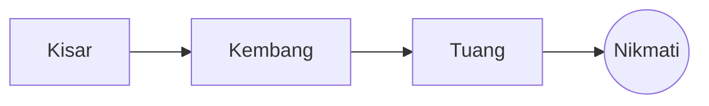

# Tuangan Manual yang Sempurna

Ritual pagi yang perlahan dalam beberapa langkah. Tulis dalam **sumber** di sebelah kiri atau terus dalam *pratonton* di sebelah kanan: kedua-duanya kekal selaras, dan ==setiap suntingan ialah perubahan yang bersih== pada Markdown.

> [!TIP]
> Air sebaik sahaja selepas mendidih, sekitar 94 °C, mengeluarkan kemanisan tanpa kepahitan.

## Nisbah

Kebanyakan resipi menetapkan satu bahagian kopi kepada enam belas bahagian air:

$$
m_{\text{air}} = 16 \times m_{\text{kopi}}
$$

Jadi $20\,\text{g}$ kopi memerlukan $320\,\text{g}$ air.

## Langkah demi langkah



## Kaedah menyeduh

| Kaedah         | Kisaran         | Masa |
|:---------------|:---------------:|-----:|
| Tuangan manual | Halus sederhana | 3:30 |
| French press   | Kasar           | 4:00 |
| Espresso       | Halus           | 0:28 |

## Sebelum anda mula

- [x] Biji kopi yang baru dibakar :coffee:
- [x] Pengisar burr
- [ ] Cerek berleher angsa

```python
def water_for(coffee_g: float, ratio: int = 16) -> float:
    return coffee_g * ratio
```

Kembang
: Percikan air pertama yang membolehkan hampas kopi melepaskan gasnya.[^1]

[^1]: Biji yang segar mengembang paling banyak; yang lama hampir tidak naik.
