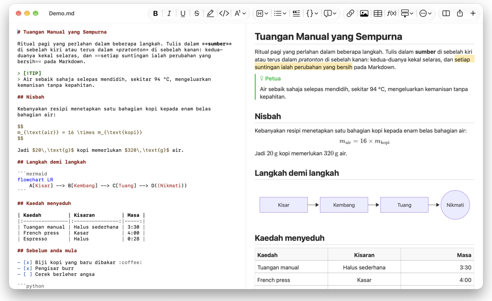
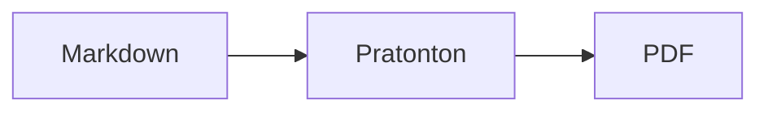

<p>&nbsp;&nbsp;&nbsp;</p>

# Splat

**Penyunting Markdown untuk macOS yang membolehkan anda menulis dalam sumber atau terus dalam pratonton.**

Splat meletakkan sumber Markdown anda dengan warna sintaks di sebelah kiri dan pratonton langsung yang boleh diedit sepenuhnya di sebelah kanan. Taip di mana-mana: apa-apa yang anda tulis dalam pratonton menjadi perubahan minimum pada sumber, jadi baris yang tidak anda sentuh kekal sama bait demi bait dan diff Git anda kekal bersih. Splat membaca Markdown yang sudah anda gunakan: CommonMark dan GitHub Flavored Markdown, GitHub alerts, pautan wiki, benam dan kotak maklumat Obsidian, sambungan Pandoc dan Typora, HTML terbenam, formula LaTeX serta rajah Mermaid, Graphviz dan PlantUML, semuanya dipaparkan luar talian. Eksport ke PDF, HTML atau Word dengan satu klik. Ia ditulis dalam Rust di atas kawalan AppKit tulen, menyokong 35 bahasa dan tidak menghantar apa-apa melalui rangkaian melainkan anda memintanya.
 


[](https://raw.githubusercontent.com/sventmueller/splat/main/dist/Splat-1.0.6.dmg)

**[Muat turun Splat-1.0.6.dmg](https://raw.githubusercontent.com/sventmueller/splat/main/dist/Splat-1.0.6.dmg)**: ditandatangani dan dinotarisasi oleh Apple, untuk macOS 14 atau lebih baharu pada Apple Silicon dan Intel.
 
 

[](https://www.rust-lang.org)
[](https://www.apple.com/macos/)

[](https://github.com/madsmtm/objc2)
[](https://webkit.org)
[](https://github.com/kivikakk/comrak)
[](https://github.github.com/gfm/)
[](https://www.mathjax.org)
[](https://cortexjs.io/mathlive/)
[](https://mermaid.js.org)
[](https://graphviz.org)
[](https://plantuml.com)


[](#lesen)

[Bahasa Indonesia](../id/README.md) ·
**Bahasa Melayu** ·
[Català](../ca/README.md) ·
[Čeština](../cs/README.md) ·
[Dansk](../da/README.md) ·
[Deutsch](../de/README.md) ·
[English](../../../README.md) ·
[Español](../es/README.md) ·
[Français](../fr/README.md) ·
[Hrvatski](../hr/README.md) ·
[Italiano](../it/README.md) ·
[Magyar](../hu/README.md) ·
[Nederlands](../nl/README.md) ·
[Norsk](../no/README.md) ·
[Polski](../pl/README.md) ·
[Português (Brasil)](../pt_BR/README.md) ·
[Português (Portugal)](../pt_PT/README.md) ·
[Română](../ro/README.md) ·
[Slovenčina](../sk/README.md) ·
[Slovenščina](../sl/README.md) ·
[Suomi](../fi/README.md) ·
[Svenska](../sv/README.md) ·
[Tiếng Việt](../vi/README.md) ·
[Türkçe](../tr/README.md) ·
[Ελληνικά](../el/README.md) ·
[Русский](../ru/README.md) ·
[Українська](../uk/README.md) ·
[עברית](../he/README.md)‎ ·
[العربية](../ar/README.md)‎ ·
[हिन्दी](../hi/README.md) ·
[ไทย](../th/README.md) ·
[한국어](../ko/README.md) ·
[日本語](../ja/README.md) ·
[简体中文](../zh-Hans/README.md) ·
[繁體中文](../zh-Hant/README.md)

## Kandungan

- [Ciri-ciri sepintas lalu](#ciri-ciri-sepintas-lalu)
- [Keperluan](#keperluan)
- [Pemasangan](#pemasangan)
- [Bermula](#bermula)
- [Menulis](#menulis)
  - [Dalam sumber](#dalam-sumber)
  - [Dalam pratonton](#dalam-pratonton)
  - [Arahan pemformatan](#arahan-pemformatan)
  - [Senarai dan tugas](#senarai-dan-tugas)
  - [Jadual](#jadual)
- [Markdown yang disokong](#markdown-yang-disokong)
  - [CommonMark dan GitHub Flavored Markdown](#commonmark-dan-github-flavored-markdown)
  - [Kotak maklumat](#kotak-maklumat)
  - [Sintaks lanjutan](#sintaks-lanjutan)
  - [Obsidian](#obsidian)
  - [Petikan dan rujukan](#petikan-dan-rujukan)
  - [HTML terbenam](#html-terbenam)
  - [Tanda baca tipografi](#tanda-baca-tipografi)
  - [Gambaran keseluruhan sintaks](#gambaran-keseluruhan-sintaks)
- [Formula](#formula)
- [Rajah](#rajah)
- [Imej](#imej)
- [Pautan dan navigasi](#pautan-dan-navigasi)
- [Mengeksport, mencetak dan berkongsi](#mengeksport-mencetak-dan-berkongsi)
- [Penampilan dan kebolehcapaian](#penampilan-dan-kebolehcapaian)
- [Bahasa](#bahasa)
- [Pintasan papan kekunci](#pintasan-papan-kekunci)
- [Privasi dan keselamatan](#privasi-dan-keselamatan)
- [Dokumen besar](#dokumen-besar)
- [Had yang diketahui](#had-yang-diketahui)
- [Penyelesaian masalah](#penyelesaian-masalah)
- [Untuk pembangun](#untuk-pembangun)
  - [Membina](#membina)
  - [Pengedaran](#pengedaran)
  - [Pengujian](#pengujian)
  - [Susun atur projek](#susun-atur-projek)
  - [Aliran data](#aliran-data)
  - [Peraturan dalam pengawal](#peraturan-dalam-pengawal)
  - [Menambah arahan](#menambah-arahan)
  - [Terjemahan](#terjemahan)
  - [Komponen pihak ketiga](#komponen-pihak-ketiga)
- [Lesen](#lesen)

## Ciri-ciri sepintas lalu

- **Dua cara menulis, satu teks.** Sumber dan pratonton kedua-duanya boleh diedit. Fail Markdown ialah satu-satunya kebenaran: setiap dokumen mempunyai satu sejarah buat asal, dan setiap suntingan pratonton diterjemahkan menjadi perubahan terkecil pada sumber.
- **Markdown yang sudah anda gunakan.** CommonMark, GitHub Flavored Markdown, GitHub alerts, Obsidian, sambungan Pandoc dan Typora, kod pendek emoji, spoiler, senarai definisi, sauh tajuk dan HTML seperti dalam README GitHub.
- **Formula dan rajah terbina dalam.** Formula LaTeX melalui MathJax, dengan penyunting formula visual. Rajah dalam Mermaid, Graphviz dan PlantUML, dipaparkan pada Mac anda tanpa Java, pelayan atau sambungan rangkaian.
- **Butang untuk setiap perkara.** Setiap binaan Markdown mempunyai butang bar alat dan item menu, dan yang biasa digunakan juga mempunyai pintasan papan kekunci. Jadual mendapat menunya sendiri untuk baris, lajur dan penjajaran.
- **Eksport tanpa kehilangan apa-apa.** PDF, satu fail HTML yang berdiri sendiri, atau dokumen Word dengan tajuk, senarai, jadual, nota kaki dan imej yang sebenar.
- **Natif sepenuhnya.** Tetingkap, tab, menu, popover, Versi, Simpan Auto, menu kongsi, mod gelap, semakan ejaan, dikte dan VoiceOver yang sebenar daripada AppKit. Tiada Electron, tiada paparan web untuk teks itu sendiri.
- **Pantas dengan fail besar.** Merender satu ketukan kekunci dalam dokumen 10 MB mengambil kira-kira 25 ms, sebelum kerja paparan itu sendiri.
- **Peribadi dan berhati-hati.** Imej dari web dimuatkan hanya selepas anda membenarkannya, pautan ke app lain bertanya dahulu, dan semua yang menyahkod data imej yang tidak dipercayai berjalan dalam proses pembantu berkotak pasir.
- **Dalam bahasa anda.** Antara muka dan rujukan pantas Markdown terbina dalam tersedia dalam 35 bahasa: Arab, Katalan, Cina (Ringkas), Cina (Tradisional), Croatia, Czech, Denmark, Belanda, Inggeris, Finland, Perancis, Jerman, Yunani, Ibrani, Hindi, Hungary, Indonesia, Itali, Jepun, Korea, Melayu, Norway, Poland, Portugis (Brazil), Portugis (Portugal), Romania, Rusia, Slovak, Slovenia, Sepanyol, Sweden, Thai, Turki, Ukraine dan Vietnam.

## Keperluan

- macOS 14 Sonoma atau lebih baharu. Splat dibangunkan dan diuji pada macOS 27, tempat ia menggunakan reka bentuk Liquid Glass secara automatik.
- Mac dengan Apple Silicon atau pemproses Intel.
- Kira-kira 45 MB ruang cakera.

## Pemasangan

**Daripada imej cakera.** Muat turun [`dist/Splat-1.0.6.dmg`](https://raw.githubusercontent.com/sventmueller/splat/main/dist/Splat-1.0.6.dmg), buka dan seret Splat ke folder Aplikasi. Imej ini ditandatangani dengan Developer ID dan dinotarisasi oleh Apple, jadi ia dibuka tanpa amaran.

**Dengan Homebrew.** Cask berada dalam tap tersendiri:

```sh
brew install --cask sventmueller/tap/splat
```

`brew upgrade --cask splat` memasang versi baharu, dan `brew uninstall --zap --cask splat` turut membuang tetapan dan cache Splat.

**Kemas kini.** Splat daripada imej cakera atau Homebrew mengemas kini dirinya sendiri melalui [Sparkle](https://sparkle-project.org). Pada pelancaran kali kedua, ia bertanya sama ada ia boleh mencari kemas kini sendiri, sekali sehari. **Splat › Semak Kemas Kini…** menyemak serta-merta; **Semak Kemas Kini Secara Automatik** dan **Muat Turun dan Pasang Kemas Kini Secara Automatik** dalam menu yang sama mengubah pilihan anda kemudian. Splat memasang kemas kini hanya jika ia membawa tandatangan pembangun. Binaan anda sendiri tidak mempunyai pengemas kini.

**Daripada kod sumber.** Lihat [Building](#membina) untuk prasyarat, kemudian:

```sh
make build
ditto target/release/Splat.app /Applications/Splat.app
open /Applications/Splat.app
```

Untuk membuka fail Markdown dengan Splat melalui klik dua kali, pilih mana-mana fail `.md` dalam Finder, pilih **Fail › Dapatkan Info**, pilih Splat di bawah **Buka dengan** dan klik **Tukar Semua…**. Splat mendaftarkan dirinya untuk fail `.md`, `.markdown`, `.mdown` dan `.mkd`.

## Bermula

### Tetingkap

Setiap dokumen dibuka dalam tetingkapnya sendiri, atau sebagai tab jika anda lebih suka tab:

- **Kiri: sumber.** Markdown anda dalam SF Mono dengan warna sintaks.
- **Kanan: pratonton.** Dokumen yang telah dipaparkan, sedia untuk diedit.
- **Bar sisi rangka (pilihan).** Semua tajuk sebagai pepohon; satu klik pada tajuk menunjukkannya dalam kedua-dua anak tetingkap. Togolkannya dengan **Paparan › Tunjukkan Rangka** (⌃⌘S).
- **Bar alat.** Butang yang dikumpulkan mengikut apa yang diubahnya: aksara, perenggan dan elemen yang dimasukkan, kemudian pratonton hidup/mati, Kongsi dan Dokumen Baharu. Sesuaikannya dengan **Paparan › Sesuaikan Bar Alat…**.

Seret pembahagi untuk memberi lebih ruang kepada mana-mana sebelah. **Paparan › Sembunyikan Pratonton** (⌥⌘P) meninggalkan sumber sahaja; Splat mengingatinya bagi setiap tetingkap. Kedua-dua anak tetingkap tergulung bersama, dan pilihan dalam satu anak tetingkap diserlahkan dalam yang satu lagi.

### Dokumen, tab dan versi

Splat ialah app dokumen macOS yang biasa:

- **Simpan Auto dan Versi.** Perubahan disimpan di tempatnya. **Fail › Kembali Ke › Layari Semua Versi…** membawa anda kembali ke masa lalu.
- **Perubahan daripada program lain.** Apabila Git, skrip atau penyunting lain mengubah dokumen yang dibuka, Splat memuatkannya semula dan mengekalkan karet serta kedudukan skrol. Jika anda mempunyai perubahan sendiri yang belum disimpan, Splat mengekalkannya, dan macOS bertanya sebelum menyimpan menimpa versi yang lain.
- **Arahan fail yang biasa.** Duplikasi (⇧⌘S), Nama Semula…, Alih ke…, dan **Fail › Buka Terbaharu**.
- **Tab.** **Fail › Tab Baharu** atau butang **+** pada bar alat membuka dokumen baharu sebagai tab; menu Tetingkap standard menggabung, mengalih dan beralih antara tab.
- **Kedudukan tetingkap.** Saiz dan kedudukan tetingkap terakhir anda diingati, juga selepas dimulakan semula. Jika tetingkap sudah berada di situ, yang baharu dibuka sedikit teranjak.
- **Ikon Dock.** Satu klik padanya selepas anda menutup tetingkap terakhir membuka dokumen baharu.
- **Buka fail Markdown dalam Splat.** **Splat › Tetapkan sebagai App Lalai untuk Markdown** menjadikan klik dua kali pada fail `.md` atau `.markdown` membuka Splat; macOS meminta pengesahan sekali. Item itu menunjukkan tanda semak selagi Splat ialah app lalai.

Fail mestilah teks UTF-8, atau UTF-16 dengan tanda urutan bait. Splat menolak pengekodan lain daripada meneka dan merosakkan teks. Tanda urutan bait dikekalkan, UTF-16 kekal UTF-16, dan dalam fail yang semua barisnya berakhir dengan CRLF, baris yang anda tambah turut mendapat CRLF.

**Selepas ranap**, paling banyak beberapa saat terakhir menaip hilang: setiap lima saat, Splat menyalin teks yang belum disimpan ke `~/Library/Application Support/Splat/Unsaved`, dan membuang salinan itu apabila dokumen disimpan atau Splat ditutup seperti biasa. Pada permulaan seterusnya, apa yang ditinggalkan ranap di sana dialihkan ke `~/Library/Application Support/Splat/Recovery` dan diberitahu sekali, dengan butang yang membuka folder itu. Ranap yang Splat masih sempat bertindak balas turut menulis teks setiap dokumen yang dibuka di sana.
### Rujukan pantas

**Bantuan › Rujukan Pantas Markdown** membuka helaian ringkasan dalam bahasa anda sebagai dokumen baharu tanpa tajuk. Ia dokumen biasa, jadi cubalah segala-galanya di situ, dalam sumber atau dalam pratonton.

## Menulis

### Dalam sumber

Sumber ialah penyunting teks biasa yang disesuaikan untuk Markdown:

- **Warna sintaks** seperti dalam VS Code: tajuk, penekanan, pautan, kod, jadual, HTML, front matter, serta LaTeX dan Mermaid di dalam formula dan rajah. Terdapat palet untuk cerah, gelap dan Tingkatkan Kontras.
- **Blok kod berpagar** diserlahkan untuk Bash, C, C++, C#, CSS (juga SCSS dan Less), Go, HTML, XML, Java, JavaScript, JSON, Kotlin, PHP, Python, Ruby, Rust, SQL, Swift, TypeScript, YAML, TeX dan Mermaid, termasuk nama pendek biasanya seperti `js`, `py` atau `sh`.
- **Tiada penggantian yang mengejutkan.** Petikan pintar, sengkang pintar dan penggantian teks dimatikan secara lalai, kerana ia merosakkan `--`, `---` dan `"`. Hidupkannya di bawah **Edit › Penggantian**.
- **Alat menulis sistem.** Semakan ejaan dan tatabahasa, dikte, Cari dan Ganti (⌥⌘F), dan Pertuturan.
- **Seret dan lepas.** Lepaskan fail imej untuk memasukkan ``, fail lain untuk memasukkan pautan kepadanya, dan URL untuk memasukkan `[url](url)`. Setiap lepasan ialah satu langkah buat asal.
- **Tampal imej.** Gambar pada papan keratan, seperti tangkapan skrin, disimpan sebagai fail PNG di sebelah dokumen (`Imej 2026-10-29 13.09.07.png`) dan dimasukkan sebagai imej. Dokumen perlu disimpan sekali untuk ini.

### Dalam pratonton

Pratonton berfungsi seperti pemproses kata, tetapi segala yang anda lakukan di dalamnya berakhir sebagai Markdown:

- **Menaip.** Aksara yang bermakna dalam Markdown, seperti `*` atau `#`, di-escape supaya muncul seperti yang ditaip.
- **Return** memulakan perenggan atau item senarai baharu. **⌥Return** atau **⌃Return** memasukkan pemisah baris.
- **Pemformatan pada kursor.** Apabila kursor berada di hujung perkataan, Tebal, Italik dan format aksara lain digunakan pada apa yang anda taip seterusnya. Pilih format itu sekali lagi untuk menghentikannya. Di dalam perkataan, seluruh perkataan diformatkan.
- **Baris kosong.** Return pada baris kosong menambah satu lagi baris kosong, dan Backspace membuangnya. Dalam sumber, setiap baris kosong tambahan ialah dua baris kosong lagi; program Markdown lain memaparkannya sebagai jarak perenggan biasa.
- **Buat Asal** berfungsi merentasi kedua-dua anak tetingkap. Item buat asal mempunyai nama (“Buat Asal Tebal”), menaip ialah satu langkah bagi setiap rentetan ketukan, dan selepas Buat Asal dan Buat Semula kedua-dua anak tetingkap menggulung ke perubahan itu.
- **Formula dan rajah** muncul sebagai grafik siap. Klik pada satu, gerakkan kursor ke atasnya atau tekan Return padanya untuk membuka penyuntingnya (lihat [Formulas](#formula) dan [Diagrams](#rajah)).
- **HTML terbenam, nota terbenam dan front matter** ditunjukkan, tetapi anda mengeditnya dalam sumber. Satu klik padanya meletakkan kursor di tempat yang sepadan di sana.

Apa-apa yang tidak dapat diungkapkan oleh Markdown disekat dalam pratonton: panel Fon dan Warna, pembaris, serta menampal atau melepaskan teks kaya dan imej. HTML dan RTF yang ditampal tiba sebagai teks biasa.

### Arahan pemformatan

Setiap arahan tersedia daripada bar alat, bar menu dan menu konteks kedua-dua anak tetingkap. Item menu menunjukkan tanda semak untuk pemformatan pada kursor.

| Menu | Arahan |
|---|---|
| **Format › Fon** | Tebal, Italik, Garis Bawah, Garis Potong, Serlahan, Kod, Superskrip, Subskrip |
| **Format › Tajuk** | Teks Badan, Tajuk 1 hingga 6 |
| **Format › Senarai** | Senarai Berbulet, Senarai Bernombor, Senarai Tugas |
| **Format** | Petikan, Blok Kod (Tiada Bahasa atau salah satu daripada 20 bahasa; turut menukar bahasa blok yang sedia ada), Kotak Maklumat (Nota, Petua, Penting, Amaran, Awas; jenis yang sama sekali lagi membuangnya), Edit Formula atau Rajah…, Kosongkan Format |
| **Masukkan** | Pautan…, Imej…, Jadual…, Formula, Rajah (Carta Alir, Rajah Jujukan, Carta Gantt), Senarai Kandungan, Nota Kaki, Garis Pembahagi |
| **Jadual** | Masukkan Baris di Atas/Bawah, Masukkan Lajur di Kiri/Kanan, Padam Baris, Padam Lajur, Penjajaran (Kiri, Tengah, Kanan, Lalai), Jajarkan Lajur Jadual |
| **Paparan** | Sembunyikan/Tunjukkan Pratonton, Tunjukkan/Sembunyikan Rangka, Tanda baca tipografi, Zum Masuk/Keluar, Saiz Sebenar, bar alat, bar tab, skrin penuh |

Garis bawah, serlahan, superskrip dan subskrip ditulis sebagai `<ins>`, `<mark>`, `<sup>` dan `<sub>`, yang turut dipaparkan oleh GitHub. Splat juga membaca `<u>`, yang dibuang oleh GitHub, serta bentuk yang lebih pendek `==highlight==`, `^sup^` dan `~sub~`. GitHub memaparkan `==` dan `^` seperti yang ditaip dan `~sub~` sebagai garis potong.

### Senarai dan tugas

- Return menyambung senarai; Return pada item kosong menamatkannya.
- **Tab** dan **⇧Tab** mengindenkan dan mengoutdenkan item senarai dalam pratonton.
- Satu klik pada kotak semak tugas dalam pratonton menogol `- [ ]` dan `- [x]`.
- **Format › Senarai** menukar perenggan yang dipilih menjadi senarai atau mengubah jenisnya.

### Jadual

- **Masukkan › Jadual…** meminta bilangan baris (termasuk pengepala) dan lajur.
- Dalam pratonton, **Tab** beralih ke sel seterusnya, **⇧Tab** ke sel sebelumnya dan **Return** ke sel di bawah. Tab dalam sel terakhir menambah baris.
- Menu **Jadual** memasukkan dan memadam baris serta lajur dan menetapkan penjajaran lajur (⌘{, ⌘|, ⌘}).
- **Jadual › Jajarkan Lajur Jadual** mengisi sumber dengan ruang supaya lajur sejajar.

## Markdown yang disokong

Splat menghuraikan dengan [comrak](https://github.com/kivikakk/comrak), penghurai yang serasi dengan CommonMark dan GFM, dan menghidupkan kebanyakan sambungannya. Semua yang berikut dipaparkan dalam pratonton dan dalam semua eksport.

### CommonMark dan GitHub Flavored Markdown

- Tajuk (`#` dan bergaris bawah), perenggan, pemisah baris, penekanan, penekanan kuat, kod sebaris, petikan blok, garis pembahagi.
- Senarai berbulet, bernombor dan bersarang; senarai tugas.
- Pautan (sebaris, rujukan dan automatik), imej, takrifan rujukan pautan.
- Blok kod berpagar dan berinden dengan warna sintaks.
- Jadual dengan penjajaran lajur.
- Garis potong dengan `~~two tildes~~`.
- Nota kaki: `text[^1]` dengan `[^1]: The note.` di mana-mana dalam dokumen. Satu klik pada penanda melompat ke nota itu.
- Front matter YAML di antara baris `---` di bahagian atas. Pratonton meringkaskannya dalam satu baris, seperti “Metadata: title, date, tags”.

### Kotak maklumat

GitHub alerts dipaparkan sebagai kotak berwarna dengan ikon dan tajuk:

```markdown
> [!NOTE]
> Maklumat berguna yang patut diketahui pengguna.

> [!WARNING]
> Kandungan kritikal yang memerlukan perhatian segera.
```

Lima jenisnya ialah Nota, Petua, Penting, Amaran dan Awas. **Format › Kotak Maklumat** menukar perenggan pada kursor menjadi salah satunya.

Kotak maklumat Obsidian juga berfungsi, dengan sebarang tajuk dan keadaan lipat:

```markdown
> [!tip]- Klik ▸ untuk mengembangkan
> Tersembunyi sehingga dibuka.

> [!question]+ Terbuka secara lalai
> `+` bermula dalam keadaan dikembangkan, `-` dalam keadaan dikuncupkan.
```

Jenis Obsidian yang lain ditunjukkan dalam warna yang paling hampir daripada lima itu: `success`, `check`, `done` dan `hint` sebagai Petua; `question`, `help` dan `faq` sebagai Penting; `attention` sebagai Amaran; `failure`, `fail`, `missing`, `danger`, `error` dan `bug` sebagai Awas; yang lain sebagai Nota.

### Sintaks lanjutan

| Ciri | Sintaks | Daripada |
|---|---|---|
| Serlahan | `==marked text==` | Obsidian, Typora |
| Superskrip | `x^2^` | Pandoc, Typora |
| Subskrip | `H~2~O` | Pandoc, Typora |
| Kod pendek emoji | `:rocket:` menjadi 🚀 | GitHub |
| Spoiler | `\|\|hidden text\|\|`, pilih untuk membaca | Discord |
| Nota kaki sebaris | `text^[the note itself]` | Pandoc, Obsidian |
| Senarai definisi | `Term`, baris kosong, `: Explanation` | PHP Markdown Extra, Pandoc |
| Sauh tajuk | `## Install {#setup}`, pautan dengan `[see](#setup)` | Pandoc, kramdown |

Senarai definisi kelihatan seperti ini dalam sumber:

```markdown
Istilah

: Penerangan istilah itu.
```

Tanpa sauh tersuai, setiap tajuk mendapat satu yang diterbitkan daripada teksnya, seperti di GitHub: `## Bermula` boleh dicapai sebagai `#bermula`.

### Obsidian

- **Pautan wiki.** `[[Nota]]` memaut ke `Nota.md` dalam folder yang sama atau folder di bawahnya. `[[Nota|Teks paparan]]` menunjukkan teks anda sendiri, dan `[[Nota#Tajuk]]` membuka nota itu. ⌘-klik membukanya dalam Splat.
- **Benam.** `![[Nota]]` menunjukkan nota lain di dalam yang ini; nota yang dibenam di dalamnya muncul sebagai pautan. `![[diagram.png]]` menunjukkan imej. Seperti dalam Obsidian, benam menamakan nota dan imej dalam folder dokumen atau di bawahnya, tidak pernah dengan laluan mutlak, dan hanya fail Markdown ditunjukkan sebagai nota.
- **Ulasan.** `%%Hanya dalam sumber%%` kekal kelihatan dalam sumber dan ditinggalkan daripada pratonton dan setiap eksport, sama ada sebaris atau pada barisnya sendiri.
- **Teg.** `#idea` atau `#project/splat` diserlahkan. ⌘-klik mencari teg itu dalam dokumen.
- **Kotak maklumat boleh lipat.** Lihat [Callouts](#kotak-maklumat).

### Petikan dan rujukan

- **Petikan Pandoc.** `[@doe2020]` atau `[@doe2020; @roe2021]` dibaca seperti “(Doe 2020; Roe 2021)”. Entri datang daripada fail BibTeX yang dinamakan oleh front matter sebagai `bibliography: refs.bib`. Tanpanya, Splat menggunakan `references.bib`, `literatur.bib` atau `bibliography.bib` di sebelah dokumen.
- **Rujukan GitHub dan GitLab.** Jika dokumen terletak dalam repositori Git yang remote `origin`-nya berada di github.com atau hos GitLab, `@name`, `#12` (isu) dan `!7` (merge request, GitLab sahaja) diserlahkan. ⌘-klik membukanya dalam pelayar.

### HTML terbenam

HTML seperti yang anda temui dalam README GitHub dipaparkan, dengan pembacanya sendiri dan bukan enjin pelayar:

- perenggan dan blok di tengah (`<p align="center">`, `<div align="center">`)
- imej dengan saiz (``)
- pautan, `<kbd>⌘</kbd>`, `<br>`, `<u>`, `<ins>`, `<mark>`, `<sup>`, `<sub>`
- senarai dan jadual, termasuk sel yang merentangi lajur (`colspan`)
- bahagian boleh lipat: `<details><summary>Lagi</summary>…</details>`, dibuka dengan klik pada ▸

Markdown di antara teg HTML dipaparkan sebagai Markdown. Skrip, gaya, bingkai dan borang ditinggalkan sepenuhnya, dan pautan serta imej hanya mengekalkan alamat `http`, `https`, `mailto` dan relatif.

### Tanda baca tipografi

**Paparan › Tanda baca tipografi** menunjukkan petikan lurus sebagai tanda petikan bahasa antara muka anda, `--` sebagai en dash, `---` sebagai em dash dan `...` sebagai elipsis. Dalam bahasa Jerman, `"Ja"` menjadi „Ja“, dalam bahasa Perancis «Oui», dalam bahasa Jepun 「はい」, juga di tempat bahasa Cina dan Jepun menyusun petikan tanpa ruang; singkatan Ibrani seperti `צה"ל` mendapat gershayim, צה״ל. Sumber mengekalkan aksara biasa; pratonton dan semua eksport menunjukkan yang tipografi. Tetapan ini mati sehingga anda menghidupkannya.

### Gambaran keseluruhan sintaks

| Elemen | Markdown |
|---|---|
| **Tebal** | `**Tebal**` |
| *Italik* | `*Italik*` |
| Garis bawah | `<ins>Garis bawah</ins>` atau `<u>Garis bawah</u>` |
| ~~Garis potong~~ | `~~Garis potong~~` |
| Serlahan | `<mark>Serlahan</mark>` atau `==Serlahan==` |
| `Kod` | `` `Kod` `` |
| x² | `x<sup>2</sup>` atau `x^2^` |
| H₂O | `H<sub>2</sub>O` atau `H~2~O` |
| [Pautan](https://example.com) | `[Pautan](https://example.com)` |
| Tajuk | `# Tajuk` hingga `###### Tajuk` |
| Petikan | `> Petikan` |
| Senarai berbulet | `- Item` |
| Senarai bernombor | `1. Item` |
| Tugas | `- [ ] Belum` dan `- [x] Siap` |
| Blok kod | ```` ```rust ```` … ```` ``` ```` |
| Jadual | `\| A \| B \|` dengan `\|---\|---\|` di bawah pengepala |
| Nota kaki | `Teks[^1]` dan `[^1]: Nota` |
| Garis pembahagi | `---` |
| Imej | `` |
| Formula | `$E = mc^2$`, `$$ … $$` |
| Rajah | ```` ```mermaid ````, ```` ```dot ````, ```` ```plantuml ```` |
| Kotak maklumat | `> [!TIP]` |
| Pautan wiki | `[[Nota]]`, `[[Nota\|Teks]]` |
| Benam | `![[Nota]]`, `![[image.png]]` |
| Ulasan | `%%Ulasan%%` |
| Teg | `#teg` |
| Petikan | `[@key]` |
| Spoiler | `\|\|Spoiler\|\|` |
| Emoji | `:tada:` |

## Formula

Formula dipaparkan oleh [MathJax](https://www.mathjax.org) dengan matematik TeX dan AMS-nya, sebagai grafik vektor yang tajam. Teks dalam `\text{…}` boleh dalam sebarang skrip: apa yang tiada pada fon MathJax datang daripada fon Mac anda, dengan Arab dan Ibrani berjalan dari kanan ke kiri, dan emoji berwarna.

| Jenis | Sintaks |
|---|---|
| Sebaris | `$E = mc^2$`, `` $`E = mc^2`$ `` (GitHub, GitLab), `\(E = mc^2\)` |
| Paparan | `$$` … `$$`, `\[` … `\]`, atau blok kod bertanda `math` |

**Mengedit formula.** Klik formula dalam pratonton, klik dua kali padanya, tekan Return padanya atau gerakkan kursor ke atasnya untuk membuka penyuntingnya dalam popover. **Masukkan › Formula** memasukkan yang baharu dan terus membuka penyunting.

- **Visual atau LaTeX.** Suis di bahagian atas beralih antara penyunting visual ([MathLive](https://cortexjs.io/mathlive/)) dan kod LaTeX. Splat mengingati pilihan anda.
- **Blok binaan** untuk pecahan, punca kuasa dua, superskrip dan subskrip, hasil tambah dan kamiran dengan had, had, kurungan yang membesar mengikut kandungan, matriks 2×2, huruf Yunani, serta hubungan, operator dan anak panah. Ia meninggalkan ruang letak □, dan **Tab** melompat ke yang seterusnya.
- **Pratonton langsung.** Perubahan muncul dalam dokumen semasa anda menaip. Ralat daripada MathJax ditunjukkan dalam satu baris di bawah kod.
- **Simpan atau buang.** Mengklik di luar mengekalkan perubahan sebagai satu langkah buat asal; **Esc** atau **Batal** membuangnya. Menekan Esc pada formula baharu yang kosong membuangnya semula.
- Menu konteks menawarkan **Edit Formula…** untuk formula di bawah penuding.

VoiceOver membaca formula sebagai kod LaTeXnya. Splat memaparkan formula, bukan dokumen LaTeX yang lengkap: tiada pakej, tiada TikZ dan tiada `\documentclass`.

## Rajah

Rajah dipaparkan di dalam Splat, luar talian dan dalam varian cerah dan gelap.

| Enjin | Blok kod | Apa yang dilukisnya |
|---|---|---|
| [Mermaid](https://mermaid.js.org) | ```` ```mermaid ```` | carta alir, jujukan, kelas, keadaan, hubungan entiti, Gantt, pai, peta minda, garis masa dan setiap jenis Mermaid yang lain |
| [Graphviz](https://graphviz.org) | ```` ```dot ```` atau ```` ```graphviz ```` | graf dalam bahasa DOT |
| [PlantUML](https://plantuml.com) | ```` ```plantuml ```` atau ```` ```puml ```` | rajah UML; berjalan tanpa Java |



**Mengedit rajah** berfungsi seperti mengedit formula: klik padanya untuk membuka kod dalam popover, dengan warna sintaks dan mesej ralat dalam satu baris di bawah kod. **Masukkan › Rajah** bermula daripada templat untuk carta alir, rajah jujukan atau carta Gantt. Blok binaan membantu dengan tiga jenis Mermaid yang paling biasa:

- **Carta Alir:** Nod ▾ (segi empat tepat, bucu bulat, bulatan, wajik, pangkalan data), Sambungan, Sambungan berlabel, Kumpulan, Arah ▾
- **Rajah Jujukan:** Peserta, Mesej, Balasan, Nota, Gelung, Laluan alternatif
- **Carta Gantt:** Bahagian, Tugas, Batu Tanda

Jenis rajah lain diedit sebagai kod. VoiceOver membaca tajuk atau teks alternatif rajah.

Rajah pertama selepas pelancaran mengambil masa kira-kira satu saat, kerana enjin pemaparan bermula di latar belakang. Rajah yang mengambil masa lebih daripada 10 saat menunjukkan ralat, dan enjin pemaparan bermula semula untuk rajah seterusnya. Enjin PlantUML (3 MB) dimuatkan hanya dengan rajah PlantUML yang pertama. `!include` PlantUML dari web disekat.

## Imej

- **Imej setempat** menggunakan laluan relatif kepada dokumen: ``. Splat menunjukkan PNG, JPEG, GIF, WebP, BMP, SVG, HEIC, TIFF, AVIF dan PDF.
- **Imej dari web** kekal disekat sehingga anda membenarkannya: bar di atas pratonton menerangkan bahawa memuatkannya memberitahu pelayannya bahawa dan bila anda membuka dokumen. **Muatkan Imej** membenarkannya untuk dokumen ini; Splat mengingati pilihan itu bagi setiap fail.
- **Saiz.** `` menetapkan saiz imej; jika tidak, imej muat dengan lebar pratonton.
- **Perubahan pada cakera.** Imej yang anda gantikan, atau yang muncul selepas dokumen menamakannya, ditunjukkan tanpa membuka dokumen sekali lagi. Imej dari web yang gagal kerana rangkaian dicuba semula selagi dokumen menunjukkannya.
- **Memori.** Imej ditunjukkan sehingga 2560 piksel pada sisi terpanjangnya, yang juga memenuhi halaman A4. Ia dinyahkod lebih kecil apabila ia memenuhi satu perlapan memori Mac, dan semasa macOS melaporkan tekanan memori.
- **Mod gelap.** Imej dengan latar putih dilaraskan sedikit lebih malap dalam pratonton gelap.
- **Menampal dan melepas.** Lihat [In the source](#dalam-sumber).

## Pautan dan navigasi

Dalam pratonton, satu klik meletakkan kursor supaya anda boleh mengedit teks pautan; **⌘-klik** mengikuti pautan:

- `http`, `https` dan `mailto` dibuka dalam pelayar atau app mel anda.
- Fail Markdown dibuka dalam Splat; fail dan folder lain ditunjukkan dalam Finder.
- `#anchor` melompat ke tajuk dalam dokumen.
- Alamat yang membuka app lain, seperti `slack://` atau `vscode://`, bertanya dahulu dan menunjukkan alamat penuh serta app itu. **Batal** dipilih terlebih dahulu.

**Masukkan › Senarai Kandungan** memasukkan senarai berpaut bagi semua tajuk. Dengan kursor di dalamnya, arahan yang sama mengemas kininya. Bar sisi rangka (⌃⌘S) melompat ke mana-mana tajuk dalam kedua-dua anak tetingkap.

## Mengeksport, mencetak dan berkongsi

| Format | Cara | Apa yang anda dapat |
|---|---|---|
| **PDF** | **Fail › Eksport sebagai PDF…** atau menu Kongsi | Halaman bersaiz kertas, sentiasa dalam penampilan cerah, formula dan rajah sebagai grafik vektor. **Fail › Persediaan Halaman…** menetapkan kertas. |
| **Cetak** | **Fail › Cetak…** (⌘P) | Reka letak yang sama seperti PDF. |
| **HTML** | **Fail › Eksport sebagai HTML…** atau menu Kongsi | Satu fail yang berdiri sendiri: imej setempat dibenamkan, formula dan rajah sebagai imej tajam, sauh tajuk supaya senarai kandungan berfungsi. Tanpa skrip. |
| **Word** | **Fail › Eksport sebagai Dokumen Word…** atau menu Kongsi | Fail `.docx` dengan gaya tajuk Word, senarai dan jadual sebenar (termasuk sel yang digabungkan), nota kaki sebagai nota kaki Word, imej terbenam, formula dan rajah. |
| **Markdown** | Butang **Kongsi** pada bar alat | Dokumen sebagai fail `.md` untuk Mail, Mesej, AirDrop dan setiap perkhidmatan kongsi yang lain. |

Menu **Fail › Kongsi** menawarkan semua ini di satu tempat. Eksport menggunakan tetapan tanda baca tipografi dan imej dari web yang anda benarkan; imej dari web kekal sebagai pautan dalam HTML.

## Penampilan dan kebolehcapaian

- **Mod gelap** mengikut sistem. Formula dan rajah dipaparkan untuk setiap penampilan.
- **Tingkatkan kontras** dalam Seting Sistem menukar warna sintaks kepada palet kontras tinggi.
- **Zum.** ⌘+, ⌘− dan ⌘0 menskalakan kedua-dua anak tetingkap.
- **Skrin penuh, tab dan bar alat yang boleh disesuaikan**, seperti dalam setiap app Mac.
- **VoiceOver.** Anak tetingkap berlabel “Sumber Markdown” dan “Pratonton”, formula dibaca sebagai kodnya dan rajah sebagai tajuknya. Setiap arahan boleh dicapai daripada papan kekunci.

Splat tidak mempunyai tetingkap tetapan: beberapa pilihan itu terletak di tempat ia digunakan, dalam **Paparan** dan **Edit › Penggantian**.

## Bahasa

Antara muka, menu dan rujukan pantas Markdown diterjemahkan ke dalam 35 bahasa:

Arab, Katalan, Cina (Ringkas), Cina (Tradisional), Croatia, Czech, Denmark, Belanda, Inggeris, Finland, Perancis, Jerman, Yunani, Ibrani, Hindi, Hungary, Indonesia, Itali, Jepun, Korea, Melayu, Norway, Poland, Portugis (Brazil), Portugis (Portugal), Romania, Rusia, Slovak, Slovenia, Sepanyol, Sweden, Thai, Turki, Ukraine dan Vietnam.

Splat mengikut susunan bahasa dalam **Seting Sistem › Umum › Bahasa & Rantau**; anda juga boleh memilih bahasa untuk Splat sahaja di situ di bawah **Aplikasi**. Tanpa terjemahan untuk bahasa anda, ia menggunakan bahasa Inggeris. Istilah menu mengikut terjemahan Apple sendiri, jadi Splat terasa seperti bahagian lain Mac anda.

Teks Ibrani dan Arab dibaca dari kanan ke kiri di mana-mana ia muncul, apa pun bahasa antara muka: setiap perenggan, tajuk dan item senarai mengambil arah huruf pertamanya, petikan dan kotak maklumat melukis bar di sebelah kanan, dan jadual yang teksnya bermula dari kanan ke kiri menyenaraikan lajurnya dari kanan. Blok kod kekal dari kiri ke kanan. Eksport PDF, HTML dan Word mengekalkan arah ini. Dengan bahasa Ibrani atau Arab sebagai bahasa sistem, macOS turut mencerminkan tetingkap, jadi pratonton berada di sebelah kiri.

## Pintasan papan kekunci

| Tindakan | Pintasan |
|---|---|
| Tebal, Italik, Garis Bawah | ⌘B, ⌘I, ⌘U |
| Garis Potong | ⇧⌘X |
| Pautan… | ⌘K |
| Teks badan, Tajuk 1 hingga 6 | ⌥⌘0, ⌥⌘1 hingga ⌥⌘6 |
| Jajarkan lajur jadual ke kiri, tengah, kanan | ⌘{, ⌘\|, ⌘} |
| Sembunyikan atau tunjukkan pratonton | ⌥⌘P |
| Tunjukkan atau sembunyikan rangka | ⌃⌘S |
| Zum masuk, keluar, saiz sebenar | ⌘+, ⌘−, ⌘0 |
| Dokumen baharu, buka, simpan, duplikasi | ⌘N, ⌘O, ⌘S, ⇧⌘S |
| Persediaan halaman, cetak | ⇧⌘P, ⌘P |
| Cari, cari dan ganti | ⌘F, ⌥⌘F |
| Cari seterusnya, sebelumnya; guna pilihan; lompat ke pilihan | ⌘G, ⇧⌘G; ⌘E; ⌘J |
| Tunjukkan ejaan dan tatabahasa; semak dokumen | ⌘:, ⌘; |
| Tampal dan padankan gaya | ⌥⇧⌘V |
| Sembunyikan bar alat, tunjukkan semua tab, skrin penuh | ⌥⌘T, ⇧⌘\\, ⌃⌘F |
| Pemisah baris (pratonton) | ⌥Return atau ⌃Return |
| Sel seterusnya / sel sebelumnya dalam jadual (pratonton) | Tab / ⇧Tab |
| Indenkan / outdenkan item senarai (pratonton) | Tab / ⇧Tab |
| Ruang letak seterusnya dalam penyunting formula | Tab |
| Tutup penyunting formula atau rajah tanpa perubahan | Esc |
| Ikut pautan, teg atau rujukan (pratonton) | ⌘-klik |

Splat membiarkan pintasan standard Apple di tempatnya.

## Privasi dan keselamatan

Fail Markdown boleh datang daripada sesiapa sahaja, jadi Splat menganggap setiap dokumen tidak dipercayai.

- **Tiada rangkaian secara lalai.** Splat tidak mempunyai telemetri. Ia mencari kemas kini hanya apabila anda bersetuju atau memilih **Semak Kemas Kini…**: ia kemudian memuatkan fail suapan kecil daripada GitHub, dan permintaan itu tidak menamakan apa-apa selain app dan versinya. Formula dan rajah dipaparkan secara setempat; paparan web yang melakukannya tidak dapat mencapai rangkaian.
- **Imej dari web** dimuatkan hanya selepas kebenaran anda, hanya melalui `https`, tidak pernah daripada hos dalam rangkaian setempat anda, paling banyak 10 MB setiap satu, dan dalam sesi persendirian tanpa kuki.
- **Penyahkodan terasing.** Imej dan grafik formula serta rajah dinyahkod dalam proses pembantu yang menutup setiap fail yang diwarisinya dan mengunci dirinya dalam kotak pasir sebelum membaca bait pertama: tiada akses fail, tiada rangkaian. Ia hanya menyerahkan semula piksel, yang saiznya disemak, dan dihentikan selepas 10 saat. Penyahkod imej Apple sendiri hanya melihat HEIC, TIFF, AVIF dan PDF, dan hanya apabila data itu benar-benar format tersebut; ia berjalan dalam pembantu tersendiri, yang di samping itu boleh membaca folder fon sistem dan menggunakan penyahkod video sistem. SVG, formula dan rajah turut melalui pembantu itu, jadi ia ialah gambar dengan resolusi tetap dalam Splat: empat piksel setiap titik, sehingga 2560 pada sisi yang lebih panjang.
- **Fail setempat** sampai kepada dokumen hanya melalui laluan yang dinamakannya. Benam menunjukkan nota Markdown daripada folder dokumen dan ke bawah, dan gambar yang tiada dicari di situ sahaja. Laluan imej di tempat lain, mutlak atau bermula dengan `~`, tetap dimuatkan, dan eksport HTML serta Word membenamkannya: lihat eksport dokumen yang bukan anda tulis sebelum anda menyerahkannya.
- **Salinan teks yang belum disimpan** kekal pada Mac ini, dalam folder Library anda, untuk pemulihan selepas ranap. Ia hilang dengan penyimpanan atau penamatan biasa Splat; salinan yang ditinggalkan ranap kekal dalam folder pemulihan sehingga anda memadamnya.
- **Pautan** tidak pernah memulakan program dengan satu klik. Pautan web dan mel dibuka seperti biasa; pautan ke app lain bertanya dahulu.
- **HTML dalam dokumen** dibaca oleh penghurai Splat sendiri. Skrip, gaya, bingkai dan borang tidak pernah dijalankan.
- **Eksport** tidak membawa skrip. Halaman HTML hanya mengekalkan senarai tetap teg dan atribut yang tidak berbahaya, seperti GitHub, serta dasar keselamatan kandungan. Fail Word hanya memaut alamat `http`, `https` dan `mailto`.
- **Penandatanganan kod** dengan Hardened Runtime. Splat berjalan tanpa App Sandbox supaya ia dapat menunjukkan imej di sebelah dokumen anda tanpa bertanya untuk setiap folder; pengasingan semua penyahkodan mengimbanginya.

## Dokumen besar

Splat kekal responsif dengan dokumen beberapa megabait:

- Sumber menggunakan TextKit 2, yang hanya menyusun atur bahagian yang kelihatan.
- Semasa anda menaip dalam pratonton, dan dalam sumber dokumen sehingga 2 MB, hanya perenggan yang terjejas dihuraikan, diwarnakan dan disusun atur semula. Dalam dokumen 10 MB, penghuraian dan pewarnaan mengambil kira-kira 20 ms, perenderan kira-kira 25 ms, dan satu ketukan kekunci penuh dalam pratontonnya kira-kira 60 ms termasuk kerja paparan itu sendiri.
- Pratonton besar memaparkan bahagian yang kelihatan dahulu dan selebihnya semasa app terbiar. Blok yang digulung ke paparan dipaparkan sebelum dilukis.
- Dalam sumber dokumen yang lebih besar, penghuraian untuk pratonton berjalan di latar belakang semasa anda menaip.
- Dokumen kekal sebagai teks biasa apabila ia akan memerlukan kira-kira 4 GB memori, iaitu kira-kira 50 hingga 120 MB Markdown biasa, tetapi hanya 10 hingga 20 MB jika isinya hanya jadual atau tajuk: sumber tiada warna dan pratonton menyatakan sebab ia kekal kosong. Eksport masih berfungsi.
- Mulai kira-kira 200 KB, dokumen membuka tetingkapnya sebelum dihuraikan; pada 5 MB, warna dan pratonton menyusul kira-kira suku saat kemudian.

Sesetengah perubahan diproses sepenuhnya, pada kira-kira 300 ms setiap ketukan kekunci pada 10 MB: perubahan pada takrifan atau rujukan nota kaki, di sebelah nota kaki sebaris, di hujung dokumen sebelah nota kaki, pada front matter atau berhampiran takrifan rujukan pautan, dan setiap perubahan dalam dokumen dengan blok ulasan `%%` atau dengan nota kaki yang ditakrifkan dua kali atau di dalam petikan atau senarai. Memori bertambah bersama fail, kepada kira-kira 115–160 MB untuk 1 MB Markdown dan 340–510 MB untuk 10 MB.

## Had yang diketahui

- **Tilde tunggal bermaksud subskrip.** `~text~` ialah subskrip seperti dalam Pandoc; garis potong memerlukan `~~two~~`. GitHub juga menggaris potong dengan satu tilde.
- **Baca sahaja dalam pratonton:** HTML terbenam, nota terbenam dan front matter diedit dalam sumber.
- **Sarang yang sangat dalam:** HTML yang bersarang lebih daripada 64 peringkat, dan HTML sebaris lebih daripada 16, mengalah kepada kandungannya.
- **Sel jadual yang digabungkan** hanya wujud dalam jadual HTML, dan hanya merentangi lajur (`colspan`, tiada `rowspan`). Sintaks jadual MultiMarkdown untuk sel yang digabungkan tidak disokong.
- **Bibliografi** dibaca daripada BibTeX sahaja, bukan daripada CSL JSON atau YAML.
- **Rujukan** memerlukan repositori di github.com atau hos GitLab; `!7` hanya wujud di GitLab.
- **Tanda baca tipografi:** petikan tunggal penutup bahasa Jerman tidak dapat dibezakan daripada apostrof dan ditetapkan sebagai ’.
- **Formula, bukan dokumen:** tiada pakej LaTeX, TikZ atau dokumen penuh.
- **Penyunting formula visual** menulis LaTeX dalam tatatanda MathLive: ruang hilang (`E = mc^2` menjadi `E=mc^2`), paparannya kekal sama.
- **Dengan reka bentuk:** tiada nombor baris, tiada tetingkap tetapan, tiada Help Book, tiada dalam App Store.
- **Kurang diuji pada Intel.** Ujian kendiri tetingkap berjalan pada Apple Silicon sahaja; pada Intel, CI menjalankan `cargo test`.

## Penyelesaian masalah

**Senarai dokumen terkini kosong selepas saya membina semula Splat.** macOS mengikat dokumen terkini dan kebenaran folder kepada tandatangan kod app. Binaan setempat ditandatangani dengan sijil “Splat Local Signing” dalam keychain log masuk anda, jadi pembinaan semula mengekalkan kedua-duanya. Jika sijil itu dipadam, binaan seterusnya mencipta yang baharu dan senarai bermula semula sekali.

**App daripada imej cakera menunjukkan dokumen terkini yang berbeza daripada binaan saya sendiri.** Kedua-duanya membawa tandatangan yang berbeza, jadi macOS menyimpan senarai dan kebenaran folder yang berasingan untuk setiap satu.

**HTML atau sintaks lain ditunjukkan sebagai kod biasa.** Salinan Splat yang lapuk mungkin telah membuka dokumen itu. Keluar daripadanya, pilih **Fail › Dapatkan Info** pada dokumen dalam Finder dan semak bahawa **Buka dengan** menamakan Splat dalam folder Aplikasi anda.

**Tiada Semak Kemas Kini… dalam menu Splat.** Hanya versi daripada imej cakera atau Homebrew yang mengemas kini dirinya; binaan anda sendiri tidak mempunyai pengemas kini.

**Imej dari web tidak muncul.** Klik **Muatkan Imej** dalam bar di atas pratonton. Hanya imej `https` daripada hos awam yang dimuatkan.

**Menampal tangkapan skrin meminta saya menyimpan dahulu.** Imej yang ditampal disimpan sebagai fail di sebelah dokumen, yang memerlukan tempat pada cakera. Simpan dokumen, kemudian tampal lagi.

**“Fail ini bukan teks UTF-8.”** Fail itu dalam pengekodan lain dan tidak mempunyai tanda urutan bait yang menamakannya. Tukarkannya dahulu, contohnya dengan `iconv -f ISO-8859-1 -t UTF-8 old.md > new.md`.

**Formula atau rajah menunjukkan ralat.** Klik padanya: penyunting menunjukkan mesej MathJax, Mermaid, Graphviz atau PlantUML di bawah kod.

## Untuk pembangun

Splat ialah aplikasi Rust yang berhubung terus dengan AppKit dan WebKit melalui [objc2](https://github.com/madsmtm/objc2). Tiada Swift, tiada Objective-C, tiada projek Xcode dan tiada fail Interface Builder.

### Membina

Prasyarat:

- macOS dengan Command Line Tools (`xcode-select --install`). Xcode tidak diperlukan; Splat dibina tanpa `actool`, `ibtool` dan `metal`.
- Rust 1.99 (`brew install rust`). [rust-toolchain.toml](../../../rust-toolchain.toml) menamakan versi tepat yang digunakan CI; rustup memasangnya sendiri, Rust Homebrew mengabaikan fail itu. Menaikkannya di sana ialah cara amaran pengkompil dan clippy baharu sampai ke projek.
- rustup, untuk `make lint`, `make check` dan `make universal`: `cargo xtask check-library` membina pustaka untuk Linux bagi menunjukkan bahawa ia tidak memerlukan macOS, dan Rust Homebrew tidak mempunyai sasaran lain.

[Makefile](../../../Makefile) menyimpan titik masuk ringkas; `make help` menyenaraikan kesemuanya:

```sh
make build                  # target/release/Splat.app, sama seperti cargo xtask bundle --release
make universal              # target/splat-universal untuk Apple Silicon dan Intel, seperti yang dibawa imej cakera
make check                  # pemformatan, clippy tanpa amaran, semua ujian, pustaka vendor; apa yang CI jalankan
make test                   # make check, kemudian ujian kendiri tanpa tetingkap
make test-gui               # ujian kendiri dengan tetingkap; ia menduduki Mac selama kira-kira empat minit
make test-long              # carian rawak yang lebih panjang dan semakan kemas kini separa 10 MB
make coverage               # liputan baris semua ujian dan ujian kendiri, dengan paras minimum bagi setiap modul
make coverage-library       # paras minimum yang sama untuk modul tanpa tetingkap, seperti dalam CI
make bench FILE=<file.md>   # masa untuk membuka, menaip dan menggulung fail besar
make release                # make test dahulu, kemudian imej cakera yang dinotarisasi
```

Logik pembinaan itu sendiri terletak dalam crate Rust [xtask](../../../xtask/src/main.rs):

```sh
cargo xtask bundle --release   # target/release/Splat.app, Hardened Runtime, ditandatangani dengan "Splat Local Signing"
cargo xtask bundle             # target/debug/Splat Debug.app, app berasingan yang tidak pernah membuka fail Markdown
cargo xtask dmg                # dist/Splat-<version>.dmg untuk pengedaran, Developer ID, dinotarisasi
cargo xtask icon               # bina semula assets/AppIcon.icns dan ikon README daripada assets/icon-1024.png
cargo xtask vendor check       # sahkan JavaScript terbundel terhadap vendor.lock
cargo xtask vendor fetch       # muat turun semula selepas mengubah versi dalam vendor.lock
```

`bundle` menulis `Info.plist`, menyalin sumber dan penyetempatan, dan menandatangani app dengan sijil “Splat Local Signing”. Binaan pertama mencipta sijil itu dalam keychain log masuk anda, sah selama 20 tahun. Selagi ia kekal, Splat mengekalkan dokumen terkini dan kebenaran folder merentasi pembinaan semula; dengan tandatangan ad hoc, setiap binaan akan menjadi app baharu bagi macOS. Binaan nyahpepijat dan ujian kendiri membawa ID bundle sendiri (`local.splat.debug`, `local.splat.selftest`) dan tidak mendaftar untuk fail Markdown, jadi Finder tidak pernah membuka dokumen dalam binaan yang lapuk dan ia membiarkan tetapan app biasa.

Versi terletak dalam [VERSION](../../../VERSION) sebagai `major.minor.build` dan ialah versi yang akan diterima oleh binaan seterusnya. Setiap binaan keluaran yang berjaya (`make build`, `cargo xtask bundle --release`, `make release`) menaikkan nombor binaan sebanyak satu; binaan nyahpepijat dan ujian kendiri membiarkannya. Major dan minor dinaikkan dengan tangan: tetapkan VERSION kepada, katakan, `1.1.0`, dan binaan seterusnya mendapat betul-betul itu.

### Pengedaran

`cargo xtask dmg` (atau `make release`, yang menjalankan `make test` dahulu) membina keluaran, menandatanganinya dengan Developer ID anda, menotarisasi app dengan Apple dan melekatkan tiket, membungkusnya ke dalam imej cakera baca sahaja yang dimampatkan dengan pautan ke Aplikasi, menotarisasi dan melekatkan tiket pada imej itu juga dan menyemak hasilnya dengan Gatekeeper. App membawa tiketnya sendiri supaya salinan yang dipasang tanpa Finder, seperti yang dilakukan Homebrew, dibuka luar talian pada pelancaran pertama juga; dua pusingan dengan perkhidmatan notari mengambil masa beberapa minit setiap satu. Hanya imej yang lulus setiap langkah menjadi `dist/Splat-<version>.dmg`, salinan yang di-commit: pautan muat turun dalam README ini dan terjemahannya mengikutinya, dan nombor binaan naik. Imej sebelumnya kekal untuk satu keluaran lagi, kerana pelayan mentah GitHub mungkin menyerahkan suapan kemas kini lama beberapa minit selepas push; yang lebih lama dialihkan ke tong sampah. Larian yang gagal membiarkan `dist/`, README dan VERSION seperti sedia ada.
Setiap keluaran menambah imej penuh, kira-kira 16 MB, kepada sejarah repositori. Ia hanya berjalan apabila dipanggil, tidak pernah sebagai sebahagian daripada binaan biasa, dan memerlukan:

- sijil “Developer ID Application” dalam keychain
- log masuk yang disimpan untuk perkhidmatan notari Apple dengan kata laluan khusus app, dicipta sekali dengan `xcrun notarytool store-credentials notary --apple-id <Apple ID> --team-id <team ID>`
- kunci persendirian yang menandatangani kemas kini, dalam keychain log masuk. `generate_keys` Sparkle mencipta kunci itu; separuh awamnya ialah `UPDATE_KEY` dalam [xtask/src/main.rs](../../../xtask/src/main.rs) dan di dalam setiap salinan yang dipasang, yang hanya menerima kemas kini yang ditandatangani dengannya. Simpan sandaran dalam pengurus kata laluan: `target/sparkle-2.10.1/bin/generate_keys -x <file>` mengeksportnya, `-f <file>` mengimportnya pada Mac lain. Tanpanya, salinan yang dipasang tidak dapat dikemas kini lagi.
- rustup (`brew install rustup`, yang membiarkan Rust Homebrew di tempatnya)

Jika mana-mana daripadanya tiada, `dmg` berhenti sebelum membina. Pada larian pertama, macOS bertanya sama ada Terminal boleh mengawal Finder; tanpa kebenaran itu, imej cakera tidak menunjukkan latar belakang mahupun susunan ikonnya.

Hanya imej cakera yang membawa pengemas kini, [Sparkle](https://sparkle-project.org), yang dimuat turun oleh binaan sekali ke dalam `target/` daripada keluaran GitHub-nya dan disemak terhadap checksum dalam xtask. Hardened runtime memuatkan rangka kerja itu hanya apabila ia membawa Team ID app, yang dimiliki tandatangan Developer ID dan tiada pada sijil setempat; dan kemas kini tidak boleh menggantikan binaan anda sendiri. Binaan ujian kendiri turut membawa Sparkle, untuk menyemak menu kemas kini terhadapnya: dengan suapan yang tidak wujud, tanpa soalan Sparkle pada pelancaran kali kedua, dan dengan entitlement yang membolehkan app yang ditandatangani secara setempat memuatkan rangka kerja itu. `dmg` menandatangani imej baharu dengan kunci kemas kini dan menulis `dist/appcast.xml`, suapan yang dibaca salinan yang dipasang daripada GitHub. Commit dan push imej, suapan dan README bersama-sama: sejak itu, salinan yang dipasang menawarkan kemas kini.

Imej cakera ialah binari universal untuk Apple Silicon dan Intel; binaan lain hanya untuk pemproses hos. Rust Homebrew hanya menyertakan pustaka standard untuk pemproses hos, jadi `dmg` membina melalui rustup, yang memasang toolchain dan sasaran [rust-toolchain.toml](../../../rust-toolchain.toml) pada penggunaan pertama, dan berhenti jika program atau Sparkle tidak mempunyai kod untuk salah satu pemproses. `make universal` hanya membina programnya.
App di dalamnya membawa tandatangan yang berbeza daripada binaan setempat, jadi macOS menyimpan dokumen terkini dan kebenaran folder yang berasingan untuk kedua-duanya.

### Pengujian

| Arahan | Menyemak |
|---|---|
| `cargo test --release` | ujian unit, rawak dan terjemahan |
| `SPLAT_FUZZ_ROUNDS=20000 cargo test --release` | carian rawak yang lebih panjang; `SPLAT_FUZZ_SEED` mengubah input |
| `SPLAT_I18N_ONLY=fr cargo test --release i18n` | satu bahasa, semasa yang lain belum lengkap |
| `cargo clippy --release --all-targets [--features selftest]` | lint, termasuk justifikasi setiap blok `unsafe`, panjang fungsi dan, dalam pustaka, penukaran nombor |
| `cargo xtask check-library` | pustaka boleh dibina untuk Linux, jadi tiada apa-apa di dalamnya memerlukan macOS |
| `cargo xtask vendor check` | pustaka JavaScript sepadan dengan `vendor.lock` bait demi bait |
| `cargo xtask selftest probe` | tanpa tetingkap, masing-masing dengan keputusan yang dijangka: formula, rajah, imej web terhadap pelayan di dalam proses, alamat yang disekat, teks yang ditulis oleh setiap arahan, setiap format imej melalui kedua-dua eksport, halaman yang berhenti menjawab, dan pertahanan paparan web terhadap halaman tanpanya. Mengambil masa kira-kira setengah minit. Apa yang memerlukan app di hadapan skrin dilangkau pada skrin yang dikunci |
| `cargo xtask selftest gui [--stop-after "<check>"] [--scenarios]` | app yang berjalan, klik demi klik. Membuka tetingkap dan menaip di dalamnya; Mac sibuk selama kira-kira empat minit. `--scenarios` hanya menjalankan bahagian kedua, dalam kira-kira satu setengah minit |
| `cargo xtask selftest resize` | melebarkan tetingkap selepas menggerakkan pembahagi: sumber dibungkus semula semasa tetingkap diubah saiz. Mengambil masa kira-kira sepuluh saat |
| `cargo xtask selftest bench <file.md>` | masa untuk membuka, menaip dan menggulung fail besar |
| `cargo test --release -- --ignored partial_updates` | satu ketukan kekunci dalam 10 MB: kemas kini separa berbanding penuh, keputusan yang sama dalam suku masa paling lama |
| `cargo test --release --test hostile` | dokumen yang dibina untuk melimpahkan tindanan atau mengambil masa kuadratik, masing-masing dalam dua saiz yang masanya mesti bertambah seperti teks, melalui penghuraian, susun atur, kedua-dua eksport, ketukan kekunci dan arahan |
| `make mutants` | kesalahan dibina ke dalam `src/markdown/` dan `src/preview/` satu demi satu, melalui [cargo-mutants](https://mutants.rs) (`cargo install cargo-mutants`); menyatakan yang mana tiada ujian menyedarinya. Mengambil masa berjam-jam; `FILE=src/preview/bridge.rs` mengecilkan skop |
| `cargo test --release --test decoder` | proses penyahkod menyahkod imej dan tidak mencapai fail mahupun rangkaian |
| `make coverage` | liputan baris `cargo test` dan semua ujian kendiri, melalui [cargo-llvm-cov](https://github.com/taiki-e/cargo-llvm-cov) (`brew install cargo-llvm-cov llvm`); gagal di bawah paras minimum. Menduduki Mac selama kira-kira lima minit |
| `make coverage-library` | `src/markdown/`, `src/preview/` dan `i18n.rs` terhadap paras minimum yang lebih tinggi, diukur oleh `cargo test` sahaja |

Ujian unit terletak di sebelah kod yang diujinya. `tests/` menyimpan apa yang mencapai pustaka dari luar: ujian rawak dalam `robustness.rs`, yang berkongsi penjana dalam `src/fuzz.rs` dengan ujian `sync.rs`, dokumen yang dibina untuk mencederakan dalam `hostile.rs`, dan ujian penyahkod, yang memulakan program yang dibina. Keputusan dalam `src/editor/` yang tidak memerlukan tetingkap terletak dalam fungsi bebas dengan ujian tersendiri: segala yang diketahui pengawal dan cara ia berubah dalam `state.rs`, peraturan pemaparan dalam `render_queue.rs`, salinan teks dalam `sync.rs`, gaya perenggan, fon dan warna sebagai nilai dalam `render.rs`, maksud pengecam bar alat dalam `toolbar.rs`, maksud klik pada pautan dalam `navigation.rs`.

Langkah ujian kendiri tetingkap menunggu syarat yang bernama, bukan masa; hanya yang tidak memberi isyarat, seperti ketiadaan sesuatu, mengekalkan jeda beserta sebabnya. Menunggu dengan sia-sia ialah semakan yang gagal dan menamakan apa yang tidak pernah tiba, langkah yang panik juga semakan yang gagal, dan larian diteruskan dalam kedua-dua kes. Semakan yang tidak dapat menyatakan apa-apa dalam larian ini melaporkan `SELFTEST SKIP`: xtask menyenaraikannya, dan ia tidak lulus mahupun gagal. xtask mengikat setiap mod, dan `--scenarios` secara tersendiri, kepada kira-kira sembilan persepuluh daripada semakannya. Ujian kendiri tetingkap menjalankan bahagian kedua selepas klik-lalu utamanya, dalam `src/editor/selftest/scenarios.rs`: setiap arahan pemformatan dan jadual, dialog, klik pautan, menampal, melepas, eksport, perubahan besar, imej yang berubah pada cakera, tekanan memori, dokumen yang sangat besar dan pemulihan selepas ranap.

Liputan mempunyai dua paras minimum: setiap modul sekurang-kurangnya 84 % barisnya, semua modul bersama sekurang-kurangnya 96 %. `make coverage` mengukur `cargo test` bersama ujian kendiri dan gagal di bawah mana-mana satu; `make coverage-library` mengekalkan apa yang tidak memerlukan tetingkap pada 90 % dan 97 %. Paras minimum dan beberapa pengecualian, seperti cangkuk panik dalam `main.rs` yang hanya berjalan semasa ranap, terdapat dalam [xtask](../../../xtask/src/coverage.rs) di sebelah sebabnya. Binaan yang diukur masuk ke `target/coverage/`, jadi kod pengukuran tidak pernah sampai ke `target/release/` atau imej cakera. Pembantu penyahkod membuka fail pengukurannya sebelum ia mengunci dirinya, jadi ia diukur juga.

CI ([.github/workflows/ci.yml](../../../.github/workflows/ci.yml)) menjalankan `make check`, `make coverage-library` dan binaan universal pada Apple Silicon serta `cargo test` pada Intel untuk setiap push ke `main` dan setiap pull request. Setiap malam, [.github/workflows/nightly.yml](../../../.github/workflows/nightly.yml) menjalankan `make test-long` dengan input rawak baharu. Ujian kendiri dan imej cakera kekal pada Mac pembangun: ia memerlukan skrin dan sijil penandatanganan dalam keychain.

Output ujian kendiri masuk ke `target/selftest/`. Ujian kendiri membina app berasingan (`target/release/Splat Selftest.app`, ID bundle `local.splat.selftest`) dan membiarkan tetapan, dokumen terkini dan perkaitan fail app biasa tidak disentuh.

### Susun atur projek

`src/lib.rs` menjadikan segala yang tidak memerlukan tetingkap sebuah pustaka tersendiri, `splat`: `markdown/`, `preview/`, `i18n.rs` dan penjana ujian `fuzz.rs`. Ia dibina tanpa macOS. App dalam `src/main.rs` dibina di atasnya.

- `src/markdown/`: pepohon yang dibaca setiap pengguna, `Doc` dalam `doc/`, yang memiliki teksnya sendiri, dan satu-satunya pengikatan kepada penghurai dalam `reader/`: comrak tidak dinamakan di tempat lain, dan `reader/assumptions.rs` memuatkan apa yang diandaikan kod tentangnya. Warna sintaks, dan semua arahan sebagai suntingan teks tulen (`Edit`) dalam `commands/`. Juga penghuraian semula selepas suntingan (`incremental.rs`), pembaca untuk HTML terbenam (`markup.rs`), tipografi, teg, rujukan dan petikan dalam teks berjalan (`typography.rs`), rupa teks dan Markdown serta HTML yang menjadikannya begitu (`style.rs`), apa yang boleh menjadi alamat (`url.rs`), serta eksport HTML dan Word (`html.rs`, `docx.rs` dengan `docx/html.rs` dan `docx/xml.rs`). Kedudukan mempunyai jenisnya sendiri: `Byte` dalam teks sumber, `U16` dalam paparan sumber, `Shown` dalam paparan pratonton (`text.rs`). Tiada AppKit.
- `src/preview/`: susun atur pratonton dalam `layout/`, dengan HTML terbenam dalam `layout/html.rs`, dan pemetaan antara pratonton dan sumber (`Bridge`, `Index`). `Bridge` menolak susun atur daripada versi `Doc` yang lain. Tiada AppKit.
- `src/editor/`: tetingkap. Satu objek `EditorController` melayani AppKit sebagai delegasi kedua-dua paparan dan meneruskan kepada komponen, struct kecil di atas pengawal dan keadaan yang dimilikinya, yang medannya tidak dapat dicapai modul lain:

| Modul | Tanggungjawab |
|---|---|
| `mod.rs` | kelas, kaedah delegasi yang meneruskan, `invalidate` |
| `panes.rs` | `Panes`: paparan teks, rangka, memaparkan dan menyembunyikan anak tetingkap, dan apa yang memberi akses kepada paparan |
| `state.rs` | apa yang diketahui pengawal tentang dokumen dan setiap cara ia berubah; medannya persendirian, dan ia tidak menyentuh paparan |
| `model.rs` | meminjamkan keadaan dan salinan teks kepada closure yang tidak dapat mencapai paparan |
| `actions.rs` | daftar arahan: pemilih, tajuk, pintasan, simbol, bila arahan terpakai |
| `editing.rs` | `Editing`: menjalankan dan mengesahkan arahan, menaip dalam pratonton |
| `update.rs` | `Updater`: menghurai, mewarnakan, mengemas kini pratonton; selepas suntingan hanya perenggan yang terjejas |
| `sync.rs` | salinan teks dan pengurusan blok, tanpa AppKit dan dengan ujian rawak |
| `progressive.rs` | `Progressive`: memaparkan pratonton besar langkah demi langkah |
| `selection.rs`, `scroll.rs` | `Selection`, `ScrollSync`: pilihan dan kedudukan skrol kedua-dua anak tetingkap selaras |
| `atom.rs`, `atom/edit.rs` | `AtomEditor`: penyunting formula dan rajah |
| `navigation.rs`, `links.rs` | `Links`: pautan, pautan wiki, teg, kotak semak tugas, pelipatan, nota kaki |
| `env.rs` | apa yang dibaca pratonton dari luar teks: tanda baca tipografi, repositori untuk `@name` dan `#12`, fail BibTeX, nota terbenam |
| `render.rs`, `images.rs`, `remote.rs`, `safe_image.rs` | teks pratonton, imej setempat dan jauh; `Pictures` dalam `images.rs` |
| `attributes.rs` | atribut teks; setiap kunci hanya mendapat nilai jenis yang dijangkanya |
| `shadow.rs` | salinan teks yang belum disimpan untuk pemulihan selepas ranap |
| `decoder.rs` | proses pembantu berkotak pasir yang menyahkod imej dan grafik |
| `export.rs`, `outline.rs` | `Sharing`: eksport HTML dan Word, fail kongsi, pencetakan; bar sisi rangka |
| `js.rs`, `mathfield.rs`, `render_queue.rs` | WebKit untuk MathJax, Mermaid, Graphviz, PlantUML dan penyunting formula visual; peraturan apa yang dipaparkan bila, selain WebKit |
| `webkit.rs` | panggilan ke dalam WebKit; hanya hayat delegasi navigasi kekal pada `js.rs` dan `mathfield.rs` |
| `window.rs`, `toolbar.rs`, `views.rs`, `dialogs.rs`, `style.rs` | membina tetingkap, bar alat, paparan teks, dialog, warna |

- `src/menu.rs`, `src/app.rs`, `src/document.rs`: bar menu, delegasi app, dokumen (`MDDocument`, subkelas `NSDocument`).
- `src/i18n.rs` dengan `resources/*.lproj`: 35 bahasa; kuncinya ialah teks bahasa Jerman, dan app memasang jadual bahasa antara muka semasa bermula.
- `src/util/`: thread pekerja (`lanes.rs`), volum yang boleh berhenti menjawab (`volumes.rs`), pembantu AppKit, fail dan proses. `src/diag.rs`: apa yang tersilap di luar penglihatan pengguna pergi ke log sistem, tanpa sebarang teks dokumen.
- `src/large_alloc.rs`: peruntukan besar datang terus daripada kernel dan dikembalikan kepadanya apabila dibebaskan, supaya memori kembali selepas suntingan besar.
- `resources/js/`: halaman web dan pustaka; versi dan checksum dalam [vendor.lock](../../../vendor.lock).
- `xtask/`: pembundelan, penandatanganan, imej cakera, ikon, vendor, penjalan ujian kendiri dan paras minimum liputan.

### Aliran data

Teks sumber dalam paparan teks kiri ialah satu-satunya sumber kebenaran.

1. Setiap perubahan aksara di sana mengemas kini salinan teks (`Snapshot`) di tempatnya, tanpa membaca teks itu semula.
2. Satu kemas kini menghuraikan salinan, mewarnakan semula sumber hanya di tempat warna berubah, menyusun atur pratonton dan menggantikan hanya blok yang kandungannya berubah.
3. Selepas suntingan, hanya perenggan yang terjejas dihuraikan, diwarnakan dan disusun atur semula, selagi jirannya kekal sama; `reparse_part_and_color` menyatakan bila ia tidak sama. Dokumen dengan blok ulasan `%%`, perubahan pada front matter dan, dalam dokumen yang mempunyai takrifan rujukan pautan, perubahan pada bahagian yang mengandungi kurungan siku diproses sepenuhnya. comrak mengenali rujukan nota kaki hanya dengan takrifannya dalam penghuraian yang sama dan mengalihkan takrifan ke belakang teks, jadi bahagian itu dihuraikan dengan takrifan gantian bagi setiap label dan mengambil nombornya daripada pepohon lama; perubahan pada rujukan atau takrifan dalam bahagian itu, atau di sebelah nota kaki sebaris, diproses sepenuhnya.
4. Blok HTML yang membuka `<details>` atau `<div align>` dan menutupnya kemudian menjejaskan blok Markdown di antaranya; blok yang digunakan semula mesti mempunyai persekitaran yang sama.
5. Semasa anda menaip dalam sumber dokumen sehingga 2 MB, kemas kini separa berjalan serta-merta; apabila ia tidak terpakai, atau dalam dokumen yang lebih besar, penghuraian dan susun atur berjalan di latar belakang. Semasa anda menaip dalam pratonton, ia berjalan serta-merta, kerana kursor pratonton bergantung pada hasilnya.
6. Input dalam pratonton diterjemahkan oleh `Bridge` menjadi suntingan sumber dan mengambil laluan yang sama selepas itu. Markdown mempunyai terlalu banyak cara untuk menukar teks menjadi sintaks bagi peraturan sahaja, jadi `preview/verify.rs` menghuraikan bahagian yang berubah sekali lagi dan membandingkan apa yang ditunjukkannya dengan apa yang ditaip; suntingan yang tidak bertahan di-escape lebih jauh atau ditolak.
7. Kedudukan sebaris comrak tersasar di beberapa tempat, contohnya di belakang takrifan rujukan pautan. `markdown/reader/positions.rs` menyemaknya terhadap sumber semasa membaca blok dan membacanya semula daripada sumber di tempat ia tidak sepadan.

### Peraturan dalam pengawal

1. Perubahan pengawal sendiri pada paparan berjalan di dalam `Panes::silently`; panggil balik delegasi mengabaikannya. Di tempat lain paparan hanya boleh dibaca, jadi pengkompil yang menyemaknya. Apa yang memang patut didengar oleh panggil balik, atau apa yang menyerahkan paparan kepada AppKit, menyatakannya dengan melalui `Panes::for_appkit`.
2. Keadaan dipinjam hanya untuk membaca dan mengira, tidak pernah merentasi panggilan yang mengubah, menyusun atur atau menggulung paparan: `Model` meminjamkannya kepada closure `Send`, dan tiada paparan yang `Send`, jadi pengkompil yang menyemaknya. Ia berubah melalui kaedahnya sendiri sahaja, yang ujiannya tidak memerlukan tetingkap.
3. Mesej dari luar (imej dimuatkan, formula dipaparkan) tiba tertunda melalui `renders_arrived` dan `image_arrived`, tidak pernah di tengah-tengah kemas kini.
4. Lukisan semula tanpa perubahan teks hanya melalui `invalidate(reason)`.
5. Salinan teks tidak dipegang merentasi perubahan sumber, atau perubahan itu menyalin seluruh teks: `with_text` meminjamkannya hanya selama satu closure `Send`.
6. Arahan baharu memerlukan entri dalam `actions.rs`, kaedah dalam `mod.rs` dan cabang dalam `Editing::perform`.
7. Setiap blok `unsafe` membawa justifikasinya sebagai ulasan `// SAFETY:`. Bait sampai ke penyahkod imej sistem dalam proses pembantu sahaja, melalui `decoder::decode_native`; satu ujian mengimbas sumber untuk panggilan lain.
8. Tiada apa-apa pada urutan utama menunggu folder pengguna, kerana volum rangkaian boleh berhenti menjawab: fail dilihat pada urutan `DISK`, dan pratonton membaca jawapannya melalui `Env::known`. Hanya tindakan yang ditunggu pengguna, seperti eksport atau menyimpan, boleh menyentuh cakera secara langsung.

### Menambah arahan

Bar menu, bar alat dan menu konteks semuanya membina itemnya daripada daftar dalam [src/editor/actions.rs](../../../src/editor/actions.rs), dan pengesahan menu membaca di sana bila arahan terpakai dan sama ada ia menunjukkan tanda semak. Arahan baharu memerlukan:

1. varian `Action` dengan `Spec`-nya: pemilih, tajuk, label bar alat, tip alat (bermula dengan kata kerja, paling banyak 75 aksara), pintasan, SF Symbol dan bila ia terpakai
2. kaedah dalam `src/editor/mod.rs`
3. cabang dalam `Editing::perform`
4. teksnya dalam setiap `Localizable.strings`

Ujian `every_command_has_a_method_and_every_method_a_command` menyemak bahawa daftar dan kaedah sepadan. Pintasan standard Apple seperti ⌘E, ⌘J, ⌘T, ⌘;, ⇧⌘C, ⌥⌘C, ⌥⌘V, ⇧⌘P, ⌥⌘T, ⌃⌘F dan ⌘, tidak disentuh.

### Terjemahan

Kod menggunakan teks bahasa Jerman sebagai kunci: `t("Fett")` mencarinya semasa larian, `n("Fett")` menandakan pemalar untuk pencarian kemudian. Setiap `resources/<language>.lproj/` menyimpan:

- `Localizable.strings`: setiap teks antara muka, istilah menu mengikut glosari Apple sendiri
- `InfoPlist.strings`: nama yang ditunjukkan macOS untuk app dan jenis dokumennya
- `QuickReference.md`: rujukan pantas Markdown

`cargo xtask bundle` menyenaraikan setiap folder `.lproj` sebagai penyetempatan, dan `CFBundleDevelopmentRegion` ialah bahasa Inggeris, jadi menu sistem dan dialog simpan mengikut bahasa yang sama. Ujian i18n menyemak bahawa setiap bahasa mempunyai setiap teks dan bahawa setiap rujukan pantas mempunyai rangka yang sama seperti yang bahasa Jerman.

`assets/readme/<language>/` menyimpan README ini dalam bahasa itu, tangkapan skrinnya dan dokumen demo yang ditunjukkan tangkapan skrin itu. Perubahan pada README ini juga patut dibuat dalam salinan tersebut.

### Komponen pihak ketiga

| Komponen | Versi | Digunakan untuk | Lesen |
|---|---|---|---|
| [comrak](https://github.com/kivikakk/comrak) | 0.59 | penghurai Markdown | BSD-2-Clause |
| [objc2](https://github.com/madsmtm/objc2), objc2-foundation, block2 | 0.6 / 0.3 | runtime Objective-C, Foundation, blok | MIT |
| objc2-app-kit, objc2-web-kit, dispatch2 | 0.3 | pengikatan AppKit, WebKit dan Grand Central Dispatch | Zlib, Apache-2.0 atau MIT |
| [svg2pdf](https://github.com/typst/svg2pdf) | 0.13 | formula dan imej SVG sebagai PDF vektor | MIT atau Apache-2.0 |
| [image](https://github.com/image-rs/image) | 0.25 | menyahkod PNG, JPEG, GIF, WebP dan BMP | MIT atau Apache-2.0 |
| [unicode-width](https://github.com/unicode-rs/unicode-width) | 0.2 | menjajarkan lajur jadual | MIT atau Apache-2.0 |
| [entities](https://github.com/p-jackson/entities) | 1 | nama rujukan aksara HTML | MIT |
| [MathJax](https://www.mathjax.org) | 4.1.3 | memaparkan formula | Apache-2.0 |
| [MathLive](https://cortexjs.io/mathlive/) | 0.111.4 | penyunting formula visual, dengan fon KaTeX | MIT |
| [Mermaid](https://mermaid.js.org) | 12.3.0 | rajah Mermaid | MIT |
| [Viz.js](https://github.com/mdaines/viz-js) | 3.24.0 | Graphviz yang dikompil ke WebAssembly, mengandungi Graphviz (EPL-1.0) dan Expat (MIT) | MIT |
| [PlantUML](https://github.com/plantuml/plantuml) (`@plantuml/core`) | 1.2026.9 | rajah PlantUML, dikompil ke JavaScript | MIT |
| [Sparkle](https://sparkle-project.org) | 2.10.1 | kemas kini versi imej cakera | MIT, dengan bahagian di bawah lesen BSD dan zlib |

Pustaka JavaScript disimpan dalam `resources/js/` tepat seperti yang diterbitkan; [vendor.lock](../../../vendor.lock) merekodkan sumber dan checksum SHA-256 mereka. Teks lesen mereka, termasuk teks Graphviz dan Expat di dalam Viz.js, terletak di sebelahnya sebagai `resources/js/LICENSE-*` dan disertakan di dalam app. Sparkle tidak disimpan dalam repositori: `cargo xtask dmg` memuat turun keluarannya dan menyemaknya terhadap checksum dalam xtask, dan lesennya disertakan di dalam app sebagai `LICENSE-sparkle`.

## Lesen

Splat dilesenkan di bawah mana-mana satu daripada

- Lesen Apache, Versi 2.0 ([LICENSE-APACHE](../../../LICENSE-APACHE))
- Lesen MIT ([LICENSE-MIT](../../../LICENSE-MIT))

mengikut pilihan anda.

Melainkan anda menyatakan sebaliknya secara jelas, sebarang sumbangan yang sengaja dikemukakan untuk dimasukkan ke dalam Splat oleh anda, seperti yang ditakrifkan dalam lesen Apache-2.0, akan dilesenkan dua kali seperti di atas, tanpa sebarang terma atau syarat tambahan.
