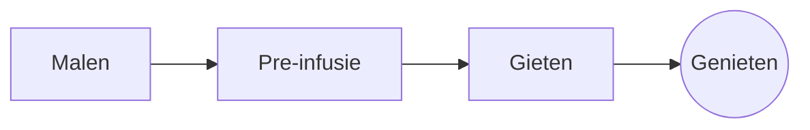

# De perfecte pour-over

Een rustig ochtendritueel in een paar stappen. Schrijf het in de **bron** links of rechtstreeks in de *voorvertoning* rechts: beide blijven gelijk, en ==elke wijziging is een nette aanpassing== van de Markdown.

> [!TIP]
> Water net van de kook, rond 94 °C, haalt de zoetheid naar boven zonder bitterheid.

## De verhouding

De meeste recepten kiezen voor één deel koffie op zestien delen water:

$$
m_{\text{water}} = 16 \times m_{\text{koffie}}
$$

Dus $20\,\text{g}$ koffie vraagt om $320\,\text{g}$ water.

## Stap voor stap



## Zetmethoden

| Methode   | Maalgraad  | Tijd |
|:----------|:----------:|-----:|
| Pour-over | Middelfijn | 3:30 |
| Cafetière | Grof       | 4:00 |
| Espresso  | Fijn       | 0:28 |

## Voor je begint

- [x] Vers gebrande bonen :coffee:
- [x] Een koffiemolen met maalstenen
- [ ] Een ketel met zwanenhals

```python
def water_for(coffee_g: float, ratio: int = 16) -> float:
    return coffee_g * ratio
```

Pre-infusie
: Het eerste scheutje water waarmee de koffie haar gassen loslaat.[^1]

[^1]: Verse bonen bloeien het meest; oude komen nauwelijks omhoog.
