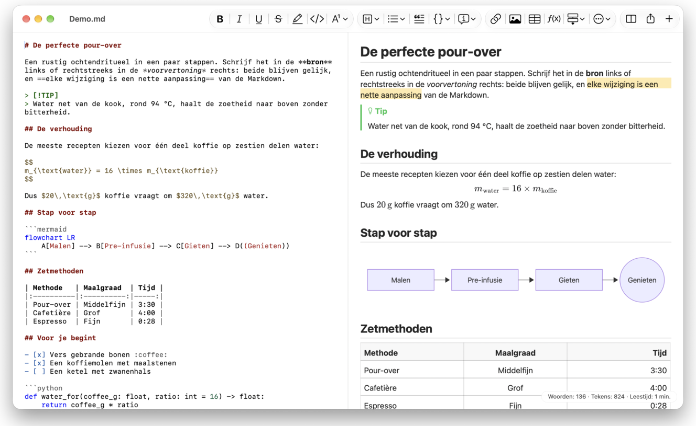
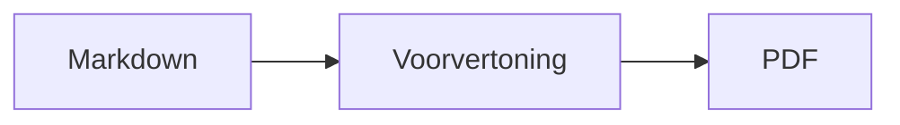

<p>&nbsp;&nbsp;&nbsp;</p>

# Splat

**De Markdown-editor voor macOS waarmee je in de bron schrijft of rechtstreeks in de voorvertoning.**

Splat toont links je Markdown-bron met syntaxiskleuren en rechts een live, volledig bewerkbare voorvertoning. Typ in
een van beide: wat je in de voorvertoning schrijft, wordt een minimale wijziging in de bron, zodat regels die je niet
hebt aangeraakt byte voor byte gelijk blijven en je Git-diffs overzichtelijk blijven. Splat leest de Markdown die je al
gebruikt: CommonMark en GitHub Flavored Markdown, GitHub-alerts, wikilinks, insluitingen en infokaders van Obsidian,
extensies van Pandoc en Typora, ingebedde HTML, LaTeX-formules en diagrammen in Mermaid, Graphviz en PlantUML, alles
offline weergegeven. Exporteer met één klik naar pdf, HTML of Word. Het is geschreven in Rust op echte
AppKit-besturingselementen, spreekt 35 talen en stuurt niets over het netwerk, tenzij jij dat vraagt.
 


[](https://raw.githubusercontent.com/sventmueller/splat/main/dist/Splat-1.0.6.dmg)

**[Download Splat-1.0.6.dmg](https://raw.githubusercontent.com/sventmueller/splat/main/dist/Splat-1.0.6.dmg)**: ondertekend en door Apple genotariseerd, voor macOS 14 of nieuwer op Apple Silicon en Intel.
 
 

[](https://www.rust-lang.org)
[](https://www.apple.com/macos/)

[](https://github.com/madsmtm/objc2)
[](https://webkit.org)
[](https://github.com/kivikakk/comrak)
[](https://github.github.com/gfm/)
[](https://www.mathjax.org)
[](https://cortexjs.io/mathlive/)
[](https://mermaid.js.org)
[](https://graphviz.org)
[](https://plantuml.com)


[](#licentie)

[Bahasa Indonesia](../id/README.md) ·
[Bahasa Melayu](../ms/README.md) ·
[Català](../ca/README.md) ·
[Čeština](../cs/README.md) ·
[Dansk](../da/README.md) ·
[Deutsch](../de/README.md) ·
[English](../../../README.md) ·
[Español](../es/README.md) ·
[Français](../fr/README.md) ·
[Hrvatski](../hr/README.md) ·
[Italiano](../it/README.md) ·
[Magyar](../hu/README.md) ·
**Nederlands** ·
[Norsk](../no/README.md) ·
[Polski](../pl/README.md) ·
[Português (Brasil)](../pt_BR/README.md) ·
[Português (Portugal)](../pt_PT/README.md) ·
[Română](../ro/README.md) ·
[Slovenčina](../sk/README.md) ·
[Slovenščina](../sl/README.md) ·
[Suomi](../fi/README.md) ·
[Svenska](../sv/README.md) ·
[Tiếng Việt](../vi/README.md) ·
[Türkçe](../tr/README.md) ·
[Ελληνικά](../el/README.md) ·
[Русский](../ru/README.md) ·
[Українська](../uk/README.md) ·
[עברית](../he/README.md)‎ ·
[العربية](../ar/README.md)‎ ·
[हिन्दी](../hi/README.md) ·
[ไทย](../th/README.md) ·
[한국어](../ko/README.md) ·
[日本語](../ja/README.md) ·
[简体中文](../zh-Hans/README.md) ·
[繁體中文](../zh-Hant/README.md)

## Inhoud

- [Functies in het kort](#functies-in-het-kort)
- [Systeemvereisten](#systeemvereisten)
- [Installatie](#installatie)
- [Aan de slag](#aan-de-slag)
- [Schrijven](#schrijven)
  - [In de bron](#in-de-bron)
  - [In de voorvertoning](#in-de-voorvertoning)
  - [Opmaakopdrachten](#opmaakopdrachten)
  - [Lijsten en taken](#lijsten-en-taken)
  - [Tabellen](#tabellen)
- [Ondersteunde Markdown](#ondersteunde-markdown)
  - [CommonMark en GitHub Flavored Markdown](#commonmark-en-github-flavored-markdown)
  - [Infokaders](#infokaders)
  - [Uitgebreide syntaxis](#uitgebreide-syntaxis)
  - [Obsidian](#obsidian)
  - [Citaten en verwijzingen](#citaten-en-verwijzingen)
  - [Ingebedde HTML](#ingebedde-html)
  - [Typografische leestekens](#typografische-leestekens)
  - [Syntaxisoverzicht](#syntaxisoverzicht)
- [Formules](#formules)
- [Diagrammen](#diagrammen)
- [Afbeeldingen](#afbeeldingen)
- [Links en navigatie](#links-en-navigatie)
- [Exporteren, afdrukken en delen](#exporteren-afdrukken-en-delen)
- [Uiterlijk en toegankelijkheid](#uiterlijk-en-toegankelijkheid)
- [Talen](#talen)
- [Toetscombinaties](#toetscombinaties)
- [Privacy en beveiliging](#privacy-en-beveiliging)
- [Grote documenten](#grote-documenten)
- [Bekende beperkingen](#bekende-beperkingen)
- [Problemen oplossen](#problemen-oplossen)
- [Voor ontwikkelaars](#voor-ontwikkelaars)
  - [Bouwen](#bouwen)
  - [Distributie](#distributie)
  - [Testen](#testen)
  - [Projectindeling](#projectindeling)
  - [Gegevensstroom](#gegevensstroom)
  - [Regels in de controller](#regels-in-de-controller)
  - [Een opdracht toevoegen](#een-opdracht-toevoegen)
  - [Vertalingen](#vertalingen)
  - [Componenten van derden](#componenten-van-derden)
- [Licentie](#licentie)

## Functies in het kort

- **Twee manieren om te schrijven, één tekst.** Bron en voorvertoning zijn allebei bewerkbaar. Het Markdown-bestand is
  de enige waarheid: er is één wijzigingsgeschiedenis per document en elke bewerking in de voorvertoning wordt
  vertaald naar de kleinst mogelijke wijziging in de bron.
- **De Markdown die je al gebruikt.** CommonMark, GitHub Flavored Markdown, GitHub-alerts, Obsidian, extensies van
  Pandoc en Typora, emoji-shortcodes, spoilers, definitielijsten, kopankers en HTML zoals in GitHub-README's.
- **Formules en diagrammen ingebouwd.** LaTeX-formules via MathJax, met een visuele formule-editor. Diagrammen in
  Mermaid, Graphviz en PlantUML, weergegeven op je Mac zonder Java, server of netwerkverbinding.
- **Een knop voor alles.** Elk Markdown-element heeft een knop in de knoppenbalk en een menu-item, de gangbare ook een
  toetscombinatie. Tabellen hebben een eigen menu voor rijen, kolommen en uitlijning.
- **Exporteren zonder verlies.** Pdf, één zelfstandig HTML-bestand of een Word-document met echte koppen, lijsten,
  tabellen, voetnoten en afbeeldingen.
- **Door en door native.** Echte AppKit-vensters, tabbladen, menu's, pop-overs, Versies, automatisch bewaren, het
  deelmenu, donkere modus, spellingcontrole, dicteren en VoiceOver. Geen Electron en geen webweergave voor de tekst
  zelf.
- **Snel met grote bestanden.** Het renderen van een toetsaanslag in een document van 10 MB kost ongeveer 25 ms, vóór het eigen werk van de weergave.
- **Privé en zorgvuldig.** Afbeeldingen van internet laden pas nadat je dat toestaat, links naar andere apps vragen
  eerst om bevestiging en alles wat onbetrouwbare afbeeldingsdata decodeert, draait in hulpprocessen in een sandbox.
- **In jouw taal.** De interface en de ingebouwde beknopte Markdown-naslag zijn er in 35 talen: Arabisch, Catalaans,
  Chinees (vereenvoudigd), Chinees (traditioneel), Kroatisch, Tsjechisch, Deens, Nederlands, Engels, Fins, Frans, Duits,
  Grieks, Hebreeuws, Hindi, Hongaars, Indonesisch, Italiaans, Japans, Koreaans, Maleis, Noors, Pools, Portugees
  (Brazilië), Portugees (Portugal), Roemeens, Russisch, Slowaaks, Sloveens, Spaans, Zweeds, Thai, Turks, Oekraïens en
  Vietnamees.

## Systeemvereisten

- macOS 14 Sonoma of nieuwer. Splat wordt ontwikkeld en getest op macOS 27, waar het automatisch het Liquid
  Glass-ontwerp overneemt.
- Een Mac met Apple Silicon of een Intel-processor.
- Ongeveer 45 MB schijfruimte.

## Installatie

**Vanaf de schijfkopie.** Download [`dist/Splat-1.0.6.dmg`](https://raw.githubusercontent.com/sventmueller/splat/main/dist/Splat-1.0.6.dmg), open haar en sleep Splat naar de map Programma's. De schijfkopie is
ondertekend met een Developer ID en door Apple genotariseerd, dus ze opent zonder waarschuwingen.

**Met Homebrew.** De cask staat in een eigen tap:

```sh
brew install --cask sventmueller/tap/splat
```

`brew upgrade --cask splat` installeert nieuwe versies en `brew uninstall --zap --cask splat` verwijdert ook de
instellingen en caches van Splat.

**Updates.** Splat vanaf de schijfkopie of via Homebrew houdt zichzelf up-to-date met [Sparkle](https://sparkle-project.org).
Bij de tweede start vraagt het of het zelf mag zoeken naar updates, eenmaal per dag. **Splat › Zoek naar updates…**
zoekt meteen; met **Zoek automatisch naar updates** en **Download en installeer updates automatisch** in hetzelfde
menu wijzig je je keuze later. Splat installeert een update alleen als die de handtekening van de ontwikkelaar draagt.
Een eigen build heeft geen updater.

**Vanaf de broncode.** Zie [Bouwen](#bouwen) voor de vereisten en voer dan uit:

```sh
make build
ditto target/release/Splat.app /Applications/Splat.app
open /Applications/Splat.app
```

Om Markdown-bestanden met een dubbelklik in Splat te openen, selecteer je een willekeurig `.md`-bestand in de Finder,
kies je **Archief › Toon info**, kies je Splat onder **Open met** en klik je op **Wijzig alles…**. Splat registreert
zich voor `.md`-, `.markdown`-, `.mdown`- en `.mkd`-bestanden.

## Aan de slag

### Het venster

Elk document opent in een eigen venster, of als tabblad als je liever tabbladen gebruikt:

- **Links: de bron.** Je Markdown in SF Mono met syntaxiskleuren.
- **Rechts: de voorvertoning.** Het weergegeven document, klaar om te bewerken.
- **Structuurzijbalk (optioneel).** Alle koppen als boom; een klik op een kop toont die in beide deelvensters. Zet de
  zijbalk aan of uit met **Weergave › Toon structuur** (⌃⌘S).
- **Knoppenbalk.** Knoppen gegroepeerd naar wat ze wijzigen: tekens, alinea's en ingevoegde onderdelen, daarna
  voorvertoning aan/uit, Deel en Nieuw document. Pas de balk aan met **Weergave › Pas knoppenbalk aan…**.

Sleep de scheiding om een van beide kanten meer ruimte te geven. **Weergave › Verberg voorvertoning** (⌥⌘P) laat alleen
de bron staan; Splat onthoudt dit per venster. Beide deelvensters scrollen samen en een selectie in het ene deelvenster
wordt in het andere gemarkeerd.

### Documenten, tabbladen en versies

Splat is een gewone macOS-documentapp:

- **Automatisch bewaren en Versies.** Wijzigingen worden ter plekke bewaard. Met **Archief › Vorige versie › Blader door alle versies…** ga je terug in de tijd.
- **Wijzigingen door andere programma's.** Als Git, een script of een andere editor een geopend document wijzigt,
  laadt Splat het opnieuw en behoudt de cursor en de scrollpositie. Heb je zelf nog niet-bewaarde wijzigingen, dan houdt
  Splat die vast en vraagt macOS om bevestiging voordat de andere versie wordt overschreven.
- **De gebruikelijke bestandsopdrachten.** Dupliceer (⇧⌘S), Wijzig naam…, Verplaats naar… en **Archief › Open recente bestanden**.
- **Tabbladen.** **Archief › Nieuw tabblad** of de knop **+** in de knoppenbalk opent een nieuw document als tabblad;
  via het standaardmenu Venster voeg je tabbladen samen, verplaats je ze en blader je erdoorheen.
- **Vensterpositie.** De grootte en positie van je laatste venster worden onthouden, ook na een herstart. Staat daar al
  een venster, dan opent het nieuwe iets verschoven.
- **Het Dock-symbool.** Een klik erop nadat je het laatste venster hebt gesloten, opent een nieuw document.
- **Open Markdown-bestanden in Splat.** Met **Splat › Stel in als standaardapp voor Markdown** opent een dubbelklik op
  een `.md`- of `.markdown`-bestand Splat; macOS vraagt eenmalig om bevestiging. Het onderdeel heeft een vinkje zolang
  Splat de standaardapp is.

Bestanden moeten UTF-8-tekst zijn, of UTF-16 met een bytevolgordemarkering. Splat weigert andere coderingen in plaats
van te gokken en de tekst te beschadigen. Een bytevolgordemarkering blijft behouden, UTF-16 blijft UTF-16 en in een
bestand waarvan alle regels op CRLF eindigen, krijgen de regels die je toevoegt ook CRLF.

**Na een crash** gaan hooguit de laatste seconden typwerk verloren: elke vijf seconden kopieert Splat niet-bewaarde
tekst naar `~/Library/Application Support/Splat/Unsaved` en verwijdert die kopieën zodra een document is bewaard of
Splat normaal wordt afgesloten. Bij de volgende start verplaatst Splat wat een crash daar heeft achtergelaten naar
`~/Library/Application Support/Splat/Recovery` en meldt dat eenmalig, met een knop die de map opent. Een crash waarop
Splat nog kan reageren, schrijft daar ook de tekst van elk geopend document naartoe.

### Beknopte naslag

**Help › Beknopte Markdown-naslag** opent een naslagblad in jouw taal als nieuw, naamloos document. Het is een gewoon
document, dus probeer alles meteen uit, in de bron of in de voorvertoning.

## Schrijven

### In de bron

De bron is een teksteditor die is afgestemd op Markdown:

- **Syntaxiskleuren** zoals in VS Code: koppen, nadruk, links, code, tabellen, HTML, front matter, en LaTeX en Mermaid
  binnen formules en diagrammen. Er zijn paletten voor licht, donker en Verhoog contrast.
- **Omheinde codeblokken** worden gemarkeerd voor Bash, C, C++, C#, CSS (ook SCSS en Less), Go, HTML, XML, Java,
  JavaScript, JSON, Kotlin, PHP, Python, Ruby, Rust, SQL, Swift, TypeScript, YAML, TeX en Mermaid, inclusief hun
  gebruikelijke korte namen zoals `js`, `py` of `sh`.
- **Geen verrassende vervangingen.** Slimme aanhalingstekens, slimme streepjes en tekstvervanging staan standaard uit,
  omdat ze `--`, `---` en `"` kapotmaken. Zet ze aan onder **Wijzig › Vervanging**.
- **De schrijfhulpmiddelen van het systeem.** Spellings- en grammaticacontrole, dicteren, Zoek en vervang (⌥⌘F) en
  Spraak.
- **Slepen en neerzetten.** Zet een afbeeldingsbestand neer om `` in te voegen, een ander
  bestand om een link ernaar in te voegen en een URL om `[url](url)` in te voegen. Elke drop is één stap om ongedaan te
  maken.
- **Afbeeldingen plakken.** Een afbeelding op het klembord, zoals een schermafbeelding, wordt als PNG-bestand naast het
  document bewaard (`Afbeelding 2026-10-29 13.09.07.png`) en als afbeelding ingevoegd. Daarvoor moet het document één
  keer bewaard zijn.

### In de voorvertoning

De voorvertoning gedraagt zich als een tekstverwerker, maar alles wat je erin doet, komt als Markdown in de bron terecht:

- **Typen.** Tekens die in Markdown iets betekenen, zoals `*` of `#`, worden ge-escaped zodat ze verschijnen zoals je ze
  typt.
- **Return** begint een nieuwe alinea of een nieuw lijstitem. **⌥Return** of **⌃Return** voegt een regeleinde in.
- **Opmaak bij de cursor.** Staat de cursor aan het eind van een woord, dan gelden Vet, Cursief en de andere
  tekenopmaak voor wat je daarna typt. Kies de opmaak opnieuw om te stoppen. Binnen een woord wordt het hele woord
  opgemaakt.
- **Lege regels.** Return op een lege regel voegt nog een lege regel toe en Backspace verwijdert die weer. In de bron
  zijn dat per extra lege regel twee extra witregels; andere Markdown-programma's tonen ze als gewone alinea-afstand.
- **Herstel** werkt in beide deelvensters. Herstelacties hebben een naam ("Herstel Vet"), typen is één stap per reeks
  aanslagen en na Herstel en Opnieuw scrollen beide deelvensters naar de wijziging.
- **Formules en diagrammen** verschijnen als afgewerkte afbeeldingen. Klik erop, zet de cursor erop of druk er op
  Return om de editor te openen (zie [Formules](#formules) en [Diagrammen](#diagrammen)).
- **Ingebedde HTML, ingesloten notities en front matter** worden getoond, maar je bewerkt ze in de bron. Een klik erop
  zet de cursor op de bijbehorende plek daar.

Alles wat Markdown niet kan uitdrukken, is in de voorvertoning geblokkeerd: de paletten Lettertype en Kleuren, de
liniaal en het plakken of neerzetten van opgemaakte tekst en afbeeldingen. Geplakte HTML en RTF komen binnen als
gewone tekst.

### Opmaakopdrachten

Elke opdracht is beschikbaar via de knoppenbalk, de menubalk en het contextmenu van beide deelvensters. Menu-items
tonen een vinkje voor de opmaak bij de cursor.

| Menu | Opdrachten |
|---|---|
| **Opmaak › Lettertype** | Vet, Cursief, Onderstreept, Doorgehaald, Markering, Code, Superscript, Subscript |
| **Opmaak › Koptekst** | Hoofdtekst, Koptekst 1 tot 6 |
| **Opmaak › Lijst** | Opsommingstekenslijst, Genummerde lijst, Takenlijst |
| **Opmaak** | Citaat, Codeblok (Geen taal of een van 20 talen; wijzigt ook de taal van een bestaand blok), Infokader (Notitie, Tip, Belangrijk, Waarschuwing, Let op; hetzelfde type nogmaals verwijdert het), Wijzig formule of diagram…, Wis opmaak |
| **Voeg in** | Link…, Afbeelding…, Tabel…, Formule, Diagram (Stroomdiagram, Sequentiediagram, Gantt-diagram), Inhoudsopgave, Voetnoot, Scheidingslijn |
| **Tabel** | Voeg rij erboven/eronder in, Voeg kolom links/rechts in, Verwijder rij, Verwijder kolom, Uitlijning (Links, Centreer, Rechts, Standaard), Lijn tabelkolommen uit |
| **Weergave** | Verberg/Toon voorvertoning, Toon/Verberg structuur, Typografische leestekens, Zoom in/uit, Werkelijke grootte, knoppenbalk, tabbladbalk, schermvullende weergave |

Onderstreept, markering, superscript en subscript worden geschreven als `<ins>`, `<mark>`, `<sup>` en `<sub>`, wat
GitHub ook toont. Splat leest ook `<u>`, dat GitHub verwijdert, en de kortere `==markering==`, `^sup^` en `~sub~`.
GitHub toont `==` en `^` zoals getypt en `~sub~` als doorhaling.

### Lijsten en taken

- Return zet een lijst voort; Return op een leeg item beëindigt de lijst.
- **Tab** en **⇧Tab** laten lijstitems in de voorvertoning inspringen en weer terugspringen.
- Een klik op een takenvakje in de voorvertoning schakelt tussen `- [ ]` en `- [x]`.
- **Opmaak › Lijst** zet de geselecteerde alinea's om in een lijst of wijzigt het soort lijst.

### Tabellen

- **Voeg in › Tabel…** vraagt om het aantal rijen (inclusief de kopregel) en kolommen.
- In de voorvertoning gaat **Tab** naar de volgende cel, **⇧Tab** naar de vorige en **Return** naar de cel eronder. Tab
  in de laatste cel voegt een rij toe.
- Het menu **Tabel** voegt rijen en kolommen in en verwijdert ze, en stelt de uitlijning van een kolom in (⌘{, ⌘|, ⌘}).
- **Tabel › Lijn tabelkolommen uit** vult de bron aan zodat de kolommen netjes onder elkaar staan.

## Ondersteunde Markdown

Splat parseert met [comrak](https://github.com/kivikakk/comrak), een parser die compatibel is met CommonMark en GFM, en
schakelt de meeste extensies ervan in. Alles hieronder wordt weergegeven in de voorvertoning en in alle exports.

### CommonMark en GitHub Flavored Markdown

- Koppen (`#` en onderstreept), alinea's, regeleinden, nadruk, sterke nadruk, inline code, blokcitaten,
  scheidingslijnen.
- Lijsten met opsommingstekens, genummerde en geneste lijsten; takenlijsten.
- Links (inline, via verwijzing en automatisch), afbeeldingen, definities van linkverwijzingen.
- Omheinde en ingesprongen codeblokken met syntaxiskleuren.
- Tabellen met kolomuitlijning.
- Doorhaling met `~~twee tildes~~`.
- Voetnoten: `tekst[^1]` met `[^1]: De noot.` ergens in het document. Een klik op de markering springt naar de noot.
- YAML-front matter tussen `---`-regels bovenaan. De voorvertoning vat die samen in één regel, zoals
  "Metadata: title, date, tags".

### Infokaders

GitHub-alerts worden weergegeven als gekleurde kaders met pictogram en titel:

```markdown
> [!NOTE]
> Nuttige informatie die gebruikers moeten weten.

> [!WARNING]
> Kritieke inhoud die onmiddellijke aandacht vraagt.
```

De vijf typen zijn Notitie, Tip, Belangrijk, Waarschuwing en Let op. **Opmaak › Infokader** maakt van de alinea bij de
cursor zo'n kader.

Infokaders van Obsidian werken ook, met een willekeurige titel en een open- of dichtstand:

```markdown
> [!tip]- Klik op ▸ om uit te vouwen
> Verborgen tot het wordt geopend.

> [!question]+ Standaard geopend
> Een `+` begint uitgevouwen, een `-` samengevouwen.
```

De andere typen van Obsidian worden getoond in de dichtstbijzijnde van de vijf kleuren: `success`, `check`, `done` en
`hint` als Tip; `question`, `help` en `faq` als Belangrijk; `attention` als Waarschuwing; `failure`, `fail`,
`missing`, `danger`, `error` en `bug` als Let op; al het andere als Notitie.

### Uitgebreide syntaxis

| Functie | Syntaxis | Afkomstig van |
|---|---|---|
| Markering | `==gemarkeerde tekst==` | Obsidian, Typora |
| Superscript | `x^2^` | Pandoc, Typora |
| Subscript | `H~2~O` | Pandoc, Typora |
| Emoji-shortcode | `:rocket:` wordt 🚀 | GitHub |
| Spoiler | `\|\|verborgen tekst\|\|`, selecteer om te lezen | Discord |
| Inline voetnoot | `tekst^[de noot zelf]` | Pandoc, Obsidian |
| Definitielijst | `Term`, lege regel, `: Uitleg` | PHP Markdown Extra, Pandoc |
| Kopanker | `## Installeren {#setup}`, link met `[zie](#setup)` | Pandoc, kramdown |

Definitielijsten zien er in de bron zo uit:

```markdown
Term

: Uitleg van de term.
```

Zonder eigen anker krijgt elke kop er een die uit de tekst wordt afgeleid, zoals op GitHub: `## Aan de slag` is te
bereiken als `#aan-de-slag`.

### Obsidian

- **Wikilinks.** `[[Notitie]]` linkt naar `Notitie.md` in dezelfde map of een map eronder. `[[Notitie|Weergegeven tekst]]` toont
  je eigen tekst en `[[Notitie#Kop]]` opent de notitie. ⌘-klik opent haar in Splat.
- **Insluitingen.** `![[Notitie]]` toont de andere notitie binnen deze; notities die daarin zijn ingesloten, verschijnen
  als links. `![[diagram.png]]` toont een afbeelding. Zoals in Obsidian noemen insluitingen notities en afbeeldingen
  in de map van het document of daaronder, nooit met een absoluut pad, en alleen Markdown-bestanden verschijnen als
  notities.
- **Opmerkingen.** `%%Alleen in de bron%%` blijft zichtbaar in de bron en wordt weggelaten uit de voorvertoning en uit
  elke export, zowel inline als op een eigen regel.
- **Tags.** `#idee` of `#project/splat` wordt gemarkeerd. ⌘-klik zoekt de tag in het document.
- **Inklapbare infokaders.** Zie [Infokaders](#infokaders).

### Citaten en verwijzingen

- **Pandoc-citaten.** `[@doe2020]` of `[@doe2020; @roe2021]` leest als "(Doe 2020; Roe 2021)". De items komen uit het
  BibTeX-bestand dat de front matter noemt als `bibliography: refs.bib`. Zonder die vermelding gebruikt Splat
  `references.bib`, `literatur.bib` of `bibliography.bib` naast het document.
- **GitHub- en GitLab-verwijzingen.** Ligt het document in een Git-repository waarvan de remote `origin` op github.com
  of een GitLab-host staat, dan worden `@naam`, `#12` (issue) en `!7` (merge request, alleen GitLab) gemarkeerd.
  ⌘-klik opent ze in de browser.

### Ingebedde HTML

HTML zoals je die in GitHub-README's vindt, wordt weergegeven met een eigen lezer in plaats van een browserengine:

- gecentreerde alinea's en blokken (`<p align="center">`, `<div align="center">`)
- afbeeldingen met een afmeting (``)
- links, `<kbd>⌘</kbd>`, `<br>`, `<u>`, `<ins>`, `<mark>`, `<sup>`, `<sub>`
- lijsten en tabellen, inclusief cellen die meerdere kolommen beslaan (`colspan`)
- inklapbare secties: `<details><summary>Meer</summary>…</details>`, geopend met een klik op ▸

Markdown tussen HTML-tags wordt als Markdown weergegeven. Scripts, stijlen, frames en formulieren worden helemaal
weggelaten, en links en afbeeldingen behouden alleen `http`, `https`, `mailto` en relatieve adressen.

### Typografische leestekens

**Weergave › Typografische leestekens** toont rechte aanhalingstekens als de aanhalingstekens van je interfacetaal, `--` als
een kort streepje, `---` als een lang streepje en `...` als beletselteken. In het Duits wordt `"Ja"` „Ja“, in het
Frans «Oui», in het Japans 「はい」, ook waar Chinees en Japans aanhalingstekens zonder spatie zetten; Hebreeuwse
afkortingen zoals `צה"ל` krijgen hun gershayim, צה״ל. De bron behoudt de gewone tekens; de voorvertoning en alle exports tonen de
typografische. De instelling staat uit totdat je haar aanzet.

### Syntaxisoverzicht

| Element | Markdown |
|---|---|
| **Vet** | `**Vet**` |
| *Cursief* | `*Cursief*` |
| Onderstreept | `<ins>Onderstreept</ins>` of `<u>Onderstreept</u>` |
| ~~Doorgehaald~~ | `~~Doorgehaald~~` |
| Markering | `<mark>Markering</mark>` of `==Markering==` |
| `Code` | `` `Code` `` |
| x² | `x<sup>2</sup>` of `x^2^` |
| H₂O | `H<sub>2</sub>O` of `H~2~O` |
| [Link](https://example.com) | `[Link](https://example.com)` |
| Koptekst | `# Koptekst` tot `###### Koptekst` |
| Citaat | `> Citaat` |
| Lijst met opsommingstekens | `- Item` |
| Genummerde lijst | `1. Item` |
| Taak | `- [ ] Open` en `- [x] Klaar` |
| Codeblok | ```` ```rust ```` … ```` ``` ```` |
| Tabel | `\| A \| B \|` met `\|---\|---\|` onder de kopregel |
| Voetnoot | `Tekst[^1]` en `[^1]: Noot` |
| Scheidingslijn | `---` |
| Afbeelding | `` |
| Formule | `$E = mc^2$`, `$$ … $$` |
| Diagram | ```` ```mermaid ````, ```` ```dot ````, ```` ```plantuml ```` |
| Infokader | `> [!TIP]` |
| Wikilink | `[[Notitie]]`, `[[Notitie\|Tekst]]` |
| Insluiting | `![[Notitie]]`, `![[afbeelding.png]]` |
| Opmerking | `%%Opmerking%%` |
| Tag | `#tag` |
| Citaat uit literatuur | `[@sleutel]` |
| Spoiler | `\|\|Spoiler\|\|` |
| Emoji | `:tada:` |

## Formules

Formules worden door [MathJax](https://www.mathjax.org) weergegeven met zijn TeX en AMS-wiskunde, als scherpe
vectorafbeeldingen. Tekst in `\text{…}` mag in elk schrift staan: wat de lettertypen van MathJax missen, komt uit de
lettertypen van je Mac, waarbij Arabisch en Hebreeuws van rechts naar links lopen, en emoji in kleur.

| Soort | Syntaxis |
|---|---|
| Inline | `$E = mc^2$`, `` $`E = mc^2`$ `` (GitHub, GitLab), `\(E = mc^2\)` |
| Display | `$$` … `$$`, `\[` … `\]`, of een codeblok met de markering `math` |

**Een formule bewerken.** Klik in de voorvertoning op een formule, dubbelklik erop, druk er op Return of zet de cursor
erop om de editor in een pop-over te openen. **Voeg in › Formule** voegt een nieuwe in en opent meteen de editor.

- **Visueel of LaTeX.** De schakelaar bovenaan wisselt tussen een visuele editor ([MathLive](https://cortexjs.io/mathlive/))
  en de LaTeX-code. Splat onthoudt je keuze.
- **Bouwstenen** voor breuk, vierkantswortel, superscript en subscript, som en integraal met grenzen, limiet,
  haakjes die met de inhoud meegroeien, 2×2-matrix, Griekse letters, en relaties, operatoren en pijlen. Ze laten
  plaatshouders □ achter en **Tab** springt naar de volgende.
- **Live voorvertoning.** Wijzigingen verschijnen in het document terwijl je typt. Fouten van MathJax staan in een regel
  onder de code.
- **Bewaren of verwerpen.** Buiten de editor klikken houdt de wijziging als één stap om ongedaan te maken; **Esc** of
  **Annuleer** gooit haar weg. Esc bij een nieuwe, lege formule verwijdert die weer.
- Het contextmenu biedt **Wijzig formule…** voor de formule onder de aanwijzer.

VoiceOver leest een formule voor als haar LaTeX-code. Splat geeft formules weer, geen volledige LaTeX-documenten: er zijn
geen pakketten, geen TikZ en geen `\documentclass`.

## Diagrammen

Diagrammen worden binnen Splat weergegeven, offline en in een lichte en een donkere variant.

| Engine | Codeblok | Wat het tekent |
|---|---|---|
| [Mermaid](https://mermaid.js.org) | ```` ```mermaid ```` | stroomdiagrammen, sequentie-, klasse-, toestands- en entiteit-relatiediagrammen, Gantt, cirkeldiagrammen, mindmaps, tijdlijnen en elk ander Mermaid-type |
| [Graphviz](https://graphviz.org) | ```` ```dot ```` of ```` ```graphviz ```` | grafen in de DOT-taal |
| [PlantUML](https://plantuml.com) | ```` ```plantuml ```` of ```` ```puml ```` | UML-diagrammen; draait zonder Java |



**Een diagram bewerken** werkt als het bewerken van een formule: klik erop om de code in een pop-over te openen, met
syntaxiskleuren en foutmeldingen in een regel onder de code. **Voeg in › Diagram** begint met een sjabloon voor een
stroomdiagram, een sequentiediagram of een Gantt-diagram. Bouwstenen helpen bij de drie meest voorkomende Mermaid-typen:

- **Stroomdiagram:** Knooppunt ▾ (rechthoek, afgerond, cirkel, ruit, database), Verbinding, Verbinding met label, Groep,
  Richting ▾
- **Sequentiediagram:** Deelnemer, Bericht, Antwoord, Notitie, Lus, Alternatieve paden
- **Gantt-diagram:** Sectie, Taak, Mijlpaal

Andere diagramtypen bewerk je als code. VoiceOver leest de titel of alternatieve tekst van een diagram voor.

Het eerste diagram na het opstarten duurt ongeveer een seconde, omdat de weergave-engine op de achtergrond start. Een
diagram dat langer dan 10 seconden duurt, toont een fout en de weergave-engine start opnieuw voor het volgende.
De engine van PlantUML (3 MB) laadt pas bij het eerste PlantUML-diagram. Een PlantUML-`!include` van het web wordt
geblokkeerd.

## Afbeeldingen

- **Lokale afbeeldingen** gebruiken paden ten opzichte van het document: ``. Splat toont PNG,
  JPEG, GIF, WebP, BMP, SVG, HEIC, TIFF, AVIF en pdf.
- **Afbeeldingen van het web** blijven geblokkeerd totdat je ze toestaat: een balk boven de voorvertoning legt uit dat
  het laden ervan hun servers laat weten dat en wanneer je het document opent. **Laad afbeeldingen** staat ze toe voor
  dit document; Splat onthoudt de keuze per bestand.
- **Afmeting.** `` bepaalt de grootte van een afbeelding; anders passen afbeeldingen in de breedte van
  de voorvertoning.
- **Wijzigingen op schijf.** Een afbeelding die je vervangt, of een die verschijnt nadat het document haar noemde, wordt
  getoond zonder het document opnieuw te openen. Afbeeldingen van het web die door het netwerk mislukten, worden
  opnieuw geprobeerd zolang een document ze toont.
- **Geheugen.** Afbeeldingen worden getoond tot 2560 pixels langs hun langste zijde, wat ook een A4-pagina vult. Ze
  worden kleiner gedecodeerd zodra ze een achtste van het geheugen van de Mac vullen, en zolang macOS geheugendruk
  meldt.
- **Donkere modus.** Afbeeldingen met een witte achtergrond worden in de donkere voorvertoning iets gedimd.
- **Plakken en neerzetten.** Zie [In de bron](#in-de-bron).

## Links en navigatie

In de voorvertoning plaatst een klik de cursor zodat je de linktekst kunt bewerken; **⌘-klik** volgt de link:

- `http`, `https` en `mailto` openen in je browser of mailapp.
- Markdown-bestanden openen in Splat; andere bestanden en mappen worden getoond in de Finder.
- `#anker` springt naar de kop in het document.
- Adressen die een andere app openen, zoals `slack://` of `vscode://`, vragen eerst om bevestiging en tonen het volledige
  adres en de app. **Annuleer** is vooraf geselecteerd.

**Voeg in › Inhoudsopgave** voegt een gelinkte lijst van alle koppen in. Met de cursor erin werkt dezelfde opdracht
haar bij. De structuurzijbalk (⌃⌘S) springt in beide deelvensters naar elke kop.

## Exporteren, afdrukken en delen

| Formaat | Hoe | Wat je krijgt |
|---|---|---|
| **PDF** | **Archief › Exporteer als pdf…** of het menu Deel | Pagina's op papierformaat, altijd in het lichte uiterlijk, formules en diagrammen als vectorafbeeldingen. **Archief › Pagina-instelling…** bepaalt het papier. |
| **Afdrukken** | **Archief › Druk af…** (⌘P) | Dezelfde opmaak als de pdf. |
| **HTML** | **Archief › Exporteer als HTML…** of het menu Deel | Eén zelfstandig bestand: lokale afbeeldingen ingebed, formules en diagrammen als scherpe afbeeldingen, kopankers zodat de inhoudsopgave werkt. Geen scripts. |
| **Word** | **Archief › Exporteer als Word-document…** of het menu Deel | Een `.docx` met de koptekststijlen van Word, echte lijsten en tabellen (inclusief samengevoegde cellen), voetnoten als Word-voetnoten, ingebedde afbeeldingen, formules en diagrammen. |
| **Markdown** | De knop **Deel** in de knoppenbalk | Het document als `.md`-bestand voor Mail, Berichten, AirDrop en elke andere deelservice. |

Het menu **Archief › Deel** biedt dit alles op één plek. Exports gebruiken de instelling voor typografische leestekens en
de afbeeldingen van het web die je hebt toegestaan; afbeeldingen van het web blijven in HTML links.

## Uiterlijk en toegankelijkheid

- **Donkere modus** volgt het systeem. Formules en diagrammen worden voor elk uiterlijk weergegeven.
- **Verhoog contrast** in Systeeminstellingen schakelt de syntaxiskleuren om naar paletten met hoog contrast.
- **Zoom.** ⌘+, ⌘− en ⌘0 schalen beide deelvensters.
- **Schermvullende weergave, tabbladen en een aanpasbare knoppenbalk**, zoals in elke Mac-app.
- **VoiceOver.** De deelvensters heten "Markdown-bron" en "Voorvertoning", formules worden voorgelezen als hun code en
  diagrammen als hun titel. Elke opdracht is met het toetsenbord te bereiken.

Splat heeft geen instellingenvenster: de weinige opties staan waar ze gelden, in **Weergave** en **Wijzig › Vervanging**.

## Talen

De interface, de menu's en de beknopte Markdown-naslag zijn vertaald in 35 talen:

Arabisch, Catalaans, Chinees (vereenvoudigd), Chinees (traditioneel), Kroatisch, Tsjechisch, Deens, Nederlands, Engels,
Fins, Frans, Duits, Grieks, Hebreeuws, Hindi, Hongaars, Indonesisch, Italiaans, Japans, Koreaans, Maleis, Noors, Pools,
Portugees (Brazilië), Portugees (Portugal), Roemeens, Russisch, Slowaaks, Sloveens, Spaans, Zweeds, Thai, Turks,
Oekraïens en Vietnamees.

Splat volgt de taalvolgorde in **Systeeminstellingen › Algemeen › Taal en regio**; daar kun je onder **Apps** ook een
taal voor Splat alleen kiezen. Is er geen vertaling voor jouw taal, dan gebruikt het Engels. Menutermen volgen de eigen
vertalingen van Apple, zodat Splat leest als de rest van je Mac.

Hebreeuwse en Arabische tekst loopt overal waar die voorkomt van rechts naar links, welke interfacetaal je ook
gebruikt: elke alinea, kop en elk lijstitem krijgt de richting van zijn eerste letter, citaten en infokaders tekenen hun
balk rechts en een tabel waarvan de tekst van rechts naar links begint, toont zijn kolommen van rechts af. Codeblokken
blijven van links naar rechts lopen. De pdf-, HTML- en Word-exports behouden deze richtingen. Met Hebreeuws of Arabisch als
systeemtaal spiegelt macOS ook het venster, zodat de voorvertoning links staat.

## Toetscombinaties

| Actie | Toetscombinatie |
|---|---|
| Vet, Cursief, Onderstreept | ⌘B, ⌘I, ⌘U |
| Doorgehaald | ⇧⌘X |
| Link… | ⌘K |
| Hoofdtekst, Koptekst 1 tot 6 | ⌥⌘0, ⌥⌘1 tot ⌥⌘6 |
| Tabelkolom links, gecentreerd, rechts uitlijnen | ⌘{, ⌘\|, ⌘} |
| Voorvertoning verbergen of tonen | ⌥⌘P |
| Structuur tonen of verbergen | ⌃⌘S |
| Zoom in, uit, werkelijke grootte | ⌘+, ⌘−, ⌘0 |
| Nieuw document, open, bewaar, dupliceer | ⌘N, ⌘O, ⌘S, ⇧⌘S |
| Pagina-instelling, druk af | ⇧⌘P, ⌘P |
| Zoek, zoek en vervang | ⌘F, ⌥⌘F |
| Zoek volgende, vorige; gebruik selectie; ga naar selectie | ⌘G, ⇧⌘G; ⌘E; ⌘J |
| Toon spelling en grammatica; controleer document | ⌘:, ⌘; |
| Plak en pas stijl aan | ⌥⇧⌘V |
| Verberg knoppenbalk, toon alle tabbladen, schermvullend | ⌥⌘T, ⇧⌘\\, ⌃⌘F |
| Regeleinde (voorvertoning) | ⌥Return of ⌃Return |
| Volgende cel / vorige cel in een tabel (voorvertoning) | Tab / ⇧Tab |
| Lijstitem laten inspringen / terugspringen (voorvertoning) | Tab / ⇧Tab |
| Volgende plaatshouder in de formule-editor | Tab |
| De formule- of diagrameditor sluiten zonder wijzigingen | Esc |
| Een link, tag of verwijzing volgen (voorvertoning) | ⌘-klik |

Splat laat de standaardtoetscombinaties van Apple ongemoeid.

## Privacy en beveiliging

Een Markdown-bestand kan van iedereen komen, dus Splat behandelt elk document als onbetrouwbaar.

- **Standaard geen netwerk.** Splat heeft geen telemetrie. Het zoekt alleen naar updates nadat je daarmee akkoord gaat
  of **Zoek naar updates…** kiest: dan laadt het een klein feedbestand van GitHub en noemt het verzoek niets
  anders dan de app en haar versie. Formules en diagrammen worden lokaal weergegeven; de webweergaven die dat doen,
  hebben geen toegang tot het netwerk.
- **Afbeeldingen van het web** laden pas na jouw toestemming, alleen via `https`, nooit van hosts in je lokale
  netwerk, hooguit 10 MB per stuk en in een privésessie zonder cookies.
- **Geïsoleerd decoderen.** Afbeeldingen en de afbeeldingen van formules en diagrammen worden gedecodeerd in
  hulpprocessen die elk bestand sluiten dat ze hebben geërfd en zichzelf in een sandbox opsluiten voordat ze de eerste
  byte lezen: geen toegang tot bestanden, geen netwerk. Ze geven alleen pixels terug, waarvan de afmeting wordt
  gecontroleerd, en worden na 10 seconden gestopt. De eigen afbeeldingsdecoders van Apple zien alleen HEIC, TIFF, AVIF
  en pdf, en alleen als de data echt dat formaat heeft; ze draaien in een eigen hulpproces, dat bovendien de
  lettertypemappen van het systeem mag lezen en de videodecoder van het systeem mag gebruiken. SVG's, formules en
  diagrammen lopen ook door dat hulpproces, dus ze zijn in Splat afbeeldingen met een vaste resolutie: vier pixels per
  punt, tot 2560 langs de langste zijde.
- **Lokale bestanden** bereiken een document alleen via het pad dat het noemt. Insluitingen tonen Markdown-notities uit
  de map van het document en daaronder, en een ontbrekende afbeelding wordt alleen daar gezocht. Een afbeeldingspad
  elders, absoluut of beginnend met `~`, laadt nog steeds, en HTML- en Word-exports sluiten haar in: bekijk de export van
  een document dat je niet zelf hebt geschreven voordat je het doorgeeft.
- **Kopieën van niet-bewaarde tekst** blijven op deze Mac, in je map Library, voor het herstel na een crash. Ze
  verdwijnen bij het bewaren of het normaal afsluiten van Splat; de kopieën die een crash heeft achtergelaten, blijven in
  de herstelmap staan totdat je ze verwijdert.
- **Links** starten nooit een programma met een klik. Web- en maillinks openen zoals gewoonlijk; links naar andere apps
  vragen eerst om bevestiging.
- **HTML in documenten** wordt gelezen door de eigen parser van Splat. Scripts, stijlen, frames en formulieren worden
  nooit uitgevoerd.
- **Exports** bevatten geen scripts. HTML-pagina's behouden alleen een vaste lijst onschuldige tags en attributen, zoals
  GitHub, plus een contentbeveiligingsbeleid. Word-bestanden linken alleen `http`-, `https`- en `mailto`-adressen.
- **Codeondertekening** met de Hardened Runtime. Splat draait zonder de App Sandbox, zodat het afbeeldingen naast je
  documenten kan tonen zonder voor elke map om toestemming te vragen; de isolatie van al het decoderen compenseert dit.

## Grote documenten

Splat blijft vlot reageren met documenten van meerdere megabytes:

- De bron gebruikt TextKit 2, dat alleen het zichtbare deel opmaakt.
- Tijdens het typen in de voorvertoning, en in de bron van documenten tot 2 MB, worden alleen de betrokken alinea's
  opnieuw geparseerd, gekleurd en opgemaakt. In een document van 10 MB kosten parseren en kleuren ongeveer 20 ms,
  renderen ongeveer 25 ms en een hele toetsaanslag in de voorvertoning ongeveer 60 ms, met het eigen werk van de
  weergave.
- Grote voorvertoningen geven eerst het zichtbare deel weer en de rest zodra de app niets te doen heeft. Blokken die in
  beeld scrollen, worden weergegeven voordat ze worden getekend.
- In de bron van grotere documenten draait het parseren voor de voorvertoning op de achtergrond terwijl je typt.
- Een document blijft platte tekst zodra het ongeveer 4 GB geheugen zou kosten, dat is zo’n 50 tot 120 MB gewone
  Markdown, maar slechts 10 tot 20 MB als het alleen uit tabellen of koppen bestaat: de bron heeft geen kleuren en de
  voorvertoning zegt waarom ze leeg blijft. Exports werken nog steeds.
- Vanaf ongeveer 200 KB opent een document zijn venster voordat het is geparseerd; bij 5 MB volgen de kleuren en de
  voorvertoning ongeveer een kwart seconde later.

Sommige wijzigingen worden volledig verwerkt, met ongeveer 300 ms per toetsaanslag bij 10 MB: die aan de definitie of
de verwijzingen van een voetnoot, naast een inline voetnoot, helemaal aan het eind van een document naast een voetnoot, aan de
front matter of vlak bij definities van linkverwijzingen, en elke wijziging in een document met `%%`-opmerkingsblokken of met een
tweemaal gedefinieerde voetnoot of een voetnoot binnen een citaat of lijst. Het geheugen groeit met het bestand, tot ongeveer 115–160 MB voor 1 MB Markdown en 340–510 MB voor 10 MB.

## Bekende beperkingen

- **Een enkele tilde betekent subscript.** `~tekst~` is subscript zoals in Pandoc; doorhaling vraagt `~~twee~~`. GitHub
  haalt ook door met één tilde.
- **Alleen-lezen in de voorvertoning:** ingebedde HTML, ingesloten notities en front matter bewerk je in de bron.
- **Zeer diepe nesting:** HTML die dieper dan 64 niveaus is genest, en inline HTML dieper dan 16, wijkt voor zijn inhoud.
- **Samengevoegde tabelcellen** bestaan alleen in HTML-tabellen, en alleen over kolommen (`colspan`, geen `rowspan`). De
  tabelsyntaxis van MultiMarkdown voor samengevoegde cellen wordt niet ondersteund.
- **Bibliografieën** worden alleen uit BibTeX gelezen, niet uit CSL JSON of YAML.
- **Verwijzingen** vragen een repository op github.com of een GitLab-host; `!7` bestaat alleen op GitLab.
- **Typografische leestekens:** een Duitse sluitende enkele aanhalingsteken is niet van een apostrof te onderscheiden en wordt als ’ gezet.
- **Formules, geen documenten:** geen LaTeX-pakketten, TikZ of volledige documenten.
- **De visuele formule-editor** schrijft LaTeX in de notatie van MathLive: spaties verdwijnen (`E = mc^2` wordt
  `E=mc^2`), de weergave blijft gelijk.
- **Bewust zo:** geen regelnummers, geen instellingenvenster, geen Help Book, niet in de App Store.
- **Minder getest op Intel.** De zelftests met een venster draaien alleen op Apple Silicon; op Intel draait CI `cargo test`.

## Problemen oplossen

**De lijst met recente documenten is leeg nadat ik Splat opnieuw heb gebouwd.** macOS koppelt recente documenten en
maptoestemmingen aan de codehandtekening van de app. Lokale builds worden ondertekend met het certificaat "Splat Local
Signing" in je inlogsleutelhanger, zodat herbouwen beide behoudt. Is het certificaat verwijderd, dan maakt de volgende
build een nieuw aan en beginnen de lijsten eenmalig opnieuw.

**De app van de schijfkopie toont andere recente documenten dan mijn eigen build.** De twee hebben verschillende
handtekeningen, dus macOS houdt voor elk een aparte lijst en aparte maptoestemmingen bij.

**HTML of andere syntaxis verschijnt als gewone code.** Mogelijk heeft een verouderde kopie van Splat het document
geopend. Stop die, kies **Archief › Toon info** voor het document in de Finder en controleer of **Open met** de Splat in
je map Programma's noemt.

**Er is geen Zoek naar updates… in het menu Splat.** Alleen de versie van de schijfkopie of van Homebrew werkt
zichzelf bij; een eigen build heeft geen updater.

**Afbeeldingen van het web verschijnen niet.** Klik op **Laad afbeeldingen** in de balk boven de voorvertoning. Alleen
`https`-afbeeldingen van openbare hosts laden.

**Een schermafbeelding plakken vraagt me eerst te bewaren.** Geplakte afbeeldingen worden als bestanden naast het
document bewaard, wat een plek op schijf vraagt. Bewaar het en plak opnieuw.

**"Het bestand is geen UTF-8-tekst."** Het bestand heeft een andere codering en geen bytevolgordemarkering die haar
noemt. Converteer het eerst, bijvoorbeeld met `iconv -f ISO-8859-1 -t UTF-8 old.md > new.md`.

**Een formule of diagram toont een fout.** Klik erop: de editor toont onder de code de melding van MathJax, Mermaid,
Graphviz of PlantUML.

## Voor ontwikkelaars

Splat is een Rust-applicatie die rechtstreeks met AppKit en WebKit praat via
[objc2](https://github.com/madsmtm/objc2). Er is geen Swift, geen Objective-C, geen Xcode-project en geen Interface
Builder-bestand.

### Bouwen

Vereisten:

- macOS met de Command Line Tools (`xcode-select --install`). Xcode is niet nodig; Splat bouwt zonder `actool`,
  `ibtool` en `metal`.
- Rust 1.99 (`brew install rust`). [rust-toolchain.toml](../../../rust-toolchain.toml) noemt de exacte versie die CI gebruikt;
  rustup installeert die zelf, de Rust van Homebrew negeert het bestand. Door die versie daar te verhogen, bereiken
  nieuwe waarschuwingen van compiler en clippy het project.
- rustup, voor `make lint`, `make check` en `make universal`: `cargo xtask check-library` bouwt de bibliotheek voor Linux om te laten zien dat ze geen macOS nodig heeft, en de Rust van Homebrew heeft geen andere targets.

De [Makefile](../../../Makefile) bevat korte ingangen; `make help` toont ze allemaal:

```sh
make build                  # target/release/Splat.app, hetzelfde als cargo xtask bundle --release
make universal              # target/splat-universal voor Apple Silicon en Intel, zoals de schijfkopie het bevat
make check                  # opmaak, clippy zonder waarschuwingen, alle tests, meegeleverde bibliotheken; wat CI draait
make test                   # make check, daarna de zelftest zonder venster
make test-gui               # zelftests met een venster; ze houden de Mac ongeveer vier minuten bezet
make test-long              # langer willekeurig zoeken en de gedeeltelijke-update-controle met 10 MB
make coverage               # regeldekking van alle tests en zelftests, met een ondergrens per module
make coverage-library       # dezelfde ondergrenzen voor de modules zonder venster, zoals in CI
make bench FILE=<file.md>   # tijden voor openen, typen en scrollen in een groot bestand
make release                # eerst make test, dan de genotariseerde schijfkopie
```

De bouwlogica zelf staat in de Rust-crate [xtask](../../../xtask/src/main.rs):

```sh
cargo xtask bundle --release   # target/release/Splat.app, Hardened Runtime, ondertekend met "Splat Local Signing"
cargo xtask bundle             # target/debug/Splat Debug.app, een aparte app die nooit Markdown-bestanden opent
cargo xtask dmg                # dist/Splat-<version>.dmg voor distributie, Developer ID, genotariseerd
cargo xtask icon               # bouw assets/AppIcon.icns en het README-icoon opnieuw uit assets/icon-1024.png
cargo xtask vendor check       # controleer het meegeleverde JavaScript tegen vendor.lock
cargo xtask vendor fetch       # download het opnieuw na een versiewijziging in vendor.lock
```

`bundle` schrijft de `Info.plist`, kopieert de resources en lokalisaties en ondertekent de app met het certificaat
"Splat Local Signing". De eerste build maakt dat certificaat aan in je inlogsleutelhanger, 20 jaar geldig. Zolang het
blijft bestaan, behoudt Splat zijn recente documenten en maptoestemmingen bij herbouwen; met een ad-hocondertekening
zou elke build voor macOS een nieuwe app zijn. Debug- en zelftestbuilds dragen eigen bundle-ID's (`local.splat.debug`,
`local.splat.selftest`) en registreren zich niet voor Markdown-bestanden, zodat de Finder nooit een document in een
verouderde build opent en ze de instellingen van de normale app met rust laten.

De versie staat in [VERSION](../../../VERSION) als `major.minor.build` en is die welke de volgende build krijgt. Elke release-build
die slaagt (`make build`, `cargo xtask bundle --release`, `make release`) verhoogt het buildnummer met één;
debug- en zelftestbuilds laten het met rust. Major en minor verhoog je met de hand: zet VERSION op bijvoorbeeld `1.1.0`
en de volgende build krijgt precies die.

### Distributie

`cargo xtask dmg` (of `make release`, dat eerst `make test` draait) bouwt een release, ondertekent die met je Developer
ID, notariseert de app bij Apple en hecht het ticket eraan vast, verpakt haar in een gecomprimeerde, alleen-lezen schijfkopie met een link naar
Programma's, notariseert ook de schijfkopie en hecht er het ticket aan vast en controleert het resultaat met Gatekeeper. De app draagt haar eigen
ticket, zodat een kopie die zonder de Finder is geïnstalleerd, zoals Homebrew doet, ook bij de eerste start offline opent; de twee
rondes met de notarisdienst duren elk een paar minuten. Alleen een schijfkopie die elke stap heeft doorstaan, wordt
`dist/Splat-<version>.dmg`, de kopie die wordt gecommit: de downloadlinks in deze README en haar vertalingen volgen die, en het buildnummer
gaat omhoog. De vorige schijfkopie blijft nog één release staan, omdat de raw-server van GitHub na een push enkele minuten de oude
updatefeed kan blijven uitgeven; oudere gaan naar de prullenmand. Een mislukte run laat `dist/`, de README's en
VERSION zoals ze waren.
Elke release voegt de volledige schijfkopie, ongeveer 16 MB, toe aan de repositorygeschiedenis. Het draait alleen als je het aanroept, nooit als onderdeel van een normale build, en vraagt:

- een certificaat "Developer ID Application" in de sleutelhanger
- een bewaarde login voor de notarisdienst van Apple met een appspecifiek wachtwoord, eenmalig aangemaakt met
  `xcrun notarytool store-credentials notary --apple-id <Apple ID> --team-id <team ID>`
- de privésleutel die updates ondertekent, in de inlogsleutelhanger. `generate_keys` van Sparkle heeft haar aangemaakt; de publieke helft
  is `UPDATE_KEY` in [xtask/src/main.rs](../../../xtask/src/main.rs) en zit in elke geïnstalleerde kopie, die alleen updates
  accepteert die ermee zijn ondertekend. Bewaar een back-up in een wachtwoordbeheerder: `target/sparkle-2.10.1/bin/generate_keys -x <file>` exporteert
  haar, `-f <file>` importeert haar op een andere Mac. Zonder haar kunnen geïnstalleerde kopieën nooit meer worden bijgewerkt.
- rustup (`brew install rustup`, dat de Rust van Homebrew laat staan)

Ontbreekt er een van, dan stopt `dmg` voordat het bouwt. Bij de eerste run vraagt macOS of Terminal de Finder mag
bedienen; zonder die toestemming toont de schijfkopie noch haar achtergrond noch de pictogramindeling.

Alleen de schijfkopie bevat de updater, [Sparkle](https://sparkle-project.org), die de build eenmalig in
`target/` downloadt van zijn GitHub-release en controleert tegen de controlesom in xtask. De hardened runtime laadt het framework
alleen als het de Team ID van de app draagt, wat de Developer ID-handtekening heeft en het lokale certificaat mist; en een
update mag geen eigen build vervangen. De zelftestbuild bevat ook Sparkle, om het updatemenu ertegen te controleren:
met een feed die niet bestaat, zonder de vraag van Sparkle bij de tweede start en met een entitlement
waarmee de lokaal ondertekende app het framework kan laden. `dmg` ondertekent de nieuwe schijfkopie met de updatesleutel en schrijft
`dist/appcast.xml`, de feed die geïnstalleerde kopieën van GitHub lezen. Commit en push de schijfkopie, de feed en de README's
samen: vanaf dat moment bieden geïnstalleerde kopieën de update aan.

De schijfkopie is een universele binary voor Apple Silicon en Intel; andere builds zijn alleen voor de hostprocessor.
De Rust van Homebrew levert de standaardbibliotheek alleen voor de hostprocessor, dus `dmg` bouwt via rustup, dat de
toolchain en targets van [rust-toolchain.toml](../../../rust-toolchain.toml) bij het eerste gebruik installeert, en stopt als het programma of
Sparkle de code voor een van beide processors mist. `make universal` bouwt alleen het programma.
De app erin draagt een andere handtekening dan een lokale build, dus macOS houdt voor beide aparte recente documenten en
maptoestemmingen bij.

### Testen

| Opdracht | Controleert |
|---|---|
| `cargo test --release` | unit-, willekeurige en vertaaltests |
| `SPLAT_FUZZ_ROUNDS=20000 cargo test --release` | een langer willekeurig zoekproces; `SPLAT_FUZZ_SEED` varieert de invoer |
| `SPLAT_I18N_ONLY=fr cargo test --release i18n` | één taal, terwijl andere onvolledig zijn |
| `cargo clippy --release --all-targets [--features selftest]` | lints, inclusief de verantwoording van elk `unsafe`-blok, de lengte van functies en, in de bibliotheek, getalconversies |
| `cargo xtask check-library` | de bibliotheek bouwt voor Linux, dus niets erin heeft macOS nodig |
| `cargo xtask vendor check` | de JavaScript-bibliotheken komen byte voor byte overeen met `vendor.lock` |
| `cargo xtask selftest probe` | zonder venster, elk met zijn verwachte resultaat: formules, diagrammen, webafbeeldingen tegen een server binnen het proces, geblokkeerde adressen, de tekst die elke opdracht schrijft, elk afbeeldingsformaat via beide exports, een pagina die niet meer antwoordt en de verdediging van de webweergaven tegen een pagina zonder die verdediging. Duurt ongeveer een halve minuut. Wat de app op het scherm nodig heeft, wordt bij een vergrendeld scherm overgeslagen |
| `cargo xtask selftest gui [--stop-after "<check>"] [--scenarios]` | de draaiende app, klik voor klik. Opent een venster en typt erin; de Mac is ongeveer vier minuten bezet. `--scenarios` draait alleen het tweede deel, in ongeveer anderhalve minuut |
| `cargo xtask selftest resize` | maakt het venster breder na het verplaatsen van de scheiding: de bron breekt opnieuw af terwijl het venster van grootte verandert. Duurt ongeveer tien seconden |
| `cargo xtask selftest bench <file.md>` | tijden voor openen, typen en scrollen in een groot bestand |
| `cargo test --release -- --ignored partial_updates` | een toetsaanslag in 10 MB: gedeeltelijke tegen volledige update, hetzelfde resultaat in hooguit een kwart van de tijd |
| `cargo test --release --test hostile` | documenten die een stackoverflow of kwadratische rekentijd uitlokken, elk in twee groottes waarvan de tijden net zo moeten groeien als de tekst, via parseren, opmaak, beide exports, toetsaanslagen en opdrachten |
| `make mutants` | fouten die één voor één in `src/markdown/` en `src/preview/` worden ingebouwd, via [cargo-mutants](https://mutants.rs) (`cargo install cargo-mutants`); zegt welke geen enkele test opmerkt. Duurt uren; `FILE=src/preview/bridge.rs` beperkt het |
| `cargo test --release --test decoder` | het decoderproces decodeert afbeeldingen en bereikt noch bestanden noch het netwerk |
| `make coverage` | regeldekking van `cargo test` en alle zelftests, via [cargo-llvm-cov](https://github.com/taiki-e/cargo-llvm-cov) (`brew install cargo-llvm-cov llvm`); mislukt onder de ondergrenzen. Houdt de Mac ongeveer vijf minuten bezet |
| `make coverage-library` | `src/markdown/`, `src/preview/` en `i18n.rs` tegen hun hogere ondergrenzen, alleen gemeten door `cargo test` |

Unittests staan naast de code die ze testen. `tests/` bevat wat de bibliotheek van buitenaf bereikt: de willekeurige tests
in `robustness.rs`, die de generator in `src/fuzz.rs` delen met die van `sync.rs`, de documenten die schade moeten aanrichten in
`hostile.rs` en de decodertest, die het gebouwde programma start. Beslissingen in `src/editor/` die geen venster nodig hebben, staan in losse functies met eigen
tests: alles wat de controller weet en hoe dat verandert in `state.rs`, de regels van het weergeven in `render_queue.rs`, de tekstkopie in `sync.rs`, alinea-stijlen, lettertypen en kleuren als waarden in `render.rs`, waar de ID's van de knoppenbalk voor staan in `toolbar.rs`, wat een linkklik betekent in `navigation.rs`.

Een stap van de venster-zelftest wacht op een benoemde voorwaarde, niet op een tijd; alleen wat geen signaal geeft, zoals de afwezigheid van iets, houdt een pauze met haar reden. Vergeefs wachten is een mislukte controle die benoemt wat nooit kwam, een stap die panic veroorzaakt is ook een mislukte controle, en de run gaat in beide gevallen door. Een controle die in deze run niets kan zeggen, meldt `SELFTEST SKIP`: xtask somt ze op, en ze slaagt noch mislukt. xtask houdt elke modus, en `--scenarios` apart, aan ongeveer negen tiende van zijn controles. De venster-zelftest
draait na zijn hoofdklikreeks een tweede deel, in `src/editor/selftest/scenarios.rs`: elke opmaak- en
tabelopdracht, de dialogen, linkklikken, plakken, neerzetten, exports, een grote wijziging, afbeeldingen die op schijf
veranderen, geheugendruk, een enorm document en het herstel na een crash.

Dekking kent twee ondergrenzen: elke module minstens 84 % van zijn regels, alle modules samen minstens 96 %. `make coverage`
meet `cargo test` samen met de zelftests en mislukt onder een van beide; `make coverage-library` houdt wat geen venster nodig heeft aan 90 % en 97 %. De ondergrenzen en de weinige uitzonderingen, zoals
de panic-hook in `main.rs` die alleen bij een crash draait, staan in [xtask](../../../xtask/src/coverage.rs) naast hun redenen.
Gemeten builds komen in `target/coverage/`, zodat metende code nooit in `target/release/` of een schijfkopie terechtkomt. Het
decoderhulpproces opent zijn meetbestand voordat het zichzelf opsluit, dus het wordt ook gemeten.

CI ([.github/workflows/ci.yml](../../../.github/workflows/ci.yml)) draait `make check`, `make coverage-library` en de universele
build op Apple Silicon en `cargo test` op Intel bij elke push naar `main` en elke pull request. Elke nacht draait
[.github/workflows/nightly.yml](../../../.github/workflows/nightly.yml) `make test-long` met nieuwe willekeurige invoer. De zelftests en de schijfkopie blijven op de Mac van de ontwikkelaar: ze hebben een scherm en de
ondertekeningscertificaten in de sleutelhanger nodig.

De uitvoer van zelftests gaat naar `target/selftest/`. De zelftest bouwt een aparte app (`target/release/Splat Selftest.app`,
bundle-ID `local.splat.selftest`) en laat de instellingen, recente documenten en bestandskoppelingen van de normale app
ongemoeid.

### Projectindeling

`src/lib.rs` maakt van alles wat geen venster nodig heeft een eigen bibliotheek, `splat`: `markdown/`, `preview/`,
`i18n.rs` en de testgenerator `fuzz.rs`. Ze bouwt zonder macOS. De app in `src/main.rs` bouwt erop voort.

- `src/markdown/`: de boom die elke afnemer leest, `Doc` in `doc/`, die zijn eigen tekst bezit, en de enige koppeling met de parser in `reader/`: comrak wordt nergens anders genoemd, en `reader/assumptions.rs` bevat wat de code over comrak aanneemt. Syntaxiskleuren, en alle opdrachten als zuivere tekstbewerkingen (`Edit`) in `commands/`. Ook
  het opnieuw parseren na een bewerking (`incremental.rs`), de lezer voor ingebedde HTML (`markup.rs`), typografie, tags,
  verwijzingen en citaten in lopende tekst (`typography.rs`), hoe tekst eruitziet en welke Markdown en HTML dat bewerkstelligen
  (`style.rs`), wat een adres mag zijn (`url.rs`) en de HTML- en Word-export (`html.rs`, `docx.rs` met `docx/html.rs`
  en `docx/xml.rs`). Een positie heeft een eigen type: `Byte` in de brontekst, `U16` in de bronweergave, `Shown` in de voorvertoningsweergave (`text.rs`). Geen AppKit.
- `src/preview/`: de opmaak van de voorvertoning in `layout/`, met ingebedde HTML in `layout/html.rs`, en de afbeelding tussen voorvertoning en bron (`Bridge`, `Index`). Een `Bridge` weigert een opmaak van een andere versie van de `Doc`. Geen AppKit.
- `src/editor/`: het venster. Eén `EditorController`-object bedient AppKit als delegate van beide weergaven en stuurt door naar componenten, kleine structs boven de controller en de toestand die ze bezitten, waarvan de andere modules de velden niet kunnen bereiken:

| Module | Verantwoordelijkheid |
|---|---|
| `mod.rs` | klasse, delegate-methoden die doorsturen, `invalidate` |
| `panes.rs` | `Panes`: de tekstweergaven, de structuur, deelvensters tonen en verbergen, en wat toegang tot de weergaven geeft |
| `state.rs` | wat de controller over het document weet en elke manier waarop dat verandert; de velden zijn privé en het raakt geen weergave aan |
| `model.rs` | leent de toestand en de tekstkopie uit aan closures die geen weergave kunnen bereiken |
| `actions.rs` | opdrachtenregister: selector, titel, toetscombinatie, symbool, wanneer de opdracht geldt |
| `editing.rs` | `Editing`: opdrachten uitvoeren en valideren, typen in de voorvertoning |
| `update.rs` | `Updater`: parseren, kleuren, de voorvertoning bijwerken; na een bewerking alleen de betrokken alinea's |
| `sync.rs` | tekstkopie en blokadministratie, zonder AppKit en met willekeurige tests |
| `progressive.rs` | `Progressive`: grote voorvertoningen stap voor stap weergeven |
| `selection.rs`, `scroll.rs` | `Selection`, `ScrollSync`: selectie en scrollpositie van beide deelvensters gelijk houden |
| `atom.rs`, `atom/edit.rs` | `AtomEditor`: de formule- en diagrameditor |
| `navigation.rs`, `links.rs` | `Links`: links, wikilinks, tags, takenvakjes, vouwen, voetnoten |
| `env.rs` | wat de voorvertoning van buiten de tekst leest: typografische leestekens, de repository voor `@name` en `#12`, het BibTeX-bestand, ingesloten notities |
| `render.rs`, `images.rs`, `remote.rs`, `safe_image.rs` | voorvertoningstekst, lokale en externe afbeeldingen; `Pictures` in `images.rs` |
| `attributes.rs` | tekstattributen; elke sleutel krijgt alleen een waarde van het type dat hij verwacht |
| `shadow.rs` | kopieën van niet-bewaarde tekst voor het herstel na een crash |
| `decoder.rs` | hulpprocessen in een sandbox die afbeeldingen en grafische data decoderen |
| `export.rs`, `outline.rs` | `Sharing`: HTML- en Word-export, het deelbestand, afdrukken; de structuurzijbalk |
| `js.rs`, `mathfield.rs`, `render_queue.rs` | WebKit voor MathJax, Mermaid, Graphviz, PlantUML en de visuele formule-editor; de regels van wat wanneer wordt weergegeven, los van WebKit |
| `webkit.rs` | aanroepen naar WebKit; alleen de levensduur van de navigatiedelegate blijft bij `js.rs` en `mathfield.rs` |
| `window.rs`, `toolbar.rs`, `views.rs`, `dialogs.rs`, `style.rs` | het venster opbouwen, knoppenbalk, tekstweergaven, dialogen, kleuren |

- `src/menu.rs`, `src/app.rs`, `src/document.rs`: menubalk, app-delegate, document (`MDDocument`, een subklasse van
  `NSDocument`).
- `src/i18n.rs` met `resources/*.lproj`: 35 talen; de sleutels zijn de Duitse teksten, en de app installeert bij het starten de tabel van de interfacetaal.
- `src/util/`: werkthreads (`lanes.rs`), volumes die kunnen ophouden te antwoorden (`volumes.rs`), AppKit-hulpjes, bestanden en processen. `src/diag.rs`: wat buiten het zicht van de gebruiker misgaat, gaat naar het systeemlogboek, zonder enige tekst van een document.
- `src/large_alloc.rs`: grote toewijzingen komen rechtstreeks van de kernel en gaan er bij vrijgave naar terug, zodat het geheugen
  na grote bewerkingen terugkeert.
- `resources/js/`: webpagina's en bibliotheken; versies en controlesommen in [vendor.lock](../../../vendor.lock).
- `xtask/`: bundelen, ondertekenen, de schijfkopie, het icoon, vendoring, de zelftestrunner en de dekkingsondergrenzen.

### Gegevensstroom

De brontekst in de tekstweergave links is de enige bron van waarheid.

1. Elke tekenwijziging daar werkt de tekstkopie (`Snapshot`) ter plekke bij, zonder de tekst opnieuw te lezen.
2. Een update parseert de kopie, kleurt de bron alleen opnieuw waar kleuren zijn veranderd, maakt de voorvertoning op en
   vervangt alleen de blokken waarvan de inhoud is veranderd.
3. Na een bewerking worden alleen de betrokken alinea's opnieuw geparseerd, gekleurd en opgemaakt, zolang hun buren
   gelijk blijven; `reparse_part_and_color` zegt wanneer dat niet zo is. Documenten met `%%`-opmerkingsblokken, wijzigingen aan de front matter en, in een document met definities van linkverwijzingen, wijzigingen aan een deel met een vierkante haak worden volledig verwerkt. comrak herkent een voetnootverwijzing
   alleen met haar definitie in dezelfde parse en verplaatst definities achter de tekst, dus het deel wordt geparseerd
   met een vervangende definitie per label en neemt zijn nummers uit de oude boom; een wijziging aan de verwijzingen of
   definities in het deel, of naast een inline voetnoot, wordt volledig verwerkt.
4. HTML-blokken die `<details>` of `<div align>` openen en later sluiten, hebben invloed op de Markdown-blokken ertussen; een
   hergebruikt blok moet dezelfde omgeving hebben.
5. Tijdens het typen in de bron van een document tot 2 MB draait de gedeeltelijke update meteen; als die niet van toepassing is,
   of in een groter document, draaien parseren en opmaken op de achtergrond. Tijdens het typen in de voorvertoning draaien ze
   meteen, omdat de cursor van de voorvertoning van het resultaat afhangt.
6. Invoer in de voorvertoning wordt door `Bridge` vertaald naar een bewerking van de bron en volgt vanaf daar hetzelfde pad.
   Markdown kent te veel manieren om tekst in syntaxis te veranderen voor regels alleen, dus `preview/verify.rs` parseert het gewijzigde deel
   opnieuw en vergelijkt wat het toont met wat is getypt; een bewerking die niet standhoudt, wordt verder ge-escaped of geweigerd.
7. De inline posities van comrak kloppen op een paar plekken niet, bijvoorbeeld achter een definitie van een linkverwijzing. `markdown/reader/positions.rs`
   controleert ze bij het lezen van een blok tegen de bron en leest ze opnieuw uit de bron waar ze niet passen.

### Regels in de controller

1. De eigen wijzigingen van de controller aan de weergaven lopen binnen `Panes::silently`; de delegate-callbacks negeren ze. Overal elders zijn de weergaven alleen te lezen, dus de compiler controleert dit. Wat de callbacks wel moeten horen, of wat een weergave aan AppKit geeft, zegt dat door via `Panes::for_appkit` te lopen.
2. De toestand wordt alleen geleend om te lezen en te rekenen, nooit over een aanroep heen die een weergave wijzigt, opmaakt of laat scrollen: `Model` leent haar uit aan `Send`-closures, en geen enkele weergave is `Send`, dus de compiler controleert dit. Ze verandert alleen via haar eigen methoden, waarvan de tests geen venster nodig hebben.
3. Berichten van buiten (een afbeelding geladen, een formule weergegeven) komen vertraagd binnen via `renders_arrived` en `image_arrived`, nooit
   midden in een update.
4. Opnieuw tekenen zonder tekstwijziging loopt alleen via `invalidate(reason)`.
5. De tekstkopie wordt niet vastgehouden over een wijziging van de bron heen, anders kopieert die wijziging de hele tekst: `with_text` leent haar alleen uit voor de duur van een `Send`-closure.
6. Een nieuwe opdracht vraagt een item in `actions.rs`, een methode in `mod.rs` en een tak in `Editing::perform`.
7. Elk `unsafe`-blok draagt zijn verantwoording als `// SAFETY:`-commentaar. Bytes bereiken de afbeeldingsdecoders van het systeem alleen in het hulpproces, via `decoder::decode_native`; een test doorzoekt de bronnen op andere aanroepen.
8. Niets op de hoofdthread wacht op de mappen van de gebruiker, omdat een netwerkvolume kan ophouden te antwoorden: bestanden worden
   bekeken op de thread `DISK` en de voorvertoning leest de antwoorden via `Env::known`. Alleen een actie waarop de gebruiker
   wacht, zoals een export of bewaren, mag de schijf rechtstreeks aanraken.

### Een opdracht toevoegen

De menubalk, de knoppenbalk en het contextmenu bouwen hun items allemaal uit het register in
[src/editor/actions.rs](../../../src/editor/actions.rs), en menuvalidatie leest daar wanneer een opdracht geldt en of ze
een vinkje toont. Een nieuwe opdracht vraagt:

1. een variant van `Action` met zijn `Spec`: selector, titel, label voor de knoppenbalk, tooltip (beginnend met een werkwoord, hooguit 75
   tekens), toetscombinatie, SF Symbol en wanneer ze geldt
2. de methode in `src/editor/mod.rs`
3. een tak in `Editing::perform`
4. de teksten ervan in elke `Localizable.strings`

De test `every_command_has_a_method_and_every_method_a_command` controleert of register en methoden overeenkomen. De
standaardtoetscombinaties van Apple zoals ⌘E, ⌘J, ⌘T, ⌘;, ⇧⌘C, ⌥⌘C, ⌥⌘V, ⇧⌘P, ⌥⌘T, ⌃⌘F en ⌘, blijven ongemoeid.

### Vertalingen

De code gebruikt de Duitse tekst als sleutel: `t("Fett")` zoekt hem tijdens het draaien op, `n("Fett")` markeert een constante voor latere
opzoeking. Elke `resources/<language>.lproj/` bevat:

- `Localizable.strings`: elke interfacetekst, menutermen volgens de eigen woordenlijsten van Apple
- `InfoPlist.strings`: de namen die macOS toont voor de app en haar documenttype
- `QuickReference.md`: de beknopte Markdown-naslag

`cargo xtask bundle` vermeldt elke `.lproj`-map als lokalisatie en `CFBundleDevelopmentRegion` is Engels, zodat
de systeemmenu's en de bewaardialoog dezelfde taal volgen. De i18n-test controleert of elke taal elke
tekst heeft en of elke beknopte naslag de opbouw van de Duitse heeft.

`assets/readme/<language>/` bevat deze README in die taal, haar schermafbeelding en het demodocument dat de schermafbeelding
toont. Een wijziging in deze README hoort ook in die kopieën.

### Componenten van derden

| Component | Versie | Gebruikt voor | Licentie |
|---|---|---|---|
| [comrak](https://github.com/kivikakk/comrak) | 0.59 | Markdown-parser | BSD-2-Clause |
| [objc2](https://github.com/madsmtm/objc2), objc2-foundation, block2 | 0.6 / 0.3 | Objective-C-runtime, Foundation, blocks | MIT |
| objc2-app-kit, objc2-web-kit, dispatch2 | 0.3 | koppelingen voor AppKit, WebKit en Grand Central Dispatch | Zlib, Apache-2.0 of MIT |
| [svg2pdf](https://github.com/typst/svg2pdf) | 0.13 | formules en SVG-afbeeldingen als vector-pdf | MIT of Apache-2.0 |
| [image](https://github.com/image-rs/image) | 0.25 | decoderen van PNG, JPEG, GIF, WebP en BMP | MIT of Apache-2.0 |
| [unicode-width](https://github.com/unicode-rs/unicode-width) | 0.2 | tabelkolommen uitlijnen | MIT of Apache-2.0 |
| [entities](https://github.com/p-jackson/entities) | 1 | de namen van HTML-tekenverwijzingen | MIT |
| [MathJax](https://www.mathjax.org) | 4.1.3 | formules weergeven | Apache-2.0 |
| [MathLive](https://cortexjs.io/mathlive/) | 0.111.4 | visuele formule-editor, met KaTeX-lettertypen | MIT |
| [Mermaid](https://mermaid.js.org) | 12.3.0 | Mermaid-diagrammen | MIT |
| [Viz.js](https://github.com/mdaines/viz-js) | 3.24.0 | Graphviz gecompileerd naar WebAssembly, bevat Graphviz (EPL-1.0) en Expat (MIT) | MIT |
| [PlantUML](https://github.com/plantuml/plantuml) (`@plantuml/core`) | 1.2026.9 | PlantUML-diagrammen, gecompileerd naar JavaScript | MIT |
| [Sparkle](https://sparkle-project.org) | 2.10.1 | updates van de versie van de schijfkopie | MIT, met onderdelen onder BSD- en zlib-licenties |

De JavaScript-bibliotheken staan precies zoals gepubliceerd in `resources/js/`; [vendor.lock](../../../vendor.lock) legt hun
bronnen en SHA-256-controlesommen vast. Hun licentieteksten, inclusief die van Graphviz en Expat in Viz.js, staan ernaast
als `resources/js/LICENSE-*` en worden met de app meegeleverd. Sparkle staat niet in de repository: `cargo xtask dmg`
downloadt zijn release en controleert die tegen de controlesom in xtask, en zijn licentie wordt met de app meegeleverd als
`LICENSE-sparkle`.

## Licentie

Splat is gelicenseerd onder een van de volgende twee licenties

- Apache-licentie, versie 2.0 ([LICENSE-APACHE](../../../LICENSE-APACHE))
- MIT-licentie ([LICENSE-MIT](../../../LICENSE-MIT))

naar jouw keuze.

Tenzij je uitdrukkelijk anders aangeeft, wordt elke bijdrage die je opzettelijk indient voor opname in Splat, zoals
gedefinieerd in de Apache-2.0-licentie, onder dubbele licentie geplaatst zoals hierboven, zonder aanvullende voorwaarden.
