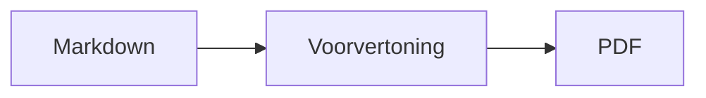

<p>&nbsp;&nbsp;&nbsp;</p>

# Splat

**De Markdown-editor voor macOS waarmee je in de bron schrijft of rechtstreeks in de voorvertoning.**

Splat toont links je Markdown-bron met syntaxiskleuren en rechts een live, volledig bewerkbare voorvertoning. Typ in
een van beide: wat je in de voorvertoning schrijft, wordt een minimale wijziging in de bron, zodat regels die je niet
hebt aangeraakt byte voor byte gelijk blijven en je Git-diffs overzichtelijk blijven. Splat leest de Markdown die je al
gebruikt: CommonMark en GitHub Flavored Markdown, GitHub-alerts, wikilinks, insluitingen en infokaders van Obsidian,
extensies van Pandoc en Typora, ingebedde HTML, LaTeX-formules en diagrammen in Mermaid, Graphviz en PlantUML, alles
offline weergegeven. Blader door en zoek in een hele map met notities, zie wat er is gewijzigd sinds de laatste
Git-commit, plak vanuit Word of een webpagina als Markdown en exporteer met één klik naar pdf, HTML of Word. Het is
geschreven in Rust op echte AppKit-besturingselementen, spreekt 35 talen en heeft geen telemetrie.
 


[](https://github.com/sventmueller/splat/releases/latest/download/Splat.dmg)

**[Download Splat.dmg](https://github.com/sventmueller/splat/releases/latest/download/Splat.dmg)**: ondertekend en door Apple genotariseerd, voor macOS 14 of nieuwer op Apple Silicon en Intel.

**Een bug gevonden?** Splat houdt regels die je niet hebt aangeraakt byte voor byte identiek. Verandert er toch een, of wordt een bestand verkeerd weergegeven, [open dan een issue](https://github.com/sventmueller/splat/issues/new/choose) en voeg het bestand toe. Heb je iets aan Splat, dan helpt een [ster op GitHub](https://github.com/sventmueller/splat) anderen het te vinden.
 
 

[](https://www.rust-lang.org)
[](https://www.apple.com/macos/)

[](https://github.com/madsmtm/objc2)
[](https://webkit.org)
[](https://github.com/kivikakk/comrak)
[](https://github.github.com/gfm/)
[](https://www.mathjax.org)
[](https://cortexjs.io/mathlive/)
[](https://mermaid.js.org)
[](https://graphviz.org)
[](https://plantuml.com)


[](#licentie)

[Bahasa Indonesia](../id/README.md) ·
[Bahasa Melayu](../ms/README.md) ·
[Català](../ca/README.md) ·
[Čeština](../cs/README.md) ·
[Dansk](../da/README.md) ·
[Deutsch](../de/README.md) ·
[English](../../../README.md) ·
[Español](../es/README.md) ·
[Français](../fr/README.md) ·
[Hrvatski](../hr/README.md) ·
[Italiano](../it/README.md) ·
[Magyar](../hu/README.md) ·
**Nederlands** ·
[Norsk](../no/README.md) ·
[Polski](../pl/README.md) ·
[Português (Brasil)](../pt_BR/README.md) ·
[Português (Portugal)](../pt_PT/README.md) ·
[Română](../ro/README.md) ·
[Slovenčina](../sk/README.md) ·
[Slovenščina](../sl/README.md) ·
[Suomi](../fi/README.md) ·
[Svenska](../sv/README.md) ·
[Tiếng Việt](../vi/README.md) ·
[Türkçe](../tr/README.md) ·
[Ελληνικά](../el/README.md) ·
[Русский](../ru/README.md) ·
[Українська](../uk/README.md) ·
[עברית](../he/README.md)‎ ·
[العربية](../ar/README.md)‎ ·
[हिन्दी](../hi/README.md) ·
[ไทย](../th/README.md) ·
[한국어](../ko/README.md) ·
[日本語](../ja/README.md) ·
[简体中文](../zh-Hans/README.md) ·
[繁體中文](../zh-Hant/README.md)

## Inhoud

- [Functies in het kort](#functies-in-het-kort)
- [Systeemvereisten](#systeemvereisten)
- [Installatie](#installatie)
- [Aan de slag](#aan-de-slag)
- [Schrijven](#schrijven)
  - [In de bron](#in-de-bron)
  - [In de voorvertoning](#in-de-voorvertoning)
  - [Opmaakopdrachten](#opmaakopdrachten)
  - [Lijsten en taken](#lijsten-en-taken)
  - [Tabellen](#tabellen)
  - [Opgemaakte tekst plakken](#opgemaakte-tekst-plakken)
  - [Metadata](#metadata)
- [Ondersteunde Markdown](#ondersteunde-markdown)
  - [CommonMark en GitHub Flavored Markdown](#commonmark-en-github-flavored-markdown)
  - [Infokaders](#infokaders)
  - [Uitgebreide syntaxis](#uitgebreide-syntaxis)
  - [Obsidian](#obsidian)
  - [Citaten en verwijzingen](#citaten-en-verwijzingen)
  - [Ingebedde HTML](#ingebedde-html)
  - [Typografische leestekens](#typografische-leestekens)
  - [Syntaxisoverzicht](#syntaxisoverzicht)
- [Formules](#formules)
- [Diagrammen](#diagrammen)
- [Afbeeldingen](#afbeeldingen)
- [Links en navigatie](#links-en-navigatie)
- [Notities in een map](#notities-in-een-map)
- [Wijzigingen sinds de laatste commit](#wijzigingen-sinds-de-laatste-commit)
- [Exporteren, afdrukken en delen](#exporteren-afdrukken-en-delen)
- [Word-documenten importeren](#word-documenten-importeren)
- [Uiterlijk en toegankelijkheid](#uiterlijk-en-toegankelijkheid)
- [Talen](#talen)
- [Toetscombinaties](#toetscombinaties)
- [Privacy en beveiliging](#privacy-en-beveiliging)
- [Grote documenten](#grote-documenten)
- [Bekende beperkingen](#bekende-beperkingen)
- [Problemen oplossen](#problemen-oplossen)
- [Voor ontwikkelaars](#voor-ontwikkelaars)
  - [Componenten van derden](#componenten-van-derden)
- [Licentie](#licentie)

## Functies in het kort

- **Twee manieren om te schrijven, één tekst.** Bron en voorvertoning zijn allebei bewerkbaar. Het Markdown-bestand is
  de enige waarheid: er is één wijzigingsgeschiedenis per document en elke bewerking in de voorvertoning wordt
  vertaald naar de kleinst mogelijke wijziging in de bron.
- **De Markdown die je al gebruikt.** CommonMark, GitHub Flavored Markdown, GitHub-alerts, Obsidian, extensies van
  Pandoc en Typora, emoji-shortcodes, spoilers, definitielijsten, kopankers en HTML zoals in GitHub-README's.
- **Formules en diagrammen ingebouwd.** LaTeX-formules via MathJax, met een visuele formule-editor. Diagrammen in
  Mermaid, Graphviz en PlantUML, weergegeven op je Mac zonder Java, server of netwerkverbinding.
- **Een knop voor alles.** Elk Markdown-element heeft een knop in de knoppenbalk en een menu-item, de gangbare ook een
  toetscombinatie. Tabellen hebben een eigen menu voor rijen, kolommen en uitlijning.
- **Een map, niet alleen een bestand.** De zijbalk toont de notities rond een document en doorzoekt ze allemaal. De naam
  van een notitie wijzigen past de links ernaar aan, en elke byte eromheen blijft staan.
- **Wijzigingen in één oogopslag.** In een Git-repository markeren balken naast de tekst wat afwijkt van de laatste
  commit, in beide deelvensters.
- **Van Word en het web naar Markdown.** Plak opgemaakte tekst als Markdown en cellen uit een spreadsheet als tabel, en
  importeer hele Word-documenten met hun afbeeldingen.
- **Exporteren zonder verlies.** Pdf, één zelfstandig HTML-bestand of een Word-document met echte koppen, lijsten,
  tabellen, voetnoten en afbeeldingen. Voeg paginanummers, kopteksten en een titelpagina toe, of gebruik het
  Word-sjabloon van je bedrijf.
- **Door en door native.** Echte AppKit-vensters, tabbladen, menu's, pop-overs, Versies, automatisch bewaren, het
  deelmenu, donkere modus, spellingcontrole, dicteren en VoiceOver. Geen Electron en geen webweergave voor de tekst
  zelf.
- **Snel met grote bestanden.** Het renderen van een toetsaanslag in een document van 10 MB kost ongeveer 10 ms, vóór het eigen werk van de weergave.
- **Privé en zorgvuldig.** Splat draait in de App Sandbox, links naar andere apps vragen eerst om bevestiging en alles
  wat onbetrouwbare afbeeldingsdata decodeert, draait in een eigen dienst in een sandbox.
- **In jouw taal.** De interface en de ingebouwde beknopte Markdown-naslag zijn er in 35 talen: Arabisch, Catalaans,
  Chinees (vereenvoudigd), Chinees (traditioneel), Kroatisch, Tsjechisch, Deens, Nederlands, Engels, Fins, Frans, Duits,
  Grieks, Hebreeuws, Hindi, Hongaars, Indonesisch, Italiaans, Japans, Koreaans, Maleis, Noors, Pools, Portugees
  (Brazilië), Portugees (Portugal), Roemeens, Russisch, Slowaaks, Sloveens, Spaans, Zweeds, Thai, Turks, Oekraïens en
  Vietnamees.

## Systeemvereisten

- macOS 14 Sonoma of nieuwer. Splat wordt ontwikkeld en getest op macOS 27, waar het automatisch het Liquid
  Glass-ontwerp overneemt.
- Een Mac met Apple Silicon of een Intel-processor.
- Ongeveer 45 MB schijfruimte.

## Installatie

**Vanaf de schijfkopie.** Download [`Splat.dmg`](https://github.com/sventmueller/splat/releases/latest/download/Splat.dmg), open haar en sleep Splat naar de map Programma's. De schijfkopie is
ondertekend met een Developer ID en door Apple genotariseerd, dus ze opent zonder waarschuwingen.

**Met Homebrew.** De cask staat in een eigen tap:

```sh
brew install --cask sventmueller/tap/splat
```

`brew upgrade --cask splat` installeert nieuwe versies en `brew uninstall --zap --cask splat` verwijdert ook de
instellingen en caches van Splat.

**Updates.** Splat vanaf de schijfkopie of via Homebrew houdt zichzelf up-to-date met [Sparkle](https://sparkle-project.org).
Bij de tweede start vraagt het of het zelf mag zoeken naar updates, eenmaal per dag. **Splat › Zoek naar updates…**
zoekt meteen; met **Zoek automatisch naar updates** en **Download en installeer updates automatisch** in hetzelfde
menu wijzig je je keuze later. Splat installeert een update alleen als die de handtekening van de ontwikkelaar draagt.
Een eigen build heeft geen updater.

**Vanaf de broncode.** Zie [Bouwen](../../../docs/development.md#building) voor de vereisten en voer dan uit:

```sh
make build
ditto target/release/Splat.app /Applications/Splat.app
open /Applications/Splat.app
```

Om Markdown-bestanden met een dubbelklik in Splat te openen, selecteer je een willekeurig `.md`-bestand in de Finder,
kies je **Archief › Toon info**, kies je Splat onder **Open met** en klik je op **Wijzig alles…**. Splat registreert
zich voor `.md`-, `.markdown`-, `.mdown`- en `.mkd`-bestanden.

## Aan de slag

### Het venster

Elk document opent in een eigen venster, of als tabblad als je liever tabbladen gebruikt:

- **Links: de bron.** Je Markdown in SF Mono met syntaxiskleuren.
- **Rechts: de voorvertoning.** Het weergegeven document, klaar om te bewerken.
- **Zijbalk (optioneel).** Alle koppen als boom, een klik op een kop toont die in beide deelvensters: **Weergave › Toon
  structuur** (⌃⌘S). Twee andere tabbladen bevatten de [notities in de map](#notities-in-een-map) en een zoekfunctie
  daarin. De knop naast de titel van het venster toont en verbergt de zijbalk, en nieuwe vensters openen hem zoals het
  laatste venster hem achterliet.
- **Knoppenbalk.** Knoppen gegroepeerd naar wat ze wijzigen: tekens, alinea's en ingevoegde onderdelen, daarna
  voorvertoning aan/uit, Deel en Nieuw document. Pas de balk aan met **Weergave › Pas knoppenbalk aan…**.

Sleep de scheiding om een van beide kanten meer ruimte te geven. **Weergave › Verberg voorvertoning** (⌥⌘P) laat alleen
de bron staan; Splat onthoudt dit per venster. Beide deelvensters scrollen samen en een selectie in het ene deelvenster
wordt in het andere gemarkeerd.

De hoek van het venster toont de woorden en tekens van de tekst en hoe lang het lezen duurt, en die van de selectie
zolang er een is. Linkadressen, HTML-tags, metadata, opmerkingen, formules en diagrammen tellen niet mee. Dit is eerst
verborgen; **Weergave › Toon aantal woorden** zet het aan.

### Documenten, tabbladen en versies

Splat is een gewone macOS-documentapp:

- **Automatisch bewaren en Versies.** Wijzigingen worden ter plekke bewaard. Met **Archief › Vorige versie › Blader door alle versies…** ga je terug in de tijd.
- **Wijzigingen door andere programma's.** Als Git, een script of een andere editor een geopend document wijzigt,
  laadt Splat het opnieuw en behoudt de cursor en de scrollpositie. Heb je zelf nog niet-bewaarde wijzigingen, dan houdt
  Splat die vast en vraagt macOS om bevestiging voordat de andere versie wordt overschreven.
- **De gebruikelijke bestandsopdrachten.** Dupliceer (⇧⌘S), Wijzig naam…, Verplaats naar… en **Archief › Open recente bestanden**.
- **Tabbladen.** **Archief › Nieuw tabblad** of de knop **+** in de knoppenbalk opent een nieuw document als tabblad;
  via het standaardmenu Venster voeg je tabbladen samen, verplaats je ze en blader je erdoorheen.
- **Vensterpositie.** De grootte en positie van je laatste venster worden onthouden, ook na een herstart. Staat daar al
  een venster, dan opent het nieuwe iets verschoven.
- **Het Dock-symbool.** Een klik erop nadat je het laatste venster hebt gesloten, opent een nieuw document.
- **Open Markdown-bestanden in Splat.** Met **Splat › Stel in als standaardapp voor Markdown** opent een dubbelklik op
  een `.md`- of `.markdown`-bestand Splat; macOS vraagt eenmalig om bevestiging. Het onderdeel heeft een vinkje zolang
  Splat de standaardapp is.

Bestanden moeten UTF-8-tekst zijn, of UTF-16 met een bytevolgordemarkering. Splat weigert andere coderingen in plaats
van te gokken en de tekst te beschadigen. Een bytevolgordemarkering blijft behouden, UTF-16 blijft UTF-16 en in een
bestand waarvan alle regels op CRLF eindigen, krijgen de regels die je toevoegt ook CRLF.

**Na een crash** gaan hooguit de laatste seconden typwerk verloren: elke vijf seconden kopieert Splat niet-bewaarde
tekst naar `~/Library/Application Support/Splat/Unsaved` en verwijdert die kopieën zodra een document is bewaard of
Splat normaal wordt afgesloten. Bij de volgende start verplaatst Splat wat een crash daar heeft achtergelaten naar
`~/Library/Application Support/Splat/Recovery` en meldt dat eenmalig, met een knop die de map opent. Een crash waarop
Splat nog kan reageren, schrijft daar ook de tekst van elk geopend document naartoe.

### Beknopte naslag

**Help › Beknopte Markdown-naslag** opent een naslagblad in jouw taal als nieuw, naamloos document. Het is een gewoon
document, dus probeer alles meteen uit, in de bron of in de voorvertoning.

## Schrijven

### In de bron

De bron is een teksteditor die is afgestemd op Markdown:

- **Syntaxiskleuren** zoals in VS Code: koppen, nadruk, links, code, tabellen, HTML, front matter, en LaTeX en Mermaid
  binnen formules en diagrammen. Er zijn paletten voor licht, donker en Verhoog contrast.
- **Omheinde codeblokken** worden gemarkeerd voor Bash, C, C++, C#, CSS (ook SCSS en Less), Go, HTML, XML, Java,
  JavaScript, JSON, Kotlin, PHP, Python, Ruby, Rust, SQL, Swift, TypeScript, YAML, TeX en Mermaid, inclusief hun
  gebruikelijke korte namen zoals `js`, `py` of `sh`.
- **Geen verrassende vervangingen.** Slimme aanhalingstekens, slimme streepjes en tekstvervanging staan standaard uit,
  omdat ze `--`, `---` en `"` kapotmaken. Zet ze aan onder **Wijzig › Vervanging**.
- **De schrijfhulpmiddelen van het systeem.** Spellings- en grammaticacontrole, dicteren, Zoek en vervang (⌥⌘F) en
  Spraak.
- **Slepen en neerzetten.** Zet een afbeeldingsbestand neer om `` in te voegen, een ander
  bestand om een link ernaar in te voegen en een URL om `[url](url)` in te voegen. Elke drop is één stap om ongedaan te
  maken.
- **Afbeeldingen plakken.** Een afbeelding op het klembord, zoals een schermafbeelding, wordt als PNG-bestand naast het
  document bewaard (`Afbeelding 2026-10-29 13.09.07.png`) en als afbeelding ingevoegd. Daarvoor moet het document één
  keer bewaard zijn.

### In de voorvertoning

De voorvertoning gedraagt zich als een tekstverwerker, maar alles wat je erin doet, komt als Markdown in de bron terecht:

- **Typen.** Tekens die in Markdown iets betekenen, zoals `*` of `#`, worden ge-escaped zodat ze verschijnen zoals je ze
  typt.
- **Return** begint een nieuwe alinea of een nieuw lijstitem. **⌥Return** of **⌃Return** voegt een regeleinde in.
- **Opmaak bij de cursor.** Staat de cursor aan het eind van een woord, dan gelden Vet, Cursief en de andere
  tekenopmaak voor wat je daarna typt. Kies de opmaak opnieuw om te stoppen. Binnen een woord wordt het hele woord
  opgemaakt.
- **Lege regels.** Return op een lege regel voegt nog een lege regel toe en Backspace verwijdert die weer. In de bron
  zijn dat per extra lege regel twee extra witregels; andere Markdown-programma's tonen ze als gewone alinea-afstand.
- **Herstel** werkt in beide deelvensters. Herstelacties hebben een naam ("Herstel Vet"), typen is één stap per reeks
  aanslagen en na Herstel en Opnieuw scrollen beide deelvensters naar de wijziging.
- **Formules en diagrammen** verschijnen als afgewerkte afbeeldingen. Klik erop, zet de cursor erop of druk er op
  Return om de editor te openen (zie [Formules](#formules) en [Diagrammen](#diagrammen)).
- **Ingebedde HTML, ingesloten notities en front matter** worden getoond, maar je bewerkt ze in de bron. Een klik erop
  zet de cursor op de bijbehorende plek daar.

Alles wat Markdown niet kan uitdrukken, is in de voorvertoning geblokkeerd: de paletten Lettertype en Kleuren, de
liniaal en het plakken of neerzetten van opgemaakte tekst en afbeeldingen. Geplakte HTML en RTF komen binnen als
gewone tekst, tenzij je [Plak als Markdown](#opgemaakte-tekst-plakken) kiest.

### Opmaakopdrachten

Elke opdracht is beschikbaar via de knoppenbalk, de menubalk en het contextmenu van beide deelvensters. Menu-items
tonen een vinkje voor de opmaak bij de cursor.

| Menu | Opdrachten |
|---|---|
| **Opmaak › Lettertype** | Vet, Cursief, Onderstreept, Doorgehaald, Markering, Code, Superscript, Subscript |
| **Opmaak › Koptekst** | Hoofdtekst, Koptekst 1 tot 6 |
| **Opmaak › Lijst** | Opsommingstekenslijst, Genummerde lijst, Takenlijst |
| **Opmaak** | Citaat, Codeblok (Geen taal of een van 20 talen; wijzigt ook de taal van een bestaand blok), Infokader (Notitie, Tip, Belangrijk, Waarschuwing, Let op; hetzelfde type nogmaals verwijdert het), Wijzig formule of diagram…, Wis opmaak |
| **Voeg in** | Link…, Afbeelding…, Tabel…, Formule, Diagram (Stroomdiagram, Sequentiediagram, Gantt-diagram), Inhoudsopgave, Voetnoot, Scheidingslijn |
| **Tabel** | Voeg rij erboven/eronder in, Voeg kolom links/rechts in, Verwijder rij, Verwijder kolom, Uitlijning (Links, Centreer, Rechts, Standaard), Lijn tabelkolommen uit |
| **Weergave** | Verberg/Toon voorvertoning, Toon/Verberg structuur, Typografische leestekens, Zoom in/uit, Werkelijke grootte, knoppenbalk, tabbladbalk, schermvullende weergave |

Onderstreept, markering, superscript en subscript worden geschreven als `<ins>`, `<mark>`, `<sup>` en `<sub>`, wat
GitHub ook toont. Splat leest ook `<u>`, dat GitHub verwijdert, en de kortere `==markering==`, `^sup^` en `~sub~`.
GitHub toont `==` en `^` zoals getypt en `~sub~` als doorhaling.

### Lijsten en taken

- Return zet een lijst voort; Return op een leeg item beëindigt de lijst.
- **Tab** en **⇧Tab** laten lijstitems in de voorvertoning inspringen en weer terugspringen.
- Een klik op een takenvakje in de voorvertoning schakelt tussen `- [ ]` en `- [x]`.
- **Opmaak › Lijst** zet de geselecteerde alinea's om in een lijst of wijzigt het soort lijst.

### Tabellen

- **Voeg in › Tabel…** vraagt om het aantal rijen (inclusief de kopregel) en kolommen.
- In de voorvertoning gaat **Tab** naar de volgende cel, **⇧Tab** naar de vorige en **Return** naar de cel eronder. Tab
  in de laatste cel voegt een rij toe.
- Het menu **Tabel** voegt rijen en kolommen in en verwijdert ze, en stelt de uitlijning van een kolom in (⌘{, ⌘|, ⌘}).
- **Tabel › Lijn tabelkolommen uit** vult de bron aan zodat de kolommen netjes onder elkaar staan.

### Opgemaakte tekst plakken

**Wijzig › Plak als Markdown** (⌃⌘V), ook in het contextmenu van beide deelvensters, zet wat op het klembord staat om in
Markdown op de plek van de selectie, als één stap om ongedaan te maken. ⌘V blijft gewone tekst invoegen.

- **Vanuit een browser, Word, Google Docs, Confluence, Notities of Pages:** koppen, vet, cursief, onderstreept,
  doorgehaald, superscript en subscript, links, lijsten met hun nesting, citaten, code en tabellen komen mee.
- **Vanuit een spreadsheet:** cellen worden een tabel met een kopregel en rechts uitgelijnde kolommen met getallen. Dat
  geldt ook voor tekst die gescheiden is door tabs, puntkomma's of komma's, als elke regel evenveel kolommen heeft.
- **Afbeeldingen** met een webadres blijven links. Een afbeelding in de geplakte HTML wordt een bestand naast het
  document, dat daarvoor één keer bewaard moet zijn. De tijdelijke afbeeldingsbestanden van Word komen niet mee, en hun
  alt-tekst blijft staan.
- **Links** behouden alleen `http`-, `https`-, `mailto`-, relatieve en `#`-adressen; van elke andere link blijft de
  tekst over.

### Metadata

**Opmaak › Wijzig metadata…**, of een klik op de metadataregel boven in de voorvertoning, opent een formulier met de
velden van de YAML-front matter. Velden kun je wijzigen, toevoegen en verwijderen. Een veld met een lijst houdt die als
lijst: de waarden staan met komma's achter elkaar, en een waarde met een komma erin staat tussen aanhalingstekens. Een
nieuw veld met de naam `tags`, `aliases`, `keywords`, `categories`, `authors` of `cssclasses` wordt ook een lijst.
Geneste velden en tekst over meerdere regels zijn daar te zien en bewerk je in de bron.

Wat het formulier wijzigt, is één stap om ongedaan te maken en raakt alleen de regels van de velden die je hebt
gewijzigd: opmerkingen, de volgorde, afwijkende spatiëring, aanhalingstekens en regeleinden van alle andere blijven byte
voor byte gelijk. Een document zonder metadata krijgt een blok aan het begin.

## Ondersteunde Markdown

Splat parseert met [comrak](https://github.com/kivikakk/comrak), een parser die compatibel is met CommonMark en GFM, en
schakelt de meeste extensies ervan in. Alles hieronder wordt weergegeven in de voorvertoning en in alle exports.

### CommonMark en GitHub Flavored Markdown

- Koppen (`#` en onderstreept), alinea's, regeleinden, nadruk, sterke nadruk, inline code, blokcitaten,
  scheidingslijnen.
- Lijsten met opsommingstekens, genummerde en geneste lijsten; takenlijsten.
- Links (inline, via verwijzing en automatisch), afbeeldingen, definities van linkverwijzingen.
- Omheinde en ingesprongen codeblokken met syntaxiskleuren.
- Tabellen met kolomuitlijning.
- Doorhaling met `~~twee tildes~~`.
- Voetnoten: `tekst[^1]` met `[^1]: De noot.` ergens in het document. Een klik op de markering springt naar de noot.
- YAML-front matter tussen `---`-regels bovenaan. De voorvertoning vat die samen in één regel, zoals
  "Metadata: title, date, tags".

### Infokaders

GitHub-alerts worden weergegeven als gekleurde kaders met pictogram en titel:

```markdown
> [!NOTE]
> Nuttige informatie die gebruikers moeten weten.

> [!WARNING]
> Kritieke inhoud die onmiddellijke aandacht vraagt.
```

De vijf typen zijn Notitie, Tip, Belangrijk, Waarschuwing en Let op. **Opmaak › Infokader** maakt van de alinea bij de
cursor zo'n kader.

Infokaders van Obsidian werken ook, met een willekeurige titel en een open- of dichtstand:

```markdown
> [!tip]- Klik op ▸ om uit te vouwen
> Verborgen tot het wordt geopend.

> [!question]+ Standaard geopend
> Een `+` begint uitgevouwen, een `-` samengevouwen.
```

De andere typen van Obsidian worden getoond in de dichtstbijzijnde van de vijf kleuren: `success`, `check`, `done` en
`hint` als Tip; `question`, `help` en `faq` als Belangrijk; `attention` als Waarschuwing; `failure`, `fail`,
`missing`, `danger`, `error` en `bug` als Let op; al het andere als Notitie.

### Uitgebreide syntaxis

| Functie | Syntaxis | Afkomstig van |
|---|---|---|
| Markering | `==gemarkeerde tekst==` | Obsidian, Typora |
| Superscript | `x^2^` | Pandoc, Typora |
| Subscript | `H~2~O` | Pandoc, Typora |
| Emoji-shortcode | `:rocket:` wordt 🚀 | GitHub |
| Spoiler | `\|\|verborgen tekst\|\|`, selecteer om te lezen | Discord |
| Inline voetnoot | `tekst^[de noot zelf]` | Pandoc, Obsidian |
| Definitielijst | `Term`, lege regel, `: Uitleg` | PHP Markdown Extra, Pandoc |
| Kopanker | `## Installeren {#setup}`, link met `[zie](#setup)` | Pandoc, kramdown |

Definitielijsten zien er in de bron zo uit:

```markdown
Term

: Uitleg van de term.
```

Zonder eigen anker krijgt elke kop er een die uit de tekst wordt afgeleid, zoals op GitHub: `## Aan de slag` is te
bereiken als `#aan-de-slag`.

### Obsidian

- **Wikilinks.** `[[Notitie]]` linkt naar `Notitie.md` in dezelfde map of een map eronder. `[[Notitie|Weergegeven tekst]]` toont
  je eigen tekst en `[[Notitie#Kop]]` opent de notitie. ⌘-klik opent haar in Splat.
- **Insluitingen.** `![[Notitie]]` toont de andere notitie binnen deze; notities die daarin zijn ingesloten, verschijnen
  als links. `![[diagram.png]]` toont een afbeelding. Zoals in Obsidian noemen insluitingen notities en afbeeldingen
  in de map van het document of daaronder, nooit met een absoluut pad, en alleen Markdown-bestanden verschijnen als
  notities.
- **Opmerkingen.** `%%Alleen in de bron%%` blijft zichtbaar in de bron en wordt weggelaten uit de voorvertoning en uit
  elke export, zowel inline als op een eigen regel.
- **Tags.** `#idee` of `#project/splat` wordt gemarkeerd. ⌘-klik zoekt de tag in het document en, in de zijbalk, in de
  hele map.
- **Inklapbare infokaders.** Zie [Infokaders](#infokaders).

### Citaten en verwijzingen

- **Pandoc-citaten.** `[@doe2020]` of `[@doe2020; @roe2021]` leest als "(Doe 2020; Roe 2021)". De items komen uit het
  BibTeX-bestand dat de front matter noemt als `bibliography: refs.bib`. Zonder die vermelding gebruikt Splat
  `references.bib`, `literatur.bib` of `bibliography.bib` naast het document.
- **GitHub- en GitLab-verwijzingen.** Ligt het document in een Git-repository waarvan de remote `origin` op github.com
  of een GitLab-host staat, dan worden `@naam`, `#12` (issue) en `!7` (merge request, alleen GitLab) gemarkeerd.
  ⌘-klik opent ze in de browser.

### Ingebedde HTML

HTML zoals je die in GitHub-README's vindt, wordt weergegeven met een eigen lezer in plaats van een browserengine:

- gecentreerde alinea's en blokken (`<p align="center">`, `<div align="center">`)
- afbeeldingen met een afmeting (``)
- links, `<kbd>⌘</kbd>`, `<br>`, `<u>`, `<ins>`, `<mark>`, `<sup>`, `<sub>`
- lijsten en tabellen, inclusief cellen die meerdere kolommen beslaan (`colspan`)
- inklapbare secties: `<details><summary>Meer</summary>…</details>`, geopend met een klik op ▸

Markdown tussen HTML-tags wordt als Markdown weergegeven. Scripts, stijlen, frames en formulieren worden helemaal
weggelaten, en links en afbeeldingen behouden alleen `http`, `https`, `mailto` en relatieve adressen.

### Typografische leestekens

**Weergave › Typografische leestekens** toont rechte aanhalingstekens als de aanhalingstekens van je interfacetaal, `--` als
een kort streepje, `---` als een lang streepje en `...` als beletselteken. In het Duits wordt `"Ja"` „Ja“, in het
Frans «Oui», in het Japans 「はい」, ook waar Chinees en Japans aanhalingstekens zonder spatie zetten; Hebreeuwse
afkortingen zoals `צה"ל` krijgen hun gershayim, צה״ל. De bron behoudt de gewone tekens; de voorvertoning en alle exports tonen de
typografische. De instelling staat uit totdat je haar aanzet.

### Syntaxisoverzicht

| Element | Markdown |
|---|---|
| **Vet** | `**Vet**` |
| *Cursief* | `*Cursief*` |
| Onderstreept | `<ins>Onderstreept</ins>` of `<u>Onderstreept</u>` |
| ~~Doorgehaald~~ | `~~Doorgehaald~~` |
| Markering | `<mark>Markering</mark>` of `==Markering==` |
| `Code` | `` `Code` `` |
| x² | `x<sup>2</sup>` of `x^2^` |
| H₂O | `H<sub>2</sub>O` of `H~2~O` |
| [Link](https://example.com) | `[Link](https://example.com)` |
| Koptekst | `# Koptekst` tot `###### Koptekst` |
| Citaat | `> Citaat` |
| Lijst met opsommingstekens | `- Item` |
| Genummerde lijst | `1. Item` |
| Taak | `- [ ] Open` en `- [x] Klaar` |
| Codeblok | ```` ```rust ```` … ```` ``` ```` |
| Tabel | `\| A \| B \|` met `\|---\|---\|` onder de kopregel |
| Voetnoot | `Tekst[^1]` en `[^1]: Noot` |
| Scheidingslijn | `---` |
| Afbeelding | `` |
| Formule | `$E = mc^2$`, `$$ … $$` |
| Diagram | ```` ```mermaid ````, ```` ```dot ````, ```` ```plantuml ```` |
| Infokader | `> [!TIP]` |
| Wikilink | `[[Notitie]]`, `[[Notitie\|Tekst]]` |
| Insluiting | `![[Notitie]]`, `![[afbeelding.png]]` |
| Opmerking | `%%Opmerking%%` |
| Tag | `#tag` |
| Citaat uit literatuur | `[@sleutel]` |
| Spoiler | `\|\|Spoiler\|\|` |
| Emoji | `:tada:` |

## Formules

Formules worden door [MathJax](https://www.mathjax.org) weergegeven met zijn TeX en AMS-wiskunde, als scherpe
vectorafbeeldingen. Tekst in `\text{…}` mag in elk schrift staan: wat de lettertypen van MathJax missen, komt uit de
lettertypen van je Mac, waarbij Arabisch en Hebreeuws van rechts naar links lopen, en emoji in kleur.

| Soort | Syntaxis |
|---|---|
| Inline | `$E = mc^2$`, `` $`E = mc^2`$ `` (GitHub, GitLab), `\(E = mc^2\)` |
| Display | `$$` … `$$`, `\[` … `\]`, of een codeblok met de markering `math` |

**Een formule bewerken.** Klik in de voorvertoning op een formule, dubbelklik erop, druk er op Return of zet de cursor
erop om de editor in een pop-over te openen. **Voeg in › Formule** voegt een nieuwe in en opent meteen de editor.

- **Visueel of LaTeX.** De schakelaar bovenaan wisselt tussen een visuele editor ([MathLive](https://cortexjs.io/mathlive/))
  en de LaTeX-code. Splat onthoudt je keuze.
- **Bouwstenen** voor breuk, vierkantswortel, superscript en subscript, som en integraal met grenzen, limiet,
  haakjes die met de inhoud meegroeien, 2×2-matrix, Griekse letters, en relaties, operatoren en pijlen. Ze laten
  plaatshouders □ achter en **Tab** springt naar de volgende.
- **Live voorvertoning.** Wijzigingen verschijnen in het document terwijl je typt. Fouten van MathJax staan in een regel
  onder de code.
- **Bewaren of verwerpen.** Buiten de editor klikken houdt de wijziging als één stap om ongedaan te maken; **Esc** of
  **Annuleer** gooit haar weg. Esc bij een nieuwe, lege formule verwijdert die weer.
- Het contextmenu biedt **Wijzig formule…** voor de formule onder de aanwijzer.

VoiceOver leest een formule voor als haar LaTeX-code. Splat geeft formules weer, geen volledige LaTeX-documenten: er zijn
geen pakketten, geen TikZ en geen `\documentclass`.

## Diagrammen

Diagrammen worden binnen Splat weergegeven, offline en in een lichte en een donkere variant.

| Engine | Codeblok | Wat het tekent |
|---|---|---|
| [Mermaid](https://mermaid.js.org) | ```` ```mermaid ```` | stroomdiagrammen, sequentie-, klasse-, toestands- en entiteit-relatiediagrammen, Gantt, cirkeldiagrammen, mindmaps, tijdlijnen en elk ander Mermaid-type |
| [Graphviz](https://graphviz.org) | ```` ```dot ```` of ```` ```graphviz ```` | grafen in de DOT-taal |
| [PlantUML](https://plantuml.com) | ```` ```plantuml ```` of ```` ```puml ```` | UML-diagrammen; draait zonder Java |



**Een diagram bewerken** werkt als het bewerken van een formule: klik erop om de code in een pop-over te openen, met
syntaxiskleuren en foutmeldingen in een regel onder de code. **Voeg in › Diagram** begint met een sjabloon voor een
stroomdiagram, een sequentiediagram of een Gantt-diagram. Bouwstenen helpen bij de drie meest voorkomende Mermaid-typen:

- **Stroomdiagram:** Knooppunt ▾ (rechthoek, afgerond, cirkel, ruit, database), Verbinding, Verbinding met label, Groep,
  Richting ▾
- **Sequentiediagram:** Deelnemer, Bericht, Antwoord, Notitie, Lus, Alternatieve paden
- **Gantt-diagram:** Sectie, Taak, Mijlpaal

Andere diagramtypen bewerk je als code. VoiceOver leest de titel of alternatieve tekst van een diagram voor.

Het eerste diagram na het opstarten duurt ongeveer een seconde, omdat de weergave-engine op de achtergrond start. Een
diagram dat langer dan 10 seconden duurt, toont een fout en de weergave-engine start opnieuw voor het volgende.
De engine van PlantUML (3 MB) laadt pas bij het eerste PlantUML-diagram. Een PlantUML-`!include` van het web wordt
geblokkeerd.

## Afbeeldingen

- **Lokale afbeeldingen** gebruiken paden ten opzichte van het document: ``. Splat toont PNG,
  JPEG, GIF, WebP, BMP, SVG, HEIC, TIFF, AVIF en pdf.
- **Afbeeldingen van het web** laden zodra een document ze toont, via `https` en tot 10 MB per stuk. Net als
  afbeeldingen in een e-mail laten ze hun servers weten dat en wanneer het document wordt geopend.
- **Afmeting.** `` bepaalt de grootte van een afbeelding; anders passen afbeeldingen in de breedte van
  de voorvertoning.
- **Wijzigingen op schijf.** Een afbeelding die je vervangt, of een die verschijnt nadat het document haar noemde, wordt
  getoond zonder het document opnieuw te openen. Afbeeldingen van het web die door het netwerk mislukten, worden
  opnieuw geprobeerd zolang een document ze toont.
- **Geheugen.** Afbeeldingen worden getoond tot 2560 pixels langs hun langste zijde, wat ook een A4-pagina vult. Ze
  worden kleiner gedecodeerd zodra ze een achtste van het geheugen van de Mac vullen, en zolang macOS geheugendruk
  meldt.
- **Donkere modus.** Afbeeldingen met een witte achtergrond worden in de donkere voorvertoning iets gedimd.
- **Plakken en neerzetten.** Zie [In de bron](#in-de-bron).

## Links en navigatie

In de voorvertoning plaatst een klik de cursor zodat je de linktekst kunt bewerken; **⌘-klik** volgt de link:

- `http`, `https` en `mailto` openen in je browser of mailapp.
- Markdown-bestanden openen in Splat; andere bestanden en mappen worden getoond in de Finder.
- `#anker` springt naar de kop in het document.
- Adressen die een andere app openen, zoals `slack://` of `vscode://`, vragen eerst om bevestiging en tonen het volledige
  adres en de app. **Annuleer** is vooraf geselecteerd.

**Voeg in › Inhoudsopgave** voegt een gelinkte lijst van alle koppen in. Met de cursor erin werkt dezelfde opdracht
haar bij. De structuurzijbalk (⌃⌘S) springt in beide deelvensters naar elke kop.

## Notities in een map

De knoppen boven in de zijbalk schakelen tussen de structuur, de bestanden en een zoekopdracht.

- **Bestanden** (**Weergave › Toon bestanden**, ⌃⌘E). Alle Markdown-bestanden in de map van het document of, als dat in
  een Git-repository staat, in die hele repository. Een klik of Return opent een notitie als tabblad van dit venster; is
  ze al geopend, dan komt ze naar voren. De knop naast de mapnaam toont een andere map in dit venster. Verborgen
  bestanden, `node_modules`, `target`, `Pods`, `DerivedData`, `__pycache__` en mappen zonder notities blijven buiten
  beeld. Een document direct in je thuismap toont alleen de notities ernaast, zodat Splat niet door al je mappen loopt
  en voor elk daarvan toestemming vraagt.
- **Zoeken** (**Wijzig › Zoek › Zoek in alle notities…**, ⇧⌘F). Vindt tekst in alle notities, ongeacht hoofdletters en
  kleine letters en hoe de accenten zijn gecodeerd. `#tag` vindt een tag, `#project` ook `#project/splat`, en niets in
  code. Een klik op een resultaat opent de notitie op die plek.
- **Links naar een notitie.** Het contextmenu van een notitie toont de notities die ernaar linken, via wikilink,
  insluiting, relatieve link of definitie van een linkverwijzing.
- **De naam van een notitie wijzigen.** Hetzelfde menu wijzigt de naam en past die links aan. Splat zegt eerst om
  hoeveel links in hoeveel bestanden het gaat. In elke link verandert alleen de naam, en elke andere byte van het
  bestand blijft staan. Geopende documenten nemen de wijziging over als een stap om ongedaan te maken; in andere
  bestanden kunnen alleen Git of Versies haar terugdraaien. Een bestand dat een ander programma intussen heeft
  gewijzigd, stopt het aanpassen van alle links, en Splat noemt het.

De lijst volgt de map wanneer het venster naar voren komt. Zoeken kijkt naar de bestanden zoals ze op schijf staan, en
tekst die je nog niet hebt bewaard, telt mee vanaf de volgende keer automatisch bewaren.

## Wijzigingen sinds de laatste commit

In een document in een Git-repository markeren balken naast de tekst wat afwijkt van de laatste commit, in de bron en in
de voorvertoning: groen voor toegevoegde regels, blauw voor gewijzigde regels en een korte rode markering waar iets is
verwijderd. Ze volgen terwijl je typt en wanneer de branch verschuift. **Weergave › Wijzigingen sinds laatste commit**
zet ze uit, voor alle vensters.

Regels die alleen in hun regeleinde verschillen, tellen niet mee, dus een bestand met CRLF tegenover een commit met LF
toont geen wijziging. Een nieuw bestand heeft geen markeringen tot zijn eerste commit, en een document boven 32 MB
evenmin.

## Exporteren, afdrukken en delen

| Formaat | Hoe | Wat je krijgt |
|---|---|---|
| **PDF** | **Archief › Exporteer als pdf…** of het menu Deel | Pagina's op papierformaat, altijd in het lichte uiterlijk, formules en diagrammen als vectorafbeeldingen. **Archief › Pagina-instelling…** bepaalt het papier. |
| **Afdrukken** | **Archief › Druk af…** (⌘P) | Dezelfde opmaak als de pdf. |
| **HTML** | **Archief › Exporteer als HTML…** of het menu Deel | Eén zelfstandig bestand: lokale afbeeldingen ingebed, formules en diagrammen als scherpe afbeeldingen, kopankers zodat de inhoudsopgave werkt. Geen scripts. |
| **Word** | **Archief › Exporteer als Word-document…** of het menu Deel | Een `.docx` met de koptekststijlen van Word, echte lijsten en tabellen (inclusief samengevoegde cellen), voetnoten als Word-voetnoten, ingebedde afbeeldingen, formules en diagrammen. |
| **Markdown** | De knop **Deel** in de knoppenbalk | Het document als `.md`-bestand voor Mail, Berichten, AirDrop en elke andere deelservice. |

Het menu **Archief › Deel** biedt dit alles op één plek. Exports gebruiken de instelling voor typografische leestekens en
de afbeeldingen van het web die de voorvertoning heeft geladen; afbeeldingen van het web blijven in HTML links.

**Archief › Exportopties…** bepaalt wat pdf, afdrukken en Word aan de tekst toevoegen, voor alle documenten:

- **Paginanummers** in de voettekst van pdf en afdruk, als `2 / 9`.
- **Koptekst en voettekst** voor pdf en afdrukken. `{title}`, `{author}`, `{date}`, `{page}` en `{pages}` staan voor hun
  waarden, de eerste drie uit de metadata van het document.
- **Een titelpagina** voor pdf, afdrukken en Word, met `title`, `subtitle`, `author` en `date` uit de metadata, of de
  naam van het document als titel. Die heeft geen koptekst of voettekst.
- **Een Word-sjabloon**, een `.docx` of `.dotx` waarvan de export het uiterlijk overneemt: de stijlen, ook met
  gelokaliseerde namen, het thema, het paginaformaat, de marges, de kopteksten en de voetteksten. Een sjabloon dat niet
  te lezen is, stopt de export en meldt dat, in plaats van je een document zonder sjabloon te geven.

## Word-documenten importeren

**Archief › Importeer Word-document…** vraagt om een `.docx`- of `.dotx`-bestand en waar de Markdown moet komen, en
opent dan het resultaat. Afbeeldingen komen in een map ernaast, genoemd naar het document met `-images`.

Koppen en lijsten worden overgenomen zoals de stijlen en nummering van Word ze bepalen, ook in documenten waarvan de stijlen
gelokaliseerde namen hebben. Vet, cursief, onderstreept, doorgehaald, markering, superscript en subscript, links,
citaten, code, voetnoten, eindnoten en tabellen komen mee, cellen over meerdere kolommen als HTML-tabel. Formules worden
LaTeX. Bijgehouden wijzigingen gelden als geaccepteerd, en een inhoudsopgave blijft achterwege, omdat **Voeg in ›
Inhoudsopgave** een nieuwe maakt. Oude `.doc`-bestanden en met een wachtwoord beveiligde documenten worden geweigerd.

## Uiterlijk en toegankelijkheid

- **Donkere modus** volgt het systeem. Formules en diagrammen worden voor elk uiterlijk weergegeven.
- **Verhoog contrast** in Systeeminstellingen schakelt de syntaxiskleuren om naar paletten met hoog contrast.
- **Zoom.** ⌘+, ⌘− en ⌘0 schalen beide deelvensters.
- **Schermvullende weergave, tabbladen en een aanpasbare knoppenbalk**, zoals in elke Mac-app.
- **VoiceOver.** De deelvensters heten "Markdown-bron" en "Voorvertoning", formules worden voorgelezen als hun code en
  diagrammen als hun titel. Elke opdracht is met het toetsenbord te bereiken.

Splat heeft geen instellingenvenster: de weinige opties staan waar ze gelden, in **Weergave**, **Wijzig › Vervanging**
en **Archief › Exportopties…**.

## Talen

De interface, de menu's en de beknopte Markdown-naslag zijn vertaald in 35 talen:

Arabisch, Catalaans, Chinees (vereenvoudigd), Chinees (traditioneel), Kroatisch, Tsjechisch, Deens, Nederlands, Engels,
Fins, Frans, Duits, Grieks, Hebreeuws, Hindi, Hongaars, Indonesisch, Italiaans, Japans, Koreaans, Maleis, Noors, Pools,
Portugees (Brazilië), Portugees (Portugal), Roemeens, Russisch, Slowaaks, Sloveens, Spaans, Zweeds, Thai, Turks,
Oekraïens en Vietnamees.

Splat volgt de taalvolgorde in **Systeeminstellingen › Algemeen › Taal en regio**; daar kun je onder **Apps** ook een
taal voor Splat alleen kiezen. Is er geen vertaling voor jouw taal, dan gebruikt het Engels. Menutermen volgen de eigen
vertalingen van Apple, zodat Splat leest als de rest van je Mac.

Hebreeuwse en Arabische tekst loopt overal waar die voorkomt van rechts naar links, welke interfacetaal je ook
gebruikt: elke alinea, kop en elk lijstitem krijgt de richting van zijn eerste letter, citaten en infokaders tekenen hun
balk rechts en een tabel waarvan de tekst van rechts naar links begint, toont zijn kolommen van rechts af. Codeblokken
blijven van links naar rechts lopen. De pdf-, HTML- en Word-exports behouden deze richtingen. Met Hebreeuws of Arabisch als
systeemtaal spiegelt macOS ook het venster, zodat de voorvertoning links staat.

## Toetscombinaties

| Actie | Toetscombinatie |
|---|---|
| Vet, Cursief, Onderstreept | ⌘B, ⌘I, ⌘U |
| Doorgehaald | ⇧⌘X |
| Code | ⌥⇧⌘C |
| Link… | ⌘K |
| Hoofdtekst, Koptekst 1 tot 6 | ⌥⌘0, ⌥⌘1 tot ⌥⌘6 |
| Tabelkolom links, gecentreerd, rechts uitlijnen | ⌘{, ⌘\|, ⌘} |
| Voorvertoning verbergen of tonen | ⌥⌘P |
| Structuur tonen of verbergen | ⌃⌘S |
| Bestanden tonen of verbergen | ⌃⌘E |
| Zoek in alle notities | ⇧⌘F |
| Plak als Markdown | ⌃⌘V |
| Zoom in, uit, werkelijke grootte | ⌘+, ⌘−, ⌘0 |
| Nieuw document, open, bewaar, dupliceer | ⌘N, ⌘O, ⌘S, ⇧⌘S |
| Pagina-instelling, druk af | ⇧⌘P, ⌘P |
| Zoek, zoek en vervang | ⌘F, ⌥⌘F |
| Zoek volgende, vorige; gebruik selectie; ga naar selectie | ⌘G, ⇧⌘G; ⌘E; ⌘J |
| Toon spelling en grammatica; controleer document | ⌘:, ⌘; |
| Plak en pas stijl aan | ⌥⇧⌘V |
| Verberg knoppenbalk, toon alle tabbladen, schermvullend | ⌥⌘T, ⇧⌘\\, ⌃⌘F |
| Regeleinde (voorvertoning) | ⌥Return of ⌃Return |
| Volgende cel / vorige cel in een tabel (voorvertoning) | Tab / ⇧Tab |
| Lijstitem laten inspringen / terugspringen (voorvertoning) | Tab / ⇧Tab |
| Volgende plaatshouder in de formule-editor | Tab |
| De formule- of diagrameditor sluiten zonder wijzigingen | Esc |
| Een link, tag of verwijzing volgen (voorvertoning) | ⌘-klik |

Splat laat de standaardtoetscombinaties van Apple ongemoeid.

## Privacy en beveiliging

Een Markdown-bestand kan van iedereen komen, dus Splat behandelt elk document als onbetrouwbaar.

- **Geen telemetrie.** Splat meldt niets over hoe je het gebruikt. Het zoekt alleen naar updates nadat je daarmee
  akkoord gaat of **Zoek naar updates…** kiest: dan laadt het een klein feedbestand van GitHub en noemt het verzoek
  niets anders dan de app en haar versie. Formules en diagrammen worden lokaal weergegeven; de webweergaven die dat
  doen, hebben geen toegang tot het netwerk. **Help › Meld een probleem…** opent een formulier op GitHub in je browser; het adres bevat de versie van Splat en macOS en het type Mac, niets uit je documenten.
- **Afbeeldingen van het web** laden zodra een document ze toont, van elke host, alleen via `https`, hooguit 10 MB per
  stuk en in een privésessie zonder cookies. Hun servers komen te weten dat en wanneer het document wordt geopend.
- **Geïsoleerd decoderen.** Afbeeldingen en de afbeeldingen van formules en diagrammen worden gedecodeerd in een eigen
  dienst, die macOS in een eigen sandbox start: geen van je bestanden, geen netwerk. Die dienst geeft alleen pixels
  terug, waarvan de afmeting wordt gecontroleerd, en stopt zichzelf als een decodering langer dan 10 seconden duurt of
  te veel geheugen vraagt. De eigen afbeeldingsdecoders van Apple zien alleen HEIC, TIFF, AVIF en pdf, en alleen als de
  data echt dat formaat heeft. SVG's, formules en diagrammen lopen ook door die dienst, dus ze zijn in Splat
  afbeeldingen met een vaste resolutie: vier pixels per punt, tot 2560 langs de langste zijde.
- **Lokale bestanden** bereiken een document alleen via het pad dat het noemt, en alleen uit een map waartoe je toegang
  hebt gegeven: Splat mag een document lezen dat je opent, maar de afbeeldingen, notities, bibliografie en repository
  eromheen pas als je toegang geeft tot hun map met **Geef toegang tot map…** in de balk boven de voorvertoning. Toegang
  geldt voor alle submappen en wordt onthouden. Insluitingen tonen Markdown-notities uit de map van het document en
  daaronder, en een ontbrekende afbeelding wordt alleen daar gezocht. Een afbeeldingspad elders, absoluut of beginnend
  met `~`, laadt in de voorvertoning uit een map waartoe je toegang hebt gegeven; HTML- en Word-exports, afdrukken en
  pdf's nemen alleen mee wat in de map van het document of in zijn Git-repository staat, tenzij die repository ook je
  thuismap bevat, zodat een document van iemand anders je bestanden niet in een export kan trekken die je doorgeeft.
- **Mappen met notities** worden alleen gelezen zolang de zijbalk ze toont, en de naam van een notitie wijzigen
  verandert andere bestanden pas nadat je hebt bevestigd hoeveel.
- **Git-repository's** leest Splat zelf. Het voert nooit het programma `git` uit, waarvan de configuratie in een
  repository van iemand anders andere programma's kan starten, en het leest niet meer dan de versie van het geopende
  document in de laatste commit. Het schrijft daar niets en gaat niet het netwerk op.
- **Word-documenten en geplakte tekst** worden gelezen door de eigen parsers van Splat, met grenzen aan de grootte, de
  nesting en hoe ver een bestand mag uitpakken. Links daarin behouden alleen de adressen die Splat ook elders toestaat,
  en de namen van afbeeldingen in een Word-bestand bepalen nooit waar ze worden weggeschreven.
- **Kopieën van niet-bewaarde tekst** blijven op deze Mac, in je map Library, voor het herstel na een crash. Ze
  verdwijnen bij het bewaren of het normaal afsluiten van Splat; de kopieën die een crash heeft achtergelaten, blijven in
  de herstelmap staan totdat je ze verwijdert.
- **Links** starten nooit een programma met een klik. Web- en maillinks openen zoals gewoonlijk; links naar andere apps
  vragen eerst om bevestiging.
- **HTML in documenten** wordt gelezen door de eigen parser van Splat. Scripts, stijlen, frames en formulieren worden
  nooit uitgevoerd.
- **Exports** bevatten geen scripts. HTML-pagina's behouden alleen een vaste lijst onschuldige tags en attributen, zoals
  GitHub, plus een contentbeveiligingsbeleid. Word-bestanden linken alleen `http`-, `https`- en `mailto`-adressen,
  afgezien van de links die een door jou gekozen Word-sjabloon meebrengt.
- **Codeondertekening** met de Hardened Runtime en de App Sandbox. Splat mag de documenten die je opent en de mappen
  waartoe je toegang geeft lezen en schrijven, het netwerk gebruiken voor afbeeldingen van het web en voor updates, en
  afdrukken; verder niets.

## Grote documenten

Splat blijft vlot reageren met documenten van meerdere megabytes:

- De bron gebruikt TextKit 2, dat alleen het zichtbare deel opmaakt.
- Tijdens het typen in de voorvertoning, en in de bron van documenten tot 2 MB, worden alleen de betrokken alinea's
  opnieuw geparseerd, gekleurd en opgemaakt. In een document van 10 MB kosten parseren en kleuren ongeveer 3 ms,
  renderen ongeveer 10 ms en een hele toetsaanslag in de voorvertoning ongeveer 30 ms, met het eigen werk van de
  weergave.
- Grote voorvertoningen geven eerst het zichtbare deel weer en de rest zodra de app niets te doen heeft. Blokken die in
  beeld scrollen, worden weergegeven voordat ze worden getekend.
- In de bron van grotere documenten draait het parseren voor de voorvertoning op de achtergrond terwijl je typt.
- Een document blijft platte tekst zodra het ongeveer 4 GB geheugen zou kosten, dat is zo’n 50 tot 120 MB gewone
  Markdown, maar slechts 10 tot 20 MB als het alleen uit tabellen of koppen bestaat: de bron heeft geen kleuren en de
  voorvertoning zegt waarom ze leeg blijft. Exports werken nog steeds.
- Vanaf ongeveer 200 KB opent een document zijn venster voordat het is geparseerd; bij 5 MB volgen de kleuren en de
  voorvertoning ongeveer een kwart seconde later.
- Alle afbeeldingen samen, inclusief formules en diagrammen, nemen hoogstens een kwart van het geheugen van de Mac in,
  en de helft daarvan zolang het geheugen krap is. Daarboven verschijnen verdere afbeeldingen als tijdelijke
  aanduidingen totdat er weer ruimte is.

Sommige wijzigingen worden volledig verwerkt, met ongeveer 300 ms per toetsaanslag bij 10 MB: die aan de definitie of
de verwijzingen van een voetnoot, naast een inline voetnoot, helemaal aan het eind van een document naast een voetnoot, aan de
front matter of aan definities van linkverwijzingen, en elke wijziging in een document met `%%`-opmerkingsblokken, met een
tweemaal gedefinieerde voetnoot of een voetnoot binnen een citaat of lijst, of met meer dan 1000 inline voetnoten of
niet-afgesloten formulemarkeringen. Het geheugen groeit met het bestand, tot ongeveer 115–160 MB voor 1 MB Markdown en 340–510 MB voor 10 MB.

## Bekende beperkingen

- **Een enkele tilde betekent subscript.** `~tekst~` is subscript zoals in Pandoc; doorhaling vraagt `~~twee~~`. GitHub
  haalt ook door met één tilde.
- **Alleen-lezen in de voorvertoning:** ingebedde HTML en ingesloten notities bewerk je in de bron, front matter in zijn
  formulier of in de bron.
- **Zeer diepe nesting:** HTML die dieper dan 64 niveaus is genest, en inline HTML dieper dan 16, wijkt voor zijn inhoud.
- **Samengevoegde tabelcellen** bestaan alleen in HTML-tabellen, en alleen over kolommen (`colspan`, geen `rowspan`). De
  tabelsyntaxis van MultiMarkdown voor samengevoegde cellen wordt niet ondersteund.
- **Bibliografieën** worden alleen uit BibTeX gelezen, niet uit CSL JSON of YAML.
- **Verwijzingen** vragen een repository op github.com of een GitLab-host; `!7` bestaat alleen op GitLab.
- **Typografische leestekens:** een Duitse sluitende enkele aanhalingsteken is niet van een apostrof te onderscheiden en wordt als ’ gezet.
- **Formules, geen documenten:** geen LaTeX-pakketten, TikZ of volledige documenten.
- **De visuele formule-editor** schrijft LaTeX in de notatie van MathLive: spaties verdwijnen (`E = mc^2` wordt
  `E=mc^2`), de weergave blijft gelijk.
- **Aantal woorden:** Thai, Laotiaans, Khmer en Birmaans worden zonder spaties geschreven en per tekstreeks geteld, niet
  per woord. `3.14` en `snake_case` zijn elk twee woorden.
- **De naam van een notitie wijzigen** past geen links in ingebedde HTML aan, en een wikilink blijft zoals hij is als de
  nieuwe naam `#`, `|`, `^`, `[`, `]` of `\` bevat.
- **Wijzigingsmarkeringen** lezen repository's met SHA-1-objecten en gewone of ingepakte refs; een repository met
  SHA-256 of reftable toont er geen. Een bestand onder een Git-filter zoals LFS wordt vergeleken met wat het filter
  heeft opgeslagen.
- **Word-import** neemt tekst in kopteksten, voetteksten en opmerkingen niet mee, en afbeeldingen als `.emz` of SVG
  behouden alleen hun alt-tekst.
- **Plak als Markdown** leest RTF als westerse tekst en haalt koppen daaruit alleen uit lettergroottes. De meeste
  programma's bieden ook HTML aan, en dat gaat voor.
- **Bewust zo:** geen regelnummers, geen instellingenvenster, geen Help Book, niet in de App Store.
- **Minder getest op Intel.** De zelftests met een venster draaien alleen op Apple Silicon; op Intel draait CI `cargo test`.

## Problemen oplossen

**De lijst met recente documenten is leeg nadat ik Splat opnieuw heb gebouwd.** macOS koppelt recente documenten en
maptoestemmingen aan de codehandtekening van de app. Lokale builds worden ondertekend met het certificaat "Splat Local
Signing" in je inlogsleutelhanger, zodat herbouwen beide behoudt. Is het certificaat verwijderd, dan maakt de volgende
build een nieuw aan en beginnen de lijsten eenmalig opnieuw.

**De app van de schijfkopie toont andere recente documenten dan mijn eigen build.** De twee hebben verschillende
handtekeningen, dus macOS houdt voor elk een aparte lijst en aparte maptoestemmingen bij.

**HTML of andere syntaxis verschijnt als gewone code.** Mogelijk heeft een verouderde kopie van Splat het document
geopend. Stop die, kies **Archief › Toon info** voor het document in de Finder en controleer of **Open met** de Splat in
je map Programma's noemt.

**Er is geen Zoek naar updates… in het menu Splat.** Alleen de versie van de schijfkopie of van Homebrew werkt
zichzelf bij; een eigen build heeft geen updater.

**Afbeeldingen van het web verschijnen niet.** Alleen `https`-afbeeldingen laden, tot 10 MB per stuk. Een afbeelding die
door het netwerk mislukte, wordt opnieuw geprobeerd zolang het document haar toont.

**Een schermafbeelding plakken vraagt me eerst te bewaren.** Geplakte afbeeldingen worden als bestanden naast het
document bewaard, wat een plek op schijf vraagt. Bewaar het en plak opnieuw.

**"Het bestand is geen UTF-8-tekst."** Het bestand heeft een andere codering en geen bytevolgordemarkering die haar
noemt. Converteer het eerst, bijvoorbeeld met `iconv -f ISO-8859-1 -t UTF-8 old.md > new.md`.

**Een formule of diagram toont een fout.** Klik erop: de editor toont onder de code de melding van MathJax, Mermaid,
Graphviz of PlantUML.

## Voor ontwikkelaars

Bouwen, testen, de opbouw van de code en de regels die hij volgt staan in [docs/development.md](../../../docs/development.md) (in het Engels).

### Componenten van derden

| Component | Versie | Gebruikt voor | Licentie |
|---|---|---|---|
| [comrak](https://github.com/kivikakk/comrak) | 0.59 met [één gewijzigde regel](../../../vendor/comrak/PATCH.md) | Markdown-parser | BSD-2-Clause |
| [objc2](https://github.com/madsmtm/objc2), objc2-foundation, block2 | 0.6 / 0.3 | Objective-C-runtime, Foundation, blocks | MIT |
| objc2-app-kit, objc2-web-kit, dispatch2 | 0.3 | koppelingen voor AppKit, WebKit en Grand Central Dispatch | Zlib, Apache-2.0 of MIT |
| [krilla](https://github.com/LaurenzV/krilla), krilla-svg, [usvg](https://github.com/linebender/resvg) | 0.8 / 0.47 | formules en SVG-afbeeldingen als vector-pdf | MIT of Apache-2.0 |
| [image](https://github.com/image-rs/image) | 0.25 | decoderen van PNG, JPEG, GIF, WebP en BMP | MIT of Apache-2.0 |
| [unicode-width](https://github.com/unicode-rs/unicode-width) | 0.2 | tabelkolommen uitlijnen | MIT of Apache-2.0 |
| [entities](https://github.com/p-jackson/entities) | 1 | de namen van HTML-tekenverwijzingen | MIT |
| [miniz_oxide](https://github.com/Frommi/miniz_oxide) | 0.9 | uitpakken van Word-bestanden en Git-objecten | MIT, Zlib of Apache-2.0 |
| [roxmltree](https://github.com/RazrFalcon/roxmltree) | 0.21 | lezen van de XML van Word-bestanden | MIT of Apache-2.0 |
| [encoding_rs](https://github.com/hsivonen/encoding_rs) | 0.8 | lezen van RTF-tekst in oudere codetabellen | MIT of Apache-2.0, BSD-3-Clause |
| [unicode-normalization](https://github.com/unicode-rs/unicode-normalization) | 0.1 | namen en zoeken over samengestelde en ontlede letters heen | MIT of Apache-2.0, Unicode-3.0 |
| [emojis](https://github.com/rossmacarthur/emojis) | 0.9 | tekst als `:shortcode:` letterlijk houden in geïmporteerde tekst | MIT of Apache-2.0, Unicode-3.0 |
| [MathJax](https://www.mathjax.org) | 4.1.3 | formules weergeven | Apache-2.0 |
| [MathLive](https://cortexjs.io/mathlive/) | 0.111.4 | visuele formule-editor, met KaTeX-lettertypen | MIT |
| [Mermaid](https://mermaid.js.org) | 12.3.0 | Mermaid-diagrammen | MIT |
| [Viz.js](https://github.com/mdaines/viz-js) | 3.24.0 | Graphviz gecompileerd naar WebAssembly, bevat Graphviz (EPL-1.0) en Expat (MIT) | MIT |
| [PlantUML](https://github.com/plantuml/plantuml) (`@plantuml/core`) | 1.2026.9 | PlantUML-diagrammen, gecompileerd naar JavaScript | MIT |
| [Sparkle](https://sparkle-project.org) | 2.10.1 | updates van de versie van de schijfkopie | MIT, met onderdelen onder BSD- en zlib-licenties |

De JavaScript-bibliotheken staan precies zoals gepubliceerd in `resources/js/`; [vendor.lock](../../../vendor.lock) legt hun
bronnen en SHA-256-controlesommen vast. Hun licentieteksten, inclusief die van Graphviz en Expat in Viz.js, staan ernaast
als `resources/js/LICENSE-*` en worden met de app meegeleverd. Sparkle staat niet in de repository: `cargo xtask dmg`
downloadt zijn release en controleert die tegen de controlesom in xtask, en zijn licentie wordt met de app meegeleverd als
`LICENSE-sparkle`.

## Licentie

Splat is gelicenseerd onder een van de volgende twee licenties

- Apache-licentie, versie 2.0 ([LICENSE-APACHE](../../../LICENSE-APACHE))
- MIT-licentie ([LICENSE-MIT](../../../LICENSE-MIT))

naar jouw keuze.

Tenzij je uitdrukkelijk anders aangeeft, wordt elke bijdrage die je opzettelijk indient voor opname in Splat, zoals
gedefinieerd in de Apache-2.0-licentie, onder dubbele licentie geplaatst zoals hierboven, zonder aanvullende voorwaarden.
