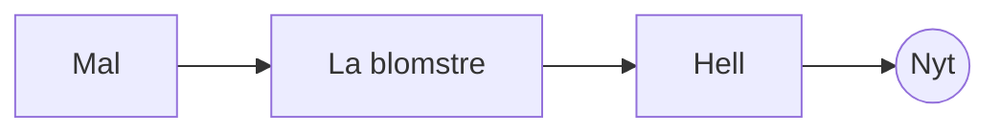

# Den perfekte pour-over

Et langsomt morgenritual i noen få trinn. Skriv det i **kildeteksten** til venstre eller rett i *forhåndsvisningen* til høyre: begge holdes synkronisert, og ==hver redigering er en ren endring== i Markdown.

> [!TIP]
> Vann rett under kokepunktet, rundt 94 °C, henter fram sødmen uten bitterhet.

## Forholdet

De fleste oppskrifter lander på én del kaffe til seksten deler vann:

$$
m_{\text{vann}} = 16 \times m_{\text{kaffe}}
$$

Så $20\,\text{g}$ kaffe trenger $320\,\text{g}$ vann.

## Trinn for trinn



## Traktemetoder

| Metode     | Maling      |  Tid |
|:-----------|:-----------:|-----:|
| Pour-over  | Middels fin | 3:30 |
| Presskanne | Grov        | 4:00 |
| Espresso   | Fin         | 0:28 |

## Før du begynner

- [x] Ferskbrente bønner :coffee:
- [x] En kvern med kjegleverk
- [ ] En kjele med svanehals

```python
def water_for(coffee_g: float, ratio: int = 16) -> float:
    return coffee_g * ratio
```

Blomstring
: Den første skvetten vann som lar kaffesumpen slippe ut gassen sin.[^1]

[^1]: Ferske bønner blomstrer mest; gamle hever seg knapt.
