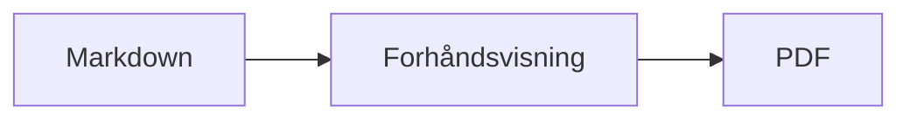

<p>&nbsp;&nbsp;&nbsp;</p>

# Splat

**Markdown-editoren for macOS der du skriver i kildeteksten eller rett i forhåndsvisningen.**

Splat viser Markdown-kildeteksten din med syntaksfarger til venstre og en levende, fullt redigerbar forhåndsvisning til høyre. Skriv i den ene eller den andre: det du skriver i forhåndsvisningen, blir til en minimal endring i kildeteksten, så linjer du ikke har rørt, forblir byte for byte like, og Git-diffene dine holder seg ryddige. Splat leser den Markdownen du allerede bruker: CommonMark og GitHub Flavored Markdown, GitHub-varsler, Obsidians wikilenker, innbygginger og infobokser, utvidelser fra Pandoc og Typora, innebygd HTML, LaTeX-formler og diagrammer i Mermaid, Graphviz og PlantUML, alt gjengitt uten nett. Eksporter til PDF, HTML eller Word med ett klikk. Appen er skrevet i Rust på ekte AppKit-kontroller, finnes på 35 språk og sender ingenting over nettverket med mindre du ber om det.
 


[](https://raw.githubusercontent.com/sventmueller/splat/main/dist/Splat-1.0.7.dmg)

**[Last ned Splat-1.0.7.dmg](https://raw.githubusercontent.com/sventmueller/splat/main/dist/Splat-1.0.7.dmg)**: signert og notarisert av Apple, for macOS 14 eller nyere på Apple Silicon og Intel.
 
 

[](https://www.rust-lang.org)
[](https://www.apple.com/macos/)

[](https://github.com/madsmtm/objc2)
[](https://webkit.org)
[](https://github.com/kivikakk/comrak)
[](https://github.github.com/gfm/)
[](https://www.mathjax.org)
[](https://cortexjs.io/mathlive/)
[](https://mermaid.js.org)
[](https://graphviz.org)
[](https://plantuml.com)


[](#lisens)

[Bahasa Indonesia](../id/README.md) ·
[Bahasa Melayu](../ms/README.md) ·
[Català](../ca/README.md) ·
[Čeština](../cs/README.md) ·
[Dansk](../da/README.md) ·
[Deutsch](../de/README.md) ·
[English](../../../README.md) ·
[Español](../es/README.md) ·
[Français](../fr/README.md) ·
[Hrvatski](../hr/README.md) ·
[Italiano](../it/README.md) ·
[Magyar](../hu/README.md) ·
[Nederlands](../nl/README.md) ·
**Norsk** ·
[Polski](../pl/README.md) ·
[Português (Brasil)](../pt_BR/README.md) ·
[Português (Portugal)](../pt_PT/README.md) ·
[Română](../ro/README.md) ·
[Slovenčina](../sk/README.md) ·
[Slovenščina](../sl/README.md) ·
[Suomi](../fi/README.md) ·
[Svenska](../sv/README.md) ·
[Tiếng Việt](../vi/README.md) ·
[Türkçe](../tr/README.md) ·
[Ελληνικά](../el/README.md) ·
[Русский](../ru/README.md) ·
[Українська](../uk/README.md) ·
[עברית](../he/README.md)‎ ·
[العربية](../ar/README.md)‎ ·
[हिन्दी](../hi/README.md) ·
[ไทย](../th/README.md) ·
[한국어](../ko/README.md) ·
[日本語](../ja/README.md) ·
[简体中文](../zh-Hans/README.md) ·
[繁體中文](../zh-Hant/README.md)

## Innhold

- [Funksjoner i korte trekk](#funksjoner-i-korte-trekk)
- [Krav](#krav)
- [Installasjon](#installasjon)
- [Kom i gang](#kom-i-gang)
- [Skrive](#skrive)
  - [I kildeteksten](#i-kildeteksten)
  - [I forhåndsvisningen](#i-forhåndsvisningen)
  - [Formateringskommandoer](#formateringskommandoer)
  - [Lister og oppgaver](#lister-og-oppgaver)
  - [Tabeller](#tabeller)
- [Støttet Markdown](#støttet-markdown)
  - [CommonMark og GitHub Flavored Markdown](#commonmark-og-github-flavored-markdown)
  - [Infobokser](#infobokser)
  - [Utvidet syntaks](#utvidet-syntaks)
  - [Obsidian](#obsidian)
  - [Siteringer og referanser](#siteringer-og-referanser)
  - [Innebygd HTML](#innebygd-html)
  - [Typografisk tegnsetting](#typografisk-tegnsetting)
  - [Syntaksoversikt](#syntaksoversikt)
- [Formler](#formler)
- [Diagrammer](#diagrammer)
- [Bilder](#bilder)
- [Lenker og navigasjon](#lenker-og-navigasjon)
- [Eksportere, skrive ut og dele](#eksportere-skrive-ut-og-dele)
- [Utseende og tilgjengelighet](#utseende-og-tilgjengelighet)
- [Språk](#språk)
- [Hurtigtaster](#hurtigtaster)
- [Personvern og sikkerhet](#personvern-og-sikkerhet)
- [Store dokumenter](#store-dokumenter)
- [Kjente begrensninger](#kjente-begrensninger)
- [Feilsøking](#feilsøking)
- [For utviklere](#for-utviklere)
  - [Bygging](#bygging)
  - [Distribusjon](#distribusjon)
  - [Testing](#testing)
  - [Prosjektstruktur](#prosjektstruktur)
  - [Dataflyt](#dataflyt)
  - [Regler i kontrolleren](#regler-i-kontrolleren)
  - [Legge til en kommando](#legge-til-en-kommando)
  - [Oversettelser](#oversettelser)
  - [Tredjepartskomponenter](#tredjepartskomponenter)
- [Lisens](#lisens)

## Funksjoner i korte trekk

- **To måter å skrive på, én tekst.** Kildetekst og forhåndsvisning kan begge redigeres. Markdown-filen er den eneste sannheten: det finnes én angrehistorikk per dokument, og hver redigering i forhåndsvisningen oversettes til den minste mulige endringen i kildeteksten.
- **Markdownen du allerede bruker.** CommonMark, GitHub Flavored Markdown, GitHub-varsler, utvidelser fra Obsidian, Pandoc og Typora, emoji-kortkoder, spoilere, definisjonslister, overskriftsankere og HTML som i GitHub-README-filer.
- **Formler og diagrammer innebygd.** LaTeX-formler via MathJax, med en visuell formelredigerer. Diagrammer i Mermaid, Graphviz og PlantUML, gjengitt på Macen din uten Java, tjener eller nettforbindelse.
- **En knapp for alt.** Hver Markdown-konstruksjon har en verktøylinjeknapp og et menyvalg, de vanligste også en hurtigtast. Tabeller har en egen meny for rader, kolonner og justering.
- **Eksport uten tap.** PDF, én enkelt selvstendig HTML-fil eller et Word-dokument med ekte overskrifter, lister, tabeller, fotnoter og bilder.
- **Native helt inn i margen.** Ekte AppKit-vinduer, faner, menyer, popovere, Versjoner, Lagre automatisk, delingsmenyen, mørk modus, stavekontroll, diktering og VoiceOver. Ingen Electron, ingen nettvisning for selve teksten.
- **Rask med store filer.** Å gjengi et tastetrykk i et dokument på 10 MB tar rundt 10 ms, før visningens eget arbeid.
- **Privat og varsom.** Bilder fra nettet lastes først etter at du har tillatt det, lenker til andre apper spør først, og alt som dekoder upålitelige bildedata, kjører i helperprosesser i en sandkasse.
- **På ditt språk.** Grensesnittet og den innebygde Markdown-hurtigreferansen finnes på 35 språk: arabisk, katalansk, kinesisk (forenklet), kinesisk (tradisjonelt), kroatisk, tsjekkisk, dansk, nederlandsk, engelsk, finsk, fransk, tysk, gresk, hebraisk, hindi, ungarsk, indonesisk, italiensk, japansk, koreansk, malayisk, norsk, polsk, portugisisk (Brasil), portugisisk (Portugal), rumensk, russisk, slovakisk, slovensk, spansk, svensk, thai, tyrkisk, ukrainsk og vietnamesisk.

## Krav

- macOS 14 Sonoma eller nyere. Splat er utviklet og testet på macOS 27, der appen automatisk tar i bruk designet Liquid Glass.
- En Mac med Apple Silicon eller en Intel-prosessor.
- Rundt 45 MB diskplass.

## Installasjon

**Fra diskbildet.** Last ned [`dist/Splat-1.0.7.dmg`](https://raw.githubusercontent.com/sventmueller/splat/main/dist/Splat-1.0.7.dmg), åpne det og dra Splat til Apper-mappen. Bildet er signert med en Developer ID og notarisert av Apple, så det åpnes uten advarsler.

**Med Homebrew.** Cask-pakken ligger i en egen tap:

```sh
brew install --cask sventmueller/tap/splat
```

`brew upgrade --cask splat` installerer nye versjoner, og `brew uninstall --zap --cask splat` fjerner også innstillingene og bufferne til Splat.

**Oppdateringer.** Splat fra diskbildet eller Homebrew holder seg selv oppdatert med [Sparkle](https://sparkle-project.org). Ved andre oppstart spør appen om den én gang om dagen får søke etter oppdateringer på egen hånd. **Splat › Søk etter oppdateringer…** søker med en gang; **Søk etter oppdateringer automatisk** og **Last ned og installer oppdateringer automatisk** i den samme menyen endrer valget ditt senere. Splat installerer en oppdatering bare hvis den har utviklerens signatur. Et bygg du har laget selv, har ingen oppdaterer.

**Fra kildekoden.** Se [Bygging](#bygging) for forutsetningene, og kjør deretter:

```sh
make build
ditto target/release/Splat.app /Applications/Splat.app
open /Applications/Splat.app
```

For å åpne Markdown-filer med Splat ved dobbeltklikk markerer du en vilkårlig `.md`-fil i Finder, velger **Fil › Vis info**, velger Splat under **Åpne med** og klikker på **Endre alle…**. Splat registrerer seg selv for filene `.md`, `.markdown`, `.mdown` og `.mkd`.

## Kom i gang

### Vinduet

Hvert dokument åpnes i sitt eget vindu, eller som en fane hvis du foretrekker faner:

- **Til venstre: kildeteksten.** Markdownen din i SF Mono med syntaksfarger.
- **Til høyre: forhåndsvisningen.** Det gjengitte dokumentet, klart til redigering.
- **Disposisjonssidefelt (valgfritt).** Alle overskrifter som et tre; et klikk på en av dem viser den i begge rutene. Slå det av og på med **Vis › Vis disposisjon** (⌃⌘S).
- **Verktøylinje.** Knapper gruppert etter det de endrer: tegn, avsnitt og innsatte elementer, deretter forhåndsvisning av/på, Del og Nytt dokument. Tilpass den med **Vis › Tilpass verktøylinje…**.

Dra i skillelinjen for å gi den ene siden mer plass. **Vis › Skjul forhåndsvisning** (⌥⌘P) lar bare kildeteksten stå igjen; Splat husker dette per vindu. Begge rutene ruller sammen, og en markering i den ene ruten utheves i den andre.

### Dokumenter, faner og versjoner

Splat er en vanlig dokumentapp for macOS:

- **Lagre automatisk og Versjoner.** Endringer lagres direkte i filen. **Fil › Tilbakestill til › Bla gjennom alle versjoner…** tar deg tilbake i tid.
- **Endringer fra andre programmer.** Når Git, et skript eller en annen editor endrer et åpent dokument, laster Splat det på nytt og beholder markøren og rulleposisjonen. Har du ulagrede endringer selv, beholder Splat dem, og macOS spør før den lagrer over den andre versjonen.
- **De vanlige filkommandoene.** Dupliser (⇧⌘S), Endre navn…, Flytt til… og **Fil › Åpne sist brukte**.
- **Faner.** **Fil › Ny fane** eller **+**-knappen i verktøylinjen åpner et nytt dokument som en fane; den vanlige Vindu-menyen slår sammen, flytter og blar mellom faner.
- **Vindusplassering.** Størrelsen og plasseringen til det siste vinduet ditt huskes, også etter omstart. Står det allerede et vindu der, åpnes det nye litt forskjøvet.
- **Dock-ikonet.** Et klikk på det etter at du har lukket det siste vinduet, åpner et nytt dokument.
- **Åpne Markdown-filer i Splat.** **Splat › Angi som standardapp for Markdown** gjør at et dobbeltklikk på en `.md`- eller `.markdown`-fil åpner Splat; macOS ber om bekreftelse én gang. Valget har et hakemerke så lenge Splat er standardappen.

Filer må være UTF-8-tekst, eller UTF-16 med byte order mark. Splat avviser andre kodinger i stedet for å gjette og ødelegge teksten. En byte order mark blir stående, UTF-16 forblir UTF-16, og i en fil der alle linjer slutter med CRLF, får linjene du legger til, også CRLF.

**Etter et krasj** går i verste fall bare de siste sekundene med skriving tapt: hvert femte sekund kopierer Splat ulagret tekst til `~/Library/Application Support/Splat/Unsaved` og fjerner kopiene når et dokument er lagret eller Splat avsluttes normalt. Ved neste oppstart flyttes det et krasj lot ligge der, til `~/Library/Application Support/Splat/Recovery`, og det sies fra om én gang, med en knapp som åpner mappen. Et krasj som Splat fortsatt kan reagere på, skriver dessuten teksten i hvert åpent dokument dit.

### Hurtigreferanse

**Hjelp › Markdown-hurtigreferanse** åpner et jukseark på ditt språk som et nytt, navnløst dokument. Det er et helt vanlig dokument, så prøv alt rett der, i kildeteksten eller i forhåndsvisningen.

## Skrive

### I kildeteksten

Kildeteksten er en ren tekstredigerer som er skreddersydd for Markdown:

- **Syntaksfarger** som i VS Code: overskrifter, utheving, lenker, kode, tabeller, HTML, front matter, og LaTeX og Mermaid inne i formler og diagrammer. Det finnes paletter for lys modus, mørk modus og Øk kontrast.
- **Kodeblokker med gjerder** utheves for Bash, C, C++, C#, CSS (også SCSS og Less), Go, HTML, XML, Java, JavaScript, JSON, Kotlin, PHP, Python, Ruby, Rust, SQL, Swift, TypeScript, YAML, TeX og Mermaid, også med de vanlige kortnavnene som `js`, `py` eller `sh`.
- **Ingen uventede erstatninger.** Smarte anførselstegn, smarte tankestreker og teksterstatning er slått av som standard, fordi de ødelegger `--`, `---` og `"`. Slå dem på under **Rediger › Automatiske endringer**.
- **Skriveverktøyene i systemet.** Stave- og grammatikkontroll, diktering, Søk og erstatt (⌥⌘F) og tale.
- **Dra og slipp.** Slipp en bildefil for å sette inn ``, en hvilken som helst annen fil for å sette inn en lenke til den, og en URL for å sette inn `[url](url)`. Hver slipp er ett angretrinn.
- **Lim inn bilder.** Et bilde på utklippstavlen, for eksempel et skjermbilde, lagres som en PNG-fil ved siden av dokumentet (`Bilde 2026-10-29 13.09.07.png`) og settes inn som bilde. Dokumentet må være lagret én gang for dette.

### I forhåndsvisningen

Forhåndsvisningen oppfører seg som et tekstbehandlingsprogram, men alt du gjør i den, ender som Markdown:

- **Skriving.** Tegn som betyr noe i Markdown, som `*` eller `#`, escapes slik at de vises som du skrev dem.
- **Return** starter et nytt avsnitt eller et nytt listepunkt. **⌥Return** eller **⌃Return** setter inn et linjeskift.
- **Formatering ved markøren.** Står markøren på slutten av et ord, gjelder Halvfet, Kursiv og de andre tegnformatene det du skriver etterpå. Velg formatet på nytt for å avslutte det. Inne i et ord formateres hele ordet.
- **Tomme linjer.** Return på en tom linje legger til enda en tom linje, og Backspace fjerner den. I kildeteksten er hver ekstra tomme linje to blanke linjer til; andre Markdown-programmer viser dem som vanlig avsnittsavstand.
- **Angre** virker på tvers av begge rutene. Angretrinnene har navn («Angre Halvfet»), skriving er ett trinn per skriveøkt, og etter Angre og Utfør likevel ruller begge rutene til endringen.
- **Formler og diagrammer** vises som ferdige grafikker. Klikk på en, flytt markøren til den eller trykk Return på den for å åpne editoren (se [Formler](#formler) og [Diagrammer](#diagrammer)).
- **Innebygd HTML, innebygde notater og front matter** vises, men du redigerer dem i kildeteksten. Et klikk på dem setter markøren på det tilsvarende stedet der.

Alt Markdown ikke kan uttrykke, er blokkert i forhåndsvisningen: Font- og Farge-panelene, linjalen, og det å lime inn eller slippe formatert tekst og bilder. Innlimt HTML og RTF kommer inn som ren tekst.

### Formateringskommandoer

Hver kommando er tilgjengelig fra verktøylinjen, menylinjen og kontekstmenyen i begge rutene. Menyvalgene viser et hakemerke for formateringen ved markøren.

| Meny | Kommandoer |
|---|---|
| **Format › Font** | Halvfet, Kursiv, Understreket, Gjennomstreket, Uthev, Kode, Hevet tekst, Senket tekst |
| **Format › Overskrift** | Brødtekst, Overskrift 1 til 6 |
| **Format › Liste** | Punktliste, Nummerert liste, Oppgaveliste |
| **Format** | Sitat, Kodeblokk (Uten språk eller ett av 20 språk; endrer også språket til en eksisterende blokk), Infoboks (Notat, Tips, Viktig, Advarsel, Forsiktig; samme type igjen fjerner den), Rediger formel eller diagram…, Fjern formatering |
| **Sett inn** | Lenke…, Bilde…, Tabell…, Formel, Diagram (Flytskjema, Sekvensdiagram, Gantt-diagram), Innholdsfortegnelse, Fotnote, Skillestrek |
| **Tabell** | Sett inn rad over/under, Sett inn kolonne til venstre/høyre, Slett rad, Slett kolonne, Justering (Venstre, Sentrer, Høyre, Standard), Juster tabellkolonner |
| **Vis** | Skjul/Vis forhåndsvisning, Vis/Skjul disposisjon, Typografisk tegnsetting, Zoom inn/ut, Faktisk størrelse, verktøylinje, fanelinje, fullskjerm |

Understreking, utheving, hevet og senket tekst skrives som `<ins>`, `<mark>`, `<sup>` og `<sub>`, som GitHub også viser. Splat leser dessuten `<u>`, som GitHub fjerner, og de kortere formene `==uthevet==`, `^hevet^` og `~senket~`. GitHub viser `==` og `^` som skrevet og `~senket~` som gjennomstreking.

### Lister og oppgaver

- Return fortsetter en liste; Return på et tomt listepunkt avslutter den.
- **Tab** og **⇧Tab** rykker listepunkter inn og ut i forhåndsvisningen.
- Et klikk på en oppgaveboks i forhåndsvisningen veksler mellom `- [ ]` og `- [x]`.
- **Format › Liste** gjør de markerte avsnittene om til en liste eller endrer typen.

### Tabeller

- **Sett inn › Tabell…** spør etter antall rader (inkludert overskriftsraden) og kolonner.
- I forhåndsvisningen flytter **Tab** til neste celle, **⇧Tab** til forrige og **Return** til cellen under. Tab i den siste cellen legger til en rad.
- **Tabell**-menyen setter inn og sletter rader og kolonner og angir justeringen til en kolonne (⌘{, ⌘|, ⌘}).
- **Tabell › Juster tabellkolonner** fyller kildeteksten med mellomrom slik at kolonnene står på linje.

## Støttet Markdown

Splat tolker teksten med [comrak](https://github.com/kivikakk/comrak), en parser som er kompatibel med CommonMark og GFM, og slår på de fleste utvidelsene den har. Alt nedenfor gjengis i forhåndsvisningen og i alle eksporter.

### CommonMark og GitHub Flavored Markdown

- Overskrifter (`#` og understreket), avsnitt, linjeskift, utheving, sterk utheving, kode i teksten, blokksitater, skillestreker.
- Punktlister, nummererte og nestede lister; oppgavelister.
- Lenker (i teksten, med referanse og automatiske), bilder, lenkereferansedefinisjoner.
- Kodeblokker med gjerder og med innrykk, med syntaksfarger.
- Tabeller med kolonnejustering.
- Gjennomstreking med `~~to tilder~~`.
- Fotnoter: `tekst[^1]` med `[^1]: Notatet.` et sted i dokumentet. Et klikk på merket hopper til notatet.
- YAML front matter mellom `---`-linjer øverst. Forhåndsvisningen oppsummerer det i én linje, for eksempel «Metadata: title, date, tags».

### Infobokser

GitHub-varsler gjengis som fargede bokser med ikon og tittel:

```markdown
> [!NOTE]
> Nyttig informasjon som brukere bør kjenne til.

> [!WARNING]
> Kritisk innhold som krever umiddelbar oppmerksomhet.
```

De fem typene er Notat, Tips, Viktig, Advarsel og Forsiktig. **Format › Infoboks** gjør avsnittet ved markøren om til en slik boks.

Obsidians infobokser fungerer også, med en vilkårlig tittel og en foldetilstand:

```markdown
> [!tip]- Klikk ▸ for å vise
> Skjult til den åpnes.

> [!question]+ Åpen som standard
> Et `+` starter utvidet, et `-` sammenfoldet.
```

Obsidians øvrige typer vises i den nærmeste av de fem fargene: `success`, `check`, `done` og `hint` som Tips; `question`, `help` og `faq` som Viktig; `attention` som Advarsel; `failure`, `fail`, `missing`, `danger`, `error` og `bug` som Forsiktig; alt annet som Notat.

### Utvidet syntaks

| Funksjon | Syntaks | Fra |
|---|---|---|
| Utheving | `==markert tekst==` | Obsidian, Typora |
| Hevet tekst | `x^2^` | Pandoc, Typora |
| Senket tekst | `H~2~O` | Pandoc, Typora |
| Emoji-kortkode | `:rocket:` blir til 🚀 | GitHub |
| Spoiler | `\|\|skjult tekst\|\|`, merk den for å lese den | Discord |
| Fotnote i teksten | `tekst^[selve notatet]` | Pandoc, Obsidian |
| Definisjonsliste | `Begrep`, tom linje, `: Forklaring` | PHP Markdown Extra, Pandoc |
| Overskriftsanker | `## Installer {#setup}`, lenk med `[se](#setup)` | Pandoc, kramdown |

Definisjonslister ser slik ut i kildeteksten:

```markdown
Begrep

: Forklaring av begrepet.
```

Uten et eget anker får hver overskrift et som er avledet av teksten, som på GitHub: `## Kom i gang` nås som `#kom-i-gang`.

### Obsidian

- **Wikilenker.** `[[Notat]]` lenker til `Notat.md` i samme mappe eller en mappe under. `[[Notat|Vist tekst]]` viser din egen tekst, og `[[Notat#Overskrift]]` åpner notatet. ⌘-klikk åpner det i Splat.
- **Innbygginger.** `![[Notat]]` viser det andre notatet inne i dette; notater som er bygd inn i det, vises som lenker. `![[diagram.png]]` viser et bilde. Som i Obsidian navngir innbygginger notater og bilder i dokumentets mappe eller under, aldri med en absolutt sti, og bare Markdown-filer vises som notater.
- **Kommentarer.** `%%Bare i kildeteksten%%` forblir synlig i kildeteksten og utelates fra forhåndsvisningen og alle eksporter, både i teksten og på egne linjer.
- **Tagger.** `#idé` eller `#prosjekt/splat` utheves. ⌘-klikk søker etter taggen i dokumentet.
- **Sammenleggbare infobokser.** Se [Infobokser](#infobokser).

### Siteringer og referanser

- **Pandoc-siteringer.** `[@doe2020]` eller `[@doe2020; @roe2021]` leses som «(Doe 2020; Roe 2021)». Oppføringene hentes fra BibTeX-filen som front matter angir med `bibliography: refs.bib`. Uten den bruker Splat `references.bib`, `literatur.bib` eller `bibliography.bib` ved siden av dokumentet.
- **GitHub- og GitLab-referanser.** Ligger dokumentet i et Git-repositorium der `origin`-remoten ligger på github.com eller en GitLab-vert, utheves `@navn`, `#12` (issue) og `!7` (merge request, bare GitLab). ⌘-klikk åpner dem i nettleseren.

### Innebygd HTML

HTML slik du finner den i GitHub-README-filer, gjengis, med en egen leser i stedet for en nettlesermotor:

- sentrerte avsnitt og blokker (`<p align="center">`, `<div align="center">`)
- bilder med størrelse (``)
- lenker, `<kbd>⌘</kbd>`, `<br>`, `<u>`, `<ins>`, `<mark>`, `<sup>`, `<sub>`
- lister og tabeller, også celler som spenner over flere kolonner (`colspan`)
- sammenleggbare deler: `<details><summary>Mer</summary>…</details>`, som åpnes med et klikk på ▸

Markdown mellom HTML-tagger gjengis som Markdown. Skript, stiler, rammer og skjemaer utelates helt, og lenker og bilder beholder bare `http`, `https`, `mailto` og relative adresser.

### Typografisk tegnsetting

**Vis › Typografisk tegnsetting** viser rette anførselstegn som anførselstegnene i grensesnittspråket ditt, `--` som en kort tankestrek, `---` som en lang tankestrek og `...` som en ellipse. På tysk blir `"Ja"` til „Ja“, på fransk «Oui», på japansk 「はい」, også der kinesisk og japansk setter anførselstegn uten mellomrom; hebraiske forkortelser som `צה"ל` får sin gershayim, צה״ל. Kildeteksten beholder de rene tegnene; forhåndsvisningen og alle eksporter viser de typografiske. Innstillingen er av til du slår den på.

### Syntaksoversikt

| Element | Markdown |
|---|---|
| **Halvfet** | `**Halvfet**` |
| *Kursiv* | `*Kursiv*` |
| Understreket | `<ins>Understreket</ins>` eller `<u>Understreket</u>` |
| ~~Gjennomstreket~~ | `~~Gjennomstreket~~` |
| Uthev | `<mark>Uthev</mark>` eller `==Uthev==` |
| `Kode` | `` `Kode` `` |
| x² | `x<sup>2</sup>` eller `x^2^` |
| H₂O | `H<sub>2</sub>O` eller `H~2~O` |
| [Lenke](https://example.com) | `[Lenke](https://example.com)` |
| Overskrift | `# Overskrift` til `###### Overskrift` |
| Sitat | `> Sitat` |
| Punktliste | `- Punkt` |
| Nummerert liste | `1. Punkt` |
| Oppgave | `- [ ] Åpen` og `- [x] Ferdig` |
| Kodeblokk | ```` ```rust ```` … ```` ``` ```` |
| Tabell | `\| A \| B \|` med `\|---\|---\|` under overskriftsraden |
| Fotnote | `Tekst[^1]` og `[^1]: Notat` |
| Skillestrek | `---` |
| Bilde | `` |
| Formel | `$E = mc^2$`, `$$ … $$` |
| Diagram | ```` ```mermaid ````, ```` ```dot ````, ```` ```plantuml ```` |
| Infoboks | `> [!TIP]` |
| Wikilenke | `[[Notat]]`, `[[Notat\|Tekst]]` |
| Innbygging | `![[Notat]]`, `![[bilde.png]]` |
| Kommentar | `%%Kommentar%%` |
| Tagg | `#tagg` |
| Sitering | `[@nøkkel]` |
| Spoiler | `\|\|Spoiler\|\|` |
| Emoji | `:tada:` |

## Formler

Formler gjengis av [MathJax](https://www.mathjax.org) med TeX og AMS-matematikk, som skarpe vektorgrafikker. Tekst i `\text{…}` kan være i et hvilket som helst skriftsystem: det MathJax' fonter mangler, hentes fra fontene på Macen din, der arabisk og hebraisk går fra høyre mot venstre og emoji vises i farger.

| Type | Syntaks |
|---|---|
| I teksten | `$E = mc^2$`, `` $`E = mc^2`$ `` (GitHub, GitLab), `\(E = mc^2\)` |
| Frittstående | `$$` … `$$`, `\[` … `\]`, eller en kodeblokk merket `math` |

**Redigere en formel.** Klikk på en formel i forhåndsvisningen, dobbeltklikk på den, trykk Return på den eller flytt markøren til den for å åpne editoren i en popover. **Sett inn › Formel** setter inn en ny og åpner editoren med en gang.

- **Visuell eller LaTeX.** Bryteren øverst skifter mellom en visuell editor ([MathLive](https://cortexjs.io/mathlive/)) og LaTeX-koden. Splat husker valget ditt.
- **Byggeklosser** for brøk, kvadratrot, hevet og senket tekst, sum og integral med grenser, grenseverdi, parenteser som vokser med innholdet, 2×2-matrise, greske bokstaver, og relasjoner, operatorer og piler. De etterlater plassholdere □, og **Tab** hopper til neste.
- **Direkte forhåndsvisning.** Endringene vises i dokumentet mens du skriver. Feil fra MathJax vises i en linje under koden.
- **Ta imot eller forkast.** Et klikk utenfor beholder endringen som ett angretrinn; **Esc** eller **Avbryt** kaster den. Esc i en ny, tom formel fjerner den igjen.
- Kontekstmenyen har **Rediger formel…** for formelen under pekeren.

VoiceOver leser en formel som LaTeX-koden. Splat gjengir formler, ikke fullstendige LaTeX-dokumenter: det finnes ingen pakker, ingen TikZ og ingen `\documentclass`.

## Diagrammer

Diagrammer gjengis i Splat, uten nett og i en lys og en mørk variant.

| Motor | Kodeblokk | Hva den tegner |
|---|---|---|
| [Mermaid](https://mermaid.js.org) | ```` ```mermaid ```` | flytskjemaer, sekvens-, klasse-, tilstands-, entitetsrelasjons- og Gantt-diagrammer, sektordiagrammer, tankekart, tidslinjer og alle andre Mermaid-typer |
| [Graphviz](https://graphviz.org) | ```` ```dot ```` eller ```` ```graphviz ```` | grafer i DOT-språket |
| [PlantUML](https://plantuml.com) | ```` ```plantuml ```` eller ```` ```puml ```` | UML-diagrammer; kjører uten Java |



**Redigere et diagram** fungerer som å redigere en formel: klikk på det for å åpne koden i en popover, med syntaksfarger og feilmeldinger i en linje under koden. **Sett inn › Diagram** starter fra en mal for et flytskjema, et sekvensdiagram eller et Gantt-diagram. Byggeklosser hjelper med de tre vanligste Mermaid-typene:

- **Flytskjema:** Node ▾ (rektangel, avrundet, sirkel, rombe, database), Forbindelse, Forbindelse med etikett, Gruppe, Retning ▾
- **Sekvensdiagram:** Deltaker, Melding, Svar, Notat, Sløyfe, Alternative forløp
- **Gantt-diagram:** Seksjon, Oppgave, Milepæl

Andre diagramtyper redigeres som kode. VoiceOver leser opp tittelen eller alternativteksten til et diagram.

Det første diagrammet etter oppstart tar rundt ett sekund, fordi gjengivelsesmotoren starter i bakgrunnen. Et diagram som bruker mer enn 10 sekunder, viser en feil, og gjengivelsesmotoren starter på nytt for det neste. PlantUML-motoren (3 MB) lastes først med det første PlantUML-diagrammet. En PlantUML-`!include` fra nettet er blokkert.

## Bilder

- **Lokale bilder** bruker stier relative til dokumentet: ``. Splat viser PNG, JPEG, GIF, WebP, BMP, SVG, HEIC, TIFF, AVIF og PDF.
- **Bilder fra nettet** forblir blokkert til du tillater dem: en linje over forhåndsvisningen forklarer at når de lastes, får serverne deres vite at og når du åpner dokumentet. **Last inn bilder** tillater dem for dette dokumentet; Splat husker valget per fil.
- **Størrelse.** `` angir størrelsen på et bilde; ellers tilpasses bildene bredden på forhåndsvisningen.
- **Endringer på disken.** Et bilde du erstatter, eller et som dukker opp etter at dokumentet navnga det, vises uten at du åpner dokumentet på nytt. Bilder fra nettet som feilet på grunn av nettverket, prøves igjen så lenge et dokument viser dem.
- **Minne.** Bilder vises med opptil 2560 piksler på den lengste siden, noe som også fyller en A4-side. De dekodes mindre når de fyller en åttedel av Macens minne, og mens macOS melder om minnepress.
- **Mørk modus.** Bilder med hvit bakgrunn dempes litt i den mørke forhåndsvisningen.
- **Lime inn og slippe.** Se [I kildeteksten](#i-kildeteksten).

## Lenker og navigasjon

I forhåndsvisningen setter et klikk markøren slik at du kan redigere lenketeksten; **⌘-klikk** følger lenken:

- `http`, `https` og `mailto` åpnes i nettleseren eller e-postappen din.
- Markdown-filer åpnes i Splat; andre filer og mapper vises i Finder.
- `#anker` hopper til overskriften i dokumentet.
- Adresser som åpner en annen app, som `slack://` eller `vscode://`, spør først og viser hele adressen og appen. **Avbryt** er forhåndsvalgt.

**Sett inn › Innholdsfortegnelse** setter inn en lenket liste over alle overskrifter. Står markøren inni den, oppdaterer den samme kommandoen listen. Disposisjonssidefeltet (⌃⌘S) hopper til en hvilken som helst overskrift i begge rutene.

## Eksportere, skrive ut og dele

| Format | Slik gjør du det | Det du får |
|---|---|---|
| **PDF** | **Fil › Eksporter som PDF…** eller Del-menyen | Sider i papirstørrelse, alltid i lyst utseende, formler og diagrammer som vektorgrafikk. **Fil › Utskriftsformat…** angir papiret. |
| **Utskrift** | **Fil › Skriv ut…** (⌘P) | Den samme utformingen som i PDF-en. |
| **HTML** | **Fil › Eksporter som HTML…** eller Del-menyen | Én selvstendig fil: lokale bilder innebygd, formler og diagrammer som skarpe bilder, overskriftsankere slik at innholdsfortegnelsen fungerer. Ingen skript. |
| **Word** | **Fil › Eksporter som Word-dokument…** eller Del-menyen | En `.docx` med Words overskriftsstiler, ekte lister og tabeller (også sammenslåtte celler), fotnoter som Word-fotnoter, innebygde bilder, formler og diagrammer. |
| **Markdown** | **Del**-knappen i verktøylinjen | Dokumentet som en `.md`-fil for Mail, Meldinger, AirDrop og alle andre delingstjenester. |

Menyen **Fil › Del** har alle disse på ett sted. Eksportene bruker innstillingen for typografisk tegnsetting og bildene du har tillatt fra nettet; bilder fra nettet forblir lenker i HTML.

## Utseende og tilgjengelighet

- **Mørk modus** følger systemet. Formler og diagrammer gjengis for hvert utseende.
- **Øk kontrast** i Systeminnstillinger bytter syntaksfargene til paletter med høy kontrast.
- **Zoom.** ⌘+, ⌘− og ⌘0 skalerer begge rutene.
- **Fullskjerm, faner og en verktøylinje som kan tilpasses**, som i alle Mac-apper.
- **VoiceOver.** Rutene heter «Markdown-kildetekst» og «Forhåndsvisning», formler leses som koden sin og diagrammer som tittelen sin. Hver kommando kan nås fra tastaturet.

Splat har ikke noe innstillingsvindu: de få valgene ligger der de gjelder, i **Vis** og **Rediger › Automatiske endringer**.

## Språk

Grensesnittet, menyene og Markdown-hurtigreferansen er oversatt til 35 språk:

arabisk, katalansk, kinesisk (forenklet), kinesisk (tradisjonelt), kroatisk, tsjekkisk, dansk, nederlandsk, engelsk, finsk, fransk, tysk, gresk, hebraisk, hindi, ungarsk, indonesisk, italiensk, japansk, koreansk, malayisk, norsk, polsk, portugisisk (Brasil), portugisisk (Portugal), rumensk, russisk, slovakisk, slovensk, spansk, svensk, thai, tyrkisk, ukrainsk og vietnamesisk.

Splat følger språkrekkefølgen i **Systeminnstillinger › Generelt › Språk og område**; der kan du også velge et språk bare for Splat under **Apper**. Finnes det ingen oversettelse for språket ditt, bruker appen engelsk. Menybegrepene følger Apples egne oversettelser, så Splat leses som resten av Macen din.

Hebraisk og arabisk tekst leses fra høyre mot venstre overalt der den vises, uansett grensesnittspråk: hvert avsnitt, hver overskrift og hvert listepunkt får retningen til sin første bokstav, sitater og infobokser tegner streken sin til høyre, og en tabell der teksten begynner fra høyre mot venstre, lister kolonnene sine fra høyre. Kodeblokker forblir venstre mot høyre. PDF-, HTML- og Word-eksportene beholder disse retningene. Med hebraisk eller arabisk som systemspråk speilvender macOS også vinduet, så forhåndsvisningen havner til venstre.

## Hurtigtaster

| Handling | Hurtigtast |
|---|---|
| Halvfet, Kursiv, Understreket | ⌘B, ⌘I, ⌘U |
| Gjennomstreket | ⇧⌘X |
| Lenke… | ⌘K |
| Brødtekst, Overskrift 1 til 6 | ⌥⌘0, ⌥⌘1 til ⌥⌘6 |
| Juster tabellkolonne til venstre, sentrert, til høyre | ⌘{, ⌘\|, ⌘} |
| Skjul eller vis forhåndsvisningen | ⌥⌘P |
| Vis eller skjul disposisjonen | ⌃⌘S |
| Zoom inn, ut, faktisk størrelse | ⌘+, ⌘−, ⌘0 |
| Nytt dokument, åpne, lagre, dupliser | ⌘N, ⌘O, ⌘S, ⇧⌘S |
| Utskriftsformat, skriv ut | ⇧⌘P, ⌘P |
| Finn, søk og erstatt | ⌘F, ⌥⌘F |
| Finn neste, forrige; bruk markering; gå til markering | ⌘G, ⇧⌘G; ⌘E; ⌘J |
| Vis stavekontroll og grammatikk; kontroller dokument | ⌘:, ⌘; |
| Lim inn og tilpass til stil | ⌥⇧⌘V |
| Skjul verktøylinje, vis alle faner, fullskjerm | ⌥⌘T, ⇧⌘\\, ⌃⌘F |
| Linjeskift (forhåndsvisning) | ⌥Return eller ⌃Return |
| Neste celle / forrige celle i en tabell (forhåndsvisning) | Tab / ⇧Tab |
| Rykk et listepunkt inn / ut (forhåndsvisning) | Tab / ⇧Tab |
| Neste plassholder i formelredigereren | Tab |
| Lukk formel- eller diagramredigereren uten endringer | Esc |
| Følg en lenke, tagg eller referanse (forhåndsvisning) | ⌘-klikk |

Splat lar Apples standard hurtigtaster stå i fred.

## Personvern og sikkerhet

En Markdown-fil kan komme fra hvem som helst, så Splat behandler hvert dokument som upålitelig.

- **Ingen nettverksbruk som standard.** Splat har ingen telemetri. Appen søker etter oppdateringer først når du har samtykket eller velger **Søk etter oppdateringer…**: da laster den en liten feedfil fra GitHub, og forespørselen nevner ikke annet enn appen og versjonen. Formler og diagrammer gjengis lokalt; nettvisningene som gjør det, kan ikke nå nettverket.
- **Bilder fra nettet** lastes først etter at du har gitt tillatelse, bare over `https`, aldri fra verter i det lokale nettverket ditt, på maksimalt 10 MB hver og i en privat økt uten informasjonskapsler.
- **Isolert dekoding.** Bilder og grafikken til formler og diagrammer dekodes i helperprosesser som lukker alle filer de har arvet og låser seg inn i en sandkasse før de leser den første byten: ingen filtilgang, ingen nettverk. De leverer bare tilbake piksler, hvis størrelse kontrolleres, og stoppes etter 10 sekunder. Apples egne bildedekodere ser bare HEIC, TIFF, AVIF og PDF, og bare når dataene faktisk har det formatet; de kjører i en helper for seg, som i tillegg kan lese systemets fontmapper og bruke systemets videodekoder. SVG-er, formler og diagrammer går også gjennom denne helperen, så de er bilder med fast oppløsning i Splat: fire piksler per punkt, opptil 2560 på den lengste siden.
- **Lokale filer** når et dokument bare via stien det navngir. Innbygginger viser Markdown-notater fra dokumentets mappe og nedover, og et manglende bilde letes det bare etter der. En bildesti andre steder, absolutt eller som begynner med `~`, lastes fortsatt i forhåndsvisningen; HTML- og Word-eksporter, utskrift og PDF-er tar bare med det som ligger i dokumentets mappe eller Git-repositoriet, med mindre det repositoriet også inneholder Hjem-mappen din, så et dokument fra noen andre ikke kan dra filene dine inn i en eksport du gir videre.
- **Kopier av ulagret tekst** blir på denne Macen, i Bibliotek-mappen din, for gjenopprettingen etter et krasj. De forsvinner ved lagring eller når Splat avsluttes normalt; kopiene et krasj etterlot, blir liggende i gjenopprettingsmappen til du sletter dem.
- **Lenker** starter aldri et program ved et klikk. Web- og e-postlenker åpnes som vanlig; lenker til andre apper spør først.
- **HTML i dokumenter** leses av Splats egen parser. Skript, stiler, rammer og skjemaer kjører aldri.
- **Eksporter** inneholder ingen skript. HTML-sider beholder bare en fast liste over harmløse tagger og attributter, som GitHub, pluss en content security policy. Word-filer lenker bare til adresser med `http`, `https` og `mailto`.
- **Kodesignering** med Hardened Runtime. Splat kjører uten App Sandbox, slik at appen kan vise bilder ved siden av dokumentene dine uten å spørre om hver mappe; isolasjonen av all dekoding veier opp for dette.

## Store dokumenter

Splat holder seg responsiv med dokumenter på flere megabyte:

- Kildeteksten bruker TextKit 2, som bare legger ut den synlige delen.
- Mens du skriver i forhåndsvisningen, og i kildeteksten i dokumenter på opptil 2 MB, blir bare de berørte avsnittene tolket, fargelagt og lagt ut på nytt. I et dokument på 10 MB tar tolking og fargelegging rundt 3 ms, gjengivelse rundt 10 ms, og et helt tastetrykk i forhåndsvisningen rundt 30 ms med visningens eget arbeid.
- Store forhåndsvisninger gjengir den synlige delen først og resten mens appen er ledig. Blokker som rulles inn i synsfeltet, gjengis før de tegnes.
- I kildeteksten til større dokumenter kjører tolkingen for forhåndsvisningen i bakgrunnen mens du skriver.
- Et dokument forblir ren tekst når det ville bruke omtrent 4 GB minne, som tilsvarer rundt 50 til 120 MB vanlig Markdown, men bare 10 til 20 MB hvis det bare består av tabeller eller overskrifter: kildeteksten har ingen farger, og forhåndsvisningen sier hvorfor den er tom. Eksport fungerer fortsatt.
- Fra rundt 200 KB åpner et dokument vinduet sitt før det er tolket; ved 5 MB følger fargene og forhåndsvisningen om lag et kvart sekund senere.
- Alle bilder til sammen, inkludert formler og diagrammer, tar høyst en fjerdedel av minnet til Macen og halvparten av det mens det er lite minne. Utover det vises flere bilder som plassholdere til det igjen er plass.

Noen endringer behandles i sin helhet, med rundt 300 ms per tastetrykk ved 10 MB: endringer i definisjonen av en fotnote eller i referansene til den, ved siden av en fotnote i teksten, helt på slutten av et dokument ved siden av en fotnote, i front matter eller i lenkereferansedefinisjoner, og hver endring i et dokument med `%%`-kommentarblokker eller med en fotnote som er definert to ganger eller inne i et sitat eller en liste. Minnebruken vokser med filen, til omtrent 115–160 MB for 1 MB Markdown og 340–510 MB for 10 MB.

## Kjente begrensninger

- **Enkelt tilde betyr senket tekst.** `~tekst~` er senket tekst som i Pandoc; gjennomstreking krever `~~to~~`. GitHub stryker også gjennom med én tilde.
- **Skrivebeskyttet i forhåndsvisningen:** innebygd HTML, innebygde notater og front matter redigeres i kildeteksten.
- **Svært dyp nesting:** HTML som er nestet dypere enn 64 nivåer, og HTML i teksten dypere enn 16, viker for innholdet sitt.
- **Sammenslåtte tabellceller** finnes bare i HTML-tabeller, og bare på tvers av kolonner (`colspan`, ingen `rowspan`). MultiMarkdowns tabellsyntaks for sammenslåtte celler støttes ikke.
- **Bibliografier** leses bare fra BibTeX, ikke fra CSL JSON eller YAML.
- **Referanser** krever et repositorium på github.com eller en GitLab-vert; `!7` finnes bare på GitLab.
- **Typografisk tegnsetting:** et tysk avsluttende enkelt anførselstegn kan ikke skilles fra en apostrof og settes som ’.
- **Formler, ikke dokumenter:** ingen LaTeX-pakker, TikZ eller fullstendige dokumenter.
- **Den visuelle formelredigereren** skriver LaTeX i MathLives notasjon: mellomrom forsvinner (`E = mc^2` blir til `E=mc^2`), gjengivelsen forblir den samme.
- **Av prinsipp:** ingen linjenumre, ikke noe innstillingsvindu, ingen Help Book, ikke i App Store.
- **Mindre testet på Intel.** Vindusselvtestene kjører bare på Apple Silicon; på Intel kjører CI `cargo test`.

## Feilsøking

**Listen over nylige dokumenter er tom etter at jeg har bygd Splat på nytt.** macOS knytter nylige dokumenter og mappetillatelser til appens kodesignatur. Lokale bygg signeres med sertifikatet «Splat Local Signing» i påloggingsnøkkelringen din, så nye bygg beholder begge deler. Hvis sertifikatet er slettet, lager neste bygg et nytt, og listene begynner på nytt én gang.

**Appen fra diskbildet viser andre nylige dokumenter enn mitt eget bygg.** De to har ulike signaturer, så macOS fører en egen liste og egne mappetillatelser for hver.

**HTML eller annen syntaks vises som ren kode.** Det kan være en utdatert kopi av Splat som åpnet dokumentet. Avslutt den, velg **Fil › Vis info** på dokumentet i Finder og kontroller at **Åpne med** navngir Splat i Apper-mappen din.

**Det finnes ingen Søk etter oppdateringer… i Splat-menyen.** Bare versjonen fra diskbildet eller Homebrew oppdaterer seg selv; et bygg du har laget selv, har ingen oppdaterer.

**Bilder fra nettet vises ikke.** Klikk på **Last inn bilder** i linjen over forhåndsvisningen. Bare `https`-bilder fra offentlige verter lastes.

**Når jeg limer inn et skjermbilde, blir jeg bedt om å lagre først.** Innlimte bilder lagres som filer ved siden av dokumentet, og det trengs et sted på disken. Lagre det, og lim deretter inn på nytt.

**«Filen er ikke UTF-8-tekst.»** Filen har en annen koding og har ingen byte order mark som navngir den. Konverter den først, for eksempel med `iconv -f ISO-8859-1 -t UTF-8 old.md > new.md`.

**En formel eller et diagram viser en feil.** Klikk på det: editoren viser meldingen fra MathJax, Mermaid, Graphviz eller PlantUML under koden.

## For utviklere

Splat er et Rust-program som snakker direkte med AppKit og WebKit gjennom [objc2](https://github.com/madsmtm/objc2). Det finnes ingen Swift, ingen Objective-C, ingen Xcode-prosjekter og ingen Interface Builder-filer.

### Bygging

Forutsetninger:

- macOS med Command Line Tools (`xcode-select --install`). Xcode trengs ikke; Splat bygges uten `actool`, `ibtool` og `metal`.
- Rust 1.99 (`brew install rust`). [rust-toolchain.toml](../../../rust-toolchain.toml) navngir den nøyaktige versjonen CI bruker; rustup installerer den av seg selv, mens Homebrews Rust ignorerer filen. Å heve den der er måten nye kompilator- og clippy-advarsler når prosjektet på.
- rustup, for `make lint`, `make check` og `make universal`: `cargo xtask check-library` bygger biblioteket for Linux for å vise at det ikke trenger macOS, og Homebrews Rust har ingen andre mål.

[Makefile](../../../Makefile) inneholder korte inngangspunkter; `make help` lister dem alle:

```sh
make build                  # target/release/Splat.app, samme som cargo xtask bundle --release
make universal              # target/splat-universal for Apple Silicon og Intel, slik diskbildet har det
make check                  # formatering, clippy uten advarsler, alle tester, medfølgende biblioteker; det CI kjører
make test                   # make check, deretter selvtesten uten vindu
make test-gui               # selvtester med vindu; de opptar Macen i omtrent fire minutter
make test-long              # lengre tilfeldig søk og kontrollen av 10 MB delvis oppdatering
make fuzz                   # tilfeldig inndata for delvis parsing og alle utdata
make coverage               # linjedekning for alle tester og selvtester, med en nedre grense per modul
make coverage-library       # de samme grensene for modulene uten vindu, som i CI
make bench FILE=<file.md>   # tidtaking for åpning, skriving og rulling i en stor fil
make release                # først make test, deretter det notariserte diskbildet
```

Selve byggelogikken ligger i Rust-craten [xtask](../../../xtask/src/main.rs):

```sh
cargo xtask bundle --release   # target/release/Splat.app, Hardened Runtime, signert med "Splat Local Signing"
cargo xtask bundle             # target/debug/Splat Debug.app, en egen app som aldri åpner Markdown-filer
cargo xtask dmg                # dist/Splat-<version>.dmg for distribusjon, Developer ID, notarisert
cargo xtask icon               # bygg assets/AppIcon.icns og README-ikonet på nytt fra assets/icon-1024.png
cargo xtask vendor check       # kontroller det medfølgende JavaScript mot vendor.lock
cargo xtask vendor fetch       # last det ned på nytt etter at en versjon i vendor.lock er endret
```

`bundle` skriver `Info.plist`, kopierer ressursene og lokaliseringene og signerer appen med sertifikatet «Splat Local Signing». Det første bygget lager sertifikatet i påloggingsnøkkelringen din, gyldig i 20 år. Så lenge det blir der, beholder Splat de nylige dokumentene og mappetillatelsene sine på tvers av nye bygg; med en ad hoc-signatur ville hvert bygg vært en ny app for macOS. Debug- og selvtestbygg har egne bundle-ID-er (`local.splat.debug`, `local.splat.selftest`) og registrerer seg ikke for Markdown-filer, så Finder aldri åpner et dokument i et utdatert bygg, og de lar innstillingene til den vanlige appen være i fred.

Versjonen ligger i [VERSION](../../../VERSION) som `major.minor.build` og er den neste bygget får. Hvert vellykkede release-bygg (`make build`, `cargo xtask bundle --release`, `make release`) øker build-nummeret med én; debug- og selvtestbygg lar det stå. Major og minor økes for hånd: sett VERSION til for eksempel `1.1.0`, så får neste bygg akkurat det.

### Distribusjon

`cargo xtask dmg` (eller `make release`, som kjører `make test` først) bygger en release, signerer den med Developer ID-en din, notariserer appen hos Apple og hefter på billetten, pakker den i et komprimert, skrivebeskyttet diskbilde med en lenke til Apper, notariserer og hefter også på diskbildet og kontrollerer resultatet med Gatekeeper. Appen bærer sin egen billett, slik at en kopi som er installert uten Finder, slik Homebrew gjør det, også åpnes uten nett ved første oppstart; de to rundene med notartjenesten tar noen minutter hver. Bare et bilde som har bestått alle trinn, blir til `dist/Splat-<version>.dmg`, kopien som sjekkes inn: nedlastingslenkene i denne README-filen og oversettelsene av den følger den, og build-nummeret går opp. Det forrige bildet blir liggende én utgivelse til, siden GitHubs raw-server kan levere den gamle oppdateringsfeeden i noen minutter etter en push; eldre bilder flyttes til papirkurven. En mislykket kjøring lar `dist/`, README-filene og VERSION stå som de var.
Hver utgivelse legger til hele bildet, rundt 16 MB, i historikken til repositoriet. Det kjører bare når det kalles, aldri som del av et vanlig bygg, og krever:

- et «Developer ID Application»-sertifikat i nøkkelringen
- en lagret pålogging til Apples notartjeneste med et appspesifikt passord, opprettet én gang med `xcrun notarytool store-credentials notary --apple-id <Apple ID> --team-id <team ID>`
- den private nøkkelen som signerer oppdateringer, i påloggingsnøkkelringen. Sparkles `generate_keys` opprettet den; den offentlige halvdelen er `UPDATE_KEY` i [xtask/src/main.rs](../../../xtask/src/main.rs) og inne i hver installert kopi, som bare godtar oppdateringer signert med den. Ta en sikkerhetskopi i en passordbehandler: `target/sparkle-2.10.1/bin/generate_keys -x <file>` eksporterer den, `-f <file>` importerer den på en annen Mac. Uten den kan installerte kopier aldri oppdateres igjen.
- rustup (`brew install rustup`, som lar Homebrews Rust stå)

Mangler noe av dette, stopper `dmg` før bygging. Ved første kjøring spør macOS om Terminal får styre Finder; uten den tillatelsen viser diskbildet verken bakgrunnen eller ikonplasseringen sin.

Bare diskbildet har oppdatereren, [Sparkle](https://sparkle-project.org), som bygget laster ned én gang til `target/` fra GitHub-utgivelsen og kontrollerer mot sjekksummen i xtask. Hardened runtime laster rammeverket bare når det bærer appens Team ID, som Developer ID-signaturen har og det lokale sertifikatet mangler; og en oppdatering må ikke erstatte et bygg du har laget selv. Selvtestbygget har også Sparkle, for å kontrollere oppdateringsmenyen mot det: med en feed som ikke finnes, uten Sparkles spørsmål ved andre oppstart og med en entitlement som lar den lokalt signerte appen laste rammeverket. `dmg` signerer det nye bildet med oppdateringsnøkkelen og skriver `dist/appcast.xml`, feeden installerte kopier leser fra GitHub. Sjekk inn og push bildet, feeden og README-filene sammen: fra da av tilbyr installerte kopier oppdateringen.

Diskbildet er en universell binærfil for Apple Silicon og Intel; andre bygg er bare for vertsprosessoren. Homebrews Rust leveres med standardbiblioteket bare for vertsprosessoren, så `dmg` bygger gjennom rustup, som ved første bruk installerer verktøykjeden og målene fra [rust-toolchain.toml](../../../rust-toolchain.toml), og stopper hvis programmet eller Sparkle mangler koden for en av prosessorene. `make universal` bygger bare programmet.
Appen i det har en annen signatur enn et lokalt bygg, så macOS fører separate nylige dokumenter og mappetillatelser for de to.

### Testing

| Kommando | Kontrollerer |
|---|---|
| `cargo test --release` | enhetstester, tilfeldighetstester og oversettelsestester |
| `SPLAT_FUZZ_ROUNDS=20000 cargo test --release` | et lengre tilfeldig søk; `SPLAT_FUZZ_SEED` varierer inndataene |
| `SPLAT_I18N_ONLY=fr cargo test --release i18n` | ett språk, mens andre er ufullstendige |
| `cargo clippy --release --all-targets [--features selftest]` | lint, inkludert begrunnelsen for hver `unsafe`-blokk, lengden på funksjoner og, i biblioteket, tallkonverteringer |
| `cargo xtask check-library` | biblioteket bygger for Linux, så ingenting i det trenger macOS |
| `cargo xtask vendor check` | JavaScript-bibliotekene stemmer byte for byte med `vendor.lock` |
| `cargo xtask selftest probe` | uten vindu, hver med forventet resultat: formler, diagrammer, nettbilder mot en server inne i prosessen, blokkerte adresser, teksten hver kommando skriver, hvert bildeformat gjennom begge eksportene, en side som slutter å svare, og forsvaret til nettvisningene mot en side uten det. Tar omtrent et halvt minutt. Det som trenger appen foran seg, hoppes over på en låst skjerm |
| `cargo xtask selftest gui [--stop-after "<check>"] [--scenarios] [--only "<group>"] [--in-back]` | den kjørende appen, klikk for klikk. Åpner et vindu og skriver inn i det; Macen er opptatt i omtrent fire minutter. `--scenarios` kjører bare den andre delen, på rundt halvannet minutt. `--only` kjører én gruppe av den delen, i sitt eget dokument, også på en låst skjerm. `--in-back` utelater det som trenger appen foran; uten det feiler en slik sjekk |
| `cargo xtask selftest resize` | gjør vinduet bredere etter at skillelinjen er flyttet: kildeteksten brytes om mens vinduet endrer størrelse. Tar rundt ti sekunder |
| `cargo xtask selftest typing [--by-hand]` | skriver gjennom lagringer, med taster via appens hendelseskø eller, med `--by-hand`, for hånd: det som skrives, blir stående og vises som ulagret. Tar omtrent ett minutt |
| `cargo xtask selftest bench <file.md> [--keystroke-ms <n>]` | tidtaking for åpning, skriving og rulling i en stor fil; `--keystroke-ms` feiler når det raskeste tastetrykket tar lengre tid |
| `cargo test --release -- --ignored partial_updates` | et tastetrykk i 10 MB: delvis mot full oppdatering, samme resultat på høyst en fjerdedel av tiden |
| `cargo test --release --test hostile` | dokumenter bygd for å fylle opp stakken eller ta kvadratisk tid, hvert i to størrelser der tidene må vokse som teksten, gjennom tolking, utlegging, begge eksportene, tastetrykk og kommandoer |
| `make mutants` | feil som bygges inn i `crates/splat-markdown`, `crates/splat-preview` og `crates/splat-file-state` én etter én, gjennom [cargo-mutants](https://mutants.rs) (`cargo install cargo-mutants`); sier hvilke ingen test merker. Tar timer; `FILE=crates/splat-preview/src/bridge/mod.rs` snevrer det inn |
| `make fuzz` | tilfeldig inndata gjennom [cargo-fuzz](https://github.com/rust-fuzz/cargo-fuzz), som trenger rustups nightly: tastetrykk som må leses som en full parsing, alle utdata, redigeringer i forhåndsvisningen, alle kommandoer og en fil som lagres slik den ble åpnet. `SECONDS=600` søker lenger |
| `cargo test --release --test fuzz_seeds` | frøene i `fuzz/seeds/` gjennom kontrollene til disse fuzz-målene, uten fuzzer; en del av hver `cargo test` |
| `cargo test --profile checked --workspace` | testene med det en feilsøkingsbygg sjekker i tillegg: etter hver delvise parsing passer blokkene til teksten, og det den bærer videre er det teksten sier. Del av `make test-long` |
| `cargo test --release --test entry_points --test structure` | fra kildene: alt systemet kaller er beskyttet mot panics, og moduler avhenger bare nedover |
| `cargo test --release --test decoder` | dekoderprosessen dekoder bilder og når verken filer eller nettverket |
| `make coverage` | linjedekning for `cargo test` og alle selvtester, gjennom [cargo-llvm-cov](https://github.com/taiki-e/cargo-llvm-cov) (`brew install cargo-llvm-cov llvm`); feiler under grensene. Opptar Macen i omtrent fem minutter |
| `make coverage-library` | cratene `splat-markdown`, `splat-preview`, `splat-file-state` og `splat-i18n` mot de høyere grensene sine, målt av `cargo test` alene |

Enhetstester ligger ved siden av koden de tester. `crates/splat-testkit/tests/` inneholder det som når modellen og forhåndsvisningen utenfra: tilfeldighetstestene i `robustness.rs`, som deler generatoren i `splat-testkit` med dem i `sync.rs`, dokumentene som er bygd for å skade i `hostile.rs`, og frøene til fuzz-målene i `fuzz_seeds.rs`. `tests/` inneholder det som ser på hele programmet: kildene, oversettelsene og dekodertesten, som starter det bygde programmet. Beslutninger i `src/editor/` som ikke trenger noe vindu, ligger i frie funksjoner med egne tester: alt kontrolleren vet og hvordan det endrer seg i `state.rs`, reglene for gjengivelse i `render_queue.rs`, tekstkopien i `sync.rs`, avsnittsstiler, skrifter og farger som verdier i `render.rs`, hva verktøylinjens identifikatorer står for i `toolbar.rs`, hva et klikk på en lenke betyr i `navigation.rs`.

Et trinn i vindusselvtesten venter på en navngitt betingelse, ikke på en tid; bare det som ikke gir noe signal, som at noe uteblir, beholder en pause med begrunnelsen sin. Å vente forgjeves er en mislykket kontroll som navngir det som aldri kom, et trinn som går i panikk er også en mislykket kontroll, og kjøringen fortsetter i begge tilfeller. En kontroll som ikke kan si noe i denne kjøringen, melder `SELFTEST SKIP`: xtask lister den, og den verken består eller feiler. xtask holder hver modus, og `--scenarios` for seg, til omtrent ni tiendedeler av kontrollene sine. Vindusselvtesten kjører en andre del etter den første klikkrunden, i `src/editor/selftest/scenarios.rs`: hver formaterings- og tabellkommando, dialogene, lenkeklikk, innliming, slipping, eksporter, en fil som et annet program har endret, en stor endring, bilder som endres på disken, minnepress, et enormt dokument og gjenopprettingen etter et krasj. Hver gruppe i den åpner sitt eget dokument, slik at en feil i én ikke når den neste, og hver kan kjøre alene med `--only`. Selvtesten uten vindu ødelegger også lagringen med vilje: en mappe som ikke tar imot noe, en skrivebeskyttet fil, en mappe som er borte, en full disk og en panic i hver callback under en lagring, og ingenting av dette får koste tekst.

Dekningen har to grenser: hver modul minst 84 % av linjene sine, alle moduler til sammen minst 96 %. `make coverage` måler `cargo test` sammen med selvtestene og feiler under begge; `make coverage-library` holder det som ikke trenger noe vindu, til 90 % og 97 %. Grensene og de få unntakene, som panikk-hooken i `main.rs` som bare kjører ved et krasj, står i [xtask](../../../xtask/src/coverage.rs) ved siden av begrunnelsene sine. Målte bygg går til `target/coverage/`, så målekode når aldri `target/release/` eller et diskbilde. Dekoderhelperen åpner målefilen sin før den låser seg inne, så den måles også.

CI ([.github/workflows/ci.yml](../../../.github/workflows/ci.yml)) kjører `make check`, `make coverage-library` og det universelle bygget på Apple Silicon og `cargo test` på Intel for hver push til `main` og hver pull request. Hver natt kjører [.github/workflows/nightly.yml](../../../.github/workflows/nightly.yml) `make test-long` med nye tilfeldige inndata. Selvtestene og diskbildet blir på utviklerens Mac: de trenger en skjerm og signeringssertifikatene i nøkkelringen.

Selvtestresultatene går til `target/selftest/`. Selvtesten bygger en egen app (`target/release/Splat Selftest.app`, bundle-ID `local.splat.selftest`) og lar innstillingene, de nylige dokumentene og filtilknytningene til den vanlige appen være urørt.

### Prosjektstruktur

Alt som ikke trenger noe vindu, er en egen crate under `crates/`, som bygger uten macOS, så kompilatoren holder fast ved hvordan de avhenger av hverandre. Appen i `src/` (pakken `splat-app`, programmet `splat`) bygger på dem.

- `crates/splat-markdown/`: treet som alle brukere leser, `Doc` i `doc/`, som eier sin egen tekst, og den eneste bindingen til parseren i `reader/`: comrak nevnes ingen andre steder, og `reader/assumptions.rs` rommer det koden antar om den. Syntaksfarger, og alle kommandoer som rene tekstendringer (`Edit`) i `commands/`. Også ny tolking etter en redigering (`incremental.rs`), leseren for innebygd HTML (`markup.rs`), typografi, tagger, referanser og siteringer i løpende tekst (`typography.rs`), hvordan tekst ser ut og hvilken Markdown og HTML som gir det (`style.rs`), hva en adresse kan være (`url.rs`), og HTML- og Word-eksporten (`html.rs`, `docx.rs` med `docx/html.rs` og `docx/xml.rs`). En posisjon har sin egen type: `Byte` i kildeteksten, `U16` i kildevisningen, `Shown` i forhåndsvisningen (`text.rs`).
- `crates/splat-preview/`: utleggingen av forhåndsvisningen i `layout/`, med innebygd HTML i `layout/html.rs`, og koblingen mellom forhåndsvisning og kildetekst (`Bridge`, `Index`). En `Bridge` avviser en utlegging av en annen versjon av `Doc`.
- `crates/splat-file-state/`: hvilken tekst en fil inneholder, i hvilket format, og hva en titt på den betyr.
- `crates/splat-i18n/` med `resources/*.lproj`: 35 språk; nøklene er de tyske tekstene, og appen installerer tabellen for grensesnittspråket ved oppstart.
- `crates/splat-testkit/`: generatoren for tilfeldighetstestene og kontrollene til fuzz-målene.
- `src/editor/`: vinduet. Ett `EditorController`-objekt betjener AppKit som delegat for begge visningene og videresender til komponenter, små structer over kontrolleren og tilstanden de eier, hvis felter de andre modulene ikke kan nå:

| Modul | Ansvar |
|---|---|
| `controller.rs` | klasse, delegatmetoder som videresender, `invalidate` og det resten av programmet forteller en editor; bare den når komponentene |
| `panes.rs` | `Panes`: tekstvisningene, disposisjonen, å vise og skjule panelene, og det som gir tilgang til visningene |
| `controller/layers.rs` | hvem som kan nå hvem: en komponent får et håndtak til kontrolleren som tilbyr det som ligger under den, og kompilatoren holder fast ved det |
| `state.rs` | det kontrolleren vet om dokumentet og alle måter det endrer seg på; feltene er private, og den rører ingen visning |
| `model.rs` | låner ut tilstanden og tekstkopien til closures som ikke kan nå en visning |
| `actions.rs` | kommandoregister: selector, tittel, hurtigtast, symbol, når kommandoen gjelder |
| `editing.rs` | `Editing`: kjøring og validering av kommandoer, skriving i forhåndsvisningen |
| `update.rs` | `Updater`: tolking, fargelegging, oppdatering av forhåndsvisningen; etter en redigering bare de berørte avsnittene |
| `sync.rs` | tekstkopi og blokkbokføring, uten AppKit og med tilfeldighetstester |
| `progressive.rs` | `Progressive`: trinnvis gjengivelse av store forhåndsvisninger |
| `selection.rs`, `scroll.rs` | `Selection`, `ScrollSync`: markering og rulleposisjon i begge rutene i takt |
| `atom.rs`, `atom/edit.rs` | `AtomEditor`: formel- og diagramredigereren |
| `navigation.rs`, `links.rs` | `Links`: lenker, wikilenker, tagger, oppgavebokser, sammenfolding, fotnoter |
| `env.rs` | det forhåndsvisningen leser utenfra teksten: typografisk tegnsetting, repositoriet for `@name` og `#12`, BibTeX-filen, innebygde notater |
| `render.rs`, `images.rs`, `picture.rs`, `remote.rs`, `safe_image.rs` | forhåndsvisningstekst, lokale og eksterne bilder; `Pictures` i `images.rs` |
| `attributes.rs` | tekstattributter; hver nøkkel får bare en verdi av den typen den forventer |
| `shadow.rs` | kopier av ulagret tekst for gjenopprettingen etter et krasj |
| `decoder.rs` | helperprosesser i sandkasse som dekoder bilder og grafikk |
| `export.rs`, `outline.rs` | `Sharing`: HTML- og Word-eksport, delingsfilen, utskrift; disposisjonssidefeltet |
| `js.rs`, `mathfield.rs`, `render_queue.rs` | WebKit for MathJax, Mermaid, Graphviz, PlantUML og den visuelle formelredigereren; reglene for hva som gjengis når, atskilt fra WebKit |
| `webkit.rs` | kall inn i WebKit; bare levetiden til navigasjonsdelegaten blir hos `js.rs` og `mathfield.rs` |
| `controller/window.rs`, `toolbar.rs`, `views.rs`, `dialogs.rs`, `style.rs` | bygging av vinduet, verktøylinje, tekstvisninger, dialoger, farger |

- `src/menu.rs`, `src/app.rs`, `src/document.rs`: menylinje, app-delegat, dokument (`MDDocument`, en underklasse av `NSDocument`).
- `src/util/`: arbeidstråder (`lanes.rs`), volumer som kan slutte å svare (`volumes.rs`), AppKit-hjelpere, filer og prosesser. `src/diag.rs`: det som går galt utenfor brukerens syn, går til systemloggen, uten noen tekst fra et dokument.
- `src/large_alloc.rs`: store allokeringer kommer rett fra kjernen og går tilbake til den når de frigjøres, så minnet kommer tilbake etter store redigeringer.
- `resources/js/`: nettsider og biblioteker; versjoner og sjekksummer i [vendor.lock](../../../vendor.lock).
- `xtask/`: bunting, signering, diskbildet, ikonet, vendoring, selvtestkjøreren og dekningsgrensene.

### Dataflyt

Kildeteksten i den venstre tekstvisningen er den eneste sannhetskilden.

1. Hver tegnendring der oppdaterer tekstkopien (`Snapshot`) på stedet, uten å lese teksten på nytt.
2. En oppdatering tolker kopien, fargelegger kildeteksten på nytt bare der fargene har endret seg, legger ut forhåndsvisningen og erstatter bare blokkene hvis innhold har endret seg.
3. Etter en redigering blir bare de berørte avsnittene tolket, fargelagt og lagt ut på nytt, så lenge naboene deres forblir like; [docs/partial-parse.md](../../../docs/partial-parse.md) sier hvorfor det gir det samme som en full parsing, og hva man må se på når comrak endres. Dokumenter med `%%`-kommentarblokker, endringer i front matter og, i et dokument med lenkereferansedefinisjoner, endringer i en del som inneholder en hakeparentes behandles i sin helhet. comrak gjenkjenner en fotnotereferanse bare med definisjonen i samme tolking og flytter definisjoner bak teksten, så delen tolkes med en stedfortredende definisjon per etikett og henter numrene sine fra det gamle treet; en endring i referansene eller definisjonene i delen, eller ved siden av en fotnote i teksten, behandles i sin helhet.
4. HTML-blokker som åpner `<details>` eller `<div align>` og lukker det senere, påvirker Markdown-blokkene imellom; en gjenbrukt blokk må ha de samme omgivelsene.
5. Mens du skriver i kildeteksten til et dokument på opptil 2 MB, kjører den delvise oppdateringen umiddelbart; når den ikke kan brukes, eller i et større dokument, kjører tolking og utlegging i bakgrunnen. Mens du skriver i forhåndsvisningen, kjører de umiddelbart, fordi markøren i forhåndsvisningen avhenger av resultatet.
6. Inndata i forhåndsvisningen oversettes av `Bridge` til en redigering av kildeteksten og tar den samme veien derfra. Markdown har for mange måter å gjøre tekst om til syntaks på til at regler alene rekker, så `preview/verify.rs` tolker den endrede delen på nytt og sammenligner det den viser, med det som ble skrevet; en redigering som ikke holder, escapes videre eller avvises.
7. comraks posisjoner i teksten blir feil noen få steder, for eksempel bak en lenkereferansedefinisjon. `reader/positions.rs` kontrollerer dem mot kildeteksten når en blokk leses, og leser dem på nytt fra kildeteksten der de ikke passer.

### Regler i kontrolleren

1. Kontrollerens egne endringer i visningene kjører inne i `Panes::silently`; delegatkallene ignorerer dem. Alle andre steder kan visningene bare leses, så kompilatoren sjekker dette. Det callbackene skal høre, eller det som gir en visning til AppKit, sier fra om det ved å gå gjennom `Panes::for_appkit`.
2. Tilstanden lånes bare til å lese og beregne, aldri over et kall som endrer, legger ut eller ruller en visning: `Model` låner den ut til `Send`-closures, og ingen visning er `Send`, så kompilatoren sjekker dette. Den endres bare gjennom sine egne metoder, hvis tester ikke trenger noe vindu.
3. Meldinger utenfra (et bilde er lastet, en formel er gjengitt) kommer forsinket gjennom `renders_arrived` og `image_arrived`, aldri midt i en oppdatering.
4. Ny tegning uten tekstendring går bare gjennom `invalidate(reason)`.
5. Tekstkopien holdes ikke over en endring av kildeteksten, ellers kopierer endringen hele teksten: `with_text` låner den ut bare så lenge en `Send`-closure varer.
6. En ny kommando trenger en oppføring i `actions.rs`, en metode i `controller.rs` og en gren i `Editing::perform`.
7. Hver `unsafe`-blokk har begrunnelsen sin som en `// SAFETY:`-kommentar. Byte når systemets bildedekodere bare i hjelpeprosessen, gjennom `decoder::decode_native`; en test skanner kildene etter andre kall.
8. Ingenting på hovedtråden venter på brukerens mapper, siden et nettverksvolum kan slutte å svare: filer undersøkes på tråden `DISK`, og forhåndsvisningen leser svarene gjennom `Env::known`. Bare en handling brukeren venter på, som en eksport eller lagring, kan berøre disken direkte.
9. Det som må ta slutt, tar også slutt etter en panic, siden hovedtråden overlever en: et hevet flagg går gjennom `with_raised`, en redigering av tekstlageret gjennom `editing`, og det angre ikke skal vite om gjennom `without_undo`. En test finner de som er skrevet for hånd.
10. En adresse i et dokument har én lesning, i `splat_markdown::url`; en test finner skjemaer som sammenlignes for hånd.

### Legge til en kommando

Menylinjen, verktøylinjen og kontekstmenyen bygger alle sine valg fra registeret i [src/editor/actions.rs](../../../src/editor/actions.rs), og menyvalideringen leser der når en kommando gjelder og om den viser et hakemerke. En ny kommando trenger:

1. en variant av `Action` med sin `Spec`: selector, tittel, verktøylinjeetikett, verktøytips (som begynner med et verb, på høyst 75 tegn), hurtigtast, SF-symbol og når den gjelder
2. metoden i `src/editor/controller.rs`
3. en gren i `Editing::perform`
4. tekstene sine i hver `Localizable.strings`

Testen `every_command_has_a_method_and_every_method_a_command` kontrollerer at register og metoder stemmer overens. Apples standard hurtigtaster som ⌘E, ⌘J, ⌘T, ⌘;, ⇧⌘C, ⌥⌘C, ⌥⌘V, ⇧⌘P, ⌥⌘T, ⌃⌘F og ⌘, forblir urørt.

### Oversettelser

Koden bruker den tyske teksten som nøkkel: `t("Fett")` slår den opp ved kjøring, `n("Fett")` markerer en konstant for senere oppslag. Hver `resources/<language>.lproj/` inneholder:

- `Localizable.strings`: hver grensesnitttekst, menybegreper etter Apples egne ordlister
- `InfoPlist.strings`: navnene macOS viser for appen og dokumenttypen den har
- `QuickReference.md`: Markdown-hurtigreferansen

`cargo xtask bundle` lister hver `.lproj`-mappe som en lokalisering, og `CFBundleDevelopmentRegion` er engelsk, så systemmenyene og lagringsdialogen følger det samme språket. i18n-testen kontrollerer at hvert språk har hver tekst, og at hver hurtigreferanse har den samme disposisjonen som den tyske.

`assets/readme/<language>/` inneholder denne README-filen på det språket, skjermbildet og demodokumentet skjermbildet viser. En endring i denne README-filen hører hjemme i disse kopiene også.

### Tredjepartskomponenter

| Komponent | Versjon | Brukt til | Lisens |
|---|---|---|---|
| [comrak](https://github.com/kivikakk/comrak) | 0.59 med [én endret linje](../../../vendor/comrak/PATCH.md) | Markdown-parser | BSD-2-Clause |
| [objc2](https://github.com/madsmtm/objc2), objc2-foundation, block2 | 0.6 / 0.3 | Objective-C-kjøretid, Foundation, blokker | MIT |
| objc2-app-kit, objc2-web-kit, dispatch2 | 0.3 | bindinger til AppKit, WebKit og Grand Central Dispatch | Zlib, Apache-2.0 eller MIT |
| [svg2pdf](https://github.com/typst/svg2pdf) | 0.13 | formler og SVG-bilder som vektor-PDF | MIT eller Apache-2.0 |
| [image](https://github.com/image-rs/image) | 0.25 | dekoding av PNG, JPEG, GIF, WebP og BMP | MIT eller Apache-2.0 |
| [unicode-width](https://github.com/unicode-rs/unicode-width) | 0.2 | justering av tabellkolonner | MIT eller Apache-2.0 |
| [entities](https://github.com/p-jackson/entities) | 1 | navnene på HTML-tegnreferanser | MIT |
| [MathJax](https://www.mathjax.org) | 4.1.3 | gjengivelse av formler | Apache-2.0 |
| [MathLive](https://cortexjs.io/mathlive/) | 0.111.4 | visuell formelredigerer, med KaTeX-fonter | MIT |
| [Mermaid](https://mermaid.js.org) | 12.3.0 | Mermaid-diagrammer | MIT |
| [Viz.js](https://github.com/mdaines/viz-js) | 3.24.0 | Graphviz kompilert til WebAssembly, inneholder Graphviz (EPL-1.0) og Expat (MIT) | MIT |
| [PlantUML](https://github.com/plantuml/plantuml) (`@plantuml/core`) | 1.2026.9 | PlantUML-diagrammer, kompilert til JavaScript | MIT |
| [Sparkle](https://sparkle-project.org) | 2.10.1 | oppdateringer av diskbildeversjonen | MIT, med deler under BSD- og zlib-lisenser |

JavaScript-bibliotekene ligger i `resources/js/` nøyaktig slik de ble publisert; [vendor.lock](../../../vendor.lock) registrerer kildene og SHA-256-sjekksummene deres. Lisenstekstene deres, også de til Graphviz og Expat inne i Viz.js, ligger ved siden av dem som `resources/js/LICENSE-*` og følger med i appen. Sparkle er ikke lagret i repositoriet: `cargo xtask dmg` laster ned utgivelsen og kontrollerer den mot sjekksummen i xtask, og lisensen følger med i appen som `LICENSE-sparkle`.

## Lisens

Splat er lisensiert under enten

- Apache-lisensen, versjon 2.0 ([LICENSE-APACHE](../../../LICENSE-APACHE))
- MIT-lisensen ([LICENSE-MIT](../../../LICENSE-MIT))

etter eget valg.

Med mindre du uttrykkelig sier noe annet, skal ethvert bidrag som du bevisst sender inn for å bli tatt med i Splat, slik det er definert i Apache-2.0-lisensen, ha dobbel lisens som ovenfor, uten ytterligere vilkår.
