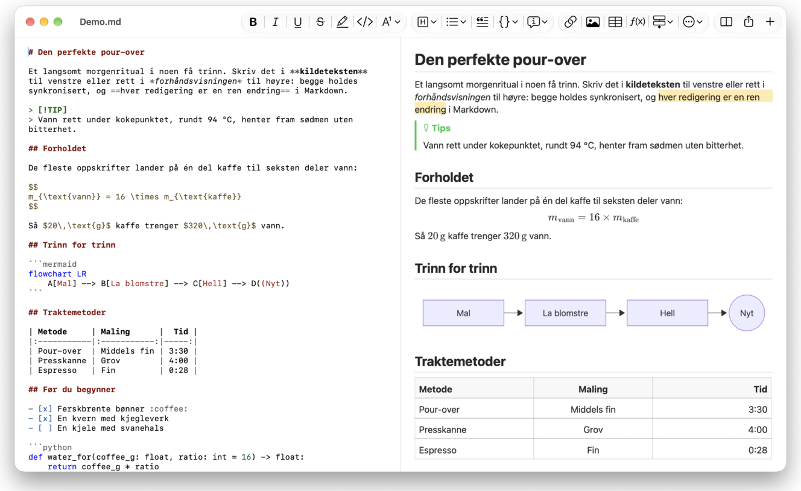
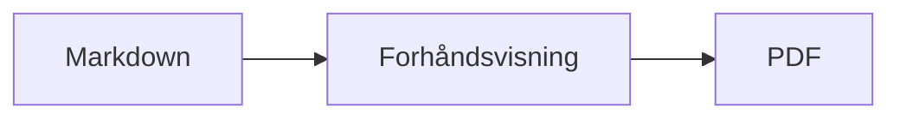

<p>&nbsp;&nbsp;&nbsp;</p>

# Splat

**Markdown-editoren for macOS der du skriver i kildeteksten eller rett i forhåndsvisningen.**

Splat viser Markdown-kildeteksten din med syntaksfarger til venstre og en levende, fullt redigerbar forhåndsvisning til høyre. Skriv i den ene eller den andre: det du skriver i forhåndsvisningen, blir til en minimal endring i kildeteksten, så linjer du ikke har rørt, forblir byte for byte like, og Git-diffene dine holder seg ryddige. Splat leser den Markdownen du allerede bruker: CommonMark og GitHub Flavored Markdown, GitHub-varsler, Obsidians wikilenker, innbygginger og infobokser, utvidelser fra Pandoc og Typora, innebygd HTML, LaTeX-formler og diagrammer i Mermaid, Graphviz og PlantUML, alt gjengitt uten nett. Bla gjennom og søk i en hel mappe med notater, se hva som er endret siden siste Git-commit, lim inn fra Word eller en nettside som Markdown, og eksporter til PDF, HTML eller Word med ett klikk. Appen er skrevet i Rust på ekte AppKit-kontroller, finnes på 35 språk og sender ingenting over nettverket med mindre du ber om det.
 


[](https://github.com/sventmueller/splat/releases/latest/download/Splat.dmg)

**[Last ned Splat.dmg](https://github.com/sventmueller/splat/releases/latest/download/Splat.dmg)**: signert og notarisert av Apple, for macOS 14 eller nyere på Apple Silicon og Intel.

**Fant du en feil?** Splat holder linjene du ikke har rørt, byte for byte like. Hvis en likevel endrer seg, eller en fil vises feil, kan du [opprette et issue](https://github.com/sventmueller/splat/issues/new/choose) og legge ved filen. Hvis du har nytte av Splat, hjelper en [stjerne på GitHub](https://github.com/sventmueller/splat) andre med å finne det.
 
 

[](https://www.rust-lang.org)
[](https://www.apple.com/macos/)

[](https://github.com/madsmtm/objc2)
[](https://webkit.org)
[](https://github.com/kivikakk/comrak)
[](https://github.github.com/gfm/)
[](https://www.mathjax.org)
[](https://cortexjs.io/mathlive/)
[](https://mermaid.js.org)
[](https://graphviz.org)
[](https://plantuml.com)


[](#lisens)

[Bahasa Indonesia](../id/README.md) ·
[Bahasa Melayu](../ms/README.md) ·
[Català](../ca/README.md) ·
[Čeština](../cs/README.md) ·
[Dansk](../da/README.md) ·
[Deutsch](../de/README.md) ·
[English](../../../README.md) ·
[Español](../es/README.md) ·
[Français](../fr/README.md) ·
[Hrvatski](../hr/README.md) ·
[Italiano](../it/README.md) ·
[Magyar](../hu/README.md) ·
[Nederlands](../nl/README.md) ·
**Norsk** ·
[Polski](../pl/README.md) ·
[Português (Brasil)](../pt_BR/README.md) ·
[Português (Portugal)](../pt_PT/README.md) ·
[Română](../ro/README.md) ·
[Slovenčina](../sk/README.md) ·
[Slovenščina](../sl/README.md) ·
[Suomi](../fi/README.md) ·
[Svenska](../sv/README.md) ·
[Tiếng Việt](../vi/README.md) ·
[Türkçe](../tr/README.md) ·
[Ελληνικά](../el/README.md) ·
[Русский](../ru/README.md) ·
[Українська](../uk/README.md) ·
[עברית](../he/README.md)‎ ·
[العربية](../ar/README.md)‎ ·
[हिन्दी](../hi/README.md) ·
[ไทย](../th/README.md) ·
[한국어](../ko/README.md) ·
[日本語](../ja/README.md) ·
[简体中文](../zh-Hans/README.md) ·
[繁體中文](../zh-Hant/README.md)

## Innhold

- [Funksjoner i korte trekk](#funksjoner-i-korte-trekk)
- [Krav](#krav)
- [Installasjon](#installasjon)
- [Kom i gang](#kom-i-gang)
- [Skrive](#skrive)
  - [I kildeteksten](#i-kildeteksten)
  - [I forhåndsvisningen](#i-forhåndsvisningen)
  - [Formateringskommandoer](#formateringskommandoer)
  - [Lister og oppgaver](#lister-og-oppgaver)
  - [Tabeller](#tabeller)
  - [Lime inn formatert tekst](#lime-inn-formatert-tekst)
  - [Metadata](#metadata)
- [Støttet Markdown](#støttet-markdown)
  - [CommonMark og GitHub Flavored Markdown](#commonmark-og-github-flavored-markdown)
  - [Infobokser](#infobokser)
  - [Utvidet syntaks](#utvidet-syntaks)
  - [Obsidian](#obsidian)
  - [Siteringer og referanser](#siteringer-og-referanser)
  - [Innebygd HTML](#innebygd-html)
  - [Typografisk tegnsetting](#typografisk-tegnsetting)
  - [Syntaksoversikt](#syntaksoversikt)
- [Formler](#formler)
- [Diagrammer](#diagrammer)
- [Bilder](#bilder)
- [Lenker og navigasjon](#lenker-og-navigasjon)
- [Notater i en mappe](#notater-i-en-mappe)
- [Endringer siden siste commit](#endringer-siden-siste-commit)
- [Eksportere, skrive ut og dele](#eksportere-skrive-ut-og-dele)
- [Importere Word-dokumenter](#importere-word-dokumenter)
- [Utseende og tilgjengelighet](#utseende-og-tilgjengelighet)
- [Språk](#språk)
- [Hurtigtaster](#hurtigtaster)
- [Personvern og sikkerhet](#personvern-og-sikkerhet)
- [Store dokumenter](#store-dokumenter)
- [Kjente begrensninger](#kjente-begrensninger)
- [Feilsøking](#feilsøking)
- [For utviklere](#for-utviklere)
  - [Tredjepartskomponenter](#tredjepartskomponenter)
- [Lisens](#lisens)

## Funksjoner i korte trekk

- **To måter å skrive på, én tekst.** Kildetekst og forhåndsvisning kan begge redigeres. Markdown-filen er den eneste sannheten: det finnes én angrehistorikk per dokument, og hver redigering i forhåndsvisningen oversettes til den minste mulige endringen i kildeteksten.
- **Markdownen du allerede bruker.** CommonMark, GitHub Flavored Markdown, GitHub-varsler, utvidelser fra Obsidian, Pandoc og Typora, emoji-kortkoder, spoilere, definisjonslister, overskriftsankere og HTML som i GitHub-README-filer.
- **Formler og diagrammer innebygd.** LaTeX-formler via MathJax, med en visuell formelredigerer. Diagrammer i Mermaid, Graphviz og PlantUML, gjengitt på Macen din uten Java, tjener eller nettforbindelse.
- **En knapp for alt.** Hver Markdown-konstruksjon har en verktøylinjeknapp og et menyvalg, de vanligste også en hurtigtast. Tabeller har en egen meny for rader, kolonner og justering.
- **En mappe, ikke bare en fil.** Sidefeltet viser notatene rundt et dokument og søker i alle sammen. Når du endrer navn på et notat, endres lenkene til det, og hver byte rundt dem blir stående.
- **Endringer med ett blikk.** I et Git-repositorium markerer streker ved siden av teksten det som avviker fra siste commit, i begge rutene.
- **Fra Word og nettet til Markdown.** Lim inn formatert tekst som Markdown og celler fra et regneark som en tabell, og importer hele Word-dokumenter med bildene sine.
- **Eksport uten tap.** PDF, én enkelt selvstendig HTML-fil eller et Word-dokument med ekte overskrifter, lister, tabeller, fotnoter og bilder. Legg til sidetall, topptekster og en tittelside, eller bruk bedriftens Word-mal.
- **Native helt inn i margen.** Ekte AppKit-vinduer, faner, menyer, popovere, Versjoner, Lagre automatisk, delingsmenyen, mørk modus, stavekontroll, diktering og VoiceOver. Ingen Electron, ingen nettvisning for selve teksten.
- **Rask med store filer.** Å gjengi et tastetrykk i et dokument på 10 MB tar rundt 10 ms, før visningens eget arbeid.
- **Privat og varsom.** Bilder fra nettet lastes først etter at du har tillatt det, lenker til andre apper spør først, og alt som dekoder upålitelige bildedata, kjører i helperprosesser i en sandkasse.
- **På ditt språk.** Grensesnittet og den innebygde Markdown-hurtigreferansen finnes på 35 språk: arabisk, katalansk, kinesisk (forenklet), kinesisk (tradisjonelt), kroatisk, tsjekkisk, dansk, nederlandsk, engelsk, finsk, fransk, tysk, gresk, hebraisk, hindi, ungarsk, indonesisk, italiensk, japansk, koreansk, malayisk, norsk, polsk, portugisisk (Brasil), portugisisk (Portugal), rumensk, russisk, slovakisk, slovensk, spansk, svensk, thai, tyrkisk, ukrainsk og vietnamesisk.

## Krav

- macOS 14 Sonoma eller nyere. Splat er utviklet og testet på macOS 27, der appen automatisk tar i bruk designet Liquid Glass.
- En Mac med Apple Silicon eller en Intel-prosessor.
- Rundt 45 MB diskplass.

## Installasjon

**Fra diskbildet.** Last ned [`Splat.dmg`](https://github.com/sventmueller/splat/releases/latest/download/Splat.dmg), åpne det og dra Splat til Apper-mappen. Bildet er signert med en Developer ID og notarisert av Apple, så det åpnes uten advarsler.

**Med Homebrew.** Cask-pakken ligger i en egen tap:

```sh
brew install --cask sventmueller/tap/splat
```

`brew upgrade --cask splat` installerer nye versjoner, og `brew uninstall --zap --cask splat` fjerner også innstillingene og bufferne til Splat.

**Oppdateringer.** Splat fra diskbildet eller Homebrew holder seg selv oppdatert med [Sparkle](https://sparkle-project.org). Ved andre oppstart spør appen om den én gang om dagen får søke etter oppdateringer på egen hånd. **Splat › Søk etter oppdateringer…** søker med en gang; **Søk etter oppdateringer automatisk** og **Last ned og installer oppdateringer automatisk** i den samme menyen endrer valget ditt senere. Splat installerer en oppdatering bare hvis den har utviklerens signatur. Et bygg du har laget selv, har ingen oppdaterer.

**Fra kildekoden.** Se [Bygging](../../../docs/development.md#building) for forutsetningene, og kjør deretter:

```sh
make build
ditto target/release/Splat.app /Applications/Splat.app
open /Applications/Splat.app
```

For å åpne Markdown-filer med Splat ved dobbeltklikk markerer du en vilkårlig `.md`-fil i Finder, velger **Fil › Vis info**, velger Splat under **Åpne med** og klikker på **Endre alle…**. Splat registrerer seg selv for filene `.md`, `.markdown`, `.mdown` og `.mkd`.

## Kom i gang

### Vinduet

Hvert dokument åpnes i sitt eget vindu, eller som en fane hvis du foretrekker faner:

- **Til venstre: kildeteksten.** Markdownen din i SF Mono med syntaksfarger.
- **Til høyre: forhåndsvisningen.** Det gjengitte dokumentet, klart til redigering.
- **Sidefelt (valgfritt).** Alle overskrifter som et tre, et klikk på en av dem viser den i begge rutene: **Vis › Vis disposisjon** (⌃⌘S). To faner til rommer [notatene i mappen](#notater-i-en-mappe) og et søk i dem.
- **Verktøylinje.** Knapper gruppert etter det de endrer: tegn, avsnitt og innsatte elementer, deretter forhåndsvisning av/på, Del og Nytt dokument. Tilpass den med **Vis › Tilpass verktøylinje…**.

Dra i skillelinjen for å gi den ene siden mer plass. **Vis › Skjul forhåndsvisning** (⌥⌘P) lar bare kildeteksten stå igjen; Splat husker dette per vindu. Begge rutene ruller sammen, og en markering i den ene ruten utheves i den andre.

Hjørnet av vinduet viser ordene og tegnene i teksten og hvor lang tid den tar å lese, og det samme for markeringen så lenge det finnes en. Lenkeadresser, HTML-tagger, metadata, kommentarer, formler og diagrammer teller ikke. **Vis › Skjul antall ord** fjerner visningen.

### Dokumenter, faner og versjoner

Splat er en vanlig dokumentapp for macOS:

- **Lagre automatisk og Versjoner.** Endringer lagres direkte i filen. **Fil › Tilbakestill til › Bla gjennom alle versjoner…** tar deg tilbake i tid.
- **Endringer fra andre programmer.** Når Git, et skript eller en annen editor endrer et åpent dokument, laster Splat det på nytt og beholder markøren og rulleposisjonen. Har du ulagrede endringer selv, beholder Splat dem, og macOS spør før den lagrer over den andre versjonen.
- **De vanlige filkommandoene.** Dupliser (⇧⌘S), Endre navn…, Flytt til… og **Fil › Åpne sist brukte**.
- **Faner.** **Fil › Ny fane** eller **+**-knappen i verktøylinjen åpner et nytt dokument som en fane; den vanlige Vindu-menyen slår sammen, flytter og blar mellom faner.
- **Vindusplassering.** Størrelsen og plasseringen til det siste vinduet ditt huskes, også etter omstart. Står det allerede et vindu der, åpnes det nye litt forskjøvet.
- **Dock-ikonet.** Et klikk på det etter at du har lukket det siste vinduet, åpner et nytt dokument.
- **Åpne Markdown-filer i Splat.** **Splat › Angi som standardapp for Markdown** gjør at et dobbeltklikk på en `.md`- eller `.markdown`-fil åpner Splat; macOS ber om bekreftelse én gang. Valget har et hakemerke så lenge Splat er standardappen.

Filer må være UTF-8-tekst, eller UTF-16 med byte order mark. Splat avviser andre kodinger i stedet for å gjette og ødelegge teksten. En byte order mark blir stående, UTF-16 forblir UTF-16, og i en fil der alle linjer slutter med CRLF, får linjene du legger til, også CRLF.

**Etter et krasj** går i verste fall bare de siste sekundene med skriving tapt: hvert femte sekund kopierer Splat ulagret tekst til `~/Library/Application Support/Splat/Unsaved` og fjerner kopiene når et dokument er lagret eller Splat avsluttes normalt. Ved neste oppstart flyttes det et krasj lot ligge der, til `~/Library/Application Support/Splat/Recovery`, og det sies fra om én gang, med en knapp som åpner mappen. Et krasj som Splat fortsatt kan reagere på, skriver dessuten teksten i hvert åpent dokument dit.

### Hurtigreferanse

**Hjelp › Markdown-hurtigreferanse** åpner et jukseark på ditt språk som et nytt, navnløst dokument. Det er et helt vanlig dokument, så prøv alt rett der, i kildeteksten eller i forhåndsvisningen.

## Skrive

### I kildeteksten

Kildeteksten er en ren tekstredigerer som er skreddersydd for Markdown:

- **Syntaksfarger** som i VS Code: overskrifter, utheving, lenker, kode, tabeller, HTML, front matter, og LaTeX og Mermaid inne i formler og diagrammer. Det finnes paletter for lys modus, mørk modus og Øk kontrast.
- **Kodeblokker med gjerder** utheves for Bash, C, C++, C#, CSS (også SCSS og Less), Go, HTML, XML, Java, JavaScript, JSON, Kotlin, PHP, Python, Ruby, Rust, SQL, Swift, TypeScript, YAML, TeX og Mermaid, også med de vanlige kortnavnene som `js`, `py` eller `sh`.
- **Ingen uventede erstatninger.** Smarte anførselstegn, smarte tankestreker og teksterstatning er slått av som standard, fordi de ødelegger `--`, `---` og `"`. Slå dem på under **Rediger › Automatiske endringer**.
- **Skriveverktøyene i systemet.** Stave- og grammatikkontroll, diktering, Søk og erstatt (⌥⌘F) og tale.
- **Dra og slipp.** Slipp en bildefil for å sette inn ``, en hvilken som helst annen fil for å sette inn en lenke til den, og en URL for å sette inn `[url](url)`. Hver slipp er ett angretrinn.
- **Lim inn bilder.** Et bilde på utklippstavlen, for eksempel et skjermbilde, lagres som en PNG-fil ved siden av dokumentet (`Bilde 2026-10-29 13.09.07.png`) og settes inn som bilde. Dokumentet må være lagret én gang for dette.

### I forhåndsvisningen

Forhåndsvisningen oppfører seg som et tekstbehandlingsprogram, men alt du gjør i den, ender som Markdown:

- **Skriving.** Tegn som betyr noe i Markdown, som `*` eller `#`, escapes slik at de vises som du skrev dem.
- **Return** starter et nytt avsnitt eller et nytt listepunkt. **⌥Return** eller **⌃Return** setter inn et linjeskift.
- **Formatering ved markøren.** Står markøren på slutten av et ord, gjelder Halvfet, Kursiv og de andre tegnformatene det du skriver etterpå. Velg formatet på nytt for å avslutte det. Inne i et ord formateres hele ordet.
- **Tomme linjer.** Return på en tom linje legger til enda en tom linje, og Backspace fjerner den. I kildeteksten er hver ekstra tomme linje to blanke linjer til; andre Markdown-programmer viser dem som vanlig avsnittsavstand.
- **Angre** virker på tvers av begge rutene. Angretrinnene har navn («Angre Halvfet»), skriving er ett trinn per skriveøkt, og etter Angre og Utfør likevel ruller begge rutene til endringen.
- **Formler og diagrammer** vises som ferdige grafikker. Klikk på en, flytt markøren til den eller trykk Return på den for å åpne editoren (se [Formler](#formler) og [Diagrammer](#diagrammer)).
- **Innebygd HTML, innebygde notater og front matter** vises, men du redigerer dem i kildeteksten. Et klikk på dem setter markøren på det tilsvarende stedet der.

Alt Markdown ikke kan uttrykke, er blokkert i forhåndsvisningen: Font- og Farge-panelene, linjalen, og det å lime inn eller slippe formatert tekst og bilder. Innlimt HTML og RTF kommer inn som ren tekst, med mindre du velger [Lim inn som Markdown](#lime-inn-formatert-tekst).

### Formateringskommandoer

Hver kommando er tilgjengelig fra verktøylinjen, menylinjen og kontekstmenyen i begge rutene. Menyvalgene viser et hakemerke for formateringen ved markøren.

| Meny | Kommandoer |
|---|---|
| **Format › Font** | Halvfet, Kursiv, Understreket, Gjennomstreket, Uthev, Kode, Hevet tekst, Senket tekst |
| **Format › Overskrift** | Brødtekst, Overskrift 1 til 6 |
| **Format › Liste** | Punktliste, Nummerert liste, Oppgaveliste |
| **Format** | Sitat, Kodeblokk (Uten språk eller ett av 20 språk; endrer også språket til en eksisterende blokk), Infoboks (Notat, Tips, Viktig, Advarsel, Forsiktig; samme type igjen fjerner den), Rediger formel eller diagram…, Fjern formatering |
| **Sett inn** | Lenke…, Bilde…, Tabell…, Formel, Diagram (Flytskjema, Sekvensdiagram, Gantt-diagram), Innholdsfortegnelse, Fotnote, Skillestrek |
| **Tabell** | Sett inn rad over/under, Sett inn kolonne til venstre/høyre, Slett rad, Slett kolonne, Justering (Venstre, Sentrer, Høyre, Standard), Juster tabellkolonner |
| **Vis** | Skjul/Vis forhåndsvisning, Vis/Skjul disposisjon, Typografisk tegnsetting, Zoom inn/ut, Faktisk størrelse, verktøylinje, fanelinje, fullskjerm |

Understreking, utheving, hevet og senket tekst skrives som `<ins>`, `<mark>`, `<sup>` og `<sub>`, som GitHub også viser. Splat leser dessuten `<u>`, som GitHub fjerner, og de kortere formene `==uthevet==`, `^hevet^` og `~senket~`. GitHub viser `==` og `^` som skrevet og `~senket~` som gjennomstreking.

### Lister og oppgaver

- Return fortsetter en liste; Return på et tomt listepunkt avslutter den.
- **Tab** og **⇧Tab** rykker listepunkter inn og ut i forhåndsvisningen.
- Et klikk på en oppgaveboks i forhåndsvisningen veksler mellom `- [ ]` og `- [x]`.
- **Format › Liste** gjør de markerte avsnittene om til en liste eller endrer typen.

### Tabeller

- **Sett inn › Tabell…** spør etter antall rader (inkludert overskriftsraden) og kolonner.
- I forhåndsvisningen flytter **Tab** til neste celle, **⇧Tab** til forrige og **Return** til cellen under. Tab i den siste cellen legger til en rad.
- **Tabell**-menyen setter inn og sletter rader og kolonner og angir justeringen til en kolonne (⌘{, ⌘|, ⌘}).
- **Tabell › Juster tabellkolonner** fyller kildeteksten med mellomrom slik at kolonnene står på linje.

### Lime inn formatert tekst

**Rediger › Lim inn som Markdown** (⌃⌘V), som også finnes i kontekstmenyen i begge rutene, gjør innholdet på utklippstavlen om til Markdown ved markeringen, som ett angretrinn. ⌘V setter fortsatt inn ren tekst.

- **Fra en nettleser, Word, Google Docs, Confluence, Notater eller Pages:** overskrifter, halvfet, kursiv, understreking, gjennomstreking, hevet og senket tekst, lenker, lister med nestingen sin, sitater, kode og tabeller blir med.
- **Fra et regneark:** celler blir til en tabell med en overskriftsrad og høyrejusterte tallkolonner. Det samme gjelder tekst atskilt med tabulatorer, semikolon eller komma, hvis hver linje har like mange kolonner.
- **Bilder** med en nettadresse forblir lenker. Et bilde inne i den innlimte HTML-en blir til en fil ved siden av dokumentet, som må være lagret én gang for dette. Words midlertidige bildefiler blir ikke med, men den alternative teksten deres blir stående.
- **Lenker** beholder bare `http`, `https`, `mailto`, relative adresser og `#`-adresser; av alle andre lenker blir bare teksten igjen.

### Metadata

**Format › Rediger metadata…** eller et klikk på metadatalinjen øverst i forhåndsvisningen åpner et skjema med feltene i YAML-front matter. Felter kan endres, legges til og fjernes. Et felt med en liste beholder den som liste: verdiene står etter hverandre med komma mellom, og en verdi som inneholder komma, står i anførselstegn. Et nytt felt som heter `tags`, `aliases`, `keywords`, `categories`, `authors` eller `cssclasses`, blir også en liste. Nestede felter og tekst over flere linjer kan ses der og redigeres i kildeteksten.

Det skjemaet endrer, er ett angretrinn og når bare linjene til feltene du har endret: kommentarer, rekkefølgen, uvanlig avstand, anførselstegn og linjeslutt i alle andre forblir byte for byte like. Et dokument uten metadata får en blokk i begynnelsen.

## Støttet Markdown

Splat tolker teksten med [comrak](https://github.com/kivikakk/comrak), en parser som er kompatibel med CommonMark og GFM, og slår på de fleste utvidelsene den har. Alt nedenfor gjengis i forhåndsvisningen og i alle eksporter.

### CommonMark og GitHub Flavored Markdown

- Overskrifter (`#` og understreket), avsnitt, linjeskift, utheving, sterk utheving, kode i teksten, blokksitater, skillestreker.
- Punktlister, nummererte og nestede lister; oppgavelister.
- Lenker (i teksten, med referanse og automatiske), bilder, lenkereferansedefinisjoner.
- Kodeblokker med gjerder og med innrykk, med syntaksfarger.
- Tabeller med kolonnejustering.
- Gjennomstreking med `~~to tilder~~`.
- Fotnoter: `tekst[^1]` med `[^1]: Notatet.` et sted i dokumentet. Et klikk på merket hopper til notatet.
- YAML front matter mellom `---`-linjer øverst. Forhåndsvisningen oppsummerer det i én linje, for eksempel «Metadata: title, date, tags».

### Infobokser

GitHub-varsler gjengis som fargede bokser med ikon og tittel:

```markdown
> [!NOTE]
> Nyttig informasjon som brukere bør kjenne til.

> [!WARNING]
> Kritisk innhold som krever umiddelbar oppmerksomhet.
```

De fem typene er Notat, Tips, Viktig, Advarsel og Forsiktig. **Format › Infoboks** gjør avsnittet ved markøren om til en slik boks.

Obsidians infobokser fungerer også, med en vilkårlig tittel og en foldetilstand:

```markdown
> [!tip]- Klikk ▸ for å vise
> Skjult til den åpnes.

> [!question]+ Åpen som standard
> Et `+` starter utvidet, et `-` sammenfoldet.
```

Obsidians øvrige typer vises i den nærmeste av de fem fargene: `success`, `check`, `done` og `hint` som Tips; `question`, `help` og `faq` som Viktig; `attention` som Advarsel; `failure`, `fail`, `missing`, `danger`, `error` og `bug` som Forsiktig; alt annet som Notat.

### Utvidet syntaks

| Funksjon | Syntaks | Fra |
|---|---|---|
| Utheving | `==markert tekst==` | Obsidian, Typora |
| Hevet tekst | `x^2^` | Pandoc, Typora |
| Senket tekst | `H~2~O` | Pandoc, Typora |
| Emoji-kortkode | `:rocket:` blir til 🚀 | GitHub |
| Spoiler | `\|\|skjult tekst\|\|`, merk den for å lese den | Discord |
| Fotnote i teksten | `tekst^[selve notatet]` | Pandoc, Obsidian |
| Definisjonsliste | `Begrep`, tom linje, `: Forklaring` | PHP Markdown Extra, Pandoc |
| Overskriftsanker | `## Installer {#setup}`, lenk med `[se](#setup)` | Pandoc, kramdown |

Definisjonslister ser slik ut i kildeteksten:

```markdown
Begrep

: Forklaring av begrepet.
```

Uten et eget anker får hver overskrift et som er avledet av teksten, som på GitHub: `## Kom i gang` nås som `#kom-i-gang`.

### Obsidian

- **Wikilenker.** `[[Notat]]` lenker til `Notat.md` i samme mappe eller en mappe under. `[[Notat|Vist tekst]]` viser din egen tekst, og `[[Notat#Overskrift]]` åpner notatet. ⌘-klikk åpner det i Splat.
- **Innbygginger.** `![[Notat]]` viser det andre notatet inne i dette; notater som er bygd inn i det, vises som lenker. `![[diagram.png]]` viser et bilde. Som i Obsidian navngir innbygginger notater og bilder i dokumentets mappe eller under, aldri med en absolutt sti, og bare Markdown-filer vises som notater.
- **Kommentarer.** `%%Bare i kildeteksten%%` forblir synlig i kildeteksten og utelates fra forhåndsvisningen og alle eksporter, både i teksten og på egne linjer.
- **Tagger.** `#idé` eller `#prosjekt/splat` utheves. ⌘-klikk søker etter taggen i dokumentet og, i sidefeltet, i hele mappen.
- **Sammenleggbare infobokser.** Se [Infobokser](#infobokser).

### Siteringer og referanser

- **Pandoc-siteringer.** `[@doe2020]` eller `[@doe2020; @roe2021]` leses som «(Doe 2020; Roe 2021)». Oppføringene hentes fra BibTeX-filen som front matter angir med `bibliography: refs.bib`. Uten den bruker Splat `references.bib`, `literatur.bib` eller `bibliography.bib` ved siden av dokumentet.
- **GitHub- og GitLab-referanser.** Ligger dokumentet i et Git-repositorium der `origin`-remoten ligger på github.com eller en GitLab-vert, utheves `@navn`, `#12` (issue) og `!7` (merge request, bare GitLab). ⌘-klikk åpner dem i nettleseren.

### Innebygd HTML

HTML slik du finner den i GitHub-README-filer, gjengis, med en egen leser i stedet for en nettlesermotor:

- sentrerte avsnitt og blokker (`<p align="center">`, `<div align="center">`)
- bilder med størrelse (``)
- lenker, `<kbd>⌘</kbd>`, `<br>`, `<u>`, `<ins>`, `<mark>`, `<sup>`, `<sub>`
- lister og tabeller, også celler som spenner over flere kolonner (`colspan`)
- sammenleggbare deler: `<details><summary>Mer</summary>…</details>`, som åpnes med et klikk på ▸

Markdown mellom HTML-tagger gjengis som Markdown. Skript, stiler, rammer og skjemaer utelates helt, og lenker og bilder beholder bare `http`, `https`, `mailto` og relative adresser.

### Typografisk tegnsetting

**Vis › Typografisk tegnsetting** viser rette anførselstegn som anførselstegnene i grensesnittspråket ditt, `--` som en kort tankestrek, `---` som en lang tankestrek og `...` som en ellipse. På tysk blir `"Ja"` til „Ja“, på fransk «Oui», på japansk 「はい」, også der kinesisk og japansk setter anførselstegn uten mellomrom; hebraiske forkortelser som `צה"ל` får sin gershayim, צה״ל. Kildeteksten beholder de rene tegnene; forhåndsvisningen og alle eksporter viser de typografiske. Innstillingen er av til du slår den på.

### Syntaksoversikt

| Element | Markdown |
|---|---|
| **Halvfet** | `**Halvfet**` |
| *Kursiv* | `*Kursiv*` |
| Understreket | `<ins>Understreket</ins>` eller `<u>Understreket</u>` |
| ~~Gjennomstreket~~ | `~~Gjennomstreket~~` |
| Uthev | `<mark>Uthev</mark>` eller `==Uthev==` |
| `Kode` | `` `Kode` `` |
| x² | `x<sup>2</sup>` eller `x^2^` |
| H₂O | `H<sub>2</sub>O` eller `H~2~O` |
| [Lenke](https://example.com) | `[Lenke](https://example.com)` |
| Overskrift | `# Overskrift` til `###### Overskrift` |
| Sitat | `> Sitat` |
| Punktliste | `- Punkt` |
| Nummerert liste | `1. Punkt` |
| Oppgave | `- [ ] Åpen` og `- [x] Ferdig` |
| Kodeblokk | ```` ```rust ```` … ```` ``` ```` |
| Tabell | `\| A \| B \|` med `\|---\|---\|` under overskriftsraden |
| Fotnote | `Tekst[^1]` og `[^1]: Notat` |
| Skillestrek | `---` |
| Bilde | `` |
| Formel | `$E = mc^2$`, `$$ … $$` |
| Diagram | ```` ```mermaid ````, ```` ```dot ````, ```` ```plantuml ```` |
| Infoboks | `> [!TIP]` |
| Wikilenke | `[[Notat]]`, `[[Notat\|Tekst]]` |
| Innbygging | `![[Notat]]`, `![[bilde.png]]` |
| Kommentar | `%%Kommentar%%` |
| Tagg | `#tagg` |
| Sitering | `[@nøkkel]` |
| Spoiler | `\|\|Spoiler\|\|` |
| Emoji | `:tada:` |

## Formler

Formler gjengis av [MathJax](https://www.mathjax.org) med TeX og AMS-matematikk, som skarpe vektorgrafikker. Tekst i `\text{…}` kan være i et hvilket som helst skriftsystem: det MathJax' fonter mangler, hentes fra fontene på Macen din, der arabisk og hebraisk går fra høyre mot venstre og emoji vises i farger.

| Type | Syntaks |
|---|---|
| I teksten | `$E = mc^2$`, `` $`E = mc^2`$ `` (GitHub, GitLab), `\(E = mc^2\)` |
| Frittstående | `$$` … `$$`, `\[` … `\]`, eller en kodeblokk merket `math` |

**Redigere en formel.** Klikk på en formel i forhåndsvisningen, dobbeltklikk på den, trykk Return på den eller flytt markøren til den for å åpne editoren i en popover. **Sett inn › Formel** setter inn en ny og åpner editoren med en gang.

- **Visuell eller LaTeX.** Bryteren øverst skifter mellom en visuell editor ([MathLive](https://cortexjs.io/mathlive/)) og LaTeX-koden. Splat husker valget ditt.
- **Byggeklosser** for brøk, kvadratrot, hevet og senket tekst, sum og integral med grenser, grenseverdi, parenteser som vokser med innholdet, 2×2-matrise, greske bokstaver, og relasjoner, operatorer og piler. De etterlater plassholdere □, og **Tab** hopper til neste.
- **Direkte forhåndsvisning.** Endringene vises i dokumentet mens du skriver. Feil fra MathJax vises i en linje under koden.
- **Ta imot eller forkast.** Et klikk utenfor beholder endringen som ett angretrinn; **Esc** eller **Avbryt** kaster den. Esc i en ny, tom formel fjerner den igjen.
- Kontekstmenyen har **Rediger formel…** for formelen under pekeren.

VoiceOver leser en formel som LaTeX-koden. Splat gjengir formler, ikke fullstendige LaTeX-dokumenter: det finnes ingen pakker, ingen TikZ og ingen `\documentclass`.

## Diagrammer

Diagrammer gjengis i Splat, uten nett og i en lys og en mørk variant.

| Motor | Kodeblokk | Hva den tegner |
|---|---|---|
| [Mermaid](https://mermaid.js.org) | ```` ```mermaid ```` | flytskjemaer, sekvens-, klasse-, tilstands-, entitetsrelasjons- og Gantt-diagrammer, sektordiagrammer, tankekart, tidslinjer og alle andre Mermaid-typer |
| [Graphviz](https://graphviz.org) | ```` ```dot ```` eller ```` ```graphviz ```` | grafer i DOT-språket |
| [PlantUML](https://plantuml.com) | ```` ```plantuml ```` eller ```` ```puml ```` | UML-diagrammer; kjører uten Java |



**Redigere et diagram** fungerer som å redigere en formel: klikk på det for å åpne koden i en popover, med syntaksfarger og feilmeldinger i en linje under koden. **Sett inn › Diagram** starter fra en mal for et flytskjema, et sekvensdiagram eller et Gantt-diagram. Byggeklosser hjelper med de tre vanligste Mermaid-typene:

- **Flytskjema:** Node ▾ (rektangel, avrundet, sirkel, rombe, database), Forbindelse, Forbindelse med etikett, Gruppe, Retning ▾
- **Sekvensdiagram:** Deltaker, Melding, Svar, Notat, Sløyfe, Alternative forløp
- **Gantt-diagram:** Seksjon, Oppgave, Milepæl

Andre diagramtyper redigeres som kode. VoiceOver leser opp tittelen eller alternativteksten til et diagram.

Det første diagrammet etter oppstart tar rundt ett sekund, fordi gjengivelsesmotoren starter i bakgrunnen. Et diagram som bruker mer enn 10 sekunder, viser en feil, og gjengivelsesmotoren starter på nytt for det neste. PlantUML-motoren (3 MB) lastes først med det første PlantUML-diagrammet. En PlantUML-`!include` fra nettet er blokkert.

## Bilder

- **Lokale bilder** bruker stier relative til dokumentet: ``. Splat viser PNG, JPEG, GIF, WebP, BMP, SVG, HEIC, TIFF, AVIF og PDF.
- **Bilder fra nettet** forblir blokkert til du tillater dem: en linje over forhåndsvisningen forklarer at når de lastes, får serverne deres vite at og når du åpner dokumentet. **Last inn bilder** tillater dem for dette dokumentet; Splat husker valget per fil.
- **Størrelse.** `` angir størrelsen på et bilde; ellers tilpasses bildene bredden på forhåndsvisningen.
- **Endringer på disken.** Et bilde du erstatter, eller et som dukker opp etter at dokumentet navnga det, vises uten at du åpner dokumentet på nytt. Bilder fra nettet som feilet på grunn av nettverket, prøves igjen så lenge et dokument viser dem.
- **Minne.** Bilder vises med opptil 2560 piksler på den lengste siden, noe som også fyller en A4-side. De dekodes mindre når de fyller en åttedel av Macens minne, og mens macOS melder om minnepress.
- **Mørk modus.** Bilder med hvit bakgrunn dempes litt i den mørke forhåndsvisningen.
- **Lime inn og slippe.** Se [I kildeteksten](#i-kildeteksten).

## Lenker og navigasjon

I forhåndsvisningen setter et klikk markøren slik at du kan redigere lenketeksten; **⌘-klikk** følger lenken:

- `http`, `https` og `mailto` åpnes i nettleseren eller e-postappen din.
- Markdown-filer åpnes i Splat; andre filer og mapper vises i Finder.
- `#anker` hopper til overskriften i dokumentet.
- Adresser som åpner en annen app, som `slack://` eller `vscode://`, spør først og viser hele adressen og appen. **Avbryt** er forhåndsvalgt.

**Sett inn › Innholdsfortegnelse** setter inn en lenket liste over alle overskrifter. Står markøren inni den, oppdaterer den samme kommandoen listen. Disposisjonssidefeltet (⌃⌘S) hopper til en hvilken som helst overskrift i begge rutene.

## Notater i en mappe

Knappene øverst i sidefeltet bytter mellom disposisjonen, filene og et søk.

- **Filer** (**Vis › Vis filer**, ⌃⌘E). Alle Markdown-filer i dokumentets mappe eller, hvis dokumentet ligger i et Git-repositorium, i hele repositoriet. Et klikk eller Return åpner et notat som en fane i dette vinduet; er det allerede åpent, kommer det frem. Knappen ved siden av mappenavnet viser en annen mappe i dette vinduet. Skjulte filer, `node_modules`, `target`, `Pods`, `DerivedData`, `__pycache__` og mapper uten notater holdes utenfor. Et dokument som ligger rett i Hjem-mappen din, viser bare notatene ved siden av seg, slik at Splat ikke går gjennom alle mappene dine og spør om hver av dem.
- **Søk** (**Rediger › Finn › Søk i alle notater…**, ⇧⌘F). Finner tekst i alle notater, uansett store og små bokstaver og uansett hvordan aksentene er kodet. `#tag` finner en tagg, `#project` også `#project/splat`, og ingenting inne i kode. Et klikk på et treff åpner notatet på det stedet.
- **Lenker til et notat.** Kontekstmenyen til et notat viser notatene som lenker til det, med wikilenke, innbygging, relativ lenke eller lenkereferansedefinisjon.
- **Endre navn på et notat.** Samme meny endrer navnet og disse lenkene. Splat sier først hvor mange lenker i hvor mange filer det gjelder. Bare navnet endres i hver lenke, og alle andre byte i filen blir stående. Åpne dokumenter tar imot endringen som et angretrinn; i andre filer er det bare Git eller Versjoner som kan ta den tilbake. En fil som et annet program har endret i mellomtiden, stopper navneendringen for alle lenker, og Splat navngir den.

Listen følger mappen når vinduet kommer frem. Søket ser på filene slik de ligger på disken, og tekst du ennå ikke har lagret, teller fra neste automatiske lagring.

## Endringer siden siste commit

I et dokument i et Git-repositorium markerer streker ved siden av teksten det som avviker fra siste commit, i kildeteksten og i forhåndsvisningen: grønt for tilføyde linjer, blått for endrede linjer og et kort rødt merke der noe er fjernet. De følger med mens du skriver og når grenen flytter seg. **Vis › Endringer siden siste commit** slår dem av for alle vinduer.

Linjer som bare skiller seg i linjeslutten, teller ikke, så en fil med CRLF mot en commit med LF viser ingen endring. En ny fil har ingen merker før sin første commit, og det har heller ikke et dokument over 32 MB.

## Eksportere, skrive ut og dele

| Format | Slik gjør du det | Det du får |
|---|---|---|
| **PDF** | **Fil › Eksporter som PDF…** eller Del-menyen | Sider i papirstørrelse, alltid i lyst utseende, formler og diagrammer som vektorgrafikk. **Fil › Utskriftsformat…** angir papiret. |
| **Utskrift** | **Fil › Skriv ut…** (⌘P) | Den samme utformingen som i PDF-en. |
| **HTML** | **Fil › Eksporter som HTML…** eller Del-menyen | Én selvstendig fil: lokale bilder innebygd, formler og diagrammer som skarpe bilder, overskriftsankere slik at innholdsfortegnelsen fungerer. Ingen skript. |
| **Word** | **Fil › Eksporter som Word-dokument…** eller Del-menyen | En `.docx` med Words overskriftsstiler, ekte lister og tabeller (også sammenslåtte celler), fotnoter som Word-fotnoter, innebygde bilder, formler og diagrammer. |
| **Markdown** | **Del**-knappen i verktøylinjen | Dokumentet som en `.md`-fil for Mail, Meldinger, AirDrop og alle andre delingstjenester. |

Menyen **Fil › Del** har alle disse på ett sted. Eksportene bruker innstillingen for typografisk tegnsetting og bildene du har tillatt fra nettet; bilder fra nettet forblir lenker i HTML.

**Fil › Eksportvalg…** angir hva PDF, utskrift og Word legger til teksten, for alle dokumenter:

- **Sidetall** i bunnteksten i PDF og utskrift, som `2 / 9`.
- **Topptekst og bunntekst** for PDF og utskrift. `{title}`, `{author}`, `{date}`, `{page}` og `{pages}` står for verdiene sine, de tre første fra dokumentets metadata.
- **En tittelside** for PDF, utskrift og Word, med `title`, `subtitle`, `author` og `date` fra metadataene, eller dokumentets navn som tittel. Den har verken topptekst eller bunntekst.
- **En Word-mal**, en `.docx` eller `.dotx` som eksporten overtar utseendet til: stilene, også med lokaliserte navn, temaet, papirstørrelsen, margene, topptekstene og bunntekstene. En mal som ikke kan leses, stopper eksporten og sier fra om det, i stedet for å gi deg et dokument uten den.

## Importere Word-dokumenter

**Fil › Importer Word-dokument…** spør etter en `.docx`- eller `.dotx`-fil og hvor Markdownen skal, og åpner deretter resultatet. Bilder havner i en mappe ved siden av, oppkalt etter dokumentet med `-images`.

Overskrifter og lister kommer gjennom slik Words stiler og nummerering definerer dem, også i dokumenter der stilene har lokaliserte navn. Halvfet, kursiv, understreking, gjennomstreking, utheving, hevet og senket tekst, lenker, sitater, kode, fotnoter, sluttnoter og tabeller blir med, celler som strekker seg over kolonner, som en HTML-tabell. Formler blir til LaTeX. Sporede endringer regnes som godtatt, og en innholdsfortegnelse holdes utenfor, siden **Sett inn › Innholdsfortegnelse** lager en ny. Gamle `.doc`-filer og passordbeskyttede dokumenter avvises.

## Utseende og tilgjengelighet

- **Mørk modus** følger systemet. Formler og diagrammer gjengis for hvert utseende.
- **Øk kontrast** i Systeminnstillinger bytter syntaksfargene til paletter med høy kontrast.
- **Zoom.** ⌘+, ⌘− og ⌘0 skalerer begge rutene.
- **Fullskjerm, faner og en verktøylinje som kan tilpasses**, som i alle Mac-apper.
- **VoiceOver.** Rutene heter «Markdown-kildetekst» og «Forhåndsvisning», formler leses som koden sin og diagrammer som tittelen sin. Hver kommando kan nås fra tastaturet.

Splat har ikke noe innstillingsvindu: de få valgene ligger der de gjelder, i **Vis**, **Rediger › Automatiske endringer** og **Fil › Eksportvalg…**.

## Språk

Grensesnittet, menyene og Markdown-hurtigreferansen er oversatt til 35 språk:

arabisk, katalansk, kinesisk (forenklet), kinesisk (tradisjonelt), kroatisk, tsjekkisk, dansk, nederlandsk, engelsk, finsk, fransk, tysk, gresk, hebraisk, hindi, ungarsk, indonesisk, italiensk, japansk, koreansk, malayisk, norsk, polsk, portugisisk (Brasil), portugisisk (Portugal), rumensk, russisk, slovakisk, slovensk, spansk, svensk, thai, tyrkisk, ukrainsk og vietnamesisk.

Splat følger språkrekkefølgen i **Systeminnstillinger › Generelt › Språk og område**; der kan du også velge et språk bare for Splat under **Apper**. Finnes det ingen oversettelse for språket ditt, bruker appen engelsk. Menybegrepene følger Apples egne oversettelser, så Splat leses som resten av Macen din.

Hebraisk og arabisk tekst leses fra høyre mot venstre overalt der den vises, uansett grensesnittspråk: hvert avsnitt, hver overskrift og hvert listepunkt får retningen til sin første bokstav, sitater og infobokser tegner streken sin til høyre, og en tabell der teksten begynner fra høyre mot venstre, lister kolonnene sine fra høyre. Kodeblokker forblir venstre mot høyre. PDF-, HTML- og Word-eksportene beholder disse retningene. Med hebraisk eller arabisk som systemspråk speilvender macOS også vinduet, så forhåndsvisningen havner til venstre.

## Hurtigtaster

| Handling | Hurtigtast |
|---|---|
| Halvfet, Kursiv, Understreket | ⌘B, ⌘I, ⌘U |
| Gjennomstreket | ⇧⌘X |
| Lenke… | ⌘K |
| Brødtekst, Overskrift 1 til 6 | ⌥⌘0, ⌥⌘1 til ⌥⌘6 |
| Juster tabellkolonne til venstre, sentrert, til høyre | ⌘{, ⌘\|, ⌘} |
| Skjul eller vis forhåndsvisningen | ⌥⌘P |
| Vis eller skjul disposisjonen | ⌃⌘S |
| Vis eller skjul filene | ⌃⌘E |
| Søk i alle notater | ⇧⌘F |
| Lim inn som Markdown | ⌃⌘V |
| Zoom inn, ut, faktisk størrelse | ⌘+, ⌘−, ⌘0 |
| Nytt dokument, åpne, lagre, dupliser | ⌘N, ⌘O, ⌘S, ⇧⌘S |
| Utskriftsformat, skriv ut | ⇧⌘P, ⌘P |
| Finn, søk og erstatt | ⌘F, ⌥⌘F |
| Finn neste, forrige; bruk markering; gå til markering | ⌘G, ⇧⌘G; ⌘E; ⌘J |
| Vis stavekontroll og grammatikk; kontroller dokument | ⌘:, ⌘; |
| Lim inn og tilpass til stil | ⌥⇧⌘V |
| Skjul verktøylinje, vis alle faner, fullskjerm | ⌥⌘T, ⇧⌘\\, ⌃⌘F |
| Linjeskift (forhåndsvisning) | ⌥Return eller ⌃Return |
| Neste celle / forrige celle i en tabell (forhåndsvisning) | Tab / ⇧Tab |
| Rykk et listepunkt inn / ut (forhåndsvisning) | Tab / ⇧Tab |
| Neste plassholder i formelredigereren | Tab |
| Lukk formel- eller diagramredigereren uten endringer | Esc |
| Følg en lenke, tagg eller referanse (forhåndsvisning) | ⌘-klikk |

Splat lar Apples standard hurtigtaster stå i fred.

## Personvern og sikkerhet

En Markdown-fil kan komme fra hvem som helst, så Splat behandler hvert dokument som upålitelig.

- **Ingen nettverksbruk som standard.** Splat har ingen telemetri. Appen søker etter oppdateringer først når du har samtykket eller velger **Søk etter oppdateringer…**: da laster den en liten feedfil fra GitHub, og forespørselen nevner ikke annet enn appen og versjonen. Formler og diagrammer gjengis lokalt; nettvisningene som gjør det, kan ikke nå nettverket. **Hjelp › Rapporter et problem…** åpner et skjema på GitHub i nettleseren; adressen inneholder versjonen av Splat og macOS og typen Mac, ingenting fra dokumentene dine.
- **Bilder fra nettet** lastes først etter at du har gitt tillatelse, bare over `https`, aldri fra verter i det lokale nettverket ditt, på maksimalt 10 MB hver og i en privat økt uten informasjonskapsler.
- **Isolert dekoding.** Bilder og grafikken til formler og diagrammer dekodes i helperprosesser som lukker alle filer de har arvet og låser seg inn i en sandkasse før de leser den første byten: ingen filtilgang, ingen nettverk. De leverer bare tilbake piksler, hvis størrelse kontrolleres, og stoppes etter 10 sekunder. Apples egne bildedekodere ser bare HEIC, TIFF, AVIF og PDF, og bare når dataene faktisk har det formatet; de kjører i en helper for seg, som i tillegg kan lese systemets fontmapper og bruke systemets videodekoder. SVG-er, formler og diagrammer går også gjennom denne helperen, så de er bilder med fast oppløsning i Splat: fire piksler per punkt, opptil 2560 på den lengste siden.
- **Lokale filer** når et dokument bare via stien det navngir. Innbygginger viser Markdown-notater fra dokumentets mappe og nedover, og et manglende bilde letes det bare etter der. En bildesti andre steder, absolutt eller som begynner med `~`, lastes fortsatt i forhåndsvisningen; HTML- og Word-eksporter, utskrift og PDF-er tar bare med det som ligger i dokumentets mappe eller Git-repositoriet, med mindre det repositoriet også inneholder Hjem-mappen din, så et dokument fra noen andre ikke kan dra filene dine inn i en eksport du gir videre.
- **Mapper med notater** leses bare mens sidefeltet viser dem, og å endre navn på et notat endrer andre filer først etter at du har bekreftet hvor mange.
- **Git-repositorier** leses av Splat selv. Appen kjører aldri programmet `git`, hvis konfigurasjon i et repositorium fra noen andre kan starte andre programmer, og leser ikke mer enn versjonen av det åpne dokumentet i siste commit. Den skriver ingenting der og går ikke ut på nettverket.
- **Word-dokumenter og innlimt tekst** leses av Splats egne parsere, med grenser for størrelse, nesting og hvor mye en fil kan pakke seg ut. Lenker i dem beholder bare adressene Splat tillater ellers, og navnene på bilder i en Word-fil avgjør aldri hvor de skrives.
- **Kopier av ulagret tekst** blir på denne Macen, i Bibliotek-mappen din, for gjenopprettingen etter et krasj. De forsvinner ved lagring eller når Splat avsluttes normalt; kopiene et krasj etterlot, blir liggende i gjenopprettingsmappen til du sletter dem.
- **Lenker** starter aldri et program ved et klikk. Web- og e-postlenker åpnes som vanlig; lenker til andre apper spør først.
- **HTML i dokumenter** leses av Splats egen parser. Skript, stiler, rammer og skjemaer kjører aldri.
- **Eksporter** inneholder ingen skript. HTML-sider beholder bare en fast liste over harmløse tagger og attributter, som GitHub, pluss en content security policy. Word-filer lenker bare til adresser med `http`, `https` og `mailto`.
- **Kodesignering** med Hardened Runtime. Splat kjører uten App Sandbox, slik at appen kan vise bilder ved siden av dokumentene dine uten å spørre om hver mappe; isolasjonen av all dekoding veier opp for dette.

## Store dokumenter

Splat holder seg responsiv med dokumenter på flere megabyte:

- Kildeteksten bruker TextKit 2, som bare legger ut den synlige delen.
- Mens du skriver i forhåndsvisningen, og i kildeteksten i dokumenter på opptil 2 MB, blir bare de berørte avsnittene tolket, fargelagt og lagt ut på nytt. I et dokument på 10 MB tar tolking og fargelegging rundt 3 ms, gjengivelse rundt 10 ms, og et helt tastetrykk i forhåndsvisningen rundt 30 ms med visningens eget arbeid.
- Store forhåndsvisninger gjengir den synlige delen først og resten mens appen er ledig. Blokker som rulles inn i synsfeltet, gjengis før de tegnes.
- I kildeteksten til større dokumenter kjører tolkingen for forhåndsvisningen i bakgrunnen mens du skriver.
- Et dokument forblir ren tekst når det ville bruke omtrent 4 GB minne, som tilsvarer rundt 50 til 120 MB vanlig Markdown, men bare 10 til 20 MB hvis det bare består av tabeller eller overskrifter: kildeteksten har ingen farger, og forhåndsvisningen sier hvorfor den er tom. Eksport fungerer fortsatt.
- Fra rundt 200 KB åpner et dokument vinduet sitt før det er tolket; ved 5 MB følger fargene og forhåndsvisningen om lag et kvart sekund senere.
- Alle bilder til sammen, inkludert formler og diagrammer, tar høyst en fjerdedel av minnet til Macen og halvparten av det mens det er lite minne. Utover det vises flere bilder som plassholdere til det igjen er plass.

Noen endringer behandles i sin helhet, med rundt 300 ms per tastetrykk ved 10 MB: endringer i definisjonen av en fotnote eller i referansene til den, ved siden av en fotnote i teksten, helt på slutten av et dokument ved siden av en fotnote, i front matter eller i lenkereferansedefinisjoner, og hver endring i et dokument med `%%`-kommentarblokker eller med en fotnote som er definert to ganger eller inne i et sitat eller en liste. Minnebruken vokser med filen, til omtrent 115–160 MB for 1 MB Markdown og 340–510 MB for 10 MB.

## Kjente begrensninger

- **Enkelt tilde betyr senket tekst.** `~tekst~` er senket tekst som i Pandoc; gjennomstreking krever `~~to~~`. GitHub stryker også gjennom med én tilde.
- **Skrivebeskyttet i forhåndsvisningen:** innebygd HTML og innebygde notater redigeres i kildeteksten, front matter i skjemaet sitt eller i kildeteksten.
- **Svært dyp nesting:** HTML som er nestet dypere enn 64 nivåer, og HTML i teksten dypere enn 16, viker for innholdet sitt.
- **Sammenslåtte tabellceller** finnes bare i HTML-tabeller, og bare på tvers av kolonner (`colspan`, ingen `rowspan`). MultiMarkdowns tabellsyntaks for sammenslåtte celler støttes ikke.
- **Bibliografier** leses bare fra BibTeX, ikke fra CSL JSON eller YAML.
- **Referanser** krever et repositorium på github.com eller en GitLab-vert; `!7` finnes bare på GitLab.
- **Typografisk tegnsetting:** et tysk avsluttende enkelt anførselstegn kan ikke skilles fra en apostrof og settes som ’.
- **Formler, ikke dokumenter:** ingen LaTeX-pakker, TikZ eller fullstendige dokumenter.
- **Den visuelle formelredigereren** skriver LaTeX i MathLives notasjon: mellomrom forsvinner (`E = mc^2` blir til `E=mc^2`), gjengivelsen forblir den samme.
- **Antall ord:** thai, lao, khmer og burmesisk skrives uten mellomrom og telles per tekststykke, ikke per ord. `3.14` og `snake_case` er to ord hver.
- **Å endre navn på et notat** endrer ikke lenker i innebygd HTML, og en wikilenke forblir som den er hvis det nye navnet inneholder `#`, `|`, `^`, `[`, `]` eller `\`.
- **Endringsmerker** leser repositorier med SHA-1-objekter og vanlige eller pakkede referanser; et med SHA-256 eller reftable viser ingen. En fil under et Git-filter som LFS sammenlignes med det filteret har lagret.
- **Word-import** tar ikke med tekst i topptekster, bunntekster og kommentarer, og bilder som `.emz` eller SVG beholder bare den alternative teksten.
- **Lim inn som Markdown** leser RTF som vestlig tekst og henter overskrifter der bare fra skriftstørrelser. De fleste programmer tilbyr også HTML, som den foretrekker.
- **Av prinsipp:** ingen linjenumre, ikke noe innstillingsvindu, ingen Help Book, ikke i App Store.
- **Mindre testet på Intel.** Vindusselvtestene kjører bare på Apple Silicon; på Intel kjører CI `cargo test`.

## Feilsøking

**Listen over nylige dokumenter er tom etter at jeg har bygd Splat på nytt.** macOS knytter nylige dokumenter og mappetillatelser til appens kodesignatur. Lokale bygg signeres med sertifikatet «Splat Local Signing» i påloggingsnøkkelringen din, så nye bygg beholder begge deler. Hvis sertifikatet er slettet, lager neste bygg et nytt, og listene begynner på nytt én gang.

**Appen fra diskbildet viser andre nylige dokumenter enn mitt eget bygg.** De to har ulike signaturer, så macOS fører en egen liste og egne mappetillatelser for hver.

**HTML eller annen syntaks vises som ren kode.** Det kan være en utdatert kopi av Splat som åpnet dokumentet. Avslutt den, velg **Fil › Vis info** på dokumentet i Finder og kontroller at **Åpne med** navngir Splat i Apper-mappen din.

**Det finnes ingen Søk etter oppdateringer… i Splat-menyen.** Bare versjonen fra diskbildet eller Homebrew oppdaterer seg selv; et bygg du har laget selv, har ingen oppdaterer.

**Bilder fra nettet vises ikke.** Klikk på **Last inn bilder** i linjen over forhåndsvisningen. Bare `https`-bilder fra offentlige verter lastes.

**Når jeg limer inn et skjermbilde, blir jeg bedt om å lagre først.** Innlimte bilder lagres som filer ved siden av dokumentet, og det trengs et sted på disken. Lagre det, og lim deretter inn på nytt.

**«Filen er ikke UTF-8-tekst.»** Filen har en annen koding og har ingen byte order mark som navngir den. Konverter den først, for eksempel med `iconv -f ISO-8859-1 -t UTF-8 old.md > new.md`.

**En formel eller et diagram viser en feil.** Klikk på det: editoren viser meldingen fra MathJax, Mermaid, Graphviz eller PlantUML under koden.

## For utviklere

Bygging, testing, oppbygningen av koden og reglene den følger er beskrevet i [docs/development.md](../../../docs/development.md) (på engelsk).

### Tredjepartskomponenter

| Komponent | Versjon | Brukt til | Lisens |
|---|---|---|---|
| [comrak](https://github.com/kivikakk/comrak) | 0.59 med [én endret linje](../../../vendor/comrak/PATCH.md) | Markdown-parser | BSD-2-Clause |
| [objc2](https://github.com/madsmtm/objc2), objc2-foundation, block2 | 0.6 / 0.3 | Objective-C-kjøretid, Foundation, blokker | MIT |
| objc2-app-kit, objc2-web-kit, dispatch2 | 0.3 | bindinger til AppKit, WebKit og Grand Central Dispatch | Zlib, Apache-2.0 eller MIT |
| [krilla](https://github.com/LaurenzV/krilla), krilla-svg, [usvg](https://github.com/linebender/resvg) | 0.8 / 0.47 | formler og SVG-bilder som vektor-PDF | MIT eller Apache-2.0 |
| [image](https://github.com/image-rs/image) | 0.25 | dekoding av PNG, JPEG, GIF, WebP og BMP | MIT eller Apache-2.0 |
| [unicode-width](https://github.com/unicode-rs/unicode-width) | 0.2 | justering av tabellkolonner | MIT eller Apache-2.0 |
| [entities](https://github.com/p-jackson/entities) | 1 | navnene på HTML-tegnreferanser | MIT |
| [miniz_oxide](https://github.com/Frommi/miniz_oxide) | 0.9 | utpakking av Word-filer og Git-objekter | MIT, Zlib eller Apache-2.0 |
| [roxmltree](https://github.com/RazrFalcon/roxmltree) | 0.21 | lesing av XML-en i Word-filer | MIT eller Apache-2.0 |
| [unicode-normalization](https://github.com/unicode-rs/unicode-normalization) | 0.1 | navn og søk på tvers av sammensatte og oppdelte bokstaver | MIT eller Apache-2.0, Unicode-3.0 |
| [emojis](https://github.com/rossmacarthur/emojis) | 0.9 | holder tekst som ligner `:shortcode:`, bokstavelig i importert tekst | MIT eller Apache-2.0, Unicode-3.0 |
| [MathJax](https://www.mathjax.org) | 4.1.3 | gjengivelse av formler | Apache-2.0 |
| [MathLive](https://cortexjs.io/mathlive/) | 0.111.4 | visuell formelredigerer, med KaTeX-fonter | MIT |
| [Mermaid](https://mermaid.js.org) | 12.3.0 | Mermaid-diagrammer | MIT |
| [Viz.js](https://github.com/mdaines/viz-js) | 3.24.0 | Graphviz kompilert til WebAssembly, inneholder Graphviz (EPL-1.0) og Expat (MIT) | MIT |
| [PlantUML](https://github.com/plantuml/plantuml) (`@plantuml/core`) | 1.2026.9 | PlantUML-diagrammer, kompilert til JavaScript | MIT |
| [Sparkle](https://sparkle-project.org) | 2.10.1 | oppdateringer av diskbildeversjonen | MIT, med deler under BSD- og zlib-lisenser |

JavaScript-bibliotekene ligger i `resources/js/` nøyaktig slik de ble publisert; [vendor.lock](../../../vendor.lock) registrerer kildene og SHA-256-sjekksummene deres. Lisenstekstene deres, også de til Graphviz og Expat inne i Viz.js, ligger ved siden av dem som `resources/js/LICENSE-*` og følger med i appen. Sparkle er ikke lagret i repositoriet: `cargo xtask dmg` laster ned utgivelsen og kontrollerer den mot sjekksummen i xtask, og lisensen følger med i appen som `LICENSE-sparkle`.

## Lisens

Splat er lisensiert under enten

- Apache-lisensen, versjon 2.0 ([LICENSE-APACHE](../../../LICENSE-APACHE))
- MIT-lisensen ([LICENSE-MIT](../../../LICENSE-MIT))

etter eget valg.

Med mindre du uttrykkelig sier noe annet, skal ethvert bidrag som du bevisst sender inn for å bli tatt med i Splat, slik det er definert i Apache-2.0-lisensen, ha dobbel lisens som ovenfor, uten ytterligere vilkår.
