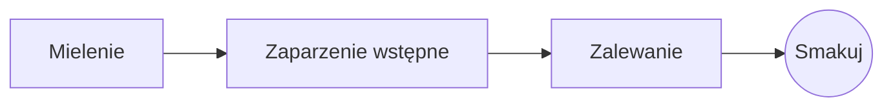

# Idealne parzenie przelewowe

Powolny poranny rytuał w kilku krokach. Pisz w **tekście źródłowym** po lewej albo wprost w *podglądzie* po prawej: oba pozostają zsynchronizowane, a ==każda zmiana jest czystą zmianą== w Markdown.

> [!TIP]
> Woda tuż po wrzeniu, około 94 °C, wydobywa słodycz bez goryczy.

## Proporcje

Większość przepisów zatrzymuje się na jednej części kawy na szesnaście części wody:

$$
m_{\text{woda}} = 16 \times m_{\text{kawa}}
$$

Czyli $20\,\text{g}$ kawy potrzebuje $320\,\text{g}$ wody.

## Krok po kroku



## Metody parzenia

| Metoda          | Mielenie       | Czas |
|:----------------|:--------------:|-----:|
| Przelew         | Średnio drobne | 3:30 |
| Prasa francuska | Grube          | 4:00 |
| Espresso        | Drobne         | 0:28 |

## Zanim zaczniesz

- [x] Świeżo palone ziarna :coffee:
- [x] Młynek żarnowy
- [ ] Czajnik z wąskim dzióbkiem

```python
def water_for(coffee_g: float, ratio: int = 16) -> float:
    return coffee_g * ratio
```

Zaparzenie wstępne
: Pierwszy chlust wody, dzięki któremu fusy uwalniają gaz.[^1]

[^1]: Świeże ziarna pęcznieją najbardziej; stare ledwo się unoszą.
