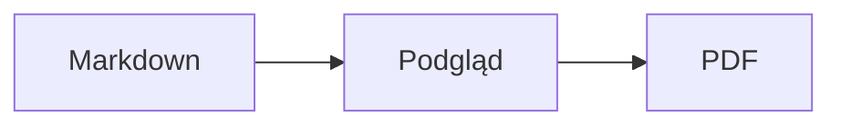

<p>&nbsp;&nbsp;&nbsp;</p>

# Splat

**Edytor Markdown dla macOS, w którym piszesz w tekście źródłowym albo wprost w podglądzie.**

Splat pokazuje po lewej tekst źródłowy Markdown z kolorowaniem składni, a po prawej działający na żywo, w pełni edytowalny podgląd. Pisz w dowolnym z nich: wszystko, co wpiszesz w podglądzie, trafia do tekstu źródłowego jako minimalna zmiana, więc nietknięte wiersze pozostają co do bajta takie same, a różnice w Git są czytelne. Splat rozumie Markdown, którego już używasz: CommonMark i GitHub Flavored Markdown, alerty GitHuba, łącza wiki, osadzenia i ramki informacyjne z Obsidiana, rozszerzenia Pandoc i Typory, osadzony HTML, wzory LaTeX oraz diagramy Mermaid, Graphviz i PlantUML, a wszystko to renderuje się offline. Eksport do PDF, HTML lub Worda jednym kliknięciem. Program napisano w Ruście na prawdziwych kontrolkach AppKit, mówi w 35 językach i niczego nie wysyła przez sieć, dopóki mu na to nie pozwolisz.
 


[](https://github.com/sventmueller/splat/releases/latest/download/Splat.dmg)

**[Pobierz Splat.dmg](https://github.com/sventmueller/splat/releases/latest/download/Splat.dmg)**: podpisany i poświadczony notarialnie przez Apple, dla macOS 14 lub nowszego na Apple Silicon i Intel.

**Trafił się błąd?** Splat zachowuje nietknięte wiersze co do bajta takie same. Jeśli któryś mimo to się zmieni albo plik wyświetla się błędnie, [otwórz zgłoszenie](https://github.com/sventmueller/splat/issues/new/choose) i dołącz plik. Jeśli Splat jest dla ciebie przydatny, [gwiazdka na GitHubie](https://github.com/sventmueller/splat) pomoże innym go znaleźć.
 
 

[](https://www.rust-lang.org)
[](https://www.apple.com/macos/)

[](https://github.com/madsmtm/objc2)
[](https://webkit.org)
[](https://github.com/kivikakk/comrak)
[](https://github.github.com/gfm/)
[](https://www.mathjax.org)
[](https://cortexjs.io/mathlive/)
[](https://mermaid.js.org)
[](https://graphviz.org)
[](https://plantuml.com)


[](#licencja)

[Bahasa Indonesia](../id/README.md) ·
[Bahasa Melayu](../ms/README.md) ·
[Català](../ca/README.md) ·
[Čeština](../cs/README.md) ·
[Dansk](../da/README.md) ·
[Deutsch](../de/README.md) ·
[English](../../../README.md) ·
[Español](../es/README.md) ·
[Français](../fr/README.md) ·
[Hrvatski](../hr/README.md) ·
[Italiano](../it/README.md) ·
[Magyar](../hu/README.md) ·
[Nederlands](../nl/README.md) ·
[Norsk](../no/README.md) ·
**Polski** ·
[Português (Brasil)](../pt_BR/README.md) ·
[Português (Portugal)](../pt_PT/README.md) ·
[Română](../ro/README.md) ·
[Slovenčina](../sk/README.md) ·
[Slovenščina](../sl/README.md) ·
[Suomi](../fi/README.md) ·
[Svenska](../sv/README.md) ·
[Tiếng Việt](../vi/README.md) ·
[Türkçe](../tr/README.md) ·
[Ελληνικά](../el/README.md) ·
[Русский](../ru/README.md) ·
[Українська](../uk/README.md) ·
[עברית](../he/README.md)‎ ·
[العربية](../ar/README.md)‎ ·
[हिन्दी](../hi/README.md) ·
[ไทย](../th/README.md) ·
[한국어](../ko/README.md) ·
[日本語](../ja/README.md) ·
[简体中文](../zh-Hans/README.md) ·
[繁體中文](../zh-Hant/README.md)

## Spis treści

- [Najważniejsze cechy](#najważniejsze-cechy)
- [Wymagania](#wymagania)
- [Instalacja](#instalacja)
- [Pierwsze kroki](#pierwsze-kroki)
- [Pisanie](#pisanie)
  - [W tekście źródłowym](#w-tekście-źródłowym)
  - [W podglądzie](#w-podglądzie)
  - [Polecenia formatowania](#polecenia-formatowania)
  - [Listy i zadania](#listy-i-zadania)
  - [Tabele](#tabele)
- [Obsługiwany Markdown](#obsługiwany-markdown)
  - [CommonMark i GitHub Flavored Markdown](#commonmark-i-github-flavored-markdown)
  - [Ramki informacyjne](#ramki-informacyjne)
  - [Rozszerzona składnia](#rozszerzona-składnia)
  - [Obsidian](#obsidian)
  - [Cytowania i odwołania](#cytowania-i-odwołania)
  - [Osadzony HTML](#osadzony-html)
  - [Interpunkcja typograficzna](#interpunkcja-typograficzna)
  - [Przegląd składni](#przegląd-składni)
- [Wzory](#wzory)
- [Diagramy](#diagramy)
- [Obrazki](#obrazki)
- [Łącza i nawigacja](#łącza-i-nawigacja)
- [Eksport, drukowanie i udostępnianie](#eksport-drukowanie-i-udostępnianie)
- [Wygląd i dostępność](#wygląd-i-dostępność)
- [Języki](#języki)
- [Skróty klawiszowe](#skróty-klawiszowe)
- [Prywatność i bezpieczeństwo](#prywatność-i-bezpieczeństwo)
- [Duże dokumenty](#duże-dokumenty)
- [Znane ograniczenia](#znane-ograniczenia)
- [Rozwiązywanie problemów](#rozwiązywanie-problemów)
- [Dla programistów](#dla-programistów)
  - [Kompilacja](#kompilacja)
  - [Dystrybucja](#dystrybucja)
  - [Testowanie](#testowanie)
  - [Układ projektu](#układ-projektu)
  - [Przepływ danych](#przepływ-danych)
  - [Reguły w kontrolerze](#reguły-w-kontrolerze)
  - [Dodawanie polecenia](#dodawanie-polecenia)
  - [Tłumaczenia](#tłumaczenia)
  - [Komponenty zewnętrzne](#komponenty-zewnętrzne)
- [Licencja](#licencja)

## Najważniejsze cechy

- **Dwa sposoby pisania, jeden tekst.** Tekst źródłowy i podgląd są edytowalne. Jedyną prawdą jest plik Markdown: dokument ma jedną historię cofania, a każda zmiana w podglądzie zamienia się w najmniejszą możliwą zmianę tekstu źródłowego.
- **Markdown, którego już używasz.** CommonMark, GitHub Flavored Markdown, alerty GitHuba, Obsidian, rozszerzenia Pandoc i Typory, kody emoji, spoilery, listy definicji, kotwice nagłówków i HTML taki jak w plikach README na GitHubie.
- **Wzory i diagramy w standardzie.** Wzory LaTeX przez MathJax, z wizualnym edytorem wzorów. Diagramy Mermaid, Graphviz i PlantUML renderowane na Macu, bez Javy, serwera i połączenia z siecią.
- **Przycisk do wszystkiego.** Każda konstrukcja Markdown ma przycisk na pasku narzędzi i pozycję w menu, a te częste także skrót klawiszowy. Tabele mają własne menu do wierszy, kolumn i wyrównania.
- **Eksport bez strat.** PDF, jeden samodzielny plik HTML albo dokument Word z prawdziwymi nagłówkami, listami, tabelami, przypisami i obrazkami.
- **Natywny na wskroś.** Prawdziwe okna AppKit, karty, menu, dymki, Wersje, automatyczne zachowywanie, menu udostępniania, tryb ciemny, sprawdzanie pisowni, dyktowanie i VoiceOver. Bez Electrona i bez widoku webowego dla samego tekstu.
- **Szybki przy dużych plikach.** Renderowanie naciśnięcia klawisza w dokumencie o rozmiarze 10 MB trwa około 10 ms, przed własną pracą widoku.
- **Prywatny i ostrożny.** Obrazki z internetu wczytują się dopiero po Twojej zgodzie, łącza do innych aplikacji najpierw pytają, a wszystko, co dekoduje niezaufane dane obrazów, działa w izolowanych procesach pomocniczych.
- **W Twoim języku.** Interfejs i wbudowany skrócony przewodnik po Markdown są dostępne w 35 językach: arabski, kataloński, chiński (uproszczony), chiński (tradycyjny), chorwacki, czeski, duński, holenderski, angielski, fiński, francuski, niemiecki, grecki, hebrajski, hindi, węgierski, indonezyjski, włoski, japoński, koreański, malajski, norweski, polski, portugalski (Brazylia), portugalski (Portugalia), rumuński, rosyjski, słowacki, słoweński, hiszpański, szwedzki, tajski, turecki, ukraiński i wietnamski.

## Wymagania

- macOS 14 Sonoma lub nowszy. Splat powstaje i jest testowany na macOS 27, gdzie sam przejmuje wygląd Liquid Glass.
- Mac z procesorem Apple Silicon lub Intel.
- Około 45 MB miejsca na dysku.

## Instalacja

**Z obrazu dysku.** Pobierz [`Splat.dmg`](https://github.com/sventmueller/splat/releases/latest/download/Splat.dmg), otwórz go i przeciągnij Splat do folderu Programy. Obraz jest podpisany certyfikatem Developer ID i poświadczony notarialnie przez Apple, więc otwiera się bez ostrzeżeń.

**Przez Homebrew.** Cask znajduje się we własnym tapie:

```sh
brew install --cask sventmueller/tap/splat
```

`brew upgrade --cask splat` instaluje nowe wersje, a `brew uninstall --zap --cask splat` usuwa też ustawienia i pamięć podręczną Splata.

**Uaktualnienia.** Splat z obrazu dysku lub z Homebrew sam dba o aktualność dzięki [Sparkle](https://sparkle-project.org). Przy drugim uruchomieniu pyta, czy może raz dziennie samodzielnie szukać uaktualnień. **Splat › Sprawdź uaktualnienia…** sprawdza od razu; **Sprawdzaj uaktualnienia automatycznie** i **Pobieraj i instaluj uaktualnienia automatycznie** w tym samym menu pozwalają zmienić decyzję później. Splat instaluje uaktualnienie tylko wtedy, gdy ma ono podpis autora. Własna kompilacja nie ma mechanizmu uaktualnień.

**Ze źródeł.** Wymagania wstępne znajdziesz w części [Kompilacja](#kompilacja), potem:

```sh
make build
ditto target/release/Splat.app /Applications/Splat.app
open /Applications/Splat.app
```

Aby pliki Markdown otwierały się w Splacie po dwukrotnym kliknięciu, zaznacz dowolny plik `.md` w Finderze, wybierz **Plik › Informacje**, wskaż Splat w polu **Otwórz w aplikacji** i kliknij **Zmień wszystkie…**. Splat rejestruje się dla plików `.md`, `.markdown`, `.mdown` i `.mkd`.

## Pierwsze kroki

### Okno

Każdy dokument otwiera się we własnym oknie albo, jeśli wolisz karty, w karcie:

- **Po lewej: tekst źródłowy.** Twój Markdown czcionką SF Mono, z kolorowaniem składni.
- **Po prawej: podgląd.** Wyrenderowany dokument, gotowy do edycji.
- **Panel boczny z konspektem (opcjonalny).** Wszystkie nagłówki jako drzewo; kliknięcie jednego pokazuje go w obu panelach. Włączysz go poleceniem **Widok › Pokaż konspekt** (⌃⌘S).
- **Pasek narzędzi.** Przyciski pogrupowane według tego, co zmieniają: znaki, akapity i wstawiane elementy, potem włączanie i wyłączanie podglądu, Udostępnij i Nowy dokument. Dostosujesz go poleceniem **Widok › Dostosuj pasek narzędzi…**.

Przeciągnij separator, aby dać któremuś panelowi więcej miejsca. **Widok › Ukryj podgląd** (⌥⌘P) zostawia sam tekst źródłowy; Splat zapamiętuje to osobno dla każdego okna. Oba panele przewijają się razem, a zaznaczenie w jednym jest podświetlone w drugim.

### Dokumenty, karty i wersje

Splat to zwykła aplikacja dokumentowa macOS:

- **Automatyczne zachowywanie i Wersje.** Zmiany są zachowywane w miejscu. **Plik › Przywróć do › Przeglądaj wszystkie wersje…** cofa Cię w czasie.
- **Zmiany z innych programów.** Gdy Git, skrypt lub inny edytor zmieni otwarty dokument, Splat wczytuje go ponownie i zachowuje położenie kursora oraz przewinięcia. Jeśli masz własne niezachowane zmiany, Splat je zachowuje, a macOS zapyta, zanim nadpiszesz drugą wersję.
- **Zwykłe polecenia plików.** Powiel (⇧⌘S), Zmień nazwę…, Przenieś do… i **Plik › Otwórz ostatnie**.
- **Karty.** **Plik › Nowa karta** albo przycisk **+** na pasku narzędzi otwiera nowy dokument w karcie; standardowe menu Okno łączy, przenosi i przełącza karty.
- **Położenie okna.** Rozmiar i położenie ostatniego okna są zapamiętywane, także po ponownym uruchomieniu. Jeśli w tym miejscu stoi już okno, nowe otwiera się lekko przesunięte.
- **Ikona w Docku.** Kliknięcie jej po zamknięciu ostatniego okna otwiera nowy dokument.
- **Otwieranie plików Markdown w Splacie.** **Splat › Ustaw jako domyślną aplikację dla Markdown** sprawia, że dwukrotne kliknięcie pliku `.md` lub `.markdown` otwiera Splat; macOS prosi raz o potwierdzenie. Gdy Splat jest aplikacją domyślną, pozycja ma znacznik wyboru.

Pliki muszą być tekstem UTF-8 albo UTF-16 ze znacznikiem kolejności bajtów. Splat odmawia otwarcia innych kodowań, zamiast zgadywać i uszkodzić tekst. Znacznik kolejności bajtów zostaje, UTF-16 pozostaje UTF-16, a w pliku, w którym wszystkie wiersze kończą się CRLF, dodawane przez Ciebie wiersze też dostają CRLF.

**Po awarii** tracisz co najwyżej kilka ostatnich sekund pisania: co pięć sekund Splat kopiuje niezachowany tekst do `~/Library/Application Support/Splat/Unsaved` i usuwa kopie, gdy dokument zostanie zachowany albo Splat zakończy pracę normalnie. Przy następnym uruchomieniu to, co awaria tam zostawiła, trafia do `~/Library/Application Support/Splat/Recovery`, a Splat raz o tym informuje, z przyciskiem otwierającym folder. Awaria, na którą Splat jeszcze zdąży zareagować, zapisuje tam też tekst każdego otwartego dokumentu.

### Skrócony przewodnik

**Pomoc › Markdown – skrócony przewodnik** otwiera ściągawkę w Twoim języku jako nowy, bez tytułu dokument. To zwykły dokument, więc wszystko możesz wypróbować od razu, w tekście źródłowym albo w podglądzie.

## Pisanie

### W tekście źródłowym

Tekst źródłowy to edytor zwykłego tekstu dostrojony do Markdown:

- **Kolorowanie składni** jak w VS Code: nagłówki, wyróżnienia, łącza, kod, tabele, HTML, front matter oraz LaTeX i Mermaid wewnątrz wzorów i diagramów. Są palety dla trybu jasnego, ciemnego i dla opcji Zwiększ kontrast.
- **Bloki kodu w ogrodzeniu** mają kolorowanie dla Bash, C, C++, C#, CSS (także SCSS i Less), Go, HTML, XML, Java, JavaScript, JSON, Kotlin, PHP, Python, Ruby, Rust, SQL, Swift, TypeScript, YAML, TeX i Mermaid, łącznie z ich zwykłymi skróconymi nazwami, takimi jak `js`, `py` czy `sh`.
- **Bez niespodzianek z zamianami.** Cudzysłowy inteligentne, myślniki inteligentne i zastępowanie tekstu są domyślnie wyłączone, bo psują `--`, `---` i `"`. Włączysz je w **Edycja › Zastąpienia**.
- **Systemowe narzędzia do pisania.** Sprawdzanie pisowni i gramatyki, dyktowanie, Znajdź i zastąp (⌥⌘F) oraz Mowa.
- **Przeciąganie i upuszczanie.** Upuszczony plik obrazu wstawia ``, każdy inny plik wstawia łącze do niego, a adres URL wstawia `[url](url)`. Każde upuszczenie to jeden krok cofania.
- **Wklejanie obrazków.** Obraz ze schowka, na przykład zrzut ekranu, jest zapisywany jako plik PNG obok dokumentu (`Obrazek 2026-10-29 13.09.07.png`) i wstawiany jako obrazek. Dokument musi być do tego raz zachowany.

### W podglądzie

Podgląd zachowuje się jak edytor tekstu, ale wszystko, co w nim robisz, kończy jako Markdown:

- **Pisanie.** Znaki mające w Markdown znaczenie, takie jak `*` czy `#`, są poprzedzane znakiem ucieczki, by pojawiały się tak, jak je wpisano.
- **Return** zaczyna nowy akapit lub pozycję listy. **⌥Return** lub **⌃Return** wstawia podział wiersza.
- **Formatowanie przy kursorze.** Gdy kursor stoi na końcu słowa, Pogrubienie, Kursywa i inne formaty znaków dotyczą tego, co wpiszesz dalej. Wybierz format ponownie, aby go zakończyć. Wewnątrz słowa formatowane jest całe słowo.
- **Puste wiersze.** Return w pustym wierszu dodaje kolejny pusty wiersz, a Backspace go usuwa. W tekście źródłowym każdy taki dodatkowy pusty wiersz to dwa kolejne puste wiersze; inne programy do Markdown pokazują je jako zwykły odstęp między akapitami.
- **Cofnij** działa w obu panelach. Pozycje cofania mają nazwy („Cofnij Pogrubienie”), pisanie to jeden krok na serię znaków, a po Cofnij i Przywróć oba panele przewijają się do zmiany.
- **Wzory i diagramy** pojawiają się jako gotowa grafika. Kliknij jedno z nich, przesuń na nie kursor albo naciśnij na nim Return, aby otworzyć jego edytor (zobacz [Wzory](#wzory) i [Diagramy](#diagramy)).
- **Osadzony HTML, osadzone notatki i front matter** są wyświetlane, ale edytujesz je w tekście źródłowym. Kliknięcie ustawia kursor w odpowiednim miejscu tekstu źródłowego.

Wszystko, czego Markdown nie potrafi wyrazić, jest w podglądzie zablokowane: panele Czcionka i Kolory, linijka oraz wklejanie lub upuszczanie sformatowanego tekstu i obrazów. Wklejony HTML i RTF trafiają jako zwykły tekst.

### Polecenia formatowania

Każde polecenie jest dostępne na pasku narzędzi, w pasku menu i w menu kontekstowym obu paneli. Pozycje menu mają znacznik wyboru dla formatowania przy kursorze.

| Menu | Polecenia |
|---|---|
| **Format › Czcionka** | Pogrubienie, Kursywa, Podkreślenie, Przekreślenie, Wyróżnienie, Kod, Indeks górny, Indeks dolny |
| **Format › Nagłówek** | Tekst główny, Nagłówek od 1 do 6 |
| **Format › Lista** | Lista punktowana, Lista numerowana, Lista zadań |
| **Format** | Cytat, Blok kodu (Bez języka albo jeden z 20 języków; zmienia też język istniejącego bloku), Ramka informacyjna (Notatka, Wskazówka, Ważne, Uwaga, Przestroga; ten sam typ ponownie usuwa ramkę), Edytuj wzór lub diagram…, Usuń formatowanie |
| **Wstaw** | Łącze…, Obrazek…, Tabela…, Wzór, Diagram (Schemat blokowy, Diagram sekwencji, Wykres Gantta), Spis treści, Przypis, Separator |
| **Tabela** | Wstaw wiersz powyżej/poniżej, Wstaw kolumnę po lewej/po prawej, Usuń wiersz, Usuń kolumnę, Wyrównanie (Wyrównaj do lewej, Wyśrodkuj, Wyrównaj do prawej, Domyślne), Wyrównaj kolumny tabeli |
| **Widok** | Ukryj/Pokaż podgląd, Pokaż/Ukryj konspekt, Interpunkcja typograficzna, Powiększ/Pomniejsz, Wielkość rzeczywista, pasek narzędzi, pasek z kartami, tryb pełnoekranowy |

Podkreślenie, wyróżnienie, indeks górny i indeks dolny zapisuje się jako `<ins>`, `<mark>`, `<sup>` i `<sub>`, które GitHub też wyświetla. Splat czyta także `<u>`, które GitHub usuwa, oraz krótsze `==wyróżnienie==`, `^górny^` i `~dolny~`. GitHub pokazuje `==` i `^` tak, jak je wpisano, a `~dolny~` jako przekreślenie.

### Listy i zadania

- Return kontynuuje listę; Return na pustej pozycji ją kończy.
- **Tab** i **⇧Tab** zwiększają i zmniejszają wcięcie pozycji listy w podglądzie.
- Kliknięcie pola wyboru zadania w podglądzie przełącza `- [ ]` i `- [x]`.
- **Format › Lista** zamienia zaznaczone akapity w listę albo zmienia jej rodzaj.

### Tabele

- **Wstaw › Tabela…** pyta o liczbę wierszy (z nagłówkiem) i kolumn.
- W podglądzie **Tab** przechodzi do następnej komórki, **⇧Tab** do poprzedniej, a **Return** do komórki poniżej. Tab w ostatniej komórce dodaje wiersz.
- Menu **Tabela** wstawia i usuwa wiersze oraz kolumny i ustawia wyrównanie kolumny (⌘{, ⌘|, ⌘}).
- **Tabela › Wyrównaj kolumny tabeli** dopełnia tekst źródłowy, aby kolumny leżały w jednej linii.

## Obsługiwany Markdown

Splat parsuje za pomocą [comrak](https://github.com/kivikakk/comrak), parsera zgodnego z CommonMark i GFM, i włącza większość jego rozszerzeń. Wszystko poniżej renderuje się w podglądzie i we wszystkich eksportach.

### CommonMark i GitHub Flavored Markdown

- Nagłówki (`#` i podkreślane), akapity, podziały wierszy, wyróżnienie, mocne wyróżnienie, kod w tekście, cytaty blokowe, separatory.
- Listy punktowane, numerowane i zagnieżdżone; listy zadań.
- Łącza (w tekście, referencyjne i automatyczne), obrazki, definicje łączy referencyjnych.
- Bloki kodu w ogrodzeniu i wcięte, z kolorowaniem składni.
- Tabele z wyrównaniem kolumn.
- Przekreślenie za pomocą `~~dwóch tyld~~`.
- Przypisy: `tekst[^1]` z `[^1]: Treść przypisu.` w dowolnym miejscu dokumentu. Kliknięcie znacznika przenosi do przypisu.
- Front matter YAML między wierszami `---` na początku. Podgląd streszcza go w jednym wierszu, na przykład „Metadane: title, date, tags”.

### Ramki informacyjne

Alerty GitHuba renderują się jako kolorowe ramki z ikoną i tytułem:

```markdown
> [!NOTE]
> Przydatna informacja, którą powinni znać użytkownicy.

> [!WARNING]
> Ważna treść wymagająca natychmiastowej uwagi.
```

Pięć typów to Notatka, Wskazówka, Ważne, Uwaga i Przestroga. **Format › Ramka informacyjna** zamienia w ramkę akapit, w którym stoi kursor.

Ramki informacyjne z Obsidiana też działają, z dowolnym tytułem i stanem zwinięcia:

```markdown
> [!tip]- Kliknij ▸, aby rozwinąć
> Ukryte do czasu otwarcia.

> [!question]+ Domyślnie otwarta
> Plus zaczyna rozwiniętą, minus zwiniętą.
```

Pozostałe typy z Obsidiana są pokazywane w najbliższym z pięciu kolorów: `success`, `check`, `done` i `hint` jako Wskazówka; `question`, `help` i `faq` jako Ważne; `attention` jako Uwaga; `failure`, `fail`, `missing`, `danger`, `error` i `bug` jako Przestroga; wszystko inne jako Notatka.

### Rozszerzona składnia

| Cecha | Składnia | Skąd |
|---|---|---|
| Wyróżnienie | `==zaznaczony tekst==` | Obsidian, Typora |
| Indeks górny | `x^2^` | Pandoc, Typora |
| Indeks dolny | `H~2~O` | Pandoc, Typora |
| Kod emoji | `:rocket:` zamienia się w 🚀 | GitHub |
| Spoiler | `\|\|ukryty tekst\|\|`, zaznacz go, aby przeczytać | Discord |
| Przypis w tekście | `tekst^[sama treść przypisu]` | Pandoc, Obsidian |
| Lista definicji | `Pojęcie`, pusty wiersz, `: Wyjaśnienie` | PHP Markdown Extra, Pandoc |
| Kotwica nagłówka | `## Instalacja {#setup}`, łącze przez `[zobacz](#setup)` | Pandoc, kramdown |

Listy definicji wyglądają w tekście źródłowym tak:

```markdown
Pojęcie

: Wyjaśnienie pojęcia.
```

Bez własnej kotwicy każdy nagłówek dostaje kotwicę wyprowadzoną z jego tekstu, jak na GitHubie: `## Pierwsze kroki` jest dostępny jako `#pierwsze-kroki`.

### Obsidian

- **Łącza wiki.** `[[Notatka]]` prowadzi do `Notatka.md` w tym samym folderze lub w folderze niżej. `[[Notatka|Wyświetlany tekst]]` pokazuje Twój własny tekst, a `[[Notatka#Nagłówek]]` otwiera notatkę. ⌘-kliknięcie otwiera ją w Splacie.
- **Osadzenia.** `![[Notatka]]` pokazuje inną notatkę wewnątrz tej; osadzone w niej notatki pojawiają się jako łącza. `![[diagram.png]]` pokazuje obrazek. Tak jak w Obsidianie osadzenia wskazują notatki i obrazy w folderze dokumentu lub niżej, nigdy przez ścieżkę bezwzględną, a jako notatki pokazują się tylko pliki Markdown.
- **Komentarze.** `%%Tylko w tekście źródłowym%%` pozostaje widoczny w tekście źródłowym, a w podglądzie i w każdym eksporcie jest pomijany, zarówno w tekście, jak i w osobnych wierszach.
- **Tagi.** `#pomysł` albo `#projekt/splat` są wyróżniane. ⌘-kliknięcie wyszukuje tag w dokumencie.
- **Zwijane ramki informacyjne.** Zobacz [Ramki informacyjne](#ramki-informacyjne).

### Cytowania i odwołania

- **Cytowania Pandoc.** `[@doe2020]` lub `[@doe2020; @roe2021]` wygląda jak „(Doe 2020; Roe 2021)”. Wpisy pochodzą z pliku BibTeX, który front matter wskazuje jako `bibliography: refs.bib`. Bez tego Splat używa `references.bib`, `literatur.bib` lub `bibliography.bib` obok dokumentu.
- **Odwołania GitHub i GitLab.** Jeśli dokument leży w repozytorium Git, którego zdalny `origin` jest na github.com lub na serwerze GitLab, `@nazwa`, `#12` (zgłoszenie) i `!7` (merge request, tylko GitLab) są wyróżniane. ⌘-kliknięcie otwiera je w przeglądarce.

### Osadzony HTML

HTML, jaki spotyka się w plikach README na GitHubie, jest renderowany własnym czytnikiem, a nie silnikiem przeglądarki:

- wyśrodkowane akapity i bloki (`<p align="center">`, `<div align="center">`)
- obrazy z rozmiarem (``)
- łącza, `<kbd>⌘</kbd>`, `<br>`, `<u>`, `<ins>`, `<mark>`, `<sup>`, `<sub>`
- listy i tabele, także komórki obejmujące kilka kolumn (`colspan`)
- sekcje rozwijane: `<details><summary>Więcej</summary>…</details>`, otwierane kliknięciem ▸

Markdown między znacznikami HTML jest renderowany jako Markdown. Skrypty, style, ramki i formularze są całkowicie pomijane, a łącza i obrazy zachowują tylko adresy `http`, `https`, `mailto` i względne.

### Interpunkcja typograficzna

**Widok › Interpunkcja typograficzna** zamienia proste cudzysłowy na cudzysłowy języka interfejsu, `--` na półpauzę, `---` na pauzę, a `...` na wielokropek. W niemieckim `"Ja"` staje się „Ja“, we francuskim «Oui», w japońskim 「はい」, także tam, gdzie chiński i japoński składają cudzysłowy bez spacji; hebrajskie skróty takie jak `צה"ל` dostają gerszajim, צה״ל. Tekst źródłowy zachowuje zwykłe znaki; podgląd i wszystkie eksporty pokazują typograficzne. Ustawienie jest domyślnie wyłączone.

### Przegląd składni

| Element | Markdown |
|---|---|
| **Pogrubienie** | `**Pogrubienie**` |
| *Kursywa* | `*Kursywa*` |
| Podkreślenie | `<ins>Podkreślenie</ins>` lub `<u>Podkreślenie</u>` |
| ~~Przekreślenie~~ | `~~Przekreślenie~~` |
| Wyróżnienie | `<mark>Wyróżnienie</mark>` lub `==Wyróżnienie==` |
| `Kod` | `` `Kod` `` |
| x² | `x<sup>2</sup>` lub `x^2^` |
| H₂O | `H<sub>2</sub>O` lub `H~2~O` |
| [Łącze](https://example.com) | `[Łącze](https://example.com)` |
| Nagłówek | `# Nagłówek` do `###### Nagłówek` |
| Cytat | `> Cytat` |
| Lista punktowana | `- Pozycja` |
| Lista numerowana | `1. Pozycja` |
| Zadanie | `- [ ] Otwarte` i `- [x] Gotowe` |
| Blok kodu | ```` ```rust ```` … ```` ``` ```` |
| Tabela | `\| A \| B \|` z `\|---\|---\|` pod nagłówkiem |
| Przypis | `Tekst[^1]` i `[^1]: Przypis` |
| Separator | `---` |
| Obrazek | `` |
| Wzór | `$E = mc^2$`, `$$ … $$` |
| Diagram | ```` ```mermaid ````, ```` ```dot ````, ```` ```plantuml ```` |
| Ramka informacyjna | `> [!TIP]` |
| Łącze wiki | `[[Notatka]]`, `[[Notatka\|Tekst]]` |
| Osadzenie | `![[Notatka]]`, `![[obraz.png]]` |
| Komentarz | `%%Komentarz%%` |
| Tag | `#tag` |
| Cytowanie | `[@klucz]` |
| Spoiler | `\|\|Spoiler\|\|` |
| Emoji | `:tada:` |

## Wzory

Wzory renderuje [MathJax](https://www.mathjax.org) z matematyką TeX i AMS, jako ostrą grafikę wektorową. Tekst w `\text{…}` może być w dowolnym piśmie: czego brakuje w czcionkach MathJax, pochodzi z czcionek Twojego Maca, przy czym arabski i hebrajski biegną od prawej do lewej, a emoji są kolorowe.

| Rodzaj | Składnia |
|---|---|
| W tekście | `$E = mc^2$`, `` $`E = mc^2`$ `` (GitHub, GitLab), `\(E = mc^2\)` |
| Osobny wiersz | `$$` … `$$`, `\[` … `\]` albo blok kodu oznaczony `math` |

**Edycja wzoru.** Kliknij wzór w podglądzie, kliknij go dwukrotnie, naciśnij na nim Return albo przesuń na niego kursor, aby otworzyć jego edytor w dymku. **Wstaw › Wzór** wstawia nowy i od razu otwiera edytor.

- **Wizualnie lub LaTeX.** Przełącznik u góry przełącza między edytorem wizualnym ([MathLive](https://cortexjs.io/mathlive/)) a kodem LaTeX. Splat zapamiętuje Twój wybór.
- **Gotowe elementy** dla ułamka, pierwiastka kwadratowego, indeksu górnego i dolnego, sumy i całki z granicami, granicy, nawiasów dopasowujących się do zawartości, macierzy 2×2, liter greckich oraz relacji, operatorów i strzałek. Zostawiają symbole zastępcze □, a **Tab** przechodzi do następnego.
- **Podgląd na żywo.** Zmiany pojawiają się w dokumencie podczas pisania. Błędy z MathJax pokazują się w wierszu pod kodem.
- **Zatwierdź lub odrzuć.** Kliknięcie poza edytorem zachowuje zmianę jako jeden krok cofania; **Esc** lub **Anuluj** ją odrzuca. Esc w nowym, pustym wzorze usuwa go z powrotem.
- Menu kontekstowe oferuje **Edytuj wzór…** dla wzoru pod wskaźnikiem.

VoiceOver czyta wzór jako jego kod LaTeX. Splat renderuje wzory, a nie całe dokumenty LaTeX: nie ma pakietów, TikZ ani `\documentclass`.

## Diagramy

Diagramy renderują się wewnątrz Splata, offline, w wariancie jasnym i ciemnym.

| Silnik | Blok kodu | Co rysuje |
|---|---|---|
| [Mermaid](https://mermaid.js.org) | ```` ```mermaid ```` | schematy blokowe, diagramy sekwencji, klas, stanów, związków encji, wykresy Gantta, kołowe, mapy myśli, osie czasu i każdy inny typ Mermaid |
| [Graphviz](https://graphviz.org) | ```` ```dot ```` lub ```` ```graphviz ```` | grafy w języku DOT |
| [PlantUML](https://plantuml.com) | ```` ```plantuml ```` lub ```` ```puml ```` | diagramy UML; działa bez Javy |



**Edycja diagramu** działa jak edycja wzoru: kliknij go, aby otworzyć kod w dymku, z kolorowaniem składni i komunikatami o błędach w wierszu pod kodem. **Wstaw › Diagram** zaczyna od szablonu schematu blokowego, diagramu sekwencji lub wykresu Gantta. Gotowe elementy pomagają przy trzech najczęstszych typach Mermaid:

- **Schemat blokowy:** Węzeł ▾ (prostokąt, zaokrąglony, koło, romb, baza danych), Połączenie, Połączenie z etykietą, Grupa, Kierunek ▾
- **Diagram sekwencji:** Uczestnik, Wiadomość, Odpowiedź, Notatka, Pętla, Alternatywne ścieżki
- **Wykres Gantta:** Sekcja, Zadanie, Kamień milowy

Inne typy diagramów edytuje się jako kod. VoiceOver czyta tytuł diagramu lub jego tekst alternatywny.

Pierwszy diagram po uruchomieniu zajmuje około sekundy, bo silnik renderowania startuje w tle. Diagram, który trwa dłużej niż 10 sekund, pokazuje błąd, a silnik renderowania startuje od nowa dla następnego. Silnik PlantUML (3 MB) ładuje się dopiero przy pierwszym diagramie PlantUML. `!include` w PlantUML z internetu jest blokowany.

## Obrazki

- **Obrazki lokalne** używają ścieżek względem dokumentu: ``. Splat pokazuje PNG, JPEG, GIF, WebP, BMP, SVG, HEIC, TIFF, AVIF i PDF.
- **Obrazki z internetu** pozostają zablokowane, dopóki ich nie dopuścisz: pasek nad podglądem wyjaśnia, że ich wczytanie informuje ich serwery, że i kiedy otwierasz dokument. **Wczytaj obrazki** dopuszcza je dla tego dokumentu; Splat zapamiętuje wybór osobno dla każdego pliku.
- **Rozmiar.** `` ustala rozmiar obrazka; poza tym obrazki dopasowują się do szerokości podglądu.
- **Zmiany na dysku.** Obrazek, który podmienisz, albo taki, który pojawi się po tym, jak dokument go wskazał, widać bez ponownego otwierania dokumentu. Obrazki z internetu, które nie wczytały się przez sieć, są próbowane ponownie, dopóki dokument je pokazuje.
- **Pamięć.** Obrazki są pokazywane do 2560 pikseli na dłuższym boku, co wystarcza też do wypełnienia strony A4. Dekodują się mniejsze, gdy zajmą jedną ósmą pamięci Maca oraz gdy macOS zgłasza niedobór pamięci.
- **Tryb ciemny.** Obrazki z białym tłem są w ciemnym podglądzie lekko przyciemniane.
- **Wklejanie i upuszczanie.** Zobacz [W tekście źródłowym](#w-tekście-źródłowym).

## Łącza i nawigacja

W podglądzie kliknięcie ustawia kursor, byś mógł edytować tekst łącza; **⌘-kliknięcie** przechodzi za łączem:

- `http`, `https` i `mailto` otwierają się w przeglądarce lub aplikacji pocztowej.
- Pliki Markdown otwierają się w Splacie; inne pliki i foldery są pokazywane w Finderze.
- `#kotwica` przechodzi do nagłówka w dokumencie.
- Adresy otwierające inną aplikację, takie jak `slack://` czy `vscode://`, najpierw pytają i pokazują pełny adres oraz aplikację. Domyślnie wybrane jest **Anuluj**.

**Wstaw › Spis treści** wstawia listę łączy do wszystkich nagłówków. Gdy kursor stoi w spisie, to samo polecenie go aktualizuje. Panel konspektu (⌃⌘S) przenosi do dowolnego nagłówka w obu panelach.

## Eksport, drukowanie i udostępnianie

| Format | Jak | Co dostajesz |
|---|---|---|
| **PDF** | **Plik › Eksportuj jako PDF…** lub menu Udostępnij | Strony o rozmiarze papieru, zawsze w jasnym wyglądzie, wzory i diagramy jako grafika wektorowa. **Plik › Układ strony…** ustawia papier. |
| **Drukowanie** | **Plik › Drukuj…** (⌘P) | Ten sam układ co w PDF. |
| **HTML** | **Plik › Eksportuj jako HTML…** lub menu Udostępnij | Jeden samodzielny plik: lokalne obrazki osadzone, wzory i diagramy jako ostre obrazy, kotwice nagłówków, by działał spis treści. Bez skryptów. |
| **Word** | **Plik › Eksportuj jako dokument Word…** lub menu Udostępnij | Plik `.docx` ze stylami nagłówków Worda, prawdziwymi listami i tabelami (także ze scalonymi komórkami), przypisami jako przypisami Worda, osadzonymi obrazkami, wzorami i diagramami. |
| **Markdown** | Przycisk **Udostępnij** na pasku narzędzi | Dokument jako plik `.md` dla Poczty, Wiadomości, AirDrop i każdej innej usługi udostępniania. |

Menu **Plik › Udostępnij** oferuje to wszystko w jednym miejscu. Eksporty uwzględniają ustawienie interpunkcji typograficznej i obrazki z internetu dopuszczone przez Ciebie; w HTML obrazki z internetu pozostają łączami.

## Wygląd i dostępność

- **Tryb ciemny** podąża za systemem. Wzory i diagramy są renderowane dla każdego wyglądu.
- **Zwiększ kontrast** w Ustawieniach systemowych przełącza kolory składni na palety o wysokim kontraście.
- **Zoom.** ⌘+, ⌘− i ⌘0 skalują oba panele.
- **Tryb pełnoekranowy, karty i konfigurowalny pasek narzędzi**, jak w każdej aplikacji na Maca.
- **VoiceOver.** Panele nazywają się „Tekst źródłowy Markdown” i „Podgląd”, wzory są czytane jako ich kod, a diagramy jako ich tytuł. Każde polecenie jest dostępne z klawiatury.

Splat nie ma okna ustawień: nieliczne opcje są tam, gdzie działają, w menu **Widok** i **Edycja › Zastąpienia**.

## Języki

Interfejs, menu i skrócony przewodnik po Markdown są przetłumaczone na 35 języków:

arabski, kataloński, chiński (uproszczony), chiński (tradycyjny), chorwacki, czeski, duński, holenderski, angielski, fiński, francuski, niemiecki, grecki, hebrajski, hindi, węgierski, indonezyjski, włoski, japoński, koreański, malajski, norweski, polski, portugalski (Brazylia), portugalski (Portugalia), rumuński, rosyjski, słowacki, słoweński, hiszpański, szwedzki, tajski, turecki, ukraiński i wietnamski.

Splat podąża za kolejnością języków w **Ustawienia systemowe › Ogólne › Język i region**; tam w sekcji **Aplikacje** możesz też wybrać język tylko dla Splata. Jeśli nie ma tłumaczenia na Twój język, używa angielskiego. Terminy w menu odpowiadają własnym tłumaczeniom Apple, więc Splat brzmi jak reszta Twojego Maca.

Tekst hebrajski i arabski biegnie od prawej do lewej wszędzie, gdzie się pojawia, niezależnie od języka interfejsu: każdy akapit, nagłówek i pozycja listy przyjmuje kierunek swojej pierwszej litery, cytaty i ramki informacyjne rysują pasek po prawej, a tabela, której tekst zaczyna się od prawej, ma kolumny ułożone od prawej. Bloki kodu pozostają od lewej do prawej. Eksporty do PDF, HTML i Worda zachowują te kierunki. Gdy językiem systemu jest hebrajski lub arabski, macOS odbija też lustrzanie okno, więc podgląd leży po lewej.

## Skróty klawiszowe

| Czynność | Skrót |
|---|---|
| Pogrubienie, Kursywa, Podkreślenie | ⌘B, ⌘I, ⌘U |
| Przekreślenie | ⇧⌘X |
| Łącze… | ⌘K |
| Tekst główny, Nagłówek od 1 do 6 | ⌥⌘0, ⌥⌘1 do ⌥⌘6 |
| Wyrównanie kolumny tabeli do lewej, środka, prawej | ⌘{, ⌘\|, ⌘} |
| Ukryj lub pokaż podgląd | ⌥⌘P |
| Pokaż lub ukryj konspekt | ⌃⌘S |
| Powiększ, pomniejsz, wielkość rzeczywista | ⌘+, ⌘−, ⌘0 |
| Nowy dokument, otwórz, zachowaj, powiel | ⌘N, ⌘O, ⌘S, ⇧⌘S |
| Układ strony, drukuj | ⇧⌘P, ⌘P |
| Znajdź, znajdź i zastąp | ⌘F, ⌥⌘F |
| Znajdź następne, poprzednie; szukaj zaznaczonego tekstu; przejdź do zaznaczenia | ⌘G, ⇧⌘G; ⌘E; ⌘J |
| Pokaż pisownię i gramatykę; sprawdź dokument | ⌘:, ⌘; |
| Wklej i dostosuj styl | ⌥⇧⌘V |
| Ukryj pasek narzędzi, pokaż wszystkie karty, tryb pełnoekranowy | ⌥⌘T, ⇧⌘\\, ⌃⌘F |
| Podział wiersza (podgląd) | ⌥Return lub ⌃Return |
| Następna / poprzednia komórka w tabeli (podgląd) | Tab / ⇧Tab |
| Zwiększ / zmniejsz wcięcie pozycji listy (podgląd) | Tab / ⇧Tab |
| Następny symbol zastępczy w edytorze wzorów | Tab |
| Zamknij edytor wzoru lub diagramu bez zmian | Esc |
| Przejdź za łączem, tagiem lub odwołaniem (podgląd) | ⌘-kliknięcie |

Splat zostawia standardowe skróty Apple tam, gdzie są.

## Prywatność i bezpieczeństwo

Plik Markdown może pochodzić od kogokolwiek, więc Splat traktuje każdy dokument jako niezaufany.

- **Domyślnie bez sieci.** Splat nie ma telemetrii. Szuka uaktualnień dopiero wtedy, gdy się zgodzisz albo wybierzesz **Sprawdź uaktualnienia…**: wczytuje wtedy mały plik kanału z GitHuba, a żądanie podaje tylko aplikację i jej wersję. Wzory i diagramy renderują się lokalnie; widoki webowe, które to robią, nie mają dostępu do sieci. **Pomoc › Zgłoś problem…** otwiera w przeglądarce formularz w serwisie GitHub; jego adres zawiera wersję Splata, wersję macOS i rodzaj Maca, nic z twoich dokumentów.
- **Obrazki z internetu** wczytują się dopiero po Twojej zgodzie, tylko przez `https`, nigdy z hostów w Twojej sieci lokalnej, najwyżej po 10 MB każdy i w prywatnej sesji bez ciasteczek.
- **Izolowane dekodowanie.** Obrazy oraz grafiki wzorów i diagramów są dekodowane w procesach pomocniczych, które zamykają każdy odziedziczony plik i zamykają się w piaskownicy, zanim odczytają pierwszy bajt: bez dostępu do plików i do sieci. Oddają tylko piksele, których rozmiar jest sprawdzany, i są zatrzymywane po 10 sekundach. Własne dekodery obrazów Apple widzą tylko HEIC, TIFF, AVIF i PDF, i to tylko wtedy, gdy dane naprawdę mają ten format; działają we własnym procesie pomocniczym, który może dodatkowo czytać systemowe foldery czcionek i używać systemowego dekodera wideo. Przechodzą przez niego także SVG, wzory i diagramy, więc w Splacie są obrazami o stałej rozdzielczości: cztery piksele na punkt, do 2560 na dłuższym boku.
- **Pliki lokalne** docierają do dokumentu tylko ścieżką, którą on wskazuje. Osadzenia pokazują notatki Markdown z folderu dokumentu i z niższych, a brakującego obrazka szuka się tylko tam. Ścieżka obrazu gdzie indziej, bezwzględna lub zaczynająca się od `~`, nadal wczytuje się w podglądzie; eksporty HTML i Word, drukowanie i pliki PDF zabierają tylko to, co leży w folderze dokumentu lub w jego repozytorium Git, chyba że to repozytorium zawiera też twój folder domowy, więc cudzy dokument nie wciągnie twoich plików do eksportu, który przekazujesz dalej.
- **Kopie niezachowanego tekstu** zostają na tym Macu, w folderze Biblioteka, na potrzeby odzyskiwania po awarii. Znikają wraz z zachowaniem dokumentu lub normalnym zakończeniem Splata; kopie, które pozostawiła awaria, zostają w folderze odzyskiwania, dopóki ich nie usuniesz.
- **Łącza** nigdy nie uruchamiają programu jednym kliknięciem. Łącza do stron i poczty otwierają się jak zwykle; łącza do innych aplikacji najpierw pytają.
- **HTML w dokumentach** czyta własny parser Splata. Skrypty, style, ramki i formularze nigdy się nie uruchamiają.
- **Eksporty** nie zawierają skryptów. Strony HTML zachowują tylko ustaloną listę nieszkodliwych znaczników i atrybutów, jak GitHub, oraz politykę bezpieczeństwa treści. Pliki Word łączą tylko adresy `http`, `https` i `mailto`.
- **Podpisanie kodu** z Hardened Runtime. Splat działa bez App Sandbox, by mógł pokazywać obrazki obok Twoich dokumentów bez pytania o każdy folder; izolacja całego dekodowania to równoważy.

## Duże dokumenty

Splat pozostaje responsywny przy dokumentach o rozmiarze kilku megabajtów:

- Tekst źródłowy używa TextKit 2, który układa tylko widoczną część.
- Gdy piszesz w podglądzie, a w tekście źródłowym dokumentów do 2 MB, tylko dotknięte akapity są parsowane, kolorowane i układane od nowa. W dokumencie 10 MB parsowanie i kolorowanie trwają około 3 ms, renderowanie około 10 ms, a całe naciśnięcie klawisza w jego podglądzie około 30 ms, łącznie z własną pracą widoku.
- Duże podglądy renderują najpierw widoczną część, a resztę, gdy aplikacja jest bezczynna. Bloki przewinięte do widoku są renderowane, zanim zostaną narysowane.
- W tekście źródłowym większych dokumentów parsowanie na potrzeby podglądu działa w tle, gdy piszesz.
- Dokument pozostaje zwykłym tekstem, gdy wymagałby około 4 GB pamięci, czyli około 50–120 MB zwykłego Markdowna, ale tylko od 10 do 20 MB, jeśli składa się wyłącznie z tabel lub nagłówków: tekst źródłowy nie ma kolorów, a podgląd mówi, dlaczego jest pusty. Eksporty nadal działają.
- Od około 200 KB dokument otwiera okno, zanim zostanie sparsowany; przy 5 MB kolory i podgląd pojawiają się około ćwierć sekundy później.
- Wszystkie obrazy razem, łącznie ze wzorami i diagramami, zajmują najwyżej ćwierć pamięci Maca, a połowę tego, gdy pamięci brakuje. Powyżej tej granicy kolejne obrazy są pokazywane jako symbole zastępcze, dopóki znów nie będzie miejsca.

Niektóre zmiany są przetwarzane w całości, przy około 300 ms na naciśnięcie klawisza w 10 MB: zmiany definicji lub odwołań przypisu, obok przypisu w tekście, na samym końcu dokumentu obok przypisu, we front matter lub w definicjach łączy referencyjnych, a także każda zmiana w dokumencie z blokami komentarzy `%%` albo z przypisem zdefiniowanym dwa razy lub wewnątrz cytatu czy listy. Pamięć rośnie wraz z plikiem, do około 115–160 MB dla 1 MB Markdown i 340–510 MB dla 10 MB.

## Znane ograniczenia

- **Pojedyncze tyldy oznaczają indeks dolny.** `~tekst~` to indeks dolny jak w Pandoc; przekreślenie wymaga `~~dwóch~~`. GitHub przekreśla też jedną tyldą.
- **Tylko do odczytu w podglądzie:** osadzony HTML, osadzone notatki i front matter edytuje się w tekście źródłowym.
- **Bardzo głębokie zagnieżdżenie:** HTML zagnieżdżony głębiej niż na 64 poziomy i HTML w tekście głębiej niż na 16 ustępuje miejsca swojej zawartości.
- **Scalone komórki tabeli** istnieją tylko w tabelach HTML i tylko w poziomie (`colspan`, bez `rowspan`). Składnia tabel MultiMarkdown dla scalonych komórek nie jest obsługiwana.
- **Bibliografie** są czytane tylko z BibTeX, nie z CSL JSON ani YAML.
- **Odwołania** wymagają repozytorium na github.com lub na serwerze GitLab; `!7` istnieje tylko w GitLabie.
- **Interpunkcja typograficzna:** niemieckiego zamykającego cudzysłowu pojedynczego nie da się odróżnić od apostrofu i jest składany jako ’.
- **Wzory, nie dokumenty:** bez pakietów LaTeX, TikZ i całych dokumentów.
- **Wizualny edytor wzorów** zapisuje LaTeX w notacji MathLive: spacje znikają (`E = mc^2` staje się `E=mc^2`), a wyrenderowany wzór pozostaje taki sam.
- **Z założenia:** bez numerów wierszy, bez okna ustawień, bez Help Book, nie w App Store.
- **Mniej testów na Intelu.** Samotesty okna działają tylko na Apple Silicon; na Intelu CI uruchamia `cargo test`.

## Rozwiązywanie problemów

**Lista ostatnich dokumentów jest pusta po przebudowaniu Splata.** macOS wiąże ostatnie dokumenty i uprawnienia do folderów z podpisem kodu aplikacji. Lokalne kompilacje są podpisywane certyfikatem „Splat Local Signing” w Twoim łańcuchu kluczy logowania, więc przebudowy zachowują jedno i drugie. Jeśli certyfikat został usunięty, następna kompilacja tworzy nowy, a listy zaczynają się od nowa jeden raz.

**Aplikacja z obrazu dysku pokazuje inne ostatnie dokumenty niż moja własna kompilacja.** Obie mają różne podpisy, więc macOS prowadzi dla każdej osobną listę i osobne uprawnienia do folderów.

**HTML lub inna składnia pokazuje się jako zwykły kod.** Dokument mogła otworzyć nieaktualna kopia Splata. Zakończ ją, wybierz **Plik › Informacje** dla dokumentu w Finderze i sprawdź, czy w polu **Otwórz w aplikacji** jest Splat z Twojego folderu Programy.

**W menu Splat nie ma Sprawdź uaktualnienia….** Tylko wersja z obrazu dysku lub z Homebrew sama się uaktualnia; własna kompilacja nie ma mechanizmu uaktualnień.

**Obrazki z internetu się nie pojawiają.** Kliknij **Wczytaj obrazki** na pasku nad podglądem. Wczytują się tylko obrazki `https` z publicznych hostów.

**Wklejenie zrzutu ekranu prosi o wcześniejsze zachowanie.** Wklejone obrazki są zapisywane jako pliki obok dokumentu, a do tego potrzebne jest miejsce na dysku. Zachowaj dokument i wklej ponownie.

**„Plik nie zawiera tekstu UTF-8.”** Plik ma inne kodowanie i nie ma znacznika kolejności bajtów, który by je wskazywał. Najpierw go przekonwertuj, na przykład przez `iconv -f ISO-8859-1 -t UTF-8 old.md > new.md`.

**Wzór lub diagram pokazuje błąd.** Kliknij go: edytor pokazuje komunikat MathJax, Mermaid, Graphviz lub PlantUML pod kodem.

## Dla programistów

Splat to aplikacja w Ruście, która rozmawia z AppKit i WebKit bezpośrednio przez [objc2](https://github.com/madsmtm/objc2). Nie ma Swifta, Objective-C, projektu Xcode ani pliku Interface Buildera.

### Kompilacja

Wymagania wstępne:

- macOS z Command Line Tools (`xcode-select --install`). Xcode nie jest potrzebny; Splat buduje się bez `actool`, `ibtool` i `metal`.
- Rust 1.99 (`brew install rust`). [rust-toolchain.toml](../../../rust-toolchain.toml) podaje dokładną wersję, której używa CI; rustup instaluje ją sam, Rust z Homebrew ignoruje ten plik. Podniesienie jej tam to sposób, w jaki nowe ostrzeżenia kompilatora i clippy docierają do projektu.
- rustup, dla `make lint`, `make check` i `make universal`: `cargo xtask check-library` buduje bibliotekę dla Linuksa, by pokazać, że nie potrzebuje macOS, a Rust z Homebrew nie ma innych celów.

[Makefile](../../../Makefile) zawiera krótkie punkty wejścia; `make help` wypisuje je wszystkie:

```sh
make build                  # target/release/Splat.app, to samo co cargo xtask bundle --release
make universal              # target/splat-universal dla Apple Silicon i Intel, tak jak niesie go obraz dysku
make check                  # formatowanie, clippy bez ostrzeżeń, wszystkie testy, biblioteki vendor; to, co uruchamia CI
make test                   # make check, potem samotest bez okna
make test-gui               # samotesty z oknem; zajmują Maca na około cztery minuty
make test-long              # dłuższe losowe wyszukiwanie i sprawdzenie częściowej aktualizacji w 10 MB
make fuzz                   # losowe dane dla częściowego parsowania i wszystkich wyjść
make coverage               # pokrycie wierszy przez wszystkie testy i samotesty, z progiem dla każdego modułu
make coverage-library       # te same progi dla modułów bez okna, jak w CI
make bench FILE=<file.md>   # czasy otwierania, pisania i przewijania dużego pliku
make release                # najpierw make test, potem poświadczony notarialnie obraz dysku
```

Sama logika budowania mieszka w crate'cie Rusta [xtask](../../../xtask/src/main.rs):

```sh
cargo xtask bundle --release   # target/release/Splat.app, Hardened Runtime, podpisany „Splat Local Signing”
cargo xtask bundle             # target/debug/Splat Debug.app, osobna aplikacja, która nigdy nie otwiera plików Markdown
cargo xtask dmg                # dist/Splat-<version>.dmg do dystrybucji, Developer ID, poświadczony notarialnie
cargo xtask icon               # przebuduj assets/AppIcon.icns i ikonę README z assets/icon-1024.png
cargo xtask vendor check       # sprawdź dołączony JavaScript względem vendor.lock
cargo xtask vendor fetch       # pobierz go ponownie po zmianie wersji w vendor.lock
```

`bundle` zapisuje `Info.plist`, kopiuje zasoby i lokalizacje oraz podpisuje aplikację certyfikatem „Splat Local Signing”. Pierwsza kompilacja tworzy ten certyfikat w Twoim łańcuchu kluczy logowania, ważny przez 20 lat. Dopóki on tam jest, Splat zachowuje ostatnie dokumenty i uprawnienia do folderów po przebudowach; z podpisem ad hoc każda kompilacja byłaby dla macOS nową aplikacją. Kompilacje debugowania i samotestów mają własne identyfikatory pakietu (`local.splat.debug`, `local.splat.selftest`) i nie rejestrują się dla plików Markdown, więc Finder nigdy nie otwiera dokumentu w nieaktualnej kompilacji, a ustawienia zwykłej aplikacji zostają nietknięte.

Wersja mieszka w [VERSION](../../../VERSION) jako `major.minor.build` i jest tą, którą dostanie następna kompilacja. Każda udana kompilacja wydania (`make build`, `cargo xtask bundle --release`, `make release`) podnosi numer kompilacji o jeden; kompilacje debugowania i samotestów go nie ruszają. Major i minor podnosi się ręcznie: ustaw w VERSION, powiedzmy, `1.1.0`, a następna kompilacja dostanie dokładnie to.

### Dystrybucja

`cargo xtask dmg` (lub `make release`, które najpierw uruchamia `make test`) buduje wydanie, podpisuje je Twoim Developer ID, poświadcza aplikację notarialnie u Apple i przypina bilet, pakuje ją do skompresowanego obrazu dysku tylko do odczytu z łączem do folderu Programy, poświadcza i opatruje biletem także obraz, a wynik sprawdza przez Gatekeepera. Aplikacja niesie własny bilet, by kopia zainstalowana bez Findera, jak robi to Homebrew, otwierała się offline także przy pierwszym uruchomieniu; dwie rundy z usługą notarialną trwają po kilka minut. Tylko obraz, który przeszedł każdy krok, staje się `dist/Splat-<version>.dmg`, czyli kopią, która trafia do commita, a numer kompilacji rośnie. Poprzedni obraz zostaje na jedno wydanie dłużej, bo surowy serwer GitHuba może jeszcze przez kilka minut po pushu podawać stary kanał uaktualnień; starsze trafiają do kosza. Nieudane uruchomienie zostawia `dist/` i VERSION bez zmian.
Każde wydanie dodaje do historii repozytorium pełny obraz, około 16 MB. Uruchamia się tylko na żądanie, nigdy w ramach zwykłej kompilacji, i wymaga:

- certyfikatu „Developer ID Application” w łańcuchu kluczy
- zapisanego logowania do usługi notarialnej Apple z hasłem aplikacji, utworzonego raz przez `xcrun notarytool store-credentials notary --apple-id <Apple ID> --team-id <team ID>`
- prywatnego klucza podpisującego uaktualnienia, w łańcuchu kluczy logowania. Utworzył go `generate_keys` ze Sparkle; jego publiczna połowa to `UPDATE_KEY` w [xtask/src/main.rs](../../../xtask/src/main.rs) i wewnątrz każdej zainstalowanej kopii, która przyjmuje tylko uaktualnienia nim podpisane. Trzymaj kopię zapasową w menedżerze haseł: `target/sparkle-2.10.1/bin/generate_keys -x <file>` ją eksportuje, `-f <file>` importuje na innym Macu. Bez niego zainstalowanych kopii nie da się już nigdy uaktualnić.
- rustup (`brew install rustup`, który zostawia Rust z Homebrew na miejscu)
- `RELEASE_NOTES.md` z opisem tego, co przynosi to wydanie. Okno uaktualnienia pokazuje go nad wierszem o tym, jak zgłosić problem, więc `dmg` zatrzymuje się, gdy plik jest pusty albo wciąż zawiera notatki poprzedniego wydania

Jeśli któregoś brakuje, `dmg` zatrzymuje się przed budowaniem. Przy pierwszym uruchomieniu macOS pyta, czy Terminal może sterować Finderem; bez tego uprawnienia obraz dysku nie pokazuje ani tła, ani ułożenia ikon.

Tylko obraz dysku niesie mechanizm uaktualnień, [Sparkle](https://sparkle-project.org), który kompilacja pobiera raz do `target/` z jego wydania na GitHubie i sprawdza względem sumy kontrolnej w xtask. Hardened runtime ładuje framework tylko wtedy, gdy ma on Team ID aplikacji, które podpis Developer ID ma, a certyfikat lokalny nie; a uaktualnienie nie może zastąpić Twojej własnej kompilacji. Kompilacja samotestów też niesie Sparkle, by sprawdzić na nim menu uaktualnień: z kanałem, który nie istnieje, bez pytania Sparkle przy drugim uruchomieniu i z uprawnieniem pozwalającym lokalnie podpisanej aplikacji załadować framework. `dmg` podpisuje nowy obraz kluczem uaktualnień i zapisuje `dist/appcast.xml`, kanał, który zainstalowane kopie czytają z GitHuba. Zatwierdź i wypchnij razem obraz i kanał: od tej chwili zainstalowane kopie oferują uaktualnienie. Linki pobierania w tym README i jego tłumaczeniach wskazują `Splat.dmg` w najnowszym wydaniu na GitHubie, więc każde wydanie zawiera kopię pod tą nazwą: `cp dist/Splat-<version>.dmg target/Splat.dmg`, a potem `gh release create v<version> dist/Splat-<version>.dmg target/Splat.dmg`.

Obraz dysku to binarka uniwersalna dla Apple Silicon i Intel; inne kompilacje są tylko dla procesora hosta. Rust z Homebrew dostarcza bibliotekę standardową tylko dla procesora hosta, więc `dmg` buduje przez rustup, który przy pierwszym użyciu instaluje toolchain i cele z [rust-toolchain.toml](../../../rust-toolchain.toml), i zatrzymuje się, jeśli program lub Sparkle nie ma kodu dla któregoś z procesorów. `make universal` buduje tylko program.
Aplikacja w nim ma inny podpis niż lokalna kompilacja, więc macOS prowadzi osobne ostatnie dokumenty i uprawnienia do folderów dla obu.

### Testowanie

| Polecenie | Co sprawdza |
|---|---|
| `cargo test --release` | testy jednostkowe, losowe i tłumaczeń |
| `SPLAT_FUZZ_ROUNDS=20000 cargo test --release` | dłuższe losowe wyszukiwanie; `SPLAT_FUZZ_SEED` zmienia dane wejściowe |
| `SPLAT_I18N_ONLY=fr cargo test --release i18n` | jeden język, gdy inne są niekompletne |
| `cargo clippy --release --all-targets [--features selftest]` | lint, w tym uzasadnienie każdego bloku `unsafe`, długość funkcji i, w bibliotece, konwersje liczb |
| `cargo xtask check-library` | biblioteka buduje się dla Linuksa, więc nic w niej nie potrzebuje macOS |
| `cargo xtask vendor check` | biblioteki JavaScript zgadzają się z `vendor.lock` co do bajta |
| `cargo xtask selftest probe` | bez okna, każdy z oczekiwanym wynikiem: wzory, diagramy, obrazy z internetu względem serwera wewnątrz procesu, zablokowane adresy, tekst, który zapisuje każde polecenie, każdy format obrazu przez oba eksporty, strona, która przestaje odpowiadać, i zabezpieczenia widoków webowych wobec strony bez nich. Trwa około pół minuty. To, co wymaga aplikacji na pierwszym planie, jest pomijane przy zablokowanym ekranie |
| `cargo xtask selftest gui [--stop-after "<check>"] [--scenarios] [--only "<group>"] [--in-back]` | działająca aplikacja, kliknięcie po kliknięciu. Otwiera okno i pisze w nim; Mac jest zajęty przez około cztery minuty. `--scenarios` uruchamia tylko drugą część, w około półtorej minuty. `--only` uruchamia jedną grupę tej części, we własnym dokumencie, także przy zablokowanym ekranie. `--in-back` pomija to, co wymaga aplikacji na wierzchu; bez tego taka kontrola kończy się błędem |
| `cargo xtask selftest resize` | poszerza okno po przesunięciu separatora: tekst źródłowy łamie się na nowo, gdy rozmiar okna się zmienia. Trwa około dziesięciu sekund |
| `cargo xtask selftest typing [--by-hand]` | pisze przez kolejne zapisy, klawiszami przez kolejkę zdarzeń aplikacji lub, z `--by-hand`, ręcznie: wpisany tekst zostaje i liczy się jako niezapisany. Trwa około minuty |
| `cargo xtask selftest bench <file.md> [--keystroke-ms <n>]` | czasy otwierania, pisania i przewijania dużego pliku; `--keystroke-ms` kończy się błędem, gdy najszybsze naciśnięcie trwa dłużej |
| `cargo test --release -- --ignored partial_updates` | naciśnięcie klawisza w 10 MB: aktualizacja częściowa wobec pełnej, ten sam wynik w co najwyżej jednej czwartej czasu |
| `cargo test --release --test hostile` | dokumenty zbudowane tak, by przepełnić stos lub zająć czas kwadratowy, każdy w dwóch rozmiarach, których czasy muszą rosnąć tak jak tekst, przez parsowanie, układ, oba eksporty, naciśnięcia klawiszy i polecenia |
| `make mutants` | błędy wbudowane w `crates/splat-markdown`, `crates/splat-preview` i `crates/splat-file-state` jeden po drugim, przez [cargo-mutants](https://mutants.rs) (`cargo install cargo-mutants`); mówi, których żaden test nie zauważa. Trwa godzinami; `FILE=crates/splat-preview/src/bridge/mod.rs` zawęża zakres |
| `make fuzz` | losowe dane przez [cargo-fuzz](https://github.com/rust-fuzz/cargo-fuzz), który wymaga wersji nightly z rustup: naciśnięcia klawiszy, które muszą czytać się jak pełne parsowanie, wszystkie wyjścia, edycje w podglądzie, wszystkie polecenia i plik, który zapisuje się tak, jak się otworzył. `SECONDS=600` szuka dłużej |
| `cargo test --release --test fuzz_seeds` | ziarna z `fuzz/seeds/` przez kontrole tych celów fuzzingu, bez fuzzera; część każdego `cargo test` |
| `cargo test --profile checked --workspace` | testy z tym, co dodatkowo sprawdza kompilacja debug: po każdym częściowym parsowaniu bloki pasują do tekstu, a to, co niesie dalej, jest tym, co mówi tekst. Część `make test-long` |
| `cargo test --release --test entry_points --test structure` | ze źródeł: wszystko, co wywołuje system, jest chronione przed panikami, a moduły zależą tylko w dół |
| `cargo test --release --test decoder` | proces dekodera dekoduje obrazy i nie sięga ani do plików, ani do sieci |
| `make coverage` | pokrycie wierszy przez `cargo test` i wszystkie samotesty, przez [cargo-llvm-cov](https://github.com/taiki-e/cargo-llvm-cov) (`brew install cargo-llvm-cov llvm`); kończy się błędem poniżej progów. Zajmuje Maca na około pięć minut |
| `make coverage-library` | crate'y `splat-markdown`, `splat-preview`, `splat-file-state` i `splat-i18n` wobec ich wyższych progów, mierzone samym `cargo test` |

Testy jednostkowe leżą obok kodu, który testują. W `crates/splat-testkit/tests/` jest to, co sięga do modelu i podglądu z zewnątrz: testy losowe w `robustness.rs`, które dzielą generator z `splat-testkit` z testami z `sync.rs`, dokumenty zbudowane, by zaszkodzić, w `hostile.rs` oraz ziarna celów fuzzingu w `fuzz_seeds.rs`. W `tests/` jest to, co patrzy na cały program: jego źródła, jego tłumaczenia i test dekodera, który uruchamia zbudowany program. Decyzje w `src/editor/`, które nie potrzebują okna, mieszkają w wolnych funkcjach z własnymi testami: wszystko, co wie kontroler, i jak się to zmienia, w `state.rs`, reguły renderowania w `render_queue.rs`, kopia tekstu w `sync.rs`, style akapitów, czcionki i kolory jako wartości w `render.rs`, to, co oznaczają identyfikatory paska narzędzi, w `toolbar.rs`, to, co oznacza kliknięcie łącza, w `navigation.rs`.

Krok samotestu okna czeka na nazwany warunek, a nie na czas; tylko to, co nie daje sygnału, jak brak czegoś, zachowuje pauzę wraz z jej powodem. Czekanie na próżno to nieudana kontrola, która nazywa to, co nigdy nie nadeszło, krok, który wpada w panikę, to również nieudana kontrola, a przebieg w obu wypadkach trwa dalej. Kontrola, która w tym przebiegu nie może nic powiedzieć, zgłasza `SELFTEST SKIP`: xtask ją wylicza, a ona ani nie przechodzi, ani nie zawodzi. xtask wiąże każdy tryb, a `--scenarios` osobno, z mniej więcej dziewięcioma dziesiątymi jego kontroli. Samotest okna uruchamia drugą część po głównym przejściu klikaniem, w `src/editor/selftest/scenarios.rs`: każde polecenie formatowania i tabeli, okna dialogowe, kliknięcia łączy, wklejanie, upuszczanie, eksporty, plik zmieniony przez inny program, dużą zmianę, obrazki zmieniające się na dysku, niedobór pamięci, ogromny dokument i odzyskiwanie po awarii. Każda jej grupa otwiera własny dokument, tak że błąd w jednej nie dosięga następnej, a każdą można uruchomić osobno przez `--only`. Samotest bez okna także celowo psuje zapisywanie: folder, który niczego nie przyjmuje, plik tylko do odczytu, folder, który zniknął, pełny dysk i panika w każdym callbacku zapisu, a nic z tego nie może kosztować tekstu.

Pokrycie ma dwa progi: każdy moduł co najmniej 84 % wierszy, wszystkie moduły razem co najmniej 96 %. `make coverage` mierzy `cargo test` razem z samotestami i kończy się błędem poniżej któregokolwiek; `make coverage-library` trzyma to, co nie potrzebuje okna, na 90 % i 97 %. Progi i nieliczne wyjątki, takie jak hak paniki w `main.rs`, który działa tylko przy awarii, są w [xtask](../../../xtask/src/coverage.rs) obok swoich powodów. Mierzone kompilacje trafiają do `target/coverage/`, więc kod pomiarowy nigdy nie trafia do `target/release/` ani do obrazu dysku. Proces pomocniczy dekodera otwiera swój plik pomiarowy, zanim się zamknie, więc jest mierzony także on.

CI ([.github/workflows/ci.yml](../../../.github/workflows/ci.yml)) uruchamia `make check`, `make coverage-library` i uniwersalną kompilację na Apple Silicon oraz `cargo test` na Intelu przy każdym pushu do `main` i każdym pull requeście. Co noc [.github/workflows/nightly.yml](../../../.github/workflows/nightly.yml) uruchamia `make test-long` z nowymi losowymi danymi. Samotesty i obraz dysku zostają na Macu programisty: potrzebują ekranu i certyfikatów podpisywania w łańcuchu kluczy.

Wyniki samotestów trafiają do `target/selftest/`. Samotest buduje osobną aplikację (`target/release/Splat Selftest.app`, identyfikator pakietu `local.splat.selftest`) i nie rusza ustawień, ostatnich dokumentów ani powiązań plików zwykłej aplikacji.

### Układ projektu

Wszystko, co nie potrzebuje okna, jest własnym crate'em w `crates/`, który buduje się bez macOS, więc kompilator pilnuje tego, jak zależą od siebie. Aplikacja w `src/` (pakiet `splat-app`, program `splat`) buduje się na nich.

- `crates/splat-markdown/`: drzewo, które czyta każdy odbiorca, `Doc` w `doc/`, który jest właścicielem swojego tekstu, oraz jedyne powiązanie z parserem w `reader/`: comrak nie występuje nigdzie indziej, a `reader/assumptions.rs` zawiera to, co kod o nim zakłada. Kolory składni i wszystkie polecenia jako czyste edycje tekstu (`Edit`) w `commands/`. Także ponowne parsowanie po edycji (`incremental.rs`), czytnik osadzonego HTML (`markup.rs`), typografia, tagi, odwołania i cytowania w tekście ciągłym (`typography.rs`), jak tekst wygląda i jaki Markdown oraz HTML to powoduje (`style.rs`), czym może być adres (`url.rs`) oraz eksport HTML i Word (`html.rs`, `docx.rs` z `docx/html.rs` i `docx/xml.rs`). Pozycja ma swój typ: `Byte` w tekście źródłowym, `U16` w widoku źródła, `Shown` w widoku podglądu (`text.rs`).
- `crates/splat-preview/`: układ podglądu w `layout/`, z osadzonym HTML w `layout/html.rs`, i odwzorowanie między podglądem a tekstem źródłowym (`Bridge`, `Index`). `Bridge` odrzuca układ innej wersji `Doc`.
- `crates/splat-file-state/`: jaki tekst zawiera plik, w jakim formacie i co znaczy spojrzenie na niego.
- `crates/splat-i18n/` z `resources/*.lproj`: 35 języków; kluczami są teksty niemieckie, a aplikacja przy starcie instaluje tabelę języka interfejsu.
- `crates/splat-testkit/`: generator testów losowych i kontrole celów fuzzingu.
- `src/editor/`: okno. Jeden obiekt `EditorController` obsługuje AppKit jako delegat obu widoków i przekazuje dalej do komponentów, czyli małych struktur nad kontrolerem i stanem, który posiadają, a których pól inne moduły nie sięgają:

| Moduł | Odpowiedzialność |
|---|---|
| `controller.rs` | klasa, metody delegata, które przekazują dalej, `invalidate` oraz to, co reszta programu mówi edytorowi; tylko on dociera do komponentów |
| `panes.rs` | `Panes`: widoki tekstu, konspekt, pokazywanie i ukrywanie paneli oraz to, co daje dostęp do widoków |
| `controller/layers.rs` | kto może dotrzeć do kogo: komponent dostaje uchwyt kontrolera, który oferuje to, co leży pod nim, a kompilator tego pilnuje |
| `state.rs` | co kontroler wie o dokumencie i każdy sposób, w jaki się to zmienia; jego pola są prywatne i nie dotyka żadnego widoku |
| `model.rs` | pożycza stan i kopię tekstu domknięciom, które nie sięgają widoku |
| `actions.rs` | rejestr poleceń: selektor, tytuł, skrót, symbol, kiedy polecenie ma zastosowanie |
| `editing.rs` | `Editing`: uruchamianie i sprawdzanie poleceń, pisanie w podglądzie |
| `update.rs` | `Updater`: parsowanie, kolorowanie, aktualizowanie podglądu; po edycji tylko dotknięte akapity |
| `sync.rs` | kopia tekstu i księgowanie bloków, bez AppKit i z testami losowymi |
| `progressive.rs` | `Progressive`: renderowanie dużych podglądów krok po kroku |
| `selection.rs`, `scroll.rs` | `Selection`, `ScrollSync`: zaznaczenie i położenie przewinięcia obu paneli w zgodzie |
| `atom.rs`, `atom/edit.rs` | `AtomEditor`: edytor wzorów i diagramów |
| `navigation.rs`, `links.rs` | `Links`: łącza, łącza wiki, tagi, pola wyboru zadań, zwijanie, przypisy |
| `env.rs` | co podgląd czyta spoza tekstu: interpunkcja typograficzna, repozytorium dla `@name` i `#12`, plik BibTeX, osadzone notatki |
| `render.rs`, `images.rs`, `picture.rs`, `remote.rs`, `safe_image.rs` | tekst podglądu, obrazki lokalne i zdalne; `Pictures` w `images.rs` |
| `attributes.rs` | atrybuty tekstu; każdy klucz dostaje tylko wartość oczekiwanego typu |
| `shadow.rs` | kopie niezachowanego tekstu do odzyskiwania po awarii |
| `decoder.rs` | izolowane procesy pomocnicze dekodujące obrazy i grafiki |
| `export.rs`, `outline.rs` | `Sharing`: eksport HTML i Word, plik udostępniania, drukowanie; panel boczny z konspektem |
| `js.rs`, `mathfield.rs`, `render_queue.rs` | WebKit dla MathJax, Mermaid, Graphviz, PlantUML i wizualnego edytora wzorów; reguły, co renderuje się kiedy, poza WebKit |
| `webkit.rs` | wywołania do WebKit; tylko czas życia delegata nawigacji zostaje przy `js.rs` i `mathfield.rs` |
| `controller/window.rs`, `toolbar.rs`, `views.rs`, `dialogs.rs`, `style.rs` | budowanie okna, pasek narzędzi, widoki tekstu, okna dialogowe, kolory |

- `src/menu.rs`, `src/app.rs`, `src/document.rs`: pasek menu, delegat aplikacji, dokument (`MDDocument`, podklasa `NSDocument`).
- `src/util/`: wątki robocze (`lanes.rs`), woluminy, które mogą przestać odpowiadać (`volumes.rs`), pomocniki AppKit, pliki i procesy. `src/diag.rs`: to, co idzie źle poza wzrokiem użytkownika, trafia do dziennika systemowego, bez żadnego tekstu dokumentu.
- `src/large_alloc.rs`: duże alokacje pochodzą prosto z jądra i do niego wracają po zwolnieniu, więc pamięć wraca po dużych edycjach.
- `resources/js/`: strony webowe i biblioteki; wersje i sumy kontrolne w [vendor.lock](../../../vendor.lock).
- `xtask/`: pakowanie, podpisywanie, obraz dysku, ikona, vendoring, uruchamiacz samotestów i progi pokrycia.

### Przepływ danych

Tekst źródłowy w lewym widoku tekstu jest jedynym źródłem prawdy.

1. Każda zmiana znaku tam aktualizuje kopię tekstu (`Snapshot`) w miejscu, bez ponownego czytania tekstu.
2. Aktualizacja parsuje kopię, koloruje tekst źródłowy ponownie tylko tam, gdzie kolory się zmieniły, układa podgląd i zastępuje tylko bloki, których zawartość się zmieniła.
3. Po edycji tylko dotknięte akapity są parsowane, kolorowane i układane od nowa, o ile ich sąsiedzi pozostają bez zmian; [docs/partial-parse.md](../../../docs/partial-parse.md) mówi, dlaczego daje to to samo co pełne parsowanie i na co patrzeć, gdy comrak się zmienia. Dokumenty z blokami komentarzy `%%`, zmiany we front matter i, w dokumencie z definicjami łączy referencyjnych, zmiany w części zawierającej nawias kwadratowy są przetwarzane w całości. comrak rozpoznaje odwołanie do przypisu tylko z jego definicją w tym samym parsowaniu i przenosi definicje za tekst, więc część jest parsowana z zastępczą definicją na etykietę i bierze swoje numery ze starego drzewa; zmiana odwołań lub definicji w części albo obok przypisu w tekście jest przetwarzana w całości.
4. Bloki HTML, które otwierają `<details>` lub `<div align>` i zamykają go później, wpływają na bloki Markdown pomiędzy nimi; ponownie użyty blok musi mieć to samo otoczenie.
5. Gdy piszesz w tekście źródłowym dokumentu do 2 MB, aktualizacja częściowa działa natychmiast; gdy nie ma zastosowania albo dokument jest większy, parsowanie i układ działają w tle. Gdy piszesz w podglądzie, działają natychmiast, bo kursor podglądu zależy od wyniku.
6. Dane wejściowe w podglądzie są tłumaczone przez `Bridge` na edycję tekstu źródłowego i od tego miejsca idą tą samą drogą. Markdown ma zbyt wiele sposobów zamiany tekstu w składnię, by wystarczyły same reguły, więc `preview/verify.rs` parsuje zmienioną część ponownie i porównuje to, co pokazuje, z tym, co wpisano; edycja, która się nie trzyma, jest dalej poprzedzana znakiem ucieczki albo odrzucana.
7. Pozycje w tekście z comraka bywają w kilku miejscach błędne, na przykład za definicją łącza referencyjnego. `reader/positions.rs` sprawdza je z tekstem źródłowym przy czytaniu bloku i czyta je ponownie z tekstu źródłowego tam, gdzie się nie zgadzają.

### Reguły w kontrolerze

1. Własne zmiany kontrolera w widokach działają wewnątrz `Panes::silently`; wywołania zwrotne delegata je ignorują. Gdzie indziej widoki można tylko czytać, więc sprawdza to kompilator. To, co wywołania zwrotne mają usłyszeć, albo to, co przekazuje widok do AppKit, mówi o tym, przechodząc przez `Panes::for_appkit`.
2. Stan jest pożyczany tylko do odczytu i obliczeń, nigdy przez wywołanie, które zmienia, układa lub przewija widok: `Model` pożycza go domknięciom `Send`, a żaden widok nie jest `Send`, więc sprawdza to kompilator. Zmienia się wyłącznie własnymi metodami, których testy nie potrzebują okna.
3. Wiadomości z zewnątrz (wczytany obrazek, wyrenderowany wzór) przychodzą z opóźnieniem przez `renders_arrived` i `image_arrived`, nigdy w środku aktualizacji.
4. Przerysowanie bez zmiany tekstu idzie wyłącznie przez `invalidate(reason)`.
5. Kopia tekstu nie jest trzymana przez zmianę tekstu źródłowego, bo inaczej ta zmiana kopiuje cały tekst: `with_text` pożycza ją tylko na czas trwania domknięcia `Send`.
6. Nowe polecenie wymaga wpisu w `actions.rs`, metody w `controller.rs` i gałęzi w `Editing::perform`.
7. Każdy blok `unsafe` niesie swoje uzasadnienie jako komentarz `// SAFETY:`. Bajty trafiają do systemowych dekoderów obrazów wyłącznie w procesie pomocniczym, przez `decoder::decode_native`; test przeszukuje źródła pod kątem innych wywołań.
8. Nic w głównym wątku nie czeka na foldery użytkownika, bo wolumin sieciowy może przestać odpowiadać: pliki ogląda wątek `DISK`, a podgląd czyta odpowiedzi przez `Env::known`. Tylko czynność, na którą użytkownik czeka, jak eksport czy zachowanie, może sięgać do dysku bezpośrednio.
9. To, co musi się skończyć, kończy się też po panice, bo główny wątek ją przeżywa: podniesiona flaga idzie przez `with_raised`, edycja magazynu tekstu przez `editing`, a to, o czym cofanie ma nie wiedzieć, przez `without_undo`. Test znajduje to, co napisano ręcznie.
10. Adres w dokumencie ma jedno odczytanie, w `splat_markdown::url`; test znajduje schematy porównywane ręcznie.

### Dodawanie polecenia

Pasek menu, pasek narzędzi i menu kontekstowe budują swoje pozycje z rejestru w [src/editor/actions.rs](../../../src/editor/actions.rs), a sprawdzanie menu czyta tam, kiedy polecenie ma zastosowanie i czy pokazuje znacznik wyboru. Nowe polecenie wymaga:

1. wariantu `Action` z jego `Spec`: selektor, tytuł, etykieta paska narzędzi, podpowiedź (zaczynająca się od czasownika, najwyżej 75 znaków), skrót, SF Symbol i kiedy ma zastosowanie
2. metody w `src/editor/controller.rs`
3. gałęzi w `Editing::perform`
4. jego tekstów w każdym `Localizable.strings`

Test `every_command_has_a_method_and_every_method_a_command` sprawdza, czy rejestr i metody się zgadzają. Standardowe skróty Apple, takie jak ⌘E, ⌘J, ⌘T, ⌘;, ⇧⌘C, ⌥⌘C, ⌥⌘V, ⇧⌘P, ⌥⌘T, ⌃⌘F i ⌘, zostają nietknięte.

### Tłumaczenia

Kod używa niemieckiego tekstu jako klucza: `t("Fett")` wyszukuje go w czasie działania, `n("Fett")` oznacza stałą do późniejszego wyszukania. Każdy `resources/<language>.lproj/` zawiera:

- `Localizable.strings`: każdy tekst interfejsu, terminy menu według własnych glosariuszy Apple
- `InfoPlist.strings`: nazwy, które macOS pokazuje dla aplikacji i jej typu dokumentu
- `QuickReference.md`: skrócony przewodnik po Markdown

`cargo xtask bundle` wpisuje każdy folder `.lproj` jako lokalizację, a `CFBundleDevelopmentRegion` to angielski, więc menu systemowe i okno zapisu podążają za tym samym językiem. Test i18n sprawdza, czy każdy język ma każdy tekst i czy każdy skrócony przewodnik ma zarys niemieckiego.

`assets/readme/<language>/` zawiera to README w danym języku, jego zrzut ekranu i dokument demonstracyjny, który zrzut pokazuje. Zmiana w tym README należy też do tych kopii.

### Komponenty zewnętrzne

| Komponent | Wersja | Do czego | Licencja |
|---|---|---|---|
| [comrak](https://github.com/kivikakk/comrak) | 0.59 z [jednym zmienionym wierszem](../../../vendor/comrak/PATCH.md) | parser Markdown | BSD-2-Clause |
| [objc2](https://github.com/madsmtm/objc2), objc2-foundation, block2 | 0.6 / 0.3 | środowisko uruchomieniowe Objective-C, Foundation, bloki | MIT |
| objc2-app-kit, objc2-web-kit, dispatch2 | 0.3 | powiązania z AppKit, WebKit i Grand Central Dispatch | Zlib, Apache-2.0 lub MIT |
| [krilla](https://github.com/LaurenzV/krilla), krilla-svg, [usvg](https://github.com/linebender/resvg) | 0.8 / 0.47 | wzory i obrazy SVG jako wektorowy PDF | MIT lub Apache-2.0 |
| [image](https://github.com/image-rs/image) | 0.25 | dekodowanie PNG, JPEG, GIF, WebP i BMP | MIT lub Apache-2.0 |
| [unicode-width](https://github.com/unicode-rs/unicode-width) | 0.2 | wyrównywanie kolumn tabel | MIT lub Apache-2.0 |
| [entities](https://github.com/p-jackson/entities) | 1 | nazwy odwołań znakowych HTML | MIT |
| [MathJax](https://www.mathjax.org) | 4.1.3 | renderowanie wzorów | Apache-2.0 |
| [MathLive](https://cortexjs.io/mathlive/) | 0.111.4 | wizualny edytor wzorów, z czcionkami KaTeX | MIT |
| [Mermaid](https://mermaid.js.org) | 12.3.0 | diagramy Mermaid | MIT |
| [Viz.js](https://github.com/mdaines/viz-js) | 3.24.0 | Graphviz skompilowany do WebAssembly, zawiera Graphviz (EPL-1.0) i Expat (MIT) | MIT |
| [PlantUML](https://github.com/plantuml/plantuml) (`@plantuml/core`) | 1.2026.9 | diagramy PlantUML, skompilowane do JavaScriptu | MIT |
| [Sparkle](https://sparkle-project.org) | 2.10.1 | uaktualnienia wersji z obrazu dysku | MIT, z częściami na licencjach BSD i zlib |

Biblioteki JavaScript są przechowywane w `resources/js/` dokładnie tak, jak opublikowano; [vendor.lock](../../../vendor.lock) zapisuje ich źródła i sumy kontrolne SHA-256. Ich teksty licencji, w tym Graphviz i Expat wewnątrz Viz.js, leżą obok nich jako `resources/js/LICENSE-*` i są dołączane do aplikacji. Sparkle nie jest przechowywany w repozytorium: `cargo xtask dmg` pobiera jego wydanie i sprawdza je względem sumy kontrolnej w xtask, a jego licencja jest dołączana do aplikacji jako `LICENSE-sparkle`.

## Licencja

Splat jest udostępniany na licencji, do wyboru, albo

- Licencja Apache, wersja 2.0 ([LICENSE-APACHE](../../../LICENSE-APACHE))
- Licencja MIT ([LICENSE-MIT](../../../LICENSE-MIT))

według Twojego wyboru.

O ile wyraźnie nie zaznaczysz inaczej, każdy wkład celowo przekazany do włączenia do Splata przez Ciebie, w rozumieniu licencji Apache-2.0, będzie objęty podwójną licencją jak wyżej, bez dodatkowych warunków.
