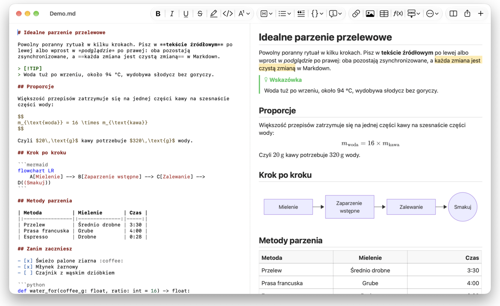
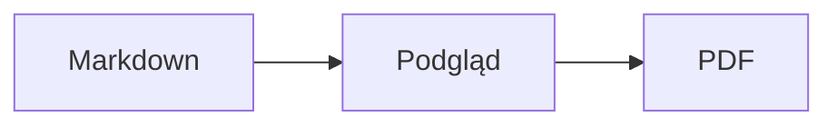

<p>&nbsp;&nbsp;&nbsp;</p>

# Splat

**Edytor Markdown dla macOS, w którym piszesz w tekście źródłowym albo wprost w podglądzie.**

Splat pokazuje po lewej tekst źródłowy Markdown z kolorowaniem składni, a po prawej działający na żywo, w pełni edytowalny podgląd. Pisz w dowolnym z nich: wszystko, co wpiszesz w podglądzie, trafia do tekstu źródłowego jako minimalna zmiana, więc nietknięte wiersze pozostają co do bajta takie same, a różnice w Git są czytelne. Splat rozumie Markdown, którego już używasz: CommonMark i GitHub Flavored Markdown, alerty GitHuba, łącza wiki, osadzenia i ramki informacyjne z Obsidiana, rozszerzenia Pandoc i Typory, osadzony HTML, wzory LaTeX oraz diagramy Mermaid, Graphviz i PlantUML, a wszystko to renderuje się offline. Przeglądaj i przeszukuj cały folder notatek, sprawdzaj, co się zmieniło od ostatniego commitu w Git, wklejaj z Worda lub strony internetowej jako Markdown i eksportuj do PDF, HTML lub Worda jednym kliknięciem. Program napisano w Ruście na prawdziwych kontrolkach AppKit, mówi w 35 językach i niczego nie wysyła przez sieć, dopóki mu na to nie pozwolisz.
 


[](https://github.com/sventmueller/splat/releases/latest/download/Splat.dmg)

**[Pobierz Splat.dmg](https://github.com/sventmueller/splat/releases/latest/download/Splat.dmg)**: podpisany i poświadczony notarialnie przez Apple, dla macOS 14 lub nowszego na Apple Silicon i Intel.

**Trafił się błąd?** Splat zachowuje nietknięte wiersze co do bajta takie same. Jeśli któryś mimo to się zmieni albo plik wyświetla się błędnie, [otwórz zgłoszenie](https://github.com/sventmueller/splat/issues/new/choose) i dołącz plik. Jeśli Splat jest dla ciebie przydatny, [gwiazdka na GitHubie](https://github.com/sventmueller/splat) pomoże innym go znaleźć.
 
 

[](https://www.rust-lang.org)
[](https://www.apple.com/macos/)

[](https://github.com/madsmtm/objc2)
[](https://webkit.org)
[](https://github.com/kivikakk/comrak)
[](https://github.github.com/gfm/)
[](https://www.mathjax.org)
[](https://cortexjs.io/mathlive/)
[](https://mermaid.js.org)
[](https://graphviz.org)
[](https://plantuml.com)


[](#licencja)

[Bahasa Indonesia](../id/README.md) ·
[Bahasa Melayu](../ms/README.md) ·
[Català](../ca/README.md) ·
[Čeština](../cs/README.md) ·
[Dansk](../da/README.md) ·
[Deutsch](../de/README.md) ·
[English](../../../README.md) ·
[Español](../es/README.md) ·
[Français](../fr/README.md) ·
[Hrvatski](../hr/README.md) ·
[Italiano](../it/README.md) ·
[Magyar](../hu/README.md) ·
[Nederlands](../nl/README.md) ·
[Norsk](../no/README.md) ·
**Polski** ·
[Português (Brasil)](../pt_BR/README.md) ·
[Português (Portugal)](../pt_PT/README.md) ·
[Română](../ro/README.md) ·
[Slovenčina](../sk/README.md) ·
[Slovenščina](../sl/README.md) ·
[Suomi](../fi/README.md) ·
[Svenska](../sv/README.md) ·
[Tiếng Việt](../vi/README.md) ·
[Türkçe](../tr/README.md) ·
[Ελληνικά](../el/README.md) ·
[Русский](../ru/README.md) ·
[Українська](../uk/README.md) ·
[עברית](../he/README.md)‎ ·
[العربية](../ar/README.md)‎ ·
[हिन्दी](../hi/README.md) ·
[ไทย](../th/README.md) ·
[한국어](../ko/README.md) ·
[日本語](../ja/README.md) ·
[简体中文](../zh-Hans/README.md) ·
[繁體中文](../zh-Hant/README.md)

## Spis treści

- [Najważniejsze cechy](#najważniejsze-cechy)
- [Wymagania](#wymagania)
- [Instalacja](#instalacja)
- [Pierwsze kroki](#pierwsze-kroki)
- [Pisanie](#pisanie)
  - [W tekście źródłowym](#w-tekście-źródłowym)
  - [W podglądzie](#w-podglądzie)
  - [Polecenia formatowania](#polecenia-formatowania)
  - [Listy i zadania](#listy-i-zadania)
  - [Tabele](#tabele)
  - [Wklejanie sformatowanego tekstu](#wklejanie-sformatowanego-tekstu)
  - [Metadane](#metadane)
- [Obsługiwany Markdown](#obsługiwany-markdown)
  - [CommonMark i GitHub Flavored Markdown](#commonmark-i-github-flavored-markdown)
  - [Ramki informacyjne](#ramki-informacyjne)
  - [Rozszerzona składnia](#rozszerzona-składnia)
  - [Obsidian](#obsidian)
  - [Cytowania i odwołania](#cytowania-i-odwołania)
  - [Osadzony HTML](#osadzony-html)
  - [Interpunkcja typograficzna](#interpunkcja-typograficzna)
  - [Przegląd składni](#przegląd-składni)
- [Wzory](#wzory)
- [Diagramy](#diagramy)
- [Obrazki](#obrazki)
- [Łącza i nawigacja](#łącza-i-nawigacja)
- [Notatki w folderze](#notatki-w-folderze)
- [Zmiany od ostatniego commitu](#zmiany-od-ostatniego-commitu)
- [Eksport, drukowanie i udostępnianie](#eksport-drukowanie-i-udostępnianie)
- [Import dokumentów Word](#import-dokumentów-word)
- [Wygląd i dostępność](#wygląd-i-dostępność)
- [Języki](#języki)
- [Skróty klawiszowe](#skróty-klawiszowe)
- [Prywatność i bezpieczeństwo](#prywatność-i-bezpieczeństwo)
- [Duże dokumenty](#duże-dokumenty)
- [Znane ograniczenia](#znane-ograniczenia)
- [Rozwiązywanie problemów](#rozwiązywanie-problemów)
- [Dla programistów](#dla-programistów)
  - [Komponenty zewnętrzne](#komponenty-zewnętrzne)
- [Licencja](#licencja)

## Najważniejsze cechy

- **Dwa sposoby pisania, jeden tekst.** Tekst źródłowy i podgląd są edytowalne. Jedyną prawdą jest plik Markdown: dokument ma jedną historię cofania, a każda zmiana w podglądzie zamienia się w najmniejszą możliwą zmianę tekstu źródłowego.
- **Markdown, którego już używasz.** CommonMark, GitHub Flavored Markdown, alerty GitHuba, Obsidian, rozszerzenia Pandoc i Typory, kody emoji, spoilery, listy definicji, kotwice nagłówków i HTML taki jak w plikach README na GitHubie.
- **Wzory i diagramy w standardzie.** Wzory LaTeX przez MathJax, z wizualnym edytorem wzorów. Diagramy Mermaid, Graphviz i PlantUML renderowane na Macu, bez Javy, serwera i połączenia z siecią.
- **Przycisk do wszystkiego.** Każda konstrukcja Markdown ma przycisk na pasku narzędzi i pozycję w menu, a te częste także skrót klawiszowy. Tabele mają własne menu do wierszy, kolumn i wyrównania.
- **Folder, nie tylko plik.** Panel boczny pokazuje notatki wokół dokumentu i przeszukuje je wszystkie. Zmiana nazwy notatki zmienia łącza do niej, a każdy bajt wokół nich pozostaje.
- **Zmiany na pierwszy rzut oka.** W repozytorium Git paski obok tekstu oznaczają to, co różni się od ostatniego commitu, w obu panelach.
- **Z Worda i internetu do Markdown.** Wklejaj sformatowany tekst jako Markdown, komórki z arkusza kalkulacyjnego jako tabelę i importuj całe dokumenty Word wraz z obrazkami.
- **Eksport bez strat.** PDF, jeden samodzielny plik HTML albo dokument Word z prawdziwymi nagłówkami, listami, tabelami, przypisami i obrazkami. Dodaj numery stron, nagłówki i stronę tytułową albo użyj szablonu Word swojej firmy.
- **Natywny na wskroś.** Prawdziwe okna AppKit, karty, menu, dymki, Wersje, automatyczne zachowywanie, menu udostępniania, tryb ciemny, sprawdzanie pisowni, dyktowanie i VoiceOver. Bez Electrona i bez widoku webowego dla samego tekstu.
- **Szybki przy dużych plikach.** Renderowanie naciśnięcia klawisza w dokumencie o rozmiarze 10 MB trwa około 10 ms, przed własną pracą widoku.
- **Prywatny i ostrożny.** Obrazki z internetu wczytują się dopiero po Twojej zgodzie, łącza do innych aplikacji najpierw pytają, a wszystko, co dekoduje niezaufane dane obrazów, działa w izolowanych procesach pomocniczych.
- **W Twoim języku.** Interfejs i wbudowany skrócony przewodnik po Markdown są dostępne w 35 językach: arabski, kataloński, chiński (uproszczony), chiński (tradycyjny), chorwacki, czeski, duński, holenderski, angielski, fiński, francuski, niemiecki, grecki, hebrajski, hindi, węgierski, indonezyjski, włoski, japoński, koreański, malajski, norweski, polski, portugalski (Brazylia), portugalski (Portugalia), rumuński, rosyjski, słowacki, słoweński, hiszpański, szwedzki, tajski, turecki, ukraiński i wietnamski.

## Wymagania

- macOS 14 Sonoma lub nowszy. Splat powstaje i jest testowany na macOS 27, gdzie sam przejmuje wygląd Liquid Glass.
- Mac z procesorem Apple Silicon lub Intel.
- Około 45 MB miejsca na dysku.

## Instalacja

**Z obrazu dysku.** Pobierz [`Splat.dmg`](https://github.com/sventmueller/splat/releases/latest/download/Splat.dmg), otwórz go i przeciągnij Splat do folderu Programy. Obraz jest podpisany certyfikatem Developer ID i poświadczony notarialnie przez Apple, więc otwiera się bez ostrzeżeń.

**Przez Homebrew.** Cask znajduje się we własnym tapie:

```sh
brew install --cask sventmueller/tap/splat
```

`brew upgrade --cask splat` instaluje nowe wersje, a `brew uninstall --zap --cask splat` usuwa też ustawienia i pamięć podręczną Splata.

**Uaktualnienia.** Splat z obrazu dysku lub z Homebrew sam dba o aktualność dzięki [Sparkle](https://sparkle-project.org). Przy drugim uruchomieniu pyta, czy może raz dziennie samodzielnie szukać uaktualnień. **Splat › Sprawdź uaktualnienia…** sprawdza od razu; **Sprawdzaj uaktualnienia automatycznie** i **Pobieraj i instaluj uaktualnienia automatycznie** w tym samym menu pozwalają zmienić decyzję później. Splat instaluje uaktualnienie tylko wtedy, gdy ma ono podpis autora. Własna kompilacja nie ma mechanizmu uaktualnień.

**Ze źródeł.** Wymagania wstępne znajdziesz w części [Kompilacja](../../../docs/development.md#building), potem:

```sh
make build
ditto target/release/Splat.app /Applications/Splat.app
open /Applications/Splat.app
```

Aby pliki Markdown otwierały się w Splacie po dwukrotnym kliknięciu, zaznacz dowolny plik `.md` w Finderze, wybierz **Plik › Informacje**, wskaż Splat w polu **Otwórz w aplikacji** i kliknij **Zmień wszystkie…**. Splat rejestruje się dla plików `.md`, `.markdown`, `.mdown` i `.mkd`.

## Pierwsze kroki

### Okno

Każdy dokument otwiera się we własnym oknie albo, jeśli wolisz karty, w karcie:

- **Po lewej: tekst źródłowy.** Twój Markdown czcionką SF Mono, z kolorowaniem składni.
- **Po prawej: podgląd.** Wyrenderowany dokument, gotowy do edycji.
- **Panel boczny (opcjonalny).** Wszystkie nagłówki jako drzewo, kliknięcie jednego pokazuje go w obu panelach: **Widok › Pokaż konspekt** (⌃⌘S). Dwie kolejne karty zawierają [notatki w folderze](#notatki-w-folderze) i ich wyszukiwanie. Przycisk obok tytułu okna pokazuje go i ukrywa, a nowe okna otwierają go tak, jak zostawiło go ostatnie okno.
- **Pasek narzędzi.** Przyciski pogrupowane według tego, co zmieniają: znaki, akapity i wstawiane elementy, potem włączanie i wyłączanie podglądu, Udostępnij i Nowy dokument. Dostosujesz go poleceniem **Widok › Dostosuj pasek narzędzi…**.

Przeciągnij separator, aby dać któremuś panelowi więcej miejsca. **Widok › Ukryj podgląd** (⌥⌘P) zostawia sam tekst źródłowy; Splat zapamiętuje to osobno dla każdego okna. Oba panele przewijają się razem, a zaznaczenie w jednym jest podświetlone w drugim.

W rogu okna widać liczbę wyrazów i znaków tekstu oraz czas czytania, a dopóki istnieje zaznaczenie, również te dane dla zaznaczenia. Adresy łączy, znaczniki HTML, metadane, komentarze, wzory i diagramy się nie liczą. Domyślnie ta informacja jest ukryta; **Widok › Pokaż liczbę wyrazów** ją włącza.

### Dokumenty, karty i wersje

Splat to zwykła aplikacja dokumentowa macOS:

- **Automatyczne zachowywanie i Wersje.** Zmiany są zachowywane w miejscu. **Plik › Przywróć do › Przeglądaj wszystkie wersje…** cofa Cię w czasie.
- **Zmiany z innych programów.** Gdy Git, skrypt lub inny edytor zmieni otwarty dokument, Splat wczytuje go ponownie i zachowuje położenie kursora oraz przewinięcia. Jeśli masz własne niezachowane zmiany, Splat je zachowuje, a macOS zapyta, zanim nadpiszesz drugą wersję.
- **Zwykłe polecenia plików.** Powiel (⇧⌘S), Zmień nazwę…, Przenieś do… i **Plik › Otwórz ostatnie**.
- **Karty.** **Plik › Nowa karta** albo przycisk **+** na pasku narzędzi otwiera nowy dokument w karcie; standardowe menu Okno łączy, przenosi i przełącza karty.
- **Położenie okna.** Rozmiar i położenie ostatniego okna są zapamiętywane, także po ponownym uruchomieniu. Jeśli w tym miejscu stoi już okno, nowe otwiera się lekko przesunięte.
- **Ikona w Docku.** Kliknięcie jej po zamknięciu ostatniego okna otwiera nowy dokument.
- **Otwieranie plików Markdown w Splacie.** **Splat › Ustaw jako domyślną aplikację dla Markdown** sprawia, że dwukrotne kliknięcie pliku `.md` lub `.markdown` otwiera Splat; macOS prosi raz o potwierdzenie. Gdy Splat jest aplikacją domyślną, pozycja ma znacznik wyboru.

Pliki muszą być tekstem UTF-8 albo UTF-16 ze znacznikiem kolejności bajtów. Splat odmawia otwarcia innych kodowań, zamiast zgadywać i uszkodzić tekst. Znacznik kolejności bajtów zostaje, UTF-16 pozostaje UTF-16, a w pliku, w którym wszystkie wiersze kończą się CRLF, dodawane przez Ciebie wiersze też dostają CRLF.

**Po awarii** tracisz co najwyżej kilka ostatnich sekund pisania: co pięć sekund Splat kopiuje niezachowany tekst do `~/Library/Application Support/Splat/Unsaved` i usuwa kopie, gdy dokument zostanie zachowany albo Splat zakończy pracę normalnie. Przy następnym uruchomieniu to, co awaria tam zostawiła, trafia do `~/Library/Application Support/Splat/Recovery`, a Splat raz o tym informuje, z przyciskiem otwierającym folder. Awaria, na którą Splat jeszcze zdąży zareagować, zapisuje tam też tekst każdego otwartego dokumentu.

### Skrócony przewodnik

**Pomoc › Markdown – skrócony przewodnik** otwiera ściągawkę w Twoim języku jako nowy, bez tytułu dokument. To zwykły dokument, więc wszystko możesz wypróbować od razu, w tekście źródłowym albo w podglądzie.

## Pisanie

### W tekście źródłowym

Tekst źródłowy to edytor zwykłego tekstu dostrojony do Markdown:

- **Kolorowanie składni** jak w VS Code: nagłówki, wyróżnienia, łącza, kod, tabele, HTML, front matter oraz LaTeX i Mermaid wewnątrz wzorów i diagramów. Są palety dla trybu jasnego, ciemnego i dla opcji Zwiększ kontrast.
- **Bloki kodu w ogrodzeniu** mają kolorowanie dla Bash, C, C++, C#, CSS (także SCSS i Less), Go, HTML, XML, Java, JavaScript, JSON, Kotlin, PHP, Python, Ruby, Rust, SQL, Swift, TypeScript, YAML, TeX i Mermaid, łącznie z ich zwykłymi skróconymi nazwami, takimi jak `js`, `py` czy `sh`.
- **Bez niespodzianek z zamianami.** Cudzysłowy inteligentne, myślniki inteligentne i zastępowanie tekstu są domyślnie wyłączone, bo psują `--`, `---` i `"`. Włączysz je w **Edycja › Zastąpienia**.
- **Systemowe narzędzia do pisania.** Sprawdzanie pisowni i gramatyki, dyktowanie, Znajdź i zastąp (⌥⌘F) oraz Mowa.
- **Przeciąganie i upuszczanie.** Upuszczony plik obrazu wstawia ``, każdy inny plik wstawia łącze do niego, a adres URL wstawia `[url](url)`. Każde upuszczenie to jeden krok cofania.
- **Wklejanie obrazków.** Obraz ze schowka, na przykład zrzut ekranu, jest zapisywany jako plik PNG obok dokumentu (`Obrazek 2026-10-29 13.09.07.png`) i wstawiany jako obrazek. Dokument musi być do tego raz zachowany.

### W podglądzie

Podgląd zachowuje się jak edytor tekstu, ale wszystko, co w nim robisz, kończy jako Markdown:

- **Pisanie.** Znaki mające w Markdown znaczenie, takie jak `*` czy `#`, są poprzedzane znakiem ucieczki, by pojawiały się tak, jak je wpisano.
- **Return** zaczyna nowy akapit lub pozycję listy. **⌥Return** lub **⌃Return** wstawia podział wiersza.
- **Formatowanie przy kursorze.** Gdy kursor stoi na końcu słowa, Pogrubienie, Kursywa i inne formaty znaków dotyczą tego, co wpiszesz dalej. Wybierz format ponownie, aby go zakończyć. Wewnątrz słowa formatowane jest całe słowo.
- **Puste wiersze.** Return w pustym wierszu dodaje kolejny pusty wiersz, a Backspace go usuwa. W tekście źródłowym każdy taki dodatkowy pusty wiersz to dwa kolejne puste wiersze; inne programy do Markdown pokazują je jako zwykły odstęp między akapitami.
- **Cofnij** działa w obu panelach. Pozycje cofania mają nazwy („Cofnij Pogrubienie”), pisanie to jeden krok na serię znaków, a po Cofnij i Przywróć oba panele przewijają się do zmiany.
- **Wzory i diagramy** pojawiają się jako gotowa grafika. Kliknij jedno z nich, przesuń na nie kursor albo naciśnij na nim Return, aby otworzyć jego edytor (zobacz [Wzory](#wzory) i [Diagramy](#diagramy)).
- **Osadzony HTML, osadzone notatki i front matter** są wyświetlane, ale edytujesz je w tekście źródłowym. Kliknięcie ustawia kursor w odpowiednim miejscu tekstu źródłowego.

Wszystko, czego Markdown nie potrafi wyrazić, jest w podglądzie zablokowane: panele Czcionka i Kolory, linijka oraz wklejanie lub upuszczanie sformatowanego tekstu i obrazów. Wklejony HTML i RTF trafiają jako zwykły tekst, chyba że wybierzesz [Wklej jako Markdown](#wklejanie-sformatowanego-tekstu).

### Polecenia formatowania

Każde polecenie jest dostępne na pasku narzędzi, w pasku menu i w menu kontekstowym obu paneli. Pozycje menu mają znacznik wyboru dla formatowania przy kursorze.

| Menu | Polecenia |
|---|---|
| **Format › Czcionka** | Pogrubienie, Kursywa, Podkreślenie, Przekreślenie, Wyróżnienie, Kod, Indeks górny, Indeks dolny |
| **Format › Nagłówek** | Tekst główny, Nagłówek od 1 do 6 |
| **Format › Lista** | Lista punktowana, Lista numerowana, Lista zadań |
| **Format** | Cytat, Blok kodu (Bez języka albo jeden z 20 języków; zmienia też język istniejącego bloku), Ramka informacyjna (Notatka, Wskazówka, Ważne, Uwaga, Przestroga; ten sam typ ponownie usuwa ramkę), Edytuj wzór lub diagram…, Usuń formatowanie |
| **Wstaw** | Łącze…, Obrazek…, Tabela…, Wzór, Diagram (Schemat blokowy, Diagram sekwencji, Wykres Gantta), Spis treści, Przypis, Separator |
| **Tabela** | Wstaw wiersz powyżej/poniżej, Wstaw kolumnę po lewej/po prawej, Usuń wiersz, Usuń kolumnę, Wyrównanie (Wyrównaj do lewej, Wyśrodkuj, Wyrównaj do prawej, Domyślne), Wyrównaj kolumny tabeli |
| **Widok** | Ukryj/Pokaż podgląd, Pokaż/Ukryj konspekt, Interpunkcja typograficzna, Powiększ/Pomniejsz, Wielkość rzeczywista, pasek narzędzi, pasek z kartami, tryb pełnoekranowy |

Podkreślenie, wyróżnienie, indeks górny i indeks dolny zapisuje się jako `<ins>`, `<mark>`, `<sup>` i `<sub>`, które GitHub też wyświetla. Splat czyta także `<u>`, które GitHub usuwa, oraz krótsze `==wyróżnienie==`, `^górny^` i `~dolny~`. GitHub pokazuje `==` i `^` tak, jak je wpisano, a `~dolny~` jako przekreślenie.

### Listy i zadania

- Return kontynuuje listę; Return na pustej pozycji ją kończy.
- **Tab** i **⇧Tab** zwiększają i zmniejszają wcięcie pozycji listy w podglądzie.
- Kliknięcie pola wyboru zadania w podglądzie przełącza `- [ ]` i `- [x]`.
- **Format › Lista** zamienia zaznaczone akapity w listę albo zmienia jej rodzaj.

### Tabele

- **Wstaw › Tabela…** pyta o liczbę wierszy (z nagłówkiem) i kolumn.
- W podglądzie **Tab** przechodzi do następnej komórki, **⇧Tab** do poprzedniej, a **Return** do komórki poniżej. Tab w ostatniej komórce dodaje wiersz.
- Menu **Tabela** wstawia i usuwa wiersze oraz kolumny i ustawia wyrównanie kolumny (⌘{, ⌘|, ⌘}).
- **Tabela › Wyrównaj kolumny tabeli** dopełnia tekst źródłowy, aby kolumny leżały w jednej linii.

### Wklejanie sformatowanego tekstu

**Edycja › Wklej jako Markdown** (⌃⌘V), dostępne także w menu kontekstowym obu paneli, zamienia zawartość schowka na Markdown w miejscu zaznaczenia, jako jeden krok cofania. ⌘V nadal wstawia zwykły tekst.

- **Z przeglądarki, Worda, Google Docs, Confluence, Notatek lub Pages:** przenoszone są nagłówki, pogrubienie, kursywa, podkreślenie, przekreślenie, indeks górny i dolny, łącza, listy z zagnieżdżeniem, cytaty, kod i tabele.
- **Z arkusza kalkulacyjnego:** komórki stają się tabelą z wierszem nagłówka i kolumnami liczb wyrównanymi do prawej. Tak samo tekst rozdzielony tabulatorami, średnikami lub przecinkami, jeśli każdy wiersz ma tyle samo kolumn.
- **Obrazki** z adresem internetowym pozostają łączami. Obrazek wewnątrz wklejonego HTML staje się plikiem obok dokumentu, który musi być do tego raz zachowany. Tymczasowe pliki obrazów Worda nie są przenoszone, ale ich tekst alternatywny pozostaje.
- **Łącza** zachowują tylko adresy `http`, `https`, `mailto`, względne i `#`; z każdego innego łącza zostaje tylko tekst.

### Metadane

**Format › Edytuj metadane…** albo kliknięcie wiersza metadanych u góry podglądu otwiera formularz z polami YAML front matter. Pola można zmieniać, dodawać i usuwać. Pole z listą pozostaje listą: jego wartości następują jedna po drugiej, rozdzielone przecinkami, a wartość zawierająca przecinek jest w cudzysłowie. Nowe pole o nazwie `tags`, `aliases`, `keywords`, `categories`, `authors` lub `cssclasses` też staje się listą. Zagnieżdżone pola i tekst wielowierszowy można tam zobaczyć, a edytuje się je w tekście źródłowym.

To, co zmienia formularz, jest jednym krokiem cofania i sięga tylko wierszy pól, które zmienisz: komentarze, kolejność, nietypowe odstępy, cudzysłowy i końce wierszy wszystkich pozostałych pozostają co do bajta takie same. Dokument bez metadanych dostaje blok na początku.

## Obsługiwany Markdown

Splat parsuje za pomocą [comrak](https://github.com/kivikakk/comrak), parsera zgodnego z CommonMark i GFM, i włącza większość jego rozszerzeń. Wszystko poniżej renderuje się w podglądzie i we wszystkich eksportach.

### CommonMark i GitHub Flavored Markdown

- Nagłówki (`#` i podkreślane), akapity, podziały wierszy, wyróżnienie, mocne wyróżnienie, kod w tekście, cytaty blokowe, separatory.
- Listy punktowane, numerowane i zagnieżdżone; listy zadań.
- Łącza (w tekście, referencyjne i automatyczne), obrazki, definicje łączy referencyjnych.
- Bloki kodu w ogrodzeniu i wcięte, z kolorowaniem składni.
- Tabele z wyrównaniem kolumn.
- Przekreślenie za pomocą `~~dwóch tyld~~`.
- Przypisy: `tekst[^1]` z `[^1]: Treść przypisu.` w dowolnym miejscu dokumentu. Kliknięcie znacznika przenosi do przypisu.
- Front matter YAML między wierszami `---` na początku. Podgląd streszcza go w jednym wierszu, na przykład „Metadane: title, date, tags”.

### Ramki informacyjne

Alerty GitHuba renderują się jako kolorowe ramki z ikoną i tytułem:

```markdown
> [!NOTE]
> Przydatna informacja, którą powinni znać użytkownicy.

> [!WARNING]
> Ważna treść wymagająca natychmiastowej uwagi.
```

Pięć typów to Notatka, Wskazówka, Ważne, Uwaga i Przestroga. **Format › Ramka informacyjna** zamienia w ramkę akapit, w którym stoi kursor.

Ramki informacyjne z Obsidiana też działają, z dowolnym tytułem i stanem zwinięcia:

```markdown
> [!tip]- Kliknij ▸, aby rozwinąć
> Ukryte do czasu otwarcia.

> [!question]+ Domyślnie otwarta
> Plus zaczyna rozwiniętą, minus zwiniętą.
```

Pozostałe typy z Obsidiana są pokazywane w najbliższym z pięciu kolorów: `success`, `check`, `done` i `hint` jako Wskazówka; `question`, `help` i `faq` jako Ważne; `attention` jako Uwaga; `failure`, `fail`, `missing`, `danger`, `error` i `bug` jako Przestroga; wszystko inne jako Notatka.

### Rozszerzona składnia

| Cecha | Składnia | Skąd |
|---|---|---|
| Wyróżnienie | `==zaznaczony tekst==` | Obsidian, Typora |
| Indeks górny | `x^2^` | Pandoc, Typora |
| Indeks dolny | `H~2~O` | Pandoc, Typora |
| Kod emoji | `:rocket:` zamienia się w 🚀 | GitHub |
| Spoiler | `\|\|ukryty tekst\|\|`, zaznacz go, aby przeczytać | Discord |
| Przypis w tekście | `tekst^[sama treść przypisu]` | Pandoc, Obsidian |
| Lista definicji | `Pojęcie`, pusty wiersz, `: Wyjaśnienie` | PHP Markdown Extra, Pandoc |
| Kotwica nagłówka | `## Instalacja {#setup}`, łącze przez `[zobacz](#setup)` | Pandoc, kramdown |

Listy definicji wyglądają w tekście źródłowym tak:

```markdown
Pojęcie

: Wyjaśnienie pojęcia.
```

Bez własnej kotwicy każdy nagłówek dostaje kotwicę wyprowadzoną z jego tekstu, jak na GitHubie: `## Pierwsze kroki` jest dostępny jako `#pierwsze-kroki`.

### Obsidian

- **Łącza wiki.** `[[Notatka]]` prowadzi do `Notatka.md` w tym samym folderze lub w folderze niżej. `[[Notatka|Wyświetlany tekst]]` pokazuje Twój własny tekst, a `[[Notatka#Nagłówek]]` otwiera notatkę. ⌘-kliknięcie otwiera ją w Splacie.
- **Osadzenia.** `![[Notatka]]` pokazuje inną notatkę wewnątrz tej; osadzone w niej notatki pojawiają się jako łącza. `![[diagram.png]]` pokazuje obrazek. Tak jak w Obsidianie osadzenia wskazują notatki i obrazy w folderze dokumentu lub niżej, nigdy przez ścieżkę bezwzględną, a jako notatki pokazują się tylko pliki Markdown.
- **Komentarze.** `%%Tylko w tekście źródłowym%%` pozostaje widoczny w tekście źródłowym, a w podglądzie i w każdym eksporcie jest pomijany, zarówno w tekście, jak i w osobnych wierszach.
- **Tagi.** `#pomysł` albo `#projekt/splat` są wyróżniane. ⌘-kliknięcie wyszukuje tag w dokumencie, a w panelu bocznym w całym folderze.
- **Zwijane ramki informacyjne.** Zobacz [Ramki informacyjne](#ramki-informacyjne).

### Cytowania i odwołania

- **Cytowania Pandoc.** `[@doe2020]` lub `[@doe2020; @roe2021]` wygląda jak „(Doe 2020; Roe 2021)”. Wpisy pochodzą z pliku BibTeX, który front matter wskazuje jako `bibliography: refs.bib`. Bez tego Splat używa `references.bib`, `literatur.bib` lub `bibliography.bib` obok dokumentu.
- **Odwołania GitHub i GitLab.** Jeśli dokument leży w repozytorium Git, którego zdalny `origin` jest na github.com lub na serwerze GitLab, `@nazwa`, `#12` (zgłoszenie) i `!7` (merge request, tylko GitLab) są wyróżniane. ⌘-kliknięcie otwiera je w przeglądarce.

### Osadzony HTML

HTML, jaki spotyka się w plikach README na GitHubie, jest renderowany własnym czytnikiem, a nie silnikiem przeglądarki:

- wyśrodkowane akapity i bloki (`<p align="center">`, `<div align="center">`)
- obrazy z rozmiarem (``)
- łącza, `<kbd>⌘</kbd>`, `<br>`, `<u>`, `<ins>`, `<mark>`, `<sup>`, `<sub>`
- listy i tabele, także komórki obejmujące kilka kolumn (`colspan`)
- sekcje rozwijane: `<details><summary>Więcej</summary>…</details>`, otwierane kliknięciem ▸

Markdown między znacznikami HTML jest renderowany jako Markdown. Skrypty, style, ramki i formularze są całkowicie pomijane, a łącza i obrazy zachowują tylko adresy `http`, `https`, `mailto` i względne.

### Interpunkcja typograficzna

**Widok › Interpunkcja typograficzna** zamienia proste cudzysłowy na cudzysłowy języka interfejsu, `--` na półpauzę, `---` na pauzę, a `...` na wielokropek. W niemieckim `"Ja"` staje się „Ja“, we francuskim «Oui», w japońskim 「はい」, także tam, gdzie chiński i japoński składają cudzysłowy bez spacji; hebrajskie skróty takie jak `צה"ל` dostają gerszajim, צה״ל. Tekst źródłowy zachowuje zwykłe znaki; podgląd i wszystkie eksporty pokazują typograficzne. Ustawienie jest domyślnie wyłączone.

### Przegląd składni

| Element | Markdown |
|---|---|
| **Pogrubienie** | `**Pogrubienie**` |
| *Kursywa* | `*Kursywa*` |
| Podkreślenie | `<ins>Podkreślenie</ins>` lub `<u>Podkreślenie</u>` |
| ~~Przekreślenie~~ | `~~Przekreślenie~~` |
| Wyróżnienie | `<mark>Wyróżnienie</mark>` lub `==Wyróżnienie==` |
| `Kod` | `` `Kod` `` |
| x² | `x<sup>2</sup>` lub `x^2^` |
| H₂O | `H<sub>2</sub>O` lub `H~2~O` |
| [Łącze](https://example.com) | `[Łącze](https://example.com)` |
| Nagłówek | `# Nagłówek` do `###### Nagłówek` |
| Cytat | `> Cytat` |
| Lista punktowana | `- Pozycja` |
| Lista numerowana | `1. Pozycja` |
| Zadanie | `- [ ] Otwarte` i `- [x] Gotowe` |
| Blok kodu | ```` ```rust ```` … ```` ``` ```` |
| Tabela | `\| A \| B \|` z `\|---\|---\|` pod nagłówkiem |
| Przypis | `Tekst[^1]` i `[^1]: Przypis` |
| Separator | `---` |
| Obrazek | `` |
| Wzór | `$E = mc^2$`, `$$ … $$` |
| Diagram | ```` ```mermaid ````, ```` ```dot ````, ```` ```plantuml ```` |
| Ramka informacyjna | `> [!TIP]` |
| Łącze wiki | `[[Notatka]]`, `[[Notatka\|Tekst]]` |
| Osadzenie | `![[Notatka]]`, `![[obraz.png]]` |
| Komentarz | `%%Komentarz%%` |
| Tag | `#tag` |
| Cytowanie | `[@klucz]` |
| Spoiler | `\|\|Spoiler\|\|` |
| Emoji | `:tada:` |

## Wzory

Wzory renderuje [MathJax](https://www.mathjax.org) z matematyką TeX i AMS, jako ostrą grafikę wektorową. Tekst w `\text{…}` może być w dowolnym piśmie: czego brakuje w czcionkach MathJax, pochodzi z czcionek Twojego Maca, przy czym arabski i hebrajski biegną od prawej do lewej, a emoji są kolorowe.

| Rodzaj | Składnia |
|---|---|
| W tekście | `$E = mc^2$`, `` $`E = mc^2`$ `` (GitHub, GitLab), `\(E = mc^2\)` |
| Osobny wiersz | `$$` … `$$`, `\[` … `\]` albo blok kodu oznaczony `math` |

**Edycja wzoru.** Kliknij wzór w podglądzie, kliknij go dwukrotnie, naciśnij na nim Return albo przesuń na niego kursor, aby otworzyć jego edytor w dymku. **Wstaw › Wzór** wstawia nowy i od razu otwiera edytor.

- **Wizualnie lub LaTeX.** Przełącznik u góry przełącza między edytorem wizualnym ([MathLive](https://cortexjs.io/mathlive/)) a kodem LaTeX. Splat zapamiętuje Twój wybór.
- **Gotowe elementy** dla ułamka, pierwiastka kwadratowego, indeksu górnego i dolnego, sumy i całki z granicami, granicy, nawiasów dopasowujących się do zawartości, macierzy 2×2, liter greckich oraz relacji, operatorów i strzałek. Zostawiają symbole zastępcze □, a **Tab** przechodzi do następnego.
- **Podgląd na żywo.** Zmiany pojawiają się w dokumencie podczas pisania. Błędy z MathJax pokazują się w wierszu pod kodem.
- **Zatwierdź lub odrzuć.** Kliknięcie poza edytorem zachowuje zmianę jako jeden krok cofania; **Esc** lub **Anuluj** ją odrzuca. Esc w nowym, pustym wzorze usuwa go z powrotem.
- Menu kontekstowe oferuje **Edytuj wzór…** dla wzoru pod wskaźnikiem.

VoiceOver czyta wzór jako jego kod LaTeX. Splat renderuje wzory, a nie całe dokumenty LaTeX: nie ma pakietów, TikZ ani `\documentclass`.

## Diagramy

Diagramy renderują się wewnątrz Splata, offline, w wariancie jasnym i ciemnym.

| Silnik | Blok kodu | Co rysuje |
|---|---|---|
| [Mermaid](https://mermaid.js.org) | ```` ```mermaid ```` | schematy blokowe, diagramy sekwencji, klas, stanów, związków encji, wykresy Gantta, kołowe, mapy myśli, osie czasu i każdy inny typ Mermaid |
| [Graphviz](https://graphviz.org) | ```` ```dot ```` lub ```` ```graphviz ```` | grafy w języku DOT |
| [PlantUML](https://plantuml.com) | ```` ```plantuml ```` lub ```` ```puml ```` | diagramy UML; działa bez Javy |



**Edycja diagramu** działa jak edycja wzoru: kliknij go, aby otworzyć kod w dymku, z kolorowaniem składni i komunikatami o błędach w wierszu pod kodem. **Wstaw › Diagram** zaczyna od szablonu schematu blokowego, diagramu sekwencji lub wykresu Gantta. Gotowe elementy pomagają przy trzech najczęstszych typach Mermaid:

- **Schemat blokowy:** Węzeł ▾ (prostokąt, zaokrąglony, koło, romb, baza danych), Połączenie, Połączenie z etykietą, Grupa, Kierunek ▾
- **Diagram sekwencji:** Uczestnik, Wiadomość, Odpowiedź, Notatka, Pętla, Alternatywne ścieżki
- **Wykres Gantta:** Sekcja, Zadanie, Kamień milowy

Inne typy diagramów edytuje się jako kod. VoiceOver czyta tytuł diagramu lub jego tekst alternatywny.

Pierwszy diagram po uruchomieniu zajmuje około sekundy, bo silnik renderowania startuje w tle. Diagram, który trwa dłużej niż 10 sekund, pokazuje błąd, a silnik renderowania startuje od nowa dla następnego. Silnik PlantUML (3 MB) ładuje się dopiero przy pierwszym diagramie PlantUML. `!include` w PlantUML z internetu jest blokowany.

## Obrazki

- **Obrazki lokalne** używają ścieżek względem dokumentu: ``. Splat pokazuje PNG, JPEG, GIF, WebP, BMP, SVG, HEIC, TIFF, AVIF i PDF.
- **Obrazki z internetu** pozostają zablokowane, dopóki ich nie dopuścisz: pasek nad podglądem wyjaśnia, że ich wczytanie informuje ich serwery, że i kiedy otwierasz dokument. **Wczytaj obrazki** dopuszcza je dla tego dokumentu; Splat zapamiętuje wybór osobno dla każdego pliku.
- **Rozmiar.** `` ustala rozmiar obrazka; poza tym obrazki dopasowują się do szerokości podglądu.
- **Zmiany na dysku.** Obrazek, który podmienisz, albo taki, który pojawi się po tym, jak dokument go wskazał, widać bez ponownego otwierania dokumentu. Obrazki z internetu, które nie wczytały się przez sieć, są próbowane ponownie, dopóki dokument je pokazuje.
- **Pamięć.** Obrazki są pokazywane do 2560 pikseli na dłuższym boku, co wystarcza też do wypełnienia strony A4. Dekodują się mniejsze, gdy zajmą jedną ósmą pamięci Maca oraz gdy macOS zgłasza niedobór pamięci.
- **Tryb ciemny.** Obrazki z białym tłem są w ciemnym podglądzie lekko przyciemniane.
- **Wklejanie i upuszczanie.** Zobacz [W tekście źródłowym](#w-tekście-źródłowym).

## Łącza i nawigacja

W podglądzie kliknięcie ustawia kursor, byś mógł edytować tekst łącza; **⌘-kliknięcie** przechodzi za łączem:

- `http`, `https` i `mailto` otwierają się w przeglądarce lub aplikacji pocztowej.
- Pliki Markdown otwierają się w Splacie; inne pliki i foldery są pokazywane w Finderze.
- `#kotwica` przechodzi do nagłówka w dokumencie.
- Adresy otwierające inną aplikację, takie jak `slack://` czy `vscode://`, najpierw pytają i pokazują pełny adres oraz aplikację. Domyślnie wybrane jest **Anuluj**.

**Wstaw › Spis treści** wstawia listę łączy do wszystkich nagłówków. Gdy kursor stoi w spisie, to samo polecenie go aktualizuje. Panel konspektu (⌃⌘S) przenosi do dowolnego nagłówka w obu panelach.

## Notatki w folderze

Przyciski u góry panelu bocznego przełączają między konspektem, plikami a wyszukiwaniem.

- **Pliki** (**Widok › Pokaż pliki**, ⌃⌘E). Wszystkie pliki Markdown w folderze dokumentu lub, jeśli dokument leży w repozytorium Git, w całym repozytorium. Kliknięcie lub Return otwiera notatkę jako kartę tego okna; jeśli jest już otwarta, przechodzi na wierzch. Przycisk obok nazwy folderu pokazuje w tym oknie inny folder. Ukryte pliki, `node_modules`, `target`, `Pods`, `DerivedData`, `__pycache__` i foldery bez notatek są pomijane. Dokument leżący bezpośrednio w Twoim folderze domowym pokazuje tylko notatki obok siebie, aby Splat nie przechodził przez wszystkie Twoje foldery i nie pytał o każdy z nich.
- **Wyszukiwanie** (**Edycja › Znajdź › Szukaj we wszystkich notatkach…**, ⇧⌘F). Znajduje tekst we wszystkich notatkach niezależnie od wielkości liter i sposobu zakodowania znaków diakrytycznych. `#tag` znajduje tag, `#project` także `#project/splat`, i nic wewnątrz kodu. Kliknięcie wyniku otwiera notatkę w tym miejscu.
- **Łącza do notatki.** Menu kontekstowe notatki wymienia notatki, które do niej prowadzą, przez łącze wiki, osadzenie, łącze względne lub definicję łącza referencyjnego.
- **Zmiana nazwy notatki.** To samo menu zmienia jej nazwę i te łącza. Splat najpierw mówi, ile łączy w ilu plikach to oznacza. W każdym łączu zmienia się tylko nazwa, a każdy inny bajt pliku pozostaje. Otwarte dokumenty przyjmują zmianę jako krok cofania; w innych plikach cofnąć ją może tylko Git lub Wersje. Plik, który w międzyczasie zmienił inny program, zatrzymuje zmianę nazwy we wszystkich łączach, a Splat go wskazuje.

Lista podąża za folderem, gdy okno przechodzi na wierzch. Wyszukiwanie obejmuje pliki w takiej postaci, w jakiej są na dysku, a tekst, którego jeszcze nie zachowano, liczy się od następnego automatycznego zachowania.

## Zmiany od ostatniego commitu

W dokumencie w repozytorium Git paski obok tekstu oznaczają to, co różni się od ostatniego commitu, w tekście źródłowym i w podglądzie: zielony dla dodanych wierszy, niebieski dla zmienionych wierszy i krótki czerwony znak tam, gdzie coś usunięto. Nadążają za pisaniem i za przesunięciem gałęzi. **Widok › Zmiany od ostatniego commitu** wyłącza je we wszystkich oknach.

Wiersze różniące się tylko końcem wiersza się nie liczą, więc plik z CRLF wobec commitu z LF nie pokazuje zmiany. Nowy plik nie ma znaczników do swojego pierwszego commitu; nie ma ich też dokument powyżej 32 MB.

## Eksport, drukowanie i udostępnianie

| Format | Jak | Co dostajesz |
|---|---|---|
| **PDF** | **Plik › Eksportuj jako PDF…** lub menu Udostępnij | Strony o rozmiarze papieru, zawsze w jasnym wyglądzie, wzory i diagramy jako grafika wektorowa. **Plik › Układ strony…** ustawia papier. |
| **Drukowanie** | **Plik › Drukuj…** (⌘P) | Ten sam układ co w PDF. |
| **HTML** | **Plik › Eksportuj jako HTML…** lub menu Udostępnij | Jeden samodzielny plik: lokalne obrazki osadzone, wzory i diagramy jako ostre obrazy, kotwice nagłówków, by działał spis treści. Bez skryptów. |
| **Word** | **Plik › Eksportuj jako dokument Word…** lub menu Udostępnij | Plik `.docx` ze stylami nagłówków Worda, prawdziwymi listami i tabelami (także ze scalonymi komórkami), przypisami jako przypisami Worda, osadzonymi obrazkami, wzorami i diagramami. |
| **Markdown** | Przycisk **Udostępnij** na pasku narzędzi | Dokument jako plik `.md` dla Poczty, Wiadomości, AirDrop i każdej innej usługi udostępniania. |

Menu **Plik › Udostępnij** oferuje to wszystko w jednym miejscu. Eksporty uwzględniają ustawienie interpunkcji typograficznej i obrazki z internetu dopuszczone przez Ciebie; w HTML obrazki z internetu pozostają łączami.

**Plik › Opcje eksportu…** ustawia, co PDF, drukowanie i Word dodają do tekstu, dla wszystkich dokumentów:

- **Numery stron** w stopce PDF i wydruku, w postaci `2 / 9`.
- **Nagłówek i stopka** dla PDF i wydruku. `{title}`, `{author}`, `{date}`, `{page}` i `{pages}` oznaczają swoje wartości, pierwsze trzy z metadanych dokumentu.
- **Strona tytułowa** dla PDF, wydruku i Worda, z `title`, `subtitle`, `author` i `date` z metadanych albo z nazwą dokumentu jako tytułem. Nie ma ani nagłówka, ani stopki.
- **Szablon Word**, plik `.docx` lub `.dotx`, którego wygląd przejmuje eksport: jego style, także ze zlokalizowanymi nazwami, motyw, rozmiar strony, marginesy, nagłówki i stopki. Szablon, którego nie da się odczytać, zatrzymuje eksport i mówi o tym, zamiast dać Ci dokument bez niego.

## Import dokumentów Word

**Plik › Importuj dokument Word…** pyta o plik `.docx` lub `.dotx` i o to, dokąd ma trafić jego Markdown, a potem otwiera wynik. Obrazki trafiają do folderu obok niego, nazwanego jak dokument, z dopiskiem `-images`.

Nagłówki i listy są przenoszone tak, jak definiują je style i numeracja Worda, także w dokumentach, których style mają zlokalizowane nazwy. Pogrubienie, kursywa, podkreślenie, przekreślenie, wyróżnienie, indeks górny i dolny, łącza, cytaty, kod, przypisy dolne, przypisy końcowe i tabele są przenoszone, komórki obejmujące kilka kolumn jako tabela HTML. Wzory stają się kodem LaTeX. Śledzone zmiany liczą się jako zaakceptowane, a spis treści jest pomijany, bo **Wstaw › Spis treści** tworzy nowy. Stare pliki `.doc` i dokumenty chronione hasłem są odrzucane.

## Wygląd i dostępność

- **Tryb ciemny** podąża za systemem. Wzory i diagramy są renderowane dla każdego wyglądu.
- **Zwiększ kontrast** w Ustawieniach systemowych przełącza kolory składni na palety o wysokim kontraście.
- **Zoom.** ⌘+, ⌘− i ⌘0 skalują oba panele.
- **Tryb pełnoekranowy, karty i konfigurowalny pasek narzędzi**, jak w każdej aplikacji na Maca.
- **VoiceOver.** Panele nazywają się „Tekst źródłowy Markdown” i „Podgląd”, wzory są czytane jako ich kod, a diagramy jako ich tytuł. Każde polecenie jest dostępne z klawiatury.

Splat nie ma okna ustawień: nieliczne opcje są tam, gdzie działają, w menu **Widok**, **Edycja › Zastąpienia** i **Plik › Opcje eksportu…**.

## Języki

Interfejs, menu i skrócony przewodnik po Markdown są przetłumaczone na 35 języków:

arabski, kataloński, chiński (uproszczony), chiński (tradycyjny), chorwacki, czeski, duński, holenderski, angielski, fiński, francuski, niemiecki, grecki, hebrajski, hindi, węgierski, indonezyjski, włoski, japoński, koreański, malajski, norweski, polski, portugalski (Brazylia), portugalski (Portugalia), rumuński, rosyjski, słowacki, słoweński, hiszpański, szwedzki, tajski, turecki, ukraiński i wietnamski.

Splat podąża za kolejnością języków w **Ustawienia systemowe › Ogólne › Język i region**; tam w sekcji **Aplikacje** możesz też wybrać język tylko dla Splata. Jeśli nie ma tłumaczenia na Twój język, używa angielskiego. Terminy w menu odpowiadają własnym tłumaczeniom Apple, więc Splat brzmi jak reszta Twojego Maca.

Tekst hebrajski i arabski biegnie od prawej do lewej wszędzie, gdzie się pojawia, niezależnie od języka interfejsu: każdy akapit, nagłówek i pozycja listy przyjmuje kierunek swojej pierwszej litery, cytaty i ramki informacyjne rysują pasek po prawej, a tabela, której tekst zaczyna się od prawej, ma kolumny ułożone od prawej. Bloki kodu pozostają od lewej do prawej. Eksporty do PDF, HTML i Worda zachowują te kierunki. Gdy językiem systemu jest hebrajski lub arabski, macOS odbija też lustrzanie okno, więc podgląd leży po lewej.

## Skróty klawiszowe

| Czynność | Skrót |
|---|---|
| Pogrubienie, Kursywa, Podkreślenie | ⌘B, ⌘I, ⌘U |
| Przekreślenie | ⇧⌘X |
| Kod | ⌥⇧⌘C |
| Łącze… | ⌘K |
| Tekst główny, Nagłówek od 1 do 6 | ⌥⌘0, ⌥⌘1 do ⌥⌘6 |
| Wyrównanie kolumny tabeli do lewej, środka, prawej | ⌘{, ⌘\|, ⌘} |
| Ukryj lub pokaż podgląd | ⌥⌘P |
| Pokaż lub ukryj konspekt | ⌃⌘S |
| Pokaż lub ukryj pliki | ⌃⌘E |
| Szukaj we wszystkich notatkach | ⇧⌘F |
| Wklej jako Markdown | ⌃⌘V |
| Powiększ, pomniejsz, wielkość rzeczywista | ⌘+, ⌘−, ⌘0 |
| Nowy dokument, otwórz, zachowaj, powiel | ⌘N, ⌘O, ⌘S, ⇧⌘S |
| Układ strony, drukuj | ⇧⌘P, ⌘P |
| Znajdź, znajdź i zastąp | ⌘F, ⌥⌘F |
| Znajdź następne, poprzednie; szukaj zaznaczonego tekstu; przejdź do zaznaczenia | ⌘G, ⇧⌘G; ⌘E; ⌘J |
| Pokaż pisownię i gramatykę; sprawdź dokument | ⌘:, ⌘; |
| Wklej i dostosuj styl | ⌥⇧⌘V |
| Ukryj pasek narzędzi, pokaż wszystkie karty, tryb pełnoekranowy | ⌥⌘T, ⇧⌘\\, ⌃⌘F |
| Podział wiersza (podgląd) | ⌥Return lub ⌃Return |
| Następna / poprzednia komórka w tabeli (podgląd) | Tab / ⇧Tab |
| Zwiększ / zmniejsz wcięcie pozycji listy (podgląd) | Tab / ⇧Tab |
| Następny symbol zastępczy w edytorze wzorów | Tab |
| Zamknij edytor wzoru lub diagramu bez zmian | Esc |
| Przejdź za łączem, tagiem lub odwołaniem (podgląd) | ⌘-kliknięcie |

Splat zostawia standardowe skróty Apple tam, gdzie są.

## Prywatność i bezpieczeństwo

Plik Markdown może pochodzić od kogokolwiek, więc Splat traktuje każdy dokument jako niezaufany.

- **Domyślnie bez sieci.** Splat nie ma telemetrii. Szuka uaktualnień dopiero wtedy, gdy się zgodzisz albo wybierzesz **Sprawdź uaktualnienia…**: wczytuje wtedy mały plik kanału z GitHuba, a żądanie podaje tylko aplikację i jej wersję. Wzory i diagramy renderują się lokalnie; widoki webowe, które to robią, nie mają dostępu do sieci. **Pomoc › Zgłoś problem…** otwiera w przeglądarce formularz w serwisie GitHub; jego adres zawiera wersję Splata, wersję macOS i rodzaj Maca, nic z twoich dokumentów.
- **Obrazki z internetu** wczytują się dopiero po Twojej zgodzie, tylko przez `https`, nigdy z hostów w Twojej sieci lokalnej, najwyżej po 10 MB każdy i w prywatnej sesji bez ciasteczek.
- **Izolowane dekodowanie.** Obrazy oraz grafiki wzorów i diagramów są dekodowane w procesach pomocniczych, które zamykają każdy odziedziczony plik i zamykają się w piaskownicy, zanim odczytają pierwszy bajt: bez dostępu do plików i do sieci. Oddają tylko piksele, których rozmiar jest sprawdzany, i są zatrzymywane po 10 sekundach. Własne dekodery obrazów Apple widzą tylko HEIC, TIFF, AVIF i PDF, i to tylko wtedy, gdy dane naprawdę mają ten format; działają we własnym procesie pomocniczym, który może dodatkowo czytać systemowe foldery czcionek i używać systemowego dekodera wideo. Przechodzą przez niego także SVG, wzory i diagramy, więc w Splacie są obrazami o stałej rozdzielczości: cztery piksele na punkt, do 2560 na dłuższym boku.
- **Pliki lokalne** docierają do dokumentu tylko ścieżką, którą on wskazuje. Osadzenia pokazują notatki Markdown z folderu dokumentu i z niższych, a brakującego obrazka szuka się tylko tam. Ścieżka obrazu gdzie indziej, bezwzględna lub zaczynająca się od `~`, nadal wczytuje się w podglądzie; eksporty HTML i Word, drukowanie i pliki PDF zabierają tylko to, co leży w folderze dokumentu lub w jego repozytorium Git, chyba że to repozytorium zawiera też twój folder domowy, więc cudzy dokument nie wciągnie twoich plików do eksportu, który przekazujesz dalej.
- **Foldery notatek** są czytane tylko wtedy, gdy pokazuje je panel boczny, a zmiana nazwy notatki zmienia inne pliki dopiero po potwierdzeniu, ile ich jest.
- **Repozytoria Git** czyta sam Splat. Nigdy nie uruchamia programu `git`, którego konfiguracja w cudzym repozytorium może uruchamiać inne programy, i czyta nie więcej niż wersję otwartego dokumentu z ostatniego commitu. Niczego tam nie zapisuje i nie korzysta z sieci.
- **Dokumenty Word i wklejony tekst** czytają własne parsery Splata, z limitami rozmiaru, zagnieżdżenia i tego, jak bardzo plik może się rozpakować. Łącza w nich zachowują tylko adresy, na które Splat pozwala gdzie indziej, a nazwy obrazów w pliku Word nigdy nie decydują o tym, gdzie zostaną zapisane.
- **Kopie niezachowanego tekstu** zostają na tym Macu, w folderze Biblioteka, na potrzeby odzyskiwania po awarii. Znikają wraz z zachowaniem dokumentu lub normalnym zakończeniem Splata; kopie, które pozostawiła awaria, zostają w folderze odzyskiwania, dopóki ich nie usuniesz.
- **Łącza** nigdy nie uruchamiają programu jednym kliknięciem. Łącza do stron i poczty otwierają się jak zwykle; łącza do innych aplikacji najpierw pytają.
- **HTML w dokumentach** czyta własny parser Splata. Skrypty, style, ramki i formularze nigdy się nie uruchamiają.
- **Eksporty** nie zawierają skryptów. Strony HTML zachowują tylko ustaloną listę nieszkodliwych znaczników i atrybutów, jak GitHub, oraz politykę bezpieczeństwa treści. Pliki Word łączą tylko adresy `http`, `https` i `mailto`.
- **Podpisanie kodu** z Hardened Runtime. Splat działa bez App Sandbox, by mógł pokazywać obrazki obok Twoich dokumentów bez pytania o każdy folder; izolacja całego dekodowania to równoważy.

## Duże dokumenty

Splat pozostaje responsywny przy dokumentach o rozmiarze kilku megabajtów:

- Tekst źródłowy używa TextKit 2, który układa tylko widoczną część.
- Gdy piszesz w podglądzie, a w tekście źródłowym dokumentów do 2 MB, tylko dotknięte akapity są parsowane, kolorowane i układane od nowa. W dokumencie 10 MB parsowanie i kolorowanie trwają około 3 ms, renderowanie około 10 ms, a całe naciśnięcie klawisza w jego podglądzie około 30 ms, łącznie z własną pracą widoku.
- Duże podglądy renderują najpierw widoczną część, a resztę, gdy aplikacja jest bezczynna. Bloki przewinięte do widoku są renderowane, zanim zostaną narysowane.
- W tekście źródłowym większych dokumentów parsowanie na potrzeby podglądu działa w tle, gdy piszesz.
- Dokument pozostaje zwykłym tekstem, gdy wymagałby około 4 GB pamięci, czyli około 50–120 MB zwykłego Markdowna, ale tylko od 10 do 20 MB, jeśli składa się wyłącznie z tabel lub nagłówków: tekst źródłowy nie ma kolorów, a podgląd mówi, dlaczego jest pusty. Eksporty nadal działają.
- Od około 200 KB dokument otwiera okno, zanim zostanie sparsowany; przy 5 MB kolory i podgląd pojawiają się około ćwierć sekundy później.
- Wszystkie obrazy razem, łącznie ze wzorami i diagramami, zajmują najwyżej ćwierć pamięci Maca, a połowę tego, gdy pamięci brakuje. Powyżej tej granicy kolejne obrazy są pokazywane jako symbole zastępcze, dopóki znów nie będzie miejsca.

Niektóre zmiany są przetwarzane w całości, przy około 300 ms na naciśnięcie klawisza w 10 MB: zmiany definicji lub odwołań przypisu, obok przypisu w tekście, na samym końcu dokumentu obok przypisu, we front matter lub w definicjach łączy referencyjnych, a także każda zmiana w dokumencie z blokami komentarzy `%%` albo z przypisem zdefiniowanym dwa razy lub wewnątrz cytatu czy listy. Pamięć rośnie wraz z plikiem, do około 115–160 MB dla 1 MB Markdown i 340–510 MB dla 10 MB.

## Znane ograniczenia

- **Pojedyncze tyldy oznaczają indeks dolny.** `~tekst~` to indeks dolny jak w Pandoc; przekreślenie wymaga `~~dwóch~~`. GitHub przekreśla też jedną tyldą.
- **Tylko do odczytu w podglądzie:** osadzony HTML i osadzone notatki edytuje się w tekście źródłowym, front matter w jego formularzu lub w tekście źródłowym.
- **Bardzo głębokie zagnieżdżenie:** HTML zagnieżdżony głębiej niż na 64 poziomy i HTML w tekście głębiej niż na 16 ustępuje miejsca swojej zawartości.
- **Scalone komórki tabeli** istnieją tylko w tabelach HTML i tylko w poziomie (`colspan`, bez `rowspan`). Składnia tabel MultiMarkdown dla scalonych komórek nie jest obsługiwana.
- **Bibliografie** są czytane tylko z BibTeX, nie z CSL JSON ani YAML.
- **Odwołania** wymagają repozytorium na github.com lub na serwerze GitLab; `!7` istnieje tylko w GitLabie.
- **Interpunkcja typograficzna:** niemieckiego zamykającego cudzysłowu pojedynczego nie da się odróżnić od apostrofu i jest składany jako ’.
- **Wzory, nie dokumenty:** bez pakietów LaTeX, TikZ i całych dokumentów.
- **Wizualny edytor wzorów** zapisuje LaTeX w notacji MathLive: spacje znikają (`E = mc^2` staje się `E=mc^2`), a wyrenderowany wzór pozostaje taki sam.
- **Liczba wyrazów:** tajski, laotański, khmerski i birmański zapisuje się bez spacji i liczy się według ciągów tekstu, a nie wyrazów. `3.14` i `snake_case` to po dwa wyrazy.
- **Zmiana nazwy notatki** nie zmienia łączy w osadzonym HTML, a łącze wiki pozostaje bez zmian, jeśli nowa nazwa zawiera `#`, `|`, `^`, `[`, `]` lub `\`.
- **Znaczniki zmian** czytają repozytoria z obiektami SHA-1 i zwykłymi lub spakowanymi referencjami; repozytorium z SHA-256 lub reftable nie pokazuje żadnych. Plik objęty filtrem Git, takim jak LFS, jest porównywany z tym, co zapisał filtr.
- **Import z Worda** pomija tekst w nagłówkach, stopkach i komentarzach, a obrazy `.emz` lub SVG zachowują tylko tekst alternatywny.
- **Wklej jako Markdown** czyta RTF jako tekst zachodni, a nagłówki bierze w nim tylko z rozmiarów czcionki. Większość programów oferuje też HTML, który jest preferowany.
- **Z założenia:** bez numerów wierszy, bez okna ustawień, bez Help Book, nie w App Store.
- **Mniej testów na Intelu.** Samotesty okna działają tylko na Apple Silicon; na Intelu CI uruchamia `cargo test`.

## Rozwiązywanie problemów

**Lista ostatnich dokumentów jest pusta po przebudowaniu Splata.** macOS wiąże ostatnie dokumenty i uprawnienia do folderów z podpisem kodu aplikacji. Lokalne kompilacje są podpisywane certyfikatem „Splat Local Signing” w Twoim łańcuchu kluczy logowania, więc przebudowy zachowują jedno i drugie. Jeśli certyfikat został usunięty, następna kompilacja tworzy nowy, a listy zaczynają się od nowa jeden raz.

**Aplikacja z obrazu dysku pokazuje inne ostatnie dokumenty niż moja własna kompilacja.** Obie mają różne podpisy, więc macOS prowadzi dla każdej osobną listę i osobne uprawnienia do folderów.

**HTML lub inna składnia pokazuje się jako zwykły kod.** Dokument mogła otworzyć nieaktualna kopia Splata. Zakończ ją, wybierz **Plik › Informacje** dla dokumentu w Finderze i sprawdź, czy w polu **Otwórz w aplikacji** jest Splat z Twojego folderu Programy.

**W menu Splat nie ma Sprawdź uaktualnienia….** Tylko wersja z obrazu dysku lub z Homebrew sama się uaktualnia; własna kompilacja nie ma mechanizmu uaktualnień.

**Obrazki z internetu się nie pojawiają.** Kliknij **Wczytaj obrazki** na pasku nad podglądem. Wczytują się tylko obrazki `https` z publicznych hostów.

**Wklejenie zrzutu ekranu prosi o wcześniejsze zachowanie.** Wklejone obrazki są zapisywane jako pliki obok dokumentu, a do tego potrzebne jest miejsce na dysku. Zachowaj dokument i wklej ponownie.

**„Plik nie zawiera tekstu UTF-8.”** Plik ma inne kodowanie i nie ma znacznika kolejności bajtów, który by je wskazywał. Najpierw go przekonwertuj, na przykład przez `iconv -f ISO-8859-1 -t UTF-8 old.md > new.md`.

**Wzór lub diagram pokazuje błąd.** Kliknij go: edytor pokazuje komunikat MathJax, Mermaid, Graphviz lub PlantUML pod kodem.

## Dla programistów

Kompilacja, testowanie, struktura kodu i zasady, których przestrzega, są opisane w [docs/development.md](../../../docs/development.md) (po angielsku).

### Komponenty zewnętrzne

| Komponent | Wersja | Do czego | Licencja |
|---|---|---|---|
| [comrak](https://github.com/kivikakk/comrak) | 0.59 z [jednym zmienionym wierszem](../../../vendor/comrak/PATCH.md) | parser Markdown | BSD-2-Clause |
| [objc2](https://github.com/madsmtm/objc2), objc2-foundation, block2 | 0.6 / 0.3 | środowisko uruchomieniowe Objective-C, Foundation, bloki | MIT |
| objc2-app-kit, objc2-web-kit, dispatch2 | 0.3 | powiązania z AppKit, WebKit i Grand Central Dispatch | Zlib, Apache-2.0 lub MIT |
| [krilla](https://github.com/LaurenzV/krilla), krilla-svg, [usvg](https://github.com/linebender/resvg) | 0.8 / 0.47 | wzory i obrazy SVG jako wektorowy PDF | MIT lub Apache-2.0 |
| [image](https://github.com/image-rs/image) | 0.25 | dekodowanie PNG, JPEG, GIF, WebP i BMP | MIT lub Apache-2.0 |
| [unicode-width](https://github.com/unicode-rs/unicode-width) | 0.2 | wyrównywanie kolumn tabel | MIT lub Apache-2.0 |
| [entities](https://github.com/p-jackson/entities) | 1 | nazwy odwołań znakowych HTML | MIT |
| [miniz_oxide](https://github.com/Frommi/miniz_oxide) | 0.9 | rozpakowywanie plików Word i obiektów Git | MIT, Zlib lub Apache-2.0 |
| [roxmltree](https://github.com/RazrFalcon/roxmltree) | 0.21 | odczyt XML z plików Word | MIT lub Apache-2.0 |
| [encoding_rs](https://github.com/hsivonen/encoding_rs) | 0.8 | odczyt tekstu RTF zapisanego w starszych stronach kodowych | MIT lub Apache-2.0, BSD-3-Clause |
| [unicode-normalization](https://github.com/unicode-rs/unicode-normalization) | 0.1 | nazwy i wyszukiwanie niezależne od złożonych i rozłożonych liter | MIT lub Apache-2.0, Unicode-3.0 |
| [emojis](https://github.com/rossmacarthur/emojis) | 0.9 | zachowanie dosłownie tekstu podobnego do `:shortcode:` w importowanym tekście | MIT lub Apache-2.0, Unicode-3.0 |
| [MathJax](https://www.mathjax.org) | 4.1.3 | renderowanie wzorów | Apache-2.0 |
| [MathLive](https://cortexjs.io/mathlive/) | 0.111.4 | wizualny edytor wzorów, z czcionkami KaTeX | MIT |
| [Mermaid](https://mermaid.js.org) | 12.3.0 | diagramy Mermaid | MIT |
| [Viz.js](https://github.com/mdaines/viz-js) | 3.24.0 | Graphviz skompilowany do WebAssembly, zawiera Graphviz (EPL-1.0) i Expat (MIT) | MIT |
| [PlantUML](https://github.com/plantuml/plantuml) (`@plantuml/core`) | 1.2026.9 | diagramy PlantUML, skompilowane do JavaScriptu | MIT |
| [Sparkle](https://sparkle-project.org) | 2.10.1 | uaktualnienia wersji z obrazu dysku | MIT, z częściami na licencjach BSD i zlib |

Biblioteki JavaScript są przechowywane w `resources/js/` dokładnie tak, jak opublikowano; [vendor.lock](../../../vendor.lock) zapisuje ich źródła i sumy kontrolne SHA-256. Ich teksty licencji, w tym Graphviz i Expat wewnątrz Viz.js, leżą obok nich jako `resources/js/LICENSE-*` i są dołączane do aplikacji. Sparkle nie jest przechowywany w repozytorium: `cargo xtask dmg` pobiera jego wydanie i sprawdza je względem sumy kontrolnej w xtask, a jego licencja jest dołączana do aplikacji jako `LICENSE-sparkle`.

## Licencja

Splat jest udostępniany na licencji, do wyboru, albo

- Licencja Apache, wersja 2.0 ([LICENSE-APACHE](../../../LICENSE-APACHE))
- Licencja MIT ([LICENSE-MIT](../../../LICENSE-MIT))

według Twojego wyboru.

O ile wyraźnie nie zaznaczysz inaczej, każdy wkład celowo przekazany do włączenia do Splata przez Ciebie, w rozumieniu licencji Apache-2.0, będzie objęty podwójną licencją jak wyżej, bez dodatkowych warunków.
